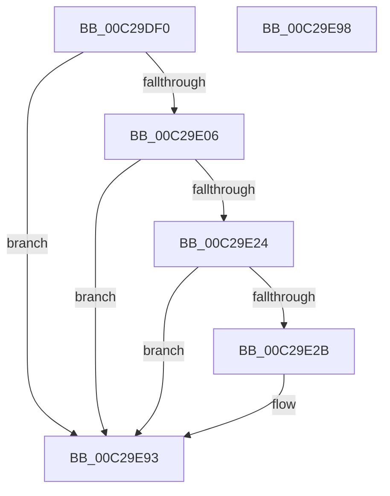

# VslRegisterIumPowerCallbacks

- RVA: `0x00C29DF0`–`0x00C29E99` (길이 `169` bytes)
- VA: `0x0000000140C29DF0`
- 실행 섹션: `INIT`
- PDB 이름 있음: `예`; PDB Function 태그: `아니요`
- unwind 정보 RVA: `0x0005D2F4`
- 디코드: `37`개 명령, `169/169` bytes 표시
- 미해석 바이트: `0` (있으면 어셈블리에 `.byte`로 보존)

> 이 문서는 커널 이미지의 기계어와 PDB 기호를 분석해 생성했습니다. 4번과 5번은 함수 원형과 자료형을 바이너리 사용 방식에서 추정한 C 해석이며 원본 소스 복구 결과는 아닙니다.

## 1. Dependencies

- 직접 호출 지점: **4**; 고유 호출 대상: **3**
- 직접 호출자로 확인된 함수: **1**
- RIP 상대 이미지 참조: **7**

### Outgoing calls
- `0x00C29E1B` → [NtPowerInformation](../../page/95/NtPowerInformation_function_00955D80.md) (function, `0x00955D80`)
- `0x00C29E52` → [ExSubscribeWnfStateChange](../../page/9D/ExSubscribeWnfStateChange_function_009D4BC0.md) (function, `0x009D4BC0`)
- `0x00C29E70` → [PoRegisterPowerSettingCallback](../../page/A8/PoRegisterPowerSettingCallback_function_00A82150.md) (function, `0x00A82150`)
- `0x00C29E8E` → [PoRegisterPowerSettingCallback](../../page/A8/PoRegisterPowerSettingCallback_function_00A82150.md) (function, `0x00A82150`)

### Direct callers
- [IoInitSystemPreDrivers](IoInitSystemPreDrivers_function_00C2AC3C.md) at `0x00C2BC51`

### Static image references
- `0x00C29DF4` → RVA `0x00FC6A84` (`ALMOSTRO`; read)
- `0x00C29E31` → RVA `0x00A49D90` (`VslpConnectedStandbyWnfCallback`; read)
- `0x00C29E40` → RVA `0x00020AD0` (`.rdata`; read)
- `0x00C29E47` → RVA `0x00F8EBA8` (`.data`; read)
- `0x00C29E5D` → RVA `0x00A9DC70` (`VslpConnectedStandbyPoCallback`; read)
- `0x00C29E67` → RVA `0x0001C740` (`.rdata`; read)
- `0x00C29E85` → RVA `0x0001A268` (`.rdata`; read)

## 2. Other-region calls and transfers

- 다른 실행 섹션으로 향하는 call: **4**
  - `0x00C29E1B` → [NtPowerInformation](../../page/95/NtPowerInformation_function_00955D80.md) (`INIT` → `PAGE`)
  - `0x00C29E52` → [ExSubscribeWnfStateChange](../../page/9D/ExSubscribeWnfStateChange_function_009D4BC0.md) (`INIT` → `PAGE`)
  - `0x00C29E70` → [PoRegisterPowerSettingCallback](../../page/A8/PoRegisterPowerSettingCallback_function_00A82150.md) (`INIT` → `PAGE`)
  - `0x00C29E8E` → [PoRegisterPowerSettingCallback](../../page/A8/PoRegisterPowerSettingCallback_function_00A82150.md) (`INIT` → `PAGE`)
- 별도 외부 분기/꼬리 이동을 확인하지 못했습니다.

## 3. Assembly (complete function range)

```asm
00C29DF0  48 83 EC 38                     sub rsp, 0x38
00C29DF4  80 3D 89 CC 39 00 00            cmp byte ptr [rip + 0x39cc89], 0
00C29DFB  C6 44 24 40 00                  mov byte ptr [rsp + 0x40], 0
00C29E00  0F 84 8D 00 00 00               je 0x140c29e93
00C29E06  33 D2                           xor edx, edx
00C29E08  C7 44 24 20 01 00 00 00         mov dword ptr [rsp + 0x20], 1
00C29E10  4C 8D 4C 24 40                  lea r9, [rsp + 0x40]
00C29E15  45 33 C0                        xor r8d, r8d
00C29E18  8D 4A 42                        lea ecx, [rdx + 0x42]
00C29E1B  E8 60 BF D2 FF                  call 0x140955d80
00C29E20  85 C0                           test eax, eax
00C29E22  78 6F                           js 0x140c29e93
00C29E24  80 7C 24 40 00                  cmp byte ptr [rsp + 0x40], 0
00C29E29  74 68                           je 0x140c29e93
00C29E2B  48 83 64 24 28 00               and qword ptr [rsp + 0x28], 0
00C29E31  48 8D 05 58 FF E1 FF            lea rax, [rip - 0x1e00a8]
00C29E38  45 33 C9                        xor r9d, r9d
00C29E3B  48 89 44 24 20                  mov qword ptr [rsp + 0x20], rax
00C29E40  48 8D 15 89 6C 3F FF            lea rdx, [rip - 0xc09377]
00C29E47  48 8D 0D 5A 4D 36 00            lea rcx, [rip + 0x364d5a]
00C29E4E  45 8D 41 01                     lea r8d, [r9 + 1]
00C29E52  E8 69 AD DA FF                  call 0x1409d4bc0
00C29E57  48 83 64 24 20 00               and qword ptr [rsp + 0x20], 0
00C29E5D  4C 8D 05 0C 3E E7 FF            lea r8, [rip - 0x18c1f4]
00C29E64  45 33 C9                        xor r9d, r9d
00C29E67  48 8D 15 D2 28 3F FF            lea rdx, [rip - 0xc0d72e]
00C29E6E  33 C9                           xor ecx, ecx
00C29E70  E8 DB 82 E5 FF                  call 0x140a82150
00C29E75  48 83 64 24 20 00               and qword ptr [rsp + 0x20], 0
00C29E7B  4C 8D 05 EE 3D E7 FF            lea r8, [rip - 0x18c212]
00C29E82  45 33 C9                        xor r9d, r9d
00C29E85  48 8D 15 DC 03 3F FF            lea rdx, [rip - 0xc0fc24]
00C29E8C  33 C9                           xor ecx, ecx
00C29E8E  E8 BD 82 E5 FF                  call 0x140a82150
00C29E93  48 83 C4 38                     add rsp, 0x38
00C29E97  C3                              ret
00C29E98  CC                              int3
```

## 4. C-style interpretation (structured pseudocode)

```c
__int64 __fastcall VslRegisterIumPowerCallbacks(__int64 a1, int a2, int a3)
{
    __int64 result;
    __int64 v_rsp;
    unsigned __int64 v_stack_m10;
    unsigned int v_stack_m18;
    unsigned __int8 v_stack_p8;

    v_rsp = (v_rsp) - (56);
    v_stack_p8 = 0;
    if ((*(unsigned __int8 *)(v_rip + 3787913)) == 0) goto loc_00C29E93;
    a2 = 0;
    v_stack_m18 = 1;
    a3 = 0;
    result = NtPowerInformation(a2 + 66, a2, a3, v_stack_p8);
    if (sign_flag) goto loc_00C29E93;
    if (v_stack_p8 != 0) {
        result = v_rip - 1966248;
        a4 = 0;
        v_stack_m18 = result;
        a2 = v_rip - 12620663;
        a1 = v_rip + 3558746;
        a3 = a4 + 1;
        result = ExSubscribeWnfStateChange(a1, a2, a3, a4);
        a3 = v_rip - 1622516;
        a4 = 0;
        a2 = v_rip - 12637998;
        a1 = 0;
        result = PoRegisterPowerSettingCallback(a1, a2, a3, a4);
        a3 = v_rip - 1622546;
        a4 = 0;
        a2 = v_rip - 12647460;
        a1 = 0;
        result = PoRegisterPowerSettingCallback(a1, a2, a3, a4);
    }
    v_rsp = (v_rsp) + (56);
    return result;
}
```

## 5. (Beta) C Style

```c
int64_t VslRegisterIumPowerCallbacks(int64_t Arg1, int32_t Arg2, int32_t Arg3)
{
    int64_t result;
    int64_t local_rsp;
    uint64_t v_stack_m10;
    uint32_t v_stack_m18;
    uint8_t v_stack_p8;

    local_rsp = (local_rsp) - (56);
    v_stack_p8 = 0;
    if ((*(uint8_t *)(v_rip + 0x39CC89)) == 0) goto loc_00C29E93;
    Arg2 = 0;
    v_stack_m18 = 1;
    Arg3 = 0;
    result = NtPowerInformation(Arg2 + 66, Arg2, Arg3, v_stack_p8);
    if (sign_flag) goto loc_00C29E93;
    if (v_stack_p8 != 0) {
        result = v_rip - 1966248;
        a4 = 0;
        v_stack_m18 = result;
        Arg2 = v_rip - 12620663;
        Arg1 = v_rip + 3558746;
        Arg3 = a4 + 1;
        result = ExSubscribeWnfStateChange(Arg1, Arg2, Arg3, a4);
        Arg3 = v_rip - 1622516;
        a4 = 0;
        Arg2 = v_rip - 12637998;
        Arg1 = 0;
        result = PoRegisterPowerSettingCallback(Arg1, Arg2, Arg3, a4);
        Arg3 = v_rip - 1622546;
        a4 = 0;
        Arg2 = v_rip - 12647460;
        Arg1 = 0;
        result = PoRegisterPowerSettingCallback(Arg1, Arg2, Arg3, a4);
    }
    local_rsp = (local_rsp) + (56);
    return result;
}
```

## 6. Execution-region graph

[열기: 2D/3D 그래프와 함수 탐색 컨트롤 패널](../../../control-panel.html?section=init&rva=0x00C29DF0&view=graph)

- 2D 그래프는 위에서 아래로 흐르고, 3D 그래프는 빈 공간을 드래그해 회전합니다. Shift+드래그는 이동, 휠은 확대·축소, 함수 노드 선택은 대상 보고서 이동입니다.

### Static fallback


