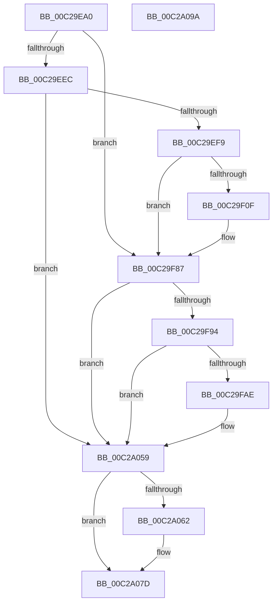

# VslpIumInitializeTelemetry

- RVA: `0x00C29EA0`–`0x00C2A09B` (길이 `507` bytes)
- VA: `0x0000000140C29EA0`
- 실행 섹션: `INIT`
- PDB 이름 있음: `예`; PDB Function 태그: `아니요`
- unwind 정보 RVA: `0x000C6D98`
- 디코드: `103`개 명령, `507/507` bytes 표시
- 미해석 바이트: `0` (있으면 어셈블리에 `.byte`로 보존)

> 이 문서는 커널 이미지의 기계어와 PDB 기호를 분석해 생성했습니다. 4번과 5번은 함수 원형과 자료형을 바이너리 사용 방식에서 추정한 C 해석이며 원본 소스 복구 결과는 아닙니다.

## 1. Dependencies

- 직접 호출 지점: **7**; 고유 호출 대상: **5**
- 직접 호출자로 확인된 함수: **1**
- RIP 상대 이미지 참조: **9**

### Outgoing calls
- `0x00C29ECF` → [TraceLoggingRegisterEx_EtwRegister_EtwSetInformation](../../page/92/TraceLoggingRegisterEx_EtwRegister_EtwSetInformation_function_009208A0.md) (function, `0x009208A0`)
- `0x00C29F06` → [tlgKeywordOn](../../text/42/tlgKeywordOn_function_0042EAA0.md) (function, `0x0042EAA0`)
- `0x00C29F82` → [tlgWriteTransfer_EtwWriteTransfer](../../text/42/tlgWriteTransfer_EtwWriteTransfer_function_004260E0.md) (function, `0x004260E0`)
- `0x00C29FA1` → [tlgKeywordOn](../../text/42/tlgKeywordOn_function_0042EAA0.md) (function, `0x0042EAA0`)
- `0x00C2A054` → [tlgWriteTransfer_EtwWriteTransfer](../../text/42/tlgWriteTransfer_EtwWriteTransfer_function_004260E0.md) (function, `0x004260E0`)
- `0x00C2A078` → [EtwUnregister](../../page/A7/EtwUnregister_function_00A723D0.md) (function, `0x00A723D0`)
- `0x00C2A084` → [_security_check_cookie](../../text/6A/_security_check_cookie_function_006AC640.md) (function, `0x006AC640`)

### Direct callers
- [VslpIumPhase4Initialize](../../text/58/VslpIumPhase4Initialize_function_0058FAE0.md) at `0x0058FB09`

### Static image references
- `0x00C29EB2` → RVA `0x00E0A740` (`.data`; read)
- `0x00C29EC0` → RVA `0x00E06D50` (`.data`; read)
- `0x00C29ED4` → RVA `0x00FC6B20` (`ALMOSTRO`; read)
- `0x00C29F59` → RVA `0x000459BC` (`.rdata`; read)
- `0x00C29FCB` → RVA `0x00FC6A84` (`ALMOSTRO`; read)
- `0x00C2A039` → RVA `0x000459F8` (`.rdata`; read)
- `0x00C2A062` → RVA `0x00E06D70` (`.data`; read)
- `0x00C2A069` → RVA `0x00E06D70` (`.data`; read/write)
- `0x00C2A071` → RVA `0x00E06D50` (`.data`; read/write)

## 2. Other-region calls and transfers

- 다른 실행 섹션으로 향하는 call: **7**
  - `0x00C29ECF` → [TraceLoggingRegisterEx_EtwRegister_EtwSetInformation](../../page/92/TraceLoggingRegisterEx_EtwRegister_EtwSetInformation_function_009208A0.md) (`INIT` → `PAGE`)
  - `0x00C29F06` → [tlgKeywordOn](../../text/42/tlgKeywordOn_function_0042EAA0.md) (`INIT` → `.text`)
  - `0x00C29F82` → [tlgWriteTransfer_EtwWriteTransfer](../../text/42/tlgWriteTransfer_EtwWriteTransfer_function_004260E0.md) (`INIT` → `.text`)
  - `0x00C29FA1` → [tlgKeywordOn](../../text/42/tlgKeywordOn_function_0042EAA0.md) (`INIT` → `.text`)
  - `0x00C2A054` → [tlgWriteTransfer_EtwWriteTransfer](../../text/42/tlgWriteTransfer_EtwWriteTransfer_function_004260E0.md) (`INIT` → `.text`)
  - `0x00C2A078` → [EtwUnregister](../../page/A7/EtwUnregister_function_00A723D0.md) (`INIT` → `PAGE`)
  - `0x00C2A084` → [_security_check_cookie](../../text/6A/_security_check_cookie_function_006AC640.md) (`INIT` → `.text`)
- 별도 외부 분기/꼬리 이동을 확인하지 못했습니다.

## 3. Assembly (complete function range)

```asm
00C29EA0  48 89 7C 24 08                  mov qword ptr [rsp + 8], rdi
00C29EA5  55                              push rbp
00C29EA6  48 8D 6C 24 A9                  lea rbp, [rsp - 0x57]
00C29EAB  48 81 EC C0 00 00 00            sub rsp, 0xc0
00C29EB2  48 8B 05 87 08 1E 00            mov rax, qword ptr [rip + 0x1e0887]
00C29EB9  48 33 C4                        xor rax, rsp
00C29EBC  48 89 45 47                     mov qword ptr [rbp + 0x47], rax
00C29EC0  48 8D 3D 89 CE 1D 00            lea rdi, [rip + 0x1dce89]
00C29EC7  45 33 C0                        xor r8d, r8d
00C29ECA  48 8B CF                        mov rcx, rdi
00C29ECD  33 D2                           xor edx, edx
00C29ECF  E8 CC 69 CF FF                  call 0x1409208a0
00C29ED4  4C 8B 0D 45 CC 39 00            mov r9, qword ptr [rip + 0x39cc45]
00C29EDB  45 8B 81 08 01 00 00            mov r8d, dword ptr [r9 + 0x108]
00C29EE2  41 F6 C0 01                     test r8b, 1
00C29EE6  0F 84 9B 00 00 00               je 0x140c29f87
00C29EEC  83 3D 5D CE 1D 00 05            cmp dword ptr [rip + 0x1dce5d], 5
00C29EF3  0F 86 60 01 00 00               jbe 0x140c2a059
00C29EF9  48 BA 00 00 00 00 00 40 00 00   movabs rdx, 0x400000000000
00C29F03  48 8B CF                        mov rcx, rdi
00C29F06  E8 95 4B 80 FF                  call 0x14042eaa0
00C29F0B  84 C0                           test al, al
00C29F0D  74 78                           je 0x140c29f87
00C29F0F  49 8B 81 F0 00 00 00            mov rax, qword ptr [r9 + 0xf0]
00C29F16  45 33 C9                        xor r9d, r9d
00C29F19  41 C1 E8 02                     shr r8d, 2
00C29F1D  41 83 E0 01                     and r8d, 1
00C29F21  0F B7 90 E0 0A 00 00            movzx edx, word ptr [rax + 0xae0]
00C29F28  48 8B 88 E8 0A 00 00            mov rcx, qword ptr [rax + 0xae8]
00C29F2F  48 8D 45 1F                     lea rax, [rbp + 0x1f]
00C29F33  83 65 13 00                     and dword ptr [rbp + 0x13], 0
00C29F37  83 65 23 00                     and dword ptr [rbp + 0x23], 0
00C29F3B  83 65 33 00                     and dword ptr [rbp + 0x33], 0
00C29F3F  48 89 45 07                     mov qword ptr [rbp + 7], rax
00C29F43  48 8D 45 C7                     lea rax, [rbp - 0x39]
00C29F47  48 89 45 27                     mov qword ptr [rbp + 0x27], rax
00C29F4B  48 8D 45 E7                     lea rax, [rbp - 0x19]
00C29F4F  48 89 4D 17                     mov qword ptr [rbp + 0x17], rcx
00C29F53  48 8B CF                        mov rcx, rdi
00C29F56  89 55 1F                        mov dword ptr [rbp + 0x1f], edx
00C29F59  48 8D 15 5C BA 41 FF            lea rdx, [rip - 0xbe45a4]
00C29F60  44 89 45 C7                     mov dword ptr [rbp - 0x39], r8d
00C29F64  45 33 C0                        xor r8d, r8d
00C29F67  48 89 44 24 28                  mov qword ptr [rsp + 0x28], rax
00C29F6C  C7 44 24 20 05 00 00 00         mov dword ptr [rsp + 0x20], 5
00C29F74  C7 45 0F 02 00 00 00            mov dword ptr [rbp + 0xf], 2
00C29F7B  C7 45 2F 04 00 00 00            mov dword ptr [rbp + 0x2f], 4
00C29F82  E8 59 C1 7F FF                  call 0x1404260e0
00C29F87  83 3D C2 CD 1D 00 05            cmp dword ptr [rip + 0x1dcdc2], 5
00C29F8E  0F 86 C5 00 00 00               jbe 0x140c2a059
00C29F94  48 BA 00 00 00 00 00 40 00 00   movabs rdx, 0x400000000000
00C29F9E  48 8B CF                        mov rcx, rdi
00C29FA1  E8 FA 4A 80 FF                  call 0x14042eaa0
00C29FA6  84 C0                           test al, al
00C29FA8  0F 84 AB 00 00 00               je 0x140c2a059
00C29FAE  48 8B 15 6B CB 39 00            mov rdx, qword ptr [rip + 0x39cb6b]
00C29FB5  48 8D 45 D7                     lea rax, [rbp - 0x29]
00C29FB9  83 65 13 00                     and dword ptr [rbp + 0x13], 0
00C29FBD  45 33 C9                        xor r9d, r9d
00C29FC0  83 65 23 00                     and dword ptr [rbp + 0x23], 0
00C29FC4  45 33 C0                        xor r8d, r8d
00C29FC7  48 89 45 07                     mov qword ptr [rbp + 7], rax
00C29FCB  0F B6 05 B2 CA 39 00            movzx eax, byte ptr [rip + 0x39cab2]
00C29FD2  89 45 C7                        mov dword ptr [rbp - 0x39], eax
00C29FD5  48 8D 45 C7                     lea rax, [rbp - 0x39]
00C29FD9  48 89 45 17                     mov qword ptr [rbp + 0x17], rax
00C29FDD  48 C7 45 D7 00 00 00 01         mov qword ptr [rbp - 0x29], 0x1000000
00C29FE5  C7 45 0F 08 00 00 00            mov dword ptr [rbp + 0xf], 8
00C29FEC  C7 45 1F 04 00 00 00            mov dword ptr [rbp + 0x1f], 4
00C29FF3  48 8B 82 F0 00 00 00            mov rax, qword ptr [rdx + 0xf0]
00C29FFA  8B 88 48 0B 00 00               mov ecx, dword ptr [rax + 0xb48]
00C2A000  48 8D 45 CB                     lea rax, [rbp - 0x35]
00C2A004  83 65 33 00                     and dword ptr [rbp + 0x33], 0
00C2A008  48 89 45 27                     mov qword ptr [rbp + 0x27], rax
00C2A00C  89 4D CB                        mov dword ptr [rbp - 0x35], ecx
00C2A00F  48 8B CF                        mov rcx, rdi
00C2A012  C7 45 2F 04 00 00 00            mov dword ptr [rbp + 0x2f], 4
00C2A019  48 8B 82 F0 00 00 00            mov rax, qword ptr [rdx + 0xf0]
00C2A020  8B 90 4C 0B 00 00               mov edx, dword ptr [rax + 0xb4c]
00C2A026  48 8D 45 CF                     lea rax, [rbp - 0x31]
00C2A02A  83 65 43 00                     and dword ptr [rbp + 0x43], 0
00C2A02E  48 89 45 37                     mov qword ptr [rbp + 0x37], rax
00C2A032  48 8D 45 E7                     lea rax, [rbp - 0x19]
00C2A036  89 55 CF                        mov dword ptr [rbp - 0x31], edx
00C2A039  48 8D 15 B8 B9 41 FF            lea rdx, [rip - 0xbe4648]
00C2A040  48 89 44 24 28                  mov qword ptr [rsp + 0x28], rax
00C2A045  C7 44 24 20 06 00 00 00         mov dword ptr [rsp + 0x20], 6
00C2A04D  C7 45 3F 04 00 00 00            mov dword ptr [rbp + 0x3f], 4
00C2A054  E8 87 C0 7F FF                  call 0x1404260e0
00C2A059  80 3D 24 CA 39 00 00            cmp byte ptr [rip + 0x39ca24], 0
00C2A060  75 1B                           jne 0x140c2a07d
00C2A062  48 8B 0D 07 CD 1D 00            mov rcx, qword ptr [rip + 0x1dcd07]
00C2A069  48 83 25 FF CC 1D 00 00         and qword ptr [rip + 0x1dccff], 0
00C2A071  83 25 D8 CC 1D 00 00            and dword ptr [rip + 0x1dccd8], 0
00C2A078  E8 53 83 E4 FF                  call 0x140a723d0
00C2A07D  48 8B 4D 47                     mov rcx, qword ptr [rbp + 0x47]
00C2A081  48 33 CC                        xor rcx, rsp
00C2A084  E8 B7 25 A8 FF                  call 0x1406ac640
00C2A089  48 8B BC 24 D0 00 00 00         mov rdi, qword ptr [rsp + 0xd0]
00C2A091  48 81 C4 C0 00 00 00            add rsp, 0xc0
00C2A098  5D                              pop rbp
00C2A099  C3                              ret
00C2A09A  CC                              int3
```

## 4. C-style interpretation (structured pseudocode)

```c
__int64 __fastcall VslpIumInitializeTelemetry(__int64 a1, int a2, int a3)
{
    __int64 result;
    __int64 v_rsp;
    unsigned __int64 v_stack_m18;
    unsigned int v_stack_m1C;
    unsigned int v_stack_m20;
    unsigned __int64 v_stack_m28;
    unsigned int v_stack_m2C;
    unsigned int v_stack_m30;
    unsigned __int64 v_stack_m38;
    unsigned int v_stack_m3C;
    unsigned __int64 v_stack_m40;
    unsigned __int64 v_stack_m48;
    unsigned int v_stack_m4C;
    unsigned int v_stack_m50;
    unsigned __int64 v_stack_m58;
    unsigned __int64 v_stack_m5F;
    unsigned __int64 v_stack_m78;
    unsigned __int64 v_stack_m88;
    unsigned __int64 v_stack_m90;
    unsigned __int64 v_stack_m94;
    unsigned __int64 v_stack_m98;
    unsigned __int64 v_stack_mA0;
    unsigned int v_stack_mA8;
    unsigned __int64 v_stack_p8;

    v_stack_p8 = v_rdi;
    v_rsp = (v_rsp) - (192);
    result = (*(unsigned __int64 *)(v_rip + 1968263)) ^ (v_rsp);
    v_stack_m18 = result;
    a3 = 0;
    a2 = 0;
    result = TraceLoggingRegisterEx_EtwRegister_EtwSetInformation(v_rip + 1953417, a2, a3, a4);
    if ((((unsigned __int8)((unsigned int)(*(unsigned int *)(*(unsigned __int64 *)(v_rip + 3787845) + 264)))) & (1)) == 0) goto loc_00C29F87;
    if ((*(unsigned int *)(v_rip + 1953373)) <= 5) goto loc_00C2A059;
    result = tlgKeywordOn(v_rip + 1953417, a2, (unsigned int)(*(unsigned int *)(*(unsigned __int64 *)(v_rip + 3787845) + 264)), *(unsigned __int64 *)(v_rip + 3787845));
    if ((unsigned __int8)(result) != 0) {
        result = *(unsigned __int64 *)(*(unsigned __int64 *)(v_rip + 3787845) + 240);
        a4 = 0;
        a3 = (unsigned int)(((unsigned int)(*(unsigned int *)(*(unsigned __int64 *)(v_rip + 3787845) + 264))) >> (2));
        a3 = (unsigned int)((a3) & (1));
        a2 = *(unsigned __int16 *)(result + 2784);
        a1 = *(unsigned __int64 *)(result + 2792);
        result = v_stack_m40;
        v_stack_m58 = result;
        result = v_stack_m98;
        v_stack_m38 = result;
        result = v_stack_m78;
        v_stack_m48 = a1;
        a1 = v_rip + 1953417;
        v_stack_m40 = a2;
        a2 = v_rip - 12469668;
        v_stack_m98 = a3;
        a3 = 0;
        v_stack_mA0 = result;
        v_stack_mA8 = 5;
        v_stack_m50 = 2;
        v_stack_m30 = 4;
        result = tlgWriteTransfer_EtwWriteTransfer(a1, a2, a3, a4);
    }
    if ((*(unsigned int *)(v_rip + 1953218)) <= 5) goto loc_00C2A059;
    result = tlgKeywordOn(v_rip + 1953417, a2, a3, a4);
    if ((unsigned __int8)(result) != 0) {
        a2 = *(unsigned __int64 *)(v_rip + 3787627);
        result = v_stack_m88;
        a4 = 0;
        a3 = 0;
        v_stack_m58 = result;
        result = *(unsigned __int8 *)(v_rip + 3787442);
        v_stack_m98 = (unsigned int)(result);
        result = v_stack_m98;
        v_stack_m48 = result;
        v_stack_m88 = 0x1000000ULL;
        v_stack_m50 = 8;
        v_stack_m40 = 4;
        result = *(unsigned __int64 *)(a2 + 240);
        a1 = *(unsigned int *)(result + 2888);
        result = v_stack_m94;
        v_stack_m38 = result;
        v_stack_m94 = (unsigned int)(a1);
        a1 = v_rip + 1953417;
        v_stack_m30 = 4;
        result = *(unsigned __int64 *)(a2 + 240);
        a2 = *(unsigned int *)(result + 2892);
        result = v_stack_m90;
        v_stack_m28 = result;
        result = v_stack_m78;
        v_stack_m90 = a2;
        a2 = v_rip - 12469832;
        v_stack_mA0 = result;
        v_stack_mA8 = 6;
        v_stack_m20 = 4;
        result = tlgWriteTransfer_EtwWriteTransfer(a1, a2, a3, a4);
    }
    if ((*(unsigned __int8 *)(v_rip + 3787300)) == 0) {
        a1 = *(unsigned __int64 *)(v_rip + 1953031);
        result = EtwUnregister(a1, a2, a3, a4);
    }
    a1 = (v_stack_m18) ^ (v_rsp);
    result = _security_check_cookie(a1, a2, a3, a4);
    v_rsp = (v_rsp) + (192);
    return result;
}
```

## 5. (Beta) C Style

```c
int64_t VslpIumInitializeTelemetry(int64_t Arg1, int32_t Arg2, int32_t Arg3)
{
    int64_t result;
    int64_t local_rsp;
    uint64_t v_stack_m18;
    uint32_t v_stack_m1C;
    uint32_t v_stack_m20;
    uint64_t v_stack_m28;
    uint32_t v_stack_m2C;
    uint32_t v_stack_m30;
    uint64_t v_stack_m38;
    uint32_t v_stack_m3C;
    uint64_t v_stack_m40;
    uint64_t v_stack_m48;
    uint32_t v_stack_m4C;
    uint32_t v_stack_m50;
    uint64_t v_stack_m58;
    uint64_t v_stack_m5F;
    uint64_t v_stack_m78;
    uint64_t v_stack_m88;
    uint64_t v_stack_m90;
    uint64_t v_stack_m94;
    uint64_t v_stack_m98;
    uint64_t v_stack_mA0;
    uint32_t v_stack_mA8;
    uint64_t v_stack_p8;

    v_stack_p8 = local_rdi;
    local_rsp = (local_rsp) - (192);
    result = (*(uint64_t *)(v_rip + 0x1E0887)) ^ (local_rsp);
    v_stack_m18 = result;
    Arg3 = 0;
    Arg2 = 0;
    result = TraceLoggingRegisterEx_EtwRegister_EtwSetInformation(v_rip + 1953417, Arg2, Arg3, a4);
    if ((((uint8_t)((uint32_t)(*(uint32_t *)(*(uint64_t *)(v_rip + 0x39CC45) + 0x108)))) & (1)) == 0) goto loc_00C29F87;
    if ((*(uint32_t *)(v_rip + 0x1DCE5D)) <= 5) goto loc_00C2A059;
    result = tlgKeywordOn(v_rip + 1953417, Arg2, (uint32_t)(*(uint32_t *)(*(uint64_t *)(v_rip + 0x39CC45) + 0x108)), *(uint64_t *)(v_rip + 0x39CC45));
    if ((uint8_t)(result) != 0) {
        result = *(uint64_t *)(*(uint64_t *)(v_rip + 0x39CC45) + 0xF0);
        a4 = 0;
        Arg3 = (uint32_t)(((uint32_t)(*(uint32_t *)(*(uint64_t *)(v_rip + 0x39CC45) + 0x108))) >> (2));
        Arg3 = (uint32_t)((Arg3) & (1));
        Arg2 = *(uint16_t *)(result + 0xAE0);
        Arg1 = *(uint64_t *)(result + 0xAE8);
        result = v_stack_m40;
        v_stack_m58 = result;
        result = v_stack_m98;
        v_stack_m38 = result;
        result = v_stack_m78;
        v_stack_m48 = Arg1;
        Arg1 = v_rip + 1953417;
        v_stack_m40 = Arg2;
        Arg2 = v_rip - 12469668;
        v_stack_m98 = Arg3;
        Arg3 = 0;
        v_stack_mA0 = result;
        v_stack_mA8 = 5;
        v_stack_m50 = 2;
        v_stack_m30 = 4;
        result = tlgWriteTransfer_EtwWriteTransfer(Arg1, Arg2, Arg3, a4);
    }
    if ((*(uint32_t *)(v_rip + 0x1DCDC2)) <= 5) goto loc_00C2A059;
    result = tlgKeywordOn(v_rip + 1953417, Arg2, Arg3, a4);
    if ((uint8_t)(result) != 0) {
        Arg2 = *(uint64_t *)(v_rip + 0x39CB6B);
        result = v_stack_m88;
        a4 = 0;
        Arg3 = 0;
        v_stack_m58 = result;
        result = *(uint8_t *)(v_rip + 0x39CAB2);
        v_stack_m98 = (uint32_t)(result);
        result = v_stack_m98;
        v_stack_m48 = result;
        v_stack_m88 = 0x1000000ULL;
        v_stack_m50 = 8;
        v_stack_m40 = 4;
        result = *(uint64_t *)(Arg2 + 0xF0);
        Arg1 = *(uint32_t *)(result + 0xB48);
        result = v_stack_m94;
        v_stack_m38 = result;
        v_stack_m94 = (uint32_t)(Arg1);
        Arg1 = v_rip + 1953417;
        v_stack_m30 = 4;
        result = *(uint64_t *)(Arg2 + 0xF0);
        Arg2 = *(uint32_t *)(result + 0xB4C);
        result = v_stack_m90;
        v_stack_m28 = result;
        result = v_stack_m78;
        v_stack_m90 = Arg2;
        Arg2 = v_rip - 12469832;
        v_stack_mA0 = result;
        v_stack_mA8 = 6;
        v_stack_m20 = 4;
        result = tlgWriteTransfer_EtwWriteTransfer(Arg1, Arg2, Arg3, a4);
    }
    if ((*(uint8_t *)(v_rip + 0x39CA24)) == 0) {
        Arg1 = *(uint64_t *)(v_rip + 0x1DCD07);
        result = EtwUnregister(Arg1, Arg2, Arg3, a4);
    }
    Arg1 = (v_stack_m18) ^ (local_rsp);
    result = _security_check_cookie(Arg1, Arg2, Arg3, a4);
    local_rsp = (local_rsp) + (192);
    return result;
}
```

## 6. Execution-region graph

[열기: 2D/3D 그래프와 함수 탐색 컨트롤 패널](../../../control-panel.html?section=init&rva=0x00C29EA0&view=graph)

- 2D 그래프는 위에서 아래로 흐르고, 3D 그래프는 빈 공간을 드래그해 회전합니다. Shift+드래그는 이동, 휠은 확대·축소, 함수 노드 선택은 대상 보고서 이동입니다.

### Static fallback


