# VslpIumPhase0Initialize

- RVA: `0x00C2A0A4`–`0x00C2A406` (길이 `866` bytes)
- VA: `0x0000000140C2A0A4`
- 실행 섹션: `INIT`
- PDB 이름 있음: `예`; PDB Function 태그: `아니요`
- unwind 정보 RVA: `0x000C6DD8`
- 디코드: `199`개 명령, `866/866` bytes 표시
- 미해석 바이트: `0` (있으면 어셈블리에 `.byte`로 보존)

> 이 문서는 커널 이미지의 기계어와 PDB 기호를 분석해 생성했습니다. 4번과 5번은 함수 원형과 자료형을 바이너리 사용 방식에서 추정한 C 해석이며 원본 소스 복구 결과는 아닙니다.

## 1. Dependencies

- 직접 호출 지점: **19**; 고유 호출 대상: **10**
- 직접 호출자로 확인된 함수: **1**
- RIP 상대 이미지 참조: **25**

### Outgoing calls
- `0x00C2A0ED` → [HvlQueryVsmConnection](../../text/45/HvlQueryVsmConnection_function_0045D180.md) (function, `0x0045D180`)
- `0x00C2A10B` → [KeBugCheckEx](../../text/4F/KeBugCheckEx_function_004FD660.md) (function, `0x004FD660`)
- `0x00C2A137` → [memset](../../text/6C/memset_function_006C6C40.md) (function, `0x006C6C40`)
- `0x00C2A14D` → [MmGetPhysicalAddress](../../text/23/MmGetPhysicalAddress_function_0023A500.md) (function, `0x0023A500`)
- `0x00C2A1D4` → [MmGetPhysicalAddress](../../text/23/MmGetPhysicalAddress_function_0023A500.md) (function, `0x0023A500`)
- `0x00C2A1E0` → [MmGetPhysicalAddress](../../text/23/MmGetPhysicalAddress_function_0023A500.md) (function, `0x0023A500`)
- `0x00C2A1F7` → [MmSetPageProtection](../../text/4E/MmSetPageProtection_function_004E1580.md) (function, `0x004E1580`)
- `0x00C2A213` → [guard_dispatch_icall](../../text/6B/guard_dispatch_icall_function_006BAAD0.md) (function, `0x006BAAD0`)
- `0x00C2A24E` → [KeQueryKvaShadowInformation](../../page/74/KeQueryKvaShadowInformation_function_00747280.md) (function, `0x00747280`)
- `0x00C2A2B6` → [guard_dispatch_icall](../../text/6B/guard_dispatch_icall_function_006BAAD0.md) (function, `0x006BAAD0`)
- `0x00C2A2D6` → [KeBugCheckEx](../../text/4F/KeBugCheckEx_function_004FD660.md) (function, `0x004FD660`)
- `0x00C2A2EA` → [VslpEnterIumSecureMode](../../text/23/VslpEnterIumSecureMode_function_00235E50.md) (function, `0x00235E50`)
- `0x00C2A308` → [KeBugCheckEx](../../text/4F/KeBugCheckEx_function_004FD660.md) (function, `0x004FD660`)
- `0x00C2A330` → [KeBugCheckEx](../../text/4F/KeBugCheckEx_function_004FD660.md) (function, `0x004FD660`)
- `0x00C2A386` → [ExAllocatePool2](../../poolcode/B8/ExAllocatePool2_function_00B820F0.md) (function, `0x00B820F0`)
- `0x00C2A3AD` → [KeBugCheckEx](../../text/4F/KeBugCheckEx_function_004FD660.md) (function, `0x004FD660`)
- `0x00C2A3C8` → [guard_dispatch_icall](../../text/6B/guard_dispatch_icall_function_006BAAD0.md) (function, `0x006BAAD0`)
- `0x00C2A3DF` → [guard_dispatch_icall](../../text/6B/guard_dispatch_icall_function_006BAAD0.md) (function, `0x006BAAD0`)
- `0x00C2A3EB` → [_security_check_cookie](../../text/6A/_security_check_cookie_function_006AC640.md) (function, `0x006AC640`)

### Direct callers
- [HvlPhase1Initialize](../../text/58/HvlPhase1Initialize_function_00583D80.md) at `0x00583E65`

### Static image references
- `0x00C2A0BB` → RVA `0x00E0A740` (`.data`; read)
- `0x00C2A113` → RVA `0x00F8EBD8` (`.data`; write)
- `0x00C2A11A` → RVA `0x0048E2D0` (`VslpSecureKernelPeriodicTick`; read)
- `0x00C2A121` → RVA `0x00F8EBC0` (`.data`; write)
- `0x00C2A12C` → RVA `0x00F8EBD0` (`.data`; write)
- `0x00C2A152` → RVA `0x00F475F8` (`.data`; read)
- `0x00C2A1FC` → RVA `0x00E00638` (`.data`; read)
- `0x00C2A218` → RVA `0x0120184C` (`CFGRO`; read)
- `0x00C2A224` → RVA `0x00FC5008` (`ALMOSTRO`; read)
- `0x00C2A233` → RVA `0x00FC6E54` (`ALMOSTRO`; read)
- `0x00C2A25F` → RVA `0x00EF02D0` (`.data`; read)
- `0x00C2A26F` → RVA `0x00FC6DD0` (`ALMOSTRO`; read)
- `0x00C2A296` → RVA `0x00FC6B30` (`ALMOSTRO`; read)
- `0x00C2A2A1` → RVA `0x00FC6B60` (`ALMOSTRO`; read)
- `0x00C2A339` → RVA `0x00F8EB88` (`.data`; read)
- `0x00C2A340` → RVA `0x00F8EB90` (`.data`; write)
- `0x00C2A34C` → RVA `0x00F8EB88` (`.data`; write)
- `0x00C2A35E` → RVA `0x00F8EB80` (`.data`; write)
- `0x00C2A365` → RVA `0x00F8EB82` (`.data`; write)
- `0x00C2A36C` → RVA `0x00F8EB84` (`.data`; write)
- `0x00C2A372` → RVA `0x00F8EB98` (`.data`; write)
- `0x00C2A378` → RVA `0x00FC6A84` (`ALMOSTRO`; write)
- `0x00C2A37F` → RVA `0x00F8EBE8` (`.data`; write)
- `0x00C2A38B` → RVA `0x00F8EBE0` (`.data`; write)
- `0x00C2A3B3` → RVA `0x00E00640` (`.data`; read)

## 2. Other-region calls and transfers

- 다른 실행 섹션으로 향하는 call: **19**
  - `0x00C2A0ED` → [HvlQueryVsmConnection](../../text/45/HvlQueryVsmConnection_function_0045D180.md) (`INIT` → `.text`)
  - `0x00C2A10B` → [KeBugCheckEx](../../text/4F/KeBugCheckEx_function_004FD660.md) (`INIT` → `.text`)
  - `0x00C2A137` → [memset](../../text/6C/memset_function_006C6C40.md) (`INIT` → `.text`)
  - `0x00C2A14D` → [MmGetPhysicalAddress](../../text/23/MmGetPhysicalAddress_function_0023A500.md) (`INIT` → `.text`)
  - `0x00C2A1D4` → [MmGetPhysicalAddress](../../text/23/MmGetPhysicalAddress_function_0023A500.md) (`INIT` → `.text`)
  - `0x00C2A1E0` → [MmGetPhysicalAddress](../../text/23/MmGetPhysicalAddress_function_0023A500.md) (`INIT` → `.text`)
  - `0x00C2A1F7` → [MmSetPageProtection](../../text/4E/MmSetPageProtection_function_004E1580.md) (`INIT` → `.text`)
  - `0x00C2A213` → [guard_dispatch_icall](../../text/6B/guard_dispatch_icall_function_006BAAD0.md) (`INIT` → `.text`)
  - `0x00C2A24E` → [KeQueryKvaShadowInformation](../../page/74/KeQueryKvaShadowInformation_function_00747280.md) (`INIT` → `PAGE`)
  - `0x00C2A2B6` → [guard_dispatch_icall](../../text/6B/guard_dispatch_icall_function_006BAAD0.md) (`INIT` → `.text`)
  - `0x00C2A2D6` → [KeBugCheckEx](../../text/4F/KeBugCheckEx_function_004FD660.md) (`INIT` → `.text`)
  - `0x00C2A2EA` → [VslpEnterIumSecureMode](../../text/23/VslpEnterIumSecureMode_function_00235E50.md) (`INIT` → `.text`)
  - `0x00C2A308` → [KeBugCheckEx](../../text/4F/KeBugCheckEx_function_004FD660.md) (`INIT` → `.text`)
  - `0x00C2A330` → [KeBugCheckEx](../../text/4F/KeBugCheckEx_function_004FD660.md) (`INIT` → `.text`)
  - `0x00C2A386` → [ExAllocatePool2](../../poolcode/B8/ExAllocatePool2_function_00B820F0.md) (`INIT` → `POOLCODE`)
  - `0x00C2A3AD` → [KeBugCheckEx](../../text/4F/KeBugCheckEx_function_004FD660.md) (`INIT` → `.text`)
  - `0x00C2A3C8` → [guard_dispatch_icall](../../text/6B/guard_dispatch_icall_function_006BAAD0.md) (`INIT` → `.text`)
  - `0x00C2A3DF` → [guard_dispatch_icall](../../text/6B/guard_dispatch_icall_function_006BAAD0.md) (`INIT` → `.text`)
  - `0x00C2A3EB` → [_security_check_cookie](../../text/6A/_security_check_cookie_function_006AC640.md) (`INIT` → `.text`)
- 별도 외부 분기/꼬리 이동을 확인하지 못했습니다.

## 3. Assembly (complete function range)

```asm
00C2A0A4  48 89 5C 24 08                  mov qword ptr [rsp + 8], rbx
00C2A0A9  48 89 7C 24 10                  mov qword ptr [rsp + 0x10], rdi
00C2A0AE  55                              push rbp
00C2A0AF  48 8D 6C 24 A9                  lea rbp, [rsp - 0x57]
00C2A0B4  48 81 EC C0 00 00 00            sub rsp, 0xc0
00C2A0BB  48 8B 05 7E 06 1E 00            mov rax, qword ptr [rip + 0x1e067e]
00C2A0C2  48 33 C4                        xor rax, rsp
00C2A0C5  48 89 45 47                     mov qword ptr [rbp + 0x47], rax
00C2A0C9  48 8B 81 F0 00 00 00            mov rax, qword ptr [rcx + 0xf0]
00C2A0D0  33 FF                           xor edi, edi
00C2A0D2  89 7D C7                        mov dword ptr [rbp - 0x39], edi
00C2A0D5  48 8B D9                        mov rbx, rcx
00C2A0D8  89 7D CB                        mov dword ptr [rbp - 0x35], edi
00C2A0DB  F7 80 84 00 00 00 00 02 00 00   test dword ptr [rax + 0x84], 0x200
00C2A0E5  0F 84 F9 02 00 00               je 0x140c2a3e4
00C2A0EB  33 C9                           xor ecx, ecx
00C2A0ED  E8 8E 30 83 FF                  call 0x14045d180
00C2A0F2  84 C0                           test al, al
00C2A0F4  75 1B                           jne 0x140c2a111
00C2A0F6  45 33 C9                        xor r9d, r9d
00C2A0F9  48 89 7C 24 20                  mov qword ptr [rsp + 0x20], rdi
00C2A0FE  45 33 C0                        xor r8d, r8d
00C2A101  8D 4F 6F                        lea ecx, [rdi + 0x6f]
00C2A104  48 C7 C2 01 00 00 C0            mov rdx, 0xffffffffc0000001
00C2A10B  E8 50 35 8D FF                  call 0x1404fd660
00C2A110  CC                              int3
00C2A111  33 D2                           xor edx, edx
00C2A113  48 89 3D BE 4A 36 00            mov qword ptr [rip + 0x364abe], rdi
00C2A11A  48 8D 05 AF 41 86 FF            lea rax, [rip - 0x79be51]
00C2A121  48 89 3D 98 4A 36 00            mov qword ptr [rip + 0x364a98], rdi
00C2A128  48 8D 4D D7                     lea rcx, [rbp - 0x29]
00C2A12C  48 89 05 9D 4A 36 00            mov qword ptr [rip + 0x364a9d], rax
00C2A133  44 8D 42 68                     lea r8d, [rdx + 0x68]
00C2A137  E8 04 CB A9 FF                  call 0x1406c6c40
00C2A13C  48 B9 00 00 00 00 80 F7 FF FF   movabs rcx, 0xfffff78000000000
00C2A146  C7 45 DF 10 00 00 0A            mov dword ptr [rbp - 0x21], 0xa000010
00C2A14D  E8 AE 03 61 FF                  call 0x14023a500
00C2A152  40 38 3D 9F D4 31 00            cmp byte ptr [rip + 0x31d49f], dil
00C2A159  48 89 45 E7                     mov qword ptr [rbp - 0x19], rax
00C2A15D  75 06                           jne 0x140c2a165
00C2A15F  40 88 7D EF                     mov byte ptr [rbp - 0x11], dil
00C2A163  EB 56                           jmp 0x140c2a1bb
00C2A165  48 8B 83 F0 00 00 00            mov rax, qword ptr [rbx + 0xf0]
00C2A16C  C6 45 EF 01                     mov byte ptr [rbp - 0x11], 1
00C2A170  48 8B 88 F0 0A 00 00            mov rcx, qword ptr [rax + 0xaf0]
00C2A177  48 85 C9                        test rcx, rcx
00C2A17A  74 3F                           je 0x140c2a1bb
00C2A17C  8B 81 DC 00 00 00               mov eax, dword ptr [rcx + 0xdc]
00C2A182  89 45 F3                        mov dword ptr [rbp - 0xd], eax
00C2A185  39 B9 DC 00 00 00               cmp dword ptr [rcx + 0xdc], edi
00C2A18B  75 2E                           jne 0x140c2a1bb
00C2A18D  81 39 FF 00 00 00               cmp dword ptr [rcx], 0xff
00C2A193  77 26                           ja 0x140c2a1bb
00C2A195  C7 45 F7 02 00 00 00            mov dword ptr [rbp - 9], 2
00C2A19C  0F B7 41 08                     movzx eax, word ptr [rcx + 8]
00C2A1A0  89 45 FB                        mov dword ptr [rbp - 5], eax
00C2A1A3  8A 01                           mov al, byte ptr [rcx]
00C2A1A5  88 45 FF                        mov byte ptr [rbp - 1], al
00C2A1A8  8B 49 04                        mov ecx, dword ptr [rcx + 4]
00C2A1AB  8A C1                           mov al, cl
00C2A1AD  24 1F                           and al, 0x1f
00C2A1AF  C1 E9 05                        shr ecx, 5
00C2A1B2  80 E1 07                        and cl, 7
00C2A1B5  88 45 00                        mov byte ptr [rbp], al
00C2A1B8  88 4D 01                        mov byte ptr [rbp + 1], cl
00C2A1BB  65 48 8B 04 25 18 00 00 00      mov rax, qword ptr gs:[0x18]
00C2A1C4  65 48 8B 0C 25 18 00 00 00      mov rcx, qword ptr gs:[0x18]
00C2A1CD  48 8B 58 38                     mov rbx, qword ptr [rax + 0x38]
00C2A1D1  48 8B 09                        mov rcx, qword ptr [rcx]
00C2A1D4  E8 27 03 61 FF                  call 0x14023a500
00C2A1D9  48 8B CB                        mov rcx, rbx
00C2A1DC  48 89 45 1F                     mov qword ptr [rbp + 0x1f], rax
00C2A1E0  E8 1B 03 61 FF                  call 0x14023a500
00C2A1E5  BA 00 10 00 00                  mov edx, 0x1000
00C2A1EA  48 89 45 2F                     mov qword ptr [rbp + 0x2f], rax
00C2A1EE  41 B8 02 00 00 00               mov r8d, 2
00C2A1F4  48 8B CB                        mov rcx, rbx
00C2A1F7  E8 84 73 8B FF                  call 0x1404e1580
00C2A1FC  48 8B 05 35 64 1D 00            mov rax, qword ptr [rip + 0x1d6435]
00C2A203  4C 8D 4D C7                     lea r9, [rbp - 0x39]
00C2A207  BA 08 00 00 00                  mov edx, 8
00C2A20C  4C 8D 45 27                     lea r8, [rbp + 0x27]
00C2A210  8D 4A 26                        lea ecx, [rdx + 0x26]
00C2A213  E8 B8 08 A9 FF                  call 0x1406baad0
00C2A218  F7 05 2A 76 5D 00 00 10 00 00   test dword ptr [rip + 0x5d762a], 0x1000
00C2A222  75 0F                           jne 0x140c2a233
00C2A224  48 8B 05 DD AD 39 00            mov rax, qword ptr [rip + 0x39addd]
00C2A22B  0F BA A8 6C 03 00 00 08         bts dword ptr [rax + 0x36c], 8
00C2A233  39 3D 1B CC 39 00               cmp dword ptr [rip + 0x39cc1b], edi
00C2A239  74 04                           je 0x140c2a23f
00C2A23B  83 4D E3 01                     or dword ptr [rbp - 0x1d], 1
00C2A23F  BB 04 00 00 00                  mov ebx, 4
00C2A244  4C 8D 45 C7                     lea r8, [rbp - 0x39]
00C2A248  8B D3                           mov edx, ebx
00C2A24A  48 8D 4D CB                     lea rcx, [rbp - 0x35]
00C2A24E  E8 2D D0 B1 FF                  call 0x140747280
00C2A253  F6 45 CB 10                     test byte ptr [rbp - 0x35], 0x10
00C2A257  8B 45 E3                        mov eax, dword ptr [rbp - 0x1d]
00C2A25A  74 13                           je 0x140c2a26f
00C2A25C  83 C8 02                        or eax, 2
00C2A25F  39 3D 6B 60 2C 00               cmp dword ptr [rip + 0x2c606b], edi
00C2A265  89 45 E3                        mov dword ptr [rbp - 0x1d], eax
00C2A268  7E 05                           jle 0x140c2a26f
00C2A26A  0B C3                           or eax, ebx
00C2A26C  89 45 E3                        mov dword ptr [rbp - 0x1d], eax
00C2A26F  39 3D 5B CB 39 00               cmp dword ptr [rip + 0x39cb5b], edi
00C2A275  74 06                           je 0x140c2a27d
00C2A277  83 C8 08                        or eax, 8
00C2A27A  89 45 E3                        mov dword ptr [rbp - 0x1d], eax
00C2A27D  8B 05 C9 75 5D 00               mov eax, dword ptr [rip + 0x5d75c9]
00C2A283  4C 8D 4D C7                     lea r9, [rbp - 0x39]
00C2A287  83 E0 02                        and eax, 2
00C2A28A  4C 8D 45 17                     lea r8, [rbp + 0x17]
00C2A28E  89 45 D3                        mov dword ptr [rbp - 0x2d], eax
00C2A291  BA 08 00 00 00                  mov edx, 8
00C2A296  48 8B 05 93 C8 39 00            mov rax, qword ptr [rip + 0x39c893]
00C2A29D  48 89 45 07                     mov qword ptr [rbp + 7], rax
00C2A2A1  48 8B 05 B8 C8 39 00            mov rax, qword ptr [rip + 0x39c8b8]
00C2A2A8  48 89 45 0F                     mov qword ptr [rbp + 0xf], rax
00C2A2AC  8D 4A 30                        lea ecx, [rdx + 0x30]
00C2A2AF  48 8B 05 82 63 1D 00            mov rax, qword ptr [rip + 0x1d6382]
00C2A2B6  E8 15 08 A9 FF                  call 0x1406baad0
00C2A2BB  85 C0                           test eax, eax
00C2A2BD  79 1D                           jns 0x140c2a2dc
00C2A2BF  B9 6F 00 00 00                  mov ecx, 0x6f
00C2A2C4  48 63 D0                        movsxd rdx, eax
00C2A2C7  41 B8 FF 00 00 00               mov r8d, 0xff
00C2A2CD  48 89 7C 24 20                  mov qword ptr [rsp + 0x20], rdi
00C2A2D2  44 8D 49 92                     lea r9d, [rcx - 0x6e]
00C2A2D6  E8 85 33 8D FF                  call 0x1404fd660
00C2A2DB  CC                              int3
00C2A2DC  BA D0 00 00 00                  mov edx, 0xd0
00C2A2E1  4C 8D 4D D7                     lea r9, [rbp - 0x29]
00C2A2E5  45 33 C0                        xor r8d, r8d
00C2A2E8  B1 02                           mov cl, 2
00C2A2EA  E8 61 BB 60 FF                  call 0x140235e50
00C2A2EF  85 C0                           test eax, eax
00C2A2F1  79 1B                           jns 0x140c2a30e
00C2A2F3  41 B9 01 00 00 00               mov r9d, 1
00C2A2F9  48 63 D0                        movsxd rdx, eax
00C2A2FC  45 33 C0                        xor r8d, r8d
00C2A2FF  48 89 7C 24 20                  mov qword ptr [rsp + 0x20], rdi
00C2A304  41 8D 49 6E                     lea ecx, [r9 + 0x6e]
00C2A308  E8 53 33 8D FF                  call 0x1404fd660
00C2A30D  CC                              int3
00C2A30E  81 7D E7 10 00 00 0A            cmp dword ptr [rbp - 0x19], 0xa000010
00C2A315  74 1F                           je 0x140c2a336
00C2A317  41 B9 02 00 00 00               mov r9d, 2
00C2A31D  48 89 7C 24 20                  mov qword ptr [rsp + 0x20], rdi
00C2A322  45 33 C0                        xor r8d, r8d
00C2A325  48 C7 C2 59 00 00 C0            mov rdx, 0xffffffffc0000059
00C2A32C  41 8D 49 6D                     lea ecx, [r9 + 0x6d]
00C2A330  E8 2B 33 8D FF                  call 0x1404fd660
00C2A335  CC                              int3
00C2A336  8B 45 EB                        mov eax, dword ptr [rbp - 0x15]
00C2A339  48 8D 0D 48 48 36 00            lea rcx, [rip + 0x364848]
00C2A340  48 89 0D 49 48 36 00            mov qword ptr [rip + 0x364849], rcx
00C2A347  BA 00 10 00 00                  mov edx, 0x1000
00C2A34C  48 89 0D 35 48 36 00            mov qword ptr [rip + 0x364835], rcx
00C2A353  41 B8 56 6D 73 54               mov r8d, 0x54736d56
00C2A359  B9 40 00 00 00                  mov ecx, 0x40
00C2A35E  C6 05 1B 48 36 00 05            mov byte ptr [rip + 0x36481b], 5
00C2A365  C6 05 16 48 36 00 08            mov byte ptr [rip + 0x364816], 8
00C2A36C  89 05 12 48 36 00               mov dword ptr [rip + 0x364812], eax
00C2A372  89 05 20 48 36 00               mov dword ptr [rip + 0x364820], eax
00C2A378  C6 05 05 C7 39 00 01            mov byte ptr [rip + 0x39c705], 1
00C2A37F  48 89 3D 62 48 36 00            mov qword ptr [rip + 0x364862], rdi
00C2A386  E8 65 7D F5 FF                  call 0x140b820f0
00C2A38B  48 89 05 4E 48 36 00            mov qword ptr [rip + 0x36484e], rax
00C2A392  48 85 C0                        test rax, rax
00C2A395  75 1C                           jne 0x140c2a3b3
00C2A397  44 8D 48 03                     lea r9d, [rax + 3]
00C2A39B  48 89 7C 24 20                  mov qword ptr [rsp + 0x20], rdi
00C2A3A0  45 33 C0                        xor r8d, r8d
00C2A3A3  8D 48 6F                        lea ecx, [rax + 0x6f]
00C2A3A6  48 C7 C2 9A 00 00 C0            mov rdx, 0xffffffffc000009a
00C2A3AD  E8 AE 32 8D FF                  call 0x1404fd660
00C2A3B2  CC                              int3
00C2A3B3  48 8B 05 86 62 1D 00            mov rax, qword ptr [rip + 0x1d6286]
00C2A3BA  4C 8D 45 CF                     lea r8, [rbp - 0x31]
00C2A3BE  8B D3                           mov edx, ebx
00C2A3C0  89 7D CF                        mov dword ptr [rbp - 0x31], edi
00C2A3C3  B9 10 00 00 00                  mov ecx, 0x10
00C2A3C8  E8 03 07 A9 FF                  call 0x1406baad0
00C2A3CD  48 8B 05 6C 62 1D 00            mov rax, qword ptr [rip + 0x1d626c]
00C2A3D4  4C 8D 45 D3                     lea r8, [rbp - 0x2d]
00C2A3D8  8B D3                           mov edx, ebx
00C2A3DA  B9 12 00 00 00                  mov ecx, 0x12
00C2A3DF  E8 EC 06 A9 FF                  call 0x1406baad0
00C2A3E4  48 8B 4D 47                     mov rcx, qword ptr [rbp + 0x47]
00C2A3E8  48 33 CC                        xor rcx, rsp
00C2A3EB  E8 50 22 A8 FF                  call 0x1406ac640
00C2A3F0  4C 8D 9C 24 C0 00 00 00         lea r11, [rsp + 0xc0]
00C2A3F8  49 8B 5B 10                     mov rbx, qword ptr [r11 + 0x10]
00C2A3FC  49 8B 7B 18                     mov rdi, qword ptr [r11 + 0x18]
00C2A400  49 8B E3                        mov rsp, r11
00C2A403  5D                              pop rbp
00C2A404  C3                              ret
00C2A405  CC                              int3
```

## 4. C-style interpretation (structured pseudocode)

```c
__int64 __fastcall VslpIumPhase0Initialize(__int64 a1, __int64 a2, int a3, int a4)
{
    __int64 result;
    __int64 v_rdi;
    __int64 v_rsp;
    unsigned __int64 v_stack_m18;
    unsigned __int64 v_stack_m30;
    unsigned __int64 v_stack_m38;
    unsigned __int64 v_stack_m40;
    unsigned __int64 v_stack_m48;
    unsigned __int64 v_stack_m50;
    unsigned __int64 v_stack_m58;
    unsigned __int8 v_stack_m5E;
    unsigned __int64 v_stack_m5F;
    unsigned __int8 v_stack_m60;
    unsigned int v_stack_m64;
    unsigned int v_stack_m68;
    unsigned int v_stack_m6C;
    unsigned __int8 v_stack_m70;
    unsigned int v_stack_m74;
    unsigned __int64 v_stack_m78;
    unsigned int v_stack_m7C;
    unsigned __int64 v_stack_m8;
    unsigned int v_stack_m80;
    unsigned __int64 v_stack_m88;
    unsigned int v_stack_m8C;
    unsigned __int64 v_stack_m90;
    unsigned int v_stack_m94;
    unsigned int v_stack_m98;
    unsigned __int64 v_stack_mA8;
    unsigned __int64 v_stack_p10;
    unsigned __int64 v_stack_p8;

    v_stack_p8 = v_rbx;
    v_stack_p10 = v_rdi;
    v_rsp = (v_rsp) - (192);
    result = (*(unsigned __int64 *)(v_rip + 1967742)) ^ (v_rsp);
    v_stack_m18 = result;
    v_rdi = 0;
    v_stack_m98 = 0;
    v_stack_m94 = 0;
    if (((*(unsigned int *)(*(unsigned __int64 *)(a1 + 240) + 132)) & (512)) == 0) goto loc_00C2A3E4;
    a1 = 0;
    result = HvlQueryVsmConnection(a1, a2, a3, a4);
    if ((unsigned __int8)(result) == 0) {
        a4 = 0;
        v_stack_mA8 = 0;
        a3 = 0;
        a1 = v_rdi + 111;
        a2 = 0xFFFFFFFFC0000001ULL;
        result = KeBugCheckEx(a1, a2, a3, a4);
    }
    a2 = 0;
    *(unsigned __int64 *)(v_rip + 3558078) = 0;
    *(unsigned __int64 *)(v_rip + 3558040) = 0;
    *(unsigned __int64 *)(v_rip + 3558045) = v_rip - 7978577;
    result = memset(v_stack_m88, a2, a2 + 104, a4);
    v_stack_m80 = 0xA000010ULL;
    result = MmGetPhysicalAddress(v_stack_m88, a2, a2 + 104, a4);
    v_stack_m78 = result;
    if ((*(unsigned __int8 *)(v_rip + 3265695)) != 0) goto loc_00C2A165;
    v_stack_m70 = 0;
    goto loc_00C2A1BB;
loc_00C2A165:
    v_stack_m70 = 1;
    if (*(unsigned __int64 *)(*(unsigned __int64 *)(a1 + 240) + 2800) == 0) goto loc_00C2A1BB;
    v_stack_m6C = (unsigned int)((unsigned int)(*(unsigned int *)(*(unsigned __int64 *)(*(unsigned __int64 *)(a1 + 240) + 2800) + 220)));
    if ((*(unsigned int *)(*(unsigned __int64 *)(*(unsigned __int64 *)(a1 + 240) + 2800) + 220)) != 0) goto loc_00C2A1BB;
    result = (unsigned int)(*(unsigned int *)(*(unsigned __int64 *)(*(unsigned __int64 *)(a1 + 240) + 2800) + 220));
    if ((*(unsigned int *)(*(unsigned __int64 *)(*(unsigned __int64 *)(a1 + 240) + 2800))) <= 255) {
        v_stack_m68 = 2;
        result = *(unsigned __int16 *)(*(unsigned __int64 *)(*(unsigned __int64 *)(a1 + 240) + 2800) + 8);
        v_stack_m64 = (unsigned int)(result);
        result = *(unsigned __int8 *)(*(unsigned __int64 *)(*(unsigned __int64 *)(a1 + 240) + 2800));
        v_stack_m60 = (unsigned __int8)(result);
        a1 = *(unsigned int *)(*(unsigned __int64 *)(*(unsigned __int64 *)(a1 + 240) + 2800) + 4);
        result = (unsigned __int8)(a1);
        result = (unsigned __int8)((result) & (31));
        a1 = (unsigned int)((a1) >> (5));
        a1 = (unsigned __int8)((a1) & (7));
        v_stack_m5F = (unsigned __int8)(result);
        v_stack_m5E = (unsigned __int8)(a1);
    }
    result = MmGetPhysicalAddress(*(unsigned __int64 *)(*(unsigned __int64 *)(gs_base + (0 + 24))), a2, a2 + 104, a4);
    v_stack_m40 = result;
    result = MmGetPhysicalAddress(*(unsigned __int64 *)(*(unsigned __int64 *)(gs_base + (0 + 24)) + 56), a2, a2 + 104, a4);
    v_stack_m30 = result;
    result = MmSetPageProtection(*(unsigned __int64 *)(*(unsigned __int64 *)(gs_base + (0 + 24)) + 56), (unsigned int)(0x1000ULL), 2, a4);
    result = guard_dispatch_icall(8 + 38, 8, v_stack_m38, v_stack_m98);
    if (((*(unsigned int *)(v_rip + 6125098)) & (0x1000ULL)) == 0) {
        result = *(unsigned __int64 *)(v_rip + 3780061);
    }
    if ((*(unsigned int *)(v_rip + 3787803)) != 0) {
    }
    result = KeQueryKvaShadowInformation(v_stack_m94, 4, v_stack_m98, v_stack_m98);
    if (((v_stack_m94) & (16)) == 0) goto loc_00C2A26F;
    result = (unsigned int)(((unsigned int)(v_stack_m7C)) | (2));
    v_stack_m7C = (unsigned int)(result);
    if ((*(unsigned int *)(v_rip + 2908267)) >= = 0) {
        result = (unsigned int)((result) | (4));
        v_stack_m7C = (unsigned int)(result);
    }
    if ((*(unsigned int *)(v_rip + 3787611)) != 0) {
        result = (unsigned int)((result) | (8));
        v_stack_m7C = (unsigned int)(result);
    }
    result = (unsigned int)(((unsigned int)(*(unsigned int *)(v_rip + 6125001))) & (2));
    v_stack_m8C = (unsigned int)(result);
    v_stack_m58 = *(unsigned __int64 *)(v_rip + 3786899);
    v_stack_m50 = *(unsigned __int64 *)(v_rip + 3786936);
    result = guard_dispatch_icall(8 + 48, 8, v_stack_m48, v_stack_m98);
    if (sign_flag) {
        a1 = 111;
        a2 = (int)((unsigned int)(result));
        a3 = 255;
        v_stack_mA8 = 0;
        a4 = a1 - 110;
        result = KeBugCheckEx(a1, a2, a3, a4);
    }
    a3 = 0;
    result = VslpEnterIumSecureMode(2, 208, a3, v_stack_m88);
    if (sign_flag) {
        a4 = 1;
        a2 = (int)((unsigned int)(result));
        a3 = 0;
        v_stack_mA8 = 0;
        a1 = a4 + 110;
        result = KeBugCheckEx(a1, a2, a3, a4);
    }
    if (v_stack_m78 != 0xA000010ULL) {
        a4 = 2;
        v_stack_mA8 = 0;
        a3 = 0;
        a2 = 0xFFFFFFFFC0000059ULL;
        a1 = a4 + 109;
        result = KeBugCheckEx(a1, a2, a3, a4);
    }
    *(unsigned __int64 *)(v_rip + 3557449) = v_rip + 3557448;
    *(unsigned __int64 *)(v_rip + 3557429) = v_rip + 3557448;
    *(unsigned __int8 *)(v_rip + 3557403) = 5;
    *(unsigned __int8 *)(v_rip + 3557398) = 8;
    *(unsigned int *)(v_rip + 3557394) = (unsigned int)((unsigned int)(v_stack_m74));
    *(unsigned int *)(v_rip + 3557408) = (unsigned int)((unsigned int)(v_stack_m74));
    *(unsigned __int8 *)(v_rip + 3786501) = 1;
    *(unsigned __int64 *)(v_rip + 3557474) = 0;
    result = ExAllocatePool2(64, (unsigned int)(0x1000ULL), (unsigned int)(0x54736D56ULL), a4);
    *(unsigned __int64 *)(v_rip + 3557454) = result;
    if (result == 0) {
        a4 = result + 3;
        v_stack_mA8 = 0;
        a3 = 0;
        a1 = result + 111;
        a2 = 0xFFFFFFFFC000009AULL;
        result = KeBugCheckEx(a1, a2, a3, a4);
    }
    v_stack_m90 = 0;
    result = guard_dispatch_icall(16, 4, v_stack_m90, a4);
    result = guard_dispatch_icall(18, 4, v_stack_m8C, a4);
loc_00C2A3E4:
    a1 = (v_stack_m18) ^ (v_rsp);
    result = _security_check_cookie(a1, 4, v_stack_m8C, a4);
    return result;
}
```

## 5. (Beta) C Style

```c
int64_t VslpIumPhase0Initialize(void *Arg1, int64_t Arg2, int32_t Arg3, int32_t Arg4)
{
    uint8_t *arg1 = (uint8_t *)Arg1;

    int64_t result;
    int64_t local_rdi;
    int64_t local_rsp;
    uint64_t v_stack_m18;
    uint64_t v_stack_m30;
    uint64_t v_stack_m38;
    uint64_t v_stack_m40;
    uint64_t v_stack_m48;
    uint64_t v_stack_m50;
    uint64_t v_stack_m58;
    uint8_t v_stack_m5E;
    uint64_t v_stack_m5F;
    uint8_t v_stack_m60;
    uint32_t v_stack_m64;
    uint32_t v_stack_m68;
    uint32_t v_stack_m6C;
    uint8_t v_stack_m70;
    uint32_t v_stack_m74;
    uint64_t v_stack_m78;
    uint32_t v_stack_m7C;
    uint64_t v_stack_m8;
    uint32_t v_stack_m80;
    uint64_t v_stack_m88;
    uint32_t v_stack_m8C;
    uint64_t v_stack_m90;
    uint32_t v_stack_m94;
    uint32_t v_stack_m98;
    uint64_t v_stack_mA8;
    uint64_t v_stack_p10;
    uint64_t v_stack_p8;

    v_stack_p8 = local_rbx;
    v_stack_p10 = local_rdi;
    local_rsp = (local_rsp) - (192);
    result = (*(uint64_t *)(v_rip + 0x1E067E)) ^ (local_rsp);
    v_stack_m18 = result;
    local_rdi = 0;
    v_stack_m98 = 0;
    v_stack_m94 = 0;
    if (((*(uint32_t *)(*(uint64_t *)(arg1 + 0xF0) + 0x84)) & (512)) == 0) goto loc_00C2A3E4;
    Arg1 = 0;
    result = HvlQueryVsmConnection(Arg1, Arg2, Arg3, Arg4);
    if ((uint8_t)(result) == 0) {
        Arg4 = 0;
        v_stack_mA8 = 0;
        Arg3 = 0;
        Arg1 = local_rdi + 111;
        Arg2 = 0xFFFFFFFFC0000001ULL;
        result = KeBugCheckEx(Arg1, Arg2, Arg3, Arg4);
    }
    Arg2 = 0;
    *(uint64_t *)(v_rip + 0x364ABE) = 0;
    *(uint64_t *)(v_rip + 0x364A98) = 0;
    *(uint64_t *)(v_rip + 0x364A9D) = v_rip - 7978577;
    result = memset(v_stack_m88, Arg2, Arg2 + 104, Arg4);
    v_stack_m80 = 0xA000010ULL;
    result = MmGetPhysicalAddress(v_stack_m88, Arg2, Arg2 + 104, Arg4);
    v_stack_m78 = result;
    if ((*(uint8_t *)(v_rip + 0x31D49F)) != 0) goto loc_00C2A165;
    v_stack_m70 = 0;
    goto loc_00C2A1BB;
loc_00C2A165:
    v_stack_m70 = 1;
    if (*(uint64_t *)(*(uint64_t *)(arg1 + 0xF0) + 0xAF0) == 0) goto loc_00C2A1BB;
    v_stack_m6C = (uint32_t)((uint32_t)(*(uint32_t *)(*(uint64_t *)(*(uint64_t *)(arg1 + 0xF0) + 0xAF0) + 0xDC)));
    if ((*(uint32_t *)(*(uint64_t *)(*(uint64_t *)(arg1 + 0xF0) + 0xAF0) + 0xDC)) != 0) goto loc_00C2A1BB;
    result = (uint32_t)(*(uint32_t *)(*(uint64_t *)(*(uint64_t *)(arg1 + 0xF0) + 0xAF0) + 0xDC));
    if ((*(uint32_t *)(*(uint64_t *)(*(uint64_t *)(arg1 + 0xF0) + 0xAF0))) <= 255) {
        v_stack_m68 = 2;
        result = *(uint16_t *)(*(uint64_t *)(*(uint64_t *)(arg1 + 0xF0) + 0xAF0) + 0x8);
        v_stack_m64 = (uint32_t)(result);
        result = *(uint8_t *)(*(uint64_t *)(*(uint64_t *)(arg1 + 0xF0) + 0xAF0));
        v_stack_m60 = (uint8_t)(result);
        Arg1 = *(uint32_t *)(*(uint64_t *)(*(uint64_t *)(arg1 + 0xF0) + 0xAF0) + 0x4);
        result = (uint8_t)(Arg1);
        result = (uint8_t)((result) & (31));
        Arg1 = (uint32_t)((Arg1) >> (5));
        Arg1 = (uint8_t)((Arg1) & (7));
        v_stack_m5F = (uint8_t)(result);
        v_stack_m5E = (uint8_t)(Arg1);
    }
    result = MmGetPhysicalAddress(*(uint64_t *)(*(uint64_t *)(gs_base + (0 + 0x18))), Arg2, Arg2 + 104, Arg4);
    v_stack_m40 = result;
    result = MmGetPhysicalAddress(*(uint64_t *)(*(uint64_t *)(gs_base + (0 + 0x18)) + 0x38), Arg2, Arg2 + 104, Arg4);
    v_stack_m30 = result;
    result = MmSetPageProtection(*(uint64_t *)(*(uint64_t *)(gs_base + (0 + 0x18)) + 0x38), (uint32_t)(0x1000ULL), 2, Arg4);
    result = guard_dispatch_icall(8 + 38, 8, v_stack_m38, v_stack_m98);
    if (((*(uint32_t *)(v_rip + 0x5D762A)) & (0x1000ULL)) == 0) {
        result = *(uint64_t *)(v_rip + 0x39ADDD);
    }
    if ((*(uint32_t *)(v_rip + 0x39CC1B)) != 0) {
    }
    result = KeQueryKvaShadowInformation(v_stack_m94, 4, v_stack_m98, v_stack_m98);
    if (((v_stack_m94) & (16)) == 0) goto loc_00C2A26F;
    result = (uint32_t)(((uint32_t)(v_stack_m7C)) | (2));
    v_stack_m7C = (uint32_t)(result);
    if ((*(uint32_t *)(v_rip + 0x2C606B)) >= = 0) {
        result = (uint32_t)((result) | (4));
        v_stack_m7C = (uint32_t)(result);
    }
    if ((*(uint32_t *)(v_rip + 0x39CB5B)) != 0) {
        result = (uint32_t)((result) | (8));
        v_stack_m7C = (uint32_t)(result);
    }
    result = (uint32_t)(((uint32_t)(*(uint32_t *)(v_rip + 0x5D75C9))) & (2));
    v_stack_m8C = (uint32_t)(result);
    v_stack_m58 = *(uint64_t *)(v_rip + 0x39C893);
    v_stack_m50 = *(uint64_t *)(v_rip + 0x39C8B8);
    result = guard_dispatch_icall(8 + 48, 8, v_stack_m48, v_stack_m98);
    if (sign_flag) {
        Arg1 = 111;
        Arg2 = (int32_t)((uint32_t)(result));
        Arg3 = 255;
        v_stack_mA8 = 0;
        Arg4 = Arg1 - 110;
        result = KeBugCheckEx(Arg1, Arg2, Arg3, Arg4);
    }
    Arg3 = 0;
    result = VslpEnterIumSecureMode(2, 208, Arg3, v_stack_m88);
    if (sign_flag) {
        Arg4 = 1;
        Arg2 = (int32_t)((uint32_t)(result));
        Arg3 = 0;
        v_stack_mA8 = 0;
        Arg1 = Arg4 + 110;
        result = KeBugCheckEx(Arg1, Arg2, Arg3, Arg4);
    }
    if (v_stack_m78 != 0xA000010ULL) {
        Arg4 = 2;
        v_stack_mA8 = 0;
        Arg3 = 0;
        Arg2 = 0xFFFFFFFFC0000059ULL;
        Arg1 = Arg4 + 109;
        result = KeBugCheckEx(Arg1, Arg2, Arg3, Arg4);
    }
    *(uint64_t *)(v_rip + 0x364849) = v_rip + 3557448;
    *(uint64_t *)(v_rip + 0x364835) = v_rip + 3557448;
    *(uint8_t *)(v_rip + 0x36481B) = 5;
    *(uint8_t *)(v_rip + 0x364816) = 8;
    *(uint32_t *)(v_rip + 0x364812) = (uint32_t)((uint32_t)(v_stack_m74));
    *(uint32_t *)(v_rip + 0x364820) = (uint32_t)((uint32_t)(v_stack_m74));
    *(uint8_t *)(v_rip + 0x39C705) = 1;
    *(uint64_t *)(v_rip + 0x364862) = 0;
    result = ExAllocatePool2(64, (uint32_t)(0x1000ULL), (uint32_t)(0x54736D56ULL), Arg4);
    *(uint64_t *)(v_rip + 0x36484E) = result;
    if (result == 0) {
        Arg4 = result + 3;
        v_stack_mA8 = 0;
        Arg3 = 0;
        Arg1 = result + 111;
        Arg2 = 0xFFFFFFFFC000009AULL;
        result = KeBugCheckEx(Arg1, Arg2, Arg3, Arg4);
    }
    v_stack_m90 = 0;
    result = guard_dispatch_icall(16, 4, v_stack_m90, Arg4);
    result = guard_dispatch_icall(18, 4, v_stack_m8C, Arg4);
loc_00C2A3E4:
    Arg1 = (v_stack_m18) ^ (local_rsp);
    result = _security_check_cookie(Arg1, 4, v_stack_m8C, Arg4);
    return result;
}
```

### 관측된 메모리 오프셋

구조체 형식이 확인되지 않은 접근은 인자 기준의 오프셋으로만 기록했습니다.

| 기준 인자 | 오프셋 표현 | 폭 (bit) | 접근 |
|---|---:|---:|---|
| `Arg1` | `+ 0xF0` | `64` | `R` |

## 6. Execution-region graph

[열기: 2D/3D 그래프와 함수 탐색 컨트롤 패널](../../../control-panel.html?section=init&rva=0x00C2A0A4&view=graph)

- 2D 그래프는 위에서 아래로 흐르고, 3D 그래프는 빈 공간을 드래그해 회전합니다. Shift+드래그는 이동, 휠은 확대·축소, 함수 노드 선택은 대상 보고서 이동입니다.

### Static fallback

```mermaid
flowchart TD
  bb_00C2A0A4[BB_00C2A0A4]
  bb_00C2A0EB[BB_00C2A0EB]
  bb_00C2A0F6[BB_00C2A0F6]
  bb_00C2A111[BB_00C2A111]
  bb_00C2A15F[BB_00C2A15F]
  bb_00C2A165[BB_00C2A165]
  bb_00C2A17C[BB_00C2A17C]
  bb_00C2A18D[BB_00C2A18D]
  bb_00C2A195[BB_00C2A195]
  bb_00C2A1BB[BB_00C2A1BB]
  bb_00C2A224[BB_00C2A224]
  bb_00C2A233[BB_00C2A233]
  bb_00C2A23B[BB_00C2A23B]
  bb_00C2A23F[BB_00C2A23F]
  bb_00C2A25C[BB_00C2A25C]
  bb_00C2A26A[BB_00C2A26A]
  bb_00C2A26F[BB_00C2A26F]
  bb_00C2A277[BB_00C2A277]
  bb_00C2A27D[BB_00C2A27D]
  bb_00C2A2BF[BB_00C2A2BF]
  bb_00C2A2DC[BB_00C2A2DC]
  bb_00C2A2F3[BB_00C2A2F3]
  bb_00C2A30E[BB_00C2A30E]
  bb_00C2A317[BB_00C2A317]
  bb_00C2A336[BB_00C2A336]
  bb_00C2A397[BB_00C2A397]
  bb_00C2A3B3[BB_00C2A3B3]
  bb_00C2A3E4[BB_00C2A3E4]
  bb_00C2A405[BB_00C2A405]
  bb_00C2A0A4 -->|branch| bb_00C2A3E4
  bb_00C2A0A4 -->|fallthrough| bb_00C2A0EB
  bb_00C2A0EB -->|branch| bb_00C2A111
  bb_00C2A0EB -->|fallthrough| bb_00C2A0F6
  bb_00C2A0F6 -->|flow| bb_00C2A111
  bb_00C2A111 -->|branch| bb_00C2A165
  bb_00C2A111 -->|fallthrough| bb_00C2A15F
  bb_00C2A15F -->|branch| bb_00C2A1BB
  bb_00C2A165 -->|branch| bb_00C2A1BB
  bb_00C2A165 -->|fallthrough| bb_00C2A17C
  bb_00C2A17C -->|branch| bb_00C2A1BB
  bb_00C2A17C -->|fallthrough| bb_00C2A18D
  bb_00C2A18D -->|branch| bb_00C2A1BB
  bb_00C2A18D -->|fallthrough| bb_00C2A195
  bb_00C2A195 -->|flow| bb_00C2A1BB
  bb_00C2A1BB -->|branch| bb_00C2A233
  bb_00C2A1BB -->|fallthrough| bb_00C2A224
  bb_00C2A224 -->|flow| bb_00C2A233
  bb_00C2A233 -->|branch| bb_00C2A23F
  bb_00C2A233 -->|fallthrough| bb_00C2A23B
  bb_00C2A23B -->|flow| bb_00C2A23F
  bb_00C2A23F -->|branch| bb_00C2A26F
  bb_00C2A23F -->|fallthrough| bb_00C2A25C
  bb_00C2A25C -->|branch| bb_00C2A26F
  bb_00C2A25C -->|fallthrough| bb_00C2A26A
  bb_00C2A26A -->|flow| bb_00C2A26F
  bb_00C2A26F -->|branch| bb_00C2A27D
  bb_00C2A26F -->|fallthrough| bb_00C2A277
  bb_00C2A277 -->|flow| bb_00C2A27D
  bb_00C2A27D -->|branch| bb_00C2A2DC
  bb_00C2A27D -->|fallthrough| bb_00C2A2BF
  bb_00C2A2BF -->|flow| bb_00C2A2DC
  bb_00C2A2DC -->|branch| bb_00C2A30E
  bb_00C2A2DC -->|fallthrough| bb_00C2A2F3
  bb_00C2A2F3 -->|flow| bb_00C2A30E
  bb_00C2A30E -->|branch| bb_00C2A336
  bb_00C2A30E -->|fallthrough| bb_00C2A317
  bb_00C2A317 -->|flow| bb_00C2A336
  bb_00C2A336 -->|branch| bb_00C2A3B3
  bb_00C2A336 -->|fallthrough| bb_00C2A397
  bb_00C2A397 -->|flow| bb_00C2A3B3
  bb_00C2A3B3 -->|flow| bb_00C2A3E4
```


