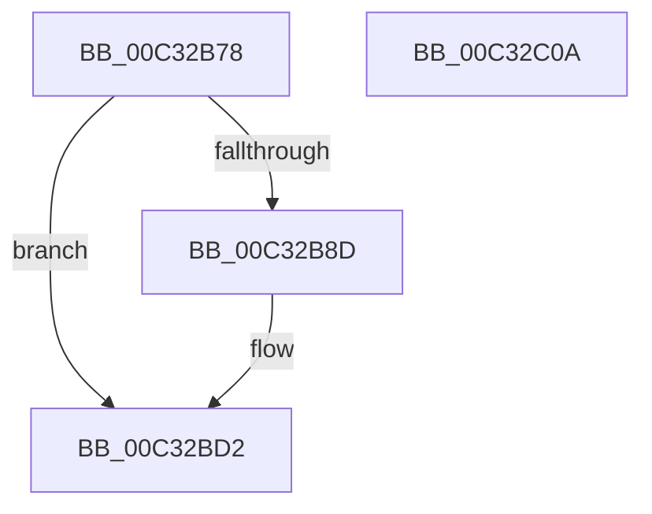

# IoInvalidateInit

- RVA: `0x00C32B78`–`0x00C32C0B` (길이 `147` bytes)
- VA: `0x0000000140C32B78`
- 실행 섹션: `INIT`
- PDB 이름 있음: `예`; PDB Function 태그: `아니요`
- unwind 정보 RVA: `0x0005C788`
- 디코드: `24`개 명령, `147/147` bytes 표시
- 미해석 바이트: `0` (있으면 어셈블리에 `.byte`로 보존)

> 이 문서는 커널 이미지의 기계어와 PDB 기호를 분석해 생성했습니다. 4번과 5번은 함수 원형과 자료형을 바이너리 사용 방식에서 추정한 C 해석이며 원본 소스 복구 결과는 아닙니다.

## 1. Dependencies

- 직접 호출 지점: **1**; 고유 호출 대상: **1**
- 직접 호출자로 확인된 함수: **1**
- RIP 상대 이미지 참조: **17**

### Outgoing calls
- `0x00C32B84` → [Feature_Servicing_PnpBootWaitForAsyncBusRelations__private_IsEnabledDeviceUsageNoInline](../../text/4C/Feature_Servicing_PnpBootWaitForAsyncBusRelations__private_IsEnabledDeviceUsageNoInline_function_004C8A70.md) (function, `0x004C8A70`)

### Direct callers
- [IopInitializePlugPlayServices](../C2/IopInitializePlugPlayServices_function_00C2F298.md) at `0x00C2FE98`

### Static image references
- `0x00C32B7C` → RVA `0x00F8CE10` (`.data`; read/write)
- `0x00C32B8D` → RVA `0x00F8CE28` (`.data`; read/write)
- `0x00C32B95` → RVA `0x00F8CE40` (`.data`; read)
- `0x00C32B9C` → RVA `0x00F8CE30` (`.data`; read/write)
- `0x00C32BA3` → RVA `0x00F8CE3C` (`.data`; read/write)
- `0x00C32BAA` → RVA `0x00F8CE48` (`.data`; write)
- `0x00C32BB1` → RVA `0x00F8CE40` (`.data`; write)
- `0x00C32BB8` → RVA `0x00F8CE20` (`.data`; write)
- `0x00C32BC2` → RVA `0x00F8CE38` (`.data`; write)
- `0x00C32BCB` → RVA `0x00F8CE3A` (`.data`; write)
- `0x00C32BD2` → RVA `0x00F8CDF8` (`.data`; read/write)
- `0x00C32BDA` → RVA `0x00F8CE00` (`.data`; read)
- `0x00C32BE1` → RVA `0x00F8CDE0` (`.data`; read/write)
- `0x00C32BE9` → RVA `0x00F8CE08` (`.data`; write)
- `0x00C32BF0` → RVA `0x00F8CE00` (`.data`; write)
- `0x00C32BF7` → RVA `0x004C8900` (`IopInvalidateBusRelationsWorker`; read)
- `0x00C32BFE` → RVA `0x00F8CDF0` (`.data`; write)

## 2. Other-region calls and transfers

- 다른 실행 섹션으로 향하는 call: **1**
  - `0x00C32B84` → [Feature_Servicing_PnpBootWaitForAsyncBusRelations__private_IsEnabledDeviceUsageNoInline](../../text/4C/Feature_Servicing_PnpBootWaitForAsyncBusRelations__private_IsEnabledDeviceUsageNoInline_function_004C8A70.md) (`INIT` → `.text`)
- 별도 외부 분기/꼬리 이동을 확인하지 못했습니다.

## 3. Assembly (complete function range)

```asm
00C32B78  48 83 EC 28                     sub rsp, 0x28
00C32B7C  48 83 25 8C A2 35 00 00         and qword ptr [rip + 0x35a28c], 0
00C32B84  E8 E7 5E 89 FF                  call 0x1404c8a70
00C32B89  85 C0                           test eax, eax
00C32B8B  74 45                           je 0x140c32bd2
00C32B8D  48 83 25 93 A2 35 00 00         and qword ptr [rip + 0x35a293], 0
00C32B95  48 8D 05 A4 A2 35 00            lea rax, [rip + 0x35a2a4]
00C32B9C  83 25 8D A2 35 00 00            and dword ptr [rip + 0x35a28d], 0
00C32BA3  83 25 92 A2 35 00 00            and dword ptr [rip + 0x35a292], 0
00C32BAA  48 89 05 97 A2 35 00            mov qword ptr [rip + 0x35a297], rax
00C32BB1  48 89 05 88 A2 35 00            mov qword ptr [rip + 0x35a288], rax
00C32BB8  C7 05 5E A2 35 00 01 00 00 00   mov dword ptr [rip + 0x35a25e], 1
00C32BC2  66 C7 05 6D A2 35 00 01 00      mov word ptr [rip + 0x35a26d], 1
00C32BCB  C6 05 68 A2 35 00 06            mov byte ptr [rip + 0x35a268], 6
00C32BD2  48 83 25 1E A2 35 00 00         and qword ptr [rip + 0x35a21e], 0
00C32BDA  48 8D 05 1F A2 35 00            lea rax, [rip + 0x35a21f]
00C32BE1  48 83 25 F7 A1 35 00 00         and qword ptr [rip + 0x35a1f7], 0
00C32BE9  48 89 05 18 A2 35 00            mov qword ptr [rip + 0x35a218], rax
00C32BF0  48 89 05 09 A2 35 00            mov qword ptr [rip + 0x35a209], rax
00C32BF7  48 8D 05 02 5D 89 FF            lea rax, [rip - 0x76a2fe]
00C32BFE  48 89 05 EB A1 35 00            mov qword ptr [rip + 0x35a1eb], rax
00C32C05  48 83 C4 28                     add rsp, 0x28
00C32C09  C3                              ret
00C32C0A  CC                              int3
```

## 4. C-style interpretation (structured pseudocode)

```c
__int64 __fastcall IoInvalidateInit(void)
{
    __int64 result;
    __int64 v_rsp;

    v_rsp = (v_rsp) - (40);
    result = Feature_Servicing_PnpBootWaitForAsyncBusRelations__private_IsEnabledDeviceUsageNoInline(a1, a2, a3, a4);
    if ((unsigned int)(result) != 0) {
        result = v_rip + 3515044;
        *(unsigned __int64 *)(v_rip + 3515031) = result;
        *(unsigned __int64 *)(v_rip + 3515016) = result;
        *(unsigned int *)(v_rip + 3514974) = 1;
        *(unsigned __int16 *)(v_rip + 3514989) = 1;
        *(unsigned __int8 *)(v_rip + 3514984) = 6;
    }
    *(unsigned __int64 *)(v_rip + 3514904) = v_rip + 3514911;
    *(unsigned __int64 *)(v_rip + 3514889) = v_rip + 3514911;
    *(unsigned __int64 *)(v_rip + 3514859) = v_rip - 7774974;
    v_rsp = (v_rsp) + (40);
    return v_rip - 7774974;
}
```

## 5. (Beta) C Style

```c
void IoInvalidateInit(void)
{
    int64_t result;
    int64_t local_rsp;

    local_rsp = (local_rsp) - (40);
    result = Feature_Servicing_PnpBootWaitForAsyncBusRelations__private_IsEnabledDeviceUsageNoInline(a1, a2, a3, a4);
    if ((uint32_t)(result) != 0) {
        result = v_rip + 3515044;
        *(uint64_t *)(v_rip + 0x35A297) = result;
        *(uint64_t *)(v_rip + 0x35A288) = result;
        *(uint32_t *)(v_rip + 0x35A25E) = 1;
        *(uint16_t *)(v_rip + 0x35A26D) = 1;
        *(uint8_t *)(v_rip + 0x35A268) = 6;
    }
    *(uint64_t *)(v_rip + 0x35A218) = v_rip + 3514911;
    *(uint64_t *)(v_rip + 0x35A209) = v_rip + 3514911;
    *(uint64_t *)(v_rip + 0x35A1EB) = v_rip - 7774974;
    local_rsp = (local_rsp) + (40);
    return v_rip - 7774974;
}
```

## 6. Execution-region graph

[열기: 2D/3D 그래프와 함수 탐색 컨트롤 패널](../../../control-panel.html?section=init&rva=0x00C32B78&view=graph)

- 2D 그래프는 위에서 아래로 흐르고, 3D 그래프는 빈 공간을 드래그해 회전합니다. Shift+드래그는 이동, 휠은 확대·축소, 함수 노드 선택은 대상 보고서 이동입니다.

### Static fallback


