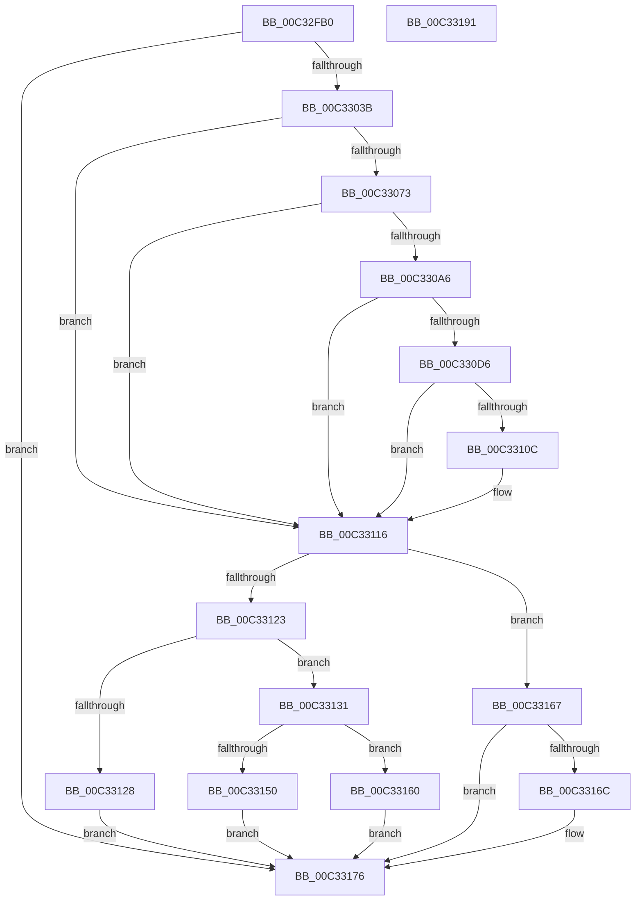

# IoReportHalResourceUsage

- RVA: `0x00C32FB0`–`0x00C33192` (길이 `482` bytes)
- VA: `0x0000000140C32FB0`
- 실행 섹션: `INIT`
- PDB 이름 있음: `예`; PDB Function 태그: `아니요`
- unwind 정보 RVA: `0x000C8494`
- 디코드: `136`개 명령, `482/482` bytes 표시
- 미해석 바이트: `0` (있으면 어셈블리에 `.byte`로 보존)

> 이 문서는 커널 이미지의 기계어와 PDB 기호를 분석해 생성했습니다. 4번과 5번은 함수 원형과 자료형을 바이너리 사용 방식에서 추정한 C 해석이며 원본 소스 복구 결과는 아닙니다.

## 1. Dependencies

- 직접 호출 지점: **13**; 고유 호출 대상: **8**
- 직접 호출자로 확인된 함수: **1**
- RIP 상대 이미지 참조: **5**

### Outgoing calls
- `0x00C33007` → [RtlInitUnicodeString](../../text/42/RtlInitUnicodeString_function_0042A780.md) (function, `0x0042A780`)
- `0x00C3302C` → [IopCreateRegistryKeyEx](../../page/A8/IopCreateRegistryKeyEx_function_00A89038.md) (function, `0x00A89038`)
- `0x00C33046` → [RtlInitUnicodeString](../../text/42/RtlInitUnicodeString_function_0042A780.md) (function, `0x0042A780`)
- `0x00C33060` → [HeadlessTerminalAddResources](../../page/7C/HeadlessTerminalAddResources_function_007C7414.md) (function, `0x007C7414`)
- `0x00C3309B` → [IopWriteResourceList](../../page/72/IopWriteResourceList_function_0072A5F0.md) (function, `0x0072A5F0`)
- `0x00C330B1` → [RtlInitUnicodeString](../../text/42/RtlInitUnicodeString_function_0042A780.md) (function, `0x0042A780`)
- `0x00C330CB` → [HeadlessTerminalAddResources](../../page/7C/HeadlessTerminalAddResources_function_007C7414.md) (function, `0x007C7414`)
- `0x00C33100` → [IopWriteResourceList](../../page/72/IopWriteResourceList_function_0072A5F0.md) (function, `0x0072A5F0`)
- `0x00C33111` → [ExFreePoolWithTag](../../poolcode/B8/ExFreePoolWithTag_function_00B82870.md) (function, `0x00B82870`)
- `0x00C3311A` → [ZwClose](../../text/6A/ZwClose_function_006AD2B0.md) (function, `0x006AD2B0`)
- `0x00C3313F` → [ExAllocatePool2](../../poolcode/B8/ExAllocatePool2_function_00B820F0.md) (function, `0x00B820F0`)
- `0x00C33159` → [memcpy](../../text/6C/memcpy_function_006C6840.md) (function, `0x006C6840`)
- `0x00C33171` → [ExFreePoolWithTag](../../poolcode/B8/ExFreePoolWithTag_function_00B82870.md) (function, `0x00B82870`)

### Direct callers
- [HalpReportResourceUsage](../C1/HalpReportResourceUsage_function_00C1F034.md) at `0x00C1F5CB`

### Static image references
- `0x00C32FEE` → RVA `0x00C82880` (`IopWstrHal`; read)
- `0x00C33017` → RVA `0x00FDA028` (`PAGEDATA`; read)
- `0x00C3303B` → RVA `0x00028448` (`.rdata`; read)
- `0x00C330A6` → RVA `0x00028458` (`.rdata`; read)
- `0x00C33128` → RVA `0x010086A0` (`INITDATA`; write)

## 2. Other-region calls and transfers

- 다른 실행 섹션으로 향하는 call: **13**
  - `0x00C33007` → [RtlInitUnicodeString](../../text/42/RtlInitUnicodeString_function_0042A780.md) (`INIT` → `.text`)
  - `0x00C3302C` → [IopCreateRegistryKeyEx](../../page/A8/IopCreateRegistryKeyEx_function_00A89038.md) (`INIT` → `PAGE`)
  - `0x00C33046` → [RtlInitUnicodeString](../../text/42/RtlInitUnicodeString_function_0042A780.md) (`INIT` → `.text`)
  - `0x00C33060` → [HeadlessTerminalAddResources](../../page/7C/HeadlessTerminalAddResources_function_007C7414.md) (`INIT` → `PAGE`)
  - `0x00C3309B` → [IopWriteResourceList](../../page/72/IopWriteResourceList_function_0072A5F0.md) (`INIT` → `PAGE`)
  - `0x00C330B1` → [RtlInitUnicodeString](../../text/42/RtlInitUnicodeString_function_0042A780.md) (`INIT` → `.text`)
  - `0x00C330CB` → [HeadlessTerminalAddResources](../../page/7C/HeadlessTerminalAddResources_function_007C7414.md) (`INIT` → `PAGE`)
  - `0x00C33100` → [IopWriteResourceList](../../page/72/IopWriteResourceList_function_0072A5F0.md) (`INIT` → `PAGE`)
  - `0x00C33111` → [ExFreePoolWithTag](../../poolcode/B8/ExFreePoolWithTag_function_00B82870.md) (`INIT` → `POOLCODE`)
  - `0x00C3311A` → [ZwClose](../../text/6A/ZwClose_function_006AD2B0.md) (`INIT` → `.text`)
  - `0x00C3313F` → [ExAllocatePool2](../../poolcode/B8/ExAllocatePool2_function_00B820F0.md) (`INIT` → `POOLCODE`)
  - `0x00C33159` → [memcpy](../../text/6C/memcpy_function_006C6840.md) (`INIT` → `.text`)
  - `0x00C33171` → [ExFreePoolWithTag](../../poolcode/B8/ExFreePoolWithTag_function_00B82870.md) (`INIT` → `POOLCODE`)
- 별도 외부 분기/꼬리 이동을 확인하지 못했습니다.

## 3. Assembly (complete function range)

```asm
00C32FB0  48 89 5C 24 10                  mov qword ptr [rsp + 0x10], rbx
00C32FB5  48 89 74 24 18                  mov qword ptr [rsp + 0x18], rsi
00C32FBA  48 89 4C 24 08                  mov qword ptr [rsp + 8], rcx
00C32FBF  55                              push rbp
00C32FC0  57                              push rdi
00C32FC1  41 54                           push r12
00C32FC3  41 55                           push r13
00C32FC5  41 56                           push r14
00C32FC7  48 8B EC                        mov rbp, rsp
00C32FCA  48 83 EC 70                     sub rsp, 0x70
00C32FCE  33 FF                           xor edi, edi
00C32FD0  41 8B F1                        mov esi, r9d
00C32FD3  4C 8B E2                        mov r12, rdx
00C32FD6  48 89 7D C8                     mov qword ptr [rbp - 0x38], rdi
00C32FDA  4C 8B F1                        mov r14, rcx
00C32FDD  48 89 7D D0                     mov qword ptr [rbp - 0x30], rdi
00C32FE1  0F 57 C0                        xorps xmm0, xmm0
00C32FE4  89 7D C0                        mov dword ptr [rbp - 0x40], edi
00C32FE7  0F 57 C9                        xorps xmm1, xmm1
00C32FEA  48 89 7D D8                     mov qword ptr [rbp - 0x28], rdi
00C32FEE  48 8D 15 8B F8 04 00            lea rdx, [rip + 0x4f88b]
00C32FF5  89 7D C4                        mov dword ptr [rbp - 0x3c], edi
00C32FF8  48 8D 4D F0                     lea rcx, [rbp - 0x10]
00C32FFC  4D 8B E8                        mov r13, r8
00C32FFF  0F 11 45 F0                     movups xmmword ptr [rbp - 0x10], xmm0
00C33003  0F 11 4D E0                     movups xmmword ptr [rbp - 0x20], xmm1
00C33007  E8 74 77 7F FF                  call 0x14042a780
00C3300C  41 B9 1F 00 02 00               mov r9d, 0x2001f
00C33012  48 89 7C 24 28                  mov qword ptr [rsp + 0x28], rdi
00C33017  4C 8D 05 0A 70 3A 00            lea r8, [rip + 0x3a700a]
00C3301E  C7 44 24 20 01 00 00 00         mov dword ptr [rsp + 0x20], 1
00C33026  33 D2                           xor edx, edx
00C33028  48 8D 4D C8                     lea rcx, [rbp - 0x38]
00C3302C  E8 07 60 E5 FF                  call 0x140a89038
00C33031  8B D8                           mov ebx, eax
00C33033  85 C0                           test eax, eax
00C33035  0F 88 3B 01 00 00               js 0x140c33176
00C3303B  48 8D 15 06 54 3F FF            lea rdx, [rip - 0xc0abfa]
00C33042  48 8D 4D E0                     lea rcx, [rbp - 0x20]
00C33046  E8 35 77 7F FF                  call 0x14042a780
00C3304B  48 8D 45 C0                     lea rax, [rbp - 0x40]
00C3304F  45 33 C0                        xor r8d, r8d
00C33052  4C 8D 4D D0                     lea r9, [rbp - 0x30]
00C33056  48 89 44 24 20                  mov qword ptr [rsp + 0x20], rax
00C3305B  8B D6                           mov edx, esi
00C3305D  49 8B CC                        mov rcx, r12
00C33060  E8 AF 43 B9 FF                  call 0x1407c7414
00C33065  48 8B 7D D0                     mov rdi, qword ptr [rbp - 0x30]
00C33069  8B D8                           mov ebx, eax
00C3306B  85 C0                           test eax, eax
00C3306D  0F 88 A3 00 00 00               js 0x140c33116
00C33073  48 85 FF                        test rdi, rdi
00C33076  4C 8D 4D E0                     lea r9, [rbp - 0x20]
00C3307A  8B CE                           mov ecx, esi
00C3307C  48 8D 55 F0                     lea rdx, [rbp - 0x10]
00C33080  0F 45 4D C0                     cmovne ecx, dword ptr [rbp - 0x40]
00C33084  49 8B C4                        mov rax, r12
00C33087  89 4C 24 28                     mov dword ptr [rsp + 0x28], ecx
00C3308B  48 0F 45 C7                     cmovne rax, rdi
00C3308F  48 8B 4D C8                     mov rcx, qword ptr [rbp - 0x38]
00C33093  4D 8B C6                        mov r8, r14
00C33096  48 89 44 24 20                  mov qword ptr [rsp + 0x20], rax
00C3309B  E8 50 75 AF FF                  call 0x14072a5f0
00C330A0  8B D8                           mov ebx, eax
00C330A2  85 C0                           test eax, eax
00C330A4  78 70                           js 0x140c33116
00C330A6  48 8D 15 AB 53 3F FF            lea rdx, [rip - 0xc0ac55]
00C330AD  48 8D 4D E0                     lea rcx, [rbp - 0x20]
00C330B1  E8 CA 76 7F FF                  call 0x14042a780
00C330B6  48 8D 45 C4                     lea rax, [rbp - 0x3c]
00C330BA  41 B0 01                        mov r8b, 1
00C330BD  4C 8D 4D D8                     lea r9, [rbp - 0x28]
00C330C1  48 89 44 24 20                  mov qword ptr [rsp + 0x20], rax
00C330C6  8B D6                           mov edx, esi
00C330C8  49 8B CD                        mov rcx, r13
00C330CB  E8 44 43 B9 FF                  call 0x1407c7414
00C330D0  8B D8                           mov ebx, eax
00C330D2  85 C0                           test eax, eax
00C330D4  78 40                           js 0x140c33116
00C330D6  4C 8B 75 D8                     mov r14, qword ptr [rbp - 0x28]
00C330DA  4C 8D 4D E0                     lea r9, [rbp - 0x20]
00C330DE  4C 8B 45 30                     mov r8, qword ptr [rbp + 0x30]
00C330E2  48 8D 55 F0                     lea rdx, [rbp - 0x10]
00C330E6  48 8B 4D C8                     mov rcx, qword ptr [rbp - 0x38]
00C330EA  4D 85 F6                        test r14, r14
00C330ED  8B C6                           mov eax, esi
00C330EF  0F 45 45 C4                     cmovne eax, dword ptr [rbp - 0x3c]
00C330F3  4D 0F 45 EE                     cmovne r13, r14
00C330F7  89 44 24 28                     mov dword ptr [rsp + 0x28], eax
00C330FB  4C 89 6C 24 20                  mov qword ptr [rsp + 0x20], r13
00C33100  E8 EB 74 AF FF                  call 0x14072a5f0
00C33105  8B D8                           mov ebx, eax
00C33107  4D 85 F6                        test r14, r14
00C3310A  74 0A                           je 0x140c33116
00C3310C  33 D2                           xor edx, edx
00C3310E  49 8B CE                        mov rcx, r14
00C33111  E8 5A F7 F4 FF                  call 0x140b82870
00C33116  48 8B 4D C8                     mov rcx, qword ptr [rbp - 0x38]
00C3311A  E8 91 A1 A7 FF                  call 0x1406ad2b0
00C3311F  85 DB                           test ebx, ebx
00C33121  78 44                           js 0x140c33167
00C33123  48 85 FF                        test rdi, rdi
00C33126  74 09                           je 0x140c33131
00C33128  48 89 3D 71 55 3D 00            mov qword ptr [rip + 0x3d5571], rdi
00C3312F  EB 45                           jmp 0x140c33176
00C33131  41 B8 50 70 20 20               mov r8d, 0x20207050
00C33137  48 8B D6                        mov rdx, rsi
00C3313A  B9 00 01 00 00                  mov ecx, 0x100
00C3313F  E8 AC EF F4 FF                  call 0x140b820f0
00C33144  48 89 05 55 55 3D 00            mov qword ptr [rip + 0x3d5555], rax
00C3314B  48 85 C0                        test rax, rax
00C3314E  74 10                           je 0x140c33160
00C33150  4C 8B C6                        mov r8, rsi
00C33153  49 8B D4                        mov rdx, r12
00C33156  48 8B C8                        mov rcx, rax
00C33159  E8 E2 36 A9 FF                  call 0x1406c6840
00C3315E  EB 16                           jmp 0x140c33176
00C33160  BB 9A 00 00 C0                  mov ebx, 0xc000009a
00C33165  EB 0F                           jmp 0x140c33176
00C33167  48 85 FF                        test rdi, rdi
00C3316A  74 0A                           je 0x140c33176
00C3316C  33 D2                           xor edx, edx
00C3316E  48 8B CF                        mov rcx, rdi
00C33171  E8 FA F6 F4 FF                  call 0x140b82870
00C33176  4C 8D 5C 24 70                  lea r11, [rsp + 0x70]
00C3317B  8B C3                           mov eax, ebx
00C3317D  49 8B 5B 38                     mov rbx, qword ptr [r11 + 0x38]
00C33181  49 8B 73 40                     mov rsi, qword ptr [r11 + 0x40]
00C33185  49 8B E3                        mov rsp, r11
00C33188  41 5E                           pop r14
00C3318A  41 5D                           pop r13
00C3318C  41 5C                           pop r12
00C3318E  5F                              pop rdi
00C3318F  5D                              pop rbp
00C33190  C3                              ret
00C33191  CC                              int3
```

## 4. C-style interpretation (structured pseudocode)

```c
__int64 __fastcall IoReportHalResourceUsage(__int64 a1, __int64 a2, __int64 a3, int a4)
{
    __int64 result;
    __int64 v_rdi;
    __int64 v_rsp;
    unsigned __int64 v_stack_m28;
    unsigned __int64 v_stack_m38;
    unsigned __int64 v_stack_m48;
    unsigned __int64 v_stack_m50;
    unsigned __int64 v_stack_m58;
    unsigned __int64 v_stack_m60;
    unsigned int v_stack_m64;
    unsigned int v_stack_m68;
    unsigned __int64 v_stack_m70;
    unsigned int v_stack_m78;
    unsigned __int64 v_stack_p10;
    unsigned __int64 v_stack_p18;
    unsigned __int64 v_stack_p8;

    v_stack_p10 = v_rbx;
    v_stack_p18 = v_rsi;
    v_stack_p8 = a1;
    v_rsp = (v_rsp) - (112);
    v_rdi = 0;
    v_stack_m60 = 0;
    v_stack_m58 = 0;
    v_stack_m68 = 0;
    v_stack_m50 = 0;
    v_stack_m64 = 0;
    v_stack_m38 = v_xmm0;
    v_stack_m48 = v_xmm1;
    result = RtlInitUnicodeString(v_stack_m38, v_rip + 325771, a3, a4);
    v_stack_m70 = 0;
    v_stack_m78 = 1;
    a2 = 0;
    result = IopCreateRegistryKeyEx(v_stack_m60, a2, v_rip + 3829770, (unsigned int)(0x2001FULL));
    if (sign_flag) goto loc_00C33176;
    result = RtlInitUnicodeString(v_stack_m48, v_rip - 12626938, v_rip + 3829770, (unsigned int)(0x2001FULL));
    a3 = 0;
    v_stack_m78 = v_stack_m68;
    result = HeadlessTerminalAddResources(0, (unsigned int)((unsigned int)((unsigned int)(a4))), a3, v_stack_m58);
    if (sign_flag) goto loc_00C33116;
    a1 = (unsigned int)((unsigned int)((unsigned int)(a4)));
    if (v_stack_m58 != 0) { a1 = v_stack_m68; }
    v_stack_m70 = (unsigned int)(a1);
    result = 0;
    if (v_stack_m58 != 0) { result = v_stack_m58; }
    v_stack_m78 = result;
    result = IopWriteResourceList(v_stack_m60, v_stack_m38, a1, v_stack_m48);
    if (sign_flag) goto loc_00C33116;
    result = RtlInitUnicodeString(v_stack_m48, v_rip - 12627029, a1, v_stack_m48);
    v_stack_m78 = v_stack_m64;
    result = HeadlessTerminalAddResources(0, (unsigned int)((unsigned int)((unsigned int)(a4))), 1, v_stack_m50);
    if (sign_flag) goto loc_00C33116;
    result = (unsigned int)((unsigned int)((unsigned int)(a4)));
    if (v_stack_m50 != 0) {
        result = v_stack_m64;
        a3 = v_stack_m50;
    }
    v_stack_m70 = (unsigned int)(result);
    v_stack_m78 = a3;
    result = IopWriteResourceList(v_stack_m60, v_stack_m38, v_stack_p8, v_stack_m48);
    if (v_stack_m50 != 0) {
        a2 = 0;
        a1 = v_stack_m50;
        result = ExFreePoolWithTag(a1, a2, v_stack_p8, v_stack_m48);
    }
    result = ZwClose(v_stack_m60, a2, v_stack_p8, v_stack_m48);
    if (sign_flag) goto loc_00C33167;
    if (v_stack_m58 == 0) goto loc_00C33131;
    *(unsigned __int64 *)(v_rip + 4019569) = v_stack_m58;
    goto loc_00C33176;
loc_00C33131:
    result = ExAllocatePool2(256, (unsigned int)(a4), (unsigned int)(0x20207050ULL), v_stack_m48);
    *(unsigned __int64 *)(v_rip + 4019541) = result;
    if (result == 0) goto loc_00C33160;
    result = memcpy(result, 0, (unsigned int)(a4), v_stack_m48);
    goto loc_00C33176;
loc_00C33160:
    goto loc_00C33176;
loc_00C33167:
    if (v_stack_m58 != 0) {
        a2 = 0;
        a1 = v_stack_m58;
        result = ExFreePoolWithTag(a1, a2, (unsigned int)(a4), v_stack_m48);
    }
    return (unsigned int)((unsigned int)((unsigned int)(0xC000009AULL)));
}
```

## 5. (Beta) C Style

```c
int64_t IoReportHalResourceUsage(int64_t Arg1, int64_t Arg2, int64_t Arg3, int32_t Arg4)
{
    int64_t result;
    int64_t local_rdi;
    int64_t local_rsp;
    uint64_t v_stack_m28;
    uint64_t v_stack_m38;
    uint64_t v_stack_m48;
    uint64_t v_stack_m50;
    uint64_t v_stack_m58;
    uint64_t v_stack_m60;
    uint32_t v_stack_m64;
    uint32_t v_stack_m68;
    uint64_t v_stack_m70;
    uint32_t v_stack_m78;
    uint64_t v_stack_p10;
    uint64_t v_stack_p18;
    uint64_t v_stack_p8;

    v_stack_p10 = local_rbx;
    v_stack_p18 = local_rsi;
    v_stack_p8 = Arg1;
    local_rsp = (local_rsp) - (112);
    local_rdi = 0;
    v_stack_m60 = 0;
    v_stack_m58 = 0;
    v_stack_m68 = 0;
    v_stack_m50 = 0;
    v_stack_m64 = 0;
    v_stack_m38 = v_xmm0;
    v_stack_m48 = v_xmm1;
    result = RtlInitUnicodeString(v_stack_m38, v_rip + 325771, Arg3, Arg4);
    v_stack_m70 = 0;
    v_stack_m78 = 1;
    Arg2 = 0;
    result = IopCreateRegistryKeyEx(v_stack_m60, Arg2, v_rip + 3829770, (uint32_t)(0x2001FULL));
    if (sign_flag) goto loc_00C33176;
    result = RtlInitUnicodeString(v_stack_m48, v_rip - 12626938, v_rip + 3829770, (uint32_t)(0x2001FULL));
    Arg3 = 0;
    v_stack_m78 = v_stack_m68;
    result = HeadlessTerminalAddResources(0, (uint32_t)((uint32_t)((uint32_t)(Arg4))), Arg3, v_stack_m58);
    if (sign_flag) goto loc_00C33116;
    Arg1 = (uint32_t)((uint32_t)((uint32_t)(Arg4)));
    if (v_stack_m58 != 0) { Arg1 = v_stack_m68; }
    v_stack_m70 = (uint32_t)(Arg1);
    result = 0;
    if (v_stack_m58 != 0) { result = v_stack_m58; }
    v_stack_m78 = result;
    result = IopWriteResourceList(v_stack_m60, v_stack_m38, Arg1, v_stack_m48);
    if (sign_flag) goto loc_00C33116;
    result = RtlInitUnicodeString(v_stack_m48, v_rip - 12627029, Arg1, v_stack_m48);
    v_stack_m78 = v_stack_m64;
    result = HeadlessTerminalAddResources(0, (uint32_t)((uint32_t)((uint32_t)(Arg4))), 1, v_stack_m50);
    if (sign_flag) goto loc_00C33116;
    result = (uint32_t)((uint32_t)((uint32_t)(Arg4)));
    if (v_stack_m50 != 0) {
        result = v_stack_m64;
        Arg3 = v_stack_m50;
    }
    v_stack_m70 = (uint32_t)(result);
    v_stack_m78 = Arg3;
    result = IopWriteResourceList(v_stack_m60, v_stack_m38, v_stack_p8, v_stack_m48);
    if (v_stack_m50 != 0) {
        Arg2 = 0;
        Arg1 = v_stack_m50;
        result = ExFreePoolWithTag(Arg1, Arg2, v_stack_p8, v_stack_m48);
    }
    result = ZwClose(v_stack_m60, Arg2, v_stack_p8, v_stack_m48);
    if (sign_flag) goto loc_00C33167;
    if (v_stack_m58 == 0) goto loc_00C33131;
    *(uint64_t *)(v_rip + 0x3D5571) = v_stack_m58;
    goto loc_00C33176;
loc_00C33131:
    result = ExAllocatePool2(256, (uint32_t)(Arg4), (uint32_t)(0x20207050ULL), v_stack_m48);
    *(uint64_t *)(v_rip + 0x3D5555) = result;
    if (result == 0) goto loc_00C33160;
    result = memcpy(result, 0, (uint32_t)(Arg4), v_stack_m48);
    goto loc_00C33176;
loc_00C33160:
    goto loc_00C33176;
loc_00C33167:
    if (v_stack_m58 != 0) {
        Arg2 = 0;
        Arg1 = v_stack_m58;
        result = ExFreePoolWithTag(Arg1, Arg2, (uint32_t)(Arg4), v_stack_m48);
    }
    return (uint32_t)((uint32_t)((uint32_t)(0xC000009AULL)));
}
```

## 6. Execution-region graph

[열기: 2D/3D 그래프와 함수 탐색 컨트롤 패널](../../../control-panel.html?section=init&rva=0x00C32FB0&view=graph)

- 2D 그래프는 위에서 아래로 흐르고, 3D 그래프는 빈 공간을 드래그해 회전합니다. Shift+드래그는 이동, 휠은 확대·축소, 함수 노드 선택은 대상 보고서 이동입니다.

### Static fallback


