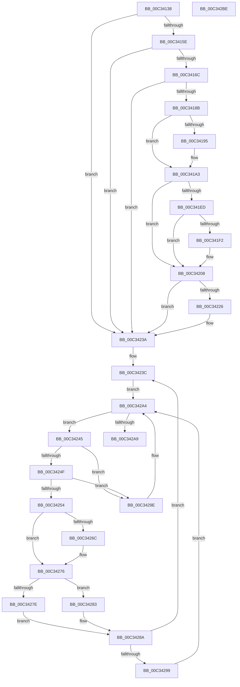

# IopAllocateLegacyBootResources

- RVA: `0x00C34138`–`0x00C342BF` (길이 `391` bytes)
- VA: `0x0000000140C34138`
- 실행 섹션: `INIT`
- PDB 이름 있음: `예`; PDB Function 태그: `아니요`
- unwind 정보 RVA: `0x00098710`
- 디코드: `103`개 명령, `391/391` bytes 표시
- 미해석 바이트: `0` (있으면 어셈블리에 `.byte`로 보존)

> 이 문서는 커널 이미지의 기계어와 PDB 기호를 분석해 생성했습니다. 4번과 5번은 함수 원형과 자료형을 바이너리 사용 방식에서 추정한 C 해석이며 원본 소스 복구 결과는 아닙니다.

## 1. Dependencies

- 직접 호출 지점: **11**; 고유 호출 대상: **5**
- 직접 호출자로 확인된 함수: **3**
- RIP 상대 이미지 참조: **5**

### Outgoing calls
- `0x00C3417A` → [IopCreateCmResourceList](../../page/72/IopCreateCmResourceList_function_0072EA38.md) (function, `0x0072EA38`)
- `0x00C3419E` → [ExFreePoolWithTag](../../poolcode/B8/ExFreePoolWithTag_function_00B82870.md) (function, `0x00B82870`)
- `0x00C341BD` → [PipSetDevNodeFlags](../../page/8F/PipSetDevNodeFlags_function_008FC048.md) (function, `0x008FC048`)
- `0x00C341D5` → [IopAllocateBootResources](../../page/72/IopAllocateBootResources_function_0072E680.md) (function, `0x0072E680`)
- `0x00C341F4` → [ExFreePoolWithTag](../../poolcode/B8/ExFreePoolWithTag_function_00B82870.md) (function, `0x00B82870`)
- `0x00C3420E` → [IopCombineCmResourceList](../../page/72/IopCombineCmResourceList_function_0072E984.md) (function, `0x0072E984`)
- `0x00C3422B` → [ExFreePoolWithTag](../../poolcode/B8/ExFreePoolWithTag_function_00B82870.md) (function, `0x00B82870`)
- `0x00C34235` → [ExFreePoolWithTag](../../poolcode/B8/ExFreePoolWithTag_function_00B82870.md) (function, `0x00B82870`)
- `0x00C34260` → [IopAllocateBootResources](../../page/72/IopAllocateBootResources_function_0072E680.md) (function, `0x0072E680`)
- `0x00C34271` → [ExFreePoolWithTag](../../poolcode/B8/ExFreePoolWithTag_function_00B82870.md) (function, `0x00B82870`)
- `0x00C3428F` → [ExFreePoolWithTag](../../poolcode/B8/ExFreePoolWithTag_function_00B82870.md) (function, `0x00B82870`)

### Direct callers
- [PipProcessStartPhase2](../../page/94/PipProcessStartPhase2_function_0094EE60.md) at `0x0094EF37`
- [sub_00B26024](../../page/B2/Unknown_function_00B26024.md) at `0x00B2607B`
- [IopInitializeBootDrivers](../C2/IopInitializeBootDrivers_function_00C2E6F4.md) at `0x00C2ECF8`

### Static image references
- `0x00C3414B` → RVA `0x01008690` (`INITDATA`; read)
- `0x00C3415E` → RVA `0x010086A0` (`INITDATA`; read)
- `0x00C341AF` → RVA `0x010086A0` (`INITDATA`; write)
- `0x00C3423C` → RVA `0x010086B8` (`INITDATA`; read)
- `0x00C34283` → RVA `0x010086B8` (`INITDATA`; write)

## 2. Other-region calls and transfers

- 다른 실행 섹션으로 향하는 call: **11**
  - `0x00C3417A` → [IopCreateCmResourceList](../../page/72/IopCreateCmResourceList_function_0072EA38.md) (`INIT` → `PAGE`)
  - `0x00C3419E` → [ExFreePoolWithTag](../../poolcode/B8/ExFreePoolWithTag_function_00B82870.md) (`INIT` → `POOLCODE`)
  - `0x00C341BD` → [PipSetDevNodeFlags](../../page/8F/PipSetDevNodeFlags_function_008FC048.md) (`INIT` → `PAGE`)
  - `0x00C341D5` → [IopAllocateBootResources](../../page/72/IopAllocateBootResources_function_0072E680.md) (`INIT` → `PAGE`)
  - `0x00C341F4` → [ExFreePoolWithTag](../../poolcode/B8/ExFreePoolWithTag_function_00B82870.md) (`INIT` → `POOLCODE`)
  - `0x00C3420E` → [IopCombineCmResourceList](../../page/72/IopCombineCmResourceList_function_0072E984.md) (`INIT` → `PAGE`)
  - `0x00C3422B` → [ExFreePoolWithTag](../../poolcode/B8/ExFreePoolWithTag_function_00B82870.md) (`INIT` → `POOLCODE`)
  - `0x00C34235` → [ExFreePoolWithTag](../../poolcode/B8/ExFreePoolWithTag_function_00B82870.md) (`INIT` → `POOLCODE`)
  - `0x00C34260` → [IopAllocateBootResources](../../page/72/IopAllocateBootResources_function_0072E680.md) (`INIT` → `PAGE`)
  - `0x00C34271` → [ExFreePoolWithTag](../../poolcode/B8/ExFreePoolWithTag_function_00B82870.md) (`INIT` → `POOLCODE`)
  - `0x00C3428F` → [ExFreePoolWithTag](../../poolcode/B8/ExFreePoolWithTag_function_00B82870.md) (`INIT` → `POOLCODE`)
- 별도 외부 분기/꼬리 이동을 확인하지 못했습니다.

## 3. Assembly (complete function range)

```asm
00C34138  48 8B C4                        mov rax, rsp
00C3413B  48 89 58 08                     mov qword ptr [rax + 8], rbx
00C3413F  48 89 68 10                     mov qword ptr [rax + 0x10], rbp
00C34143  56                              push rsi
00C34144  57                              push rdi
00C34145  41 56                           push r14
00C34147  48 83 EC 20                     sub rsp, 0x20
00C3414B  48 83 3D 3D 45 3D 00 00         cmp qword ptr [rip + 0x3d453d], 0
00C34153  8B EA                           mov ebp, edx
00C34155  44 8B F1                        mov r14d, ecx
00C34158  0F 84 DC 00 00 00               je 0x140c3423a
00C3415E  48 83 3D 3A 45 3D 00 00         cmp qword ptr [rip + 0x3d453a], 0
00C34166  0F 84 CE 00 00 00               je 0x140c3423a
00C3416C  48 83 60 18 00                  and qword ptr [rax + 0x18], 0
00C34171  4C 8D 48 18                     lea r9, [rax + 0x18]
00C34175  44 8B C2                        mov r8d, edx
00C34178  8B D1                           mov edx, ecx
00C3417A  E8 B9 A8 AF FF                  call 0x14072ea38
00C3417F  48 8B D8                        mov rbx, rax
00C34182  48 85 C0                        test rax, rax
00C34185  0F 84 AF 00 00 00               je 0x140c3423a
00C3418B  48 8B 7C 24 50                  mov rdi, qword ptr [rsp + 0x50]
00C34190  48 85 FF                        test rdi, rdi
00C34193  74 0E                           je 0x140c341a3
00C34195  48 8B 0D 04 45 3D 00            mov rcx, qword ptr [rip + 0x3d4504]
00C3419C  33 D2                           xor edx, edx
00C3419E  E8 CD E6 F4 FF                  call 0x140b82870
00C341A3  48 8B 0D E6 44 3D 00            mov rcx, qword ptr [rip + 0x3d44e6]
00C341AA  BA 40 00 00 00                  mov edx, 0x40
00C341AF  48 89 3D EA 44 3D 00            mov qword ptr [rip + 0x3d44ea], rdi
00C341B6  48 8B B9 20 02 00 00            mov rdi, qword ptr [rcx + 0x220]
00C341BD  E8 86 7E CC FF                  call 0x1408fc048
00C341C2  48 8B 15 C7 44 3D 00            mov rdx, qword ptr [rip + 0x3d44c7]
00C341C9  4C 8B C3                        mov r8, rbx
00C341CC  B9 01 00 00 00                  mov ecx, 1
00C341D1  48 8B 52 20                     mov rdx, qword ptr [rdx + 0x20]
00C341D5  E8 A6 A4 AF FF                  call 0x14072e680
00C341DA  48 8B 05 AF 44 3D 00            mov rax, qword ptr [rip + 0x3d44af]
00C341E1  48 8B 88 20 02 00 00            mov rcx, qword ptr [rax + 0x220]
00C341E8  48 85 C9                        test rcx, rcx
00C341EB  74 1B                           je 0x140c34208
00C341ED  48 3B CF                        cmp rcx, rdi
00C341F0  74 16                           je 0x140c34208
00C341F2  33 D2                           xor edx, edx
00C341F4  E8 77 E6 F4 FF                  call 0x140b82870
00C341F9  48 8B 05 90 44 3D 00            mov rax, qword ptr [rip + 0x3d4490]
00C34200  48 83 A0 20 02 00 00 00         and qword ptr [rax + 0x220], 0
00C34208  48 8B D3                        mov rdx, rbx
00C3420B  48 8B CF                        mov rcx, rdi
00C3420E  E8 71 A7 AF FF                  call 0x14072e984
00C34213  48 8B 15 76 44 3D 00            mov rdx, qword ptr [rip + 0x3d4476]
00C3421A  48 89 82 20 02 00 00            mov qword ptr [rdx + 0x220], rax
00C34221  48 85 FF                        test rdi, rdi
00C34224  74 14                           je 0x140c3423a
00C34226  33 D2                           xor edx, edx
00C34228  48 8B CF                        mov rcx, rdi
00C3422B  E8 40 E6 F4 FF                  call 0x140b82870
00C34230  33 D2                           xor edx, edx
00C34232  48 8B CB                        mov rcx, rbx
00C34235  E8 36 E6 F4 FF                  call 0x140b82870
00C3423A  33 FF                           xor edi, edi
00C3423C  48 8B 1D 75 44 3D 00            mov rbx, qword ptr [rip + 0x3d4475]
00C34243  EB 5F                           jmp 0x140c342a4
00C34245  48 8B 73 10                     mov rsi, qword ptr [rbx + 0x10]
00C34249  44 39 76 04                     cmp dword ptr [rsi + 4], r14d
00C3424D  75 4F                           jne 0x140c3429e
00C3424F  39 6E 08                        cmp dword ptr [rsi + 8], ebp
00C34252  75 4A                           jne 0x140c3429e
00C34254  48 8B 53 08                     mov rdx, qword ptr [rbx + 8]
00C34258  4C 8B C6                        mov r8, rsi
00C3425B  B9 04 00 00 00                  mov ecx, 4
00C34260  E8 1B A4 AF FF                  call 0x14072e680
00C34265  48 83 7B 08 00                  cmp qword ptr [rbx + 8], 0
00C3426A  75 0A                           jne 0x140c34276
00C3426C  33 D2                           xor edx, edx
00C3426E  48 8B CE                        mov rcx, rsi
00C34271  E8 FA E5 F4 FF                  call 0x140b82870
00C34276  48 8B 03                        mov rax, qword ptr [rbx]
00C34279  48 85 FF                        test rdi, rdi
00C3427C  74 05                           je 0x140c34283
00C3427E  48 89 07                        mov qword ptr [rdi], rax
00C34281  EB 07                           jmp 0x140c3428a
00C34283  48 89 05 2E 44 3D 00            mov qword ptr [rip + 0x3d442e], rax
00C3428A  33 D2                           xor edx, edx
00C3428C  48 8B CB                        mov rcx, rbx
00C3428F  E8 DC E5 F4 FF                  call 0x140b82870
00C34294  48 85 FF                        test rdi, rdi
00C34297  74 A3                           je 0x140c3423c
00C34299  48 8B 1F                        mov rbx, qword ptr [rdi]
00C3429C  EB 06                           jmp 0x140c342a4
00C3429E  48 8B FB                        mov rdi, rbx
00C342A1  48 8B 1B                        mov rbx, qword ptr [rbx]
00C342A4  48 85 DB                        test rbx, rbx
00C342A7  75 9C                           jne 0x140c34245
00C342A9  48 8B 5C 24 40                  mov rbx, qword ptr [rsp + 0x40]
00C342AE  33 C0                           xor eax, eax
00C342B0  48 8B 6C 24 48                  mov rbp, qword ptr [rsp + 0x48]
00C342B5  48 83 C4 20                     add rsp, 0x20
00C342B9  41 5E                           pop r14
00C342BB  5F                              pop rdi
00C342BC  5E                              pop rsi
00C342BD  C3                              ret
00C342BE  CC                              int3
```

## 4. C-style interpretation (structured pseudocode)

```c
__int64 __fastcall IopAllocateLegacyBootResources(int a1, int a2)
{
    __int64 result;
    __int64 v_rdi;
    __int64 v_rsp;
    unsigned __int64 v_stack_p10;
    unsigned __int64 v_stack_p18;
    unsigned __int64 v_stack_p8;

    *(unsigned __int64 *)(v_rsp + 8) = v_rbx;
    *(unsigned __int64 *)(v_rsp + 16) = v_rbp;
    v_rsp = (v_rsp) - (32);
    if ((*(unsigned __int64 *)(v_rip + 4015421)) == 0) goto loc_00C3423A;
    if ((*(unsigned __int64 *)(v_rip + 4015418)) == 0) goto loc_00C3423A;
    result = IopCreateCmResourceList(a1, (unsigned int)(a1), (unsigned int)(a2), v_rsp + 24);
    if (result == 0) goto loc_00C3423A;
    if (v_stack_p18 != 0) {
        a1 = *(unsigned __int64 *)(v_rip + 4015364);
        a2 = 0;
        result = ExFreePoolWithTag(a1, a2, (unsigned int)(a2), v_rsp + 24);
    }
    *(unsigned __int64 *)(v_rip + 4015338) = v_stack_p18;
    result = PipSetDevNodeFlags(*(unsigned __int64 *)(v_rip + 4015334), 64, (unsigned int)(a2), v_rsp + 24);
    result = IopAllocateBootResources(1, *(unsigned __int64 *)(*(unsigned __int64 *)(v_rip + 4015303) + 32), result, v_rsp + 24);
    if (*(unsigned __int64 *)(*(unsigned __int64 *)(v_rip + 4015279) + 544) == 0) goto loc_00C34208;
    result = *(unsigned __int64 *)(v_rip + 4015279);
    if ((*(unsigned __int64 *)(*(unsigned __int64 *)(v_rip + 4015279) + 544)) != (*(unsigned __int64 *)(*(unsigned __int64 *)(v_rip + 4015334) + 544))) {
        a2 = 0;
        result = ExFreePoolWithTag(*(unsigned __int64 *)(*(unsigned __int64 *)(v_rip + 4015279) + 544), a2, result, v_rsp + 24);
        result = *(unsigned __int64 *)(v_rip + 4015248);
    }
    result = IopCombineCmResourceList(*(unsigned __int64 *)(*(unsigned __int64 *)(v_rip + 4015334) + 544), result, result, v_rsp + 24);
    *(unsigned __int64 *)(*(unsigned __int64 *)(v_rip + 4015222) + 544) = result;
    if (*(unsigned __int64 *)(*(unsigned __int64 *)(v_rip + 4015334) + 544) != 0) {
        a2 = 0;
        a1 = *(unsigned __int64 *)(*(unsigned __int64 *)(v_rip + 4015334) + 544);
        result = ExFreePoolWithTag(a1, a2, result, v_rsp + 24);
        a2 = 0;
        a1 = result;
        result = ExFreePoolWithTag(a1, a2, result, v_rsp + 24);
    }
    v_rdi = 0;
loc_00C3423C:
    goto loc_00C342A4;
loc_00C34245:
    if ((*(unsigned int *)(*(unsigned __int64 *)(*(unsigned __int64 *)(v_rip + 4015221) + 16) + 4)) != ((unsigned int)((unsigned int)(a1)))) goto loc_00C3429E;
    if ((*(unsigned int *)(*(unsigned __int64 *)(*(unsigned __int64 *)(v_rip + 4015221) + 16) + 8)) != ((unsigned int)((unsigned int)(a2)))) goto loc_00C3429E;
    result = IopAllocateBootResources(4, *(unsigned __int64 *)(*(unsigned __int64 *)(v_rip + 4015221) + 8), *(unsigned __int64 *)(*(unsigned __int64 *)(v_rip + 4015221) + 16), v_rsp + 24);
    if ((*(unsigned __int64 *)(*(unsigned __int64 *)(v_rip + 4015221) + 8)) == 0) {
        a2 = 0;
        a1 = *(unsigned __int64 *)(*(unsigned __int64 *)(v_rip + 4015221) + 16);
        result = ExFreePoolWithTag(a1, a2, *(unsigned __int64 *)(*(unsigned __int64 *)(v_rip + 4015221) + 16), v_rsp + 24);
    }
    if (0 == 0) goto loc_00C34283;
    *(unsigned __int64 *)(v_rdi) = *(unsigned __int64 *)(*(unsigned __int64 *)(v_rip + 4015221));
    goto loc_00C3428A;
loc_00C34283:
    *(unsigned __int64 *)(v_rip + 4015150) = *(unsigned __int64 *)(*(unsigned __int64 *)(v_rip + 4015221));
loc_00C3428A:
    a2 = 0;
    result = ExFreePoolWithTag(*(unsigned __int64 *)(v_rip + 4015221), a2, *(unsigned __int64 *)(*(unsigned __int64 *)(v_rip + 4015221) + 16), v_rsp + 24);
    if (0 == 0) goto loc_00C3423C;
    goto loc_00C342A4;
loc_00C3429E:
loc_00C342A4:
    if (*(unsigned __int64 *)(*(unsigned __int64 *)(v_rdi)) != 0) goto loc_00C34245;
    result = 0;
    v_rsp = (v_rsp) + (32);
    return result;
}
```

## 5. (Beta) C Style

```c
int64_t IopAllocateLegacyBootResources(int32_t Arg1, int32_t Arg2)
{
    int64_t result;
    int64_t local_rdi;
    int64_t local_rsp;
    uint64_t v_stack_p10;
    uint64_t v_stack_p18;
    uint64_t v_stack_p8;

    *(uint64_t *)(local_rsp + 0x8) = local_rbx;
    *(uint64_t *)(local_rsp + 0x10) = local_rbp;
    local_rsp = (local_rsp) - (32);
    if ((*(uint64_t *)(v_rip + 0x3D453D)) == 0) goto loc_00C3423A;
    if ((*(uint64_t *)(v_rip + 0x3D453A)) == 0) goto loc_00C3423A;
    result = IopCreateCmResourceList(Arg1, (uint32_t)(Arg1), (uint32_t)(Arg2), local_rsp + 24);
    if (result == 0) goto loc_00C3423A;
    if (v_stack_p18 != 0) {
        Arg1 = *(uint64_t *)(v_rip + 0x3D4504);
        Arg2 = 0;
        result = ExFreePoolWithTag(Arg1, Arg2, (uint32_t)(Arg2), local_rsp + 24);
    }
    *(uint64_t *)(v_rip + 0x3D44EA) = v_stack_p18;
    result = PipSetDevNodeFlags(*(uint64_t *)(v_rip + 0x3D44E6), 64, (uint32_t)(Arg2), local_rsp + 24);
    result = IopAllocateBootResources(1, *(uint64_t *)(*(uint64_t *)(v_rip + 0x3D44C7) + 0x20), result, local_rsp + 24);
    if (*(uint64_t *)(*(uint64_t *)(v_rip + 0x3D44AF) + 0x220) == 0) goto loc_00C34208;
    result = *(uint64_t *)(v_rip + 0x3D44AF);
    if ((*(uint64_t *)(*(uint64_t *)(v_rip + 0x3D44AF) + 0x220)) != (*(uint64_t *)(*(uint64_t *)(v_rip + 0x3D44E6) + 0x220))) {
        Arg2 = 0;
        result = ExFreePoolWithTag(*(uint64_t *)(*(uint64_t *)(v_rip + 0x3D44AF) + 0x220), Arg2, result, local_rsp + 24);
        result = *(uint64_t *)(v_rip + 0x3D4490);
    }
    result = IopCombineCmResourceList(*(uint64_t *)(*(uint64_t *)(v_rip + 0x3D44E6) + 0x220), result, result, local_rsp + 24);
    *(uint64_t *)(*(uint64_t *)(v_rip + 0x3D4476) + 0x220) = result;
    if (*(uint64_t *)(*(uint64_t *)(v_rip + 0x3D44E6) + 0x220) != 0) {
        Arg2 = 0;
        Arg1 = *(uint64_t *)(*(uint64_t *)(v_rip + 0x3D44E6) + 0x220);
        result = ExFreePoolWithTag(Arg1, Arg2, result, local_rsp + 24);
        Arg2 = 0;
        Arg1 = result;
        result = ExFreePoolWithTag(Arg1, Arg2, result, local_rsp + 24);
    }
    local_rdi = 0;
loc_00C3423C:
    goto loc_00C342A4;
loc_00C34245:
    if ((*(uint32_t *)(*(uint64_t *)(*(uint64_t *)(v_rip + 0x3D4475) + 0x10) + 0x4)) != ((uint32_t)((uint32_t)(Arg1)))) goto loc_00C3429E;
    if ((*(uint32_t *)(*(uint64_t *)(*(uint64_t *)(v_rip + 0x3D4475) + 0x10) + 0x8)) != ((uint32_t)((uint32_t)(Arg2)))) goto loc_00C3429E;
    result = IopAllocateBootResources(4, *(uint64_t *)(*(uint64_t *)(v_rip + 0x3D4475) + 0x8), *(uint64_t *)(*(uint64_t *)(v_rip + 0x3D4475) + 0x10), local_rsp + 24);
    if ((*(uint64_t *)(*(uint64_t *)(v_rip + 0x3D4475) + 0x8)) == 0) {
        Arg2 = 0;
        Arg1 = *(uint64_t *)(*(uint64_t *)(v_rip + 0x3D4475) + 0x10);
        result = ExFreePoolWithTag(Arg1, Arg2, *(uint64_t *)(*(uint64_t *)(v_rip + 0x3D4475) + 0x10), local_rsp + 24);
    }
    if (0 == 0) goto loc_00C34283;
    *(uint64_t *)(local_rdi) = *(uint64_t *)(*(uint64_t *)(v_rip + 0x3D4475));
    goto loc_00C3428A;
loc_00C34283:
    *(uint64_t *)(v_rip + 0x3D442E) = *(uint64_t *)(*(uint64_t *)(v_rip + 0x3D4475));
loc_00C3428A:
    Arg2 = 0;
    result = ExFreePoolWithTag(*(uint64_t *)(v_rip + 0x3D4475), Arg2, *(uint64_t *)(*(uint64_t *)(v_rip + 0x3D4475) + 0x10), local_rsp + 24);
    if (0 == 0) goto loc_00C3423C;
    goto loc_00C342A4;
loc_00C3429E:
loc_00C342A4:
    if (*(uint64_t *)(*(uint64_t *)(local_rdi)) != 0) goto loc_00C34245;
    result = 0;
    local_rsp = (local_rsp) + (32);
    return result;
}
```

## 6. Execution-region graph

[열기: 2D/3D 그래프와 함수 탐색 컨트롤 패널](../../../control-panel.html?section=init&rva=0x00C34138&view=graph)

- 2D 그래프는 위에서 아래로 흐르고, 3D 그래프는 빈 공간을 드래그해 회전합니다. Shift+드래그는 이동, 휠은 확대·축소, 함수 노드 선택은 대상 보고서 이동입니다.

### Static fallback


