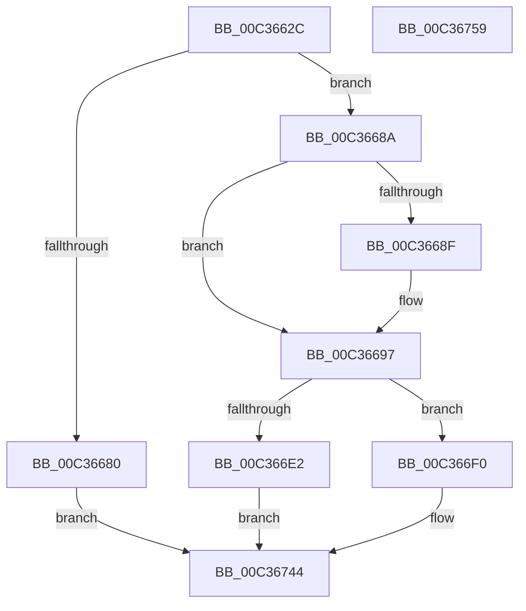

# IopFileUtilRename

- RVA: `0x00C3662C`–`0x00C3675A` (길이 `302` bytes)
- VA: `0x0000000140C3662C`
- 실행 섹션: `INIT`
- PDB 이름 있음: `예`; PDB Function 태그: `아니요`
- unwind 정보 RVA: `0x000C91F8`
- 디코드: `82`개 명령, `302/302` bytes 표시
- 미해석 바이트: `0` (있으면 어셈블리에 `.byte`로 보존)

> 이 문서는 커널 이미지의 기계어와 PDB 기호를 분석해 생성했습니다. 4번과 5번은 함수 원형과 자료형을 바이너리 사용 방식에서 추정한 C 해석이며 원본 소스 복구 결과는 아닙니다.

## 1. Dependencies

- 직접 호출 지점: **8**; 고유 호출 대상: **7**
- 직접 호출자로 확인된 함수: **2**
- RIP 상대 이미지 참조: **0**

### Outgoing calls
- `0x00C36673` → [ExAllocatePool2](../../poolcode/B8/ExAllocatePool2_function_00B820F0.md) (function, `0x00B820F0`)
- `0x00C36692` → [IopFileUtilClearAttributes](../../page/73/IopFileUtilClearAttributes_function_0073FA1C.md) (function, `0x0073FA1C`)
- `0x00C366D7` → [ZwOpenFile](../../text/6A/ZwOpenFile_function_006AD730.md) (function, `0x006AD730`)
- `0x00C366E7` → [ExFreePoolWithTag](../../poolcode/B8/ExFreePoolWithTag_function_00B82870.md) (function, `0x00B82870`)
- `0x00C366FC` → [memcpy](../../text/6C/memcpy_function_006C6840.md) (function, `0x006C6840`)
- `0x00C36728` → [ZwSetInformationFile](../../text/6A/ZwSetInformationFile_function_006AD5B0.md) (function, `0x006AD5B0`)
- `0x00C36734` → [ExFreePoolWithTag](../../poolcode/B8/ExFreePoolWithTag_function_00B82870.md) (function, `0x00B82870`)
- `0x00C3673D` → [ZwClose](../../text/6A/ZwClose_function_006AD2B0.md) (function, `0x006AD2B0`)

### Direct callers
- [PiLastGoodRevertCopyCallback](PiLastGoodRevertCopyCallback_function_00C338B0.md) at `0x00C33951`
- [PpLastGoodDoBootProcessing](PpLastGoodDoBootProcessing_function_00C33BC4.md) at `0x00C33C40`

### Static image references
- 디코드된 RIP-relative 메모리 참조가 없습니다.

## 2. Other-region calls and transfers

- 다른 실행 섹션으로 향하는 call: **8**
  - `0x00C36673` → [ExAllocatePool2](../../poolcode/B8/ExAllocatePool2_function_00B820F0.md) (`INIT` → `POOLCODE`)
  - `0x00C36692` → [IopFileUtilClearAttributes](../../page/73/IopFileUtilClearAttributes_function_0073FA1C.md) (`INIT` → `PAGE`)
  - `0x00C366D7` → [ZwOpenFile](../../text/6A/ZwOpenFile_function_006AD730.md) (`INIT` → `.text`)
  - `0x00C366E7` → [ExFreePoolWithTag](../../poolcode/B8/ExFreePoolWithTag_function_00B82870.md) (`INIT` → `POOLCODE`)
  - `0x00C366FC` → [memcpy](../../text/6C/memcpy_function_006C6840.md) (`INIT` → `.text`)
  - `0x00C36728` → [ZwSetInformationFile](../../text/6A/ZwSetInformationFile_function_006AD5B0.md) (`INIT` → `.text`)
  - `0x00C36734` → [ExFreePoolWithTag](../../poolcode/B8/ExFreePoolWithTag_function_00B82870.md) (`INIT` → `POOLCODE`)
  - `0x00C3673D` → [ZwClose](../../text/6A/ZwClose_function_006AD2B0.md) (`INIT` → `.text`)
- 별도 외부 분기/꼬리 이동을 확인하지 못했습니다.

## 3. Assembly (complete function range)

```asm
00C3662C  48 89 5C 24 08                  mov qword ptr [rsp + 8], rbx
00C36631  48 89 74 24 18                  mov qword ptr [rsp + 0x18], rsi
00C36636  55                              push rbp
00C36637  57                              push rdi
00C36638  41 56                           push r14
00C3663A  48 8B EC                        mov rbp, rsp
00C3663D  48 83 EC 70                     sub rsp, 0x70
00C36641  48 83 65 28 00                  and qword ptr [rbp + 0x28], 0
00C36646  33 C0                           xor eax, eax
00C36648  21 45 EC                        and dword ptr [rbp - 0x14], eax
00C3664B  48 8B DA                        mov rbx, rdx
00C3664E  0F B7 12                        movzx edx, word ptr [rdx]
00C36651  45 8A F0                        mov r14b, r8b
00C36654  48 8B F1                        mov rsi, rcx
00C36657  89 45 D4                        mov dword ptr [rbp - 0x2c], eax
00C3665A  21 45 D4                        and dword ptr [rbp - 0x2c], eax
00C3665D  0F 57 C0                        xorps xmm0, xmm0
00C36660  48 83 C2 18                     add rdx, 0x18
00C36664  B9 00 01 00 00                  mov ecx, 0x100
00C36669  41 B8 49 6F 46 75               mov r8d, 0x75466f49
00C3666F  0F 11 45 C0                     movups xmmword ptr [rbp - 0x40], xmm0
00C36673  E8 78 BA F4 FF                  call 0x140b820f0
00C36678  48 8B F8                        mov rdi, rax
00C3667B  48 85 C0                        test rax, rax
00C3667E  75 0A                           jne 0x140c3668a
00C36680  B8 9A 00 00 C0                  mov eax, 0xc000009a
00C36685  E9 BA 00 00 00                  jmp 0x140c36744
00C3668A  45 84 F6                        test r14b, r14b
00C3668D  74 08                           je 0x140c36697
00C3668F  48 8B CB                        mov rcx, rbx
00C36692  E8 85 93 B0 FF                  call 0x14073fa1c
00C36697  48 83 65 D8 00                  and qword ptr [rbp - 0x28], 0
00C3669C  4C 8D 4D C0                     lea r9, [rbp - 0x40]
00C366A0  0F 57 C0                        xorps xmm0, xmm0
00C366A3  C7 44 24 28 22 40 20 00         mov dword ptr [rsp + 0x28], 0x204022
00C366AB  4C 8D 45 D0                     lea r8, [rbp - 0x30]
00C366AF  C7 45 D0 30 00 00 00            mov dword ptr [rbp - 0x30], 0x30
00C366B6  BA 80 00 11 00                  mov edx, 0x110080
00C366BB  C7 45 E8 40 02 00 00            mov dword ptr [rbp - 0x18], 0x240
00C366C2  48 8D 4D 28                     lea rcx, [rbp + 0x28]
00C366C6  48 89 75 E0                     mov qword ptr [rbp - 0x20], rsi
00C366CA  F3 0F 7F 45 F0                  movdqu xmmword ptr [rbp - 0x10], xmm0
00C366CF  C7 44 24 20 07 00 00 00         mov dword ptr [rsp + 0x20], 7
00C366D7  E8 54 70 A7 FF                  call 0x1406ad730
00C366DC  8B F0                           mov esi, eax
00C366DE  85 C0                           test eax, eax
00C366E0  79 0E                           jns 0x140c366f0
00C366E2  33 D2                           xor edx, edx
00C366E4  48 8B CF                        mov rcx, rdi
00C366E7  E8 84 C1 F4 FF                  call 0x140b82870
00C366EC  8B C6                           mov eax, esi
00C366EE  EB 54                           jmp 0x140c36744
00C366F0  44 0F B7 03                     movzx r8d, word ptr [rbx]
00C366F4  48 8D 4F 14                     lea rcx, [rdi + 0x14]
00C366F8  48 8B 53 08                     mov rdx, qword ptr [rbx + 8]
00C366FC  E8 3F 01 A9 FF                  call 0x1406c6840
00C36701  48 83 67 08 00                  and qword ptr [rdi + 8], 0
00C36706  48 8D 55 C0                     lea rdx, [rbp - 0x40]
00C3670A  44 88 37                        mov byte ptr [rdi], r14b
00C3670D  4C 8B C7                        mov r8, rdi
00C36710  44 0F B7 0B                     movzx r9d, word ptr [rbx]
00C36714  44 89 4F 10                     mov dword ptr [rdi + 0x10], r9d
00C36718  41 83 C1 18                     add r9d, 0x18
00C3671C  48 8B 4D 28                     mov rcx, qword ptr [rbp + 0x28]
00C36720  C7 44 24 20 0A 00 00 00         mov dword ptr [rsp + 0x20], 0xa
00C36728  E8 83 6E A7 FF                  call 0x1406ad5b0
00C3672D  33 D2                           xor edx, edx
00C3672F  48 8B CF                        mov rcx, rdi
00C36732  8B D8                           mov ebx, eax
00C36734  E8 37 C1 F4 FF                  call 0x140b82870
00C36739  48 8B 4D 28                     mov rcx, qword ptr [rbp + 0x28]
00C3673D  E8 6E 6B A7 FF                  call 0x1406ad2b0
00C36742  8B C3                           mov eax, ebx
00C36744  4C 8D 5C 24 70                  lea r11, [rsp + 0x70]
00C36749  49 8B 5B 20                     mov rbx, qword ptr [r11 + 0x20]
00C3674D  49 8B 73 30                     mov rsi, qword ptr [r11 + 0x30]
00C36751  49 8B E3                        mov rsp, r11
00C36754  41 5E                           pop r14
00C36756  5F                              pop rdi
00C36757  5D                              pop rbp
00C36758  C3                              ret
00C36759  CC                              int3
```

## 4. C-style interpretation (structured pseudocode)

```c
__int64 __fastcall IopFileUtilRename(__int64 a1, __int64 a2, unsigned __int8 a3)
{
    __int64 result;
    __int64 v_rsp;
    unsigned __int64 v_stack_m18;
    unsigned __int64 v_stack_m28;
    unsigned int v_stack_m2C;
    unsigned int v_stack_m30;
    unsigned __int64 v_stack_m38;
    unsigned __int64 v_stack_m40;
    unsigned int v_stack_m44;
    unsigned __int64 v_stack_m48;
    unsigned __int64 v_stack_m58;
    unsigned int v_stack_m60;
    unsigned int v_stack_m68;
    unsigned __int64 v_stack_p10;
    unsigned __int64 v_stack_p18;
    unsigned __int64 v_stack_p8;

    v_stack_p8 = v_rbx;
    v_stack_p18 = v_rsi;
    v_rsp = (v_rsp) - (112);
    result = 0;
    v_stack_m44 = 0;
    a2 = (*(unsigned __int16 *)(a2)) + (24);
    v_stack_m58 = v_xmm0;
    result = ExAllocatePool2(256, a2, (unsigned int)(0x75466F49ULL), a4);
    if (result != 0) goto loc_00C3668A;
    goto loc_00C36744;
loc_00C3668A:
    result = (unsigned int)(0xC000009AULL);
    if (a3 != 0) {
        a1 = a2;
        result = IopFileUtilClearAttributes(a1, a2, (unsigned int)(0x75466F49ULL), a4);
    }
    v_stack_m60 = 0x204022ULL;
    v_stack_m48 = 48;
    v_stack_m30 = 576;
    v_stack_m38 = a1;
    v_stack_m28 = v_xmm0;
    v_stack_m68 = 7;
    result = ZwOpenFile(v_stack_p10, (unsigned int)(0x110080ULL), v_stack_m48, v_stack_m58);
    if (!sign_flag) goto loc_00C366F0;
    a2 = 0;
    result = ExFreePoolWithTag(result, a2, v_stack_m48, v_stack_m58);
    goto loc_00C36744;
loc_00C366F0:
    result = memcpy(result + 20, *(unsigned __int64 *)(a2 + 8), *(unsigned __int16 *)(a2), v_stack_m58);
    *(unsigned __int8 *)(result) = a3;
    *(unsigned int *)(result + 16) = (unsigned int)(*(unsigned __int16 *)(a2));
    a4 = (unsigned int)((*(unsigned __int16 *)(a2)) + (24));
    v_stack_m68 = 10;
    result = ZwSetInformationFile(v_stack_p10, v_stack_m58, result, a4);
    a2 = 0;
    result = ExFreePoolWithTag(result, a2, result, a4);
    result = ZwClose(v_stack_p10, a2, result, a4);
loc_00C36744:
    return (unsigned int)((unsigned int)((unsigned int)((unsigned int)(result))));
}
```

## 5. (Beta) C Style

```c
int64_t IopFileUtilRename(int64_t Arg1, void *Arg2, uint8_t Arg3)
{
    uint8_t *arg2 = (uint8_t *)Arg2;

    int64_t result;
    int64_t local_rsp;
    uint64_t v_stack_m18;
    uint64_t v_stack_m28;
    uint32_t v_stack_m2C;
    uint32_t v_stack_m30;
    uint64_t v_stack_m38;
    uint64_t v_stack_m40;
    uint32_t v_stack_m44;
    uint64_t v_stack_m48;
    uint64_t v_stack_m58;
    uint32_t v_stack_m60;
    uint32_t v_stack_m68;
    uint64_t v_stack_p10;
    uint64_t v_stack_p18;
    uint64_t v_stack_p8;

    v_stack_p8 = local_rbx;
    v_stack_p18 = local_rsi;
    local_rsp = (local_rsp) - (112);
    result = 0;
    v_stack_m44 = 0;
    Arg2 = (*(uint16_t *)(arg2)) + (24);
    v_stack_m58 = v_xmm0;
    result = ExAllocatePool2(256, Arg2, (uint32_t)(0x75466F49ULL), a4);
    if (result != 0) goto loc_00C3668A;
    goto loc_00C36744;
loc_00C3668A:
    result = (uint32_t)(0xC000009AULL);
    if (Arg3 != 0) {
        Arg1 = Arg2;
        result = IopFileUtilClearAttributes(Arg1, Arg2, (uint32_t)(0x75466F49ULL), a4);
    }
    v_stack_m60 = 0x204022ULL;
    v_stack_m48 = 48;
    v_stack_m30 = 576;
    v_stack_m38 = Arg1;
    v_stack_m28 = v_xmm0;
    v_stack_m68 = 7;
    result = ZwOpenFile(v_stack_p10, (uint32_t)(0x110080ULL), v_stack_m48, v_stack_m58);
    if (!sign_flag) goto loc_00C366F0;
    Arg2 = 0;
    result = ExFreePoolWithTag(result, Arg2, v_stack_m48, v_stack_m58);
    goto loc_00C36744;
loc_00C366F0:
    result = memcpy(result + 20, *(uint64_t *)(arg2 + 0x8), *(uint16_t *)(arg2), v_stack_m58);
    *(uint8_t *)(result) = Arg3;
    *(uint32_t *)(result + 0x10) = (uint32_t)(*(uint16_t *)(arg2));
    a4 = (uint32_t)((*(uint16_t *)(arg2)) + (24));
    v_stack_m68 = 10;
    result = ZwSetInformationFile(v_stack_p10, v_stack_m58, result, a4);
    Arg2 = 0;
    result = ExFreePoolWithTag(result, Arg2, result, a4);
    result = ZwClose(v_stack_p10, Arg2, result, a4);
loc_00C36744:
    return (uint32_t)((uint32_t)((uint32_t)((uint32_t)(result))));
}
```

### 관측된 메모리 오프셋

구조체 형식이 확인되지 않은 접근은 인자 기준의 오프셋으로만 기록했습니다.

| 기준 인자 | 오프셋 표현 | 폭 (bit) | 접근 |
|---|---:|---:|---|
| `Arg2` | `+ 0x0` | `16` | `R` |
| `Arg2` | `+ 0x8` | `64` | `R` |

## 6. Execution-region graph

[열기: 2D/3D 그래프와 함수 탐색 컨트롤 패널](../../../control-panel.html?section=init&rva=0x00C3662C&view=graph)

- 2D 그래프는 위에서 아래로 흐르고, 3D 그래프는 빈 공간을 드래그해 회전합니다. Shift+드래그는 이동, 휠은 확대·축소, 함수 노드 선택은 대상 보고서 이동입니다.

### Static fallback


