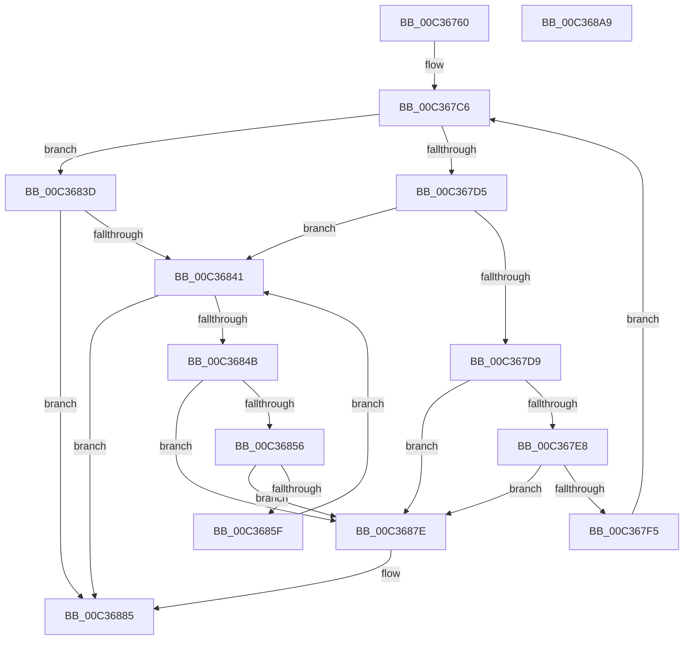

# IopFileUtilWalkDirectoryTreeTopDown

- RVA: `0x00C36760`–`0x00C368AA` (길이 `330` bytes)
- VA: `0x0000000140C36760`
- 실행 섹션: `INIT`
- PDB 이름 있음: `예`; PDB Function 태그: `아니요`
- unwind 정보 RVA: `0x000C9210`
- 디코드: `83`개 명령, `330/330` bytes 표시
- 미해석 바이트: `0` (있으면 어셈블리에 `.byte`로 보존)

> 이 문서는 커널 이미지의 기계어와 PDB 기호를 분석해 생성했습니다. 4번과 5번은 함수 원형과 자료형을 바이너리 사용 방식에서 추정한 C 해석이며 원본 소스 복구 결과는 아닙니다.

## 1. Dependencies

- 직접 호출 지점: **5**; 고유 호출 대상: **3**
- 직접 호출자로 확인된 함수: **1**
- RIP 상대 이미지 참조: **2**

### Outgoing calls
- `0x00C367BF` → [IopFileUtilWalkDirectoryTreeHelper](../../page/73/IopFileUtilWalkDirectoryTreeHelper_function_0073FD40.md) (function, `0x0073FD40`)
- `0x00C3682A` → [IopFileUtilWalkDirectoryTreeHelper](../../page/73/IopFileUtilWalkDirectoryTreeHelper_function_0073FD40.md) (function, `0x0073FD40`)
- `0x00C36836` → [ExFreePoolWithTag](../../poolcode/B8/ExFreePoolWithTag_function_00B82870.md) (function, `0x00B82870`)
- `0x00C36872` → [ExFreePoolWithTag](../../poolcode/B8/ExFreePoolWithTag_function_00B82870.md) (function, `0x00B82870`)
- `0x00C36891` → [_security_check_cookie](../../text/6A/_security_check_cookie_function_006AC640.md) (function, `0x006AC640`)

### Direct callers
- [PiLastGoodRevertLastKnownDirectory](PiLastGoodRevertLastKnownDirectory_function_00C33980.md) at `0x00C33A25`

### Static image references
- `0x00C36777` → RVA `0x00E0A740` (`.data`; read)
- `0x00C36797` → RVA `0x00C338B0` (`PiLastGoodRevertCopyCallback`; read)

## 2. Other-region calls and transfers

- 다른 실행 섹션으로 향하는 call: **5**
  - `0x00C367BF` → [IopFileUtilWalkDirectoryTreeHelper](../../page/73/IopFileUtilWalkDirectoryTreeHelper_function_0073FD40.md) (`INIT` → `PAGE`)
  - `0x00C3682A` → [IopFileUtilWalkDirectoryTreeHelper](../../page/73/IopFileUtilWalkDirectoryTreeHelper_function_0073FD40.md) (`INIT` → `PAGE`)
  - `0x00C36836` → [ExFreePoolWithTag](../../poolcode/B8/ExFreePoolWithTag_function_00B82870.md) (`INIT` → `POOLCODE`)
  - `0x00C36872` → [ExFreePoolWithTag](../../poolcode/B8/ExFreePoolWithTag_function_00B82870.md) (`INIT` → `POOLCODE`)
  - `0x00C36891` → [_security_check_cookie](../../text/6A/_security_check_cookie_function_006AC640.md) (`INIT` → `.text`)
- 별도 외부 분기/꼬리 이동을 확인하지 못했습니다.

## 3. Assembly (complete function range)

```asm
00C36760  48 89 5C 24 10                  mov qword ptr [rsp + 0x10], rbx
00C36765  55                              push rbp
00C36766  56                              push rsi
00C36767  57                              push rdi
00C36768  48 8D AC 24 A0 FC FF FF         lea rbp, [rsp - 0x360]
00C36770  48 81 EC 60 04 00 00            sub rsp, 0x460
00C36777  48 8B 05 C2 3F 1D 00            mov rax, qword ptr [rip + 0x1d3fc2]
00C3677E  48 33 C4                        xor rax, rsp
00C36781  48 89 85 50 03 00 00            mov qword ptr [rbp + 0x350], rax
00C36788  48 8D 44 24 40                  lea rax, [rsp + 0x40]
00C3678D  BA 0D 00 00 00                  mov edx, 0xd
00C36792  48 89 44 24 48                  mov qword ptr [rsp + 0x48], rax
00C36797  4C 8D 05 12 D1 FF FF            lea r8, [rip - 0x2eee]
00C3679E  48 8D 44 24 40                  lea rax, [rsp + 0x40]
00C367A3  49 8B F1                        mov rsi, r9
00C367A6  48 89 44 24 40                  mov qword ptr [rsp + 0x40], rax
00C367AB  48 8D 44 24 40                  lea rax, [rsp + 0x40]
00C367B0  48 89 44 24 30                  mov qword ptr [rsp + 0x30], rax
00C367B5  48 8D 44 24 50                  lea rax, [rsp + 0x50]
00C367BA  48 89 44 24 20                  mov qword ptr [rsp + 0x20], rax
00C367BF  E8 7C 95 B0 FF                  call 0x14073fd40
00C367C4  8B F8                           mov edi, eax
00C367C6  48 8B 5C 24 40                  mov rbx, qword ptr [rsp + 0x40]
00C367CB  48 8D 44 24 40                  lea rax, [rsp + 0x40]
00C367D0  48 3B D8                        cmp rbx, rax
00C367D3  74 68                           je 0x140c3683d
00C367D5  85 FF                           test edi, edi
00C367D7  78 68                           js 0x140c36841
00C367D9  48 8D 44 24 40                  lea rax, [rsp + 0x40]
00C367DE  48 39 43 08                     cmp qword ptr [rbx + 8], rax
00C367E2  0F 85 96 00 00 00               jne 0x140c3687e
00C367E8  48 8B 03                        mov rax, qword ptr [rbx]
00C367EB  48 39 58 08                     cmp qword ptr [rax + 8], rbx
00C367EF  0F 85 89 00 00 00               jne 0x140c3687e
00C367F5  48 89 44 24 40                  mov qword ptr [rsp + 0x40], rax
00C367FA  48 8D 4C 24 40                  lea rcx, [rsp + 0x40]
00C367FF  48 89 48 08                     mov qword ptr [rax + 8], rcx
00C36803  4C 8D 05 A6 D0 FF FF            lea r8, [rip - 0x2f5a]
00C3680A  48 8D 44 24 40                  lea rax, [rsp + 0x40]
00C3680F  4C 8B CE                        mov r9, rsi
00C36812  48 89 44 24 30                  mov qword ptr [rsp + 0x30], rax
00C36817  48 8D 4B 10                     lea rcx, [rbx + 0x10]
00C3681B  48 8D 44 24 50                  lea rax, [rsp + 0x50]
00C36820  BA 0D 00 00 00                  mov edx, 0xd
00C36825  48 89 44 24 20                  mov qword ptr [rsp + 0x20], rax
00C3682A  E8 11 95 B0 FF                  call 0x14073fd40
00C3682F  33 D2                           xor edx, edx
00C36831  48 8B CB                        mov rcx, rbx
00C36834  8B F8                           mov edi, eax
00C36836  E8 35 C0 F4 FF                  call 0x140b82870
00C3683B  EB 89                           jmp 0x140c367c6
00C3683D  85 FF                           test edi, edi
00C3683F  79 44                           jns 0x140c36885
00C36841  48 8D 44 24 40                  lea rax, [rsp + 0x40]
00C36846  48 3B D8                        cmp rbx, rax
00C36849  74 3A                           je 0x140c36885
00C3684B  48 8D 44 24 40                  lea rax, [rsp + 0x40]
00C36850  48 39 43 08                     cmp qword ptr [rbx + 8], rax
00C36854  75 28                           jne 0x140c3687e
00C36856  48 8B 03                        mov rax, qword ptr [rbx]
00C36859  48 39 58 08                     cmp qword ptr [rax + 8], rbx
00C3685D  75 1F                           jne 0x140c3687e
00C3685F  48 8D 4C 24 40                  lea rcx, [rsp + 0x40]
00C36864  48 89 44 24 40                  mov qword ptr [rsp + 0x40], rax
00C36869  48 89 48 08                     mov qword ptr [rax + 8], rcx
00C3686D  33 D2                           xor edx, edx
00C3686F  48 8B CB                        mov rcx, rbx
00C36872  E8 F9 BF F4 FF                  call 0x140b82870
00C36877  48 8B 5C 24 40                  mov rbx, qword ptr [rsp + 0x40]
00C3687C  EB C3                           jmp 0x140c36841
00C3687E  B9 03 00 00 00                  mov ecx, 3
00C36883  CD 29                           int 0x29
00C36885  8B C7                           mov eax, edi
00C36887  48 8B 8D 50 03 00 00            mov rcx, qword ptr [rbp + 0x350]
00C3688E  48 33 CC                        xor rcx, rsp
00C36891  E8 AA 5D A7 FF                  call 0x1406ac640
00C36896  48 8B 9C 24 88 04 00 00         mov rbx, qword ptr [rsp + 0x488]
00C3689E  48 81 C4 60 04 00 00            add rsp, 0x460
00C368A5  5F                              pop rdi
00C368A6  5E                              pop rsi
00C368A7  5D                              pop rbp
00C368A8  C3                              ret
00C368A9  CC                              int3
```

## 4. C-style interpretation (structured pseudocode)

```c
__int64 __fastcall IopFileUtilWalkDirectoryTreeTopDown(__int64 a1, __int64 a2, __int64 a3, __int64 a4)
{
    __int64 result;
    __int64 v_rsp;
    unsigned __int64 v_stack_m28;
    unsigned __int64 v_stack_m378;
    unsigned __int64 v_stack_m428;
    unsigned __int64 v_stack_m430;
    unsigned __int64 v_stack_m438;
    unsigned __int64 v_stack_m448;
    unsigned __int64 v_stack_m458;
    unsigned __int64 v_stack_p10;

    v_stack_p10 = v_rbx;
    v_rsp = (v_rsp) - (0x460ULL);
    result = (*(unsigned __int64 *)(v_rip + 1916866)) ^ (v_rsp);
    v_stack_m28 = result;
    v_stack_m430 = v_stack_m438;
    v_stack_m438 = v_stack_m438;
    v_stack_m448 = v_stack_m438;
    v_stack_m458 = v_stack_m428;
    result = IopFileUtilWalkDirectoryTreeHelper(a1, 13, v_rip - 12014, a4);
loc_00C367C6:
    if (v_stack_m438 == v_stack_m438) goto loc_00C3683D;
    if (sign_flag) goto loc_00C36841;
    if ((*(unsigned __int64 *)(v_stack_m438 + 8)) != v_stack_m438) goto loc_00C3687E;
    if ((*(unsigned __int64 *)(*(unsigned __int64 *)(v_stack_m438) + 8)) != v_stack_m438) goto loc_00C3687E;
    v_stack_m438 = *(unsigned __int64 *)(v_stack_m438);
    *(unsigned __int64 *)(*(unsigned __int64 *)(v_stack_m438) + 8) = v_stack_m438;
    v_stack_m448 = v_stack_m438;
    v_stack_m458 = v_stack_m428;
    result = IopFileUtilWalkDirectoryTreeHelper(v_stack_m438 + 16, 13, v_rip - 12122, a4);
    a2 = 0;
    result = ExFreePoolWithTag(v_stack_m438, a2, v_rip - 12122, a4);
    goto loc_00C367C6;
loc_00C3683D:
    if (!sign_flag) goto loc_00C36885;
loc_00C36841:
    if (v_stack_m438 == v_stack_m438) goto loc_00C36885;
    if ((*(unsigned __int64 *)(v_stack_m438 + 8)) != v_stack_m438) goto loc_00C3687E;
    if ((*(unsigned __int64 *)(*(unsigned __int64 *)(v_stack_m438) + 8)) != v_stack_m438) goto loc_00C3687E;
    v_stack_m438 = *(unsigned __int64 *)(v_stack_m438);
    *(unsigned __int64 *)(*(unsigned __int64 *)(v_stack_m438) + 8) = v_stack_m438;
    a2 = 0;
    result = ExFreePoolWithTag(v_stack_m438, a2, v_rip - 12122, a4);
    goto loc_00C36841;
loc_00C3687E:
loc_00C36885:
    a1 = (v_stack_m28) ^ (v_rsp);
    result = _security_check_cookie(a1, a2, v_rip - 12122, a4);
    v_rsp = (v_rsp) + (0x460ULL);
    return result;
}
```

## 5. (Beta) C Style

```c
int64_t IopFileUtilWalkDirectoryTreeTopDown(int64_t Arg1, int64_t Arg2, int64_t Arg3, int64_t Arg4)
{
    int64_t result;
    int64_t local_rsp;
    uint64_t v_stack_m28;
    uint64_t v_stack_m378;
    uint64_t v_stack_m428;
    uint64_t v_stack_m430;
    uint64_t v_stack_m438;
    uint64_t v_stack_m448;
    uint64_t v_stack_m458;
    uint64_t v_stack_p10;

    v_stack_p10 = local_rbx;
    local_rsp = (local_rsp) - (0x460ULL);
    result = (*(uint64_t *)(v_rip + 0x1D3FC2)) ^ (local_rsp);
    v_stack_m28 = result;
    v_stack_m430 = v_stack_m438;
    v_stack_m438 = v_stack_m438;
    v_stack_m448 = v_stack_m438;
    v_stack_m458 = v_stack_m428;
    result = IopFileUtilWalkDirectoryTreeHelper(Arg1, 13, v_rip - 12014, Arg4);
loc_00C367C6:
    if (v_stack_m438 == v_stack_m438) goto loc_00C3683D;
    if (sign_flag) goto loc_00C36841;
    if ((*(uint64_t *)(v_stack_m438 + 0x8)) != v_stack_m438) goto loc_00C3687E;
    if ((*(uint64_t *)(*(uint64_t *)(v_stack_m438) + 0x8)) != v_stack_m438) goto loc_00C3687E;
    v_stack_m438 = *(uint64_t *)(v_stack_m438);
    *(uint64_t *)(*(uint64_t *)(v_stack_m438) + 0x8) = v_stack_m438;
    v_stack_m448 = v_stack_m438;
    v_stack_m458 = v_stack_m428;
    result = IopFileUtilWalkDirectoryTreeHelper(v_stack_m438 + 16, 13, v_rip - 12122, Arg4);
    Arg2 = 0;
    result = ExFreePoolWithTag(v_stack_m438, Arg2, v_rip - 12122, Arg4);
    goto loc_00C367C6;
loc_00C3683D:
    if (!sign_flag) goto loc_00C36885;
loc_00C36841:
    if (v_stack_m438 == v_stack_m438) goto loc_00C36885;
    if ((*(uint64_t *)(v_stack_m438 + 0x8)) != v_stack_m438) goto loc_00C3687E;
    if ((*(uint64_t *)(*(uint64_t *)(v_stack_m438) + 0x8)) != v_stack_m438) goto loc_00C3687E;
    v_stack_m438 = *(uint64_t *)(v_stack_m438);
    *(uint64_t *)(*(uint64_t *)(v_stack_m438) + 0x8) = v_stack_m438;
    Arg2 = 0;
    result = ExFreePoolWithTag(v_stack_m438, Arg2, v_rip - 12122, Arg4);
    goto loc_00C36841;
loc_00C3687E:
loc_00C36885:
    Arg1 = (v_stack_m28) ^ (local_rsp);
    result = _security_check_cookie(Arg1, Arg2, v_rip - 12122, Arg4);
    local_rsp = (local_rsp) + (0x460ULL);
    return result;
}
```

## 6. Execution-region graph

[열기: 2D/3D 그래프와 함수 탐색 컨트롤 패널](../../../control-panel.html?section=init&rva=0x00C36760&view=graph)

- 2D 그래프는 위에서 아래로 흐르고, 3D 그래프는 빈 공간을 드래그해 회전합니다. Shift+드래그는 이동, 휠은 확대·축소, 함수 노드 선택은 대상 보고서 이동입니다.

### Static fallback


