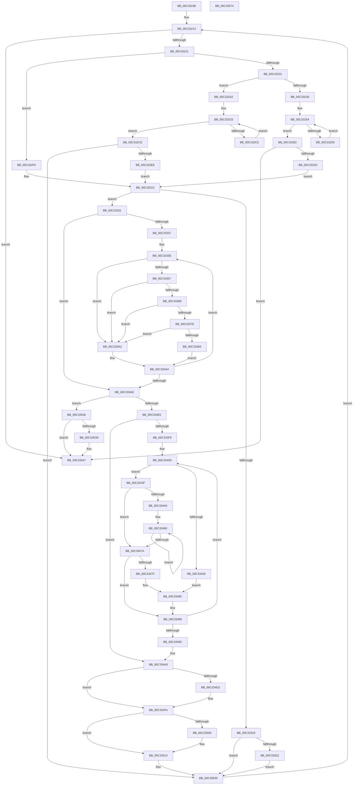

# IopInitializeResourceMap

- RVA: `0x00C33198`–`0x00C33575` (길이 `989` bytes)
- VA: `0x0000000140C33198`
- 실행 섹션: `INIT`
- PDB 이름 있음: `예`; PDB Function 태그: `아니요`
- unwind 정보 RVA: `0x000BA3A4`
- 디코드: `256`개 명령, `989/989` bytes 표시
- 미해석 바이트: `0` (있으면 어셈블리에 `.byte`로 보존)

> 이 문서는 커널 이미지의 기계어와 PDB 기호를 분석해 생성했습니다. 4번과 5번은 함수 원형과 자료형을 바이너리 사용 방식에서 추정한 C 해석이며 원본 소스 복구 결과는 아닙니다.

## 1. Dependencies

- 직접 호출 지점: **19**; 고유 호출 대상: **9**
- 직접 호출자로 확인된 함수: **1**
- RIP 상대 이미지 참조: **9**

### Outgoing calls
- `0x00C331F2` → [RtlInitUnicodeString](../../text/42/RtlInitUnicodeString_function_0042A780.md) (function, `0x0042A780`)
- `0x00C3323D` → [RtlInitUnicodeString](../../text/42/RtlInitUnicodeString_function_0042A780.md) (function, `0x0042A780`)
- `0x00C3324D` → [RtlInitUnicodeString](../../text/42/RtlInitUnicodeString_function_0042A780.md) (function, `0x0042A780`)
- `0x00C3328F` → [MmInitializeMemoryLimits](../C6/MmInitializeMemoryLimits_function_00C67150.md) (function, `0x00C67150`)
- `0x00C332A9` → [RtlInitUnicodeString](../../text/42/RtlInitUnicodeString_function_0042A780.md) (function, `0x0042A780`)
- `0x00C332B9` → [RtlInitUnicodeString](../../text/42/RtlInitUnicodeString_function_0042A780.md) (function, `0x0042A780`)
- `0x00C332DD` → [MmInitializeMemoryLimits](../C6/MmInitializeMemoryLimits_function_00C67150.md) (function, `0x00C67150`)
- `0x00C332F7` → [RtlInitUnicodeString](../../text/42/RtlInitUnicodeString_function_0042A780.md) (function, `0x0042A780`)
- `0x00C33307` → [RtlInitUnicodeString](../../text/42/RtlInitUnicodeString_function_0042A780.md) (function, `0x0042A780`)
- `0x00C33327` → [ExFreePoolWithTag](../../poolcode/B8/ExFreePoolWithTag_function_00B82870.md) (function, `0x00B82870`)
- `0x00C333CB` → [ExAllocatePool2](../../poolcode/B8/ExAllocatePool2_function_00B820F0.md) (function, `0x00B820F0`)
- `0x00C33430` → [RtlCmEncodeMemIoResource](../../text/5E/RtlCmEncodeMemIoResource_function_005E7BF0.md) (function, `0x005E7BF0`)
- `0x00C334C9` → [IopCreateRegistryKeyEx](../../page/A8/IopCreateRegistryKeyEx_function_00A89038.md) (function, `0x00A89038`)
- `0x00C334EC` → [IopWriteResourceList](../../page/72/IopWriteResourceList_function_0072A5F0.md) (function, `0x0072A5F0`)
- `0x00C334F5` → [ZwClose](../../text/6A/ZwClose_function_006AD2B0.md) (function, `0x006AD2B0`)
- `0x00C334FF` → [ExFreePoolWithTag](../../poolcode/B8/ExFreePoolWithTag_function_00B82870.md) (function, `0x00B82870`)
- `0x00C3350E` → [ExFreePoolWithTag](../../poolcode/B8/ExFreePoolWithTag_function_00B82870.md) (function, `0x00B82870`)
- `0x00C33542` → [ExFreePoolWithTag](../../poolcode/B8/ExFreePoolWithTag_function_00B82870.md) (function, `0x00B82870`)
- `0x00C3354E` → [_security_check_cookie](../../text/6A/_security_check_cookie_function_006AC640.md) (function, `0x006AC640`)

### Direct callers
- [IopInitializePlugPlayServices](../C2/IopInitializePlugPlayServices_function_00C2F298.md) at `0x00C2F57F`

### Static image references
- `0x00C331BB` → RVA `0x00E0A740` (`.data`; read)
- `0x00C331CE` → RVA `0x00C82790` (`IopWstrSystem`; read)
- `0x00C33236` → RVA `0x00C82770` (`IopWstrLoaderReservedMemory`; read)
- `0x00C33242` → RVA `0x00028448` (`.rdata`; read)
- `0x00C332A2` → RVA `0x00C82700` (`IopWstrSpecialMemory`; read)
- `0x00C332AE` → RVA `0x00028458` (`.rdata`; read)
- `0x00C332F0` → RVA `0x00C82750` (`IopWstrPhysicalMemory`; read)
- `0x00C3330C` → RVA `0x00FC6B88` (`ALMOSTRO`; read)
- `0x00C334AE` → RVA `0x00FDA028` (`PAGEDATA`; read)

## 2. Other-region calls and transfers

- 다른 실행 섹션으로 향하는 call: **17**
  - `0x00C331F2` → [RtlInitUnicodeString](../../text/42/RtlInitUnicodeString_function_0042A780.md) (`INIT` → `.text`)
  - `0x00C3323D` → [RtlInitUnicodeString](../../text/42/RtlInitUnicodeString_function_0042A780.md) (`INIT` → `.text`)
  - `0x00C3324D` → [RtlInitUnicodeString](../../text/42/RtlInitUnicodeString_function_0042A780.md) (`INIT` → `.text`)
  - `0x00C332A9` → [RtlInitUnicodeString](../../text/42/RtlInitUnicodeString_function_0042A780.md) (`INIT` → `.text`)
  - `0x00C332B9` → [RtlInitUnicodeString](../../text/42/RtlInitUnicodeString_function_0042A780.md) (`INIT` → `.text`)
  - `0x00C332F7` → [RtlInitUnicodeString](../../text/42/RtlInitUnicodeString_function_0042A780.md) (`INIT` → `.text`)
  - `0x00C33307` → [RtlInitUnicodeString](../../text/42/RtlInitUnicodeString_function_0042A780.md) (`INIT` → `.text`)
  - `0x00C33327` → [ExFreePoolWithTag](../../poolcode/B8/ExFreePoolWithTag_function_00B82870.md) (`INIT` → `POOLCODE`)
  - `0x00C333CB` → [ExAllocatePool2](../../poolcode/B8/ExAllocatePool2_function_00B820F0.md) (`INIT` → `POOLCODE`)
  - `0x00C33430` → [RtlCmEncodeMemIoResource](../../text/5E/RtlCmEncodeMemIoResource_function_005E7BF0.md) (`INIT` → `.text`)
  - `0x00C334C9` → [IopCreateRegistryKeyEx](../../page/A8/IopCreateRegistryKeyEx_function_00A89038.md) (`INIT` → `PAGE`)
  - `0x00C334EC` → [IopWriteResourceList](../../page/72/IopWriteResourceList_function_0072A5F0.md) (`INIT` → `PAGE`)
  - `0x00C334F5` → [ZwClose](../../text/6A/ZwClose_function_006AD2B0.md) (`INIT` → `.text`)
  - `0x00C334FF` → [ExFreePoolWithTag](../../poolcode/B8/ExFreePoolWithTag_function_00B82870.md) (`INIT` → `POOLCODE`)
  - `0x00C3350E` → [ExFreePoolWithTag](../../poolcode/B8/ExFreePoolWithTag_function_00B82870.md) (`INIT` → `POOLCODE`)
  - `0x00C33542` → [ExFreePoolWithTag](../../poolcode/B8/ExFreePoolWithTag_function_00B82870.md) (`INIT` → `POOLCODE`)
  - `0x00C3354E` → [_security_check_cookie](../../text/6A/_security_check_cookie_function_006AC640.md) (`INIT` → `.text`)
- 별도 외부 분기/꼬리 이동을 확인하지 못했습니다.

## 3. Assembly (complete function range)

```asm
00C33198  48 8B C4                        mov rax, rsp
00C3319B  48 89 58 10                     mov qword ptr [rax + 0x10], rbx
00C3319F  48 89 70 18                     mov qword ptr [rax + 0x18], rsi
00C331A3  48 89 78 20                     mov qword ptr [rax + 0x20], rdi
00C331A7  55                              push rbp
00C331A8  41 54                           push r12
00C331AA  41 55                           push r13
00C331AC  41 56                           push r14
00C331AE  41 57                           push r15
00C331B0  48 8D 68 A1                     lea rbp, [rax - 0x5f]
00C331B4  48 81 EC C0 00 00 00            sub rsp, 0xc0
00C331BB  48 8B 05 7E 75 1D 00            mov rax, qword ptr [rip + 0x1d757e]
00C331C2  48 33 C4                        xor rax, rsp
00C331C5  48 89 45 27                     mov qword ptr [rbp + 0x27], rax
00C331C9  48 83 65 AF 00                  and qword ptr [rbp - 0x51], 0
00C331CE  48 8D 15 BB F5 04 00            lea rdx, [rip + 0x4f5bb]
00C331D5  0F 57 C0                        xorps xmm0, xmm0
00C331D8  48 89 4D B7                     mov qword ptr [rbp - 0x49], rcx
00C331DC  48 8B D9                        mov rbx, rcx
00C331DF  0F 57 C9                        xorps xmm1, xmm1
00C331E2  48 8D 4D E7                     lea rcx, [rbp - 0x19]
00C331E6  0F 11 45 CF                     movups xmmword ptr [rbp - 0x31], xmm0
00C331EA  0F 11 4D E7                     movups xmmword ptr [rbp - 0x19], xmm1
00C331EE  0F 11 45 BF                     movups xmmword ptr [rbp - 0x41], xmm0
00C331F2  E8 89 75 7F FF                  call 0x14042a780
00C331F7  45 33 F6                        xor r14d, r14d
00C331FA  BF 00 F0 FF FF                  mov edi, 0xfffff000
00C331FF  49 BF FF 0F 00 00 FF FF FF FF   movabs r15, 0xffffffff00000fff
00C33209  49 BC 00 10 00 00 FF FF FF FF   movabs r12, 0xffffffff00001000
00C33213  44 89 75 A7                     mov dword ptr [rbp - 0x59], r14d
00C33217  41 83 FE 03                     cmp r14d, 3
00C3321B  0F 83 26 03 00 00               jae 0x140c33547
00C33221  48 8D 4D CF                     lea rcx, [rbp - 0x31]
00C33225  41 8B C6                        mov eax, r14d
00C33228  45 85 F6                        test r14d, r14d
00C3322B  0F 84 BF 00 00 00               je 0x140c332f0
00C33231  83 F8 01                        cmp eax, 1
00C33234  74 6C                           je 0x140c332a2
00C33236  48 8D 15 33 F5 04 00            lea rdx, [rip + 0x4f533]
00C3323D  E8 3E 75 7F FF                  call 0x14042a780
00C33242  48 8D 15 FF 51 3F FF            lea rdx, [rip - 0xc0ae01]
00C33249  48 8D 4D BF                     lea rcx, [rbp - 0x41]
00C3324D  E8 2E 75 7F FF                  call 0x14042a780
00C33252  33 C0                           xor eax, eax
00C33254  83 F8 2F                        cmp eax, 0x2f
00C33257  73 09                           jae 0x140c33262
00C33259  C6 44 05 F7 00                  mov byte ptr [rbp + rax - 9], 0
00C3325E  FF C0                           inc eax
00C33260  EB F2                           jmp 0x140c33254
00C33262  48 8D 55 F7                     lea rdx, [rbp - 9]
00C33266  C6 45 FA 01                     mov byte ptr [rbp - 6], 1
00C3326A  48 8B CB                        mov rcx, rbx
00C3326D  66 C7 45 15 01 01               mov word ptr [rbp + 0x15], 0x101
00C33273  C6 45 FD 01                     mov byte ptr [rbp - 3], 1
00C33277  C6 45 17 01                     mov byte ptr [rbp + 0x17], 1
00C3327B  66 C7 45 1B 01 01               mov word ptr [rbp + 0x1b], 0x101
00C33281  66 C7 45 0D 01 01               mov word ptr [rbp + 0xd], 0x101
00C33287  C6 45 11 01                     mov byte ptr [rbp + 0x11], 1
00C3328B  C6 45 14 01                     mov byte ptr [rbp + 0x14], 1
00C3328F  E8 BC 3E 03 00                  call 0x140c67150
00C33294  48 8B F0                        mov rsi, rax
00C33297  48 85 C0                        test rax, rax
00C3329A  0F 84 A7 02 00 00               je 0x140c33547
00C332A0  EB 71                           jmp 0x140c33313
00C332A2  48 8D 15 57 F4 04 00            lea rdx, [rip + 0x4f457]
00C332A9  E8 D2 74 7F FF                  call 0x14042a780
00C332AE  48 8D 15 A3 51 3F FF            lea rdx, [rip - 0xc0ae5d]
00C332B5  48 8D 4D BF                     lea rcx, [rbp - 0x41]
00C332B9  E8 C2 74 7F FF                  call 0x14042a780
00C332BE  33 C0                           xor eax, eax
00C332C0  83 F8 2F                        cmp eax, 0x2f
00C332C3  73 09                           jae 0x140c332ce
00C332C5  C6 44 05 F7 00                  mov byte ptr [rbp + rax - 9], 0
00C332CA  FF C0                           inc eax
00C332CC  EB F2                           jmp 0x140c332c0
00C332CE  48 8D 55 F7                     lea rdx, [rbp - 9]
00C332D2  C6 45 0D 01                     mov byte ptr [rbp + 0xd], 1
00C332D6  48 8B CB                        mov rcx, rbx
00C332D9  C6 45 11 01                     mov byte ptr [rbp + 0x11], 1
00C332DD  E8 6E 3E 03 00                  call 0x140c67150
00C332E2  48 8B F0                        mov rsi, rax
00C332E5  48 85 C0                        test rax, rax
00C332E8  0F 84 42 02 00 00               je 0x140c33530
00C332EE  EB 23                           jmp 0x140c33313
00C332F0  48 8D 15 59 F4 04 00            lea rdx, [rip + 0x4f459]
00C332F7  E8 84 74 7F FF                  call 0x14042a780
00C332FC  48 8D 15 55 51 3F FF            lea rdx, [rip - 0xc0aeab]
00C33303  48 8D 4D BF                     lea rcx, [rbp - 0x41]
00C33307  E8 74 74 7F FF                  call 0x14042a780
00C3330C  48 8B 35 75 38 39 00            mov rsi, qword ptr [rip + 0x393875]
00C33313  8B 06                           mov eax, dword ptr [rsi]
00C33315  85 C0                           test eax, eax
00C33317  75 18                           jne 0x140c33331
00C33319  45 85 F6                        test r14d, r14d
00C3331C  0F 84 0E 02 00 00               je 0x140c33530
00C33322  33 D2                           xor edx, edx
00C33324  48 8B CE                        mov rcx, rsi
00C33327  E8 44 F5 F4 FF                  call 0x140b82870
00C3332C  E9 FF 01 00 00                  jmp 0x140c33530
00C33331  33 DB                           xor ebx, ebx
00C33333  85 C0                           test eax, eax
00C33335  74 77                           je 0x140c333ae
00C33337  4C 8D 4E 18                     lea r9, [rsi + 0x18]
00C3333B  4C 8B D0                        mov r10, rax
00C3333E  4D 8B 01                        mov r8, qword ptr [r9]
00C33341  49 C1 E0 0C                     shl r8, 0xc
00C33345  49 8B C8                        mov rcx, r8
00C33348  48 C1 E9 08                     shr rcx, 8
00C3334C  8B C9                           mov ecx, ecx
00C3334E  48 C1 E1 08                     shl rcx, 8
00C33352  4C 3B C1                        cmp r8, rcx
00C33355  74 4B                           je 0x140c333a2
00C33357  49 8B C8                        mov rcx, r8
00C3335A  48 C1 E9 10                     shr rcx, 0x10
00C3335E  8B C9                           mov ecx, ecx
00C33360  48 C1 E1 10                     shl rcx, 0x10
00C33364  4C 3B C1                        cmp r8, rcx
00C33367  74 39                           je 0x140c333a2
00C33369  49 8B C0                        mov rax, r8
00C3336C  48 B9 00 00 00 00 FF FF FF FF   movabs rcx, 0xffffffff00000000
00C33376  48 23 C1                        and rax, rcx
00C33379  4C 3B C0                        cmp r8, rax
00C3337C  74 24                           je 0x140c333a2
00C3337E  4C 3B C7                        cmp r8, rdi
00C33381  76 1F                           jbe 0x140c333a2
00C33383  33 D2                           xor edx, edx
00C33385  4B 8D 04 38                     lea rax, [r8 + r15]
00C33389  48 F7 F7                        div rdi
00C3338C  48 FF C0                        inc rax
00C3338F  03 D8                           add ebx, eax
00C33391  49 0F AF C4                     imul rax, r12
00C33395  4C 03 C0                        add r8, rax
00C33398  8D 43 01                        lea eax, [rbx + 1]
00C3339B  0F 44 C3                        cmove eax, ebx
00C3339E  8B D8                           mov ebx, eax
00C333A0  EB 02                           jmp 0x140c333a4
00C333A2  FF C3                           inc ebx
00C333A4  49 83 C1 10                     add r9, 0x10
00C333A8  49 83 EA 01                     sub r10, 1
00C333AC  75 90                           jne 0x140c3333e
00C333AE  8D 43 01                        lea eax, [rbx + 1]
00C333B1  B9 00 01 00 00                  mov ecx, 0x100
00C333B6  44 8D 3C 80                     lea r15d, [rax + rax*4]
00C333BA  41 B8 50 70 20 20               mov r8d, 0x20207050
00C333C0  41 C1 E7 02                     shl r15d, 2
00C333C4  41 8B D7                        mov edx, r15d
00C333C7  44 89 7D AB                     mov dword ptr [rbp - 0x55], r15d
00C333CB  E8 20 ED F4 FF                  call 0x140b820f0
00C333D0  48 89 45 DF                     mov qword ptr [rbp - 0x21], rax
00C333D4  4C 8B E0                        mov r12, rax
00C333D7  48 85 C0                        test rax, rax
00C333DA  0F 84 58 01 00 00               je 0x140c33538
00C333E0  45 33 ED                        xor r13d, r13d
00C333E3  C7 00 01 00 00 00               mov dword ptr [rax], 1
00C333E9  89 58 10                        mov dword ptr [rax + 0x10], ebx
00C333EC  48 8D 78 14                     lea rdi, [rax + 0x14]
00C333F0  44 39 2E                        cmp dword ptr [rsi], r13d
00C333F3  0F 86 AF 00 00 00               jbe 0x140c334a8
00C333F9  49 BC FF 0F 00 00 FF FF FF FF   movabs r12, 0xffffffff00000fff
00C33403  49 BE 00 10 00 00 FF FF FF FF   movabs r14, 0xffffffff00001000
00C3340D  41 8B DD                        mov ebx, r13d
00C33410  B2 03                           mov dl, 3
00C33412  48 03 DB                        add rbx, rbx
00C33415  48 8B CF                        mov rcx, rdi
00C33418  4C 8B 7C DE 18                  mov r15, qword ptr [rsi + rbx*8 + 0x18]
00C3341D  48 8B 5C DE 10                  mov rbx, qword ptr [rsi + rbx*8 + 0x10]
00C33422  48 C1 E3 0C                     shl rbx, 0xc
00C33426  49 C1 E7 0C                     shl r15, 0xc
00C3342A  4C 8B CB                        mov r9, rbx
00C3342D  4D 8B C7                        mov r8, r15
00C33430  E8 BB 47 9B FF                  call 0x1405e7bf0
00C33435  85 C0                           test eax, eax
00C33437  78 06                           js 0x140c3343f
00C33439  C6 47 01 01                     mov byte ptr [rdi + 1], 1
00C3343D  EB 4D                           jmp 0x140c3348c
00C3343F  41 B8 00 F0 FF FF               mov r8d, 0xfffff000
00C33445  4D 3B F8                        cmp r15, r8
00C33448  76 30                           jbe 0x140c3347a
00C3344A  4B 8D 04 27                     lea rax, [r15 + r12]
00C3344E  33 D2                           xor edx, edx
00C33450  49 F7 F0                        div r8
00C33453  48 FF C0                        inc rax
00C33456  48 8B C8                        mov rcx, rax
00C33459  49 0F AF CE                     imul rcx, r14
00C3345D  4C 03 F9                        add r15, rcx
00C33460  48 89 5F 04                     mov qword ptr [rdi + 4], rbx
00C33464  49 03 D8                        add rbx, r8
00C33467  66 C7 07 03 01                  mov word ptr [rdi], 0x103
00C3346C  44 89 47 0C                     mov dword ptr [rdi + 0xc], r8d
00C33470  48 83 C7 14                     add rdi, 0x14
00C33474  48 83 E8 01                     sub rax, 1
00C33478  75 E6                           jne 0x140c33460
00C3347A  4D 85 FF                        test r15, r15
00C3347D  74 11                           je 0x140c33490
00C3347F  66 C7 07 03 01                  mov word ptr [rdi], 0x103
00C33484  48 89 5F 04                     mov qword ptr [rdi + 4], rbx
00C33488  44 89 7F 0C                     mov dword ptr [rdi + 0xc], r15d
00C3348C  48 83 C7 14                     add rdi, 0x14
00C33490  41 FF C5                        inc r13d
00C33493  44 3B 2E                        cmp r13d, dword ptr [rsi]
00C33496  0F 82 71 FF FF FF               jb 0x140c3340d
00C3349C  44 8B 75 A7                     mov r14d, dword ptr [rbp - 0x59]
00C334A0  4C 8B 65 DF                     mov r12, qword ptr [rbp - 0x21]
00C334A4  44 8B 7D AB                     mov r15d, dword ptr [rbp - 0x55]
00C334A8  48 83 64 24 28 00               and qword ptr [rsp + 0x28], 0
00C334AE  4C 8D 05 73 6B 3A 00            lea r8, [rip + 0x3a6b73]
00C334B5  41 B9 1F 00 02 00               mov r9d, 0x2001f
00C334BB  C7 44 24 20 01 00 00 00         mov dword ptr [rsp + 0x20], 1
00C334C3  33 D2                           xor edx, edx
00C334C5  48 8D 4D AF                     lea rcx, [rbp - 0x51]
00C334C9  E8 6A 5B E5 FF                  call 0x140a89038
00C334CE  85 C0                           test eax, eax
00C334D0  78 28                           js 0x140c334fa
00C334D2  48 8B 4D AF                     mov rcx, qword ptr [rbp - 0x51]
00C334D6  4C 8D 4D BF                     lea r9, [rbp - 0x41]
00C334DA  44 89 7C 24 28                  mov dword ptr [rsp + 0x28], r15d
00C334DF  4C 8D 45 CF                     lea r8, [rbp - 0x31]
00C334E3  48 8D 55 E7                     lea rdx, [rbp - 0x19]
00C334E7  4C 89 64 24 20                  mov qword ptr [rsp + 0x20], r12
00C334EC  E8 FF 70 AF FF                  call 0x14072a5f0
00C334F1  48 8B 4D AF                     mov rcx, qword ptr [rbp - 0x51]
00C334F5  E8 B6 9D A7 FF                  call 0x1406ad2b0
00C334FA  33 D2                           xor edx, edx
00C334FC  49 8B CC                        mov rcx, r12
00C334FF  E8 6C F3 F4 FF                  call 0x140b82870
00C33504  45 85 F6                        test r14d, r14d
00C33507  74 0A                           je 0x140c33513
00C33509  33 D2                           xor edx, edx
00C3350B  48 8B CE                        mov rcx, rsi
00C3350E  E8 5D F3 F4 FF                  call 0x140b82870
00C33513  48 8B 5D B7                     mov rbx, qword ptr [rbp - 0x49]
00C33517  49 BC 00 10 00 00 FF FF FF FF   movabs r12, 0xffffffff00001000
00C33521  49 BF FF 0F 00 00 FF FF FF FF   movabs r15, 0xffffffff00000fff
00C3352B  BF 00 F0 FF FF                  mov edi, 0xfffff000
00C33530  41 FF C6                        inc r14d
00C33533  E9 DB FC FF FF                  jmp 0x140c33213
00C33538  45 85 F6                        test r14d, r14d
00C3353B  74 0A                           je 0x140c33547
00C3353D  33 D2                           xor edx, edx
00C3353F  48 8B CE                        mov rcx, rsi
00C33542  E8 29 F3 F4 FF                  call 0x140b82870
00C33547  48 8B 4D 27                     mov rcx, qword ptr [rbp + 0x27]
00C3354B  48 33 CC                        xor rcx, rsp
00C3354E  E8 ED 90 A7 FF                  call 0x1406ac640
00C33553  4C 8D 9C 24 C0 00 00 00         lea r11, [rsp + 0xc0]
00C3355B  49 8B 5B 38                     mov rbx, qword ptr [r11 + 0x38]
00C3355F  49 8B 73 40                     mov rsi, qword ptr [r11 + 0x40]
00C33563  49 8B 7B 48                     mov rdi, qword ptr [r11 + 0x48]
00C33567  49 8B E3                        mov rsp, r11
00C3356A  41 5F                           pop r15
00C3356C  41 5E                           pop r14
00C3356E  41 5D                           pop r13
00C33570  41 5C                           pop r12
00C33572  5D                              pop rbp
00C33573  C3                              ret
00C33574  CC                              int3
```

## 4. C-style interpretation (structured pseudocode)

```c
__int64 __fastcall IopInitializeResourceMap(__int64 a1)
{
    __int64 result;
    __int64 v_r10;
    __int64 v_r13;
    __int64 v_r14;
    __int64 v_r15;
    __int64 v_rbx;
    __int64 v_rdi;
    __int64 v_rsp;
    unsigned __int64 v_stack_m28;
    unsigned __int64 v_stack_mC0;
    unsigned int v_stack_mC8;

    *(unsigned __int64 *)(v_rsp + 16) = v_rbx;
    *(unsigned __int64 *)(v_rsp + 24) = v_rsi;
    *(unsigned __int64 *)(v_rsp + 32) = v_rdi;
    v_rsp = (v_rsp) - (192);
    result = (*(unsigned __int64 *)(v_rip + 1930622)) ^ (v_rsp);
    *(unsigned __int64 *)(v_rsp - 95 + 39) = result;
    *(unsigned __int64 *)(v_rsp - 95 - 73) = a1;
    *(unsigned __int64 *)(v_rsp - 95 - 49) = v_xmm0;
    *(unsigned __int64 *)(v_rsp - 95 - 25) = v_xmm1;
    *(unsigned __int64 *)(v_rsp - 95 - 65) = v_xmm0;
    result = RtlInitUnicodeString(v_rsp - 95 - 25, v_rip + 325051, a3, a4);
    v_r14 = 0;
loc_00C33213:
    *(unsigned int *)(v_rsp - 95 - 89) = 0;
    if (0 >= 3) goto loc_00C33547;
    if (0 == 0) goto loc_00C332F0;
    if (0 == 1) goto loc_00C332A2;
    result = RtlInitUnicodeString(v_rsp - 95 - 49, v_rip + 324915, a3, a4);
    result = RtlInitUnicodeString(v_rsp - 95 - 65, v_rip - 12627457, a3, a4);
    result = 0;
loc_00C33254:
    if (0 >= 47) goto loc_00C33262;
    *(unsigned __int8 *)(v_rsp - 95 + result * 1 - 9) = 0;
    result = (unsigned int)((result) + 1);
    goto loc_00C33254;
loc_00C33262:
    *(unsigned __int8 *)(v_rsp - 95 - 6) = 1;
    *(unsigned __int16 *)(v_rsp - 95 + 21) = 257;
    *(unsigned __int8 *)(v_rsp - 95 - 3) = 1;
    *(unsigned __int8 *)(v_rsp - 95 + 23) = 1;
    *(unsigned __int16 *)(v_rsp - 95 + 27) = 257;
    *(unsigned __int16 *)(v_rsp - 95 + 13) = 257;
    *(unsigned __int8 *)(v_rsp - 95 + 17) = 1;
    *(unsigned __int8 *)(v_rsp - 95 + 20) = 1;
    result = MmInitializeMemoryLimits(a1, v_rsp - 95 - 9, a3, a4);
    if (result == 0) goto loc_00C33547;
    goto loc_00C33313;
loc_00C332A2:
    result = RtlInitUnicodeString(a1, v_rip + 324695, a3, a4);
    result = RtlInitUnicodeString(v_rsp - 95 - 65, v_rip - 12627549, a3, a4);
    result = 0;
loc_00C332C0:
    if (0 >= 47) goto loc_00C332CE;
    *(unsigned __int8 *)(v_rsp - 95 + result * 1 - 9) = 0;
    result = (unsigned int)((result) + 1);
    goto loc_00C332C0;
loc_00C332CE:
    *(unsigned __int8 *)(v_rsp - 95 + 13) = 1;
    *(unsigned __int8 *)(v_rsp - 95 + 17) = 1;
    result = MmInitializeMemoryLimits(a1, v_rsp - 95 - 9, a3, a4);
    if (result == 0) goto loc_00C33530;
    goto loc_00C33313;
loc_00C332F0:
    result = RtlInitUnicodeString(a1, v_rip + 324697, a3, a4);
    result = RtlInitUnicodeString(v_rsp - 95 - 65, v_rip - 12627627, a3, a4);
loc_00C33313:
    if ((unsigned int)((unsigned int)(*(unsigned int *)(*(unsigned __int64 *)(v_rip + 3750005)))) != 0) goto loc_00C33331;
    if (0 == 0) goto loc_00C33530;
    a2 = 0;
    result = ExFreePoolWithTag(*(unsigned __int64 *)(v_rip + 3750005), a2, a3, a4);
    goto loc_00C33530;
loc_00C33331:
    v_rbx = 0;
    if ((unsigned int)(result) == 0) goto loc_00C333AE;
loc_00C3333E:
    a3 = (*(unsigned __int64 *)(*(unsigned __int64 *)(v_rip + 3750005) + 24)) << (12);
    a1 = (a3) >> (8);
    a1 = ((unsigned int)((unsigned int)(a1))) << (8);
    if (a3 == a1) goto loc_00C333A2;
    a1 = (a3) >> (16);
    a1 = ((unsigned int)((unsigned int)(a1))) << (16);
    if (a3 == a1) goto loc_00C333A2;
    result = (a3) & (a1);
    if (a3 == result) goto loc_00C333A2;
    if (a3 <= ((unsigned int)(0xFFFFF000ULL))) goto loc_00C333A2;
    a2 = 0;
    result = (a3 + v_r15 * 1) + 1;
    v_rbx = (unsigned int)((v_rbx) + ((unsigned int)(result)));
    result = (result) * (v_r12);
    a3 = (a3) + (result);
    result = v_rbx + 1;
    if (condition_is_equal) { result = (unsigned int)(v_rbx); }
    goto loc_00C333A4;
loc_00C333A2:
    v_rbx = (unsigned int)(((unsigned int)((unsigned int)(result))) + 1);
loc_00C333A4:
    a4 = (*(unsigned __int64 *)(v_rip + 3750005) + 24) + (16);
    v_r10 = (result) - (1);
    if (condition_is_not_equal) goto loc_00C3333E;
loc_00C333AE:
    v_r15 = (unsigned int)((v_rbx + 1 + v_rbx + 1 * 4) << (2));
    *(unsigned int *)(v_rsp - 95 - 85) = (unsigned int)(v_r15);
    result = ExAllocatePool2(256, (unsigned int)((unsigned int)(v_r15)), (unsigned int)(0x20207050ULL), a4);
    *(unsigned __int64 *)(v_rsp - 95 - 33) = result;
    if (result == 0) goto loc_00C33538;
    v_r13 = 0;
    *(unsigned int *)(result) = 1;
    *(unsigned int *)(result + 16) = (unsigned int)(v_rbx);
    if ((*(unsigned int *)(*(unsigned __int64 *)(v_rip + 3750005))) <= 0) goto loc_00C334A8;
loc_00C3340D:
    v_rbx = (0) + (0);
    v_rbx = (*(unsigned __int64 *)(*(unsigned __int64 *)(v_rip + 3750005) + v_rbx * 8 + 16)) << (12);
    v_r15 = (*(unsigned __int64 *)(*(unsigned __int64 *)(v_rip + 3750005) + v_rbx * 8 + 24)) << (12);
    result = RtlCmEncodeMemIoResource(result + 20, 3, v_r15, v_rbx);
    if (sign_flag) goto loc_00C3343F;
    *(unsigned __int8 *)(result + 20 + 1) = 1;
    goto loc_00C3348C;
loc_00C3343F:
    if (v_r15 <= ((unsigned int)(0xFFFFF000ULL))) goto loc_00C3347A;
    a2 = 0;
    result = (v_r15 + result * 1) + 1;
    a1 = (result) * (0);
    v_r15 = (v_r15) + (a1);
loc_00C33460:
    *(unsigned __int64 *)(result + 20 + 4) = v_rbx;
    v_rbx = (v_rbx) + ((unsigned int)(0xFFFFF000ULL));
    *(unsigned __int16 *)(result + 20) = 259;
    *(unsigned int *)(result + 20 + 12) = (unsigned int)((unsigned int)(0xFFFFF000ULL));
    v_rdi = (result + 20) + (20);
    result = (result) - (1);
    if (condition_is_not_equal) goto loc_00C33460;
loc_00C3347A:
    if (v_r15 == 0) goto loc_00C33490;
    *(unsigned __int16 *)(v_rdi) = 259;
    *(unsigned __int64 *)(v_rdi + 4) = v_rbx;
    *(unsigned int *)(v_rdi + 12) = (unsigned int)(v_r15);
loc_00C3348C:
    v_rdi = (v_rdi) + (20);
loc_00C33490:
    v_r13 = (unsigned int)((v_r13) + 1);
    if (((unsigned int)(v_r13)) < (*(unsigned int *)(*(unsigned __int64 *)(v_rip + 3750005)))) goto loc_00C3340D;
loc_00C334A8:
    v_stack_mC8 = 1;
    a2 = 0;
    result = IopCreateRegistryKeyEx(v_rsp - 95 - 81, a2, v_rip + 3828595, (unsigned int)(0x2001FULL));
    if (!(sign_flag)) {
        a1 = *(unsigned __int64 *)(v_rsp - 95 - 81);
        a4 = v_rsp - 95 - 65;
        v_stack_mC0 = (unsigned int)((unsigned int)(*(unsigned int *)(v_rsp - 95 - 85)));
        a3 = v_rsp - 95 - 49;
        a2 = v_rsp - 95 - 25;
        v_stack_mC8 = *(unsigned __int64 *)(v_rsp - 95 - 33);
        result = IopWriteResourceList(a1, a2, a3, a4);
        a1 = *(unsigned __int64 *)(v_rsp - 95 - 81);
        result = ZwClose(a1, a2, a3, a4);
    }
    a2 = 0;
    result = ExFreePoolWithTag(*(unsigned __int64 *)(v_rsp - 95 - 33), a2, a3, a4);
    if ((unsigned int)((unsigned int)(*(unsigned int *)(v_rsp - 95 - 89))) != 0) {
        a2 = 0;
        a1 = *(unsigned __int64 *)(v_rip + 3750005);
        result = ExFreePoolWithTag(a1, a2, a3, a4);
    }
loc_00C33530:
    v_r14 = (unsigned int)(((unsigned int)(*(unsigned int *)(v_rsp - 95 - 89))) + 1);
    goto loc_00C33213;
loc_00C33538:
    if ((unsigned int)(v_r14) != 0) {
        a2 = 0;
        a1 = *(unsigned __int64 *)(v_rip + 3750005);
        result = ExFreePoolWithTag(a1, a2, a3, a4);
    }
    a1 = (*(unsigned __int64 *)(v_rsp - 95 + 39)) ^ (v_rsp);
    result = _security_check_cookie(a1, a2, a3, a4);
    return result;
}
```

## 5. (Beta) C Style

```c
int64_t IopInitializeResourceMap(int64_t Arg1)
{
    int64_t result;
    int64_t local_r10;
    int64_t local_r13;
    int64_t local_r14;
    int64_t local_r15;
    int64_t local_rbx;
    int64_t local_rdi;
    int64_t local_rsp;
    uint64_t v_stack_m28;
    uint64_t v_stack_mC0;
    uint32_t v_stack_mC8;

    *(uint64_t *)(local_rsp + 0x10) = local_rbx;
    *(uint64_t *)(local_rsp + 0x18) = local_rsi;
    *(uint64_t *)(local_rsp + 0x20) = local_rdi;
    local_rsp = (local_rsp) - (192);
    result = (*(uint64_t *)(v_rip + 0x1D757E)) ^ (local_rsp);
    *(uint64_t *)(local_rsp - 0x5F + 0x27) = result;
    *(uint64_t *)(local_rsp - 0x5F - 0x49) = Arg1;
    *(uint64_t *)(local_rsp - 0x5F - 0x31) = v_xmm0;
    *(uint64_t *)(local_rsp - 0x5F - 0x19) = v_xmm1;
    *(uint64_t *)(local_rsp - 0x5F - 0x41) = v_xmm0;
    result = RtlInitUnicodeString(local_rsp - 95 - 25, v_rip + 325051, a3, a4);
    local_r14 = 0;
loc_00C33213:
    *(uint32_t *)(local_rsp - 0x5F - 0x59) = 0;
    if (0 >= 3) goto loc_00C33547;
    if (0 == 0) goto loc_00C332F0;
    if (0 == 1) goto loc_00C332A2;
    result = RtlInitUnicodeString(local_rsp - 95 - 49, v_rip + 324915, a3, a4);
    result = RtlInitUnicodeString(local_rsp - 95 - 65, v_rip - 12627457, a3, a4);
    result = 0;
loc_00C33254:
    if (0 >= 47) goto loc_00C33262;
    *(uint8_t *)(local_rsp - 0x5F + result * 1 - 0x9) = 0;
    result = (uint32_t)((result) + 1);
    goto loc_00C33254;
loc_00C33262:
    *(uint8_t *)(local_rsp - 0x5F - 0x6) = 1;
    *(uint16_t *)(local_rsp - 0x5F + 0x15) = 257;
    *(uint8_t *)(local_rsp - 0x5F - 0x3) = 1;
    *(uint8_t *)(local_rsp - 0x5F + 0x17) = 1;
    *(uint16_t *)(local_rsp - 0x5F + 0x1B) = 257;
    *(uint16_t *)(local_rsp - 0x5F + 0xD) = 257;
    *(uint8_t *)(local_rsp - 0x5F + 0x11) = 1;
    *(uint8_t *)(local_rsp - 0x5F + 0x14) = 1;
    result = MmInitializeMemoryLimits(Arg1, local_rsp - 95 - 9, a3, a4);
    if (result == 0) goto loc_00C33547;
    goto loc_00C33313;
loc_00C332A2:
    result = RtlInitUnicodeString(Arg1, v_rip + 324695, a3, a4);
    result = RtlInitUnicodeString(local_rsp - 95 - 65, v_rip - 12627549, a3, a4);
    result = 0;
loc_00C332C0:
    if (0 >= 47) goto loc_00C332CE;
    *(uint8_t *)(local_rsp - 0x5F + result * 1 - 0x9) = 0;
    result = (uint32_t)((result) + 1);
    goto loc_00C332C0;
loc_00C332CE:
    *(uint8_t *)(local_rsp - 0x5F + 0xD) = 1;
    *(uint8_t *)(local_rsp - 0x5F + 0x11) = 1;
    result = MmInitializeMemoryLimits(Arg1, local_rsp - 95 - 9, a3, a4);
    if (result == 0) goto loc_00C33530;
    goto loc_00C33313;
loc_00C332F0:
    result = RtlInitUnicodeString(Arg1, v_rip + 324697, a3, a4);
    result = RtlInitUnicodeString(local_rsp - 95 - 65, v_rip - 12627627, a3, a4);
loc_00C33313:
    if ((uint32_t)((uint32_t)(*(uint32_t *)(*(uint64_t *)(v_rip + 0x393875)))) != 0) goto loc_00C33331;
    if (0 == 0) goto loc_00C33530;
    a2 = 0;
    result = ExFreePoolWithTag(*(uint64_t *)(v_rip + 0x393875), a2, a3, a4);
    goto loc_00C33530;
loc_00C33331:
    local_rbx = 0;
    if ((uint32_t)(result) == 0) goto loc_00C333AE;
loc_00C3333E:
    a3 = (*(uint64_t *)(*(uint64_t *)(v_rip + 0x393875) + 0x18)) << (12);
    Arg1 = (a3) >> (8);
    Arg1 = ((uint32_t)((uint32_t)(Arg1))) << (8);
    if (a3 == Arg1) goto loc_00C333A2;
    Arg1 = (a3) >> (16);
    Arg1 = ((uint32_t)((uint32_t)(Arg1))) << (16);
    if (a3 == Arg1) goto loc_00C333A2;
    result = (a3) & (Arg1);
    if (a3 == result) goto loc_00C333A2;
    if (a3 <= ((uint32_t)(0xFFFFF000ULL))) goto loc_00C333A2;
    a2 = 0;
    result = (a3 + local_r15 * 1) + 1;
    local_rbx = (uint32_t)((local_rbx) + ((uint32_t)(result)));
    result = (result) * (local_r12);
    a3 = (a3) + (result);
    result = local_rbx + 1;
    if (condition_is_equal) { result = (uint32_t)(local_rbx); }
    goto loc_00C333A4;
loc_00C333A2:
    local_rbx = (uint32_t)(((uint32_t)((uint32_t)(result))) + 1);
loc_00C333A4:
    a4 = (*(uint64_t *)(v_rip + 0x393875) + 24) + (16);
    local_r10 = (result) - (1);
    if (condition_is_not_equal) goto loc_00C3333E;
loc_00C333AE:
    local_r15 = (uint32_t)((local_rbx + 1 + local_rbx + 1 * 4) << (2));
    *(uint32_t *)(local_rsp - 0x5F - 0x55) = (uint32_t)(local_r15);
    result = ExAllocatePool2(256, (uint32_t)((uint32_t)(local_r15)), (uint32_t)(0x20207050ULL), a4);
    *(uint64_t *)(local_rsp - 0x5F - 0x21) = result;
    if (result == 0) goto loc_00C33538;
    local_r13 = 0;
    *(uint32_t *)(result) = 1;
    *(uint32_t *)(result + 0x10) = (uint32_t)(local_rbx);
    if ((*(uint32_t *)(*(uint64_t *)(v_rip + 0x393875))) <= 0) goto loc_00C334A8;
loc_00C3340D:
    local_rbx = (0) + (0);
    local_rbx = (*(uint64_t *)(*(uint64_t *)(v_rip + 0x393875) + local_rbx * 8 + 0x10)) << (12);
    local_r15 = (*(uint64_t *)(*(uint64_t *)(v_rip + 0x393875) + local_rbx * 8 + 0x18)) << (12);
    result = RtlCmEncodeMemIoResource(result + 20, 3, local_r15, local_rbx);
    if (sign_flag) goto loc_00C3343F;
    *(uint8_t *)(result + 0x14 + 0x1) = 1;
    goto loc_00C3348C;
loc_00C3343F:
    if (local_r15 <= ((uint32_t)(0xFFFFF000ULL))) goto loc_00C3347A;
    a2 = 0;
    result = (local_r15 + result * 1) + 1;
    Arg1 = (result) * (0);
    local_r15 = (local_r15) + (Arg1);
loc_00C33460:
    *(uint64_t *)(result + 0x14 + 0x4) = local_rbx;
    local_rbx = (local_rbx) + ((uint32_t)(0xFFFFF000ULL));
    *(uint16_t *)(result + 0x14) = 259;
    *(uint32_t *)(result + 0x14 + 0xC) = (uint32_t)((uint32_t)(0xFFFFF000ULL));
    local_rdi = (result + 20) + (20);
    result = (result) - (1);
    if (condition_is_not_equal) goto loc_00C33460;
loc_00C3347A:
    if (local_r15 == 0) goto loc_00C33490;
    *(uint16_t *)(local_rdi) = 259;
    *(uint64_t *)(local_rdi + 0x4) = local_rbx;
    *(uint32_t *)(local_rdi + 0xC) = (uint32_t)(local_r15);
loc_00C3348C:
    local_rdi = (local_rdi) + (20);
loc_00C33490:
    local_r13 = (uint32_t)((local_r13) + 1);
    if (((uint32_t)(local_r13)) < (*(uint32_t *)(*(uint64_t *)(v_rip + 0x393875)))) goto loc_00C3340D;
loc_00C334A8:
    v_stack_mC8 = 1;
    a2 = 0;
    result = IopCreateRegistryKeyEx(local_rsp - 95 - 81, a2, v_rip + 3828595, (uint32_t)(0x2001FULL));
    if (!(sign_flag)) {
        Arg1 = *(uint64_t *)(local_rsp - 0x5F - 0x51);
        a4 = local_rsp - 95 - 65;
        v_stack_mC0 = (uint32_t)((uint32_t)(*(uint32_t *)(local_rsp - 0x5F - 0x55)));
        a3 = local_rsp - 95 - 49;
        a2 = local_rsp - 95 - 25;
        v_stack_mC8 = *(uint64_t *)(local_rsp - 0x5F - 0x21);
        result = IopWriteResourceList(Arg1, a2, a3, a4);
        Arg1 = *(uint64_t *)(local_rsp - 0x5F - 0x51);
        result = ZwClose(Arg1, a2, a3, a4);
    }
    a2 = 0;
    result = ExFreePoolWithTag(*(uint64_t *)(local_rsp - 0x5F - 0x21), a2, a3, a4);
    if ((uint32_t)((uint32_t)(*(uint32_t *)(local_rsp - 0x5F - 0x59))) != 0) {
        a2 = 0;
        Arg1 = *(uint64_t *)(v_rip + 0x393875);
        result = ExFreePoolWithTag(Arg1, a2, a3, a4);
    }
loc_00C33530:
    local_r14 = (uint32_t)(((uint32_t)(*(uint32_t *)(local_rsp - 0x5F - 0x59))) + 1);
    goto loc_00C33213;
loc_00C33538:
    if ((uint32_t)(local_r14) != 0) {
        a2 = 0;
        Arg1 = *(uint64_t *)(v_rip + 0x393875);
        result = ExFreePoolWithTag(Arg1, a2, a3, a4);
    }
    Arg1 = (*(uint64_t *)(local_rsp - 0x5F + 0x27)) ^ (local_rsp);
    result = _security_check_cookie(Arg1, a2, a3, a4);
    return result;
}
```

## 6. Execution-region graph

[열기: 2D/3D 그래프와 함수 탐색 컨트롤 패널](../../../control-panel.html?section=init&rva=0x00C33198&view=graph)

- 2D 그래프는 위에서 아래로 흐르고, 3D 그래프는 빈 공간을 드래그해 회전합니다. Shift+드래그는 이동, 휠은 확대·축소, 함수 노드 선택은 대상 보고서 이동입니다.

### Static fallback


