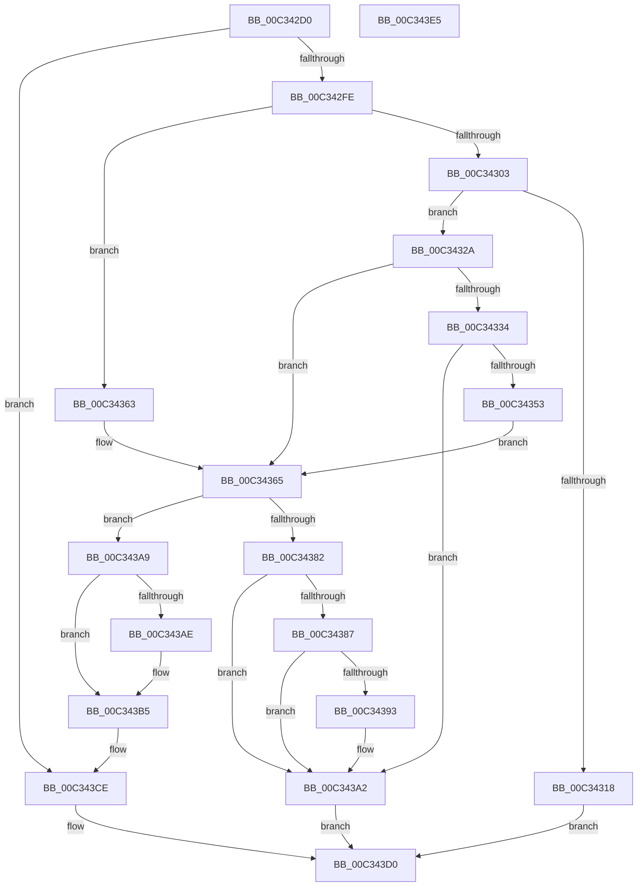

# IopReportBootResources

- RVA: `0x00C342D0`–`0x00C343E6` (길이 `278` bytes)
- VA: `0x0000000140C342D0`
- 실행 섹션: `INIT`
- PDB 이름 있음: `예`; PDB Function 태그: `아니요`
- unwind 정보 RVA: `0x0005C954`
- 디코드: `73`개 명령, `278/278` bytes 표시
- 미해석 바이트: `0` (있으면 어셈블리에 `.byte`로 보존)

> 이 문서는 커널 이미지의 기계어와 PDB 기호를 분석해 생성했습니다. 4번과 5번은 함수 원형과 자료형을 바이너리 사용 방식에서 추정한 C 해석이며 원본 소스 복구 결과는 아닙니다.

## 1. Dependencies

- 직접 호출 지점: **6**; 고유 호출 대상: **5**
- 직접 호출자로 확인된 함수: **0**
- RIP 상대 이미지 참조: **2**

### Outgoing calls
- `0x00C342EF` → [PnpDetermineResourceListSize](../../page/8F/PnpDetermineResourceListSize_function_008FC6F8.md) (function, `0x008FC6F8`)
- `0x00C34320` → [IopAllocateBootResources](../../page/72/IopAllocateBootResources_function_0072E680.md) (function, `0x0072E680`)
- `0x00C34342` → [ExAllocatePool2](../../poolcode/B8/ExAllocatePool2_function_00B820F0.md) (function, `0x00B820F0`)
- `0x00C3435C` → [memcpy](../../text/6C/memcpy_function_006C6840.md) (function, `0x006C6840`)
- `0x00C34375` → [ExAllocatePool2](../../poolcode/B8/ExAllocatePool2_function_00B820F0.md) (function, `0x00B820F0`)
- `0x00C34395` → [ExFreePoolWithTag](../../poolcode/B8/ExFreePoolWithTag_function_00B82870.md) (function, `0x00B82870`)

### Direct callers
- 이 함수 시작 RVA로 연결되는 직접 call은 확인되지 않았습니다. 간접 호출은 완전히 역산할 수 없습니다.

### Static image references
- `0x00C343BD` → RVA `0x010086B8` (`INITDATA`; read)
- `0x00C343C7` → RVA `0x010086B8` (`INITDATA`; write)

## 2. Other-region calls and transfers

- 다른 실행 섹션으로 향하는 call: **6**
  - `0x00C342EF` → [PnpDetermineResourceListSize](../../page/8F/PnpDetermineResourceListSize_function_008FC6F8.md) (`INIT` → `PAGE`)
  - `0x00C34320` → [IopAllocateBootResources](../../page/72/IopAllocateBootResources_function_0072E680.md) (`INIT` → `PAGE`)
  - `0x00C34342` → [ExAllocatePool2](../../poolcode/B8/ExAllocatePool2_function_00B820F0.md) (`INIT` → `POOLCODE`)
  - `0x00C3435C` → [memcpy](../../text/6C/memcpy_function_006C6840.md) (`INIT` → `.text`)
  - `0x00C34375` → [ExAllocatePool2](../../poolcode/B8/ExAllocatePool2_function_00B820F0.md) (`INIT` → `POOLCODE`)
  - `0x00C34395` → [ExFreePoolWithTag](../../poolcode/B8/ExFreePoolWithTag_function_00B82870.md) (`INIT` → `POOLCODE`)
- 별도 외부 분기/꼬리 이동을 확인하지 못했습니다.

## 3. Assembly (complete function range)

```asm
00C342D0  48 89 5C 24 08                  mov qword ptr [rsp + 8], rbx
00C342D5  48 89 6C 24 10                  mov qword ptr [rsp + 0x10], rbp
00C342DA  48 89 74 24 18                  mov qword ptr [rsp + 0x18], rsi
00C342DF  57                              push rdi
00C342E0  48 83 EC 20                     sub rsp, 0x20
00C342E4  8B E9                           mov ebp, ecx
00C342E6  49 8B F8                        mov rdi, r8
00C342E9  49 8B C8                        mov rcx, r8
00C342EC  48 8B F2                        mov rsi, rdx
00C342EF  E8 04 84 CC FF                  call 0x1408fc6f8
00C342F4  8B D0                           mov edx, eax
00C342F6  85 C0                           test eax, eax
00C342F8  0F 84 D0 00 00 00               je 0x140c343ce
00C342FE  48 85 F6                        test rsi, rsi
00C34301  74 60                           je 0x140c34363
00C34303  48 8B 86 38 01 00 00            mov rax, qword ptr [rsi + 0x138]
00C3430A  48 8B 58 28                     mov rbx, qword ptr [rax + 0x28]
00C3430E  8B 83 8C 01 00 00               mov eax, dword ptr [rbx + 0x18c]
00C34314  A8 01                           test al, 1
00C34316  75 12                           jne 0x140c3432a
00C34318  4C 8B C7                        mov r8, rdi
00C3431B  48 8B D6                        mov rdx, rsi
00C3431E  8B CD                           mov ecx, ebp
00C34320  E8 5B A3 AF FF                  call 0x14072e680
00C34325  E9 A6 00 00 00                  jmp 0x140c343d0
00C3432A  48 83 BB 20 02 00 00 00         cmp qword ptr [rbx + 0x220], 0
00C34332  75 31                           jne 0x140c34365
00C34334  B9 00 01 00 00                  mov ecx, 0x100
00C34339  41 B8 50 70 20 20               mov r8d, 0x20207050
00C3433F  48 8B EA                        mov rbp, rdx
00C34342  E8 A9 DD F4 FF                  call 0x140b820f0
00C34347  48 89 83 20 02 00 00            mov qword ptr [rbx + 0x220], rax
00C3434E  48 85 C0                        test rax, rax
00C34351  74 4F                           je 0x140c343a2
00C34353  4C 8B C5                        mov r8, rbp
00C34356  48 8B D7                        mov rdx, rdi
00C34359  48 8B C8                        mov rcx, rax
00C3435C  E8 DF 24 A9 FF                  call 0x1406c6840
00C34361  EB 02                           jmp 0x140c34365
00C34363  33 DB                           xor ebx, ebx
00C34365  BA 18 00 00 00                  mov edx, 0x18
00C3436A  B9 00 01 00 00                  mov ecx, 0x100
00C3436F  41 B8 50 70 20 20               mov r8d, 0x20207050
00C34375  E8 76 DD F4 FF                  call 0x140b820f0
00C3437A  48 8B C8                        mov rcx, rax
00C3437D  48 85 C0                        test rax, rax
00C34380  75 27                           jne 0x140c343a9
00C34382  48 85 DB                        test rbx, rbx
00C34385  74 1B                           je 0x140c343a2
00C34387  48 8B 8B 20 02 00 00            mov rcx, qword ptr [rbx + 0x220]
00C3438E  48 85 C9                        test rcx, rcx
00C34391  74 0F                           je 0x140c343a2
00C34393  33 D2                           xor edx, edx
00C34395  E8 D6 E4 F4 FF                  call 0x140b82870
00C3439A  48 83 A3 20 02 00 00 00         and qword ptr [rbx + 0x220], 0
00C343A2  B8 9A 00 00 C0                  mov eax, 0xc000009a
00C343A7  EB 27                           jmp 0x140c343d0
00C343A9  48 85 DB                        test rbx, rbx
00C343AC  74 07                           je 0x140c343b5
00C343AE  48 8B BB 20 02 00 00            mov rdi, qword ptr [rbx + 0x220]
00C343B5  48 89 78 10                     mov qword ptr [rax + 0x10], rdi
00C343B9  48 89 70 08                     mov qword ptr [rax + 8], rsi
00C343BD  48 8B 05 F4 42 3D 00            mov rax, qword ptr [rip + 0x3d42f4]
00C343C4  48 89 01                        mov qword ptr [rcx], rax
00C343C7  48 89 0D EA 42 3D 00            mov qword ptr [rip + 0x3d42ea], rcx
00C343CE  33 C0                           xor eax, eax
00C343D0  48 8B 5C 24 30                  mov rbx, qword ptr [rsp + 0x30]
00C343D5  48 8B 6C 24 38                  mov rbp, qword ptr [rsp + 0x38]
00C343DA  48 8B 74 24 40                  mov rsi, qword ptr [rsp + 0x40]
00C343DF  48 83 C4 20                     add rsp, 0x20
00C343E3  5F                              pop rdi
00C343E4  C3                              ret
00C343E5  CC                              int3
```

## 4. C-style interpretation (structured pseudocode)

```c
__int64 __fastcall IopReportBootResources(int a1, __int64 a2, __int64 a3)
{
    __int64 result;
    __int64 v_rbx;
    __int64 v_rdi;
    __int64 v_rsp;
    unsigned __int64 v_stack_p10;
    unsigned __int64 v_stack_p18;
    unsigned __int64 v_stack_p8;

    v_stack_p8 = v_rbx;
    v_stack_p10 = v_rbp;
    v_stack_p18 = v_rsi;
    v_rsp = (v_rsp) - (32);
    result = PnpDetermineResourceListSize(a3, a2, a3, a4);
    if ((unsigned int)(result) == 0) goto loc_00C343CE;
    if (a2 == 0) goto loc_00C34363;
    if ((((unsigned __int8)((unsigned int)(*(unsigned int *)(*(unsigned __int64 *)(*(unsigned __int64 *)(a2 + 312) + 40) + 396)))) & (1)) != 0) goto loc_00C3432A;
    result = IopAllocateBootResources((unsigned int)((unsigned int)((unsigned int)(a1))), a2, a3, a4);
    goto loc_00C343D0;
loc_00C3432A:
    if ((*(unsigned __int64 *)(*(unsigned __int64 *)(*(unsigned __int64 *)(a2 + 312) + 40) + 544)) != 0) goto loc_00C34365;
    result = ExAllocatePool2(256, a2, (unsigned int)(0x20207050ULL), a4);
    *(unsigned __int64 *)(*(unsigned __int64 *)(*(unsigned __int64 *)(a2 + 312) + 40) + 544) = result;
    if (result == 0) goto loc_00C343A2;
    result = memcpy(result, a3, a2, a4);
    goto loc_00C34365;
loc_00C34363:
    v_rbx = 0;
loc_00C34365:
    result = ExAllocatePool2(256, 24, (unsigned int)(0x20207050ULL), a4);
    if (result != 0) goto loc_00C343A9;
    if (0 == 0) goto loc_00C343A2;
    if (*(unsigned __int64 *)(v_rbx + 544) != 0) {
        a2 = 0;
        result = ExFreePoolWithTag(*(unsigned __int64 *)(v_rbx + 544), a2, (unsigned int)(0x20207050ULL), a4);
    }
    goto loc_00C343D0;
loc_00C343A9:
    v_rdi = a3;
    if (0 != 0) {
        v_rdi = *(unsigned __int64 *)(v_rbx + 544);
    }
    *(unsigned __int64 *)((unsigned int)(0xC000009AULL) + 16) = v_rdi;
    *(unsigned __int64 *)((unsigned int)(0xC000009AULL) + 8) = 0;
    *(unsigned __int64 *)(*(unsigned __int64 *)(v_rbx + 544)) = *(unsigned __int64 *)(v_rip + 4014836);
    *(unsigned __int64 *)(v_rip + 4014826) = *(unsigned __int64 *)(v_rbx + 544);
loc_00C343CE:
    result = 0;
loc_00C343D0:
    v_rsp = (v_rsp) + (32);
    return result;
}
```

## 5. (Beta) C Style

```c
int64_t IopReportBootResources(int32_t Arg1, int64_t Arg2, int64_t Arg3)
{
    int64_t result;
    int64_t local_rbx;
    int64_t local_rdi;
    int64_t local_rsp;
    uint64_t v_stack_p10;
    uint64_t v_stack_p18;
    uint64_t v_stack_p8;

    v_stack_p8 = local_rbx;
    v_stack_p10 = local_rbp;
    v_stack_p18 = local_rsi;
    local_rsp = (local_rsp) - (32);
    result = PnpDetermineResourceListSize(Arg3, Arg2, Arg3, a4);
    if ((uint32_t)(result) == 0) goto loc_00C343CE;
    if (Arg2 == 0) goto loc_00C34363;
    if ((((uint8_t)((uint32_t)(*(uint32_t *)(*(uint64_t *)(*(uint64_t *)(Arg2 + 0x138) + 0x28) + 0x18C)))) & (1)) != 0) goto loc_00C3432A;
    result = IopAllocateBootResources((uint32_t)((uint32_t)((uint32_t)(Arg1))), Arg2, Arg3, a4);
    goto loc_00C343D0;
loc_00C3432A:
    if ((*(uint64_t *)(*(uint64_t *)(*(uint64_t *)(Arg2 + 0x138) + 0x28) + 0x220)) != 0) goto loc_00C34365;
    result = ExAllocatePool2(256, Arg2, (uint32_t)(0x20207050ULL), a4);
    *(uint64_t *)(*(uint64_t *)(*(uint64_t *)(Arg2 + 0x138) + 0x28) + 0x220) = result;
    if (result == 0) goto loc_00C343A2;
    result = memcpy(result, Arg3, Arg2, a4);
    goto loc_00C34365;
loc_00C34363:
    local_rbx = 0;
loc_00C34365:
    result = ExAllocatePool2(256, 24, (uint32_t)(0x20207050ULL), a4);
    if (result != 0) goto loc_00C343A9;
    if (0 == 0) goto loc_00C343A2;
    if (*(uint64_t *)(local_rbx + 0x220) != 0) {
        Arg2 = 0;
        result = ExFreePoolWithTag(*(uint64_t *)(local_rbx + 0x220), Arg2, (uint32_t)(0x20207050ULL), a4);
    }
    goto loc_00C343D0;
loc_00C343A9:
    local_rdi = Arg3;
    if (0 != 0) {
        local_rdi = *(uint64_t *)(local_rbx + 0x220);
    }
    *(uint64_t *)((uint32_t)(0xC000009AULL) + 0x10) = local_rdi;
    *(uint64_t *)((uint32_t)(0xC000009AULL) + 0x8) = 0;
    *(uint64_t *)(*(uint64_t *)(local_rbx + 0x220)) = *(uint64_t *)(v_rip + 0x3D42F4);
    *(uint64_t *)(v_rip + 0x3D42EA) = *(uint64_t *)(local_rbx + 0x220);
loc_00C343CE:
    result = 0;
loc_00C343D0:
    local_rsp = (local_rsp) + (32);
    return result;
}
```

## 6. Execution-region graph

[열기: 2D/3D 그래프와 함수 탐색 컨트롤 패널](../../../control-panel.html?section=init&rva=0x00C342D0&view=graph)

- 2D 그래프는 위에서 아래로 흐르고, 3D 그래프는 빈 공간을 드래그해 회전합니다. Shift+드래그는 이동, 휠은 확대·축소, 함수 노드 선택은 대상 보고서 이동입니다.

### Static fallback


