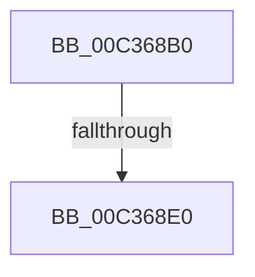

# KasanInitSystem

- RVA: `0x00C368B0`–`0x00C368E9` (길이 `57` bytes)
- VA: `0x0000000140C368B0`
- 실행 섹션: `INIT`
- PDB 이름 있음: `예`; PDB Function 태그: `아니요`
- unwind 정보 RVA: `0x000C96F0`
- 디코드: `16`개 명령, `57/57` bytes 표시
- 미해석 바이트: `0` (있으면 어셈블리에 `.byte`로 보존)

> 이 문서는 커널 이미지의 기계어와 PDB 기호를 분석해 생성했습니다. 4번과 5번은 함수 원형과 자료형을 바이너리 사용 방식에서 추정한 C 해석이며 원본 소스 복구 결과는 아닙니다.

## 1. Dependencies

- 직접 호출 지점: **0**; 고유 호출 대상: **0**
- 직접 호출자로 확인된 함수: **3**
- RIP 상대 이미지 참조: **1**

### Outgoing calls
- 직접 디코드된 call 명령이 없습니다.

### Direct callers
- [KiSystemStartup](../../pagelk/B5/KiSystemStartup_function_00B5B3C0.md) at `0x00B5B3E8`
- [MiInitializeKasan](../C6/MiInitializeKasan_function_00C60810.md) at `0x00C60907`
- [Phase1InitializationIoReady](../C7/Phase1InitializationIoReady_function_00C70458.md) at `0x00C70618`

### Static image references
- `0x00C368C1` → RVA `0x00E0A740` (`.data`; read)

## 2. Other-region calls and transfers

- 다른 실행 섹션으로 향하는 call: **0**
- call이 아닌 외부 분기/꼬리 이동: **2**
  - `0x00C368DA` → [sub_00C36AE9 + 0x195](Unknown_function_00C36AE9.md) (`tail-transfer`)
  - `0x00C368E3` → [sub_00C36AE9 + 0x10F](Unknown_function_00C36AE9.md) (`tail-transfer`)

## 3. Assembly (complete function range)

```asm
00C368B0  4C 8B DC                        mov r11, rsp
00C368B3  55                              push rbp
00C368B4  53                              push rbx
00C368B5  56                              push rsi
00C368B6  49 8D 6B A1                     lea rbp, [r11 - 0x5f]
00C368BA  48 81 EC C0 00 00 00            sub rsp, 0xc0
00C368C1  48 8B 05 78 3E 1D 00            mov rax, qword ptr [rip + 0x1d3e78]
00C368C8  48 33 C4                        xor rax, rsp
00C368CB  48 89 45 37                     mov qword ptr [rbp + 0x37], rax
00C368CF  33 F6                           xor esi, esi
00C368D1  48 8B D9                        mov rbx, rcx
00C368D4  48 89 75 CF                     mov qword ptr [rbp - 0x31], rsi
00C368D8  85 D2                           test edx, edx
00C368DA  0F 84 9E 03 00 00               je 0x140c36c7e
00C368E0  83 FA 01                        cmp edx, 1
00C368E3  0F 84 0F 03 00 00               je 0x140c36bf8
```

## 4. C-style interpretation (structured pseudocode)

```c
__int64 __fastcall KasanInitSystem(__int64 a1, int a2)
{
    __int64 result;
    __int64 v_rsi;
    __int64 v_rsp;

    v_rsp = (v_rsp) - (192);
    result = (*(unsigned __int64 *)(v_rip + 1916536)) ^ (v_rsp);
    *(unsigned __int64 *)(v_rsp - 95 + 55) = result;
    v_rsi = 0;
    *(unsigned __int64 *)(v_rsp - 95 - 49) = 0;
}
```

## 5. (Beta) C Style

```c
int64_t KasanInitSystem(int64_t Arg1, int32_t Arg2)
{
    int64_t result;
    int64_t local_rsi;
    int64_t local_rsp;

    local_rsp = (local_rsp) - (192);
    result = (*(uint64_t *)(v_rip + 0x1D3E78)) ^ (local_rsp);
    *(uint64_t *)(local_rsp - 0x5F + 0x37) = result;
    local_rsi = 0;
    *(uint64_t *)(local_rsp - 0x5F - 0x31) = 0;
}
```

## 6. Execution-region graph

[열기: 2D/3D 그래프와 함수 탐색 컨트롤 패널](../../../control-panel.html?section=init&rva=0x00C368B0&view=graph)

- 2D 그래프는 위에서 아래로 흐르고, 3D 그래프는 빈 공간을 드래그해 회전합니다. Shift+드래그는 이동, 휠은 확대·축소, 함수 노드 선택은 대상 보고서 이동입니다.

### Static fallback


