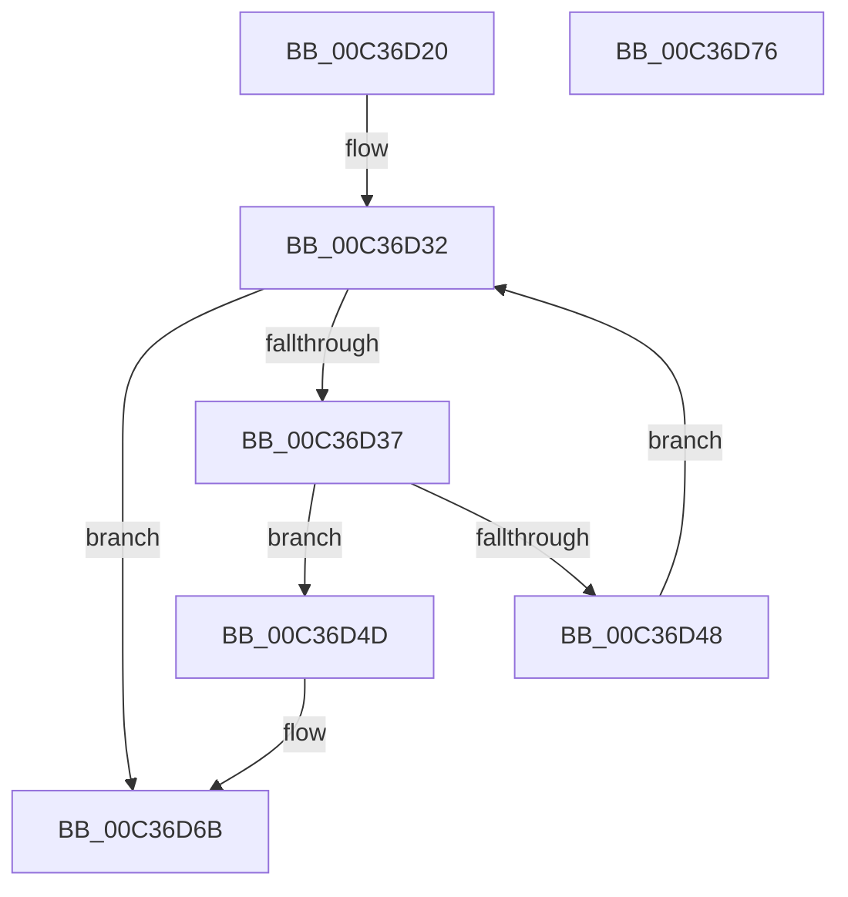

# KasanInitializeLoadedModules

- RVA: `0x00C36D20`–`0x00C36D77` (길이 `87` bytes)
- VA: `0x0000000140C36D20`
- 실행 섹션: `INIT`
- PDB 이름 있음: `예`; PDB Function 태그: `아니요`
- unwind 정보 RVA: `0x0006E5F8`
- 디코드: `27`개 명령, `87/87` bytes 표시
- 미해석 바이트: `0` (있으면 어셈블리에 `.byte`로 보존)

> 이 문서는 커널 이미지의 기계어와 PDB 기호를 분석해 생성했습니다. 4번과 5번은 함수 원형과 자료형을 바이너리 사용 방식에서 추정한 C 해석이며 원본 소스 복구 결과는 아닙니다.

## 1. Dependencies

- 직접 호출 지점: **2**; 고유 호출 대상: **2**
- 직접 호출자로 확인된 함수: **1**
- RIP 상대 이미지 참조: **0**

### Outgoing calls
- `0x00C36D3F` → [KasanDriverLoadImageInternal](../../text/4C/KasanDriverLoadImageInternal_function_004C2840.md) (function, `0x004C2840`)
- `0x00C36D65` → [KeBugCheckEx](../../text/4F/KeBugCheckEx_function_004FD660.md) (function, `0x004FD660`)

### Direct callers
- [sub_00C36AE9](Unknown_function_00C36AE9.md) at `0x00C36CC6`

### Static image references
- 디코드된 RIP-relative 메모리 참조가 없습니다.

## 2. Other-region calls and transfers

- 다른 실행 섹션으로 향하는 call: **2**
  - `0x00C36D3F` → [KasanDriverLoadImageInternal](../../text/4C/KasanDriverLoadImageInternal_function_004C2840.md) (`INIT` → `.text`)
  - `0x00C36D65` → [KeBugCheckEx](../../text/4F/KeBugCheckEx_function_004FD660.md) (`INIT` → `.text`)
- 별도 외부 분기/꼬리 이동을 확인하지 못했습니다.

## 3. Assembly (complete function range)

```asm
00C36D20  48 89 5C 24 08                  mov qword ptr [rsp + 8], rbx
00C36D25  57                              push rdi
00C36D26  48 83 EC 30                     sub rsp, 0x30
00C36D2A  48 8B 59 10                     mov rbx, qword ptr [rcx + 0x10]
00C36D2E  48 8D 79 10                     lea rdi, [rcx + 0x10]
00C36D32  48 3B DF                        cmp rbx, rdi
00C36D35  74 34                           je 0x140c36d6b
00C36D37  BA 01 00 00 00                  mov edx, 1
00C36D3C  48 8B CB                        mov rcx, rbx
00C36D3F  E8 FC BA 88 FF                  call 0x1404c2840
00C36D44  85 C0                           test eax, eax
00C36D46  78 05                           js 0x140c36d4d
00C36D48  48 8B 1B                        mov rbx, qword ptr [rbx]
00C36D4B  EB E5                           jmp 0x140c36d32
00C36D4D  BA 04 00 00 00                  mov edx, 4
00C36D52  48 98                           cdqe
00C36D54  4C 8B CB                        mov r9, rbx
00C36D57  48 89 44 24 20                  mov qword ptr [rsp + 0x20], rax
00C36D5C  B9 F1 01 00 00                  mov ecx, 0x1f1
00C36D61  44 8D 42 03                     lea r8d, [rdx + 3]
00C36D65  E8 F6 68 8C FF                  call 0x1404fd660
00C36D6A  CC                              int3
00C36D6B  48 8B 5C 24 40                  mov rbx, qword ptr [rsp + 0x40]
00C36D70  48 83 C4 30                     add rsp, 0x30
00C36D74  5F                              pop rdi
00C36D75  C3                              ret
00C36D76  CC                              int3
```

## 4. C-style interpretation (structured pseudocode)

```c
__int64 __fastcall KasanInitializeLoadedModules(__int64 a1)
{
    __int64 result;
    __int64 v_rsp;
    unsigned __int64 v_stack_m18;
    unsigned __int64 v_stack_p8;

    v_stack_p8 = v_rbx;
    v_rsp = (v_rsp) - (48);
loc_00C36D32:
    if ((*(unsigned __int64 *)(a1 + 16)) == (a1 + 16)) goto loc_00C36D6B;
    result = KasanDriverLoadImageInternal(*(unsigned __int64 *)(a1 + 16), 1, a3, a4);
    if (sign_flag) goto loc_00C36D4D;
    goto loc_00C36D32;
loc_00C36D4D:
    v_stack_m18 = result;
    result = KeBugCheckEx(497, 4, 4 + 3, *(unsigned __int64 *)(*(unsigned __int64 *)(a1 + 16)));
loc_00C36D6B:
    v_rsp = (v_rsp) + (48);
    return result;
}
```

## 5. (Beta) C Style

```c
int64_t KasanInitializeLoadedModules(void *Arg1)
{
    uint8_t *arg1 = (uint8_t *)Arg1;

    int64_t result;
    int64_t local_rsp;
    uint64_t v_stack_m18;
    uint64_t v_stack_p8;

    v_stack_p8 = local_rbx;
    local_rsp = (local_rsp) - (48);
loc_00C36D32:
    if ((*(uint64_t *)(arg1 + 0x10)) == (Arg1 + 16)) goto loc_00C36D6B;
    result = KasanDriverLoadImageInternal(*(uint64_t *)(arg1 + 0x10), 1, a3, a4);
    if (sign_flag) goto loc_00C36D4D;
    goto loc_00C36D32;
loc_00C36D4D:
    v_stack_m18 = result;
    result = KeBugCheckEx(497, 4, 4 + 3, *(uint64_t *)(*(uint64_t *)(arg1 + 0x10)));
loc_00C36D6B:
    local_rsp = (local_rsp) + (48);
    return result;
}
```

### 관측된 메모리 오프셋

구조체 형식이 확인되지 않은 접근은 인자 기준의 오프셋으로만 기록했습니다.

| 기준 인자 | 오프셋 표현 | 폭 (bit) | 접근 |
|---|---:|---:|---|
| `Arg1` | `+ 0x10` | `64` | `R` |

## 6. Execution-region graph

[열기: 2D/3D 그래프와 함수 탐색 컨트롤 패널](../../../control-panel.html?section=init&rva=0x00C36D20&view=graph)

- 2D 그래프는 위에서 아래로 흐르고, 3D 그래프는 빈 공간을 드래그해 회전합니다. Shift+드래그는 이동, 휠은 확대·축소, 함수 노드 선택은 대상 보고서 이동입니다.

### Static fallback


