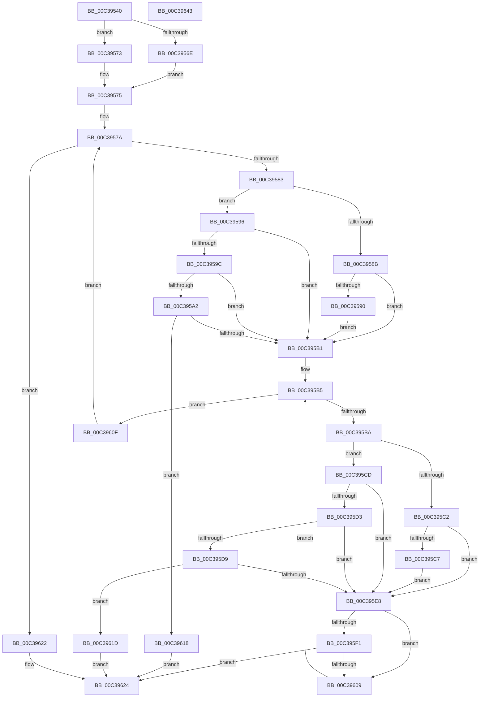

# KeFindConfigurationNextEntry

- RVA: `0x00C39540`–`0x00C39644` (길이 `260` bytes)
- VA: `0x0000000140C39540`
- 실행 섹션: `INIT`
- PDB 이름 있음: `예`; PDB Function 태그: `아니요`
- unwind 정보 RVA: `0x000847EC`
- 디코드: `87`개 명령, `260/260` bytes 표시
- 미해석 바이트: `0` (있으면 어셈블리에 `.byte`로 보존)

> 이 문서는 커널 이미지의 기계어와 PDB 기호를 분석해 생성했습니다. 4번과 5번은 함수 원형과 자료형을 바이너리 사용 방식에서 추정한 C 해석이며 원본 소스 복구 결과는 아닙니다.

## 1. Dependencies

- 직접 호출 지점: **1**; 고유 호출 대상: **1**
- 직접 호출자로 확인된 함수: **3**
- RIP 상대 이미지 참조: **0**

### Outgoing calls
- `0x00C395FF` → [KeFindConfigurationNextEntry](KeFindConfigurationNextEntry_function_00C39540.md) (function, `0x00C39540`)

### Direct callers
- [HalpAcpiFindRsdp](../C1/HalpAcpiFindRsdp_function_00C1DF48.md) at `0x00C1DFC1`
- [KeFindConfigurationEntry](KeFindConfigurationEntry_function_00C39510.md) at `0x00C39524`
- [KeFindConfigurationNextEntry](KeFindConfigurationNextEntry_function_00C39540.md) at `0x00C395FF`

### Static image references
- 디코드된 RIP-relative 메모리 참조가 없습니다.

## 2. Other-region calls and transfers

- 다른 실행 섹션으로 향하는 call: **0**
- 별도 외부 분기/꼬리 이동을 확인하지 못했습니다.

## 3. Assembly (complete function range)

```asm
00C39540  48 8B C4                        mov rax, rsp
00C39543  48 89 58 08                     mov qword ptr [rax + 8], rbx
00C39547  48 89 68 10                     mov qword ptr [rax + 0x10], rbp
00C3954B  48 89 70 18                     mov qword ptr [rax + 0x18], rsi
00C3954F  48 89 78 20                     mov qword ptr [rax + 0x20], rdi
00C39553  41 54                           push r12
00C39555  41 56                           push r14
00C39557  41 57                           push r15
00C39559  48 83 EC 30                     sub rsp, 0x30
00C3955D  4D 8B F1                        mov r14, r9
00C39560  45 8B F8                        mov r15d, r8d
00C39563  44 8B E2                        mov r12d, edx
00C39566  48 8B F9                        mov rdi, rcx
00C39569  4D 85 C9                        test r9, r9
00C3956C  74 05                           je 0x140c39573
00C3956E  41 8B 29                        mov ebp, dword ptr [r9]
00C39571  EB 02                           jmp 0x140c39575
00C39573  33 ED                           xor ebp, ebp
00C39575  48 8B 74 24 70                  mov rsi, qword ptr [rsp + 0x70]
00C3957A  48 85 FF                        test rdi, rdi
00C3957D  0F 84 9F 00 00 00               je 0x140c39622
00C39583  48 8B 06                        mov rax, qword ptr [rsi]
00C39586  48 85 C0                        test rax, rax
00C39589  74 0B                           je 0x140c39596
00C3958B  48 3B F8                        cmp rdi, rax
00C3958E  75 21                           jne 0x140c395b1
00C39590  48 83 26 00                     and qword ptr [rsi], 0
00C39594  EB 1B                           jmp 0x140c395b1
00C39596  44 39 67 18                     cmp dword ptr [rdi + 0x18], r12d
00C3959A  75 15                           jne 0x140c395b1
00C3959C  44 39 7F 1C                     cmp dword ptr [rdi + 0x1c], r15d
00C395A0  75 0F                           jne 0x140c395b1
00C395A2  49 8B C6                        mov rax, r14
00C395A5  48 F7 D8                        neg rax
00C395A8  1B C9                           sbb ecx, ecx
00C395AA  23 4F 28                        and ecx, dword ptr [rdi + 0x28]
00C395AD  3B CD                           cmp ecx, ebp
00C395AF  74 67                           je 0x140c39618
00C395B1  48 8B 5F 10                     mov rbx, qword ptr [rdi + 0x10]
00C395B5  48 85 DB                        test rbx, rbx
00C395B8  74 55                           je 0x140c3960f
00C395BA  48 8B 06                        mov rax, qword ptr [rsi]
00C395BD  48 85 C0                        test rax, rax
00C395C0  74 0B                           je 0x140c395cd
00C395C2  48 3B D8                        cmp rbx, rax
00C395C5  75 21                           jne 0x140c395e8
00C395C7  48 83 26 00                     and qword ptr [rsi], 0
00C395CB  EB 1B                           jmp 0x140c395e8
00C395CD  44 39 63 18                     cmp dword ptr [rbx + 0x18], r12d
00C395D1  75 15                           jne 0x140c395e8
00C395D3  44 39 7B 1C                     cmp dword ptr [rbx + 0x1c], r15d
00C395D7  75 0F                           jne 0x140c395e8
00C395D9  49 8B C6                        mov rax, r14
00C395DC  48 F7 D8                        neg rax
00C395DF  1B C9                           sbb ecx, ecx
00C395E1  23 4B 28                        and ecx, dword ptr [rbx + 0x28]
00C395E4  3B CD                           cmp ecx, ebp
00C395E6  74 35                           je 0x140c3961d
00C395E8  48 8B 4B 08                     mov rcx, qword ptr [rbx + 8]
00C395EC  48 85 C9                        test rcx, rcx
00C395EF  74 18                           je 0x140c39609
00C395F1  4D 8B CE                        mov r9, r14
00C395F4  48 89 74 24 20                  mov qword ptr [rsp + 0x20], rsi
00C395F9  45 8B C7                        mov r8d, r15d
00C395FC  41 8B D4                        mov edx, r12d
00C395FF  E8 3C FF FF FF                  call 0x140c39540
00C39604  48 85 C0                        test rax, rax
00C39607  75 1B                           jne 0x140c39624
00C39609  48 8B 5B 10                     mov rbx, qword ptr [rbx + 0x10]
00C3960D  EB A6                           jmp 0x140c395b5
00C3960F  48 8B 7F 08                     mov rdi, qword ptr [rdi + 8]
00C39613  E9 62 FF FF FF                  jmp 0x140c3957a
00C39618  48 8B C7                        mov rax, rdi
00C3961B  EB 07                           jmp 0x140c39624
00C3961D  48 8B C3                        mov rax, rbx
00C39620  EB 02                           jmp 0x140c39624
00C39622  33 C0                           xor eax, eax
00C39624  48 8B 5C 24 50                  mov rbx, qword ptr [rsp + 0x50]
00C39629  48 8B 6C 24 58                  mov rbp, qword ptr [rsp + 0x58]
00C3962E  48 8B 74 24 60                  mov rsi, qword ptr [rsp + 0x60]
00C39633  48 8B 7C 24 68                  mov rdi, qword ptr [rsp + 0x68]
00C39638  48 83 C4 30                     add rsp, 0x30
00C3963C  41 5F                           pop r15
00C3963E  41 5E                           pop r14
00C39640  41 5C                           pop r12
00C39642  C3                              ret
00C39643  CC                              int3
```

## 4. C-style interpretation (structured pseudocode)

```c
__int64 __fastcall KeFindConfigurationNextEntry(__int64 a1, int a2, int a3, __int64 a4, __int64 a5)
{
    __int64 result;
    __int64 v_rbp;
    __int64 v_rsp;
    unsigned __int64 v_stack_m28;
    unsigned __int64 v_stack_p10;
    unsigned __int64 v_stack_p18;
    unsigned __int64 v_stack_p20;
    unsigned __int64 v_stack_p8;

    *(unsigned __int64 *)(v_rsp + 8) = v_rbx;
    *(unsigned __int64 *)(v_rsp + 16) = v_rbp;
    *(unsigned __int64 *)(v_rsp + 24) = v_rsi;
    *(unsigned __int64 *)(v_rsp + 32) = v_rdi;
    v_rsp = (v_rsp) - (48);
    if (a4 == 0) goto loc_00C39573;
    goto loc_00C39575;
loc_00C39573:
    v_rbp = 0;
loc_00C39575:
loc_00C3957A:
    if (a1 == 0) goto loc_00C39622;
    if (*(unsigned __int64 *)(a5) == 0) goto loc_00C39596;
    if (a1 != (*(unsigned __int64 *)(a5))) goto loc_00C395B1;
    goto loc_00C395B1;
loc_00C39596:
    if ((*(unsigned int *)(a1 + 24)) != ((unsigned int)((unsigned int)(a2)))) goto loc_00C395B1;
    if ((*(unsigned int *)(a1 + 28)) != ((unsigned int)((unsigned int)(a3)))) goto loc_00C395B1;
    result = -(a4);
    a1 = (unsigned int)((a1) & (*(unsigned int *)(a1 + 40)));
    if (((unsigned int)(a1)) == 0) goto loc_00C39618;
loc_00C395B1:
loc_00C395B5:
    if (*(unsigned __int64 *)(a1 + 16) == 0) goto loc_00C3960F;
    if (*(unsigned __int64 *)(a5) == 0) goto loc_00C395CD;
    if ((*(unsigned __int64 *)(a1 + 16)) != (*(unsigned __int64 *)(a5))) goto loc_00C395E8;
    goto loc_00C395E8;
loc_00C395CD:
    if ((*(unsigned int *)(*(unsigned __int64 *)(a1 + 16) + 24)) != ((unsigned int)((unsigned int)(a2)))) goto loc_00C395E8;
    if ((*(unsigned int *)(*(unsigned __int64 *)(a1 + 16) + 28)) != ((unsigned int)((unsigned int)(a3)))) goto loc_00C395E8;
    result = -(a4);
    a1 = (unsigned int)((a1) & (*(unsigned int *)(*(unsigned __int64 *)(a1 + 16) + 40)));
    if (((unsigned int)(a1)) == 0) goto loc_00C3961D;
loc_00C395E8:
    if (*(unsigned __int64 *)(*(unsigned __int64 *)(a1 + 16) + 8) == 0) goto loc_00C39609;
    v_stack_m28 = a5;
    result = KeFindConfigurationNextEntry(*(unsigned __int64 *)(*(unsigned __int64 *)(a1 + 16) + 8), (unsigned int)((unsigned int)((unsigned int)(a2))), (unsigned int)((unsigned int)((unsigned int)(a3))), a4);
    if (result != 0) goto loc_00C39624;
loc_00C39609:
    goto loc_00C395B5;
loc_00C3960F:
    goto loc_00C3957A;
loc_00C39618:
    goto loc_00C39624;
loc_00C3961D:
    goto loc_00C39624;
loc_00C39622:
    result = 0;
loc_00C39624:
    v_rsp = (v_rsp) + (48);
    return result;
}
```

## 5. (Beta) C Style

```c
int64_t KeFindConfigurationNextEntry(int64_t Arg1, int32_t Arg2, int32_t Arg3, int64_t Arg4, void *Arg5)
{
    uint8_t *arg5 = (uint8_t *)Arg5;

    int64_t result;
    int64_t local_rbp;
    int64_t local_rsp;
    uint64_t v_stack_m28;
    uint64_t v_stack_p10;
    uint64_t v_stack_p18;
    uint64_t v_stack_p20;
    uint64_t v_stack_p8;

    *(uint64_t *)(local_rsp + 0x8) = local_rbx;
    *(uint64_t *)(local_rsp + 0x10) = local_rbp;
    *(uint64_t *)(local_rsp + 0x18) = local_rsi;
    *(uint64_t *)(local_rsp + 0x20) = local_rdi;
    local_rsp = (local_rsp) - (48);
    if (Arg4 == 0) goto loc_00C39573;
    goto loc_00C39575;
loc_00C39573:
    local_rbp = 0;
loc_00C39575:
loc_00C3957A:
    if (Arg1 == 0) goto loc_00C39622;
    if (*(uint64_t *)(arg5) == 0) goto loc_00C39596;
    if (Arg1 != (*(uint64_t *)(arg5))) goto loc_00C395B1;
    goto loc_00C395B1;
loc_00C39596:
    if ((*(uint32_t *)(Arg1 + 0x18)) != ((uint32_t)((uint32_t)(Arg2)))) goto loc_00C395B1;
    if ((*(uint32_t *)(Arg1 + 0x1C)) != ((uint32_t)((uint32_t)(Arg3)))) goto loc_00C395B1;
    result = -(Arg4);
    Arg1 = (uint32_t)((Arg1) & (*(uint32_t *)(Arg1 + 0x28)));
    if (((uint32_t)(Arg1)) == 0) goto loc_00C39618;
loc_00C395B1:
loc_00C395B5:
    if (*(uint64_t *)(Arg1 + 0x10) == 0) goto loc_00C3960F;
    if (*(uint64_t *)(arg5) == 0) goto loc_00C395CD;
    if ((*(uint64_t *)(Arg1 + 0x10)) != (*(uint64_t *)(arg5))) goto loc_00C395E8;
    goto loc_00C395E8;
loc_00C395CD:
    if ((*(uint32_t *)(*(uint64_t *)(Arg1 + 0x10) + 0x18)) != ((uint32_t)((uint32_t)(Arg2)))) goto loc_00C395E8;
    if ((*(uint32_t *)(*(uint64_t *)(Arg1 + 0x10) + 0x1C)) != ((uint32_t)((uint32_t)(Arg3)))) goto loc_00C395E8;
    result = -(Arg4);
    Arg1 = (uint32_t)((Arg1) & (*(uint32_t *)(*(uint64_t *)(Arg1 + 0x10) + 0x28)));
    if (((uint32_t)(Arg1)) == 0) goto loc_00C3961D;
loc_00C395E8:
    if (*(uint64_t *)(*(uint64_t *)(Arg1 + 0x10) + 0x8) == 0) goto loc_00C39609;
    v_stack_m28 = Arg5;
    result = KeFindConfigurationNextEntry(*(uint64_t *)(*(uint64_t *)(Arg1 + 0x10) + 0x8), (uint32_t)((uint32_t)((uint32_t)(Arg2))), (uint32_t)((uint32_t)((uint32_t)(Arg3))), Arg4);
    if (result != 0) goto loc_00C39624;
loc_00C39609:
    goto loc_00C395B5;
loc_00C3960F:
    goto loc_00C3957A;
loc_00C39618:
    goto loc_00C39624;
loc_00C3961D:
    goto loc_00C39624;
loc_00C39622:
    result = 0;
loc_00C39624:
    local_rsp = (local_rsp) + (48);
    return result;
}
```

### 관측된 메모리 오프셋

구조체 형식이 확인되지 않은 접근은 인자 기준의 오프셋으로만 기록했습니다.

| 기준 인자 | 오프셋 표현 | 폭 (bit) | 접근 |
|---|---:|---:|---|
| `Arg5` | `+ 0x0` | `64` | `R` |
| `Arg5` | `+ 0x0` | `64` | `R/W` |

## 6. Execution-region graph

[열기: 2D/3D 그래프와 함수 탐색 컨트롤 패널](../../../control-panel.html?section=init&rva=0x00C39540&view=graph)

- 2D 그래프는 위에서 아래로 흐르고, 3D 그래프는 빈 공간을 드래그해 회전합니다. Shift+드래그는 이동, 휠은 확대·축소, 함수 노드 선택은 대상 보고서 이동입니다.

### Static fallback


