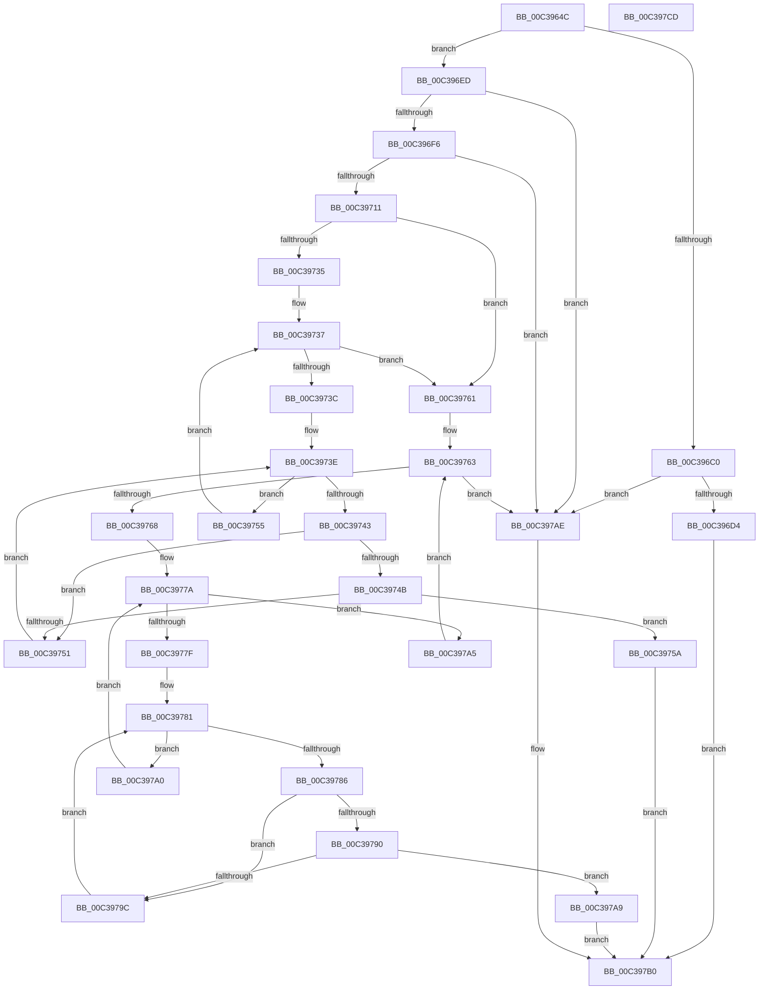

# KeGetTbSize

- RVA: `0x00C3964C`–`0x00C397CE` (길이 `386` bytes)
- VA: `0x0000000140C3964C`
- 실행 섹션: `INIT`
- PDB 이름 있음: `예`; PDB Function 태그: `아니요`
- unwind 정보 RVA: `0x000BD124`
- 디코드: `113`개 명령, `386/386` bytes 표시
- 미해석 바이트: `0` (있으면 어셈블리에 `.byte`로 보존)

> 이 문서는 커널 이미지의 기계어와 PDB 기호를 분석해 생성했습니다. 4번과 5번은 함수 원형과 자료형을 바이너리 사용 방식에서 추정한 C 해석이며 원본 소스 복구 결과는 아닙니다.

## 1. Dependencies

- 직접 호출 지점: **2**; 고유 호출 대상: **2**
- 직접 호출자로 확인된 함수: **1**
- RIP 상대 이미지 참조: **1**

### Outgoing calls
- `0x00C3975A` → [KiGetTbLeafInfo](KiGetTbLeafInfo_function_00C397D4.md) (function, `0x00C397D4`)
- `0x00C397B7` → [_security_check_cookie](../../text/6A/_security_check_cookie_function_006AC640.md) (function, `0x006AC640`)

### Direct callers
- [MiInitSystem](../C5/MiInitSystem_function_00C5E6C0.md) at `0x00C5EA87`

### Static image references
- `0x00C3965E` → RVA `0x00E0A740` (`.data`; read)

## 2. Other-region calls and transfers

- 다른 실행 섹션으로 향하는 call: **1**
  - `0x00C397B7` → [_security_check_cookie](../../text/6A/_security_check_cookie_function_006AC640.md) (`INIT` → `.text`)
- 별도 외부 분기/꼬리 이동을 확인하지 못했습니다.

## 3. Assembly (complete function range)

```asm
00C3964C  48 89 5C 24 08                  mov qword ptr [rsp + 8], rbx
00C39651  55                              push rbp
00C39652  48 8D 6C 24 A9                  lea rbp, [rsp - 0x57]
00C39657  48 81 EC 90 00 00 00            sub rsp, 0x90
00C3965E  48 8B 05 DB 10 1D 00            mov rax, qword ptr [rip + 0x1d10db]
00C39665  48 33 C4                        xor rax, rsp
00C39668  48 89 45 47                     mov qword ptr [rbp + 0x47], rax
00C3966C  B8 00 02 00 00                  mov eax, 0x200
00C39671  C6 45 F7 B4                     mov byte ptr [rbp - 9], 0xb4
00C39675  48 89 45 0F                     mov qword ptr [rbp + 0xf], rax
00C39679  0F 57 C0                        xorps xmm0, xmm0
00C3967C  48 89 45 3F                     mov qword ptr [rbp + 0x3f], rax
00C39680  65 48 8B 04 25 20 00 00 00      mov rax, qword ptr gs:[0x20]
00C39689  0F 11 45 E7                     movups xmmword ptr [rbp - 0x19], xmm0
00C3968D  48 C7 45 FF 00 01 00 00         mov qword ptr [rbp - 1], 0x100
00C39695  C6 45 07 64                     mov byte ptr [rbp + 7], 0x64
00C39699  8A 88 8D 00 00 00               mov cl, byte ptr [rax + 0x8d]
00C3969F  C6 45 17 C1                     mov byte ptr [rbp + 0x17], 0xc1
00C396A3  48 C7 45 1F 00 04 00 00         mov qword ptr [rbp + 0x1f], 0x400
00C396AB  C6 45 27 C3                     mov byte ptr [rbp + 0x27], 0xc3
00C396AF  48 C7 45 2F 00 06 00 00         mov qword ptr [rbp + 0x2f], 0x600
00C396B7  C6 45 37 CA                     mov byte ptr [rbp + 0x37], 0xca
00C396BB  80 F9 01                        cmp cl, 1
00C396BE  75 2D                           jne 0x140c396ed
00C396C0  33 C9                           xor ecx, ecx
00C396C2  B8 00 00 00 80                  mov eax, 0x80000000
00C396C7  0F A2                           cpuid
00C396C9  3D 06 00 00 80                  cmp eax, 0x80000006
00C396CE  0F 82 DA 00 00 00               jb 0x140c397ae
00C396D4  B8 06 00 00 80                  mov eax, 0x80000006
00C396D9  33 C9                           xor ecx, ecx
00C396DB  0F A2                           cpuid
00C396DD  8B C3                           mov eax, ebx
00C396DF  48 C1 E8 10                     shr rax, 0x10
00C396E3  25 FF 0F 00 00                  and eax, 0xfff
00C396E8  E9 C3 00 00 00                  jmp 0x140c397b0
00C396ED  80 F9 02                        cmp cl, 2
00C396F0  0F 85 B8 00 00 00               jne 0x140c397ae
00C396F6  33 C0                           xor eax, eax
00C396F8  33 C9                           xor ecx, ecx
00C396FA  0F A2                           cpuid
00C396FC  89 5D EB                        mov dword ptr [rbp - 0x15], ebx
00C396FF  44 8B C0                        mov r8d, eax
00C39702  89 4D EF                        mov dword ptr [rbp - 0x11], ecx
00C39705  89 55 F3                        mov dword ptr [rbp - 0xd], edx
00C39708  83 F8 02                        cmp eax, 2
00C3970B  0F 82 9D 00 00 00               jb 0x140c397ae
00C39711  33 C9                           xor ecx, ecx
00C39713  B8 02 00 00 00                  mov eax, 2
00C39718  0F A2                           cpuid
00C3971A  89 45 E7                        mov dword ptr [rbp - 0x19], eax
00C3971D  89 5D EB                        mov dword ptr [rbp - 0x15], ebx
00C39720  89 4D EF                        mov dword ptr [rbp - 0x11], ecx
00C39723  89 55 F3                        mov dword ptr [rbp - 0xd], edx
00C39726  0F 28 45 E7                     movaps xmm0, xmmword ptr [rbp - 0x19]
00C3972A  66 0F 7F 45 E7                  movdqa xmmword ptr [rbp - 0x19], xmm0
00C3972F  41 83 F8 18                     cmp r8d, 0x18
00C39733  72 2C                           jb 0x140c39761
00C39735  33 C9                           xor ecx, ecx
00C39737  83 F9 20                        cmp ecx, 0x20
00C3973A  73 25                           jae 0x140c39761
00C3973C  33 D2                           xor edx, edx
00C3973E  83 FA 04                        cmp edx, 4
00C39741  73 12                           jae 0x140c39755
00C39743  8B 44 95 E7                     mov eax, dword ptr [rbp + rdx*4 - 0x19]
00C39747  85 C0                           test eax, eax
00C39749  78 06                           js 0x140c39751
00C3974B  D3 E8                           shr eax, cl
00C3974D  3C FE                           cmp al, 0xfe
00C3974F  74 09                           je 0x140c3975a
00C39751  FF C2                           inc edx
00C39753  EB E9                           jmp 0x140c3973e
00C39755  83 C1 08                        add ecx, 8
00C39758  EB DD                           jmp 0x140c39737
00C3975A  E8 75 00 00 00                  call 0x140c397d4
00C3975F  EB 4F                           jmp 0x140c397b0
00C39761  33 D2                           xor edx, edx
00C39763  83 FA 05                        cmp edx, 5
00C39766  73 46                           jae 0x140c397ae
00C39768  8B C2                           mov eax, edx
00C3976A  48 03 C0                        add rax, rax
00C3976D  33 C9                           xor ecx, ecx
00C3976F  44 0F B6 54 C5 F7               movzx r10d, byte ptr [rbp + rax*8 - 9]
00C39775  4C 8B 4C C5 FF                  mov r9, qword ptr [rbp + rax*8 - 1]
00C3977A  83 F9 20                        cmp ecx, 0x20
00C3977D  73 26                           jae 0x140c397a5
00C3977F  33 DB                           xor ebx, ebx
00C39781  83 FB 04                        cmp ebx, 4
00C39784  73 1A                           jae 0x140c397a0
00C39786  44 8B 44 9D E7                  mov r8d, dword ptr [rbp + rbx*4 - 0x19]
00C3978B  45 85 C0                        test r8d, r8d
00C3978E  78 0C                           js 0x140c3979c
00C39790  41 D3 E8                        shr r8d, cl
00C39793  41 0F B6 C0                     movzx eax, r8b
00C39797  41 3B C2                        cmp eax, r10d
00C3979A  74 0D                           je 0x140c397a9
00C3979C  FF C3                           inc ebx
00C3979E  EB E1                           jmp 0x140c39781
00C397A0  83 C1 08                        add ecx, 8
00C397A3  EB D5                           jmp 0x140c3977a
00C397A5  FF C2                           inc edx
00C397A7  EB BA                           jmp 0x140c39763
00C397A9  49 8B C1                        mov rax, r9
00C397AC  EB 02                           jmp 0x140c397b0
00C397AE  33 C0                           xor eax, eax
00C397B0  48 8B 4D 47                     mov rcx, qword ptr [rbp + 0x47]
00C397B4  48 33 CC                        xor rcx, rsp
00C397B7  E8 84 2E A7 FF                  call 0x1406ac640
00C397BC  48 8B 9C 24 A0 00 00 00         mov rbx, qword ptr [rsp + 0xa0]
00C397C4  48 81 C4 90 00 00 00            add rsp, 0x90
00C397CB  5D                              pop rbp
00C397CC  C3                              ret
00C397CD  CC                              int3
```

## 4. C-style interpretation (structured pseudocode)

```c
__int64 __fastcall KeGetTbSize(__int64 a1, int a2)
{
    __int64 result;
    __int64 v_rbx;
    __int64 v_rsp;
    unsigned __int64 v_stack_m18;
    unsigned __int64 v_stack_m20;
    unsigned __int8 v_stack_m28;
    unsigned __int64 v_stack_m30;
    unsigned __int8 v_stack_m38;
    unsigned __int64 v_stack_m40;
    unsigned __int8 v_stack_m48;
    unsigned __int64 v_stack_m50;
    unsigned __int8 v_stack_m58;
    unsigned __int64 v_stack_m5F;
    unsigned __int64 v_stack_m60;
    unsigned __int8 v_stack_m68;
    unsigned int v_stack_m6C;
    unsigned int v_stack_m70;
    unsigned int v_stack_m74;
    unsigned __int64 v_stack_m78;
    unsigned __int64 v_stack_p8;

    v_stack_p8 = v_rbx;
    v_rsp = (v_rsp) - (144);
    result = (*(unsigned __int64 *)(v_rip + 1904859)) ^ (v_rsp);
    v_stack_m18 = result;
    v_stack_m68 = 180;
    v_stack_m50 = 512;
    v_stack_m20 = 512;
    v_stack_m78 = v_xmm0;
    v_stack_m60 = 256;
    v_stack_m58 = 100;
    v_stack_m48 = 193;
    v_stack_m40 = 0x400ULL;
    v_stack_m38 = 195;
    v_stack_m30 = 0x600ULL;
    v_stack_m28 = 202;
    if (((unsigned __int8)(*(unsigned __int8 *)(*(unsigned __int64 *)(gs_base + (0 + 32)) + 141))) != 1) goto loc_00C396ED;
    a1 = 0;
    if (((unsigned int)((unsigned int)(0x80000000ULL))) < 0x80000006ULL) goto loc_00C397AE;
    a1 = 0;
    result = ((unsigned int)((unsigned int)(v_rbx))) >> (16);
    result = (unsigned int)((result) & (0xFFFULL));
    goto loc_00C397B0;
loc_00C396ED:
    if (0 != 2) goto loc_00C397AE;
    result = 0;
    a1 = 0;
    v_stack_m74 = (unsigned int)(v_rbx);
    v_stack_m70 = 0;
    v_stack_m6C = a2;
    if (0 < 2) goto loc_00C397AE;
    a1 = 0;
    v_stack_m78 = 2;
    v_stack_m74 = (unsigned int)(v_rbx);
    v_stack_m70 = 0;
    v_stack_m6C = a2;
    v_stack_m78 = v_xmm0;
    if (0 < 24) goto loc_00C39761;
    a1 = 0;
loc_00C39737:
    if (0 >= 32) goto loc_00C39761;
    a2 = 0;
loc_00C3973E:
    if (0 >= 4) goto loc_00C39755;
    if (sign_flag) goto loc_00C39751;
    result = (unsigned int)(((unsigned int)(*(unsigned int *)(v_stack_m5F + a2 * 4 - 25))) >> (0));
    if (((unsigned __int8)(result)) == 254) goto loc_00C3975A;
loc_00C39751:
    a2 = (unsigned int)((a2) + 1);
    goto loc_00C3973E;
loc_00C39755:
    a1 = (unsigned int)((a1) + (8));
    goto loc_00C39737;
loc_00C3975A:
    result = KiGetTbLeafInfo(a1, a2, 0, a4);
    goto loc_00C397B0;
loc_00C39761:
    a2 = 0;
loc_00C39763:
    if (0 >= 5) goto loc_00C397AE;
    result = (0) + (0);
    a1 = 0;
loc_00C3977A:
    if (0 >= 32) goto loc_00C397A5;
    v_rbx = 0;
loc_00C39781:
    if (0 >= 4) goto loc_00C397A0;
    if (sign_flag) goto loc_00C3979C;
    a3 = (unsigned int)(((unsigned int)(*(unsigned int *)(v_stack_m5F + v_rbx * 4 - 25))) >> (0));
    if (((unsigned int)((unsigned __int8)(a3))) == ((unsigned int)(*(unsigned __int8 *)(v_stack_m5F + result * 8 - 9)))) goto loc_00C397A9;
loc_00C3979C:
    v_rbx = (unsigned int)((v_rbx) + 1);
    goto loc_00C39781;
loc_00C397A0:
    a1 = (unsigned int)((a1) + (8));
    goto loc_00C3977A;
loc_00C397A5:
    a2 = (unsigned int)((a2) + 1);
    goto loc_00C39763;
loc_00C397A9:
    goto loc_00C397B0;
loc_00C397AE:
    result = 0;
loc_00C397B0:
    a1 = (v_stack_m18) ^ (v_rsp);
    result = _security_check_cookie(a1, a2, a3, *(unsigned __int64 *)(v_stack_m5F + result * 8 - 1));
    v_rsp = (v_rsp) + (144);
    return result;
}
```

## 5. (Beta) C Style

```c
int64_t KeGetTbSize(int64_t Arg1, int32_t Arg2)
{
    int64_t result;
    int64_t local_rbx;
    int64_t local_rsp;
    uint64_t v_stack_m18;
    uint64_t v_stack_m20;
    uint8_t v_stack_m28;
    uint64_t v_stack_m30;
    uint8_t v_stack_m38;
    uint64_t v_stack_m40;
    uint8_t v_stack_m48;
    uint64_t v_stack_m50;
    uint8_t v_stack_m58;
    uint64_t v_stack_m5F;
    uint64_t v_stack_m60;
    uint8_t v_stack_m68;
    uint32_t v_stack_m6C;
    uint32_t v_stack_m70;
    uint32_t v_stack_m74;
    uint64_t v_stack_m78;
    uint64_t v_stack_p8;

    v_stack_p8 = local_rbx;
    local_rsp = (local_rsp) - (144);
    result = (*(uint64_t *)(v_rip + 0x1D10DB)) ^ (local_rsp);
    v_stack_m18 = result;
    v_stack_m68 = 180;
    v_stack_m50 = 512;
    v_stack_m20 = 512;
    v_stack_m78 = v_xmm0;
    v_stack_m60 = 256;
    v_stack_m58 = 100;
    v_stack_m48 = 193;
    v_stack_m40 = 0x400ULL;
    v_stack_m38 = 195;
    v_stack_m30 = 0x600ULL;
    v_stack_m28 = 202;
    if (((uint8_t)(*(uint8_t *)(*(uint64_t *)(gs_base + (0 + 0x20)) + 0x8D))) != 1) goto loc_00C396ED;
    Arg1 = 0;
    if (((uint32_t)((uint32_t)(0x80000000ULL))) < 0x80000006ULL) goto loc_00C397AE;
    Arg1 = 0;
    result = ((uint32_t)((uint32_t)(local_rbx))) >> (16);
    result = (uint32_t)((result) & (0xFFFULL));
    goto loc_00C397B0;
loc_00C396ED:
    if (0 != 2) goto loc_00C397AE;
    result = 0;
    Arg1 = 0;
    v_stack_m74 = (uint32_t)(local_rbx);
    v_stack_m70 = 0;
    v_stack_m6C = Arg2;
    if (0 < 2) goto loc_00C397AE;
    Arg1 = 0;
    v_stack_m78 = 2;
    v_stack_m74 = (uint32_t)(local_rbx);
    v_stack_m70 = 0;
    v_stack_m6C = Arg2;
    v_stack_m78 = v_xmm0;
    if (0 < 24) goto loc_00C39761;
    Arg1 = 0;
loc_00C39737:
    if (0 >= 32) goto loc_00C39761;
    Arg2 = 0;
loc_00C3973E:
    if (0 >= 4) goto loc_00C39755;
    if (sign_flag) goto loc_00C39751;
    result = (uint32_t)(((uint32_t)(*(uint32_t *)(v_stack_m5F + Arg2 * 4 - 0x19))) >> (0));
    if (((uint8_t)(result)) == 254) goto loc_00C3975A;
loc_00C39751:
    Arg2 = (uint32_t)((Arg2) + 1);
    goto loc_00C3973E;
loc_00C39755:
    Arg1 = (uint32_t)((Arg1) + (8));
    goto loc_00C39737;
loc_00C3975A:
    result = KiGetTbLeafInfo(Arg1, Arg2, 0, a4);
    goto loc_00C397B0;
loc_00C39761:
    Arg2 = 0;
loc_00C39763:
    if (0 >= 5) goto loc_00C397AE;
    result = (0) + (0);
    Arg1 = 0;
loc_00C3977A:
    if (0 >= 32) goto loc_00C397A5;
    local_rbx = 0;
loc_00C39781:
    if (0 >= 4) goto loc_00C397A0;
    if (sign_flag) goto loc_00C3979C;
    a3 = (uint32_t)(((uint32_t)(*(uint32_t *)(v_stack_m5F + local_rbx * 4 - 0x19))) >> (0));
    if (((uint32_t)((uint8_t)(a3))) == ((uint32_t)(*(uint8_t *)(v_stack_m5F + result * 8 - 0x9)))) goto loc_00C397A9;
loc_00C3979C:
    local_rbx = (uint32_t)((local_rbx) + 1);
    goto loc_00C39781;
loc_00C397A0:
    Arg1 = (uint32_t)((Arg1) + (8));
    goto loc_00C3977A;
loc_00C397A5:
    Arg2 = (uint32_t)((Arg2) + 1);
    goto loc_00C39763;
loc_00C397A9:
    goto loc_00C397B0;
loc_00C397AE:
    result = 0;
loc_00C397B0:
    Arg1 = (v_stack_m18) ^ (local_rsp);
    result = _security_check_cookie(Arg1, Arg2, a3, *(uint64_t *)(v_stack_m5F + result * 8 - 0x1));
    local_rsp = (local_rsp) + (144);
    return result;
}
```

## 6. Execution-region graph

[열기: 2D/3D 그래프와 함수 탐색 컨트롤 패널](../../../control-panel.html?section=init&rva=0x00C3964C&view=graph)

- 2D 그래프는 위에서 아래로 흐르고, 3D 그래프는 빈 공간을 드래그해 회전합니다. Shift+드래그는 이동, 휠은 확대·축소, 함수 노드 선택은 대상 보고서 이동입니다.

### Static fallback


