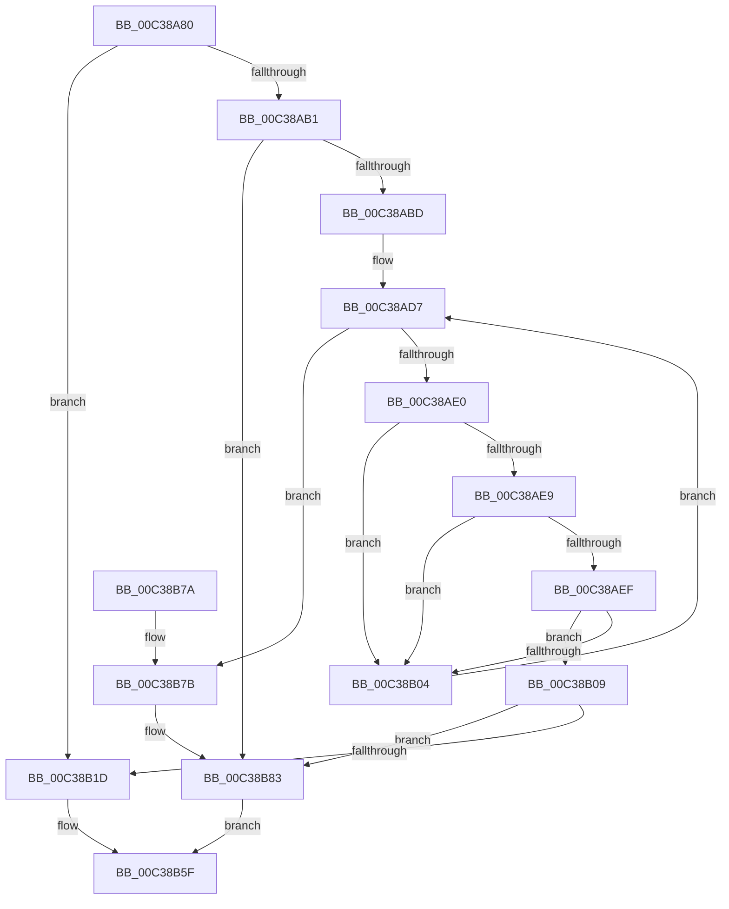

# KeHwPolicyLocateResource

- RVA: `0x00C38A80`–`0x00C38B91` (길이 `273` bytes)
- VA: `0x0000000140C38A80`
- 실행 섹션: `INIT`
- PDB 이름 있음: `예`; PDB Function 태그: `아니요`
- unwind 정보 RVA: `0x000CA388`
- 디코드: `66`개 명령, `273/273` bytes 표시
- 미해석 바이트: `0` (있으면 어셈블리에 `.byte`로 보존)

> 이 문서는 커널 이미지의 기계어와 PDB 기호를 분석해 생성했습니다. 4번과 5번은 함수 원형과 자료형을 바이너리 사용 방식에서 추정한 C 해석이며 원본 소스 복구 결과는 아닙니다.

## 1. Dependencies

- 직접 호출 지점: **2**; 고유 호출 대상: **2**
- 직접 호출자로 확인된 함수: **2**
- RIP 상대 이미지 참조: **6**

### Outgoing calls
- `0x00C38AFB` → [RtlCompareUnicodeString](../../page/93/RtlCompareUnicodeString_function_00937F90.md) (function, `0x00937F90`)
- `0x00C38B5A` → [LdrResSearchResource](../../page/98/LdrResSearchResource_function_0098F7A0.md) (function, `0x0098F7A0`)

### Direct callers
- [KiIntersectFeaturesWithPolicy](../../pagelk/B6/KiIntersectFeaturesWithPolicy_function_00B67324.md) at `0x00B67399`
- [KiIntersectFeaturesWithPolicy](../../pagelk/B6/KiIntersectFeaturesWithPolicy_function_00B67324.md) at `0x00B673CC`
- [HalpWheaInitDiscard](../C2/HalpWheaInitDiscard_function_00C202B4.md) at `0x00C20326`

### Static image references
- `0x00C38A9F` → RVA `0x00F21B00` (`.data`; read)
- `0x00C38AB1` → RVA `0x00F21AF8` (`.data`; read)
- `0x00C38AC9` → RVA `0x00C7B280` (` ?? ::PBOPGDP::`string'`; read)
- `0x00C38B11` → RVA `0x00F21B00` (`.data`; write)
- `0x00C38B7B` → RVA `0x00F21B00` (`.data`; read/write)
- `0x00C38B83` → RVA `0x00F21AF8` (`.data`; write)

## 2. Other-region calls and transfers

- 다른 실행 섹션으로 향하는 call: **2**
  - `0x00C38AFB` → [RtlCompareUnicodeString](../../page/93/RtlCompareUnicodeString_function_00937F90.md) (`INIT` → `PAGE`)
  - `0x00C38B5A` → [LdrResSearchResource](../../page/98/LdrResSearchResource_function_0098F7A0.md) (`INIT` → `PAGE`)
- 별도 외부 분기/꼬리 이동을 확인하지 못했습니다.

## 3. Assembly (complete function range)

```asm
00C38A80  4C 8B DC                        mov r11, rsp
00C38A83  49 89 5B 08                     mov qword ptr [r11 + 8], rbx
00C38A87  49 89 6B 10                     mov qword ptr [r11 + 0x10], rbp
00C38A8B  49 89 73 18                     mov qword ptr [r11 + 0x18], rsi
00C38A8F  49 89 7B 20                     mov qword ptr [r11 + 0x20], rdi
00C38A93  41 56                           push r14
00C38A95  48 83 EC 60                     sub rsp, 0x60
00C38A99  48 8B F9                        mov rdi, rcx
00C38A9C  49 8B F1                        mov rsi, r9
00C38A9F  48 8B 0D 5A 90 2E 00            mov rcx, qword ptr [rip + 0x2e905a]
00C38AA6  49 8B E8                        mov rbp, r8
00C38AA9  4C 8B F2                        mov r14, rdx
00C38AAC  48 85 C9                        test rcx, rcx
00C38AAF  75 6C                           jne 0x140c38b1d
00C38AB1  38 0D 41 90 2E 00               cmp byte ptr [rip + 0x2e9041], cl
00C38AB7  0F 85 C6 00 00 00               jne 0x140c38b83
00C38ABD  48 83 C7 30                     add rdi, 0x30
00C38AC1  49 C7 43 D8 18 00 1A 00         mov qword ptr [r11 - 0x28], 0x1a0018
00C38AC9  48 8D 05 B0 27 04 00            lea rax, [rip + 0x427b0]
00C38AD0  49 89 43 E0                     mov qword ptr [r11 - 0x20], rax
00C38AD4  48 8B 1F                        mov rbx, qword ptr [rdi]
00C38AD7  48 3B DF                        cmp rbx, rdi
00C38ADA  0F 84 9B 00 00 00               je 0x140c38b7b
00C38AE0  48 8B 4B 30                     mov rcx, qword ptr [rbx + 0x30]
00C38AE4  48 85 C9                        test rcx, rcx
00C38AE7  74 1B                           je 0x140c38b04
00C38AE9  83 7B 38 00                     cmp dword ptr [rbx + 0x38], 0
00C38AED  7C 15                           jl 0x140c38b04
00C38AEF  48 83 C1 58                     add rcx, 0x58
00C38AF3  48 8D 54 24 40                  lea rdx, [rsp + 0x40]
00C38AF8  41 B0 01                        mov r8b, 1
00C38AFB  E8 90 F4 CF FF                  call 0x140937f90
00C38B00  85 C0                           test eax, eax
00C38B02  74 05                           je 0x140c38b09
00C38B04  48 8B 1B                        mov rbx, qword ptr [rbx]
00C38B07  EB CE                           jmp 0x140c38ad7
00C38B09  48 8B 43 30                     mov rax, qword ptr [rbx + 0x30]
00C38B0D  48 8B 48 30                     mov rcx, qword ptr [rax + 0x30]
00C38B11  48 89 0D E8 8F 2E 00            mov qword ptr [rip + 0x2e8fe8], rcx
00C38B18  48 85 C9                        test rcx, rcx
00C38B1B  74 66                           je 0x140c38b83
00C38B1D  48 83 64 24 38 00               and qword ptr [rsp + 0x38], 0
00C38B23  48 8D 54 24 40                  lea rdx, [rsp + 0x40]
00C38B28  48 83 64 24 30 00               and qword ptr [rsp + 0x30], 0
00C38B2E  41 B9 30 00 00 00               mov r9d, 0x30
00C38B34  48 8B 84 24 90 00 00 00         mov rax, qword ptr [rsp + 0x90]
00C38B3C  48 83 64 24 50 00               and qword ptr [rsp + 0x50], 0
00C38B42  48 89 44 24 28                  mov qword ptr [rsp + 0x28], rax
00C38B47  45 8D 41 D3                     lea r8d, [r9 - 0x2d]
00C38B4B  4C 89 74 24 40                  mov qword ptr [rsp + 0x40], r14
00C38B50  48 89 6C 24 48                  mov qword ptr [rsp + 0x48], rbp
00C38B55  48 89 74 24 20                  mov qword ptr [rsp + 0x20], rsi
00C38B5A  E8 41 6C D5 FF                  call 0x14098f7a0
00C38B5F  4C 8D 5C 24 60                  lea r11, [rsp + 0x60]
00C38B64  49 8B 5B 10                     mov rbx, qword ptr [r11 + 0x10]
00C38B68  49 8B 6B 18                     mov rbp, qword ptr [r11 + 0x18]
00C38B6C  49 8B 73 20                     mov rsi, qword ptr [r11 + 0x20]
00C38B70  49 8B 7B 28                     mov rdi, qword ptr [r11 + 0x28]
00C38B74  49 8B E3                        mov rsp, r11
00C38B77  41 5E                           pop r14
00C38B79  C3                              ret
00C38B7A  CC                              int3
00C38B7B  48 83 25 7D 8F 2E 00 00         and qword ptr [rip + 0x2e8f7d], 0
00C38B83  C6 05 6E 8F 2E 00 01            mov byte ptr [rip + 0x2e8f6e], 1
00C38B8A  B8 6C 02 00 C0                  mov eax, 0xc000026c
00C38B8F  EB CE                           jmp 0x140c38b5f
```

## 4. C-style interpretation (structured pseudocode)

```c
__int64 __fastcall KeHwPolicyLocateResource(__int64 a1, __int64 a2, __int64 a3, __int64 a4, __int64 a5)
{
    __int64 result;
    __int64 v_rdi;
    __int64 v_rsp;
    unsigned __int64 v_stack_m18;
    unsigned __int64 v_stack_m20;
    unsigned __int64 v_stack_m28;
    unsigned __int64 v_stack_m30;
    unsigned __int64 v_stack_m38;
    unsigned __int64 v_stack_m40;
    unsigned __int64 v_stack_m48;
    unsigned __int64 v_stack_m8;

    *(unsigned __int64 *)(v_rsp + 8) = v_rbx;
    *(unsigned __int64 *)(v_rsp + 16) = v_rbp;
    *(unsigned __int64 *)(v_rsp + 24) = v_rsi;
    *(unsigned __int64 *)(v_rsp + 32) = v_rdi;
    v_rsp = (v_rsp) - (96);
    if (*(unsigned __int64 *)(v_rip + 3051610) != 0) goto loc_00C38B1D;
    if ((*(unsigned __int8 *)(v_rip + 3051585)) != ((unsigned __int8)(*(unsigned __int64 *)(v_rip + 3051610)))) goto loc_00C38B83;
    v_rdi = (a1) + (48);
    *(unsigned __int64 *)(v_rsp - 40) = 0x1A0018ULL;
    *(unsigned __int64 *)(v_rsp - 32) = v_rip + 272304;
loc_00C38AD7:
    if ((*(unsigned __int64 *)(v_rdi)) == v_rdi) goto loc_00C38B7B;
    if (*(unsigned __int64 *)(*(unsigned __int64 *)(v_rdi) + 48) == 0) goto loc_00C38B04;
    if ((*(unsigned int *)(*(unsigned __int64 *)(v_rdi) + 56)) < 0) goto loc_00C38B04;
    a1 = (*(unsigned __int64 *)(*(unsigned __int64 *)(v_rdi) + 48)) + (88);
    result = RtlCompareUnicodeString(a1, v_stack_m28, 1, a4);
    if ((unsigned int)(result) == 0) goto loc_00C38B09;
loc_00C38B04:
    goto loc_00C38AD7;
loc_00C38B09:
    *(unsigned __int64 *)(v_rip + 3051496) = *(unsigned __int64 *)(*(unsigned __int64 *)(*(unsigned __int64 *)(*(unsigned __int64 *)(v_rdi)) + 48) + 48);
    if (*(unsigned __int64 *)(*(unsigned __int64 *)(*(unsigned __int64 *)(*(unsigned __int64 *)(v_rdi)) + 48) + 48) == 0) goto loc_00C38B83;
loc_00C38B1D:
    v_stack_m40 = a5;
    v_stack_m28 = a2;
    v_stack_m20 = a3;
    v_stack_m48 = a4;
    result = LdrResSearchResource(*(unsigned __int64 *)(*(unsigned __int64 *)(*(unsigned __int64 *)(*(unsigned __int64 *)(v_rdi)) + 48) + 48), v_stack_m28, 48 - 45, 48);
loc_00C38B5F:
    return result;
loc_00C38B7B:
loc_00C38B83:
    *(unsigned __int8 *)(v_rip + 3051374) = 1;
    goto loc_00C38B5F;
}
```

## 5. (Beta) C Style

```c
int64_t KeHwPolicyLocateResource(void *Arg1, int64_t Arg2, int64_t Arg3, int64_t Arg4, int64_t Arg5)
{
    uint8_t *arg1 = (uint8_t *)Arg1;

    int64_t result;
    int64_t local_rdi;
    int64_t local_rsp;
    uint64_t v_stack_m18;
    uint64_t v_stack_m20;
    uint64_t v_stack_m28;
    uint64_t v_stack_m30;
    uint64_t v_stack_m38;
    uint64_t v_stack_m40;
    uint64_t v_stack_m48;
    uint64_t v_stack_m8;

    *(uint64_t *)(local_rsp + 0x8) = local_rbx;
    *(uint64_t *)(local_rsp + 0x10) = local_rbp;
    *(uint64_t *)(local_rsp + 0x18) = local_rsi;
    *(uint64_t *)(local_rsp + 0x20) = local_rdi;
    local_rsp = (local_rsp) - (96);
    if (*(uint64_t *)(v_rip + 0x2E905A) != 0) goto loc_00C38B1D;
    if ((*(uint8_t *)(v_rip + 0x2E9041)) != ((uint8_t)(*(uint64_t *)(v_rip + 0x2E905A)))) goto loc_00C38B83;
    local_rdi = (Arg1) + (48);
    *(uint64_t *)(local_rsp - 0x28) = 0x1A0018ULL;
    *(uint64_t *)(local_rsp - 0x20) = v_rip + 272304;
loc_00C38AD7:
    if ((*(uint64_t *)(local_rdi)) == local_rdi) goto loc_00C38B7B;
    if (*(uint64_t *)(*(uint64_t *)(local_rdi) + 0x30) == 0) goto loc_00C38B04;
    if ((*(uint32_t *)(*(uint64_t *)(local_rdi) + 0x38)) < 0) goto loc_00C38B04;
    Arg1 = (*(uint64_t *)(*(uint64_t *)(local_rdi) + 0x30)) + (88);
    result = RtlCompareUnicodeString(Arg1, v_stack_m28, 1, Arg4);
    if ((uint32_t)(result) == 0) goto loc_00C38B09;
loc_00C38B04:
    goto loc_00C38AD7;
loc_00C38B09:
    *(uint64_t *)(v_rip + 0x2E8FE8) = *(uint64_t *)(*(uint64_t *)(*(uint64_t *)(*(uint64_t *)(local_rdi)) + 0x30) + 0x30);
    if (*(uint64_t *)(*(uint64_t *)(*(uint64_t *)(*(uint64_t *)(local_rdi)) + 0x30) + 0x30) == 0) goto loc_00C38B83;
loc_00C38B1D:
    v_stack_m40 = Arg5;
    v_stack_m28 = Arg2;
    v_stack_m20 = Arg3;
    v_stack_m48 = Arg4;
    result = LdrResSearchResource(*(uint64_t *)(*(uint64_t *)(*(uint64_t *)(*(uint64_t *)(local_rdi)) + 0x30) + 0x30), v_stack_m28, 48 - 45, 48);
loc_00C38B5F:
    return result;
loc_00C38B7B:
loc_00C38B83:
    *(uint8_t *)(v_rip + 0x2E8F6E) = 1;
    goto loc_00C38B5F;
}
```

### 관측된 메모리 오프셋

구조체 형식이 확인되지 않은 접근은 인자 기준의 오프셋으로만 기록했습니다.

| 기준 인자 | 오프셋 표현 | 폭 (bit) | 접근 |
|---|---:|---:|---|
| `Arg1` | `+ 0x0` | `64` | `R` |

## 6. Execution-region graph

[열기: 2D/3D 그래프와 함수 탐색 컨트롤 패널](../../../control-panel.html?section=init&rva=0x00C38A80&view=graph)

- 2D 그래프는 위에서 아래로 흐르고, 3D 그래프는 빈 공간을 드래그해 회전합니다. Shift+드래그는 이동, 휠은 확대·축소, 함수 노드 선택은 대상 보고서 이동입니다.

### Static fallback


