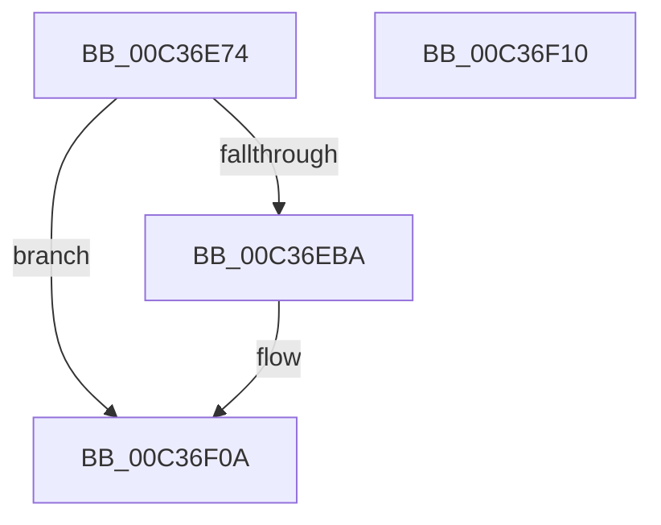

# KeNumaInitialize

- RVA: `0x00C36E74`–`0x00C36F11` (길이 `157` bytes)
- VA: `0x0000000140C36E74`
- 실행 섹션: `INIT`
- PDB 이름 있음: `예`; PDB Function 태그: `아니요`
- unwind 정보 RVA: `0x000C9FE4`
- 디코드: `37`개 명령, `157/157` bytes 표시
- 미해석 바이트: `0` (있으면 어셈블리에 `.byte`로 보존)

> 이 문서는 커널 이미지의 기계어와 PDB 기호를 분석해 생성했습니다. 4번과 5번은 함수 원형과 자료형을 바이너리 사용 방식에서 추정한 C 해석이며 원본 소스 복구 결과는 아닙니다.

## 1. Dependencies

- 직접 호출 지점: **1**; 고유 호출 대상: **1**
- 직접 호출자로 확인된 함수: **1**
- RIP 상대 이미지 참조: **9**

### Outgoing calls
- `0x00C36EB1` → [guard_dispatch_icall](../../text/6B/guard_dispatch_icall_function_006BAAD0.md) (function, `0x006BAAD0`)

### Direct callers
- [InitBootProcessor](../C1/InitBootProcessor_function_00C1B1C8.md) at `0x00C1B6F5`

### Static image references
- `0x00C36E9B` → RVA `0x00E00638` (`.data`; read)
- `0x00C36EBE` → RVA `0x00FC5000` (`ALMOSTRO`; write)
- `0x00C36EC9` → RVA `0x00F21AE8` (`.data`; write)
- `0x00C36ED4` → RVA `0x00E01400` (`.data`; write)
- `0x00C36EDF` → RVA `0x00E01408` (`.data`; write)
- `0x00C36EEA` → RVA `0x00F21AD8` (`.data`; write)
- `0x00C36EF5` → RVA `0x00F21AE0` (`.data`; write)
- `0x00C36EFC` → RVA `0x005BCDE0` (`KiQueryProximityNode`; read)
- `0x00C36F03` → RVA `0x00E66320` (`.data`; write)

## 2. Other-region calls and transfers

- 다른 실행 섹션으로 향하는 call: **1**
  - `0x00C36EB1` → [guard_dispatch_icall](../../text/6B/guard_dispatch_icall_function_006BAAD0.md) (`INIT` → `.text`)
- 별도 외부 분기/꼬리 이동을 확인하지 못했습니다.

## 3. Assembly (complete function range)

```asm
00C36E74  40 55                           push rbp
00C36E76  48 8B EC                        mov rbp, rsp
00C36E79  48 83 EC 70                     sub rsp, 0x70
00C36E7D  83 65 10 00                     and dword ptr [rbp + 0x10], 0
00C36E81  4C 8D 4D 10                     lea r9, [rbp + 0x10]
00C36E85  33 C0                           xor eax, eax
00C36E87  4C 8D 45 C0                     lea r8, [rbp - 0x40]
00C36E8B  0F 57 C0                        xorps xmm0, xmm0
00C36E8E  48 89 45 F0                     mov qword ptr [rbp - 0x10], rax
00C36E92  BA 40 00 00 00                  mov edx, 0x40
00C36E97  66 89 45 F8                     mov word ptr [rbp - 8], ax
00C36E9B  48 8B 05 96 97 1C 00            mov rax, qword ptr [rip + 0x1c9796]
00C36EA2  0F 11 45 C0                     movups xmmword ptr [rbp - 0x40], xmm0
00C36EA6  8D 4A CB                        lea ecx, [rdx - 0x35]
00C36EA9  0F 11 45 D0                     movups xmmword ptr [rbp - 0x30], xmm0
00C36EAD  0F 11 45 E0                     movups xmmword ptr [rbp - 0x20], xmm0
00C36EB1  E8 1A 3C A8 FF                  call 0x1406baad0
00C36EB6  85 C0                           test eax, eax
00C36EB8  78 50                           js 0x140c36f0a
00C36EBA  0F B7 45 C0                     movzx eax, word ptr [rbp - 0x40]
00C36EBE  66 89 05 3B E1 38 00            mov word ptr [rip + 0x38e13b], ax
00C36EC5  48 8B 45 C8                     mov rax, qword ptr [rbp - 0x38]
00C36EC9  48 89 05 18 AC 2E 00            mov qword ptr [rip + 0x2eac18], rax
00C36ED0  48 8B 45 F0                     mov rax, qword ptr [rbp - 0x10]
00C36ED4  48 89 05 25 A5 1C 00            mov qword ptr [rip + 0x1ca525], rax
00C36EDB  48 8B 45 F8                     mov rax, qword ptr [rbp - 8]
00C36EDF  48 89 05 22 A5 1C 00            mov qword ptr [rip + 0x1ca522], rax
00C36EE6  48 8B 45 D8                     mov rax, qword ptr [rbp - 0x28]
00C36EEA  48 89 05 E7 AB 2E 00            mov qword ptr [rip + 0x2eabe7], rax
00C36EF1  48 8B 45 E8                     mov rax, qword ptr [rbp - 0x18]
00C36EF5  48 89 05 E4 AB 2E 00            mov qword ptr [rip + 0x2eabe4], rax
00C36EFC  48 8D 05 DD 5E 98 FF            lea rax, [rip - 0x67a123]
00C36F03  48 89 05 16 F4 22 00            mov qword ptr [rip + 0x22f416], rax
00C36F0A  48 83 C4 70                     add rsp, 0x70
00C36F0E  5D                              pop rbp
00C36F0F  C3                              ret
00C36F10  CC                              int3
```

## 4. C-style interpretation (structured pseudocode)

```c
__int64 __fastcall KeNumaInitialize(void)
{
    __int64 result;
    __int64 v_rsp;
    unsigned __int16 v_stack_m10;
    unsigned __int64 v_stack_m18;
    unsigned __int64 v_stack_m20;
    unsigned __int64 v_stack_m28;
    unsigned __int64 v_stack_m30;
    unsigned __int64 v_stack_m38;
    unsigned __int64 v_stack_m40;
    unsigned __int64 v_stack_m48;
    unsigned int v_stack_p8;

    v_rsp = (v_rsp) - (112);
    result = 0;
    v_stack_m18 = 0;
    v_stack_m10 = 0;
    v_stack_m48 = v_xmm0;
    v_stack_m38 = v_xmm0;
    v_stack_m28 = v_xmm0;
    result = guard_dispatch_icall(64 - 53, 64, v_stack_m48, v_stack_p8);
    if (!(sign_flag)) {
        result = v_stack_m48;
        *(unsigned __int16 *)(v_rip + 3727675) = (unsigned __int16)(result);
        result = v_stack_m40;
        *(unsigned __int64 *)(v_rip + 3058712) = result;
        result = v_stack_m18;
        *(unsigned __int64 *)(v_rip + 1877285) = result;
        result = v_stack_m10;
        *(unsigned __int64 *)(v_rip + 1877282) = result;
        result = v_stack_m30;
        *(unsigned __int64 *)(v_rip + 3058663) = result;
        result = v_stack_m20;
        *(unsigned __int64 *)(v_rip + 3058660) = result;
        result = v_rip - 6791459;
        *(unsigned __int64 *)(v_rip + 2290710) = result;
    }
    v_rsp = (v_rsp) + (112);
    return result;
}
```

## 5. (Beta) C Style

```c
void KeNumaInitialize(void)
{
    int64_t result;
    int64_t local_rsp;
    uint16_t v_stack_m10;
    uint64_t v_stack_m18;
    uint64_t v_stack_m20;
    uint64_t v_stack_m28;
    uint64_t v_stack_m30;
    uint64_t v_stack_m38;
    uint64_t v_stack_m40;
    uint64_t v_stack_m48;
    uint32_t v_stack_p8;

    local_rsp = (local_rsp) - (112);
    result = 0;
    v_stack_m18 = 0;
    v_stack_m10 = 0;
    v_stack_m48 = v_xmm0;
    v_stack_m38 = v_xmm0;
    v_stack_m28 = v_xmm0;
    result = guard_dispatch_icall(64 - 53, 64, v_stack_m48, v_stack_p8);
    if (!(sign_flag)) {
        result = v_stack_m48;
        *(uint16_t *)(v_rip + 0x38E13B) = (uint16_t)(result);
        result = v_stack_m40;
        *(uint64_t *)(v_rip + 0x2EAC18) = result;
        result = v_stack_m18;
        *(uint64_t *)(v_rip + 0x1CA525) = result;
        result = v_stack_m10;
        *(uint64_t *)(v_rip + 0x1CA522) = result;
        result = v_stack_m30;
        *(uint64_t *)(v_rip + 0x2EABE7) = result;
        result = v_stack_m20;
        *(uint64_t *)(v_rip + 0x2EABE4) = result;
        result = v_rip - 6791459;
        *(uint64_t *)(v_rip + 0x22F416) = result;
    }
    local_rsp = (local_rsp) + (112);
    return result;
}
```

## 6. Execution-region graph

[열기: 2D/3D 그래프와 함수 탐색 컨트롤 패널](../../../control-panel.html?section=init&rva=0x00C36E74&view=graph)

- 2D 그래프는 위에서 아래로 흐르고, 3D 그래프는 빈 공간을 드래그해 회전합니다. Shift+드래그는 이동, 휠은 확대·축소, 함수 노드 선택은 대상 보고서 이동입니다.

### Static fallback


