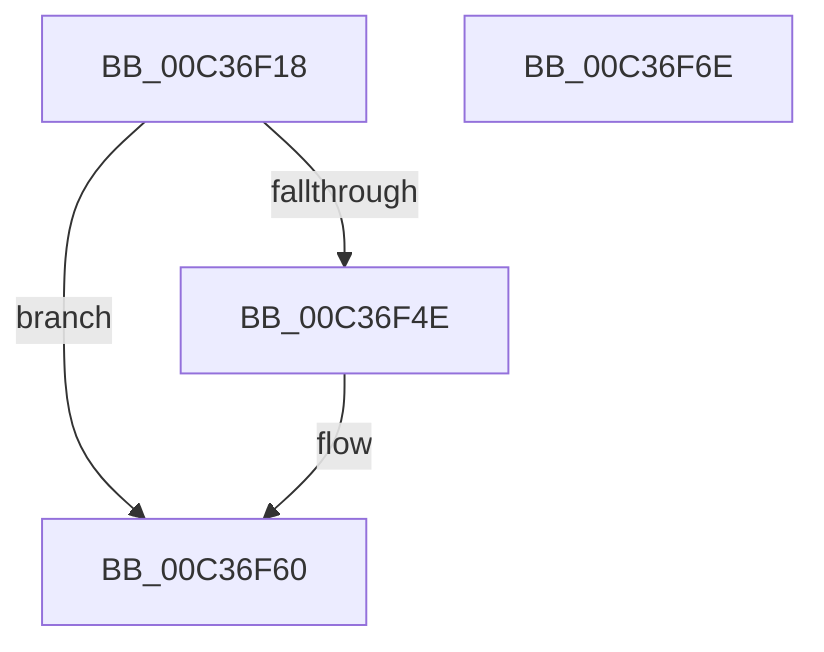

# KeQueryNumaCosts

- RVA: `0x00C36F18`–`0x00C36F6F` (길이 `87` bytes)
- VA: `0x0000000140C36F18`
- 실행 섹션: `INIT`
- PDB 이름 있음: `예`; PDB Function 태그: `아니요`
- unwind 정보 RVA: `0x0005CAAC`
- 디코드: `24`개 명령, `87/87` bytes 표시
- 미해석 바이트: `0` (있으면 어셈블리에 `.byte`로 보존)

> 이 문서는 커널 이미지의 기계어와 PDB 기호를 분석해 생성했습니다. 4번과 5번은 함수 원형과 자료형을 바이너리 사용 방식에서 추정한 C 해석이며 원본 소스 복구 결과는 아닙니다.

## 1. Dependencies

- 직접 호출 지점: **2**; 고유 호출 대상: **2**
- 직접 호출자로 확인된 함수: **1**
- RIP 상대 이미지 참조: **2**

### Outgoing calls
- `0x00C36F41` → [ExAllocatePool2](../../poolcode/B8/ExAllocatePool2_function_00B820F0.md) (function, `0x00B820F0`)
- `0x00C36F5B` → [memcpy](../../text/6C/memcpy_function_006C6840.md) (function, `0x006C6840`)

### Direct callers
- [SaveNodeDistanceInformation](../C6/SaveNodeDistanceInformation_function_00C6FE60.md) at `0x00C6FEF7`

### Static image references
- `0x00C36F22` → RVA `0x00FC5000` (`ALMOSTRO`; read)
- `0x00C36F4E` → RVA `0x00F234E8` (`.data`; read)

## 2. Other-region calls and transfers

- 다른 실행 섹션으로 향하는 call: **2**
  - `0x00C36F41` → [ExAllocatePool2](../../poolcode/B8/ExAllocatePool2_function_00B820F0.md) (`INIT` → `POOLCODE`)
  - `0x00C36F5B` → [memcpy](../../text/6C/memcpy_function_006C6840.md) (`INIT` → `.text`)
- 별도 외부 분기/꼬리 이동을 확인하지 못했습니다.

## 3. Assembly (complete function range)

```asm
00C36F18  48 89 5C 24 08                  mov qword ptr [rsp + 8], rbx
00C36F1D  57                              push rdi
00C36F1E  48 83 EC 20                     sub rsp, 0x20
00C36F22  0F B7 05 D7 E0 38 00            movzx eax, word ptr [rip + 0x38e0d7]
00C36F29  41 B8 4E 75 6D 61               mov r8d, 0x616d754e
00C36F2F  0F AF C0                        imul eax, eax
00C36F32  B9 00 01 00 00                  mov ecx, 0x100
00C36F37  48 63 F8                        movsxd rdi, eax
00C36F3A  48 C1 E7 03                     shl rdi, 3
00C36F3E  48 8B D7                        mov rdx, rdi
00C36F41  E8 AA B1 F4 FF                  call 0x140b820f0
00C36F46  48 8B D8                        mov rbx, rax
00C36F49  48 85 C0                        test rax, rax
00C36F4C  74 12                           je 0x140c36f60
00C36F4E  48 8B 15 93 C5 2E 00            mov rdx, qword ptr [rip + 0x2ec593]
00C36F55  4C 8B C7                        mov r8, rdi
00C36F58  48 8B C8                        mov rcx, rax
00C36F5B  E8 E0 F8 A8 FF                  call 0x1406c6840
00C36F60  48 8B C3                        mov rax, rbx
00C36F63  48 8B 5C 24 30                  mov rbx, qword ptr [rsp + 0x30]
00C36F68  48 83 C4 20                     add rsp, 0x20
00C36F6C  5F                              pop rdi
00C36F6D  C3                              ret
00C36F6E  CC                              int3
```

## 4. C-style interpretation (structured pseudocode)

```c
__int64 __fastcall KeQueryNumaCosts(void)
{
    __int64 result;
    __int64 v_rdi;
    __int64 v_rsp;
    unsigned __int64 v_stack_p8;

    v_stack_p8 = v_rbx;
    v_rsp = (v_rsp) - (32);
    result = (unsigned int)((*(unsigned __int16 *)(v_rip + 3727575)) * ((unsigned int)(*(unsigned __int16 *)(v_rip + 3727575))));
    v_rdi = ((int)((unsigned int)(result))) << (3);
    result = ExAllocatePool2(256, v_rdi, (unsigned int)(0x616D754EULL), a4);
    if (result != 0) {
        a2 = *(unsigned __int64 *)(v_rip + 3065235);
        a3 = v_rdi;
        a1 = result;
        result = memcpy(a1, a2, a3, a4);
    }
    v_rsp = (v_rsp) + (32);
    return result;
}
```

## 5. (Beta) C Style

```c
void KeQueryNumaCosts(void)
{
    int64_t result;
    int64_t local_rdi;
    int64_t local_rsp;
    uint64_t v_stack_p8;

    v_stack_p8 = local_rbx;
    local_rsp = (local_rsp) - (32);
    result = (uint32_t)((*(uint16_t *)(v_rip + 0x38E0D7)) * ((uint32_t)(*(uint16_t *)(v_rip + 0x38E0D7))));
    local_rdi = ((int32_t)((uint32_t)(result))) << (3);
    result = ExAllocatePool2(256, local_rdi, (uint32_t)(0x616D754EULL), a4);
    if (result != 0) {
        a2 = *(uint64_t *)(v_rip + 0x2EC593);
        a3 = local_rdi;
        a1 = result;
        result = memcpy(a1, a2, a3, a4);
    }
    local_rsp = (local_rsp) + (32);
    return result;
}
```

## 6. Execution-region graph

[열기: 2D/3D 그래프와 함수 탐색 컨트롤 패널](../../../control-panel.html?section=init&rva=0x00C36F18&view=graph)

- 2D 그래프는 위에서 아래로 흐르고, 3D 그래프는 빈 공간을 드래그해 회전합니다. Shift+드래그는 이동, 휠은 확대·축소, 함수 노드 선택은 대상 보고서 이동입니다.

### Static fallback


