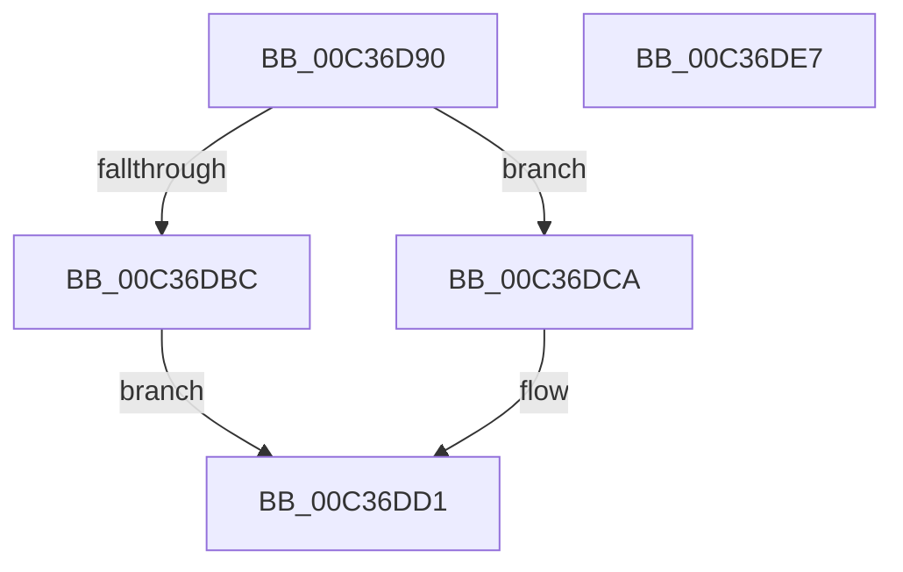

# KeSupportedPhysicalAddressBits

- RVA: `0x00C36D90`–`0x00C36DE8` (길이 `88` bytes)
- VA: `0x0000000140C36D90`
- 실행 섹션: `INIT`
- PDB 이름 있음: `예`; PDB Function 태그: `아니요`
- unwind 정보 RVA: `0x000B64AC`
- 디코드: `26`개 명령, `88/88` bytes 표시
- 미해석 바이트: `0` (있으면 어셈블리에 `.byte`로 보존)

> 이 문서는 커널 이미지의 기계어와 PDB 기호를 분석해 생성했습니다. 4번과 5번은 함수 원형과 자료형을 바이너리 사용 방식에서 추정한 C 해석이며 원본 소스 복구 결과는 아닙니다.

## 1. Dependencies

- 직접 호출 지점: **1**; 고유 호출 대상: **1**
- 직접 호출자로 확인된 함수: **1**
- RIP 상대 이미지 참조: **1**

### Outgoing calls
- `0x00C36DDC` → [_security_check_cookie](../../text/6A/_security_check_cookie_function_006AC640.md) (function, `0x006AC640`)

### Direct callers
- [MmInitSystem](../BE/MmInitSystem_function_00BEE990.md) at `0x00BEE9A9`

### Static image references
- `0x00C36D96` → RVA `0x00E0A740` (`.data`; read)

## 2. Other-region calls and transfers

- 다른 실행 섹션으로 향하는 call: **1**
  - `0x00C36DDC` → [_security_check_cookie](../../text/6A/_security_check_cookie_function_006AC640.md) (`INIT` → `.text`)
- 별도 외부 분기/꼬리 이동을 확인하지 못했습니다.

## 3. Assembly (complete function range)

```asm
00C36D90  40 53                           push rbx
00C36D92  48 83 EC 20                     sub rsp, 0x20
00C36D96  48 8B 05 A3 39 1D 00            mov rax, qword ptr [rip + 0x1d39a3]
00C36D9D  48 33 C4                        xor rax, rsp
00C36DA0  48 89 44 24 10                  mov qword ptr [rsp + 0x10], rax
00C36DA5  33 C9                           xor ecx, ecx
00C36DA7  B8 00 00 00 80                  mov eax, 0x80000000
00C36DAC  0F A2                           cpuid
00C36DAE  0F 57 C0                        xorps xmm0, xmm0
00C36DB1  0F 11 04 24                     movups xmmword ptr [rsp], xmm0
00C36DB5  3D 08 00 00 80                  cmp eax, 0x80000008
00C36DBA  72 0E                           jb 0x140c36dca
00C36DBC  B8 08 00 00 80                  mov eax, 0x80000008
00C36DC1  33 C9                           xor ecx, ecx
00C36DC3  0F A2                           cpuid
00C36DC5  89 04 24                        mov dword ptr [rsp], eax
00C36DC8  EB 07                           jmp 0x140c36dd1
00C36DCA  C7 04 24 24 00 00 00            mov dword ptr [rsp], 0x24
00C36DD1  8A 04 24                        mov al, byte ptr [rsp]
00C36DD4  48 8B 4C 24 10                  mov rcx, qword ptr [rsp + 0x10]
00C36DD9  48 33 CC                        xor rcx, rsp
00C36DDC  E8 5F 58 A7 FF                  call 0x1406ac640
00C36DE1  48 83 C4 20                     add rsp, 0x20
00C36DE5  5B                              pop rbx
00C36DE6  C3                              ret
00C36DE7  CC                              int3
```

## 4. C-style interpretation (structured pseudocode)

```c
__int64 __fastcall KeSupportedPhysicalAddressBits(int a1)
{
    __int64 result;
    __int64 v_rsp;
    unsigned __int64 v_stack_m18;
    unsigned __int64 v_stack_m28;

    v_rsp = (v_rsp) - (32);
    result = (*(unsigned __int64 *)(v_rip + 1915299)) ^ (v_rsp);
    v_stack_m18 = result;
    a1 = 0;
    v_stack_m28 = v_xmm0;
    if (((unsigned int)((unsigned int)(0x80000000ULL))) < 0x80000008ULL) goto loc_00C36DCA;
    a1 = 0;
    v_stack_m28 = (unsigned int)((unsigned int)(0x80000008ULL));
    goto loc_00C36DD1;
loc_00C36DCA:
    v_stack_m28 = 36;
loc_00C36DD1:
    a1 = (v_stack_m18) ^ (v_rsp);
    result = _security_check_cookie(a1, a2, a3, a4);
    v_rsp = (v_rsp) + (32);
    return result;
}
```

## 5. (Beta) C Style

```c
int64_t KeSupportedPhysicalAddressBits(int32_t Arg1)
{
    int64_t result;
    int64_t local_rsp;
    uint64_t v_stack_m18;
    uint64_t v_stack_m28;

    local_rsp = (local_rsp) - (32);
    result = (*(uint64_t *)(v_rip + 0x1D39A3)) ^ (local_rsp);
    v_stack_m18 = result;
    Arg1 = 0;
    v_stack_m28 = v_xmm0;
    if (((uint32_t)((uint32_t)(0x80000000ULL))) < 0x80000008ULL) goto loc_00C36DCA;
    Arg1 = 0;
    v_stack_m28 = (uint32_t)((uint32_t)(0x80000008ULL));
    goto loc_00C36DD1;
loc_00C36DCA:
    v_stack_m28 = 36;
loc_00C36DD1:
    Arg1 = (v_stack_m18) ^ (local_rsp);
    result = _security_check_cookie(Arg1, a2, a3, a4);
    local_rsp = (local_rsp) + (32);
    return result;
}
```

## 6. Execution-region graph

[열기: 2D/3D 그래프와 함수 탐색 컨트롤 패널](../../../control-panel.html?section=init&rva=0x00C36D90&view=graph)

- 2D 그래프는 위에서 아래로 흐르고, 3D 그래프는 빈 공간을 드래그해 회전합니다. Shift+드래그는 이동, 휠은 확대·축소, 함수 노드 선택은 대상 보고서 이동입니다.

### Static fallback


