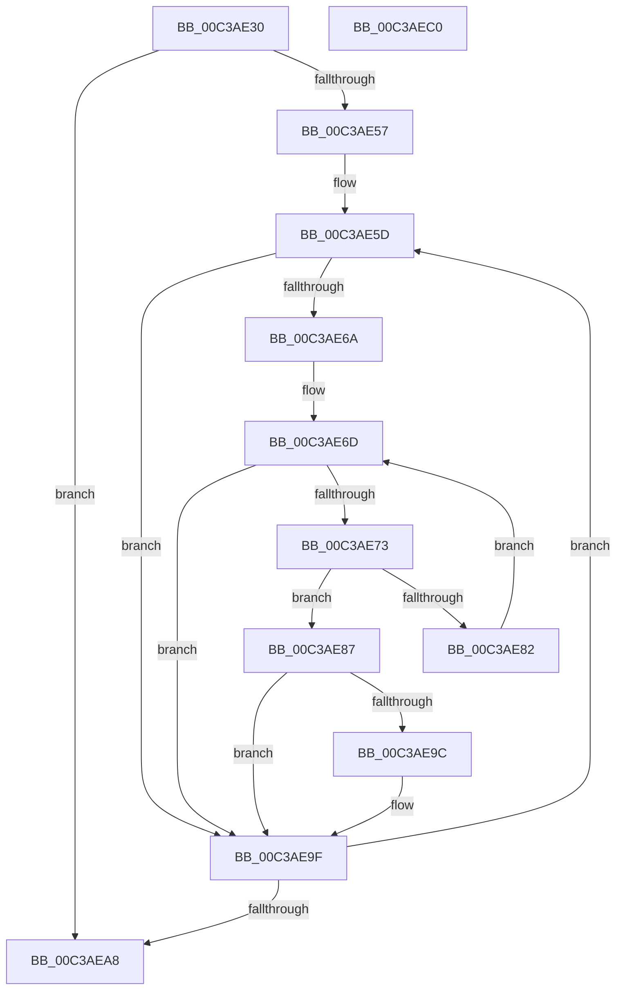

# KiAssignAdjustableSubNodes

- RVA: `0x00C3AE30`–`0x00C3AEC1` (길이 `145` bytes)
- VA: `0x0000000140C3AE30`
- 실행 섹션: `INIT`
- PDB 이름 있음: `예`; PDB Function 태그: `아니요`
- unwind 정보 RVA: `0x000A5A38`
- 디코드: `43`개 명령, `145/145` bytes 표시
- 미해석 바이트: `0` (있으면 어셈블리에 `.byte`로 보존)

> 이 문서는 커널 이미지의 기계어와 PDB 기호를 분석해 생성했습니다. 4번과 5번은 함수 원형과 자료형을 바이너리 사용 방식에서 추정한 C 해석이며 원본 소스 복구 결과는 아닙니다.

## 1. Dependencies

- 직접 호출 지점: **0**; 고유 호출 대상: **0**
- 직접 호출자로 확인된 함수: **1**
- RIP 상대 이미지 참조: **1**

### Outgoing calls
- 직접 디코드된 call 명령이 없습니다.

### Direct callers
- [KiPerformAutomaticGroupConfiguration](KiPerformAutomaticGroupConfiguration_function_00C38BDC.md) at `0x00C38D67`

### Static image references
- `0x00C3AE43` → RVA `0x00F21AC8` (`.data`; read)

## 2. Other-region calls and transfers

- 다른 실행 섹션으로 향하는 call: **0**
- 별도 외부 분기/꼬리 이동을 확인하지 못했습니다.

## 3. Assembly (complete function range)

```asm
00C3AE30  48 8B C4                        mov rax, rsp
00C3AE33  48 89 58 08                     mov qword ptr [rax + 8], rbx
00C3AE37  48 89 68 10                     mov qword ptr [rax + 0x10], rbp
00C3AE3B  48 89 70 18                     mov qword ptr [rax + 0x18], rsi
00C3AE3F  48 89 78 20                     mov qword ptr [rax + 0x20], rdi
00C3AE43  0F B7 05 7E 6C 2E 00            movzx eax, word ptr [rip + 0x2e6c7e]
00C3AE4A  33 ED                           xor ebp, ebp
00C3AE4C  49 8B F9                        mov rdi, r9
00C3AE4F  0F B7 D5                        movzx edx, bp
00C3AE52  66 3B E8                        cmp bp, ax
00C3AE55  73 51                           jae 0x140c3aea8
00C3AE57  44 8B D0                        mov r10d, eax
00C3AE5A  8D 75 01                        lea esi, [rbp + 1]
00C3AE5D  4C 8B 09                        mov r9, qword ptr [rcx]
00C3AE60  45 8A 41 05                     mov r8b, byte ptr [r9 + 5]
00C3AE64  41 F6 C0 04                     test r8b, 4
00C3AE68  75 35                           jne 0x140c3ae9f
00C3AE6A  0F B7 C5                        movzx eax, bp
00C3AE6D  66 83 F8 20                     cmp ax, 0x20
00C3AE71  73 2C                           jae 0x140c3ae9f
00C3AE73  41 0F B6 59 04                  movzx ebx, byte ptr [r9 + 4]
00C3AE78  44 0F B7 D8                     movzx r11d, ax
00C3AE7C  42 39 1C 9F                     cmp dword ptr [rdi + r11*4], ebx
00C3AE80  73 05                           jae 0x140c3ae87
00C3AE82  66 03 C6                        add ax, si
00C3AE85  EB E6                           jmp 0x140c3ae6d
00C3AE87  44 0A C6                        or r8b, sil
00C3AE8A  66 41 89 41 06                  mov word ptr [r9 + 6], ax
00C3AE8F  45 88 41 05                     mov byte ptr [r9 + 5], r8b
00C3AE93  42 29 1C 9F                     sub dword ptr [rdi + r11*4], ebx
00C3AE97  66 3B D0                        cmp dx, ax
00C3AE9A  77 03                           ja 0x140c3ae9f
00C3AE9C  8D 14 06                        lea edx, [rsi + rax]
00C3AE9F  48 83 C1 08                     add rcx, 8
00C3AEA3  4C 2B D6                        sub r10, rsi
00C3AEA6  75 B5                           jne 0x140c3ae5d
00C3AEA8  48 8B 5C 24 08                  mov rbx, qword ptr [rsp + 8]
00C3AEAD  0F B7 C2                        movzx eax, dx
00C3AEB0  48 8B 6C 24 10                  mov rbp, qword ptr [rsp + 0x10]
00C3AEB5  48 8B 74 24 18                  mov rsi, qword ptr [rsp + 0x18]
00C3AEBA  48 8B 7C 24 20                  mov rdi, qword ptr [rsp + 0x20]
00C3AEBF  C3                              ret
00C3AEC0  CC                              int3
```

## 4. C-style interpretation (structured pseudocode)

```c
__int64 __fastcall KiAssignAdjustableSubNodes(__int64 a1, __int64 a2, __int64 a3, __int64 a4)
{
    __int64 result;
    __int64 v_r10;
    __int64 v_rbp;
    unsigned __int64 v_stack_p10;
    unsigned __int64 v_stack_p18;
    unsigned __int64 v_stack_p20;
    unsigned __int64 v_stack_p8;

    *(unsigned __int64 *)(v_rsp + 8) = v_rbx;
    *(unsigned __int64 *)(v_rsp + 16) = v_rbp;
    *(unsigned __int64 *)(v_rsp + 24) = v_rsi;
    *(unsigned __int64 *)(v_rsp + 32) = v_rdi;
    v_rbp = 0;
    if (0 >= ((unsigned __int16)(*(unsigned __int16 *)(v_rip + 3042430)))) goto loc_00C3AEA8;
loc_00C3AE5D:
    if ((((unsigned __int8)(*(unsigned __int8 *)(*(unsigned __int64 *)(a1) + 5))) & (4)) != 0) goto loc_00C3AE9F;
loc_00C3AE6D:
    if (0 >= 32) goto loc_00C3AE9F;
    if ((*(unsigned int *)(a4 + 0 * 4)) >= ((unsigned int)(*(unsigned __int8 *)(*(unsigned __int64 *)(a1) + 4)))) goto loc_00C3AE87;
    result = (unsigned __int16)((0) + ((unsigned __int16)(v_rbp + 1)));
    goto loc_00C3AE6D;
loc_00C3AE87:
    a3 = (unsigned __int8)((*(unsigned __int8 *)(*(unsigned __int64 *)(a1) + 5)) | ((unsigned __int8)(v_rbp + 1)));
    *(unsigned __int16 *)(*(unsigned __int64 *)(a1) + 6) = (unsigned __int16)(result);
    *(unsigned __int8 *)(*(unsigned __int64 *)(a1) + 5) = (unsigned __int8)(a3);
    if (0 <= ((unsigned __int16)(result))) {
        a2 = v_rbp + 1 + result * 1;
    }
    a1 = (a1) + (8);
    v_r10 = ((unsigned int)((unsigned int)(*(unsigned __int16 *)(v_rip + 3042430)))) - (v_rbp + 1);
    if (condition_is_not_equal) goto loc_00C3AE5D;
loc_00C3AEA8:
    return (unsigned __int16)(a2);
}
```

## 5. (Beta) C Style

```c
int64_t KiAssignAdjustableSubNodes(void *Arg1, int64_t Arg2, int64_t Arg3, void *Arg4)
{
    uint8_t *arg1 = (uint8_t *)Arg1;
    uint8_t *arg4 = (uint8_t *)Arg4;

    int64_t result;
    int64_t local_r10;
    int64_t local_rbp;
    uint64_t v_stack_p10;
    uint64_t v_stack_p18;
    uint64_t v_stack_p20;
    uint64_t v_stack_p8;

    *(uint64_t *)(local_rsp + 0x8) = local_rbx;
    *(uint64_t *)(local_rsp + 0x10) = local_rbp;
    *(uint64_t *)(local_rsp + 0x18) = local_rsi;
    *(uint64_t *)(local_rsp + 0x20) = local_rdi;
    local_rbp = 0;
    if (0 >= ((uint16_t)(*(uint16_t *)(v_rip + 0x2E6C7E)))) goto loc_00C3AEA8;
loc_00C3AE5D:
    if ((((uint8_t)(*(uint8_t *)(*(uint64_t *)(arg1) + 0x5))) & (4)) != 0) goto loc_00C3AE9F;
loc_00C3AE6D:
    if (0 >= 32) goto loc_00C3AE9F;
    if ((*(uint32_t *)(arg4 + 0x0 * 4)) >= ((uint32_t)(*(uint8_t *)(*(uint64_t *)(arg1) + 0x4)))) goto loc_00C3AE87;
    result = (uint16_t)((0) + ((uint16_t)(local_rbp + 1)));
    goto loc_00C3AE6D;
loc_00C3AE87:
    Arg3 = (uint8_t)((*(uint8_t *)(*(uint64_t *)(arg1) + 0x5)) | ((uint8_t)(local_rbp + 1)));
    *(uint16_t *)(*(uint64_t *)(arg1) + 0x6) = (uint16_t)(result);
    *(uint8_t *)(*(uint64_t *)(arg1) + 0x5) = (uint8_t)(Arg3);
    if (0 <= ((uint16_t)(result))) {
        Arg2 = local_rbp + 1 + result * 1;
    }
    Arg1 = (Arg1) + (8);
    local_r10 = ((uint32_t)((uint32_t)(*(uint16_t *)(v_rip + 0x2E6C7E)))) - (local_rbp + 1);
    if (condition_is_not_equal) goto loc_00C3AE5D;
loc_00C3AEA8:
    return (uint16_t)(Arg2);
}
```

### 관측된 메모리 오프셋

구조체 형식이 확인되지 않은 접근은 인자 기준의 오프셋으로만 기록했습니다.

| 기준 인자 | 오프셋 표현 | 폭 (bit) | 접근 |
|---|---:|---:|---|
| `Arg1` | `+ 0x0` | `64` | `R` |
| `Arg4` | `+ 0x0 + r11*4` | `32` | `R` |
| `Arg4` | `+ 0x0 + r11*4` | `32` | `R/W` |

## 6. Execution-region graph

[열기: 2D/3D 그래프와 함수 탐색 컨트롤 패널](../../../control-panel.html?section=init&rva=0x00C3AE30&view=graph)

- 2D 그래프는 위에서 아래로 흐르고, 3D 그래프는 빈 공간을 드래그해 회전합니다. Shift+드래그는 이동, 휠은 확대·축소, 함수 노드 선택은 대상 보고서 이동입니다.

### Static fallback


