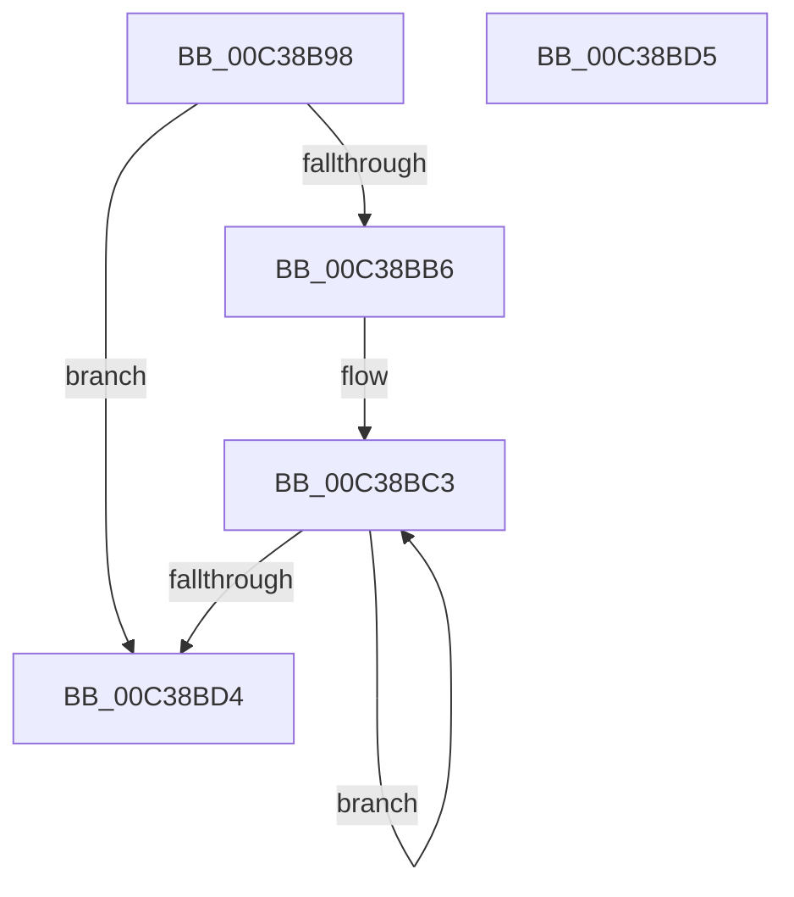

# KiAssignAllSubNodesToGroup0

- RVA: `0x00C38B98`–`0x00C38BD6` (길이 `62` bytes)
- VA: `0x0000000140C38B98`
- 실행 섹션: `INIT`
- PDB 이름 있음: `예`; PDB Function 태그: `아니요`
- unwind 정보 RVA: `0x000DB714`
- 디코드: `16`개 명령, `62/62` bytes 표시
- 미해석 바이트: `0` (있으면 어셈블리에 `.byte`로 보존)

> 이 문서는 커널 이미지의 기계어와 PDB 기호를 분석해 생성했습니다. 4번과 5번은 함수 원형과 자료형을 바이너리 사용 방식에서 추정한 C 해석이며 원본 소스 복구 결과는 아닙니다.

## 1. Dependencies

- 직접 호출 지점: **0**; 고유 호출 대상: **0**
- 직접 호출자로 확인된 함수: **1**
- RIP 상대 이미지 참조: **3**

### Outgoing calls
- 직접 디코드된 call 명령이 없습니다.

### Direct callers
- [KiPerformGroupConfiguration](KiPerformGroupConfiguration_function_00C38FB0.md) at `0x00C39063`

### Static image references
- `0x00C38B98` → RVA `0x00F21AC8` (`.data`; read)
- `0x00C38BA8` → RVA `0x00FC5014` (`ALMOSTRO`; write)
- `0x00C38BB6` → RVA `0x00F21AF0` (`.data`; read)

## 2. Other-region calls and transfers

- 다른 실행 섹션으로 향하는 call: **0**
- 별도 외부 분기/꼬리 이동을 확인하지 못했습니다.

## 3. Assembly (complete function range)

```asm
00C38B98  0F B7 0D 29 8F 2E 00            movzx ecx, word ptr [rip + 0x2e8f29]
00C38B9F  45 33 C9                        xor r9d, r9d
00C38BA2  41 B8 01 00 00 00               mov r8d, 1
00C38BA8  66 44 89 05 64 C4 38 00         mov word ptr [rip + 0x38c464], r8w
00C38BB0  66 44 3B C9                     cmp r9w, cx
00C38BB4  73 1E                           jae 0x140c38bd4
00C38BB6  48 8B 05 33 8F 2E 00            mov rax, qword ptr [rip + 0x2e8f33]
00C38BBD  8B D1                           mov edx, ecx
00C38BBF  48 83 C0 05                     add rax, 5
00C38BC3  44 08 00                        or byte ptr [rax], r8b
00C38BC6  66 44 89 48 01                  mov word ptr [rax + 1], r9w
00C38BCB  48 8D 40 18                     lea rax, [rax + 0x18]
00C38BCF  49 2B D0                        sub rdx, r8
00C38BD2  75 EF                           jne 0x140c38bc3
00C38BD4  C3                              ret
00C38BD5  CC                              int3
```

## 4. C-style interpretation (structured pseudocode)

```c
__int64 __fastcall KiAssignAllSubNodesToGroup0(__int64 a1, __int64 a2, __int64 a3, int a4)
{
    __int64 result;

    a4 = 0;
    *(unsigned __int16 *)(v_rip + 3720292) = 1;
    if (0 >= ((unsigned __int16)(*(unsigned __int16 *)(v_rip + 3051305)))) goto loc_00C38BD4;
    result = (*(unsigned __int64 *)(v_rip + 3051315)) + (5);
loc_00C38BC3:
    *(unsigned __int16 *)(result + 1) = 0;
    a2 = ((unsigned int)((unsigned int)(*(unsigned __int16 *)(v_rip + 3051305)))) - (1);
    if (condition_is_not_equal) goto loc_00C38BC3;
loc_00C38BD4:
    return result + 24;
}
```

## 5. (Beta) C Style

```c
int64_t KiAssignAllSubNodesToGroup0(int64_t Arg1, int64_t Arg2, int64_t Arg3, int32_t Arg4)
{
    int64_t result;

    Arg4 = 0;
    *(uint16_t *)(v_rip + 0x38C464) = 1;
    if (0 >= ((uint16_t)(*(uint16_t *)(v_rip + 0x2E8F29)))) goto loc_00C38BD4;
    result = (*(uint64_t *)(v_rip + 0x2E8F33)) + (5);
loc_00C38BC3:
    *(uint16_t *)(result + 0x1) = 0;
    Arg2 = ((uint32_t)((uint32_t)(*(uint16_t *)(v_rip + 0x2E8F29)))) - (1);
    if (condition_is_not_equal) goto loc_00C38BC3;
loc_00C38BD4:
    return result + 24;
}
```

## 6. Execution-region graph

[열기: 2D/3D 그래프와 함수 탐색 컨트롤 패널](../../../control-panel.html?section=init&rva=0x00C38B98&view=graph)

- 2D 그래프는 위에서 아래로 흐르고, 3D 그래프는 빈 공간을 드래그해 회전합니다. Shift+드래그는 이동, 휠은 확대·축소, 함수 노드 선택은 대상 보고서 이동입니다.

### Static fallback


