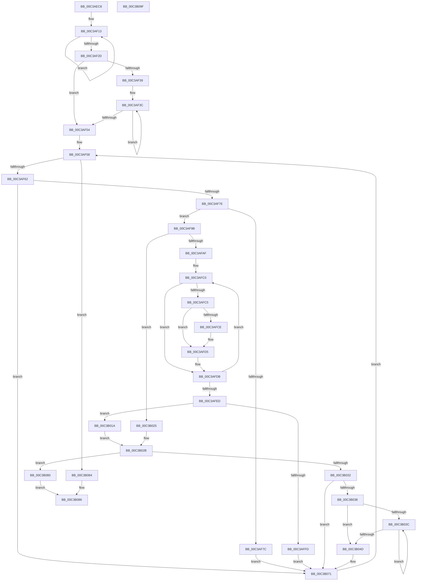

# KiAssignFixedSubNodes

- RVA: `0x00C3AEC8`–`0x00C3B0A0` (길이 `472` bytes)
- VA: `0x0000000140C3AEC8`
- 실행 섹션: `INIT`
- PDB 이름 있음: `예`; PDB Function 태그: `아니요`
- unwind 정보 RVA: `0x000CB274`
- 디코드: `132`개 명령, `472/472` bytes 표시
- 미해석 바이트: `0` (있으면 어셈블리에 `.byte`로 보존)

> 이 문서는 커널 이미지의 기계어와 PDB 기호를 분석해 생성했습니다. 4번과 5번은 함수 원형과 자료형을 바이너리 사용 방식에서 추정한 C 해석이며 원본 소스 복구 결과는 아닙니다.

## 1. Dependencies

- 직접 호출 지점: **0**; 고유 호출 대상: **0**
- 직접 호출자로 확인된 함수: **1**
- RIP 상대 이미지 참조: **2**

### Outgoing calls
- 직접 디코드된 call 명령이 없습니다.

### Direct callers
- [KiPerformAutomaticGroupConfiguration](KiPerformAutomaticGroupConfiguration_function_00C38BDC.md) at `0x00C38D38`

### Static image references
- `0x00C3AEF8` → RVA `0x00F21AC8` (`.data`; read)
- `0x00C3AF13` → RVA `0x00FC5044` (`ALMOSTRO`; read)

## 2. Other-region calls and transfers

- 다른 실행 섹션으로 향하는 call: **0**
- 별도 외부 분기/꼬리 이동을 확인하지 못했습니다.

## 3. Assembly (complete function range)

```asm
00C3AEC8  48 8B C4                        mov rax, rsp
00C3AECB  48 89 58 08                     mov qword ptr [rax + 8], rbx
00C3AECF  48 89 68 10                     mov qword ptr [rax + 0x10], rbp
00C3AED3  48 89 70 18                     mov qword ptr [rax + 0x18], rsi
00C3AED7  44 88 48 20                     mov byte ptr [rax + 0x20], r9b
00C3AEDB  57                              push rdi
00C3AEDC  41 54                           push r12
00C3AEDE  41 55                           push r13
00C3AEE0  41 56                           push r14
00C3AEE2  41 57                           push r15
00C3AEE4  48 8B 74 24 58                  mov rsi, qword ptr [rsp + 0x58]
00C3AEE9  41 B9 20 00 00 00               mov r9d, 0x20
00C3AEEF  48 8B 6C 24 50                  mov rbp, qword ptr [rsp + 0x50]
00C3AEF4  45 0F B7 E8                     movzx r13d, r8w
00C3AEF8  44 0F B7 25 C8 6B 2E 00         movzx r12d, word ptr [rip + 0x2e6bc8]
00C3AF00  4C 8B F9                        mov r15, rcx
00C3AF03  48 8B D6                        mov rdx, rsi
00C3AF06  4C 8B D5                        mov r10, rbp
00C3AF09  41 8D 59 E1                     lea ebx, [r9 - 0x1f]
00C3AF0D  45 8B D9                        mov r11d, r9d
00C3AF10  45 33 F6                        xor r14d, r14d
00C3AF13  8B 05 2B A1 38 00               mov eax, dword ptr [rip + 0x38a12b]
00C3AF19  41 89 02                        mov dword ptr [r10], eax
00C3AF1C  4D 8D 52 04                     lea r10, [r10 + 4]
00C3AF20  66 44 89 32                     mov word ptr [rdx], r14w
00C3AF24  48 8D 52 02                     lea rdx, [rdx + 2]
00C3AF28  4C 2B DB                        sub r11, rbx
00C3AF2B  75 E6                           jne 0x140c3af13
00C3AF2D  41 BA FF FF 00 00               mov r10d, 0xffff
00C3AF33  66 45 3B F4                     cmp r14w, r12w
00C3AF37  73 1B                           jae 0x140c3af54
00C3AF39  49 8B D4                        mov rdx, r12
00C3AF3C  48 8B 01                        mov rax, qword ptr [rcx]
00C3AF3F  66 44 89 50 06                  mov word ptr [rax + 6], r10w
00C3AF44  48 8B 01                        mov rax, qword ptr [rcx]
00C3AF47  48 8D 49 08                     lea rcx, [rcx + 8]
00C3AF4B  80 60 05 FE                     and byte ptr [rax + 5], 0xfe
00C3AF4F  48 2B D3                        sub rdx, rbx
00C3AF52  75 E8                           jne 0x140c3af3c
00C3AF54  45 0F B7 C6                     movzx r8d, r14w
00C3AF58  66 45 3B C4                     cmp r8w, r12w
00C3AF5C  0F 83 22 01 00 00               jae 0x140c3b084
00C3AF62  41 0F B7 D0                     movzx edx, r8w
00C3AF66  49 8B 04 D7                     mov rax, qword ptr [r15 + rdx*8]
00C3AF6A  8A 48 05                        mov cl, byte ptr [rax + 5]
00C3AF6D  F6 C1 04                        test cl, 4
00C3AF70  0F 84 FB 00 00 00               je 0x140c3b071
00C3AF76  66 45 3B C5                     cmp r8w, r13w
00C3AF7A  73 1F                           jae 0x140c3af9b
00C3AF7C  66 44 89 40 06                  mov word ptr [rax + 6], r8w
00C3AF81  0A CB                           or cl, bl
00C3AF83  88 48 05                        mov byte ptr [rax + 5], cl
00C3AF86  66 01 1C 56                     add word ptr [rsi + rdx*2], bx
00C3AF8A  49 8B 04 D7                     mov rax, qword ptr [r15 + rdx*8]
00C3AF8E  0F B6 48 04                     movzx ecx, byte ptr [rax + 4]
00C3AF92  29 4C 95 00                     sub dword ptr [rbp + rdx*4], ecx
00C3AF96  E9 D6 00 00 00                  jmp 0x140c3b071
00C3AF9B  8B 3D A3 A0 38 00               mov edi, dword ptr [rip + 0x38a0a3]
00C3AFA1  41 0F B7 D1                     movzx edx, r9w
00C3AFA5  45 0F B7 CE                     movzx r9d, r14w
00C3AFA9  66 45 3B F5                     cmp r14w, r13w
00C3AFAD  73 76                           jae 0x140c3b025
00C3AFAF  44 0F B6 70 04                  movzx r14d, byte ptr [rax + 4]
00C3AFB4  48 8B DE                        mov rbx, rsi
00C3AFB7  4C 8B DD                        mov r11, rbp
00C3AFBA  41 BA 01 00 00 00               mov r10d, 1
00C3AFC0  45 39 33                        cmp dword ptr [r11], r14d
00C3AFC3  72 16                           jb 0x140c3afdb
00C3AFC5  44 0F B7 13                     movzx r10d, word ptr [rbx]
00C3AFC9  44 3B D7                        cmp r10d, edi
00C3AFCC  73 07                           jae 0x140c3afd5
00C3AFCE  41 8B FA                        mov edi, r10d
00C3AFD1  41 0F B7 D1                     movzx edx, r9w
00C3AFD5  41 BA 01 00 00 00               mov r10d, 1
00C3AFDB  66 45 03 CA                     add r9w, r10w
00C3AFDF  49 83 C3 04                     add r11, 4
00C3AFE3  48 83 C3 02                     add rbx, 2
00C3AFE7  66 45 3B CD                     cmp r9w, r13w
00C3AFEB  72 D3                           jb 0x140c3afc0
00C3AFED  41 B9 20 00 00 00               mov r9d, 0x20
00C3AFF3  41 8D 59 E1                     lea ebx, [r9 - 0x1f]
00C3AFF7  66 41 3B D1                     cmp dx, r9w
00C3AFFB  74 1D                           je 0x140c3b01a
00C3AFFD  0A CB                           or cl, bl
00C3AFFF  66 89 50 06                     mov word ptr [rax + 6], dx
00C3B003  88 48 05                        mov byte ptr [rax + 5], cl
00C3B006  0F B7 CA                        movzx ecx, dx
00C3B009  66 01 1C 4E                     add word ptr [rsi + rcx*2], bx
00C3B00D  0F B6 40 04                     movzx eax, byte ptr [rax + 4]
00C3B011  29 44 8D 00                     sub dword ptr [rbp + rcx*4], eax
00C3B015  45 33 F6                        xor r14d, r14d
00C3B018  EB 57                           jmp 0x140c3b071
00C3B01A  45 33 F6                        xor r14d, r14d
00C3B01D  41 BA FF FF 00 00               mov r10d, 0xffff
00C3B023  EB 06                           jmp 0x140c3b02b
00C3B025  41 B9 20 00 00 00               mov r9d, 0x20
00C3B02B  44 38 74 24 48                  cmp byte ptr [rsp + 0x48], r14b
00C3B030  74 4E                           je 0x140c3b080
00C3B032  66 44 39 30                     cmp word ptr [rax], r14w
00C3B036  75 39                           jne 0x140c3b071
00C3B038  84 CB                           test bl, cl
00C3B03A  75 11                           jne 0x140c3b04d
00C3B03C  66 45 03 C2                     add r8w, r10w
00C3B040  41 0F B7 C0                     movzx eax, r8w
00C3B044  49 8B 0C C7                     mov rcx, qword ptr [r15 + rax*8]
00C3B048  84 59 05                        test byte ptr [rcx + 5], bl
00C3B04B  74 EF                           je 0x140c3b03c
00C3B04D  41 0F B7 C0                     movzx eax, r8w
00C3B051  49 8B 14 C7                     mov rdx, qword ptr [r15 + rax*8]
00C3B055  0F B7 42 06                     movzx eax, word ptr [rdx + 6]
00C3B059  80 62 05 FE                     and byte ptr [rdx + 5], 0xfe
00C3B05D  8B C8                           mov ecx, eax
00C3B05F  66 44 89 52 06                  mov word ptr [rdx + 6], r10w
00C3B064  66 44 01 14 46                  add word ptr [rsi + rax*2], r10w
00C3B069  0F B6 42 04                     movzx eax, byte ptr [rdx + 4]
00C3B06D  01 44 8D 00                     add dword ptr [rbp + rcx*4], eax
00C3B071  66 44 03 C3                     add r8w, bx
00C3B075  41 BA FF FF 00 00               mov r10d, 0xffff
00C3B07B  E9 D8 FE FF FF                  jmp 0x140c3af58
00C3B080  32 C0                           xor al, al
00C3B082  EB 02                           jmp 0x140c3b086
00C3B084  8A C3                           mov al, bl
00C3B086  48 8B 5C 24 30                  mov rbx, qword ptr [rsp + 0x30]
00C3B08B  48 8B 6C 24 38                  mov rbp, qword ptr [rsp + 0x38]
00C3B090  48 8B 74 24 40                  mov rsi, qword ptr [rsp + 0x40]
00C3B095  41 5F                           pop r15
00C3B097  41 5E                           pop r14
00C3B099  41 5D                           pop r13
00C3B09B  41 5C                           pop r12
00C3B09D  5F                              pop rdi
00C3B09E  C3                              ret
00C3B09F  CC                              int3
```

## 4. C-style interpretation (structured pseudocode)

```c
__int64 __fastcall KiAssignFixedSubNodes(__int64 a1, __int64 a2, unsigned __int16 a3, unsigned __int8 a4, __int64 a5, __int64 a6)
{
    __int64 result;
    __int64 v_r11;
    __int64 v_r14;
    __int64 v_rbx;
    __int64 v_rdi;
    unsigned __int64 v_stack_p10;
    unsigned __int64 v_stack_p18;
    unsigned __int8 v_stack_p20;
    unsigned __int64 v_stack_p8;

    *(unsigned __int64 *)(v_rsp + 8) = v_rbx;
    *(unsigned __int64 *)(v_rsp + 16) = v_rbp;
    *(unsigned __int64 *)(v_rsp + 24) = v_rsi;
    *(unsigned __int8 *)(v_rsp + 32) = a4;
    v_r14 = 0;
loc_00C3AF13:
    *(unsigned int *)(a5) = (unsigned int)((unsigned int)(*(unsigned int *)(v_rip + 3711275)));
    *(unsigned __int16 *)(a6) = 0;
    v_r11 = (32) - (32 - 31);
    if (condition_is_not_equal) goto loc_00C3AF13;
    if (0 >= ((unsigned __int16)(*(unsigned __int16 *)(v_rip + 3042248)))) goto loc_00C3AF54;
loc_00C3AF3C:
    *(unsigned __int16 *)(*(unsigned __int64 *)(a1) + 6) = (unsigned __int16)((unsigned int)(0xFFFFULL));
    a2 = (*(unsigned __int16 *)(v_rip + 3042248)) - (32 - 31);
    if (condition_is_not_equal) goto loc_00C3AF3C;
loc_00C3AF54:
loc_00C3AF58:
    if (0 >= ((unsigned __int16)(*(unsigned __int16 *)(v_rip + 3042248)))) goto loc_00C3B084;
    if ((((unsigned __int8)(*(unsigned __int8 *)(*(unsigned __int64 *)(a1 + 0 * 8) + 5))) & (4)) == 0) goto loc_00C3B071;
    if (0 >= a3) goto loc_00C3AF9B;
    *(unsigned __int16 *)(*(unsigned __int64 *)(a1 + 0 * 8) + 6) = 0;
    a1 = (unsigned __int8)((*(unsigned __int8 *)(*(unsigned __int64 *)(a1 + 0 * 8) + 5)) | ((unsigned __int8)(32 - 31)));
    *(unsigned __int8 *)(*(unsigned __int64 *)(a1 + 0 * 8) + 5) = (unsigned __int8)(a1);
    goto loc_00C3B071;
loc_00C3AF9B:
    if (0 >= a3) goto loc_00C3B025;
loc_00C3AFC0:
    if ((*(unsigned int *)(a5)) < ((unsigned int)(*(unsigned __int8 *)(*(unsigned __int64 *)(a1 + 0 * 8) + 4)))) goto loc_00C3AFDB;
    v_rdi = (unsigned int)(*(unsigned int *)(v_rip + 3711139));
    if (((unsigned int)(*(unsigned __int16 *)(a6))) < ((unsigned int)((unsigned int)(*(unsigned int *)(v_rip + 3711139))))) {
        v_rdi = (unsigned int)(*(unsigned __int16 *)(a6));
        a2 = 0;
    }
loc_00C3AFDB:
    a4 = (unsigned __int16)((0) + (1));
    v_r11 = (a5) + (4);
    v_rbx = (a6) + (2);
    if (a4 < a3) goto loc_00C3AFC0;
    if (((unsigned __int16)(a2)) == 32) goto loc_00C3B01A;
    a1 = (unsigned __int8)((*(unsigned __int8 *)(*(unsigned __int64 *)(a1 + 0 * 8) + 4)) | ((unsigned __int8)(32 - 31)));
    *(unsigned __int16 *)(*(unsigned __int64 *)(a1 + 0 * 8) + 6) = (unsigned __int16)(a2);
    *(unsigned __int8 *)(*(unsigned __int64 *)(a1 + 0 * 8) + 5) = (unsigned __int8)(a1);
    v_r14 = 0;
    goto loc_00C3B071;
loc_00C3B01A:
    v_r14 = 0;
    goto loc_00C3B02B;
loc_00C3B025:
loc_00C3B02B:
    if (v_stack_p20 == 0) goto loc_00C3B080;
    if ((*(unsigned __int16 *)(*(unsigned __int8 *)(*(unsigned __int64 *)(a1 + 0 * 8) + 4))) != 0) goto loc_00C3B071;
    if ((((unsigned __int8)(32 - 31)) & ((unsigned __int8)((unsigned __int16)(a2)))) != 0) goto loc_00C3B04D;
loc_00C3B03C:
    a3 = (unsigned __int16)((0) + ((unsigned __int16)((unsigned int)(0xFFFFULL))));
    if (((*(unsigned __int8 *)(*(unsigned __int64 *)(a1 + a3 * 8) + 5)) & ((unsigned __int8)(32 - 31))) == 0) goto loc_00C3B03C;
loc_00C3B04D:
    *(unsigned __int16 *)(*(unsigned __int64 *)(a1 + a3 * 8) + 6) = (unsigned __int16)((unsigned int)(0xFFFFULL));
loc_00C3B071:
    a3 = (unsigned __int16)((a3) + ((unsigned __int16)(32 - 31)));
    goto loc_00C3AF58;
loc_00C3B080:
    result = 0;
    goto loc_00C3B086;
loc_00C3B084:
loc_00C3B086:
    return (unsigned __int8)(32 - 31);
}
```

## 5. (Beta) C Style

```c
int64_t KiAssignFixedSubNodes(void *Arg1, int64_t Arg2, uint16_t Arg3, uint8_t Arg4, void *Arg5, void *Arg6)
{
    uint8_t *arg1 = (uint8_t *)Arg1;
    uint8_t *arg5 = (uint8_t *)Arg5;
    uint8_t *arg6 = (uint8_t *)Arg6;

    int64_t result;
    int64_t local_r11;
    int64_t local_r14;
    int64_t local_rbx;
    int64_t local_rdi;
    uint64_t v_stack_p10;
    uint64_t v_stack_p18;
    uint8_t v_stack_p20;
    uint64_t v_stack_p8;

    *(uint64_t *)(local_rsp + 0x8) = local_rbx;
    *(uint64_t *)(local_rsp + 0x10) = local_rbp;
    *(uint64_t *)(local_rsp + 0x18) = local_rsi;
    *(uint8_t *)(local_rsp + 0x20) = Arg4;
    local_r14 = 0;
loc_00C3AF13:
    *(uint32_t *)(arg5) = (uint32_t)((uint32_t)(*(uint32_t *)(v_rip + 0x38A12B)));
    *(uint16_t *)(arg6) = 0;
    local_r11 = (32) - (32 - 31);
    if (condition_is_not_equal) goto loc_00C3AF13;
    if (0 >= ((uint16_t)(*(uint16_t *)(v_rip + 0x2E6BC8)))) goto loc_00C3AF54;
loc_00C3AF3C:
    *(uint16_t *)(*(uint64_t *)(arg1) + 0x6) = (uint16_t)((uint32_t)(0xFFFFULL));
    Arg2 = (*(uint16_t *)(v_rip + 0x2E6BC8)) - (32 - 31);
    if (condition_is_not_equal) goto loc_00C3AF3C;
loc_00C3AF54:
loc_00C3AF58:
    if (0 >= ((uint16_t)(*(uint16_t *)(v_rip + 0x2E6BC8)))) goto loc_00C3B084;
    if ((((uint8_t)(*(uint8_t *)(*(uint64_t *)(arg1 + 0x0 * 8) + 0x5))) & (4)) == 0) goto loc_00C3B071;
    if (0 >= Arg3) goto loc_00C3AF9B;
    *(uint16_t *)(*(uint64_t *)(arg1 + 0x0 * 8) + 0x6) = 0;
    Arg1 = (uint8_t)((*(uint8_t *)(*(uint64_t *)(arg1 + 0x0 * 8) + 0x5)) | ((uint8_t)(32 - 31)));
    *(uint8_t *)(*(uint64_t *)(arg1 + 0x0 * 8) + 0x5) = (uint8_t)(Arg1);
    goto loc_00C3B071;
loc_00C3AF9B:
    if (0 >= Arg3) goto loc_00C3B025;
loc_00C3AFC0:
    if ((*(uint32_t *)(arg5)) < ((uint32_t)(*(uint8_t *)(*(uint64_t *)(arg1 + 0x0 * 8) + 0x4)))) goto loc_00C3AFDB;
    local_rdi = (uint32_t)(*(uint32_t *)(v_rip + 0x38A0A3));
    if (((uint32_t)(*(uint16_t *)(arg6))) < ((uint32_t)((uint32_t)(*(uint32_t *)(v_rip + 0x38A0A3))))) {
        local_rdi = (uint32_t)(*(uint16_t *)(arg6));
        Arg2 = 0;
    }
loc_00C3AFDB:
    Arg4 = (uint16_t)((0) + (1));
    local_r11 = (Arg5) + (4);
    local_rbx = (Arg6) + (2);
    if (Arg4 < Arg3) goto loc_00C3AFC0;
    if (((uint16_t)(Arg2)) == 32) goto loc_00C3B01A;
    Arg1 = (uint8_t)((*(uint8_t *)(*(uint64_t *)(arg1 + 0x0 * 8) + 0x4)) | ((uint8_t)(32 - 31)));
    *(uint16_t *)(*(uint64_t *)(arg1 + 0x0 * 8) + 0x6) = (uint16_t)(Arg2);
    *(uint8_t *)(*(uint64_t *)(arg1 + 0x0 * 8) + 0x5) = (uint8_t)(Arg1);
    local_r14 = 0;
    goto loc_00C3B071;
loc_00C3B01A:
    local_r14 = 0;
    goto loc_00C3B02B;
loc_00C3B025:
loc_00C3B02B:
    if (v_stack_p20 == 0) goto loc_00C3B080;
    if ((*(uint16_t *)(*(uint8_t *)(*(uint64_t *)(arg1 + 0x0 * 8) + 0x4))) != 0) goto loc_00C3B071;
    if ((((uint8_t)(32 - 31)) & ((uint8_t)((uint16_t)(Arg2)))) != 0) goto loc_00C3B04D;
loc_00C3B03C:
    Arg3 = (uint16_t)((0) + ((uint16_t)((uint32_t)(0xFFFFULL))));
    if (((*(uint8_t *)(*(uint64_t *)(arg1 + Arg3 * 8) + 0x5)) & ((uint8_t)(32 - 31))) == 0) goto loc_00C3B03C;
loc_00C3B04D:
    *(uint16_t *)(*(uint64_t *)(arg1 + Arg3 * 8) + 0x6) = (uint16_t)((uint32_t)(0xFFFFULL));
loc_00C3B071:
    Arg3 = (uint16_t)((Arg3) + ((uint16_t)(32 - 31)));
    goto loc_00C3AF58;
loc_00C3B080:
    result = 0;
    goto loc_00C3B086;
loc_00C3B084:
loc_00C3B086:
    return (uint8_t)(32 - 31);
}
```

### 관측된 메모리 오프셋

구조체 형식이 확인되지 않은 접근은 인자 기준의 오프셋으로만 기록했습니다.

| 기준 인자 | 오프셋 표현 | 폭 (bit) | 접근 |
|---|---:|---:|---|
| `Arg1` | `+ 0x0` | `64` | `R` |
| `Arg1` | `+ 0x0 + rax*8` | `64` | `R` |
| `Arg1` | `+ 0x0 + rdx*8` | `64` | `R` |
| `Arg1` | `+ 0x8` | `64` | `R` |
| `Arg5` | `+ 0x0` | `32` | `R` |
| `Arg5` | `+ 0x0` | `32` | `W` |
| `Arg5` | `+ 0x0 + rcx*4` | `32` | `R/W` |
| `Arg5` | `+ 0x0 + rdx*4` | `32` | `R/W` |
| `Arg5` | `+ 0x4` | `64` | `R` |
| `Arg6` | `+ 0x0` | `16` | `R` |
| `Arg6` | `+ 0x0` | `16` | `W` |
| `Arg6` | `+ 0x0 + rax*2` | `16` | `R/W` |
| `Arg6` | `+ 0x0 + rcx*2` | `16` | `R/W` |
| `Arg6` | `+ 0x0 + rdx*2` | `16` | `R/W` |
| `Arg6` | `+ 0x2` | `64` | `R` |

## 6. Execution-region graph

[열기: 2D/3D 그래프와 함수 탐색 컨트롤 패널](../../../control-panel.html?section=init&rva=0x00C3AEC8&view=graph)

- 2D 그래프는 위에서 아래로 흐르고, 3D 그래프는 빈 공간을 드래그해 회전합니다. Shift+드래그는 이동, 휠은 확대·축소, 함수 노드 선택은 대상 보고서 이동입니다.

### Static fallback


