# KiComputeDispatchInterruptCost

- RVA: `0x00C377C0`–`0x00C37ACD` (길이 `781` bytes)
- VA: `0x0000000140C377C0`
- 실행 섹션: `INIT`
- PDB 이름 있음: `예`; PDB Function 태그: `아니요`
- unwind 정보 RVA: `0x000C9ECC`
- 디코드: `214`개 명령, `781/781` bytes 표시
- 미해석 바이트: `0` (있으면 어셈블리에 `.byte`로 보존)

> 이 문서는 커널 이미지의 기계어와 PDB 기호를 분석해 생성했습니다. 4번과 5번은 함수 원형과 자료형을 바이너리 사용 방식에서 추정한 C 해석이며 원본 소스 복구 결과는 아닙니다.

## 1. Dependencies

- 직접 호출 지점: **16**; 고유 호출 대상: **11**
- 직접 호출자로 확인된 함수: **1**
- RIP 상대 이미지 참조: **4**

### Outgoing calls
- `0x00C37811` → [HviIsAnyHypervisorPresent](../../text/4A/HviIsAnyHypervisorPresent_function_004ADC50.md) (function, `0x004ADC50`)
- `0x00C37827` → [HviGetHypervisorFeatures](../../text/66/HviGetHypervisorFeatures_function_00666630.md) (function, `0x00666630`)
- `0x00C3783E` → [HviGetEnlightenmentInformation](../../text/66/HviGetEnlightenmentInformation_function_006665E4.md) (function, `0x006665E4`)
- `0x00C37879` → [ExAllocatePool2](../../poolcode/B8/ExAllocatePool2_function_00B820F0.md) (function, `0x00B820F0`)
- `0x00C378F1` → [ExAllocatePool2](../../poolcode/B8/ExAllocatePool2_function_00B820F0.md) (function, `0x00B820F0`)
- `0x00C37916` → [ExAllocatePool2](../../poolcode/B8/ExAllocatePool2_function_00B820F0.md) (function, `0x00B820F0`)
- `0x00C3792F` → [KeQueryPerformanceCounter](../../text/37/KeQueryPerformanceCounter_function_0037E7E0.md) (function, `0x0037E7E0`)
- `0x00C3793E` → [KeDisableInterrupts](../../text/21/KeDisableInterrupts_function_00217BE0.md) (function, `0x00217BE0`)
- `0x00C37980` → [KeQueryPerformanceCounter](../../text/37/KeQueryPerformanceCounter_function_0037E7E0.md) (function, `0x0037E7E0`)
- `0x00C37991` → [KeInsertQueueDpc](../../text/20/KeInsertQueueDpc_function_00207C50.md) (function, `0x00207C50`)
- `0x00C379DA` → [KiRemoveSystemWorkPriorityKick](../../text/26/KiRemoveSystemWorkPriorityKick_function_002631D0.md) (function, `0x002631D0`)
- `0x00C37A00` → [KeWaitForMultipleObjects](../../text/20/KeWaitForMultipleObjects_function_0020D110.md) (function, `0x0020D110`)
- `0x00C37A79` → [ExFreePoolWithTag](../../poolcode/B8/ExFreePoolWithTag_function_00B82870.md) (function, `0x00B82870`)
- `0x00C37A88` → [ExFreePoolWithTag](../../poolcode/B8/ExFreePoolWithTag_function_00B82870.md) (function, `0x00B82870`)
- `0x00C37A97` → [ExFreePoolWithTag](../../poolcode/B8/ExFreePoolWithTag_function_00B82870.md) (function, `0x00B82870`)
- `0x00C37AA6` → [_security_check_cookie](../../text/6A/_security_check_cookie_function_006AC640.md) (function, `0x006AC640`)

### Direct callers
- [KeInitSystem](../C7/KeInitSystem_function_00C71660.md) at `0x00C718A3`

### Static image references
- `0x00C377DF` → RVA `0x00E0A740` (`.data`; read)
- `0x00C377EE` → RVA `0x00FC6A80` (`ALMOSTRO`; read)
- `0x00C378A9` → RVA `0x005B77D0` (`KiComputeDispatchInterruptCostDpcRoutine`; read)
- `0x00C37A6D` → RVA `0x00FC53C0` (`ALMOSTRO`; write)

## 2. Other-region calls and transfers

- 다른 실행 섹션으로 향하는 call: **16**
  - `0x00C37811` → [HviIsAnyHypervisorPresent](../../text/4A/HviIsAnyHypervisorPresent_function_004ADC50.md) (`INIT` → `.text`)
  - `0x00C37827` → [HviGetHypervisorFeatures](../../text/66/HviGetHypervisorFeatures_function_00666630.md) (`INIT` → `.text`)
  - `0x00C3783E` → [HviGetEnlightenmentInformation](../../text/66/HviGetEnlightenmentInformation_function_006665E4.md) (`INIT` → `.text`)
  - `0x00C37879` → [ExAllocatePool2](../../poolcode/B8/ExAllocatePool2_function_00B820F0.md) (`INIT` → `POOLCODE`)
  - `0x00C378F1` → [ExAllocatePool2](../../poolcode/B8/ExAllocatePool2_function_00B820F0.md) (`INIT` → `POOLCODE`)
  - `0x00C37916` → [ExAllocatePool2](../../poolcode/B8/ExAllocatePool2_function_00B820F0.md) (`INIT` → `POOLCODE`)
  - `0x00C3792F` → [KeQueryPerformanceCounter](../../text/37/KeQueryPerformanceCounter_function_0037E7E0.md) (`INIT` → `.text`)
  - `0x00C3793E` → [KeDisableInterrupts](../../text/21/KeDisableInterrupts_function_00217BE0.md) (`INIT` → `.text`)
  - `0x00C37980` → [KeQueryPerformanceCounter](../../text/37/KeQueryPerformanceCounter_function_0037E7E0.md) (`INIT` → `.text`)
  - `0x00C37991` → [KeInsertQueueDpc](../../text/20/KeInsertQueueDpc_function_00207C50.md) (`INIT` → `.text`)
  - `0x00C379DA` → [KiRemoveSystemWorkPriorityKick](../../text/26/KiRemoveSystemWorkPriorityKick_function_002631D0.md) (`INIT` → `.text`)
  - `0x00C37A00` → [KeWaitForMultipleObjects](../../text/20/KeWaitForMultipleObjects_function_0020D110.md) (`INIT` → `.text`)
  - `0x00C37A79` → [ExFreePoolWithTag](../../poolcode/B8/ExFreePoolWithTag_function_00B82870.md) (`INIT` → `POOLCODE`)
  - `0x00C37A88` → [ExFreePoolWithTag](../../poolcode/B8/ExFreePoolWithTag_function_00B82870.md) (`INIT` → `POOLCODE`)
  - `0x00C37A97` → [ExFreePoolWithTag](../../poolcode/B8/ExFreePoolWithTag_function_00B82870.md) (`INIT` → `POOLCODE`)
  - `0x00C37AA6` → [_security_check_cookie](../../text/6A/_security_check_cookie_function_006AC640.md) (`INIT` → `.text`)
- 별도 외부 분기/꼬리 이동을 확인하지 못했습니다.

## 3. Assembly (complete function range)

```asm
00C377C0  4C 8B DC                        mov r11, rsp
00C377C3  49 89 5B 08                     mov qword ptr [r11 + 8], rbx
00C377C7  49 89 6B 10                     mov qword ptr [r11 + 0x10], rbp
00C377CB  49 89 73 18                     mov qword ptr [r11 + 0x18], rsi
00C377CF  57                              push rdi
00C377D0  41 54                           push r12
00C377D2  41 55                           push r13
00C377D4  41 56                           push r14
00C377D6  41 57                           push r15
00C377D8  48 81 EC 80 00 00 00            sub rsp, 0x80
00C377DF  48 8B 05 5A 2F 1D 00            mov rax, qword ptr [rip + 0x1d2f5a]
00C377E6  48 33 C4                        xor rax, rsp
00C377E9  48 89 44 24 78                  mov qword ptr [rsp + 0x78], rax
00C377EE  8B 05 8C F2 38 00               mov eax, dword ptr [rip + 0x38f28c]
00C377F4  33 ED                           xor ebp, ebp
00C377F6  49 89 6B A8                     mov qword ptr [r11 - 0x58], rbp
00C377FA  0F 57 C0                        xorps xmm0, xmm0
00C377FD  44 8B F5                        mov r14d, ebp
00C37800  0F 11 44 24 68                  movups xmmword ptr [rsp + 0x68], xmm0
00C37805  83 F8 01                        cmp eax, 1
00C37808  75 07                           jne 0x140c37811
00C3780A  8B DD                           mov ebx, ebp
00C3780C  E9 8B 02 00 00                  jmp 0x140c37a9c
00C37811  E8 3A 64 87 FF                  call 0x1404adc50
00C37816  84 C0                           test al, al
00C37818  74 33                           je 0x140c3784d
00C3781A  0F 57 C0                        xorps xmm0, xmm0
00C3781D  48 8D 4C 24 58                  lea rcx, [rsp + 0x58]
00C37822  0F 11 44 24 58                  movups xmmword ptr [rsp + 0x58], xmm0
00C37827  E8 04 EE A2 FF                  call 0x140666630
00C3782C  48 8B 44 24 58                  mov rax, qword ptr [rsp + 0x58]
00C37831  48 C1 E8 2C                     shr rax, 0x2c
00C37835  A8 01                           test al, 1
00C37837  74 D1                           je 0x140c3780a
00C37839  48 8D 4C 24 68                  lea rcx, [rsp + 0x68]
00C3783E  E8 A1 ED A2 FF                  call 0x1406665e4
00C37843  F7 44 24 68 00 10 00 00         test dword ptr [rsp + 0x68], 0x1000
00C3784B  75 BD                           jne 0x140c3780a
00C3784D  8B 05 2D F2 38 00               mov eax, dword ptr [rip + 0x38f22d]
00C37853  BF 10 00 00 00                  mov edi, 0x10
00C37858  3B C7                           cmp eax, edi
00C3785A  73 06                           jae 0x140c37862
00C3785C  8B 3D 1E F2 38 00               mov edi, dword ptr [rip + 0x38f21e]
00C37862  8B DF                           mov ebx, edi
00C37864  BE 4B 64 69 63                  mov esi, 0x6369644b
00C37869  48 6B D3 68                     imul rdx, rbx, 0x68
00C3786D  41 BC 40 00 00 00               mov r12d, 0x40
00C37873  44 8B C6                        mov r8d, esi
00C37876  41 8B CC                        mov ecx, r12d
00C37879  E8 72 A8 F4 FF                  call 0x140b820f0
00C3787E  4C 8B E8                        mov r13, rax
00C37881  48 85 C0                        test rax, rax
00C37884  75 0A                           jne 0x140c37890
00C37886  BB 17 00 00 C0                  mov ebx, 0xc0000017
00C3788B  E9 0C 02 00 00                  jmp 0x140c37a9c
00C37890  85 FF                           test edi, edi
00C37892  74 4F                           je 0x140c378e3
00C37894  48 8D 48 51                     lea rcx, [rax + 0x51]
00C37898  48 8B D3                        mov rdx, rbx
00C3789B  66 C7 41 FF 01 00               mov word ptr [rcx - 1], 1
00C378A1  48 8D 41 07                     lea rax, [rcx + 7]
00C378A5  C6 41 01 06                     mov byte ptr [rcx + 1], 6
00C378A9  4C 8D 05 20 FF 97 FF            lea r8, [rip - 0x6800e0]
00C378B0  89 69 03                        mov dword ptr [rcx + 3], ebp
00C378B3  48 89 41 0F                     mov qword ptr [rcx + 0xf], rax
00C378B7  48 89 00                        mov qword ptr [rax], rax
00C378BA  48 8D 41 AF                     lea rax, [rcx - 0x51]
00C378BE  48 89 41 CF                     mov qword ptr [rcx - 0x31], rax
00C378C2  66 89 69 B1                     mov word ptr [rcx - 0x4f], bp
00C378C6  4C 89 41 C7                     mov qword ptr [rcx - 0x39], r8
00C378CA  48 89 69 E7                     mov qword ptr [rcx - 0x19], rbp
00C378CE  48 89 69 BF                     mov qword ptr [rcx - 0x41], rbp
00C378D2  C6 41 B0 02                     mov byte ptr [rcx - 0x50], 2
00C378D6  48 8D 49 68                     lea rcx, [rcx + 0x68]
00C378DA  C6 00 13                        mov byte ptr [rax], 0x13
00C378DD  48 83 EA 01                     sub rdx, 1
00C378E1  75 B8                           jne 0x140c3789b
00C378E3  48 8D 14 DD 00 00 00 00         lea rdx, [rbx*8]
00C378EB  44 8B C6                        mov r8d, esi
00C378EE  49 8B CC                        mov rcx, r12
00C378F1  E8 FA A7 F4 FF                  call 0x140b820f0
00C378F6  4C 8B F8                        mov r15, rax
00C378F9  48 85 C0                        test rax, rax
00C378FC  75 0A                           jne 0x140c37908
00C378FE  BB 17 00 00 C0                  mov ebx, 0xc0000017
00C37903  E9 6C 01 00 00                  jmp 0x140c37a74
00C37908  48 8D 14 5B                     lea rdx, [rbx + rbx*2]
00C3790C  44 8B C6                        mov r8d, esi
00C3790F  48 C1 E2 04                     shl rdx, 4
00C37913  49 8B CC                        mov rcx, r12
00C37916  E8 D5 A7 F4 FF                  call 0x140b820f0
00C3791B  4C 8B F0                        mov r14, rax
00C3791E  48 85 C0                        test rax, rax
00C37921  74 DB                           je 0x140c378fe
00C37923  48 8D 4C 24 50                  lea rcx, [rsp + 0x50]
00C37928  89 6C 24 44                     mov dword ptr [rsp + 0x44], ebp
00C3792C  4C 8B E5                        mov r12, rbp
00C3792F  E8 AC 6E 74 FF                  call 0x14037e7e0
00C37934  BE 05 00 00 00                  mov esi, 5
00C37939  48 89 74 24 48                  mov qword ptr [rsp + 0x48], rsi
00C3793E  E8 9D 02 5E FF                  call 0x140217be0
00C37943  33 DB                           xor ebx, ebx
00C37945  88 44 24 40                     mov byte ptr [rsp + 0x40], al
00C37949  85 FF                           test edi, edi
00C3794B  74 5A                           je 0x140c379a7
00C3794D  65 8B 0C 25 A4 01 00 00         mov ecx, dword ptr gs:[0x1a4]
00C37955  3B D9                           cmp ebx, ecx
00C37957  74 3F                           je 0x140c37998
00C37959  8B CD                           mov ecx, ebp
00C3795B  48 6B F1 68                     imul rsi, rcx, 0x68
00C3795F  49 03 F5                        add rsi, r13
00C37962  48 8D 46 50                     lea rax, [rsi + 0x50]
00C37966  49 89 04 CF                     mov qword ptr [r15 + rcx*8], rax
00C3796A  48 8B 46 38                     mov rax, qword ptr [rsi + 0x38]
00C3796E  48 85 C0                        test rax, rax
00C37971  75 0B                           jne 0x140c3797e
00C37973  B8 00 08 00 00                  mov eax, 0x800
00C37978  03 C3                           add eax, ebx
00C3797A  66 89 46 02                     mov word ptr [rsi + 2], ax
00C3797E  33 C9                           xor ecx, ecx
00C37980  E8 5B 6E 74 FF                  call 0x14037e7e0
00C37985  45 33 C0                        xor r8d, r8d
00C37988  48 89 46 40                     mov qword ptr [rsi + 0x40], rax
00C3798C  33 D2                           xor edx, edx
00C3798E  48 8B CE                        mov rcx, rsi
00C37991  E8 BA 02 5D FF                  call 0x140207c50
00C37996  FF C5                           inc ebp
00C37998  FF C3                           inc ebx
00C3799A  3B DF                           cmp ebx, edi
00C3799C  72 AF                           jb 0x140c3794d
00C3799E  8A 44 24 40                     mov al, byte ptr [rsp + 0x40]
00C379A2  48 8B 74 24 48                  mov rsi, qword ptr [rsp + 0x48]
00C379A7  84 C0                           test al, al
00C379A9  74 35                           je 0x140c379e0
00C379AB  65 48 8B 0C 25 20 00 00 00      mov rcx, qword ptr gs:[0x20]
00C379B4  4C 8B 81 B8 8E 00 00            mov r8, qword ptr [rcx + 0x8eb8]
00C379BB  4D 85 C0                        test r8, r8
00C379BE  74 1F                           je 0x140c379df
00C379C0  41 0F 0D 08                     prefetchw byte ptr [r8]
00C379C4  41 8B 00                        mov eax, dword ptr [r8]
00C379C7  8B D0                           mov edx, eax
00C379C9  0F BA F2 15                     btr edx, 0x15
00C379CD  F0 41 0F B1 10                  lock cmpxchg dword ptr [r8], edx
00C379D2  75 F3                           jne 0x140c379c7
00C379D4  0F BA E0 15                     bt eax, 0x15
00C379D8  73 05                           jae 0x140c379df
00C379DA  E8 F1 B7 62 FF                  call 0x1402631d0
00C379DF  FB                              sti
00C379E0  4C 89 74 24 38                  mov qword ptr [rsp + 0x38], r14
00C379E5  45 33 C9                        xor r9d, r9d
00C379E8  48 83 64 24 30 00               and qword ptr [rsp + 0x30], 0
00C379EE  45 33 C0                        xor r8d, r8d
00C379F1  C6 44 24 28 00                  mov byte ptr [rsp + 0x28], 0
00C379F6  49 8B D7                        mov rdx, r15
00C379F9  8B CD                           mov ecx, ebp
00C379FB  C6 44 24 20 00                  mov byte ptr [rsp + 0x20], 0
00C37A00  E8 0B 57 5D FF                  call 0x14020d110
00C37A05  44 8B 4C 24 44                  mov r9d, dword ptr [rsp + 0x44]
00C37A0A  85 ED                           test ebp, ebp
00C37A0C  74 23                           je 0x140c37a31
00C37A0E  44 03 CD                        add r9d, ebp
00C37A11  44 8B C5                        mov r8d, ebp
00C37A14  44 89 4C 24 44                  mov dword ptr [rsp + 0x44], r9d
00C37A19  49 8D 55 40                     lea rdx, [r13 + 0x40]
00C37A1D  48 8B 4A 08                     mov rcx, qword ptr [rdx + 8]
00C37A21  48 2B 0A                        sub rcx, qword ptr [rdx]
00C37A24  48 8D 52 68                     lea rdx, [rdx + 0x68]
00C37A28  4C 03 E1                        add r12, rcx
00C37A2B  49 83 E8 01                     sub r8, 1
00C37A2F  75 EC                           jne 0x140c37a1d
00C37A31  48 83 EE 01                     sub rsi, 1
00C37A35  BD 00 00 00 00                  mov ebp, 0
00C37A3A  48 89 74 24 48                  mov qword ptr [rsp + 0x48], rsi
00C37A3F  0F 85 F9 FE FF FF               jne 0x140c3793e
00C37A45  65 48 8B 04 25 20 00 00 00      mov rax, qword ptr gs:[0x20]
00C37A4E  33 D2                           xor edx, edx
00C37A50  8B DD                           mov ebx, ebp
00C37A52  8B 48 44                        mov ecx, dword ptr [rax + 0x44]
00C37A55  4C 0F AF E1                     imul r12, rcx
00C37A59  41 8B C9                        mov ecx, r9d
00C37A5C  49 69 C4 40 42 0F 00            imul rax, r12, 0xf4240
00C37A63  48 F7 74 24 50                  div qword ptr [rsp + 0x50]
00C37A68  33 D2                           xor edx, edx
00C37A6A  48 F7 F1                        div rcx
00C37A6D  48 89 05 4C D9 38 00            mov qword ptr [rip + 0x38d94c], rax
00C37A74  33 D2                           xor edx, edx
00C37A76  49 8B CD                        mov rcx, r13
00C37A79  E8 F2 AD F4 FF                  call 0x140b82870
00C37A7E  4D 85 FF                        test r15, r15
00C37A81  74 0A                           je 0x140c37a8d
00C37A83  33 D2                           xor edx, edx
00C37A85  49 8B CF                        mov rcx, r15
00C37A88  E8 E3 AD F4 FF                  call 0x140b82870
00C37A8D  4D 85 F6                        test r14, r14
00C37A90  74 0A                           je 0x140c37a9c
00C37A92  33 D2                           xor edx, edx
00C37A94  49 8B CE                        mov rcx, r14
00C37A97  E8 D4 AD F4 FF                  call 0x140b82870
00C37A9C  8B C3                           mov eax, ebx
00C37A9E  48 8B 4C 24 78                  mov rcx, qword ptr [rsp + 0x78]
00C37AA3  48 33 CC                        xor rcx, rsp
00C37AA6  E8 95 4B A7 FF                  call 0x1406ac640
00C37AAB  4C 8D 9C 24 80 00 00 00         lea r11, [rsp + 0x80]
00C37AB3  49 8B 5B 30                     mov rbx, qword ptr [r11 + 0x30]
00C37AB7  49 8B 6B 38                     mov rbp, qword ptr [r11 + 0x38]
00C37ABB  49 8B 73 40                     mov rsi, qword ptr [r11 + 0x40]
00C37ABF  49 8B E3                        mov rsp, r11
00C37AC2  41 5F                           pop r15
00C37AC4  41 5E                           pop r14
00C37AC6  41 5D                           pop r13
00C37AC8  41 5C                           pop r12
00C37ACA  5F                              pop rdi
00C37ACB  C3                              ret
00C37ACC  CC                              int3
```

## 4. C-style interpretation (structured pseudocode)

```c
__int64 __fastcall KiComputeDispatchInterruptCost(__int64 a1, __int64 a2, __int64 a3, int a4)
{
    __int64 result;
    __int64 v_r12;
    __int64 v_rbp;
    __int64 v_rbx;
    __int64 v_rdi;
    __int64 v_rsi;
    __int64 v_rsp;
    unsigned __int64 v_stack_m28;
    unsigned __int64 v_stack_m30;
    unsigned __int64 v_stack_m40;
    unsigned __int64 v_stack_m50;
    unsigned __int64 v_stack_m58;
    unsigned __int64 v_stack_m60;
    unsigned int v_stack_m64;
    unsigned __int8 v_stack_m68;
    unsigned __int64 v_stack_m70;
    unsigned __int64 v_stack_m78;
    unsigned __int8 v_stack_m80;
    unsigned __int8 v_stack_m88;

    *(unsigned __int64 *)(v_rsp + 8) = v_rbx;
    *(unsigned __int64 *)(v_rsp + 16) = v_rbp;
    *(unsigned __int64 *)(v_rsp + 24) = v_rsi;
    v_rsp = (v_rsp) - (128);
    result = (*(unsigned __int64 *)(v_rip + 1912666)) ^ (v_rsp);
    v_stack_m30 = result;
    v_rbp = 0;
    *(unsigned __int64 *)(v_rsp - 88) = 0;
    v_stack_m40 = v_xmm0;
    if (((unsigned int)((unsigned int)(*(unsigned int *)(v_rip + 3732108)))) != 1) goto loc_00C37811;
loc_00C3780A:
    goto loc_00C37A9C;
loc_00C37811:
    result = HviIsAnyHypervisorPresent(a1, a2, a3, a4);
    if ((unsigned __int8)(result) == 0) goto loc_00C3784D;
    v_stack_m50 = v_xmm0;
    result = HviGetHypervisorFeatures(v_stack_m50, a2, a3, a4);
    result = (v_stack_m50) >> (44);
    if ((((unsigned __int8)(result)) & (1)) == 0) goto loc_00C3780A;
    result = HviGetEnlightenmentInformation(v_stack_m40, a2, a3, a4);
    if (((v_stack_m40) & (0x1000ULL)) != 0) goto loc_00C3780A;
loc_00C3784D:
    v_rdi = 16;
    if (((unsigned int)((unsigned int)(*(unsigned int *)(v_rip + 3732013)))) < 16) {
        v_rdi = *(unsigned int *)(v_rip + 3731998);
    }
    a2 = (a2) * ((unsigned int)((unsigned int)(v_rdi)));
    result = ExAllocatePool2(64, a2, (unsigned int)((unsigned int)((unsigned int)(0x6369644BULL))), a4);
    if (result != 0) goto loc_00C37890;
    goto loc_00C37A9C;
loc_00C37890:
    if ((unsigned int)(v_rdi) == 0) goto loc_00C378E3;
loc_00C3789B:
    *(unsigned __int16 *)(result + 81 - 1) = 1;
    *(unsigned __int8 *)(result + 81 + 1) = 6;
    *(unsigned int *)(result + 81 + 3) = 0;
    *(unsigned __int64 *)(result + 81 + 15) = result + 81 + 7;
    *(unsigned __int64 *)(result + 81 + 7) = result + 81 + 7;
    *(unsigned __int64 *)(result + 81 - 49) = result + 81 - 81;
    *(unsigned __int16 *)(result + 81 - 79) = 0;
    *(unsigned __int64 *)(result + 81 - 57) = v_rip - 6815968;
    *(unsigned __int64 *)(result + 81 - 25) = 0;
    *(unsigned __int64 *)(result + 81 - 65) = 0;
    *(unsigned __int8 *)(result + 81 - 80) = 2;
    *(unsigned __int8 *)(result + 81 - 81) = 19;
    a2 = ((unsigned int)(0xC0000017ULL)) - (1);
    if (condition_is_not_equal) goto loc_00C3789B;
loc_00C378E3:
    result = ExAllocatePool2(64, (unsigned int)(0xC0000017ULL) * 8, (unsigned int)((unsigned int)((unsigned int)(0x6369644BULL))), a4);
    if (result != 0) goto loc_00C37908;
loc_00C378FE:
    goto loc_00C37A74;
loc_00C37908:
    a2 = ((unsigned int)(0xC0000017ULL) + (unsigned int)(0xC0000017ULL) * 2) << (4);
    result = ExAllocatePool2(64, a2, (unsigned int)((unsigned int)((unsigned int)(0x6369644BULL))), a4);
    if (result == 0) goto loc_00C378FE;
    v_stack_m64 = 0;
    result = KeQueryPerformanceCounter(v_stack_m58, a2, (unsigned int)((unsigned int)((unsigned int)(0x6369644BULL))), a4);
    v_stack_m60 = 5;
loc_00C3793E:
    result = KeDisableInterrupts(v_stack_m58, a2, (unsigned int)((unsigned int)((unsigned int)(0x6369644BULL))), a4);
    v_rbx = 0;
    v_stack_m68 = (unsigned __int8)(result);
    if ((unsigned int)(v_rdi) == 0) goto loc_00C379A7;
loc_00C3794D:
    if (0 == ((unsigned int)((unsigned int)(*(unsigned int *)(gs_base + (0 + 420)))))) goto loc_00C37998;
    v_rsi = (5) * (0);
    v_rsi = (v_rsi) + (result);
    *(unsigned __int64 *)(result + 0 * 8) = v_rsi + 80;
    result = *(unsigned __int64 *)(v_rsi + 56);
    if (*(unsigned __int64 *)(v_rsi + 56) == 0) {
        result = 0x800ULL;
        result = (unsigned int)((result) + (0));
        *(unsigned __int16 *)(v_rsi + 2) = (unsigned __int16)(result);
    }
    a1 = 0;
    result = KeQueryPerformanceCounter(a1, a2, (unsigned int)((unsigned int)((unsigned int)(0x6369644BULL))), a4);
    a3 = 0;
    *(unsigned __int64 *)(v_rsi + 64) = result;
    a2 = 0;
    result = KeInsertQueueDpc(v_rsi, a2, a3, a4);
    v_rbp = (unsigned int)((v_rbp) + 1);
loc_00C37998:
    v_rbx = (unsigned int)((v_rbx) + 1);
    if (((unsigned int)(v_rbx)) < ((unsigned int)(v_rdi))) goto loc_00C3794D;
loc_00C379A7:
    if ((unsigned __int8)(v_stack_m68) == 0) goto loc_00C379E0;
    if (*(unsigned __int64 *)(*(unsigned __int64 *)(gs_base + (0 + 32)) + 36536) == 0) goto loc_00C379DF;
loc_00C379C7:
    if (*(unsigned __int64 *)(*(unsigned __int64 *)(gs_base + (0 + 32)) + 36536) != 0) goto loc_00C379C7;
    result = (unsigned int)(*(unsigned int *)(*(unsigned __int64 *)(*(unsigned __int64 *)(gs_base + (0 + 32)) + 36536)));
    if (!(condition_is_above_or_equal)) {
        result = KiRemoveSystemWorkPriorityKick(*(unsigned __int64 *)(gs_base + (0 + 32)), (unsigned int)((unsigned int)((unsigned int)(*(unsigned int *)(*(unsigned __int64 *)(*(unsigned __int64 *)(gs_base + (0 + 32)) + 36536))))), *(unsigned __int64 *)(*(unsigned __int64 *)(gs_base + (0 + 32)) + 36536), a4);
    }
loc_00C379E0:
    v_stack_m70 = result;
    a4 = 0;
    a3 = 0;
    v_stack_m80 = 0;
    v_stack_m88 = 0;
    result = KeWaitForMultipleObjects((unsigned int)((unsigned int)(v_rbp)), result, a3, a4);
    if ((unsigned int)(v_rbp) == 0) goto loc_00C37A31;
    a4 = (unsigned int)(((unsigned int)(v_stack_m64)) + ((unsigned int)(v_rbp)));
    v_stack_m64 = a4;
loc_00C37A1D:
    a1 = (*(unsigned __int64 *)(result + 64 + 8)) - (*(unsigned __int64 *)(result + 64));
    v_r12 = (0) + (a1);
    a3 = ((unsigned int)((unsigned int)(v_rbp))) - (1);
    if (condition_is_not_equal) goto loc_00C37A1D;
loc_00C37A31:
    v_rsi = (v_stack_m60) - (1);
    v_stack_m60 = v_rsi;
    if (condition_is_not_equal) goto loc_00C3793E;
    a2 = 0;
    v_r12 = (v_r12) * ((unsigned int)(*(unsigned int *)(*(unsigned __int64 *)(gs_base + (0 + 32)) + 68)));
    result = (*(unsigned __int64 *)(gs_base + (0 + 32))) * (v_r12);
    a2 = 0;
    *(unsigned __int64 *)(v_rip + 3725644) = result;
loc_00C37A74:
    a2 = 0;
    result = ExFreePoolWithTag(result, a2, a3, a4);
    if (result != 0) {
        a2 = 0;
        a1 = result;
        result = ExFreePoolWithTag(a1, a2, a3, a4);
    }
    if (result != 0) {
        a2 = 0;
        a1 = result;
        result = ExFreePoolWithTag(a1, a2, a3, a4);
    }
    a1 = (v_stack_m30) ^ (v_rsp);
    result = _security_check_cookie(a1, a2, a3, a4);
    return result;
}
```

## 5. (Beta) C Style

```c
int64_t KiComputeDispatchInterruptCost(int64_t Arg1, int64_t Arg2, int64_t Arg3, int32_t Arg4)
{
    int64_t result;
    int64_t local_r12;
    int64_t local_rbp;
    int64_t local_rbx;
    int64_t local_rdi;
    int64_t local_rsi;
    int64_t local_rsp;
    uint64_t v_stack_m28;
    uint64_t v_stack_m30;
    uint64_t v_stack_m40;
    uint64_t v_stack_m50;
    uint64_t v_stack_m58;
    uint64_t v_stack_m60;
    uint32_t v_stack_m64;
    uint8_t v_stack_m68;
    uint64_t v_stack_m70;
    uint64_t v_stack_m78;
    uint8_t v_stack_m80;
    uint8_t v_stack_m88;

    *(uint64_t *)(local_rsp + 0x8) = local_rbx;
    *(uint64_t *)(local_rsp + 0x10) = local_rbp;
    *(uint64_t *)(local_rsp + 0x18) = local_rsi;
    local_rsp = (local_rsp) - (128);
    result = (*(uint64_t *)(v_rip + 0x1D2F5A)) ^ (local_rsp);
    v_stack_m30 = result;
    local_rbp = 0;
    *(uint64_t *)(local_rsp - 0x58) = 0;
    v_stack_m40 = v_xmm0;
    if (((uint32_t)((uint32_t)(*(uint32_t *)(v_rip + 0x38F28C)))) != 1) goto loc_00C37811;
loc_00C3780A:
    goto loc_00C37A9C;
loc_00C37811:
    result = HviIsAnyHypervisorPresent(Arg1, Arg2, Arg3, Arg4);
    if ((uint8_t)(result) == 0) goto loc_00C3784D;
    v_stack_m50 = v_xmm0;
    result = HviGetHypervisorFeatures(v_stack_m50, Arg2, Arg3, Arg4);
    result = (v_stack_m50) >> (44);
    if ((((uint8_t)(result)) & (1)) == 0) goto loc_00C3780A;
    result = HviGetEnlightenmentInformation(v_stack_m40, Arg2, Arg3, Arg4);
    if (((v_stack_m40) & (0x1000ULL)) != 0) goto loc_00C3780A;
loc_00C3784D:
    local_rdi = 16;
    if (((uint32_t)((uint32_t)(*(uint32_t *)(v_rip + 0x38F22D)))) < 16) {
        local_rdi = *(uint32_t *)(v_rip + 0x38F21E);
    }
    Arg2 = (Arg2) * ((uint32_t)((uint32_t)(local_rdi)));
    result = ExAllocatePool2(64, Arg2, (uint32_t)((uint32_t)((uint32_t)(0x6369644BULL))), Arg4);
    if (result != 0) goto loc_00C37890;
    goto loc_00C37A9C;
loc_00C37890:
    if ((uint32_t)(local_rdi) == 0) goto loc_00C378E3;
loc_00C3789B:
    *(uint16_t *)(result + 0x51 - 0x1) = 1;
    *(uint8_t *)(result + 0x51 + 0x1) = 6;
    *(uint32_t *)(result + 0x51 + 0x3) = 0;
    *(uint64_t *)(result + 0x51 + 0xF) = result + 81 + 7;
    *(uint64_t *)(result + 0x51 + 0x7) = result + 81 + 7;
    *(uint64_t *)(result + 0x51 - 0x31) = result + 81 - 81;
    *(uint16_t *)(result + 0x51 - 0x4F) = 0;
    *(uint64_t *)(result + 0x51 - 0x39) = v_rip - 6815968;
    *(uint64_t *)(result + 0x51 - 0x19) = 0;
    *(uint64_t *)(result + 0x51 - 0x41) = 0;
    *(uint8_t *)(result + 0x51 - 0x50) = 2;
    *(uint8_t *)(result + 0x51 - 0x51) = 19;
    Arg2 = ((uint32_t)(0xC0000017ULL)) - (1);
    if (condition_is_not_equal) goto loc_00C3789B;
loc_00C378E3:
    result = ExAllocatePool2(64, (uint32_t)(0xC0000017ULL) * 8, (uint32_t)((uint32_t)((uint32_t)(0x6369644BULL))), Arg4);
    if (result != 0) goto loc_00C37908;
loc_00C378FE:
    goto loc_00C37A74;
loc_00C37908:
    Arg2 = ((uint32_t)(0xC0000017ULL) + (uint32_t)(0xC0000017ULL) * 2) << (4);
    result = ExAllocatePool2(64, Arg2, (uint32_t)((uint32_t)((uint32_t)(0x6369644BULL))), Arg4);
    if (result == 0) goto loc_00C378FE;
    v_stack_m64 = 0;
    result = KeQueryPerformanceCounter(v_stack_m58, Arg2, (uint32_t)((uint32_t)((uint32_t)(0x6369644BULL))), Arg4);
    v_stack_m60 = 5;
loc_00C3793E:
    result = KeDisableInterrupts(v_stack_m58, Arg2, (uint32_t)((uint32_t)((uint32_t)(0x6369644BULL))), Arg4);
    local_rbx = 0;
    v_stack_m68 = (uint8_t)(result);
    if ((uint32_t)(local_rdi) == 0) goto loc_00C379A7;
loc_00C3794D:
    if (0 == ((uint32_t)((uint32_t)(*(uint32_t *)(gs_base + (0 + 0x1A4)))))) goto loc_00C37998;
    local_rsi = (5) * (0);
    local_rsi = (local_rsi) + (result);
    *(uint64_t *)(result + 0x0 * 8) = local_rsi + 80;
    result = *(uint64_t *)(local_rsi + 0x38);
    if (*(uint64_t *)(local_rsi + 0x38) == 0) {
        result = 0x800ULL;
        result = (uint32_t)((result) + (0));
        *(uint16_t *)(local_rsi + 0x2) = (uint16_t)(result);
    }
    Arg1 = 0;
    result = KeQueryPerformanceCounter(Arg1, Arg2, (uint32_t)((uint32_t)((uint32_t)(0x6369644BULL))), Arg4);
    Arg3 = 0;
    *(uint64_t *)(local_rsi + 0x40) = result;
    Arg2 = 0;
    result = KeInsertQueueDpc(local_rsi, Arg2, Arg3, Arg4);
    local_rbp = (uint32_t)((local_rbp) + 1);
loc_00C37998:
    local_rbx = (uint32_t)((local_rbx) + 1);
    if (((uint32_t)(local_rbx)) < ((uint32_t)(local_rdi))) goto loc_00C3794D;
loc_00C379A7:
    if ((uint8_t)(v_stack_m68) == 0) goto loc_00C379E0;
    if (*(uint64_t *)(*(uint64_t *)(gs_base + (0 + 0x20)) + 0x8EB8) == 0) goto loc_00C379DF;
loc_00C379C7:
    if (*(uint64_t *)(*(uint64_t *)(gs_base + (0 + 0x20)) + 0x8EB8) != 0) goto loc_00C379C7;
    result = (uint32_t)(*(uint32_t *)(*(uint64_t *)(*(uint64_t *)(gs_base + (0 + 0x20)) + 0x8EB8)));
    if (!(condition_is_above_or_equal)) {
        result = KiRemoveSystemWorkPriorityKick(*(uint64_t *)(gs_base + (0 + 0x20)), (uint32_t)((uint32_t)((uint32_t)(*(uint32_t *)(*(uint64_t *)(*(uint64_t *)(gs_base + (0 + 0x20)) + 0x8EB8))))), *(uint64_t *)(*(uint64_t *)(gs_base + (0 + 0x20)) + 0x8EB8), Arg4);
    }
loc_00C379E0:
    v_stack_m70 = result;
    Arg4 = 0;
    Arg3 = 0;
    v_stack_m80 = 0;
    v_stack_m88 = 0;
    result = KeWaitForMultipleObjects((uint32_t)((uint32_t)(local_rbp)), result, Arg3, Arg4);
    if ((uint32_t)(local_rbp) == 0) goto loc_00C37A31;
    Arg4 = (uint32_t)(((uint32_t)(v_stack_m64)) + ((uint32_t)(local_rbp)));
    v_stack_m64 = Arg4;
loc_00C37A1D:
    Arg1 = (*(uint64_t *)(result + 0x40 + 0x8)) - (*(uint64_t *)(result + 0x40));
    local_r12 = (0) + (Arg1);
    Arg3 = ((uint32_t)((uint32_t)(local_rbp))) - (1);
    if (condition_is_not_equal) goto loc_00C37A1D;
loc_00C37A31:
    local_rsi = (v_stack_m60) - (1);
    v_stack_m60 = local_rsi;
    if (condition_is_not_equal) goto loc_00C3793E;
    Arg2 = 0;
    local_r12 = (local_r12) * ((uint32_t)(*(uint32_t *)(*(uint64_t *)(gs_base + (0 + 0x20)) + 0x44)));
    result = (*(uint64_t *)(gs_base + (0 + 0x20))) * (local_r12);
    Arg2 = 0;
    *(uint64_t *)(v_rip + 0x38D94C) = result;
loc_00C37A74:
    Arg2 = 0;
    result = ExFreePoolWithTag(result, Arg2, Arg3, Arg4);
    if (result != 0) {
        Arg2 = 0;
        Arg1 = result;
        result = ExFreePoolWithTag(Arg1, Arg2, Arg3, Arg4);
    }
    if (result != 0) {
        Arg2 = 0;
        Arg1 = result;
        result = ExFreePoolWithTag(Arg1, Arg2, Arg3, Arg4);
    }
    Arg1 = (v_stack_m30) ^ (local_rsp);
    result = _security_check_cookie(Arg1, Arg2, Arg3, Arg4);
    return result;
}
```

## 6. Execution-region graph

[열기: 2D/3D 그래프와 함수 탐색 컨트롤 패널](../../../control-panel.html?section=init&rva=0x00C377C0&view=graph)

- 2D 그래프는 위에서 아래로 흐르고, 3D 그래프는 빈 공간을 드래그해 회전합니다. Shift+드래그는 이동, 휠은 확대·축소, 함수 노드 선택은 대상 보고서 이동입니다.

### Static fallback

```mermaid
flowchart TD
  bb_00C377C0[BB_00C377C0]
  bb_00C3780A[BB_00C3780A]
  bb_00C37811[BB_00C37811]
  bb_00C3781A[BB_00C3781A]
  bb_00C37839[BB_00C37839]
  bb_00C3784D[BB_00C3784D]
  bb_00C3785C[BB_00C3785C]
  bb_00C37862[BB_00C37862]
  bb_00C37886[BB_00C37886]
  bb_00C37890[BB_00C37890]
  bb_00C37894[BB_00C37894]
  bb_00C3789B[BB_00C3789B]
  bb_00C378E3[BB_00C378E3]
  bb_00C378FE[BB_00C378FE]
  bb_00C37908[BB_00C37908]
  bb_00C37923[BB_00C37923]
  bb_00C3793E[BB_00C3793E]
  bb_00C3794D[BB_00C3794D]
  bb_00C37959[BB_00C37959]
  bb_00C37973[BB_00C37973]
  bb_00C3797E[BB_00C3797E]
  bb_00C37998[BB_00C37998]
  bb_00C3799E[BB_00C3799E]
  bb_00C379A7[BB_00C379A7]
  bb_00C379AB[BB_00C379AB]
  bb_00C379C0[BB_00C379C0]
  bb_00C379C7[BB_00C379C7]
  bb_00C379D4[BB_00C379D4]
  bb_00C379DA[BB_00C379DA]
  bb_00C379DF[BB_00C379DF]
  bb_00C379E0[BB_00C379E0]
  bb_00C37A0E[BB_00C37A0E]
  bb_00C37A1D[BB_00C37A1D]
  bb_00C37A31[BB_00C37A31]
  bb_00C37A45[BB_00C37A45]
  bb_00C37A74[BB_00C37A74]
  bb_00C37A83[BB_00C37A83]
  bb_00C37A8D[BB_00C37A8D]
  bb_00C37A92[BB_00C37A92]
  bb_00C37A9C[BB_00C37A9C]
  bb_00C37ACC[BB_00C37ACC]
  bb_00C377C0 -->|branch| bb_00C37811
  bb_00C377C0 -->|fallthrough| bb_00C3780A
  bb_00C3780A -->|branch| bb_00C37A9C
  bb_00C37811 -->|branch| bb_00C3784D
  bb_00C37811 -->|fallthrough| bb_00C3781A
  bb_00C3781A -->|branch| bb_00C3780A
  bb_00C3781A -->|fallthrough| bb_00C37839
  bb_00C37839 -->|branch| bb_00C3780A
  bb_00C37839 -->|fallthrough| bb_00C3784D
  bb_00C3784D -->|branch| bb_00C37862
  bb_00C3784D -->|fallthrough| bb_00C3785C
  bb_00C3785C -->|flow| bb_00C37862
  bb_00C37862 -->|branch| bb_00C37890
  bb_00C37862 -->|fallthrough| bb_00C37886
  bb_00C37886 -->|branch| bb_00C37A9C
  bb_00C37890 -->|branch| bb_00C378E3
  bb_00C37890 -->|fallthrough| bb_00C37894
  bb_00C37894 -->|flow| bb_00C3789B
  bb_00C3789B -->|branch| bb_00C3789B
  bb_00C3789B -->|fallthrough| bb_00C378E3
  bb_00C378E3 -->|branch| bb_00C37908
  bb_00C378E3 -->|fallthrough| bb_00C378FE
  bb_00C378FE -->|branch| bb_00C37A74
  bb_00C37908 -->|branch| bb_00C378FE
  bb_00C37908 -->|fallthrough| bb_00C37923
  bb_00C37923 -->|flow| bb_00C3793E
  bb_00C3793E -->|branch| bb_00C379A7
  bb_00C3793E -->|fallthrough| bb_00C3794D
  bb_00C3794D -->|branch| bb_00C37998
  bb_00C3794D -->|fallthrough| bb_00C37959
  bb_00C37959 -->|branch| bb_00C3797E
  bb_00C37959 -->|fallthrough| bb_00C37973
  bb_00C37973 -->|flow| bb_00C3797E
  bb_00C3797E -->|flow| bb_00C37998
  bb_00C37998 -->|branch| bb_00C3794D
  bb_00C37998 -->|fallthrough| bb_00C3799E
  bb_00C3799E -->|flow| bb_00C379A7
  bb_00C379A7 -->|branch| bb_00C379E0
  bb_00C379A7 -->|fallthrough| bb_00C379AB
  bb_00C379AB -->|branch| bb_00C379DF
  bb_00C379AB -->|fallthrough| bb_00C379C0
  bb_00C379C0 -->|flow| bb_00C379C7
  bb_00C379C7 -->|branch| bb_00C379C7
  bb_00C379C7 -->|fallthrough| bb_00C379D4
  bb_00C379D4 -->|branch| bb_00C379DF
  bb_00C379D4 -->|fallthrough| bb_00C379DA
  bb_00C379DA -->|flow| bb_00C379DF
  bb_00C379DF -->|flow| bb_00C379E0
  bb_00C379E0 -->|branch| bb_00C37A31
  bb_00C379E0 -->|fallthrough| bb_00C37A0E
  bb_00C37A0E -->|flow| bb_00C37A1D
  bb_00C37A1D -->|branch| bb_00C37A1D
  bb_00C37A1D -->|fallthrough| bb_00C37A31
  bb_00C37A31 -->|branch| bb_00C3793E
  bb_00C37A31 -->|fallthrough| bb_00C37A45
  bb_00C37A45 -->|flow| bb_00C37A74
  bb_00C37A74 -->|branch| bb_00C37A8D
  bb_00C37A74 -->|fallthrough| bb_00C37A83
  bb_00C37A83 -->|flow| bb_00C37A8D
  bb_00C37A8D -->|branch| bb_00C37A9C
  bb_00C37A8D -->|fallthrough| bb_00C37A92
  bb_00C37A92 -->|flow| bb_00C37A9C
```


