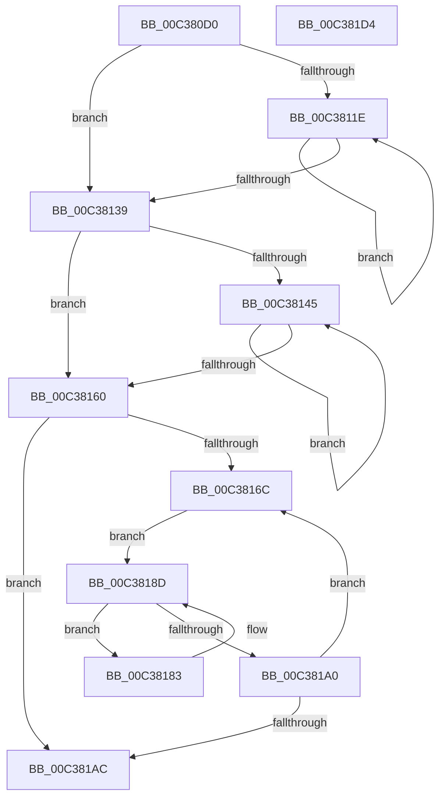

# KiConfigureAllSchedulingInformation

- RVA: `0x00C380D0`–`0x00C381D5` (길이 `261` bytes)
- VA: `0x0000000140C380D0`
- 실행 섹션: `INIT`
- PDB 이름 있음: `예`; PDB Function 태그: `아니요`
- unwind 정보 RVA: `0x000C9E40`
- 디코드: `68`개 명령, `261/261` bytes 표시
- 미해석 바이트: `0` (있으면 어셈블리에 `.byte`로 보존)

> 이 문서는 커널 이미지의 기계어와 PDB 기호를 분석해 생성했습니다. 4번과 5번은 함수 원형과 자료형을 바이너리 사용 방식에서 추정한 C 해석이며 원본 소스 복구 결과는 아닙니다.

## 1. Dependencies

- 직접 호출 지점: **7**; 고유 호출 대상: **7**
- 직접 호출자로 확인된 함수: **1**
- RIP 상대 이미지 참조: **4**

### Outgoing calls
- `0x00C38128` → [KiConfigureSchedulingInformation](../../pagelk/B6/KiConfigureSchedulingInformation_function_00B66518.md) (function, `0x00B66518`)
- `0x00C3814F` → [KiFinalizeCoreControlBlockAssignment](../../text/5B/KiFinalizeCoreControlBlockAssignment_function_005B7D0C.md) (function, `0x005B7D0C`)
- `0x00C3817C` → [KeInitializeSchedulerSubNodeEnumerationContext](../../text/41/KeInitializeSchedulerSubNodeEnumerationContext_function_0041E4B0.md) (function, `0x0041E4B0`)
- `0x00C38188` → [KiConfigureNodeSchedulingInformation](../../text/5B/KiConfigureNodeSchedulingInformation_function_005B7A9C.md) (function, `0x005B7A9C`)
- `0x00C38197` → [KeEnumerateNextSchedulerSubNodeInNode](../../text/25/KeEnumerateNextSchedulerSubNodeInNode_function_002566D8.md) (function, `0x002566D8`)
- `0x00C381AC` → [KiConfigureCooperativeIdleSearchTargets](../../text/5B/KiConfigureCooperativeIdleSearchTargets_function_005B79D4.md) (function, `0x005B79D4`)
- `0x00C381B9` → [_security_check_cookie](../../text/6A/_security_check_cookie_function_006AC640.md) (function, `0x006AC640`)

### Direct callers
- [KeStartAllProcessors](KeStartAllProcessors_function_00C36F78.md) at `0x00C3772F`

### Static image references
- `0x00C380E5` → RVA `0x00E0A740` (`.data`; read)
- `0x00C380F6` → RVA `0x00000000` (`image boundary/outside`; read)
- `0x00C38114` → RVA `0x00FC6A80` (`ALMOSTRO`; read)
- `0x00C38160` → RVA `0x00FC5000` (`ALMOSTRO`; read)

## 2. Other-region calls and transfers

- 다른 실행 섹션으로 향하는 call: **7**
  - `0x00C38128` → [KiConfigureSchedulingInformation](../../pagelk/B6/KiConfigureSchedulingInformation_function_00B66518.md) (`INIT` → `PAGELK`)
  - `0x00C3814F` → [KiFinalizeCoreControlBlockAssignment](../../text/5B/KiFinalizeCoreControlBlockAssignment_function_005B7D0C.md) (`INIT` → `.text`)
  - `0x00C3817C` → [KeInitializeSchedulerSubNodeEnumerationContext](../../text/41/KeInitializeSchedulerSubNodeEnumerationContext_function_0041E4B0.md) (`INIT` → `.text`)
  - `0x00C38188` → [KiConfigureNodeSchedulingInformation](../../text/5B/KiConfigureNodeSchedulingInformation_function_005B7A9C.md) (`INIT` → `.text`)
  - `0x00C38197` → [KeEnumerateNextSchedulerSubNodeInNode](../../text/25/KeEnumerateNextSchedulerSubNodeInNode_function_002566D8.md) (`INIT` → `.text`)
  - `0x00C381AC` → [KiConfigureCooperativeIdleSearchTargets](../../text/5B/KiConfigureCooperativeIdleSearchTargets_function_005B79D4.md) (`INIT` → `.text`)
  - `0x00C381B9` → [_security_check_cookie](../../text/6A/_security_check_cookie_function_006AC640.md) (`INIT` → `.text`)
- 별도 외부 분기/꼬리 이동을 확인하지 못했습니다.

## 3. Assembly (complete function range)

```asm
00C380D0  4C 8B DC                        mov r11, rsp
00C380D3  49 89 5B 08                     mov qword ptr [r11 + 8], rbx
00C380D7  49 89 73 10                     mov qword ptr [r11 + 0x10], rsi
00C380DB  49 89 7B 18                     mov qword ptr [r11 + 0x18], rdi
00C380DF  41 56                           push r14
00C380E1  48 83 EC 50                     sub rsp, 0x50
00C380E5  48 8B 05 54 26 1D 00            mov rax, qword ptr [rip + 0x1d2654]
00C380EC  48 33 C4                        xor rax, rsp
00C380EF  48 89 44 24 40                  mov qword ptr [rsp + 0x40], rax
00C380F4  33 FF                           xor edi, edi
00C380F6  4C 8D 35 03 7F 3C FF            lea r14, [rip - 0xc380fd]
00C380FD  33 C0                           xor eax, eax
00C380FF  49 89 7B C8                     mov qword ptr [r11 - 0x38], rdi
00C38103  0F 57 C0                        xorps xmm0, xmm0
00C38106  8B DF                           mov ebx, edi
00C38108  0F 11 44 24 28                  movups xmmword ptr [rsp + 0x28], xmm0
00C3810D  49 89 43 E0                     mov qword ptr [r11 - 0x20], rax
00C38111  8D 77 01                        lea esi, [rdi + 1]
00C38114  8B 05 66 E9 38 00               mov eax, dword ptr [rip + 0x38e966]
00C3811A  85 C0                           test eax, eax
00C3811C  74 1B                           je 0x140c38139
00C3811E  8B CB                           mov ecx, ebx
00C38120  49 8B 8C CE 40 8C FC 00         mov rcx, qword ptr [r14 + rcx*8 + 0xfc8c40]
00C38128  E8 EB E3 F2 FF                  call 0x140b66518
00C3812D  8B 05 4D E9 38 00               mov eax, dword ptr [rip + 0x38e94d]
00C38133  03 DE                           add ebx, esi
00C38135  3B D8                           cmp ebx, eax
00C38137  72 E5                           jb 0x140c3811e
00C38139  8B 05 41 E9 38 00               mov eax, dword ptr [rip + 0x38e941]
00C3813F  8B DF                           mov ebx, edi
00C38141  85 C0                           test eax, eax
00C38143  74 1B                           je 0x140c38160
00C38145  8B CB                           mov ecx, ebx
00C38147  49 8B 8C CE 40 8C FC 00         mov rcx, qword ptr [r14 + rcx*8 + 0xfc8c40]
00C3814F  E8 B8 FB 97 FF                  call 0x1405b7d0c
00C38154  8B 05 26 E9 38 00               mov eax, dword ptr [rip + 0x38e926]
00C3815A  03 DE                           add ebx, esi
00C3815C  3B D8                           cmp ebx, eax
00C3815E  72 E5                           jb 0x140c38145
00C38160  66 3B 3D 99 CE 38 00            cmp di, word ptr [rip + 0x38ce99]
00C38167  0F B7 DF                        movzx ebx, di
00C3816A  73 40                           jae 0x140c381ac
00C3816C  0F B7 D3                        movzx edx, bx
00C3816F  48 8D 4C 24 28                  lea rcx, [rsp + 0x28]
00C38174  49 8B 94 D6 C0 F6 FC 00         mov rdx, qword ptr [r14 + rdx*8 + 0xfcf6c0]
00C3817C  E8 2F 63 7E FF                  call 0x14041e4b0
00C38181  EB 0A                           jmp 0x140c3818d
00C38183  48 8B 4C 24 20                  mov rcx, qword ptr [rsp + 0x20]
00C38188  E8 0F F9 97 FF                  call 0x1405b7a9c
00C3818D  48 8D 54 24 20                  lea rdx, [rsp + 0x20]
00C38192  48 8D 4C 24 28                  lea rcx, [rsp + 0x28]
00C38197  E8 3C E5 61 FF                  call 0x1402566d8
00C3819C  85 C0                           test eax, eax
00C3819E  74 E3                           je 0x140c38183
00C381A0  66 03 DE                        add bx, si
00C381A3  66 3B 1D 56 CE 38 00            cmp bx, word ptr [rip + 0x38ce56]
00C381AA  72 C0                           jb 0x140c3816c
00C381AC  E8 23 F8 97 FF                  call 0x1405b79d4
00C381B1  48 8B 4C 24 40                  mov rcx, qword ptr [rsp + 0x40]
00C381B6  48 33 CC                        xor rcx, rsp
00C381B9  E8 82 44 A7 FF                  call 0x1406ac640
00C381BE  48 8B 5C 24 60                  mov rbx, qword ptr [rsp + 0x60]
00C381C3  48 8B 74 24 68                  mov rsi, qword ptr [rsp + 0x68]
00C381C8  48 8B 7C 24 70                  mov rdi, qword ptr [rsp + 0x70]
00C381CD  48 83 C4 50                     add rsp, 0x50
00C381D1  41 5E                           pop r14
00C381D3  C3                              ret
00C381D4  CC                              int3
```

## 4. C-style interpretation (structured pseudocode)

```c
__int64 __fastcall KiConfigureAllSchedulingInformation(void)
{
    __int64 result;
    __int64 v_rbx;
    __int64 v_rdi;
    __int64 v_rsp;
    unsigned __int64 v_stack_m18;
    unsigned __int64 v_stack_m30;
    unsigned __int64 v_stack_m38;
    unsigned __int64 v_stack_p10;
    unsigned __int64 v_stack_p18;
    unsigned __int64 v_stack_p8;

    *(unsigned __int64 *)(v_rsp + 8) = v_rbx;
    *(unsigned __int64 *)(v_rsp + 16) = v_rsi;
    *(unsigned __int64 *)(v_rsp + 24) = v_rdi;
    v_rsp = (v_rsp) - (80);
    result = (*(unsigned __int64 *)(v_rip + 1910356)) ^ (v_rsp);
    v_stack_m18 = result;
    v_rdi = 0;
    result = 0;
    *(unsigned __int64 *)(v_rsp - 56) = 0;
    v_stack_m30 = v_xmm0;
    *(unsigned __int64 *)(v_rsp - 32) = 0;
    if ((unsigned int)((unsigned int)(*(unsigned int *)(v_rip + 3729766))) == 0) goto loc_00C38139;
loc_00C3811E:
    result = KiConfigureSchedulingInformation(*(unsigned __int64 *)(v_rip - 12812541 + 0 * 8 + 16550976), a2, a3, a4);
    v_rbx = (unsigned int)((0) + ((unsigned int)(v_rdi + 1)));
    if (((unsigned int)(v_rbx)) < ((unsigned int)((unsigned int)(*(unsigned int *)(v_rip + 3729741))))) goto loc_00C3811E;
loc_00C38139:
    if ((unsigned int)((unsigned int)(*(unsigned int *)(v_rip + 3729729))) == 0) goto loc_00C38160;
loc_00C38145:
    result = KiFinalizeCoreControlBlockAssignment(*(unsigned __int64 *)(v_rip - 12812541 + 0 * 8 + 16550976), a2, a3, a4);
    v_rbx = (unsigned int)((0) + ((unsigned int)(v_rdi + 1)));
    if (((unsigned int)(v_rbx)) < ((unsigned int)((unsigned int)(*(unsigned int *)(v_rip + 3729702))))) goto loc_00C38145;
loc_00C38160:
    if (0 >= (*(unsigned __int16 *)(v_rip + 3722905))) goto loc_00C381AC;
loc_00C3816C:
    result = KeInitializeSchedulerSubNodeEnumerationContext(v_stack_m30, *(unsigned __int64 *)(v_rip - 12812541 + 0 * 8 + 16578240), a3, a4);
    goto loc_00C3818D;
loc_00C38183:
    result = KiConfigureNodeSchedulingInformation(v_stack_m38, *(unsigned __int64 *)(v_rip - 12812541 + 0 * 8 + 16578240), a3, a4);
loc_00C3818D:
    result = KeEnumerateNextSchedulerSubNodeInNode(v_stack_m30, v_stack_m38, a3, a4);
    if ((unsigned int)(result) == 0) goto loc_00C38183;
    v_rbx = (unsigned __int16)((0) + ((unsigned __int16)(v_rdi + 1)));
    if (((unsigned __int16)(v_rbx)) < (*(unsigned __int16 *)(v_rip + 3722838))) goto loc_00C3816C;
loc_00C381AC:
    result = KiConfigureCooperativeIdleSearchTargets(v_stack_m30, v_stack_m38, a3, a4);
    a1 = (v_stack_m18) ^ (v_rsp);
    result = _security_check_cookie(a1, v_stack_m38, a3, a4);
    v_rsp = (v_rsp) + (80);
    return result;
}
```

## 5. (Beta) C Style

```c
void KiConfigureAllSchedulingInformation(void)
{
    int64_t result;
    int64_t local_rbx;
    int64_t local_rdi;
    int64_t local_rsp;
    uint64_t v_stack_m18;
    uint64_t v_stack_m30;
    uint64_t v_stack_m38;
    uint64_t v_stack_p10;
    uint64_t v_stack_p18;
    uint64_t v_stack_p8;

    *(uint64_t *)(local_rsp + 0x8) = local_rbx;
    *(uint64_t *)(local_rsp + 0x10) = local_rsi;
    *(uint64_t *)(local_rsp + 0x18) = local_rdi;
    local_rsp = (local_rsp) - (80);
    result = (*(uint64_t *)(v_rip + 0x1D2654)) ^ (local_rsp);
    v_stack_m18 = result;
    local_rdi = 0;
    result = 0;
    *(uint64_t *)(local_rsp - 0x38) = 0;
    v_stack_m30 = v_xmm0;
    *(uint64_t *)(local_rsp - 0x20) = 0;
    if ((uint32_t)((uint32_t)(*(uint32_t *)(v_rip + 0x38E966))) == 0) goto loc_00C38139;
loc_00C3811E:
    result = KiConfigureSchedulingInformation(*(uint64_t *)(v_rip - 0xC380FD + 0x0 * 8 + 0xFC8C40), a2, a3, a4);
    local_rbx = (uint32_t)((0) + ((uint32_t)(local_rdi + 1)));
    if (((uint32_t)(local_rbx)) < ((uint32_t)((uint32_t)(*(uint32_t *)(v_rip + 0x38E94D))))) goto loc_00C3811E;
loc_00C38139:
    if ((uint32_t)((uint32_t)(*(uint32_t *)(v_rip + 0x38E941))) == 0) goto loc_00C38160;
loc_00C38145:
    result = KiFinalizeCoreControlBlockAssignment(*(uint64_t *)(v_rip - 0xC380FD + 0x0 * 8 + 0xFC8C40), a2, a3, a4);
    local_rbx = (uint32_t)((0) + ((uint32_t)(local_rdi + 1)));
    if (((uint32_t)(local_rbx)) < ((uint32_t)((uint32_t)(*(uint32_t *)(v_rip + 0x38E926))))) goto loc_00C38145;
loc_00C38160:
    if (0 >= (*(uint16_t *)(v_rip + 0x38CE99))) goto loc_00C381AC;
loc_00C3816C:
    result = KeInitializeSchedulerSubNodeEnumerationContext(v_stack_m30, *(uint64_t *)(v_rip - 0xC380FD + 0x0 * 8 + 0xFCF6C0), a3, a4);
    goto loc_00C3818D;
loc_00C38183:
    result = KiConfigureNodeSchedulingInformation(v_stack_m38, *(uint64_t *)(v_rip - 0xC380FD + 0x0 * 8 + 0xFCF6C0), a3, a4);
loc_00C3818D:
    result = KeEnumerateNextSchedulerSubNodeInNode(v_stack_m30, v_stack_m38, a3, a4);
    if ((uint32_t)(result) == 0) goto loc_00C38183;
    local_rbx = (uint16_t)((0) + ((uint16_t)(local_rdi + 1)));
    if (((uint16_t)(local_rbx)) < (*(uint16_t *)(v_rip + 0x38CE56))) goto loc_00C3816C;
loc_00C381AC:
    result = KiConfigureCooperativeIdleSearchTargets(v_stack_m30, v_stack_m38, a3, a4);
    a1 = (v_stack_m18) ^ (local_rsp);
    result = _security_check_cookie(a1, v_stack_m38, a3, a4);
    local_rsp = (local_rsp) + (80);
    return result;
}
```

## 6. Execution-region graph

[열기: 2D/3D 그래프와 함수 탐색 컨트롤 패널](../../../control-panel.html?section=init&rva=0x00C380D0&view=graph)

- 2D 그래프는 위에서 아래로 흐르고, 3D 그래프는 빈 공간을 드래그해 회전합니다. Shift+드래그는 이동, 휠은 확대·축소, 함수 노드 선택은 대상 보고서 이동입니다.

### Static fallback


