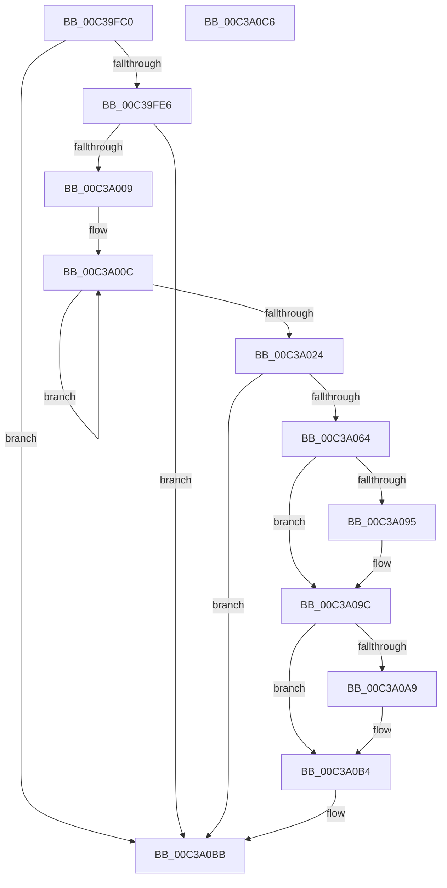

# KiEpfInitialize

- RVA: `0x00C39FC0`–`0x00C3A0C7` (길이 `263` bytes)
- VA: `0x0000000140C39FC0`
- 실행 섹션: `INIT`
- PDB 이름 있음: `예`; PDB Function 태그: `아니요`
- unwind 정보 RVA: `0x000C4ED8`
- 디코드: `62`개 명령, `263/263` bytes 표시
- 미해석 바이트: `0` (있으면 어셈블리에 `.byte`로 보존)

> 이 문서는 커널 이미지의 기계어와 PDB 기호를 분석해 생성했습니다. 4번과 5번은 함수 원형과 자료형을 바이너리 사용 방식에서 추정한 C 해석이며 원본 소스 복구 결과는 아닙니다.

## 1. Dependencies

- 직접 호출 지점: **5**; 고유 호출 대상: **5**
- 직접 호출자로 확인된 함수: **1**
- RIP 상대 이미지 참조: **11**

### Outgoing calls
- `0x00C39FF4` → [ExAllocatePool2](../../poolcode/B8/ExAllocatePool2_function_00B820F0.md) (function, `0x00B820F0`)
- `0x00C3A05B` → [HvlSetupPhysicalFaultNotificationQueue](../../text/58/HvlSetupPhysicalFaultNotificationQueue_function_00584CE0.md) (function, `0x00584CE0`)
- `0x00C3A097` → [KiRaiseIrqlProcessIrqlFlags](../../text/4F/KiRaiseIrqlProcessIrqlFlags_function_004F56FC.md) (function, `0x004F56FC`)
- `0x00C3A09C` → [KiEpfDrainCompletionQueue](../../text/5C/KiEpfDrainCompletionQueue_function_005C4A6C.md) (function, `0x005C4A6C`)
- `0x00C3A0AF` → [KiLowerIrqlProcessIrqlFlags](../../text/4F/KiLowerIrqlProcessIrqlFlags_function_004F5698.md) (function, `0x004F5698`)

### Direct callers
- [KeInitSystem](../C7/KeInitSystem_function_00C71660.md) at `0x00C71C29`

### Static image references
- `0x00C39FCA` → RVA `0x00FC6A90` (`ALMOSTRO`; read)
- `0x00C39FF9` → RVA `0x00F10DE0` (`.data`; write)
- `0x00C3A024` → RVA `0x005C4A50` (`KiEpfCompletionDpcRoutine`; read)
- `0x00C3A02B` → RVA `0x00F10D80` (`.data`; write)
- `0x00C3A03A` → RVA `0x00F10D98` (`.data`; write)
- `0x00C3A046` → RVA `0x00F10DA0` (`.data`; write)
- `0x00C3A04D` → RVA `0x00F10DB8` (`.data`; write)
- `0x00C3A054` → RVA `0x00F10D90` (`.data`; write)
- `0x00C3A06E` → RVA `0x00F10D70` (`.data`; write)
- `0x00C3A079` → RVA `0x00F10D68` (`.data`; write)
- `0x00C3A08D` → RVA `0x00FC6D20` (`ALMOSTRO`; read)

## 2. Other-region calls and transfers

- 다른 실행 섹션으로 향하는 call: **5**
  - `0x00C39FF4` → [ExAllocatePool2](../../poolcode/B8/ExAllocatePool2_function_00B820F0.md) (`INIT` → `POOLCODE`)
  - `0x00C3A05B` → [HvlSetupPhysicalFaultNotificationQueue](../../text/58/HvlSetupPhysicalFaultNotificationQueue_function_00584CE0.md) (`INIT` → `.text`)
  - `0x00C3A097` → [KiRaiseIrqlProcessIrqlFlags](../../text/4F/KiRaiseIrqlProcessIrqlFlags_function_004F56FC.md) (`INIT` → `.text`)
  - `0x00C3A09C` → [KiEpfDrainCompletionQueue](../../text/5C/KiEpfDrainCompletionQueue_function_005C4A6C.md) (`INIT` → `.text`)
  - `0x00C3A0AF` → [KiLowerIrqlProcessIrqlFlags](../../text/4F/KiLowerIrqlProcessIrqlFlags_function_004F5698.md) (`INIT` → `.text`)
- 별도 외부 분기/꼬리 이동을 확인하지 못했습니다.

## 3. Assembly (complete function range)

```asm
00C39FC0  48 89 5C 24 18                  mov qword ptr [rsp + 0x18], rbx
00C39FC5  57                              push rdi
00C39FC6  48 83 EC 20                     sub rsp, 0x20
00C39FCA  8B 05 C0 CA 38 00               mov eax, dword ptr [rip + 0x38cac0]
00C39FD0  33 FF                           xor edi, edi
00C39FD2  C1 E8 14                        shr eax, 0x14
00C39FD5  48 89 7C 24 38                  mov qword ptr [rsp + 0x38], rdi
00C39FDA  89 7C 24 30                     mov dword ptr [rsp + 0x30], edi
00C39FDE  A8 01                           test al, 1
00C39FE0  0F 84 D5 00 00 00               je 0x140c3a0bb
00C39FE6  BA A0 04 00 00                  mov edx, 0x4a0
00C39FEB  8D 4F 40                        lea ecx, [rdi + 0x40]
00C39FEE  41 B8 4B 65 50 48               mov r8d, 0x4850654b
00C39FF4  E8 F7 80 F4 FF                  call 0x140b820f0
00C39FF9  48 89 05 E0 6D 2D 00            mov qword ptr [rip + 0x2d6de0], rax
00C3A000  48 85 C0                        test rax, rax
00C3A003  0F 84 B2 00 00 00               je 0x140c3a0bb
00C3A009  8D 4F 25                        lea ecx, [rdi + 0x25]
00C3A00C  48 89 40 08                     mov qword ptr [rax + 8], rax
00C3A010  48 89 00                        mov qword ptr [rax], rax
00C3A013  48 89 78 10                     mov qword ptr [rax + 0x10], rdi
00C3A017  89 78 18                        mov dword ptr [rax + 0x18], edi
00C3A01A  48 83 C0 20                     add rax, 0x20
00C3A01E  48 83 E9 01                     sub rcx, 1
00C3A022  75 E8                           jne 0x140c3a00c
00C3A024  48 8D 05 25 AA 98 FF            lea rax, [rip - 0x6755db]
00C3A02B  C7 05 4B 6D 2D 00 13 01 00 00   mov dword ptr [rip + 0x2d6d4b], 0x113
00C3A035  48 8D 54 24 30                  lea rdx, [rsp + 0x30]
00C3A03A  48 89 05 57 6D 2D 00            mov qword ptr [rip + 0x2d6d57], rax
00C3A041  48 8D 4C 24 38                  lea rcx, [rsp + 0x38]
00C3A046  48 89 3D 53 6D 2D 00            mov qword ptr [rip + 0x2d6d53], rdi
00C3A04D  48 89 3D 64 6D 2D 00            mov qword ptr [rip + 0x2d6d64], rdi
00C3A054  48 89 3D 35 6D 2D 00            mov qword ptr [rip + 0x2d6d35], rdi
00C3A05B  E8 80 AC 94 FF                  call 0x140584ce0
00C3A060  85 C0                           test eax, eax
00C3A062  78 57                           js 0x140c3a0bb
00C3A064  8B 44 24 30                     mov eax, dword ptr [rsp + 0x30]
00C3A068  83 C0 F0                        add eax, -0x10
00C3A06B  C1 E8 03                        shr eax, 3
00C3A06E  89 05 FC 6C 2D 00               mov dword ptr [rip + 0x2d6cfc], eax
00C3A074  48 8B 44 24 38                  mov rax, qword ptr [rsp + 0x38]
00C3A079  48 89 05 E8 6C 2D 00            mov qword ptr [rip + 0x2d6ce8], rax
00C3A080  44 0F 20 C3                     mov rbx, cr8
00C3A084  BA 02 00 00 00                  mov edx, 2
00C3A089  44 0F 22 C2                     mov cr8, rdx
00C3A08D  39 3D 8D CC 38 00               cmp dword ptr [rip + 0x38cc8d], edi
00C3A093  74 07                           je 0x140c3a09c
00C3A095  8A CB                           mov cl, bl
00C3A097  E8 60 B6 8B FF                  call 0x1404f56fc
00C3A09C  E8 CB A9 98 FF                  call 0x1405c4a6c
00C3A0A1  39 3D 79 CC 38 00               cmp dword ptr [rip + 0x38cc79], edi
00C3A0A7  74 0B                           je 0x140c3a0b4
00C3A0A9  44 0F 20 C1                     mov rcx, cr8
00C3A0AD  8A D3                           mov dl, bl
00C3A0AF  E8 E4 B5 8B FF                  call 0x1404f5698
00C3A0B4  0F B6 C3                        movzx eax, bl
00C3A0B7  44 0F 22 C0                     mov cr8, rax
00C3A0BB  48 8B 5C 24 40                  mov rbx, qword ptr [rsp + 0x40]
00C3A0C0  48 83 C4 20                     add rsp, 0x20
00C3A0C4  5F                              pop rdi
00C3A0C5  C3                              ret
00C3A0C6  CC                              int3
```

## 4. C-style interpretation (structured pseudocode)

```c
__int64 __fastcall KiEpfInitialize(void)
{
    __int64 result;
    __int64 v_rdi;
    __int64 v_rsp;
    unsigned __int64 v_stack_p10;
    unsigned __int64 v_stack_p18;
    unsigned int v_stack_p8;

    v_stack_p18 = v_rbx;
    v_rsp = (v_rsp) - (32);
    v_rdi = 0;
    result = (unsigned int)(((unsigned int)(*(unsigned int *)(v_rip + 3721920))) >> (20));
    v_stack_p10 = 0;
    v_stack_p8 = 0;
    if ((((unsigned __int8)(result)) & (1)) == 0) goto loc_00C3A0BB;
    result = ExAllocatePool2(v_rdi + 64, (unsigned int)(0x4A0ULL), (unsigned int)(0x4850654BULL), a4);
    *(unsigned __int64 *)(v_rip + 2977248) = result;
    if (result == 0) goto loc_00C3A0BB;
loc_00C3A00C:
    *(unsigned __int64 *)(result + 8) = result;
    *(unsigned __int64 *)(result) = result;
    *(unsigned __int64 *)(result + 16) = 0;
    *(unsigned int *)(result + 24) = 0;
    result = (result) + (32);
    a1 = (v_rdi + 37) - (1);
    if (condition_is_not_equal) goto loc_00C3A00C;
    *(unsigned int *)(v_rip + 2977099) = 275;
    *(unsigned __int64 *)(v_rip + 2977111) = v_rip - 6772187;
    *(unsigned __int64 *)(v_rip + 2977107) = 0;
    *(unsigned __int64 *)(v_rip + 2977124) = 0;
    *(unsigned __int64 *)(v_rip + 2977077) = 0;
    result = HvlSetupPhysicalFaultNotificationQueue(v_stack_p10, v_stack_p8, (unsigned int)(0x4850654BULL), a4);
    if (sign_flag) goto loc_00C3A0BB;
    result = (unsigned int)(((unsigned int)(v_stack_p8)) + (-16));
    result = (unsigned int)((result) >> (3));
    *(unsigned int *)(v_rip + 2977020) = (unsigned int)(result);
    *(unsigned __int64 *)(v_rip + 2977000) = v_stack_p10;
    result = v_stack_p10;
    if ((*(unsigned int *)(v_rip + 3722381)) != 0) {
        a1 = (unsigned __int8)(v_cr8);
        result = KiRaiseIrqlProcessIrqlFlags(a1, 2, (unsigned int)(0x4850654BULL), a4);
    }
    result = KiEpfDrainCompletionQueue(a1, 2, (unsigned int)(0x4850654BULL), a4);
    if ((*(unsigned int *)(v_rip + 3722361)) != 0) {
        a1 = 2;
        a2 = (unsigned __int8)(v_cr8);
        result = KiLowerIrqlProcessIrqlFlags(a1, a2, (unsigned int)(0x4850654BULL), a4);
    }
loc_00C3A0BB:
    v_rsp = (v_rsp) + (32);
    return (unsigned __int8)(v_cr8);
}
```

## 5. (Beta) C Style

```c
void KiEpfInitialize(void)
{
    int64_t result;
    int64_t local_rdi;
    int64_t local_rsp;
    uint64_t v_stack_p10;
    uint64_t v_stack_p18;
    uint32_t v_stack_p8;

    v_stack_p18 = local_rbx;
    local_rsp = (local_rsp) - (32);
    local_rdi = 0;
    result = (uint32_t)(((uint32_t)(*(uint32_t *)(v_rip + 0x38CAC0))) >> (20));
    v_stack_p10 = 0;
    v_stack_p8 = 0;
    if ((((uint8_t)(result)) & (1)) == 0) goto loc_00C3A0BB;
    result = ExAllocatePool2(local_rdi + 64, (uint32_t)(0x4A0ULL), (uint32_t)(0x4850654BULL), a4);
    *(uint64_t *)(v_rip + 0x2D6DE0) = result;
    if (result == 0) goto loc_00C3A0BB;
loc_00C3A00C:
    *(uint64_t *)(result + 0x8) = result;
    *(uint64_t *)(result) = result;
    *(uint64_t *)(result + 0x10) = 0;
    *(uint32_t *)(result + 0x18) = 0;
    result = (result) + (32);
    a1 = (local_rdi + 37) - (1);
    if (condition_is_not_equal) goto loc_00C3A00C;
    *(uint32_t *)(v_rip + 0x2D6D4B) = 275;
    *(uint64_t *)(v_rip + 0x2D6D57) = v_rip - 6772187;
    *(uint64_t *)(v_rip + 0x2D6D53) = 0;
    *(uint64_t *)(v_rip + 0x2D6D64) = 0;
    *(uint64_t *)(v_rip + 0x2D6D35) = 0;
    result = HvlSetupPhysicalFaultNotificationQueue(v_stack_p10, v_stack_p8, (uint32_t)(0x4850654BULL), a4);
    if (sign_flag) goto loc_00C3A0BB;
    result = (uint32_t)(((uint32_t)(v_stack_p8)) + (-16));
    result = (uint32_t)((result) >> (3));
    *(uint32_t *)(v_rip + 0x2D6CFC) = (uint32_t)(result);
    *(uint64_t *)(v_rip + 0x2D6CE8) = v_stack_p10;
    result = v_stack_p10;
    if ((*(uint32_t *)(v_rip + 0x38CC8D)) != 0) {
        a1 = (uint8_t)(v_cr8);
        result = KiRaiseIrqlProcessIrqlFlags(a1, 2, (uint32_t)(0x4850654BULL), a4);
    }
    result = KiEpfDrainCompletionQueue(a1, 2, (uint32_t)(0x4850654BULL), a4);
    if ((*(uint32_t *)(v_rip + 0x38CC79)) != 0) {
        a1 = 2;
        a2 = (uint8_t)(v_cr8);
        result = KiLowerIrqlProcessIrqlFlags(a1, a2, (uint32_t)(0x4850654BULL), a4);
    }
loc_00C3A0BB:
    local_rsp = (local_rsp) + (32);
    return (uint8_t)(v_cr8);
}
```

## 6. Execution-region graph

[열기: 2D/3D 그래프와 함수 탐색 컨트롤 패널](../../../control-panel.html?section=init&rva=0x00C39FC0&view=graph)

- 2D 그래프는 위에서 아래로 흐르고, 3D 그래프는 빈 공간을 드래그해 회전합니다. Shift+드래그는 이동, 휠은 확대·축소, 함수 노드 선택은 대상 보고서 이동입니다.

### Static fallback


