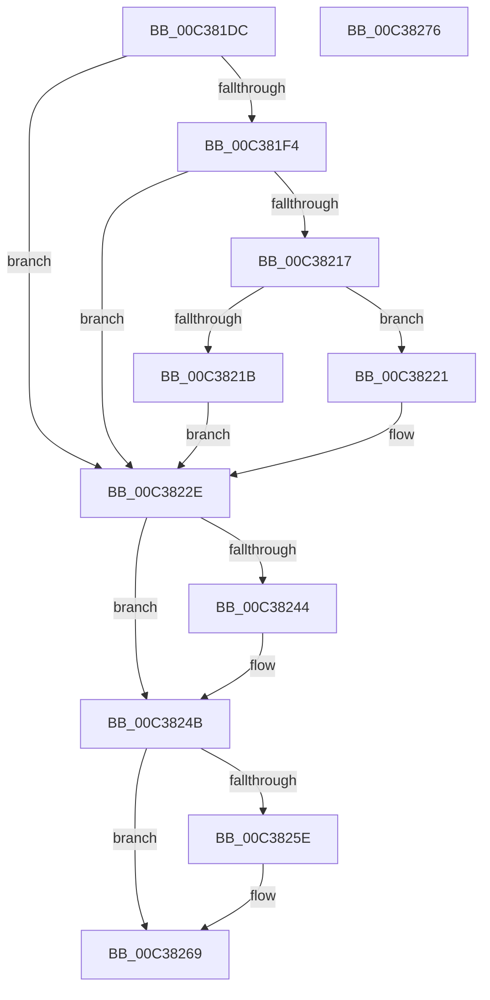

# KiForceSymbolReferences

- RVA: `0x00C381DC`–`0x00C38277` (길이 `155` bytes)
- VA: `0x0000000140C381DC`
- 실행 섹션: `INIT`
- PDB 이름 있음: `예`; PDB Function 태그: `아니요`
- unwind 정보 RVA: `0x0005CF00`
- 디코드: `42`개 명령, `155/155` bytes 표시
- 미해석 바이트: `0` (있으면 어셈블리에 `.byte`로 보존)

> 이 문서는 커널 이미지의 기계어와 PDB 기호를 분석해 생성했습니다. 4번과 5번은 함수 원형과 자료형을 바이너리 사용 방식에서 추정한 C 해석이며 원본 소스 복구 결과는 아닙니다.

## 1. Dependencies

- 직접 호출 지점: **5**; 고유 호출 대상: **5**
- 직접 호출자로 확인된 함수: **1**
- RIP 상대 이미지 참조: **1**

### Outgoing calls
- `0x00C381FF` → [KeAbPreAcquire](../../text/21/KeAbPreAcquire_function_00210230.md) (function, `0x00210230`)
- `0x00C38229` → [KeAbPostReleaseEx](../../text/26/KeAbPostReleaseEx_function_00262210.md) (function, `0x00262210`)
- `0x00C38246` → [KiRaiseIrqlProcessIrqlFlags](../../text/4F/KiRaiseIrqlProcessIrqlFlags_function_004F56FC.md) (function, `0x004F56FC`)
- `0x00C38250` → [ExTryAcquireSpinLockExclusiveAtDpcLevel](../../text/2B/ExTryAcquireSpinLockExclusiveAtDpcLevel_function_002BB800.md) (function, `0x002BB800`)
- `0x00C38264` → [KiLowerIrqlProcessIrqlFlags](../../text/4F/KiLowerIrqlProcessIrqlFlags_function_004F5698.md) (function, `0x004F5698`)

### Direct callers
- [KiInitSystem](KiInitSystem_function_00C38480.md) at `0x00C38499`

### Static image references
- `0x00C3823B` → RVA `0x00FC6D20` (`ALMOSTRO`; read)

## 2. Other-region calls and transfers

- 다른 실행 섹션으로 향하는 call: **5**
  - `0x00C381FF` → [KeAbPreAcquire](../../text/21/KeAbPreAcquire_function_00210230.md) (`INIT` → `.text`)
  - `0x00C38229` → [KeAbPostReleaseEx](../../text/26/KeAbPostReleaseEx_function_00262210.md) (`INIT` → `.text`)
  - `0x00C38246` → [KiRaiseIrqlProcessIrqlFlags](../../text/4F/KiRaiseIrqlProcessIrqlFlags_function_004F56FC.md) (`INIT` → `.text`)
  - `0x00C38250` → [ExTryAcquireSpinLockExclusiveAtDpcLevel](../../text/2B/ExTryAcquireSpinLockExclusiveAtDpcLevel_function_002BB800.md) (`INIT` → `.text`)
  - `0x00C38264` → [KiLowerIrqlProcessIrqlFlags](../../text/4F/KiLowerIrqlProcessIrqlFlags_function_004F5698.md) (`INIT` → `.text`)
- 별도 외부 분기/꼬리 이동을 확인하지 못했습니다.

## 3. Assembly (complete function range)

```asm
00C381DC  40 53                           push rbx
00C381DE  48 83 EC 20                     sub rsp, 0x20
00C381E2  48 83 64 24 38 00               and qword ptr [rsp + 0x38], 0
00C381E8  65 8B 04 25 A4 01 00 00         mov eax, dword ptr gs:[0x1a4]
00C381F0  85 C0                           test eax, eax
00C381F2  75 3A                           jne 0x140c3822e
00C381F4  33 D2                           xor edx, edx
00C381F6  44 8D 40 01                     lea r8d, [rax + 1]
00C381FA  48 8D 4C 24 38                  lea rcx, [rsp + 0x38]
00C381FF  E8 2C 80 5D FF                  call 0x140210230
00C38204  48 8D 4C 24 38                  lea rcx, [rsp + 0x38]
00C38209  F0 48 0F BA 29 00               lock bts qword ptr [rcx], 0
00C3820F  0F 92 C1                        setb cl
00C38212  48 85 C0                        test rax, rax
00C38215  74 17                           je 0x140c3822e
00C38217  84 C9                           test cl, cl
00C38219  75 06                           jne 0x140c38221
00C3821B  C6 40 0A 01                     mov byte ptr [rax + 0xa], 1
00C3821F  EB 0D                           jmp 0x140c3822e
00C38221  48 8B D0                        mov rdx, rax
00C38224  48 8D 4C 24 38                  lea rcx, [rsp + 0x38]
00C38229  E8 E2 9F 62 FF                  call 0x140262210
00C3822E  44 0F 20 C3                     mov rbx, cr8
00C38232  BA 02 00 00 00                  mov edx, 2
00C38237  44 0F 22 C2                     mov cr8, rdx
00C3823B  83 3D DE EA 38 00 00            cmp dword ptr [rip + 0x38eade], 0
00C38242  74 07                           je 0x140c3824b
00C38244  8A CB                           mov cl, bl
00C38246  E8 B1 D4 8B FF                  call 0x1404f56fc
00C3824B  48 8D 4C 24 30                  lea rcx, [rsp + 0x30]
00C38250  E8 AB 35 68 FF                  call 0x1402bb800
00C38255  83 3D C4 EA 38 00 00            cmp dword ptr [rip + 0x38eac4], 0
00C3825C  74 0B                           je 0x140c38269
00C3825E  44 0F 20 C1                     mov rcx, cr8
00C38262  8A D3                           mov dl, bl
00C38264  E8 2F D4 8B FF                  call 0x1404f5698
00C38269  0F B6 C3                        movzx eax, bl
00C3826C  44 0F 22 C0                     mov cr8, rax
00C38270  48 83 C4 20                     add rsp, 0x20
00C38274  5B                              pop rbx
00C38275  C3                              ret
00C38276  CC                              int3
```

## 4. C-style interpretation (structured pseudocode)

```c
__int64 __fastcall KiForceSymbolReferences(__int64 a1, int a2)
{
    __int64 result;
    __int64 v_rsp;
    unsigned __int64 v_stack_p10;
    unsigned __int64 v_stack_p8;

    v_rsp = (v_rsp) - (32);
    if ((unsigned int)((unsigned int)(*(unsigned int *)(gs_base + (0 + 420)))) != 0) goto loc_00C3822E;
    a2 = 0;
    result = KeAbPreAcquire(v_stack_p10, a2, (unsigned int)(*(unsigned int *)(gs_base + (0 + 420))) + 1, a4);
    a1 = (condition_is_below) ? 1 : 0;
    if (result == 0) goto loc_00C3822E;
    if ((unsigned __int8)(a1) != 0) goto loc_00C38221;
    *(unsigned __int8 *)(result + 10) = 1;
    goto loc_00C3822E;
loc_00C38221:
    result = KeAbPostReleaseEx(v_stack_p10, result, (unsigned int)(*(unsigned int *)(gs_base + (0 + 420))) + 1, a4);
loc_00C3822E:
    if ((*(unsigned int *)(v_rip + 3730142)) != 0) {
        a1 = (unsigned __int8)(v_cr8);
        result = KiRaiseIrqlProcessIrqlFlags(a1, 2, (unsigned int)(*(unsigned int *)(gs_base + (0 + 420))) + 1, a4);
    }
    result = ExTryAcquireSpinLockExclusiveAtDpcLevel(v_stack_p8, 2, (unsigned int)(*(unsigned int *)(gs_base + (0 + 420))) + 1, a4);
    if ((*(unsigned int *)(v_rip + 3730116)) != 0) {
        a1 = 2;
        a2 = (unsigned __int8)(v_cr8);
        result = KiLowerIrqlProcessIrqlFlags(a1, a2, (unsigned int)(*(unsigned int *)(gs_base + (0 + 420))) + 1, a4);
    }
    v_rsp = (v_rsp) + (32);
    return (unsigned __int8)(v_cr8);
}
```

## 5. (Beta) C Style

```c
int64_t KiForceSymbolReferences(int64_t Arg1, int32_t Arg2)
{
    int64_t result;
    int64_t local_rsp;
    uint64_t v_stack_p10;
    uint64_t v_stack_p8;

    local_rsp = (local_rsp) - (32);
    if ((uint32_t)((uint32_t)(*(uint32_t *)(gs_base + (0 + 0x1A4)))) != 0) goto loc_00C3822E;
    Arg2 = 0;
    result = KeAbPreAcquire(v_stack_p10, Arg2, (uint32_t)(*(uint32_t *)(gs_base + (0 + 0x1A4))) + 1, a4);
    Arg1 = (condition_is_below) ? 1 : 0;
    if (result == 0) goto loc_00C3822E;
    if ((uint8_t)(Arg1) != 0) goto loc_00C38221;
    *(uint8_t *)(result + 0xA) = 1;
    goto loc_00C3822E;
loc_00C38221:
    result = KeAbPostReleaseEx(v_stack_p10, result, (uint32_t)(*(uint32_t *)(gs_base + (0 + 0x1A4))) + 1, a4);
loc_00C3822E:
    if ((*(uint32_t *)(v_rip + 0x38EADE)) != 0) {
        Arg1 = (uint8_t)(v_cr8);
        result = KiRaiseIrqlProcessIrqlFlags(Arg1, 2, (uint32_t)(*(uint32_t *)(gs_base + (0 + 0x1A4))) + 1, a4);
    }
    result = ExTryAcquireSpinLockExclusiveAtDpcLevel(v_stack_p8, 2, (uint32_t)(*(uint32_t *)(gs_base + (0 + 0x1A4))) + 1, a4);
    if ((*(uint32_t *)(v_rip + 0x38EAC4)) != 0) {
        Arg1 = 2;
        Arg2 = (uint8_t)(v_cr8);
        result = KiLowerIrqlProcessIrqlFlags(Arg1, Arg2, (uint32_t)(*(uint32_t *)(gs_base + (0 + 0x1A4))) + 1, a4);
    }
    local_rsp = (local_rsp) + (32);
    return (uint8_t)(v_cr8);
}
```

## 6. Execution-region graph

[열기: 2D/3D 그래프와 함수 탐색 컨트롤 패널](../../../control-panel.html?section=init&rva=0x00C381DC&view=graph)

- 2D 그래프는 위에서 아래로 흐르고, 3D 그래프는 빈 공간을 드래그해 회전합니다. Shift+드래그는 이동, 휠은 확대·축소, 함수 노드 선택은 대상 보고서 이동입니다.

### Static fallback


