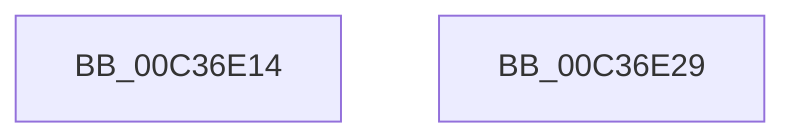

# KiGetHalExtensionList

- RVA: `0x00C36E14`–`0x00C36E2A` (길이 `22` bytes)
- VA: `0x0000000140C36E14`
- 실행 섹션: `INIT`
- PDB 이름 있음: `예`; PDB Function 태그: `아니요`
- unwind 정보 RVA: `0x000DB714`
- 디코드: `5`개 명령, `22/22` bytes 표시
- 미해석 바이트: `0` (있으면 어셈블리에 `.byte`로 보존)

> 이 문서는 커널 이미지의 기계어와 PDB 기호를 분석해 생성했습니다. 4번과 5번은 함수 원형과 자료형을 바이너리 사용 방식에서 추정한 C 해석이며 원본 소스 복구 결과는 아닙니다.

## 1. Dependencies

- 직접 호출 지점: **0**; 고유 호출 대상: **0**
- 직접 호출자로 확인된 함수: **1**
- RIP 상대 이미지 참조: **1**

### Outgoing calls
- 직접 디코드된 call 명령이 없습니다.

### Direct callers
- [sub_00BF16D0](../BF/Unknown_function_00BF16D0.md) at `0x00C0033B`

### Static image references
- `0x00C36E14` → RVA `0x00FC6B20` (`ALMOSTRO`; read)

## 2. Other-region calls and transfers

- 다른 실행 섹션으로 향하는 call: **0**
- 별도 외부 분기/꼬리 이동을 확인하지 못했습니다.

## 3. Assembly (complete function range)

```asm
00C36E14  48 8B 05 05 FD 38 00            mov rax, qword ptr [rip + 0x38fd05]
00C36E1B  48 8B 80 F0 00 00 00            mov rax, qword ptr [rax + 0xf0]
00C36E22  48 05 18 0A 00 00               add rax, 0xa18
00C36E28  C3                              ret
00C36E29  CC                              int3
```

## 4. C-style interpretation (structured pseudocode)

```c
__int64 __fastcall KiGetHalExtensionList(void)
{
    __int64 result;

    result = (*(unsigned __int64 *)(*(unsigned __int64 *)(v_rip + 3734789) + 240)) + (0xA18ULL);
    return result;
}
```

## 5. (Beta) C Style

```c
void KiGetHalExtensionList(void)
{
    int64_t result;

    result = (*(uint64_t *)(*(uint64_t *)(v_rip + 0x38FD05) + 0xF0)) + (0xA18ULL);
    return result;
}
```

## 6. Execution-region graph

[열기: 2D/3D 그래프와 함수 탐색 컨트롤 패널](../../../control-panel.html?section=init&rva=0x00C36E14&view=graph)

- 2D 그래프는 위에서 아래로 흐르고, 3D 그래프는 빈 공간을 드래그해 회전합니다. Shift+드래그는 이동, 휠은 확대·축소, 함수 노드 선택은 대상 보고서 이동입니다.

### Static fallback


