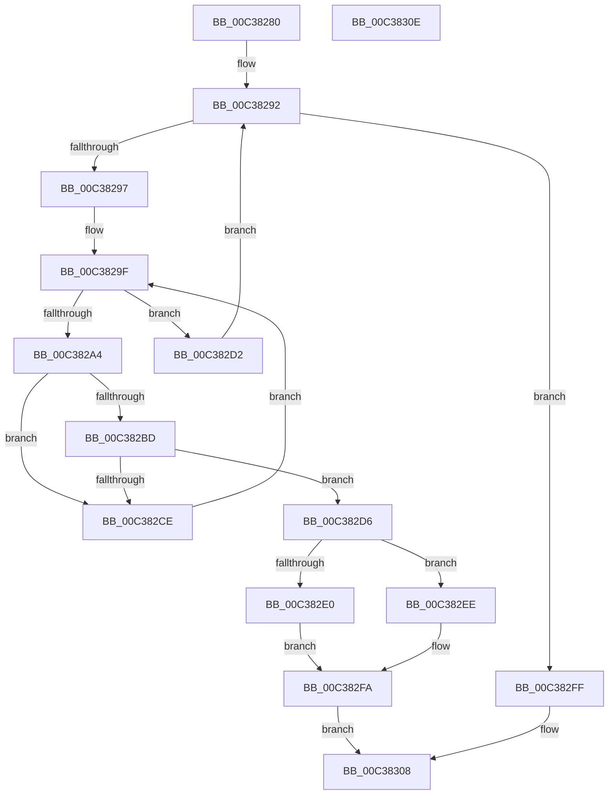

# KiGetHalNumaConversionFactor

- RVA: `0x00C38280`–`0x00C3830F` (길이 `143` bytes)
- VA: `0x0000000140C38280`
- 실행 섹션: `INIT`
- PDB 이름 있음: `예`; PDB Function 태그: `아니요`
- unwind 정보 RVA: `0x00071750`
- 디코드: `43`개 명령, `143/143` bytes 표시
- 미해석 바이트: `0` (있으면 어셈블리에 `.byte`로 보존)

> 이 문서는 커널 이미지의 기계어와 PDB 기호를 분석해 생성했습니다. 4번과 5번은 함수 원형과 자료형을 바이너리 사용 방식에서 추정한 C 해석이며 원본 소스 복구 결과는 아닙니다.

## 1. Dependencies

- 직접 호출 지점: **0**; 고유 호출 대상: **0**
- 직접 호출자로 확인된 함수: **1**
- RIP 상대 이미지 참조: **3**

### Outgoing calls
- 직접 디코드된 call 명령이 없습니다.

### Direct callers
- [KiComputeNumaCosts](KiComputeNumaCosts_function_00C37AD4.md) at `0x00C37F1B`

### Static image references
- `0x00C38285` → RVA `0x00FC5000` (`ALMOSTRO`; read)
- `0x00C382A4` → RVA `0x00F234E8` (`.data`; read)
- `0x00C382BD` → RVA `0x00FC50A8` (`ALMOSTRO`; read)

## 2. Other-region calls and transfers

- 다른 실행 섹션으로 향하는 call: **0**
- 별도 외부 분기/꼬리 이동을 확인하지 못했습니다.

## 3. Assembly (complete function range)

```asm
00C38280  48 89 5C 24 08                  mov qword ptr [rsp + 8], rbx
00C38285  44 0F B7 0D 73 CD 38 00         movzx r9d, word ptr [rip + 0x38cd73]
00C3828D  4C 8B D9                        mov r11, rcx
00C38290  33 D2                           xor edx, edx
00C38292  41 3B D1                        cmp edx, r9d
00C38295  73 68                           jae 0x140c382ff
00C38297  41 8B D9                        mov ebx, r9d
00C3829A  0F AF DA                        imul ebx, edx
00C3829D  33 C9                           xor ecx, ecx
00C3829F  41 3B C9                        cmp ecx, r9d
00C382A2  73 2E                           jae 0x140c382d2
00C382A4  48 8B 05 3D B2 2E 00            mov rax, qword ptr [rip + 0x2eb23d]
00C382AB  44 8D 14 19                     lea r10d, [rcx + rbx]
00C382AF  4E 8B 04 D0                     mov r8, qword ptr [rax + r10*8]
00C382B3  49 8D 40 FF                     lea rax, [r8 - 1]
00C382B7  48 83 F8 FD                     cmp rax, -3
00C382BB  77 11                           ja 0x140c382ce
00C382BD  48 8B 05 E4 CD 38 00            mov rax, qword ptr [rip + 0x38cde4]
00C382C4  46 8B 14 90                     mov r10d, dword ptr [rax + r10*4]
00C382C8  41 83 FA 01                     cmp r10d, 1
00C382CC  77 08                           ja 0x140c382d6
00C382CE  FF C1                           inc ecx
00C382D0  EB CD                           jmp 0x140c3829f
00C382D2  FF C2                           inc edx
00C382D4  EB BC                           jmp 0x140c38292
00C382D6  33 D2                           xor edx, edx
00C382D8  49 8B CA                        mov rcx, r10
00C382DB  4D 3B D0                        cmp r10, r8
00C382DE  72 0E                           jb 0x140c382ee
00C382E0  41 6B C2 64                     imul eax, r10d, 0x64
00C382E4  B9 03 00 00 00                  mov ecx, 3
00C382E9  49 F7 F0                        div r8
00C382EC  EB 0C                           jmp 0x140c382fa
00C382EE  49 6B C0 64                     imul rax, r8, 0x64
00C382F2  48 F7 F1                        div rcx
00C382F5  B9 02 00 00 00                  mov ecx, 2
00C382FA  41 89 0B                        mov dword ptr [r11], ecx
00C382FD  EB 09                           jmp 0x140c38308
00C382FF  41 C7 03 01 00 00 00            mov dword ptr [r11], 1
00C38306  33 C0                           xor eax, eax
00C38308  48 8B 5C 24 08                  mov rbx, qword ptr [rsp + 8]
00C3830D  C3                              ret
00C3830E  CC                              int3
```

## 4. C-style interpretation (structured pseudocode)

```c
__int64 __fastcall KiGetHalNumaConversionFactor(__int64 a1, int a2)
{
    __int64 result;
    __int64 v_rbx;
    unsigned __int64 v_stack_p8;

    v_stack_p8 = v_rbx;
    a2 = 0;
loc_00C38292:
    if (0 >= ((unsigned int)(*(unsigned __int16 *)(v_rip + 3722611)))) goto loc_00C382FF;
    v_rbx = (unsigned int)(((unsigned int)((unsigned int)(*(unsigned __int16 *)(v_rip + 3722611)))) * (0));
    a1 = 0;
loc_00C3829F:
    if (0 >= ((unsigned int)(*(unsigned __int16 *)(v_rip + 3722611)))) goto loc_00C382D2;
    if ((*(unsigned __int64 *)(*(unsigned __int64 *)(v_rip + 3060285) + a1 + v_rbx * 1 * 8) - 1) > -3) goto loc_00C382CE;
    if (((unsigned int)((unsigned int)(*(unsigned int *)(*(unsigned __int64 *)(v_rip + 3722724) + a1 + v_rbx * 1 * 4)))) > 1) goto loc_00C382D6;
loc_00C382CE:
    a1 = (unsigned int)((a1) + 1);
    goto loc_00C3829F;
loc_00C382D2:
    a2 = (unsigned int)((a2) + 1);
    goto loc_00C38292;
loc_00C382D6:
    a2 = 0;
    if (((unsigned int)(*(unsigned int *)(*(unsigned __int64 *)(v_rip + 3722724) + a1 + v_rbx * 1 * 4))) < (*(unsigned __int64 *)(*(unsigned __int64 *)(v_rip + 3060285) + a1 + v_rbx * 1 * 8))) goto loc_00C382EE;
    result = (unsigned int)((*(unsigned __int64 *)(v_rip + 3722724)) * ((unsigned int)((unsigned int)(*(unsigned int *)(*(unsigned __int64 *)(v_rip + 3722724) + a1 + v_rbx * 1 * 4)))));
    goto loc_00C382FA;
loc_00C382EE:
    result = (result) * (*(unsigned __int64 *)(*(unsigned __int64 *)(v_rip + 3060285) + a1 + v_rbx * 1 * 8));
loc_00C382FA:
    *(unsigned int *)(a1) = 2;
    goto loc_00C38308;
loc_00C382FF:
    *(unsigned int *)(a1) = 1;
    result = 0;
loc_00C38308:
    return result;
}
```

## 5. (Beta) C Style

```c
int64_t KiGetHalNumaConversionFactor(void *Arg1, int32_t Arg2)
{
    uint8_t *arg1 = (uint8_t *)Arg1;

    int64_t result;
    int64_t local_rbx;
    uint64_t v_stack_p8;

    v_stack_p8 = local_rbx;
    Arg2 = 0;
loc_00C38292:
    if (0 >= ((uint32_t)(*(uint16_t *)(v_rip + 0x38CD73)))) goto loc_00C382FF;
    local_rbx = (uint32_t)(((uint32_t)((uint32_t)(*(uint16_t *)(v_rip + 0x38CD73)))) * (0));
    Arg1 = 0;
loc_00C3829F:
    if (0 >= ((uint32_t)(*(uint16_t *)(v_rip + 0x38CD73)))) goto loc_00C382D2;
    if ((*(uint64_t *)(*(uint64_t *)(v_rip + 0x2EB23D) + arg1 + local_rbx * 1 * 8) - 1) > -3) goto loc_00C382CE;
    if (((uint32_t)((uint32_t)(*(uint32_t *)(*(uint64_t *)(v_rip + 0x38CDE4) + arg1 + local_rbx * 1 * 4)))) > 1) goto loc_00C382D6;
loc_00C382CE:
    Arg1 = (uint32_t)((Arg1) + 1);
    goto loc_00C3829F;
loc_00C382D2:
    Arg2 = (uint32_t)((Arg2) + 1);
    goto loc_00C38292;
loc_00C382D6:
    Arg2 = 0;
    if (((uint32_t)(*(uint32_t *)(*(uint64_t *)(v_rip + 0x38CDE4) + arg1 + local_rbx * 1 * 4))) < (*(uint64_t *)(*(uint64_t *)(v_rip + 0x2EB23D) + arg1 + local_rbx * 1 * 8))) goto loc_00C382EE;
    result = (uint32_t)((*(uint64_t *)(v_rip + 0x38CDE4)) * ((uint32_t)((uint32_t)(*(uint32_t *)(*(uint64_t *)(v_rip + 0x38CDE4) + arg1 + local_rbx * 1 * 4)))));
    goto loc_00C382FA;
loc_00C382EE:
    result = (result) * (*(uint64_t *)(*(uint64_t *)(v_rip + 0x2EB23D) + arg1 + local_rbx * 1 * 8));
loc_00C382FA:
    *(uint32_t *)(arg1) = 2;
    goto loc_00C38308;
loc_00C382FF:
    *(uint32_t *)(arg1) = 1;
    result = 0;
loc_00C38308:
    return result;
}
```

### 관측된 메모리 오프셋

구조체 형식이 확인되지 않은 접근은 인자 기준의 오프셋으로만 기록했습니다.

| 기준 인자 | 오프셋 표현 | 폭 (bit) | 접근 |
|---|---:|---:|---|
| `Arg1` | `+ 0x0` | `32` | `W` |

## 6. Execution-region graph

[열기: 2D/3D 그래프와 함수 탐색 컨트롤 패널](../../../control-panel.html?section=init&rva=0x00C38280&view=graph)

- 2D 그래프는 위에서 아래로 흐르고, 3D 그래프는 빈 공간을 드래그해 회전합니다. Shift+드래그는 이동, 휠은 확대·축소, 함수 노드 선택은 대상 보고서 이동입니다.

### Static fallback


