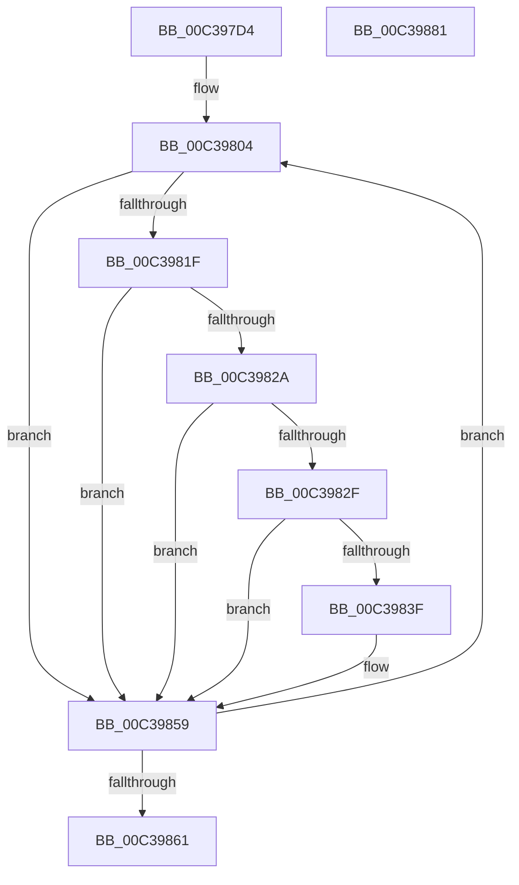

# KiGetTbLeafInfo

- RVA: `0x00C397D4`–`0x00C39882` (길이 `174` bytes)
- VA: `0x0000000140C397D4`
- 실행 섹션: `INIT`
- PDB 이름 있음: `예`; PDB Function 태그: `아니요`
- unwind 정보 RVA: `0x000CA4D8`
- 디코드: `55`개 명령, `174/174` bytes 표시
- 미해석 바이트: `0` (있으면 어셈블리에 `.byte`로 보존)

> 이 문서는 커널 이미지의 기계어와 PDB 기호를 분석해 생성했습니다. 4번과 5번은 함수 원형과 자료형을 바이너리 사용 방식에서 추정한 C 해석이며 원본 소스 복구 결과는 아닙니다.

## 1. Dependencies

- 직접 호출 지점: **1**; 고유 호출 대상: **1**
- 직접 호출자로 확인된 함수: **1**
- RIP 상대 이미지 참조: **1**

### Outgoing calls
- `0x00C3986C` → [_security_check_cookie](../../text/6A/_security_check_cookie_function_006AC640.md) (function, `0x006AC640`)

### Direct callers
- [KeGetTbSize](KeGetTbSize_function_00C3964C.md) at `0x00C3975A`

### Static image references
- `0x00C397E3` → RVA `0x00E0A740` (`.data`; read)

## 2. Other-region calls and transfers

- 다른 실행 섹션으로 향하는 call: **1**
  - `0x00C3986C` → [_security_check_cookie](../../text/6A/_security_check_cookie_function_006AC640.md) (`INIT` → `.text`)
- 별도 외부 분기/꼬리 이동을 확인하지 못했습니다.

## 3. Assembly (complete function range)

```asm
00C397D4  48 89 5C 24 08                  mov qword ptr [rsp + 8], rbx
00C397D9  48 89 74 24 10                  mov qword ptr [rsp + 0x10], rsi
00C397DE  57                              push rdi
00C397DF  48 83 EC 20                     sub rsp, 0x20
00C397E3  48 8B 05 56 0F 1D 00            mov rax, qword ptr [rip + 0x1d0f56]
00C397EA  48 33 C4                        xor rax, rsp
00C397ED  48 89 44 24 10                  mov qword ptr [rsp + 0x10], rax
00C397F2  33 FF                           xor edi, edi
00C397F4  33 C9                           xor ecx, ecx
00C397F6  45 33 D2                        xor r10d, r10d
00C397F9  8D 47 18                        lea eax, [rdi + 0x18]
00C397FC  0F A2                           cpuid
00C397FE  8B F0                           mov esi, eax
00C39800  44 8D 5F 01                     lea r11d, [rdi + 1]
00C39804  B8 18 00 00 00                  mov eax, 0x18
00C39809  41 8B CA                        mov ecx, r10d
00C3980C  0F A2                           cpuid
00C3980E  44 8B C0                        mov r8d, eax
00C39811  44 8B CA                        mov r9d, edx
00C39814  8B C2                           mov eax, edx
00C39816  0B C1                           or eax, ecx
00C39818  0B C3                           or eax, ebx
00C3981A  41 0B C0                        or eax, r8d
00C3981D  74 3A                           je 0x140c39859
00C3981F  C1 EA 05                        shr edx, 5
00C39822  83 E2 07                        and edx, 7
00C39825  41 3B D3                        cmp edx, r11d
00C39828  72 2F                           jb 0x140c39859
00C3982A  F6 C3 01                        test bl, 1
00C3982D  74 2A                           je 0x140c39859
00C3982F  41 83 E1 1F                     and r9d, 0x1f
00C39833  41 FF C9                        dec r9d
00C39836  41 F7 C1 FD FF FF FF            test r9d, 0xfffffffd
00C3983D  75 1A                           jne 0x140c39859
00C3983F  C1 EB 10                        shr ebx, 0x10
00C39842  33 C0                           xor eax, eax
00C39844  0F AF D9                        imul ebx, ecx
00C39847  41 3B D3                        cmp edx, r11d
00C3984A  48 0F 46 C7                     cmovbe rax, rdi
00C3984E  41 0F 46 D3                     cmovbe edx, r11d
00C39852  44 8B DA                        mov r11d, edx
00C39855  48 8D 3C 18                     lea rdi, [rax + rbx]
00C39859  41 FF C2                        inc r10d
00C3985C  44 3B D6                        cmp r10d, esi
00C3985F  76 A3                           jbe 0x140c39804
00C39861  48 8B C7                        mov rax, rdi
00C39864  48 8B 4C 24 10                  mov rcx, qword ptr [rsp + 0x10]
00C39869  48 33 CC                        xor rcx, rsp
00C3986C  E8 CF 2D A7 FF                  call 0x1406ac640
00C39871  48 8B 5C 24 30                  mov rbx, qword ptr [rsp + 0x30]
00C39876  48 8B 74 24 38                  mov rsi, qword ptr [rsp + 0x38]
00C3987B  48 83 C4 20                     add rsp, 0x20
00C3987F  5F                              pop rdi
00C39880  C3                              ret
00C39881  CC                              int3
```

## 4. C-style interpretation (structured pseudocode)

```c
__int64 __fastcall KiGetTbLeafInfo(int a1, int a2)
{
    __int64 result;
    __int64 v_r10;
    __int64 v_r11;
    __int64 v_rbx;
    __int64 v_rdi;
    __int64 v_rsp;
    unsigned __int64 v_stack_m18;
    unsigned __int64 v_stack_p10;
    unsigned __int64 v_stack_p8;

    v_stack_p8 = v_rbx;
    v_stack_p10 = v_rsi;
    v_rsp = (v_rsp) - (32);
    result = (*(unsigned __int64 *)(v_rip + 1904470)) ^ (v_rsp);
    v_stack_m18 = result;
    v_rdi = 0;
    a1 = 0;
    v_r10 = 0;
loc_00C39804:
    result = (unsigned int)(((unsigned int)(a2)) | (0));
    result = (unsigned int)((result) | ((unsigned int)(v_rbx)));
    result = (unsigned int)((result) | (24));
    if (condition_is_equal) goto loc_00C39859;
    a2 = (unsigned int)((a2) >> (5));
    a2 = (unsigned int)((a2) & (7));
    if (a2 < ((unsigned int)(v_rdi + 1))) goto loc_00C39859;
    if ((((unsigned __int8)(v_rbx)) & (1)) == 0) goto loc_00C39859;
    a4 = (unsigned int)(((unsigned int)(a2)) & (31));
    a4 = (unsigned int)((a4) - 1);
    v_r11 = v_rdi + 1;
    if ((((unsigned int)(a4)) & (0xFFFFFFFDULL)) == 0) {
        v_rbx = (unsigned int)((v_rbx) >> (16));
        result = 0;
        v_rbx = (unsigned int)((v_rbx) * (0));
        if (a2 <= ((unsigned int)(v_rdi + 1))) {
            result = 0;
            a2 = (unsigned int)(v_rdi + 1);
        }
        v_r11 = a2;
        v_rdi = result + v_rbx * 1;
    }
    v_r10 = (unsigned int)((v_r10) + 1);
    if (((unsigned int)(v_r10)) <= ((unsigned int)((unsigned int)((unsigned int)(v_rdi + 24))))) goto loc_00C39804;
    a1 = (v_stack_m18) ^ (v_rsp);
    result = _security_check_cookie(a1, a2, 24, a4);
    v_rsp = (v_rsp) + (32);
    return result;
}
```

## 5. (Beta) C Style

```c
int64_t KiGetTbLeafInfo(int32_t Arg1, int32_t Arg2)
{
    int64_t result;
    int64_t local_r10;
    int64_t local_r11;
    int64_t local_rbx;
    int64_t local_rdi;
    int64_t local_rsp;
    uint64_t v_stack_m18;
    uint64_t v_stack_p10;
    uint64_t v_stack_p8;

    v_stack_p8 = local_rbx;
    v_stack_p10 = local_rsi;
    local_rsp = (local_rsp) - (32);
    result = (*(uint64_t *)(v_rip + 0x1D0F56)) ^ (local_rsp);
    v_stack_m18 = result;
    local_rdi = 0;
    Arg1 = 0;
    local_r10 = 0;
loc_00C39804:
    result = (uint32_t)(((uint32_t)(Arg2)) | (0));
    result = (uint32_t)((result) | ((uint32_t)(local_rbx)));
    result = (uint32_t)((result) | (24));
    if (condition_is_equal) goto loc_00C39859;
    Arg2 = (uint32_t)((Arg2) >> (5));
    Arg2 = (uint32_t)((Arg2) & (7));
    if (Arg2 < ((uint32_t)(local_rdi + 1))) goto loc_00C39859;
    if ((((uint8_t)(local_rbx)) & (1)) == 0) goto loc_00C39859;
    a4 = (uint32_t)(((uint32_t)(Arg2)) & (31));
    a4 = (uint32_t)((a4) - 1);
    local_r11 = local_rdi + 1;
    if ((((uint32_t)(a4)) & (0xFFFFFFFDULL)) == 0) {
        local_rbx = (uint32_t)((local_rbx) >> (16));
        result = 0;
        local_rbx = (uint32_t)((local_rbx) * (0));
        if (Arg2 <= ((uint32_t)(local_rdi + 1))) {
            result = 0;
            Arg2 = (uint32_t)(local_rdi + 1);
        }
        local_r11 = Arg2;
        local_rdi = result + local_rbx * 1;
    }
    local_r10 = (uint32_t)((local_r10) + 1);
    if (((uint32_t)(local_r10)) <= ((uint32_t)((uint32_t)((uint32_t)(local_rdi + 24))))) goto loc_00C39804;
    Arg1 = (v_stack_m18) ^ (local_rsp);
    result = _security_check_cookie(Arg1, Arg2, 24, a4);
    local_rsp = (local_rsp) + (32);
    return result;
}
```

## 6. Execution-region graph

[열기: 2D/3D 그래프와 함수 탐색 컨트롤 패널](../../../control-panel.html?section=init&rva=0x00C397D4&view=graph)

- 2D 그래프는 위에서 아래로 흐르고, 3D 그래프는 빈 공간을 드래그해 회전합니다. Shift+드래그는 이동, 휠은 확대·축소, 함수 노드 선택은 대상 보고서 이동입니다.

### Static fallback


