# KiInitDpcThresholds

- RVA: `0x00C38318`–`0x00C3847A` (길이 `354` bytes)
- VA: `0x0000000140C38318`
- 실행 섹션: `INIT`
- PDB 이름 있음: `예`; PDB Function 태그: `아니요`
- unwind 정보 RVA: `0x0005C788`
- 디코드: `101`개 명령, `354/354` bytes 표시
- 미해석 바이트: `0` (있으면 어셈블리에 `.byte`로 보존)

> 이 문서는 커널 이미지의 기계어와 PDB 기호를 분석해 생성했습니다. 4번과 5번은 함수 원형과 자료형을 바이너리 사용 방식에서 추정한 C 해석이며 원본 소스 복구 결과는 아닙니다.

## 1. Dependencies

- 직접 호출 지점: **1**; 고유 호출 대상: **1**
- 직접 호출자로 확인된 함수: **1**
- RIP 상대 이미지 참조: **15**

### Outgoing calls
- `0x00C38405` → [KiInitializeLegacyWatchdogProfileThresholds](KiInitializeLegacyWatchdogProfileThresholds_function_00C387B0.md) (function, `0x00C387B0`)

### Direct callers
- [KeInitSystem](../C7/KeInitSystem_function_00C71660.md) at `0x00C71828`

### Static image references
- `0x00C3831C` → RVA `0x00FC502C` (`ALMOSTRO`; read)
- `0x00C38337` → RVA `0x00FC502C` (`ALMOSTRO`; write)
- `0x00C3833E` → RVA `0x00FC5034` (`ALMOSTRO`; read)
- `0x00C38356` → RVA `0x00FC5034` (`ALMOSTRO`; write)
- `0x00C3835C` → RVA `0x00FC5040` (`ALMOSTRO`; read)
- `0x00C3836C` → RVA `0x00FC5040` (`ALMOSTRO`; write)
- `0x00C38385` → RVA `0x00FC503C` (`ALMOSTRO`; read)
- `0x00C38397` → RVA `0x00FC503C` (`ALMOSTRO`; write)
- `0x00C383B0` → RVA `0x00FC5028` (`ALMOSTRO`; read)
- `0x00C383D9` → RVA `0x00FC5028` (`ALMOSTRO`; write)
- `0x00C383DF` → RVA `0x00FC5024` (`ALMOSTRO`; read)
- `0x00C383FF` → RVA `0x00FC5024` (`ALMOSTRO`; write)
- `0x00C38434` → RVA `0x00FC5048` (`ALMOSTRO`; read)
- `0x00C38441` → RVA `0x00FC5048` (`ALMOSTRO`; write)
- `0x00C3846E` → RVA `0x00FC53D4` (`ALMOSTRO`; write)

## 2. Other-region calls and transfers

- 다른 실행 섹션으로 향하는 call: **0**
- 별도 외부 분기/꼬리 이동을 확인하지 못했습니다.

## 3. Assembly (complete function range)

```asm
00C38318  48 83 EC 28                     sub rsp, 0x28
00C3831C  44 8B 05 09 CD 38 00            mov r8d, dword ptr [rip + 0x38cd09]
00C38323  41 BA D0 07 00 00               mov r10d, 0x7d0
00C38329  41 8D 40 FF                     lea eax, [r8 - 1]
00C3832D  3D CE 07 00 00                  cmp eax, 0x7ce
00C38332  77 0A                           ja 0x140c3833e
00C38334  45 8B C2                        mov r8d, r10d
00C38337  44 89 15 EE CC 38 00            mov dword ptr [rip + 0x38ccee], r10d
00C3833E  44 8B 0D EF CC 38 00            mov r9d, dword ptr [rip + 0x38ccef]
00C38345  B9 14 00 00 00                  mov ecx, 0x14
00C3834A  41 8D 41 FF                     lea eax, [r9 - 1]
00C3834E  83 F8 12                        cmp eax, 0x12
00C38351  77 09                           ja 0x140c3835c
00C38353  44 8B C9                        mov r9d, ecx
00C38356  89 0D D8 CC 38 00               mov dword ptr [rip + 0x38ccd8], ecx
00C3835C  8B 15 DE CC 38 00               mov edx, dword ptr [rip + 0x38ccde]
00C38362  85 D2                           test edx, edx
00C38364  74 1F                           je 0x140c38385
00C38366  3B D1                           cmp edx, ecx
00C38368  73 08                           jae 0x140c38372
00C3836A  8B D1                           mov edx, ecx
00C3836C  89 0D CE CC 38 00               mov dword ptr [rip + 0x38ccce], ecx
00C38372  45 85 C9                        test r9d, r9d
00C38375  74 0E                           je 0x140c38385
00C38377  41 3B D1                        cmp edx, r9d
00C3837A  76 09                           jbe 0x140c38385
00C3837C  41 8B D1                        mov edx, r9d
00C3837F  89 15 BB CC 38 00               mov dword ptr [rip + 0x38ccbb], edx
00C38385  8B 0D B1 CC 38 00               mov ecx, dword ptr [rip + 0x38ccb1]
00C3838B  85 C9                           test ecx, ecx
00C3838D  74 21                           je 0x140c383b0
00C3838F  41 3B CA                        cmp ecx, r10d
00C38392  73 09                           jae 0x140c3839d
00C38394  41 8B CA                        mov ecx, r10d
00C38397  89 0D 9F CC 38 00               mov dword ptr [rip + 0x38cc9f], ecx
00C3839D  45 85 C0                        test r8d, r8d
00C383A0  74 0E                           je 0x140c383b0
00C383A2  41 3B C8                        cmp ecx, r8d
00C383A5  76 09                           jbe 0x140c383b0
00C383A7  41 8B C8                        mov ecx, r8d
00C383AA  89 0D 8C CC 38 00               mov dword ptr [rip + 0x38cc8c], ecx
00C383B0  44 8B 15 71 CC 38 00            mov r10d, dword ptr [rip + 0x38cc71]
00C383B7  41 BB FD FF FF FF               mov r11d, 0xfffffffd
00C383BD  41 8D 42 FF                     lea eax, [r10 - 1]
00C383C1  41 3B C3                        cmp eax, r11d
00C383C4  77 19                           ja 0x140c383df
00C383C6  8B C2                           mov eax, edx
00C383C8  85 D2                           test edx, edx
00C383CA  75 08                           jne 0x140c383d4
00C383CC  41 8B C1                        mov eax, r9d
00C383CF  45 85 C9                        test r9d, r9d
00C383D2  74 0B                           je 0x140c383df
00C383D4  44 3B D0                        cmp r10d, eax
00C383D7  76 06                           jbe 0x140c383df
00C383D9  89 15 49 CC 38 00               mov dword ptr [rip + 0x38cc49], edx
00C383DF  8B 15 3F CC 38 00               mov edx, dword ptr [rip + 0x38cc3f]
00C383E5  8D 42 FF                        lea eax, [rdx - 1]
00C383E8  41 3B C3                        cmp eax, r11d
00C383EB  77 18                           ja 0x140c38405
00C383ED  8B C1                           mov eax, ecx
00C383EF  85 C9                           test ecx, ecx
00C383F1  75 08                           jne 0x140c383fb
00C383F3  41 8B C0                        mov eax, r8d
00C383F6  45 85 C0                        test r8d, r8d
00C383F9  74 0A                           je 0x140c38405
00C383FB  3B D0                           cmp edx, eax
00C383FD  76 06                           jbe 0x140c38405
00C383FF  89 0D 1F CC 38 00               mov dword ptr [rip + 0x38cc1f], ecx
00C38405  E8 A6 03 00 00                  call 0x140c387b0
00C3840A  8B 05 18 CC 38 00               mov eax, dword ptr [rip + 0x38cc18]
00C38410  41 83 C8 FF                     or r8d, 0xffffffff
00C38414  41 3B C0                        cmp eax, r8d
00C38417  75 08                           jne 0x140c38421
00C38419  33 C0                           xor eax, eax
00C3841B  89 05 07 CC 38 00               mov dword ptr [rip + 0x38cc07], eax
00C38421  8B 15 FD CB 38 00               mov edx, dword ptr [rip + 0x38cbfd]
00C38427  41 3B D0                        cmp edx, r8d
00C3842A  75 08                           jne 0x140c38434
00C3842C  33 D2                           xor edx, edx
00C3842E  89 15 F0 CB 38 00               mov dword ptr [rip + 0x38cbf0], edx
00C38434  8B 0D 0E CC 38 00               mov ecx, dword ptr [rip + 0x38cc0e]
00C3843A  41 3B C8                        cmp ecx, r8d
00C3843D  75 17                           jne 0x140c38456
00C3843F  33 C9                           xor ecx, ecx
00C38441  89 0D 01 CC 38 00               mov dword ptr [rip + 0x38cc01], ecx
00C38447  85 C0                           test eax, eax
00C38449  75 04                           jne 0x140c3844f
00C3844B  85 D2                           test edx, edx
00C3844D  74 1C                           je 0x140c3846b
00C3844F  B9 00 10 04 00                  mov ecx, 0x41000
00C38454  EB 0F                           jmp 0x140c38465
00C38456  8D 41 FF                        lea eax, [rcx - 1]
00C38459  3D FE 1F 00 00                  cmp eax, 0x1ffe
00C3845E  77 0B                           ja 0x140c3846b
00C38460  B9 00 20 00 00                  mov ecx, 0x2000
00C38465  89 0D DD CB 38 00               mov dword ptr [rip + 0x38cbdd], ecx
00C3846B  C1 E9 03                        shr ecx, 3
00C3846E  89 0D 60 CF 38 00               mov dword ptr [rip + 0x38cf60], ecx
00C38474  48 83 C4 28                     add rsp, 0x28
00C38478  C3                              ret
00C38479  CC                              int3
```

## 4. C-style interpretation (structured pseudocode)

```c
__int64 __fastcall KiInitDpcThresholds(void)
{
    __int64 result;
    __int64 v_rsp;

    v_rsp = (v_rsp) - (40);
    if (((unsigned int)((unsigned int)(*(unsigned int *)(v_rip + 3722505)) - 1)) <= 0x7CEULL) {
        a3 = (unsigned int)((unsigned int)(0x7D0ULL));
        *(unsigned int *)(v_rip + 3722478) = (unsigned int)((unsigned int)(0x7D0ULL));
    }
    if (((unsigned int)((unsigned int)(*(unsigned int *)(v_rip + 3722479)) - 1)) <= 18) {
        a4 = 20;
        *(unsigned int *)(v_rip + 3722456) = 20;
    }
    if ((unsigned int)((unsigned int)(*(unsigned int *)(v_rip + 3722462))) == 0) goto loc_00C38385;
    if (((unsigned int)((unsigned int)(*(unsigned int *)(v_rip + 3722462)))) < 20) {
        a2 = 20;
        *(unsigned int *)(v_rip + 3722446) = 20;
    }
    if ((unsigned int)(a4) == 0) goto loc_00C38385;
    if (((unsigned int)(a2)) >= = ((unsigned int)(a4))) {
        a2 = (unsigned int)(a4);
        *(unsigned int *)(v_rip + 3722427) = (unsigned int)(a2);
    }
    if ((unsigned int)((unsigned int)(*(unsigned int *)(v_rip + 3722417))) == 0) goto loc_00C383B0;
    if (((unsigned int)((unsigned int)(*(unsigned int *)(v_rip + 3722417)))) < ((unsigned int)((unsigned int)(0x7D0ULL)))) {
        a1 = (unsigned int)((unsigned int)(0x7D0ULL));
        *(unsigned int *)(v_rip + 3722399) = (unsigned int)(a1);
    }
    if ((unsigned int)(a3) == 0) goto loc_00C383B0;
    if (((unsigned int)(a1)) >= = ((unsigned int)(a3))) {
        a1 = (unsigned int)(a3);
        *(unsigned int *)(v_rip + 3722380) = (unsigned int)(a1);
    }
    if (((unsigned int)((unsigned int)(*(unsigned int *)(v_rip + 3722353)) - 1)) > ((unsigned int)((unsigned int)(0xFFFFFFFDULL)))) goto loc_00C383DF;
    if ((unsigned int)(a2) != 0) goto loc_00C383D4;
    if ((unsigned int)(a4) == 0) goto loc_00C383DF;
loc_00C383D4:
    if (((unsigned int)((unsigned int)(*(unsigned int *)(v_rip + 3722353)))) >= = ((unsigned int)((unsigned int)((unsigned int)(a4))))) {
        *(unsigned int *)(v_rip + 3722313) = (unsigned int)(a2);
    }
    if (((unsigned int)((unsigned int)(*(unsigned int *)(v_rip + 3722303)) - 1)) > ((unsigned int)((unsigned int)(0xFFFFFFFDULL)))) goto loc_00C38405;
    if ((unsigned int)(a1) != 0) goto loc_00C383FB;
    if ((unsigned int)(a3) == 0) goto loc_00C38405;
loc_00C383FB:
    if (((unsigned int)((unsigned int)(*(unsigned int *)(v_rip + 3722303)))) >= = ((unsigned int)((unsigned int)((unsigned int)(a3))))) {
        *(unsigned int *)(v_rip + 3722271) = (unsigned int)(a1);
    }
    result = KiInitializeLegacyWatchdogProfileThresholds(a1, (unsigned int)(*(unsigned int *)(v_rip + 3722303)), a3, a4);
    a3 = (unsigned int)((a3) | (0xFFFFFFFFULL));
    result = (unsigned int)(*(unsigned int *)(v_rip + 3722264));
    if (((unsigned int)((unsigned int)(*(unsigned int *)(v_rip + 3722264)))) == ((unsigned int)(a3))) {
        result = 0;
        *(unsigned int *)(v_rip + 3722247) = 0;
    }
    if (((unsigned int)((unsigned int)(*(unsigned int *)(v_rip + 3722237)))) == ((unsigned int)(a3))) {
        a2 = 0;
        *(unsigned int *)(v_rip + 3722224) = 0;
    }
    if (((unsigned int)((unsigned int)(*(unsigned int *)(v_rip + 3722254)))) != ((unsigned int)(a3))) goto loc_00C38456;
    a1 = 0;
    *(unsigned int *)(v_rip + 3722241) = 0;
    if (0 != 0) goto loc_00C3844F;
    if (0 == 0) goto loc_00C3846B;
loc_00C3844F:
    goto loc_00C38465;
loc_00C38456:
    if (((unsigned int)((unsigned int)(0x41000ULL) - 1)) > 0x1FFEULL) goto loc_00C3846B;
loc_00C38465:
    *(unsigned int *)(v_rip + 3722205) = (unsigned int)((unsigned int)(0x2000ULL));
loc_00C3846B:
    a1 = (unsigned int)(((unsigned int)(0x2000ULL)) >> (3));
    *(unsigned int *)(v_rip + 3723104) = (unsigned int)(a1);
    v_rsp = (v_rsp) + (40);
    return (unsigned int)(0x41000ULL) - 1;
}
```

## 5. (Beta) C Style

```c
void KiInitDpcThresholds(void)
{
    int64_t result;
    int64_t local_rsp;

    local_rsp = (local_rsp) - (40);
    if (((uint32_t)((uint32_t)(*(uint32_t *)(v_rip + 0x38CD09)) - 1)) <= 0x7CEULL) {
        a3 = (uint32_t)((uint32_t)(0x7D0ULL));
        *(uint32_t *)(v_rip + 0x38CCEE) = (uint32_t)((uint32_t)(0x7D0ULL));
    }
    if (((uint32_t)((uint32_t)(*(uint32_t *)(v_rip + 0x38CCEF)) - 1)) <= 18) {
        a4 = 20;
        *(uint32_t *)(v_rip + 0x38CCD8) = 20;
    }
    if ((uint32_t)((uint32_t)(*(uint32_t *)(v_rip + 0x38CCDE))) == 0) goto loc_00C38385;
    if (((uint32_t)((uint32_t)(*(uint32_t *)(v_rip + 0x38CCDE)))) < 20) {
        a2 = 20;
        *(uint32_t *)(v_rip + 0x38CCCE) = 20;
    }
    if ((uint32_t)(a4) == 0) goto loc_00C38385;
    if (((uint32_t)(a2)) >= = ((uint32_t)(a4))) {
        a2 = (uint32_t)(a4);
        *(uint32_t *)(v_rip + 0x38CCBB) = (uint32_t)(a2);
    }
    if ((uint32_t)((uint32_t)(*(uint32_t *)(v_rip + 0x38CCB1))) == 0) goto loc_00C383B0;
    if (((uint32_t)((uint32_t)(*(uint32_t *)(v_rip + 0x38CCB1)))) < ((uint32_t)((uint32_t)(0x7D0ULL)))) {
        a1 = (uint32_t)((uint32_t)(0x7D0ULL));
        *(uint32_t *)(v_rip + 0x38CC9F) = (uint32_t)(a1);
    }
    if ((uint32_t)(a3) == 0) goto loc_00C383B0;
    if (((uint32_t)(a1)) >= = ((uint32_t)(a3))) {
        a1 = (uint32_t)(a3);
        *(uint32_t *)(v_rip + 0x38CC8C) = (uint32_t)(a1);
    }
    if (((uint32_t)((uint32_t)(*(uint32_t *)(v_rip + 0x38CC71)) - 1)) > ((uint32_t)((uint32_t)(0xFFFFFFFDULL)))) goto loc_00C383DF;
    if ((uint32_t)(a2) != 0) goto loc_00C383D4;
    if ((uint32_t)(a4) == 0) goto loc_00C383DF;
loc_00C383D4:
    if (((uint32_t)((uint32_t)(*(uint32_t *)(v_rip + 0x38CC71)))) >= = ((uint32_t)((uint32_t)((uint32_t)(a4))))) {
        *(uint32_t *)(v_rip + 0x38CC49) = (uint32_t)(a2);
    }
    if (((uint32_t)((uint32_t)(*(uint32_t *)(v_rip + 0x38CC3F)) - 1)) > ((uint32_t)((uint32_t)(0xFFFFFFFDULL)))) goto loc_00C38405;
    if ((uint32_t)(a1) != 0) goto loc_00C383FB;
    if ((uint32_t)(a3) == 0) goto loc_00C38405;
loc_00C383FB:
    if (((uint32_t)((uint32_t)(*(uint32_t *)(v_rip + 0x38CC3F)))) >= = ((uint32_t)((uint32_t)((uint32_t)(a3))))) {
        *(uint32_t *)(v_rip + 0x38CC1F) = (uint32_t)(a1);
    }
    result = KiInitializeLegacyWatchdogProfileThresholds(a1, (uint32_t)(*(uint32_t *)(v_rip + 0x38CC3F)), a3, a4);
    a3 = (uint32_t)((a3) | (0xFFFFFFFFULL));
    result = (uint32_t)(*(uint32_t *)(v_rip + 0x38CC18));
    if (((uint32_t)((uint32_t)(*(uint32_t *)(v_rip + 0x38CC18)))) == ((uint32_t)(a3))) {
        result = 0;
        *(uint32_t *)(v_rip + 0x38CC07) = 0;
    }
    if (((uint32_t)((uint32_t)(*(uint32_t *)(v_rip + 0x38CBFD)))) == ((uint32_t)(a3))) {
        a2 = 0;
        *(uint32_t *)(v_rip + 0x38CBF0) = 0;
    }
    if (((uint32_t)((uint32_t)(*(uint32_t *)(v_rip + 0x38CC0E)))) != ((uint32_t)(a3))) goto loc_00C38456;
    a1 = 0;
    *(uint32_t *)(v_rip + 0x38CC01) = 0;
    if (0 != 0) goto loc_00C3844F;
    if (0 == 0) goto loc_00C3846B;
loc_00C3844F:
    goto loc_00C38465;
loc_00C38456:
    if (((uint32_t)((uint32_t)(0x41000ULL) - 1)) > 0x1FFEULL) goto loc_00C3846B;
loc_00C38465:
    *(uint32_t *)(v_rip + 0x38CBDD) = (uint32_t)((uint32_t)(0x2000ULL));
loc_00C3846B:
    a1 = (uint32_t)(((uint32_t)(0x2000ULL)) >> (3));
    *(uint32_t *)(v_rip + 0x38CF60) = (uint32_t)(a1);
    local_rsp = (local_rsp) + (40);
    return (uint32_t)(0x41000ULL) - 1;
}
```

## 6. Execution-region graph

[열기: 2D/3D 그래프와 함수 탐색 컨트롤 패널](../../../control-panel.html?section=init&rva=0x00C38318&view=graph)

- 2D 그래프는 위에서 아래로 흐르고, 3D 그래프는 빈 공간을 드래그해 회전합니다. Shift+드래그는 이동, 휠은 확대·축소, 함수 노드 선택은 대상 보고서 이동입니다.

### Static fallback

```mermaid
flowchart TD
  bb_00C38318[BB_00C38318]
  bb_00C38334[BB_00C38334]
  bb_00C3833E[BB_00C3833E]
  bb_00C38353[BB_00C38353]
  bb_00C3835C[BB_00C3835C]
  bb_00C38366[BB_00C38366]
  bb_00C3836A[BB_00C3836A]
  bb_00C38372[BB_00C38372]
  bb_00C38377[BB_00C38377]
  bb_00C3837C[BB_00C3837C]
  bb_00C38385[BB_00C38385]
  bb_00C3838F[BB_00C3838F]
  bb_00C38394[BB_00C38394]
  bb_00C3839D[BB_00C3839D]
  bb_00C383A2[BB_00C383A2]
  bb_00C383A7[BB_00C383A7]
  bb_00C383B0[BB_00C383B0]
  bb_00C383C6[BB_00C383C6]
  bb_00C383CC[BB_00C383CC]
  bb_00C383D4[BB_00C383D4]
  bb_00C383D9[BB_00C383D9]
  bb_00C383DF[BB_00C383DF]
  bb_00C383ED[BB_00C383ED]
  bb_00C383F3[BB_00C383F3]
  bb_00C383FB[BB_00C383FB]
  bb_00C383FF[BB_00C383FF]
  bb_00C38405[BB_00C38405]
  bb_00C38419[BB_00C38419]
  bb_00C38421[BB_00C38421]
  bb_00C3842C[BB_00C3842C]
  bb_00C38434[BB_00C38434]
  bb_00C3843F[BB_00C3843F]
  bb_00C3844B[BB_00C3844B]
  bb_00C3844F[BB_00C3844F]
  bb_00C38456[BB_00C38456]
  bb_00C38460[BB_00C38460]
  bb_00C38465[BB_00C38465]
  bb_00C3846B[BB_00C3846B]
  bb_00C38479[BB_00C38479]
  bb_00C38318 -->|branch| bb_00C3833E
  bb_00C38318 -->|fallthrough| bb_00C38334
  bb_00C38334 -->|flow| bb_00C3833E
  bb_00C3833E -->|branch| bb_00C3835C
  bb_00C3833E -->|fallthrough| bb_00C38353
  bb_00C38353 -->|flow| bb_00C3835C
  bb_00C3835C -->|branch| bb_00C38385
  bb_00C3835C -->|fallthrough| bb_00C38366
  bb_00C38366 -->|branch| bb_00C38372
  bb_00C38366 -->|fallthrough| bb_00C3836A
  bb_00C3836A -->|flow| bb_00C38372
  bb_00C38372 -->|branch| bb_00C38385
  bb_00C38372 -->|fallthrough| bb_00C38377
  bb_00C38377 -->|branch| bb_00C38385
  bb_00C38377 -->|fallthrough| bb_00C3837C
  bb_00C3837C -->|flow| bb_00C38385
  bb_00C38385 -->|branch| bb_00C383B0
  bb_00C38385 -->|fallthrough| bb_00C3838F
  bb_00C3838F -->|branch| bb_00C3839D
  bb_00C3838F -->|fallthrough| bb_00C38394
  bb_00C38394 -->|flow| bb_00C3839D
  bb_00C3839D -->|branch| bb_00C383B0
  bb_00C3839D -->|fallthrough| bb_00C383A2
  bb_00C383A2 -->|branch| bb_00C383B0
  bb_00C383A2 -->|fallthrough| bb_00C383A7
  bb_00C383A7 -->|flow| bb_00C383B0
  bb_00C383B0 -->|branch| bb_00C383DF
  bb_00C383B0 -->|fallthrough| bb_00C383C6
  bb_00C383C6 -->|branch| bb_00C383D4
  bb_00C383C6 -->|fallthrough| bb_00C383CC
  bb_00C383CC -->|branch| bb_00C383DF
  bb_00C383CC -->|fallthrough| bb_00C383D4
  bb_00C383D4 -->|branch| bb_00C383DF
  bb_00C383D4 -->|fallthrough| bb_00C383D9
  bb_00C383D9 -->|flow| bb_00C383DF
  bb_00C383DF -->|branch| bb_00C38405
  bb_00C383DF -->|fallthrough| bb_00C383ED
  bb_00C383ED -->|branch| bb_00C383FB
  bb_00C383ED -->|fallthrough| bb_00C383F3
  bb_00C383F3 -->|branch| bb_00C38405
  bb_00C383F3 -->|fallthrough| bb_00C383FB
  bb_00C383FB -->|branch| bb_00C38405
  bb_00C383FB -->|fallthrough| bb_00C383FF
  bb_00C383FF -->|flow| bb_00C38405
  bb_00C38405 -->|branch| bb_00C38421
  bb_00C38405 -->|fallthrough| bb_00C38419
  bb_00C38419 -->|flow| bb_00C38421
  bb_00C38421 -->|branch| bb_00C38434
  bb_00C38421 -->|fallthrough| bb_00C3842C
  bb_00C3842C -->|flow| bb_00C38434
  bb_00C38434 -->|branch| bb_00C38456
  bb_00C38434 -->|fallthrough| bb_00C3843F
  bb_00C3843F -->|branch| bb_00C3844F
  bb_00C3843F -->|fallthrough| bb_00C3844B
  bb_00C3844B -->|branch| bb_00C3846B
  bb_00C3844B -->|fallthrough| bb_00C3844F
  bb_00C3844F -->|branch| bb_00C38465
  bb_00C38456 -->|branch| bb_00C3846B
  bb_00C38456 -->|fallthrough| bb_00C38460
  bb_00C38460 -->|flow| bb_00C38465
  bb_00C38465 -->|flow| bb_00C3846B
```


