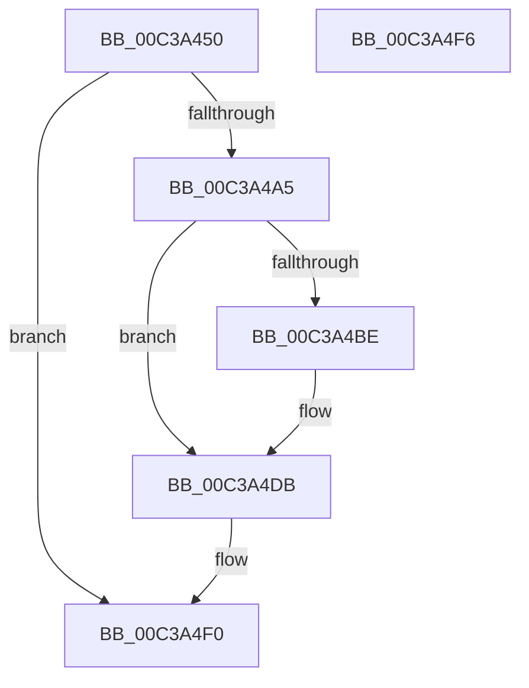

# KiInitDynamicTraceSupport

- RVA: `0x00C3A450`–`0x00C3A4F7` (길이 `167` bytes)
- VA: `0x0000000140C3A450`
- 실행 섹션: `INIT`
- PDB 이름 있음: `예`; PDB Function 태그: `아니요`
- unwind 정보 RVA: `0x0005CF00`
- 디코드: `37`개 명령, `167/167` bytes 표시
- 미해석 바이트: `0` (있으면 어셈블리에 `.byte`로 보존)

> 이 문서는 커널 이미지의 기계어와 PDB 기호를 분석해 생성했습니다. 4번과 5번은 함수 원형과 자료형을 바이너리 사용 방식에서 추정한 C 해석이며 원본 소스 복구 결과는 아닙니다.

## 1. Dependencies

- 직접 호출 지점: **2**; 고유 호출 대상: **2**
- 직접 호출자로 확인된 함수: **1**
- RIP 상대 이미지 참조: **9**

### Outgoing calls
- `0x00C3A495` → `ext-ms-win-ntos-trace-l1-1-0.dll!TraceInitSystem` (import, 간접 대상; import `ext-ms-win-ntos-trace-l1-1-0.dll!TraceInitSystem`)
- `0x00C3A4B4` → [RtlLookupFunctionEntry](../../text/2F/RtlLookupFunctionEntry_function_002F2F30.md) (function, `0x002F2F30`)

### Direct callers
- [KeInitSystem](../C7/KeInitSystem_function_00C71660.md) at `0x00C71794`

### Static image references
- `0x00C3A45C` → RVA `0x00FC7448` (`ALMOSTRO`; read)
- `0x00C3A469` → RVA `0x00FC7400` (`ALMOSTRO`; read)
- `0x00C3A470` → RVA `0x00F475DC` (`.data`; read)
- `0x00C3A481` → RVA `0x00FC7400` (`ALMOSTRO`; write)
- `0x00C3A495` → RVA `0x001515F0` (`ext-ms-win-ntos-trace-l1-1-0.dll!TraceInitSystem (IAT)`; read)
- `0x00C3A4C5` → RVA `0x00FC7448` (`ALMOSTRO`; write)
- `0x00C3A4D4` → RVA `0x00FC7450` (`ALMOSTRO`; write)
- `0x00C3A4E0` → RVA `0x00008070` (`.rdata`; read)
- `0x00C3A4EA` → RVA `0x00FC6C10` (`ALMOSTRO`; write)

## 2. Other-region calls and transfers

- 다른 실행 섹션으로 향하는 call: **1**
  - `0x00C3A4B4` → [RtlLookupFunctionEntry](../../text/2F/RtlLookupFunctionEntry_function_002F2F30.md) (`INIT` → `.text`)
- 별도 외부 분기/꼬리 이동을 확인하지 못했습니다.

## 3. Assembly (complete function range)

```asm
00C3A450  40 53                           push rbx
00C3A452  48 83 EC 20                     sub rsp, 0x20
00C3A456  48 83 64 24 38 00               and qword ptr [rsp + 0x38], 0
00C3A45C  4C 8D 05 E5 CF 38 00            lea r8, [rip + 0x38cfe5]
00C3A463  48 83 64 24 30 00               and qword ptr [rsp + 0x30], 0
00C3A469  48 8D 15 90 CF 38 00            lea rdx, [rip + 0x38cf90]
00C3A470  80 3D 65 D1 30 00 00            cmp byte ptr [rip + 0x30d165], 0
00C3A477  48 8D 4C 24 38                  lea rcx, [rsp + 0x38]
00C3A47C  BB 01 00 00 00                  mov ebx, 1
00C3A481  48 C7 05 74 CF 38 00 09 00 00 00  mov qword ptr [rip + 0x38cf74], 9
00C3A48C  8D 43 04                        lea eax, [rbx + 4]
00C3A48F  0F 44 D8                        cmove ebx, eax
00C3A492  83 CB 02                        or ebx, 2
00C3A495  48 FF 15 54 71 51 FF            call qword ptr [rip - 0xae8eac]
00C3A49C  0F 1F 44 00 00                  nop dword ptr [rax + rax]
00C3A4A1  85 C0                           test eax, eax
00C3A4A3  78 4B                           js 0x140c3a4f0
00C3A4A5  48 8B 0D 9C CF 38 00            mov rcx, qword ptr [rip + 0x38cf9c]
00C3A4AC  48 8D 54 24 30                  lea rdx, [rsp + 0x30]
00C3A4B1  45 33 C0                        xor r8d, r8d
00C3A4B4  E8 77 8A 6B FF                  call 0x1402f2f30
00C3A4B9  48 85 C0                        test rax, rax
00C3A4BC  74 1D                           je 0x140c3a4db
00C3A4BE  8B 08                           mov ecx, dword ptr [rax]
00C3A4C0  48 03 4C 24 30                  add rcx, qword ptr [rsp + 0x30]
00C3A4C5  48 89 0D 7C CF 38 00            mov qword ptr [rip + 0x38cf7c], rcx
00C3A4CC  8B 40 04                        mov eax, dword ptr [rax + 4]
00C3A4CF  48 03 44 24 30                  add rax, qword ptr [rsp + 0x30]
00C3A4D4  48 89 05 75 CF 38 00            mov qword ptr [rip + 0x38cf75], rax
00C3A4DB  48 8B 44 24 38                  mov rax, qword ptr [rsp + 0x38]
00C3A4E0  48 8D 0D 89 DB 3C FF            lea rcx, [rip - 0xc32477]
00C3A4E7  48 89 08                        mov qword ptr [rax], rcx
00C3A4EA  89 1D 20 C7 38 00               mov dword ptr [rip + 0x38c720], ebx
00C3A4F0  48 83 C4 20                     add rsp, 0x20
00C3A4F4  5B                              pop rbx
00C3A4F5  C3                              ret
00C3A4F6  CC                              int3
```

## 4. C-style interpretation (structured pseudocode)

```c
__int64 __fastcall KiInitDynamicTraceSupport(void)
{
    __int64 result;
    __int64 v_rbx;
    __int64 v_rsp;
    unsigned __int64 v_stack_p10;
    unsigned __int64 v_stack_p8;

    v_rsp = (v_rsp) - (32);
    *(unsigned __int64 *)(v_rip + 3723124) = 9;
    v_rbx = 1;
    if ((*(unsigned __int8 *)(v_rip + 3199333)) == 0) { v_rbx = (unsigned int)(1 + 4); }
    v_rbx = (unsigned int)((v_rbx) | (2));
    result = ext_ms_win_ntos_trace_l1_1_0_dll_TraceInitSystem(v_stack_p10, v_rip + 3723152, v_rip + 3723237, a4);
    if (sign_flag) goto loc_00C3A4F0;
    a3 = 0;
    result = RtlLookupFunctionEntry(*(unsigned __int64 *)(v_rip + 3723164), v_stack_p8, a3, a4);
    if (result != 0) {
        a1 = *(unsigned int *)(result);
        a1 = (a1) + (v_stack_p8);
        *(unsigned __int64 *)(v_rip + 3723132) = a1;
        result = *(unsigned int *)(result + 4);
        result = (result) + (v_stack_p8);
        *(unsigned __int64 *)(v_rip + 3723125) = result;
    }
    *(unsigned __int64 *)(v_stack_p10) = v_rip - 12788855;
    *(unsigned int *)(v_rip + 3720992) = (unsigned int)(v_rbx);
loc_00C3A4F0:
    v_rsp = (v_rsp) + (32);
    return v_stack_p10;
}
```

## 5. (Beta) C Style

```c
void KiInitDynamicTraceSupport(void)
{
    int64_t result;
    int64_t local_rbx;
    int64_t local_rsp;
    uint64_t v_stack_p10;
    uint64_t v_stack_p8;

    local_rsp = (local_rsp) - (32);
    *(uint64_t *)(v_rip + 0x38CF74) = 9;
    local_rbx = 1;
    if ((*(uint8_t *)(v_rip + 0x30D165)) == 0) { local_rbx = (uint32_t)(1 + 4); }
    local_rbx = (uint32_t)((local_rbx) | (2));
    result = kernel_indirect_call(v_stack_p10, v_rip + 3723152, v_rip + 3723237, a4);
    if (sign_flag) goto loc_00C3A4F0;
    a3 = 0;
    result = RtlLookupFunctionEntry(*(uint64_t *)(v_rip + 0x38CF9C), v_stack_p8, a3, a4);
    if (result != 0) {
        a1 = *(uint32_t *)(result);
        a1 = (a1) + (v_stack_p8);
        *(uint64_t *)(v_rip + 0x38CF7C) = a1;
        result = *(uint32_t *)(result + 0x4);
        result = (result) + (v_stack_p8);
        *(uint64_t *)(v_rip + 0x38CF75) = result;
    }
    *(uint64_t *)(v_stack_p10) = v_rip - 12788855;
    *(uint32_t *)(v_rip + 0x38C720) = (uint32_t)(local_rbx);
loc_00C3A4F0:
    local_rsp = (local_rsp) + (32);
    return v_stack_p10;
}
```

## 6. Execution-region graph

[열기: 2D/3D 그래프와 함수 탐색 컨트롤 패널](../../../control-panel.html?section=init&rva=0x00C3A450&view=graph)

- 2D 그래프는 위에서 아래로 흐르고, 3D 그래프는 빈 공간을 드래그해 회전합니다. Shift+드래그는 이동, 휠은 확대·축소, 함수 노드 선택은 대상 보고서 이동입니다.

### Static fallback


