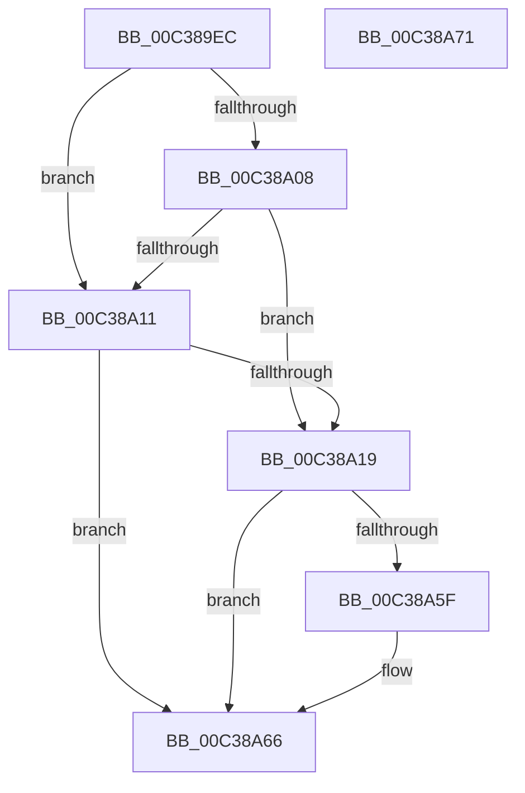

# KiInitSupervisorStateExtensionHost

- RVA: `0x00C389EC`–`0x00C38A72` (길이 `134` bytes)
- VA: `0x0000000140C389EC`
- 실행 섹션: `INIT`
- PDB 이름 있음: `예`; PDB Function 태그: `아니요`
- unwind 정보 RVA: `0x0009EAB4`
- 디코드: `31`개 명령, `134/134` bytes 표시
- 미해석 바이트: `0` (있으면 어셈블리에 `.byte`로 보존)

> 이 문서는 커널 이미지의 기계어와 PDB 기호를 분석해 생성했습니다. 4번과 5번은 함수 원형과 자료형을 바이너리 사용 방식에서 추정한 C 해석이며 원본 소스 복구 결과는 아닙니다.

## 1. Dependencies

- 직접 호출 지점: **1**; 고유 호출 대상: **1**
- 직접 호출자로 확인된 함수: **1**
- RIP 상대 이미지 참조: **6**

### Outgoing calls
- `0x00C38A56` → [ExRegisterHost](../../page/7D/ExRegisterHost_function_007D06CC.md) (function, `0x007D06CC`)

### Direct callers
- [KeInitSystem](../C7/KeInitSystem_function_00C71660.md) at `0x00C718E7`

### Static image references
- `0x00C389FB` → RVA `0x00FC6B30` (`ALMOSTRO`; read)
- `0x00C38A08` → RVA `0x00FC6C60` (`ALMOSTRO`; read)
- `0x00C38A11` → RVA `0x00FC6B94` (`ALMOSTRO`; read)
- `0x00C38A19` → RVA `0x00008048` (`.rdata`; read)
- `0x00C38A3C` → RVA `0x00F225E0` (`.data`; read)
- `0x00C38A5F` → RVA `0x00F225E0` (`.data`; write)

## 2. Other-region calls and transfers

- 다른 실행 섹션으로 향하는 call: **1**
  - `0x00C38A56` → [ExRegisterHost](../../page/7D/ExRegisterHost_function_007D06CC.md) (`INIT` → `PAGE`)
- 별도 외부 분기/꼬리 이동을 확인하지 못했습니다.

## 3. Assembly (complete function range)

```asm
00C389EC  48 89 5C 24 08                  mov qword ptr [rsp + 8], rbx
00C389F1  55                              push rbp
00C389F2  48 8B EC                        mov rbp, rsp
00C389F5  48 83 EC 60                     sub rsp, 0x60
00C389F9  33 DB                           xor ebx, ebx
00C389FB  48 F7 05 2A E1 38 00 00 00 80 00  test qword ptr [rip + 0x38e12a], 0x800000
00C38A06  74 09                           je 0x140c38a11
00C38A08  48 39 1D 51 E2 38 00            cmp qword ptr [rip + 0x38e251], rbx
00C38A0F  75 08                           jne 0x140c38a19
00C38A11  39 1D 7D E1 38 00               cmp dword ptr [rip + 0x38e17d], ebx
00C38A17  76 4D                           jbe 0x140c38a66
00C38A19  48 8D 05 28 F6 3C FF            lea rax, [rip - 0xc309d8]
00C38A20  48 C7 45 D0 0C 00 01 00         mov qword ptr [rbp - 0x30], 0x1000c
00C38A28  48 89 45 C8                     mov qword ptr [rbp - 0x38], rax
00C38A2C  4C 8D 45 D0                     lea r8, [rbp - 0x30]
00C38A30  48 8D 45 C0                     lea rax, [rbp - 0x40]
00C38A34  48 C7 45 E0 00 02 00 00         mov qword ptr [rbp - 0x20], 0x200
00C38A3C  48 8D 0D 9D 9B 2E 00            lea rcx, [rip + 0x2e9b9d]
00C38A43  48 89 45 D8                     mov qword ptr [rbp - 0x28], rax
00C38A47  C7 45 C0 01 00 00 00            mov dword ptr [rbp - 0x40], 1
00C38A4E  48 89 5D E8                     mov qword ptr [rbp - 0x18], rbx
00C38A52  48 89 5D F0                     mov qword ptr [rbp - 0x10], rbx
00C38A56  E8 71 7C B9 FF                  call 0x1407d06cc
00C38A5B  85 C0                           test eax, eax
00C38A5D  79 07                           jns 0x140c38a66
00C38A5F  48 89 1D 7A 9B 2E 00            mov qword ptr [rip + 0x2e9b7a], rbx
00C38A66  48 8B 5C 24 70                  mov rbx, qword ptr [rsp + 0x70]
00C38A6B  48 83 C4 60                     add rsp, 0x60
00C38A6F  5D                              pop rbp
00C38A70  C3                              ret
00C38A71  CC                              int3
```

## 4. C-style interpretation (structured pseudocode)

```c
__int64 __fastcall KiInitSupervisorStateExtensionHost(void)
{
    __int64 result;
    __int64 v_rbx;
    __int64 v_rsp;
    unsigned __int64 v_stack_m18;
    unsigned __int64 v_stack_m20;
    unsigned __int64 v_stack_m28;
    unsigned __int64 v_stack_m30;
    unsigned __int64 v_stack_m38;
    unsigned __int64 v_stack_m40;
    unsigned __int64 v_stack_m48;
    unsigned __int64 v_stack_p8;

    v_stack_p8 = v_rbx;
    v_rsp = (v_rsp) - (96);
    v_rbx = 0;
    if (((*(unsigned __int64 *)(v_rip + 3727658)) & (0x800000ULL)) == 0) goto loc_00C38A11;
    if ((*(unsigned __int64 *)(v_rip + 3727953)) != 0) goto loc_00C38A19;
loc_00C38A11:
    if ((*(unsigned int *)(v_rip + 3727741)) <= 0) goto loc_00C38A66;
loc_00C38A19:
    v_stack_m38 = 0x1000CULL;
    v_stack_m40 = v_rip - 12782040;
    v_stack_m28 = 512;
    v_stack_m30 = v_stack_m48;
    v_stack_m48 = 1;
    v_stack_m20 = 0;
    v_stack_m18 = 0;
    result = ExRegisterHost(v_rip + 3054493, a2, v_stack_m38, a4);
    if (sign_flag) {
        *(unsigned __int64 *)(v_rip + 3054458) = 0;
    }
    v_rsp = (v_rsp) + (96);
    return result;
}
```

## 5. (Beta) C Style

```c
void KiInitSupervisorStateExtensionHost(void)
{
    int64_t result;
    int64_t local_rbx;
    int64_t local_rsp;
    uint64_t v_stack_m18;
    uint64_t v_stack_m20;
    uint64_t v_stack_m28;
    uint64_t v_stack_m30;
    uint64_t v_stack_m38;
    uint64_t v_stack_m40;
    uint64_t v_stack_m48;
    uint64_t v_stack_p8;

    v_stack_p8 = local_rbx;
    local_rsp = (local_rsp) - (96);
    local_rbx = 0;
    if (((*(uint64_t *)(v_rip + 0x38E12A)) & (0x800000ULL)) == 0) goto loc_00C38A11;
    if ((*(uint64_t *)(v_rip + 0x38E251)) != 0) goto loc_00C38A19;
loc_00C38A11:
    if ((*(uint32_t *)(v_rip + 0x38E17D)) <= 0) goto loc_00C38A66;
loc_00C38A19:
    v_stack_m38 = 0x1000CULL;
    v_stack_m40 = v_rip - 12782040;
    v_stack_m28 = 512;
    v_stack_m30 = v_stack_m48;
    v_stack_m48 = 1;
    v_stack_m20 = 0;
    v_stack_m18 = 0;
    result = ExRegisterHost(v_rip + 3054493, a2, v_stack_m38, a4);
    if (sign_flag) {
        *(uint64_t *)(v_rip + 0x2E9B7A) = 0;
    }
    local_rsp = (local_rsp) + (96);
    return result;
}
```

## 6. Execution-region graph

[열기: 2D/3D 그래프와 함수 탐색 컨트롤 패널](../../../control-panel.html?section=init&rva=0x00C389EC&view=graph)

- 2D 그래프는 위에서 아래로 흐르고, 3D 그래프는 빈 공간을 드래그해 회전합니다. Shift+드래그는 이동, 휠은 확대·축소, 함수 노드 선택은 대상 보고서 이동입니다.

### Static fallback


