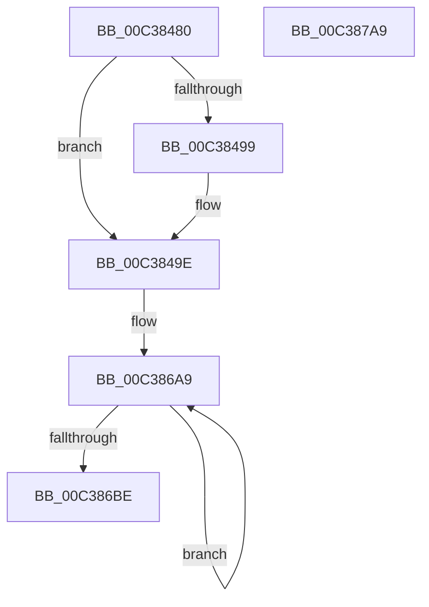

# KiInitSystem

- RVA: `0x00C38480`–`0x00C387AA` (길이 `810` bytes)
- VA: `0x0000000140C38480`
- 실행 섹션: `INIT`
- PDB 이름 있음: `예`; PDB Function 태그: `아니요`
- unwind 정보 RVA: `0x0005CAAC`
- 디코드: `130`개 명령, `810/810` bytes 표시
- 미해석 바이트: `0` (있으면 어셈블리에 `.byte`로 보존)

> 이 문서는 커널 이미지의 기계어와 PDB 기호를 분석해 생성했습니다. 4번과 5번은 함수 원형과 자료형을 바이너리 사용 방식에서 추정한 C 해석이며 원본 소스 복구 결과는 아닙니다.

## 1. Dependencies

- 직접 호출 지점: **3**; 고유 호출 대상: **3**
- 직접 호출자로 확인된 함수: **1**
- RIP 상대 이미지 참조: **100**

### Outgoing calls
- `0x00C38499` → [KiForceSymbolReferences](KiForceSymbolReferences_function_00C381DC.md) (function, `0x00C381DC`)
- `0x00C386BE` → [Feature_Servicing_InlinePreWakeupPriorityBoosting__private_IsEnabledDeviceUsageNoInline](../../text/5C/Feature_Servicing_InlinePreWakeupPriorityBoosting__private_IsEnabledDeviceUsageNoInline_function_005C5128.md) (function, `0x005C5128`)
- `0x00C38799` → [KiInitializeIdleProcess](KiInitializeIdleProcess_function_00C38900.md) (function, `0x00C38900`)

### Direct callers
- [KiInitializeKernel](../../pagelk/B6/KiInitializeKernel_function_00B68D20.md) at `0x00B690CF`

### Static image references
- `0x00C3848A` → RVA `0x00F234F0` (`.data`; read)
- `0x00C3849E` → RVA `0x012018E0` (`CFGRO`; read)
- `0x00C384A5` → RVA `0x00FC54A8` (`ALMOSTRO`; read)
- `0x00C384B6` → RVA `0x00FC54AC` (`ALMOSTRO`; read)
- `0x00C384BD` → RVA `0x012018F0` (`CFGRO`; write)
- `0x00C384C3` → RVA `0x012018F0` (`CFGRO`; read)
- `0x00C384CF` → RVA `0x00FCF040` (`CACHEALI`; read)
- `0x00C384DB` → RVA `0x01200008` (`CFGRO`; read)
- `0x00C384E7` → RVA `0x00F23470` (`.data`; read)
- `0x00C384EE` → RVA `0x00F23478` (`.data`; write)
- `0x00C384F5` → RVA `0x00F23470` (`.data`; write)
- `0x00C384FC` → RVA `0x00F234A0` (`.data`; read)
- `0x00C38503` → RVA `0x00F234A8` (`.data`; write)
- `0x00C3850A` → RVA `0x00F234A0` (`.data`; write)
- `0x00C38511` → RVA `0x00F23480` (`.data`; read)
- `0x00C38518` → RVA `0x00F23488` (`.data`; write)
- `0x00C3851F` → RVA `0x00F23480` (`.data`; write)
- `0x00C38526` → RVA `0x00F23490` (`.data`; read)
- `0x00C3852D` → RVA `0x00F23498` (`.data`; write)
- `0x00C38534` → RVA `0x00F23490` (`.data`; write)
- `0x00C3853B` → RVA `0x00F22D50` (`.data`; read)
- `0x00C38542` → RVA `0x00F22D58` (`.data`; write)
- `0x00C38549` → RVA `0x00F22D50` (`.data`; write)
- `0x00C38550` → RVA `0x00F22D60` (`.data`; read)
- `0x00C38557` → RVA `0x00F22D68` (`.data`; write)
- `0x00C3855E` → RVA `0x00F22D60` (`.data`; write)
- `0x00C38565` → RVA `0x00F22D88` (`.data`; read)
- `0x00C3856C` → RVA `0x00F22D90` (`.data`; write)
- `0x00C38573` → RVA `0x00F22D88` (`.data`; write)
- `0x00C3857A` → RVA `0x000DB720` (`.rdata`; read)
- `0x00C38581` → RVA `0x012018C0` (`CFGRO`; write)
- `0x00C38588` → RVA `0x000DBEC8` (`.rdata`; read)
- `0x00C3858E` → RVA `0x012018C0` (`CFGRO`; read)
- `0x00C38595` → RVA `0x012018D0` (`CFGRO`; write)
- `0x00C3859B` → RVA `0x000DBECC` (`.rdata`; read)
- `0x00C385A2` → RVA `0x012018D8` (`CFGRO`; write)
- `0x00C385A9` → RVA `0x00494F40` (`KiBalanceSetManagerDeferredRoutine`; read)
- `0x00C385B0` → RVA `0x012018D0` (`CFGRO`; read)
- `0x00C385B7` → RVA `0x00F23178` (`.data`; write)
- `0x00C385BE` → RVA `0x00F22E20` (`.data`; read)
- `0x00C385C5` → RVA `0x00F23180` (`.data`; write)
- `0x00C385CC` → RVA `0x00F22E28` (`.data`; read)
- `0x00C385D3` → RVA `0x00F22E30` (`.data`; write)
- `0x00C385DA` → RVA `0x00F22E28` (`.data`; write)
- `0x00C385E1` → RVA `0x00F22E48` (`.data`; read)
- `0x00C385E8` → RVA `0x00F22E50` (`.data`; write)
- `0x00C385EF` → RVA `0x00F22E48` (`.data`; write)
- `0x00C385F6` → RVA `0x00E17100` (`.data`; read)
- `0x00C385FD` → RVA `0x00F231A0` (`.data`; write)
- `0x00C38604` → RVA `0x00F22D80` (`.data`; write)
- `0x00C3860D` → RVA `0x00F22D82` (`.data`; write)
- `0x00C38614` → RVA `0x00F22D84` (`.data`; write)
- `0x00C3861A` → RVA `0x00F22D98` (`.data`; write)
- `0x00C38621` → RVA `0x00F22D40` (`.data`; write)
- `0x00C38628` → RVA `0x00F22D48` (`.data`; write)
- `0x00C3862F` → RVA `0x00FC7280` (`ALMOSTRO`; write)
- `0x00C38636` → RVA `0x00FC7290` (`ALMOSTRO`; write)
- `0x00C3863D` → RVA `0x00FC72A0` (`ALMOSTRO`; write)
- `0x00C38644` → RVA `0x00FC72B0` (`ALMOSTRO`; write)
- `0x00C3864B` → RVA `0x00FC73C0` (`ALMOSTRO`; write)
- `0x00C38652` → RVA `0x00FC73D0` (`ALMOSTRO`; write)
- `0x00C38659` → RVA `0x00FC73E0` (`ALMOSTRO`; write)
- `0x00C38660` → RVA `0x00FC73F0` (`ALMOSTRO`; write)
- `0x00C38667` → RVA `0x00F23160` (`.data`; write)
- `0x00C38671` → RVA `0x00F23198` (`.data`; write)
- `0x00C38678` → RVA `0x00F23170` (`.data`; write)
- `0x00C3867F` → RVA `0x00F22E20` (`.data`; write)
- `0x00C38688` → RVA `0x00F22E22` (`.data`; write)
- `0x00C3868F` → RVA `0x00F22E24` (`.data`; write)
- `0x00C38695` → RVA `0x00F22E40` (`.data`; write)
- `0x00C3869C` → RVA `0x00F22E42` (`.data`; write)
- `0x00C386A3` → RVA `0x00F22E44` (`.data`; write)
- `0x00C386C5` → RVA `0x00F22B80` (`.data`; write)
- `0x00C386CF` → RVA `0x00F22BA0` (`.data`; read)
- `0x00C386D6` → RVA `0x00F22B88` (`.data`; write)
- `0x00C386DD` → RVA `0x00F22BA8` (`.data`; write)
- `0x00C386E6` → RVA `0x00F22BA0` (`.data`; write)
- `0x00C386F0` → RVA `0x00F22DC0` (`.data`; read)
- `0x00C386F7` → RVA `0x00F10D60` (`.data`; write)
- `0x00C386FD` → RVA `0x00F22DC8` (`.data`; write)
- `0x00C38707` → RVA `0x00F22DC0` (`.data`; write)
- `0x00C3870E` → RVA `0x005C4690` (`KiSetVirtualHeteroClockIntervalRequestDpcRoutine`; read)
- `0x00C38715` → RVA `0x00F22DF8` (`.data`; write)
- `0x00C3871C` → RVA `0x00F22FC0` (`.data`; read)
- `0x00C38723` → RVA `0x00F22FC8` (`.data`; write)
- `0x00C3872A` → RVA `0x00F22FC0` (`.data`; write)
- `0x00C38731` → RVA `0x00F22B90` (`.data`; write)
- `0x00C38737` → RVA `0x00F22B98` (`.data`; write)
- `0x00C38740` → RVA `0x00F22B9A` (`.data`; write)
- `0x00C38747` → RVA `0x00F22B9C` (`.data`; write)
- `0x00C3874D` → RVA `0x00F22DA0` (`.data`; write)
- `0x00C38757` → RVA `0x00F22DA8` (`.data`; write)
- `0x00C3875E` → RVA `0x00F22DB0` (`.data`; write)
- `0x00C38764` → RVA `0x00F22DB8` (`.data`; write)
- `0x00C3876D` → RVA `0x00F22DBA` (`.data`; write)
- `0x00C38774` → RVA `0x00F22DBC` (`.data`; write)
- `0x00C3877A` → RVA `0x00F22DE0` (`.data`; write)
- `0x00C38784` → RVA `0x00F22E00` (`.data`; write)
- `0x00C3878B` → RVA `0x00F22E18` (`.data`; write)
- `0x00C38792` → RVA `0x00F22DF0` (`.data`; write)

## 2. Other-region calls and transfers

- 다른 실행 섹션으로 향하는 call: **1**
  - `0x00C386BE` → [Feature_Servicing_InlinePreWakeupPriorityBoosting__private_IsEnabledDeviceUsageNoInline](../../text/5C/Feature_Servicing_InlinePreWakeupPriorityBoosting__private_IsEnabledDeviceUsageNoInline_function_005C5128.md) (`INIT` → `.text`)
- 별도 외부 분기/꼬리 이동을 확인하지 못했습니다.

## 3. Assembly (complete function range)

```asm
00C38480  48 89 5C 24 08                  mov qword ptr [rsp + 8], rbx
00C38485  57                              push rdi
00C38486  48 83 EC 20                     sub rsp, 0x20
00C3848A  8B 05 60 B0 2E 00               mov eax, dword ptr [rip + 0x2eb060]
00C38490  33 FF                           xor edi, edi
00C38492  48 8B D9                        mov rbx, rcx
00C38495  85 C0                           test eax, eax
00C38497  74 05                           je 0x140c3849e
00C38499  E8 3E FD FF FF                  call 0x140c381dc
00C3849E  0F 28 0D 3B 94 5C 00            movaps xmm1, xmmword ptr [rip + 0x5c943b]
00C384A5  48 8D 05 FC CF 38 00            lea rax, [rip + 0x38cffc]
00C384AC  48 89 44 24 38                  mov qword ptr [rsp + 0x38], rax
00C384B1  B9 00 04 00 00                  mov ecx, 0x400
00C384B6  48 8D 05 EF CF 38 00            lea rax, [rip + 0x38cfef]
00C384BD  89 3D 2D 94 5C 00               mov dword ptr [rip + 0x5c942d], edi
00C384C3  0F 28 05 26 94 5C 00            movaps xmm0, xmmword ptr [rip + 0x5c9426]
00C384CA  48 89 44 24 38                  mov qword ptr [rsp + 0x38], rax
00C384CF  48 8D 05 6A 6B 39 00            lea rax, [rip + 0x396b6a]
00C384D6  48 89 44 24 38                  mov qword ptr [rsp + 0x38], rax
00C384DB  48 8D 05 26 7B 5C 00            lea rax, [rip + 0x5c7b26]
00C384E2  48 89 44 24 38                  mov qword ptr [rsp + 0x38], rax
00C384E7  48 8D 05 82 AF 2E 00            lea rax, [rip + 0x2eaf82]
00C384EE  48 89 05 83 AF 2E 00            mov qword ptr [rip + 0x2eaf83], rax
00C384F5  48 89 05 74 AF 2E 00            mov qword ptr [rip + 0x2eaf74], rax
00C384FC  48 8D 05 9D AF 2E 00            lea rax, [rip + 0x2eaf9d]
00C38503  48 89 05 9E AF 2E 00            mov qword ptr [rip + 0x2eaf9e], rax
00C3850A  48 89 05 8F AF 2E 00            mov qword ptr [rip + 0x2eaf8f], rax
00C38511  48 8D 05 68 AF 2E 00            lea rax, [rip + 0x2eaf68]
00C38518  48 89 05 69 AF 2E 00            mov qword ptr [rip + 0x2eaf69], rax
00C3851F  48 89 05 5A AF 2E 00            mov qword ptr [rip + 0x2eaf5a], rax
00C38526  48 8D 05 63 AF 2E 00            lea rax, [rip + 0x2eaf63]
00C3852D  48 89 05 64 AF 2E 00            mov qword ptr [rip + 0x2eaf64], rax
00C38534  48 89 05 55 AF 2E 00            mov qword ptr [rip + 0x2eaf55], rax
00C3853B  48 8D 05 0E A8 2E 00            lea rax, [rip + 0x2ea80e]
00C38542  48 89 05 0F A8 2E 00            mov qword ptr [rip + 0x2ea80f], rax
00C38549  48 89 05 00 A8 2E 00            mov qword ptr [rip + 0x2ea800], rax
00C38550  48 8D 05 09 A8 2E 00            lea rax, [rip + 0x2ea809]
00C38557  48 89 05 0A A8 2E 00            mov qword ptr [rip + 0x2ea80a], rax
00C3855E  48 89 05 FB A7 2E 00            mov qword ptr [rip + 0x2ea7fb], rax
00C38565  48 8D 05 1C A8 2E 00            lea rax, [rip + 0x2ea81c]
00C3856C  48 89 05 1D A8 2E 00            mov qword ptr [rip + 0x2ea81d], rax
00C38573  48 89 05 0E A8 2E 00            mov qword ptr [rip + 0x2ea80e], rax
00C3857A  48 8D 05 9F 31 4A FF            lea rax, [rip - 0xb5ce61]
00C38581  48 89 05 38 93 5C 00            mov qword ptr [rip + 0x5c9338], rax
00C38588  8B 05 3A 39 4A FF               mov eax, dword ptr [rip - 0xb5c6c6]
00C3858E  0F 28 1D 2B 93 5C 00            movaps xmm3, xmmword ptr [rip + 0x5c932b]
00C38595  89 05 35 93 5C 00               mov dword ptr [rip + 0x5c9335], eax
00C3859B  48 8D 05 2A 39 4A FF            lea rax, [rip - 0xb5c6d6]
00C385A2  48 89 05 2F 93 5C 00            mov qword ptr [rip + 0x5c932f], rax
00C385A9  48 8D 05 90 C9 85 FF            lea rax, [rip - 0x7a3670]
00C385B0  0F 28 15 19 93 5C 00            movaps xmm2, xmmword ptr [rip + 0x5c9319]
00C385B7  48 89 05 BA AB 2E 00            mov qword ptr [rip + 0x2eabba], rax
00C385BE  48 8D 05 5B A8 2E 00            lea rax, [rip + 0x2ea85b]
00C385C5  48 89 05 B4 AB 2E 00            mov qword ptr [rip + 0x2eabb4], rax
00C385CC  48 8D 05 55 A8 2E 00            lea rax, [rip + 0x2ea855]
00C385D3  48 89 05 56 A8 2E 00            mov qword ptr [rip + 0x2ea856], rax
00C385DA  48 89 05 47 A8 2E 00            mov qword ptr [rip + 0x2ea847], rax
00C385E1  48 8D 05 60 A8 2E 00            lea rax, [rip + 0x2ea860]
00C385E8  48 89 05 61 A8 2E 00            mov qword ptr [rip + 0x2ea861], rax
00C385EF  48 89 05 52 A8 2E 00            mov qword ptr [rip + 0x2ea852], rax
00C385F6  48 8D 05 03 EB 1D 00            lea rax, [rip + 0x1deb03]
00C385FD  48 89 3D 9C AB 2E 00            mov qword ptr [rip + 0x2eab9c], rdi
00C38604  66 C7 05 73 A7 2E 00 01 00      mov word ptr [rip + 0x2ea773], 1
00C3860D  C6 05 6E A7 2E 00 06            mov byte ptr [rip + 0x2ea76e], 6
00C38614  89 3D 6A A7 2E 00               mov dword ptr [rip + 0x2ea76a], edi
00C3861A  48 89 3D 77 A7 2E 00            mov qword ptr [rip + 0x2ea777], rdi
00C38621  48 89 3D 18 A7 2E 00            mov qword ptr [rip + 0x2ea718], rdi
00C38628  48 89 3D 19 A7 2E 00            mov qword ptr [rip + 0x2ea719], rdi
00C3862F  0F 29 1D 4A EC 38 00            movaps xmmword ptr [rip + 0x38ec4a], xmm3
00C38636  0F 29 15 53 EC 38 00            movaps xmmword ptr [rip + 0x38ec53], xmm2
00C3863D  0F 29 0D 5C EC 38 00            movaps xmmword ptr [rip + 0x38ec5c], xmm1
00C38644  0F 29 05 65 EC 38 00            movaps xmmword ptr [rip + 0x38ec65], xmm0
00C3864B  0F 29 1D 6E ED 38 00            movaps xmmword ptr [rip + 0x38ed6e], xmm3
00C38652  0F 29 15 77 ED 38 00            movaps xmmword ptr [rip + 0x38ed77], xmm2
00C38659  0F 29 0D 80 ED 38 00            movaps xmmword ptr [rip + 0x38ed80], xmm1
00C38660  0F 29 05 89 ED 38 00            movaps xmmword ptr [rip + 0x38ed89], xmm0
00C38667  C7 05 EF AA 2E 00 13 01 00 00   mov dword ptr [rip + 0x2eaaef], 0x113
00C38671  48 89 3D 20 AB 2E 00            mov qword ptr [rip + 0x2eab20], rdi
00C38678  48 89 3D F1 AA 2E 00            mov qword ptr [rip + 0x2eaaf1], rdi
00C3867F  66 C7 05 98 A7 2E 00 01 00      mov word ptr [rip + 0x2ea798], 1
00C38688  C6 05 93 A7 2E 00 06            mov byte ptr [rip + 0x2ea793], 6
00C3868F  89 3D 8F A7 2E 00               mov dword ptr [rip + 0x2ea78f], edi
00C38695  66 89 3D A4 A7 2E 00            mov word ptr [rip + 0x2ea7a4], di
00C3869C  C6 05 9F A7 2E 00 06            mov byte ptr [rip + 0x2ea79f], 6
00C386A3  89 3D 9B A7 2E 00               mov dword ptr [rip + 0x2ea79b], edi
00C386A9  48 89 38                        mov qword ptr [rax], rdi
00C386AC  48 89 78 08                     mov qword ptr [rax + 8], rdi
00C386B0  48 89 78 10                     mov qword ptr [rax + 0x10], rdi
00C386B4  48 8D 40 40                     lea rax, [rax + 0x40]
00C386B8  48 83 E9 01                     sub rcx, 1
00C386BC  75 EB                           jne 0x140c386a9
00C386BE  E8 65 CA 98 FF                  call 0x1405c5128
00C386C3  85 C0                           test eax, eax
00C386C5  C7 05 B1 A4 2E 00 01 00 00 00   mov dword ptr [rip + 0x2ea4b1], 1
00C386CF  48 8D 05 CA A4 2E 00            lea rax, [rip + 0x2ea4ca]
00C386D6  48 89 3D AB A4 2E 00            mov qword ptr [rip + 0x2ea4ab], rdi
00C386DD  48 89 05 C4 A4 2E 00            mov qword ptr [rip + 0x2ea4c4], rax
00C386E4  8B CF                           mov ecx, edi
00C386E6  48 89 05 B3 A4 2E 00            mov qword ptr [rip + 0x2ea4b3], rax
00C386ED  0F 95 C1                        setne cl
00C386F0  48 8D 05 C9 A6 2E 00            lea rax, [rip + 0x2ea6c9]
00C386F7  89 0D 63 86 2D 00               mov dword ptr [rip + 0x2d8663], ecx
00C386FD  48 89 05 C4 A6 2E 00            mov qword ptr [rip + 0x2ea6c4], rax
00C38704  48 8B CB                        mov rcx, rbx
00C38707  48 89 05 B2 A6 2E 00            mov qword ptr [rip + 0x2ea6b2], rax
00C3870E  48 8D 05 7B BF 98 FF            lea rax, [rip - 0x674085]
00C38715  48 89 05 DC A6 2E 00            mov qword ptr [rip + 0x2ea6dc], rax
00C3871C  48 8D 05 9D A8 2E 00            lea rax, [rip + 0x2ea89d]
00C38723  48 89 05 9E A8 2E 00            mov qword ptr [rip + 0x2ea89e], rax
00C3872A  48 89 05 8F A8 2E 00            mov qword ptr [rip + 0x2ea88f], rax
00C38731  89 3D 59 A4 2E 00               mov dword ptr [rip + 0x2ea459], edi
00C38737  66 C7 05 58 A4 2E 00 01 00      mov word ptr [rip + 0x2ea458], 1
00C38740  C6 05 53 A4 2E 00 06            mov byte ptr [rip + 0x2ea453], 6
00C38747  89 3D 4F A4 2E 00               mov dword ptr [rip + 0x2ea44f], edi
00C3874D  C7 05 49 A6 2E 00 01 00 00 00   mov dword ptr [rip + 0x2ea649], 1
00C38757  48 89 3D 4A A6 2E 00            mov qword ptr [rip + 0x2ea64a], rdi
00C3875E  89 3D 4C A6 2E 00               mov dword ptr [rip + 0x2ea64c], edi
00C38764  66 C7 05 4B A6 2E 00 01 00      mov word ptr [rip + 0x2ea64b], 1
00C3876D  C6 05 46 A6 2E 00 06            mov byte ptr [rip + 0x2ea646], 6
00C38774  89 3D 42 A6 2E 00               mov dword ptr [rip + 0x2ea642], edi
00C3877A  C7 05 5C A6 2E 00 13 02 00 00   mov dword ptr [rip + 0x2ea65c], 0x213
00C38784  48 89 3D 75 A6 2E 00            mov qword ptr [rip + 0x2ea675], rdi
00C3878B  48 89 3D 86 A6 2E 00            mov qword ptr [rip + 0x2ea686], rdi
00C38792  48 89 3D 57 A6 2E 00            mov qword ptr [rip + 0x2ea657], rdi
00C38799  E8 62 01 00 00                  call 0x140c38900
00C3879E  48 8B 5C 24 30                  mov rbx, qword ptr [rsp + 0x30]
00C387A3  48 83 C4 20                     add rsp, 0x20
00C387A7  5F                              pop rdi
00C387A8  C3                              ret
00C387A9  CC                              int3
```

## 4. C-style interpretation (structured pseudocode)

```c
__int64 __fastcall KiInitSystem(__int64 a1)
{
    __int64 result;
    __int64 v_rdi;
    __int64 v_rsp;
    unsigned __int64 v_stack_p10;
    unsigned __int64 v_stack_p8;

    v_stack_p8 = v_rbx;
    v_rsp = (v_rsp) - (32);
    v_rdi = 0;
    result = (unsigned int)(*(unsigned int *)(v_rip + 3059808));
    if ((unsigned int)((unsigned int)(*(unsigned int *)(v_rip + 3059808))) != 0) {
        result = KiForceSymbolReferences(a1, a2, a3, a4);
    }
    v_stack_p10 = v_rip + 3723260;
    *(unsigned int *)(v_rip + 6067245) = 0;
    v_stack_p10 = v_rip + 3723247;
    v_stack_p10 = v_rip + 3763050;
    v_stack_p10 = v_rip + 6060838;
    *(unsigned __int64 *)(v_rip + 3059587) = v_rip + 3059586;
    *(unsigned __int64 *)(v_rip + 3059572) = v_rip + 3059586;
    *(unsigned __int64 *)(v_rip + 3059614) = v_rip + 3059613;
    *(unsigned __int64 *)(v_rip + 3059599) = v_rip + 3059613;
    *(unsigned __int64 *)(v_rip + 3059561) = v_rip + 3059560;
    *(unsigned __int64 *)(v_rip + 3059546) = v_rip + 3059560;
    *(unsigned __int64 *)(v_rip + 3059556) = v_rip + 3059555;
    *(unsigned __int64 *)(v_rip + 3059541) = v_rip + 3059555;
    *(unsigned __int64 *)(v_rip + 3057679) = v_rip + 3057678;
    *(unsigned __int64 *)(v_rip + 3057664) = v_rip + 3057678;
    *(unsigned __int64 *)(v_rip + 3057674) = v_rip + 3057673;
    *(unsigned __int64 *)(v_rip + 3057659) = v_rip + 3057673;
    *(unsigned __int64 *)(v_rip + 3057693) = v_rip + 3057692;
    *(unsigned __int64 *)(v_rip + 3057678) = v_rip + 3057692;
    *(unsigned __int64 *)(v_rip + 6067000) = v_rip - 11914849;
    *(unsigned int *)(v_rip + 6066997) = (unsigned int)((unsigned int)(*(unsigned int *)(v_rip - 11912902)));
    *(unsigned __int64 *)(v_rip + 6066991) = v_rip - 11912918;
    *(unsigned __int64 *)(v_rip + 3058618) = v_rip - 8009328;
    *(unsigned __int64 *)(v_rip + 3058612) = v_rip + 3057755;
    *(unsigned __int64 *)(v_rip + 3057750) = v_rip + 3057749;
    *(unsigned __int64 *)(v_rip + 3057735) = v_rip + 3057749;
    *(unsigned __int64 *)(v_rip + 3057761) = v_rip + 3057760;
    *(unsigned __int64 *)(v_rip + 3057746) = v_rip + 3057760;
    *(unsigned __int64 *)(v_rip + 3058588) = 0;
    *(unsigned __int16 *)(v_rip + 3057523) = 1;
    *(unsigned __int8 *)(v_rip + 3057518) = 6;
    *(unsigned int *)(v_rip + 3057514) = 0;
    *(unsigned __int64 *)(v_rip + 3057527) = 0;
    *(unsigned __int64 *)(v_rip + 3057432) = 0;
    *(unsigned __int64 *)(v_rip + 3057433) = 0;
    *(unsigned __int64 *)(v_rip + 3730506) = v_xmm3;
    *(unsigned __int64 *)(v_rip + 3730515) = v_xmm2;
    *(unsigned __int64 *)(v_rip + 3730524) = v_xmm1;
    *(unsigned __int64 *)(v_rip + 3730533) = v_xmm0;
    *(unsigned __int64 *)(v_rip + 3730798) = v_xmm3;
    *(unsigned __int64 *)(v_rip + 3730807) = v_xmm2;
    *(unsigned __int64 *)(v_rip + 3730816) = v_xmm1;
    *(unsigned __int64 *)(v_rip + 3730825) = v_xmm0;
    *(unsigned int *)(v_rip + 3058415) = 275;
    *(unsigned __int64 *)(v_rip + 3058464) = 0;
    *(unsigned __int64 *)(v_rip + 3058417) = 0;
    *(unsigned __int16 *)(v_rip + 3057560) = 1;
    *(unsigned __int8 *)(v_rip + 3057555) = 6;
    *(unsigned int *)(v_rip + 3057551) = 0;
    *(unsigned __int16 *)(v_rip + 3057572) = 0;
    *(unsigned __int8 *)(v_rip + 3057567) = 6;
    *(unsigned int *)(v_rip + 3057563) = 0;
loc_00C386A9:
    *(unsigned __int64 *)(v_rip + 1960707) = 0;
    *(unsigned __int64 *)(v_rip + 1960707 + 8) = 0;
    *(unsigned __int64 *)(v_rip + 1960707 + 16) = 0;
    a1 = ((unsigned int)(0x400ULL)) - (1);
    if (condition_is_not_equal) goto loc_00C386A9;
    result = Feature_Servicing_InlinePreWakeupPriorityBoosting__private_IsEnabledDeviceUsageNoInline(a1, a2, a3, a4);
    *(unsigned int *)(v_rip + 3056817) = 1;
    *(unsigned __int64 *)(v_rip + 3056811) = 0;
    *(unsigned __int64 *)(v_rip + 3056836) = v_rip + 3056842;
    *(unsigned __int64 *)(v_rip + 3056819) = v_rip + 3056842;
    a1 = ((unsigned int)(result) != 0) ? 1 : 0;
    *(unsigned int *)(v_rip + 2983523) = (unsigned int)(a1);
    *(unsigned __int64 *)(v_rip + 3057348) = v_rip + 3057353;
    *(unsigned __int64 *)(v_rip + 3057330) = v_rip + 3057353;
    *(unsigned __int64 *)(v_rip + 3057372) = v_rip - 6766725;
    *(unsigned __int64 *)(v_rip + 3057822) = v_rip + 3057821;
    *(unsigned __int64 *)(v_rip + 3057807) = v_rip + 3057821;
    *(unsigned int *)(v_rip + 3056729) = 0;
    *(unsigned __int16 *)(v_rip + 3056728) = 1;
    *(unsigned __int8 *)(v_rip + 3056723) = 6;
    *(unsigned int *)(v_rip + 3056719) = 0;
    *(unsigned int *)(v_rip + 3057225) = 1;
    *(unsigned __int64 *)(v_rip + 3057226) = 0;
    *(unsigned int *)(v_rip + 3057228) = 0;
    *(unsigned __int16 *)(v_rip + 3057227) = 1;
    *(unsigned __int8 *)(v_rip + 3057222) = 6;
    *(unsigned int *)(v_rip + 3057218) = 0;
    *(unsigned int *)(v_rip + 3057244) = 531;
    *(unsigned __int64 *)(v_rip + 3057269) = 0;
    *(unsigned __int64 *)(v_rip + 3057286) = 0;
    *(unsigned __int64 *)(v_rip + 3057239) = 0;
    result = KiInitializeIdleProcess(a1, a2, a3, a4);
    v_rsp = (v_rsp) + (32);
    return result;
}
```

## 5. (Beta) C Style

```c
int64_t KiInitSystem(int64_t Arg1)
{
    int64_t result;
    int64_t local_rdi;
    int64_t local_rsp;
    uint64_t v_stack_p10;
    uint64_t v_stack_p8;

    v_stack_p8 = local_rbx;
    local_rsp = (local_rsp) - (32);
    local_rdi = 0;
    result = (uint32_t)(*(uint32_t *)(v_rip + 0x2EB060));
    if ((uint32_t)((uint32_t)(*(uint32_t *)(v_rip + 0x2EB060))) != 0) {
        result = KiForceSymbolReferences(Arg1, a2, a3, a4);
    }
    v_stack_p10 = v_rip + 3723260;
    *(uint32_t *)(v_rip + 0x5C942D) = 0;
    v_stack_p10 = v_rip + 3723247;
    v_stack_p10 = v_rip + 3763050;
    v_stack_p10 = v_rip + 6060838;
    *(uint64_t *)(v_rip + 0x2EAF83) = v_rip + 3059586;
    *(uint64_t *)(v_rip + 0x2EAF74) = v_rip + 3059586;
    *(uint64_t *)(v_rip + 0x2EAF9E) = v_rip + 3059613;
    *(uint64_t *)(v_rip + 0x2EAF8F) = v_rip + 3059613;
    *(uint64_t *)(v_rip + 0x2EAF69) = v_rip + 3059560;
    *(uint64_t *)(v_rip + 0x2EAF5A) = v_rip + 3059560;
    *(uint64_t *)(v_rip + 0x2EAF64) = v_rip + 3059555;
    *(uint64_t *)(v_rip + 0x2EAF55) = v_rip + 3059555;
    *(uint64_t *)(v_rip + 0x2EA80F) = v_rip + 3057678;
    *(uint64_t *)(v_rip + 0x2EA800) = v_rip + 3057678;
    *(uint64_t *)(v_rip + 0x2EA80A) = v_rip + 3057673;
    *(uint64_t *)(v_rip + 0x2EA7FB) = v_rip + 3057673;
    *(uint64_t *)(v_rip + 0x2EA81D) = v_rip + 3057692;
    *(uint64_t *)(v_rip + 0x2EA80E) = v_rip + 3057692;
    *(uint64_t *)(v_rip + 0x5C9338) = v_rip - 11914849;
    *(uint32_t *)(v_rip + 0x5C9335) = (uint32_t)((uint32_t)(*(uint32_t *)(v_rip - 0xB5C6C6)));
    *(uint64_t *)(v_rip + 0x5C932F) = v_rip - 11912918;
    *(uint64_t *)(v_rip + 0x2EABBA) = v_rip - 8009328;
    *(uint64_t *)(v_rip + 0x2EABB4) = v_rip + 3057755;
    *(uint64_t *)(v_rip + 0x2EA856) = v_rip + 3057749;
    *(uint64_t *)(v_rip + 0x2EA847) = v_rip + 3057749;
    *(uint64_t *)(v_rip + 0x2EA861) = v_rip + 3057760;
    *(uint64_t *)(v_rip + 0x2EA852) = v_rip + 3057760;
    *(uint64_t *)(v_rip + 0x2EAB9C) = 0;
    *(uint16_t *)(v_rip + 0x2EA773) = 1;
    *(uint8_t *)(v_rip + 0x2EA76E) = 6;
    *(uint32_t *)(v_rip + 0x2EA76A) = 0;
    *(uint64_t *)(v_rip + 0x2EA777) = 0;
    *(uint64_t *)(v_rip + 0x2EA718) = 0;
    *(uint64_t *)(v_rip + 0x2EA719) = 0;
    *(uint64_t *)(v_rip + 0x38EC4A) = v_xmm3;
    *(uint64_t *)(v_rip + 0x38EC53) = v_xmm2;
    *(uint64_t *)(v_rip + 0x38EC5C) = v_xmm1;
    *(uint64_t *)(v_rip + 0x38EC65) = v_xmm0;
    *(uint64_t *)(v_rip + 0x38ED6E) = v_xmm3;
    *(uint64_t *)(v_rip + 0x38ED77) = v_xmm2;
    *(uint64_t *)(v_rip + 0x38ED80) = v_xmm1;
    *(uint64_t *)(v_rip + 0x38ED89) = v_xmm0;
    *(uint32_t *)(v_rip + 0x2EAAEF) = 275;
    *(uint64_t *)(v_rip + 0x2EAB20) = 0;
    *(uint64_t *)(v_rip + 0x2EAAF1) = 0;
    *(uint16_t *)(v_rip + 0x2EA798) = 1;
    *(uint8_t *)(v_rip + 0x2EA793) = 6;
    *(uint32_t *)(v_rip + 0x2EA78F) = 0;
    *(uint16_t *)(v_rip + 0x2EA7A4) = 0;
    *(uint8_t *)(v_rip + 0x2EA79F) = 6;
    *(uint32_t *)(v_rip + 0x2EA79B) = 0;
loc_00C386A9:
    *(uint64_t *)(v_rip + 0x1DEB03) = 0;
    *(uint64_t *)(v_rip + 0x1DEB03 + 0x8) = 0;
    *(uint64_t *)(v_rip + 0x1DEB03 + 0x10) = 0;
    Arg1 = ((uint32_t)(0x400ULL)) - (1);
    if (condition_is_not_equal) goto loc_00C386A9;
    result = Feature_Servicing_InlinePreWakeupPriorityBoosting__private_IsEnabledDeviceUsageNoInline(Arg1, a2, a3, a4);
    *(uint32_t *)(v_rip + 0x2EA4B1) = 1;
    *(uint64_t *)(v_rip + 0x2EA4AB) = 0;
    *(uint64_t *)(v_rip + 0x2EA4C4) = v_rip + 3056842;
    *(uint64_t *)(v_rip + 0x2EA4B3) = v_rip + 3056842;
    Arg1 = ((uint32_t)(result) != 0) ? 1 : 0;
    *(uint32_t *)(v_rip + 0x2D8663) = (uint32_t)(Arg1);
    *(uint64_t *)(v_rip + 0x2EA6C4) = v_rip + 3057353;
    *(uint64_t *)(v_rip + 0x2EA6B2) = v_rip + 3057353;
    *(uint64_t *)(v_rip + 0x2EA6DC) = v_rip - 6766725;
    *(uint64_t *)(v_rip + 0x2EA89E) = v_rip + 3057821;
    *(uint64_t *)(v_rip + 0x2EA88F) = v_rip + 3057821;
    *(uint32_t *)(v_rip + 0x2EA459) = 0;
    *(uint16_t *)(v_rip + 0x2EA458) = 1;
    *(uint8_t *)(v_rip + 0x2EA453) = 6;
    *(uint32_t *)(v_rip + 0x2EA44F) = 0;
    *(uint32_t *)(v_rip + 0x2EA649) = 1;
    *(uint64_t *)(v_rip + 0x2EA64A) = 0;
    *(uint32_t *)(v_rip + 0x2EA64C) = 0;
    *(uint16_t *)(v_rip + 0x2EA64B) = 1;
    *(uint8_t *)(v_rip + 0x2EA646) = 6;
    *(uint32_t *)(v_rip + 0x2EA642) = 0;
    *(uint32_t *)(v_rip + 0x2EA65C) = 531;
    *(uint64_t *)(v_rip + 0x2EA675) = 0;
    *(uint64_t *)(v_rip + 0x2EA686) = 0;
    *(uint64_t *)(v_rip + 0x2EA657) = 0;
    result = KiInitializeIdleProcess(Arg1, a2, a3, a4);
    local_rsp = (local_rsp) + (32);
    return result;
}
```

## 6. Execution-region graph

[열기: 2D/3D 그래프와 함수 탐색 컨트롤 패널](../../../control-panel.html?section=init&rva=0x00C38480&view=graph)

- 2D 그래프는 위에서 아래로 흐르고, 3D 그래프는 빈 공간을 드래그해 회전합니다. Shift+드래그는 이동, 휠은 확대·축소, 함수 노드 선택은 대상 보고서 이동입니다.

### Static fallback


