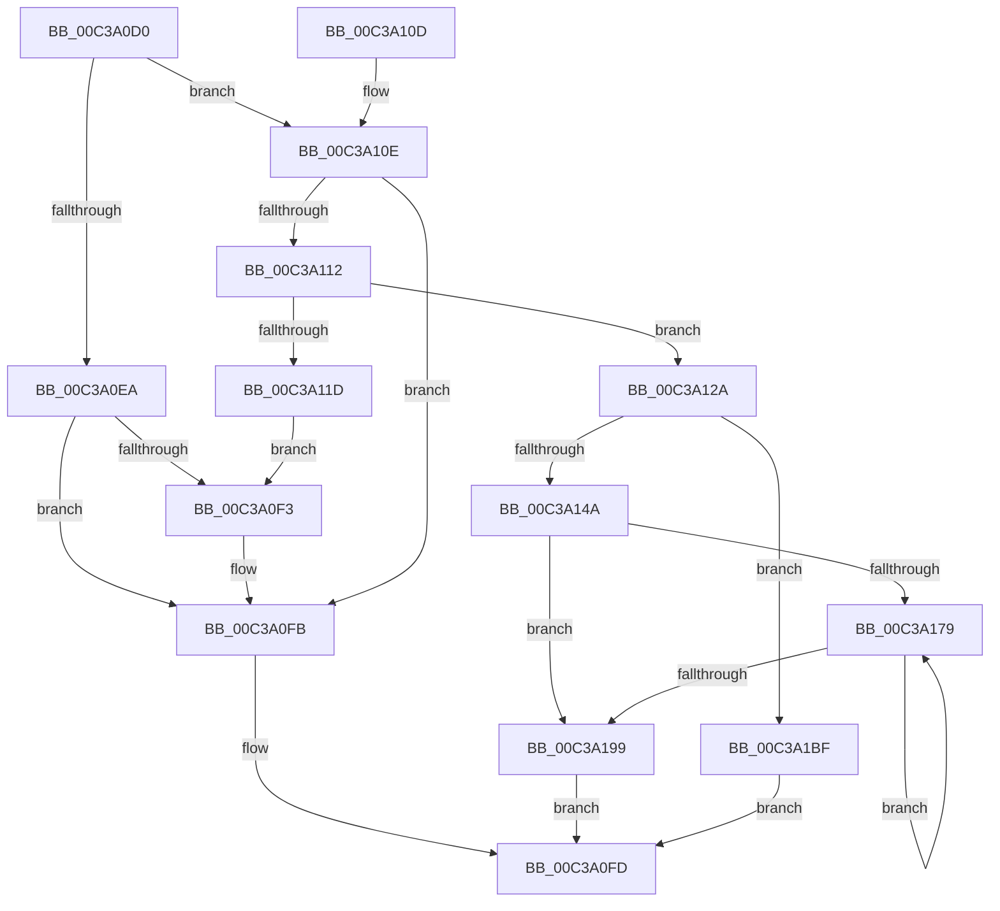

# KiInitializeCacheErrataSupport

- RVA: `0x00C3A0D0`–`0x00C3A1C4` (길이 `244` bytes)
- VA: `0x0000000140C3A0D0`
- 실행 섹션: `INIT`
- PDB 이름 있음: `예`; PDB Function 태그: `아니요`
- unwind 정보 RVA: `0x000CAA2C`
- 디코드: `68`개 명령, `244/244` bytes 표시
- 미해석 바이트: `0` (있으면 어셈블리에 `.byte`로 보존)

> 이 문서는 커널 이미지의 기계어와 PDB 기호를 분석해 생성했습니다. 4번과 5번은 함수 원형과 자료형을 바이너리 사용 방식에서 추정한 C 해석이며 원본 소스 복구 결과는 아닙니다.

## 1. Dependencies

- 직접 호출 지점: **6**; 고유 호출 대상: **5**
- 직접 호출자로 확인된 함수: **1**
- RIP 상대 이미지 참조: **5**

### Outgoing calls
- `0x00C3A0EA` → [KiDisableCacheErrataSource](../../text/5C/KiDisableCacheErrataSource_function_005C4DC8.md) (function, `0x005C4DC8`)
- `0x00C3A123` → [KiDisableCacheErrataSource](../../text/5C/KiDisableCacheErrataSource_function_005C4DC8.md) (function, `0x005C4DC8`)
- `0x00C3A13D` → [ExAllocatePool2](../../poolcode/B8/ExAllocatePool2_function_00B820F0.md) (function, `0x00B820F0`)
- `0x00C3A166` → [KeInitializeProfileCallback](../../page/6F/KeInitializeProfileCallback_function_006FF624.md) (function, `0x006FF624`)
- `0x00C3A1A7` → [KeSetIntervalProfile](../../page/AD/KeSetIntervalProfile_function_00ADB5A8.md) (function, `0x00ADB5A8`)
- `0x00C3A1B0` → [KeStartProfile](../../text/4E/KeStartProfile_function_004E1120.md) (function, `0x004E1120`)

### Direct callers
- [KiInitMachineDependent](../../text/5C/KiInitMachineDependent_function_005C1880.md) at `0x005C1946`

### Static image references
- `0x00C3A0DF` → RVA `0x00FC6C70` (`ALMOSTRO`; read)
- `0x00C3A0F3` → RVA `0x00FC6D28` (`ALMOSTRO`; read/write)
- `0x00C3A112` → RVA `0x00FC6A80` (`ALMOSTRO`; read)
- `0x00C3A11D` → RVA `0x00FC6C70` (`ALMOSTRO`; write)
- `0x00C3A15D` → RVA `0x005C4E90` (`KiMonitorCacheErrata`; read)

## 2. Other-region calls and transfers

- 다른 실행 섹션으로 향하는 call: **6**
  - `0x00C3A0EA` → [KiDisableCacheErrataSource](../../text/5C/KiDisableCacheErrataSource_function_005C4DC8.md) (`INIT` → `.text`)
  - `0x00C3A123` → [KiDisableCacheErrataSource](../../text/5C/KiDisableCacheErrataSource_function_005C4DC8.md) (`INIT` → `.text`)
  - `0x00C3A13D` → [ExAllocatePool2](../../poolcode/B8/ExAllocatePool2_function_00B820F0.md) (`INIT` → `POOLCODE`)
  - `0x00C3A166` → [KeInitializeProfileCallback](../../page/6F/KeInitializeProfileCallback_function_006FF624.md) (`INIT` → `PAGE`)
  - `0x00C3A1A7` → [KeSetIntervalProfile](../../page/AD/KeSetIntervalProfile_function_00ADB5A8.md) (`INIT` → `PAGE`)
  - `0x00C3A1B0` → [KeStartProfile](../../text/4E/KeStartProfile_function_004E1120.md) (`INIT` → `.text`)
- 별도 외부 분기/꼬리 이동을 확인하지 못했습니다.

## 3. Assembly (complete function range)

```asm
00C3A0D0  48 89 5C 24 08                  mov qword ptr [rsp + 8], rbx
00C3A0D5  48 89 74 24 10                  mov qword ptr [rsp + 0x10], rsi
00C3A0DA  57                              push rdi
00C3A0DB  48 83 EC 20                     sub rsp, 0x20
00C3A0DF  83 3D 8A CB 38 00 00            cmp dword ptr [rip + 0x38cb8a], 0
00C3A0E6  8A D9                           mov bl, cl
00C3A0E8  74 24                           je 0x140c3a10e
00C3A0EA  E8 D9 AC 98 FF                  call 0x1405c4dc8
00C3A0EF  84 DB                           test bl, bl
00C3A0F1  74 08                           je 0x140c3a0fb
00C3A0F3  48 83 25 2D CC 38 00 00         and qword ptr [rip + 0x38cc2d], 0
00C3A0FB  B0 01                           mov al, 1
00C3A0FD  48 8B 5C 24 30                  mov rbx, qword ptr [rsp + 0x30]
00C3A102  48 8B 74 24 38                  mov rsi, qword ptr [rsp + 0x38]
00C3A107  48 83 C4 20                     add rsp, 0x20
00C3A10B  5F                              pop rdi
00C3A10C  C3                              ret
00C3A10D  CC                              int3
00C3A10E  84 DB                           test bl, bl
00C3A110  74 E9                           je 0x140c3a0fb
00C3A112  8B 1D 68 C9 38 00               mov ebx, dword ptr [rip + 0x38c968]
00C3A118  83 FB 01                        cmp ebx, 1
00C3A11B  75 0D                           jne 0x140c3a12a
00C3A11D  89 1D 4D CB 38 00               mov dword ptr [rip + 0x38cb4d], ebx
00C3A123  E8 A0 AC 98 FF                  call 0x1405c4dc8
00C3A128  EB C9                           jmp 0x140c3a0f3
00C3A12A  48 8D 53 27                     lea rdx, [rbx + 0x27]
00C3A12E  B9 40 00 00 00                  mov ecx, 0x40
00C3A133  48 C1 E2 04                     shl rdx, 4
00C3A137  41 B8 4B 65 20 20               mov r8d, 0x2020654b
00C3A13D  E8 AE 7F F4 FF                  call 0x140b820f0
00C3A142  48 8B F8                        mov rdi, rax
00C3A145  48 85 C0                        test rax, rax
00C3A148  74 75                           je 0x140c3a1bf
00C3A14A  33 D2                           xor edx, edx
00C3A14C  48 8D 4F 08                     lea rcx, [rdi + 8]
00C3A150  B8 70 38 39 00                  mov eax, 0x393870
00C3A155  45 33 C9                        xor r9d, r9d
00C3A158  F7 F3                           div ebx
00C3A15A  45 33 C0                        xor r8d, r8d
00C3A15D  48 8D 15 2C AD 98 FF            lea rdx, [rip - 0x6752d4]
00C3A164  89 07                           mov dword ptr [rdi], eax
00C3A166  E8 B9 54 AC FF                  call 0x1406ff624
00C3A16B  45 33 C9                        xor r9d, r9d
00C3A16E  4C 8D 87 70 02 00 00            lea r8, [rdi + 0x270]
00C3A175  85 DB                           test ebx, ebx
00C3A177  74 20                           je 0x140c3a199
00C3A179  49 83 08 FF                     or qword ptr [r8], 0xffffffffffffffff
00C3A17D  33 D2                           xor edx, edx
00C3A17F  41 83 60 08 00                  and dword ptr [r8 + 8], 0
00C3A184  4D 8D 40 10                     lea r8, [r8 + 0x10]
00C3A188  41 FF C1                        inc r9d
00C3A18B  41 8B C1                        mov eax, r9d
00C3A18E  F7 F3                           div ebx
00C3A190  41 89 50 FC                     mov dword ptr [r8 - 4], edx
00C3A194  44 3B CB                        cmp r9d, ebx
00C3A197  72 E0                           jb 0x140c3a179
00C3A199  48 8B C7                        mov rax, rdi
00C3A19C  33 D2                           xor edx, edx
00C3A19E  48 87 05 83 CB 38 00            xchg qword ptr [rip + 0x38cb83], rax
00C3A1A5  8B 0F                           mov ecx, dword ptr [rdi]
00C3A1A7  E8 FC 13 EA FF                  call 0x140adb5a8
00C3A1AC  48 8D 4F 08                     lea rcx, [rdi + 8]
00C3A1B0  E8 6B 6F 8A FF                  call 0x1404e1120
00C3A1B5  85 C0                           test eax, eax
00C3A1B7  0F 99 C0                        setns al
00C3A1BA  E9 3E FF FF FF                  jmp 0x140c3a0fd
00C3A1BF  E9 39 FF FF FF                  jmp 0x140c3a0fd
```

## 4. C-style interpretation (structured pseudocode)

```c
__int64 __fastcall KiInitializeCacheErrataSupport(unsigned __int8 a1, __int64 a2, __int64 a3, int a4)
{
    __int64 result;
    __int64 v_rsp;
    unsigned __int64 v_stack_p10;
    unsigned __int64 v_stack_p8;

    v_stack_p8 = v_rbx;
    v_stack_p10 = v_rsi;
    v_rsp = (v_rsp) - (32);
    if ((*(unsigned int *)(v_rip + 3722122)) == 0) goto loc_00C3A10E;
    result = KiDisableCacheErrataSource(a1, a2, a3, a4);
    if (a1 != 0) {
    }
loc_00C3A0FD:
    v_rsp = (v_rsp) + (32);
    return 1;
loc_00C3A10E:
    if ((unsigned __int8)(v_stack_p8) == 0) goto loc_00C3A0FB;
    if (((unsigned int)((unsigned int)(*(unsigned int *)(v_rip + 3721576)))) != 1) goto loc_00C3A12A;
    *(unsigned int *)(v_rip + 3722061) = (unsigned int)((unsigned int)(*(unsigned int *)(v_rip + 3721576)));
    result = KiDisableCacheErrataSource(a1, a2, a3, a4);
    goto loc_00C3A0F3;
loc_00C3A12A:
    a2 = ((unsigned int)(*(unsigned int *)(v_rip + 3721576)) + 39) << (4);
    result = ExAllocatePool2(64, a2, (unsigned int)(0x2020654BULL), a4);
    if (result == 0) goto loc_00C3A1BF;
    a2 = 0;
    a4 = 0;
    a3 = 0;
    *(unsigned int *)(result) = (unsigned int)((unsigned int)(0x393870ULL));
    result = KeInitializeProfileCallback(result + 8, v_rip - 6771412, a3, a4);
    a4 = 0;
    if ((unsigned int)((unsigned int)(*(unsigned int *)(v_rip + 3721576))) == 0) goto loc_00C3A199;
loc_00C3A179:
    a2 = 0;
    a4 = (unsigned int)((a4) + 1);
    *(unsigned int *)(result + 624 + 16 - 4) = 0;
    if (a4 < ((unsigned int)((unsigned int)(*(unsigned int *)(v_rip + 3721576))))) goto loc_00C3A179;
loc_00C3A199:
    a2 = 0;
    result = KeSetIntervalProfile((unsigned int)(*(unsigned int *)(result)), a2, result + 624 + 16, a4);
    result = KeStartProfile(result + 8, a2, result + 624 + 16, a4);
    result = (!sign_flag) ? 1 : 0;
    goto loc_00C3A0FD;
loc_00C3A1BF:
    goto loc_00C3A0FD;
}
```

## 5. (Beta) C Style

```c
int64_t KiInitializeCacheErrataSupport(uint8_t Arg1, int64_t Arg2, int64_t Arg3, int32_t Arg4)
{
    int64_t result;
    int64_t local_rsp;
    uint64_t v_stack_p10;
    uint64_t v_stack_p8;

    v_stack_p8 = local_rbx;
    v_stack_p10 = local_rsi;
    local_rsp = (local_rsp) - (32);
    if ((*(uint32_t *)(v_rip + 0x38CB8A)) == 0) goto loc_00C3A10E;
    result = KiDisableCacheErrataSource(Arg1, Arg2, Arg3, Arg4);
    if (Arg1 != 0) {
    }
loc_00C3A0FD:
    local_rsp = (local_rsp) + (32);
    return 1;
loc_00C3A10E:
    if ((uint8_t)(v_stack_p8) == 0) goto loc_00C3A0FB;
    if (((uint32_t)((uint32_t)(*(uint32_t *)(v_rip + 0x38C968)))) != 1) goto loc_00C3A12A;
    *(uint32_t *)(v_rip + 0x38CB4D) = (uint32_t)((uint32_t)(*(uint32_t *)(v_rip + 0x38C968)));
    result = KiDisableCacheErrataSource(Arg1, Arg2, Arg3, Arg4);
    goto loc_00C3A0F3;
loc_00C3A12A:
    Arg2 = ((uint32_t)(*(uint32_t *)(v_rip + 0x38C968)) + 39) << (4);
    result = ExAllocatePool2(64, Arg2, (uint32_t)(0x2020654BULL), Arg4);
    if (result == 0) goto loc_00C3A1BF;
    Arg2 = 0;
    Arg4 = 0;
    Arg3 = 0;
    *(uint32_t *)(result) = (uint32_t)((uint32_t)(0x393870ULL));
    result = KeInitializeProfileCallback(result + 8, v_rip - 6771412, Arg3, Arg4);
    Arg4 = 0;
    if ((uint32_t)((uint32_t)(*(uint32_t *)(v_rip + 0x38C968))) == 0) goto loc_00C3A199;
loc_00C3A179:
    Arg2 = 0;
    Arg4 = (uint32_t)((Arg4) + 1);
    *(uint32_t *)(result + 0x270 + 0x10 - 0x4) = 0;
    if (Arg4 < ((uint32_t)((uint32_t)(*(uint32_t *)(v_rip + 0x38C968))))) goto loc_00C3A179;
loc_00C3A199:
    Arg2 = 0;
    result = KeSetIntervalProfile((uint32_t)(*(uint32_t *)(result)), Arg2, result + 624 + 16, Arg4);
    result = KeStartProfile(result + 8, Arg2, result + 624 + 16, Arg4);
    result = (!sign_flag) ? 1 : 0;
    goto loc_00C3A0FD;
loc_00C3A1BF:
    goto loc_00C3A0FD;
}
```

## 6. Execution-region graph

[열기: 2D/3D 그래프와 함수 탐색 컨트롤 패널](../../../control-panel.html?section=init&rva=0x00C3A0D0&view=graph)

- 2D 그래프는 위에서 아래로 흐르고, 3D 그래프는 빈 공간을 드래그해 회전합니다. Shift+드래그는 이동, 휠은 확대·축소, 함수 노드 선택은 대상 보고서 이동입니다.

### Static fallback


