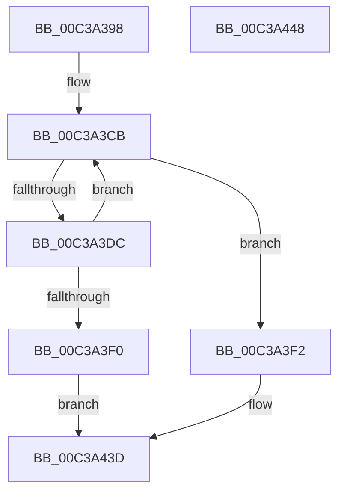

# KiInitializeDpcRuntimeHistoryHashTables

- RVA: `0x00C3A398`–`0x00C3A449` (길이 `177` bytes)
- VA: `0x0000000140C3A398`
- 실행 섹션: `INIT`
- PDB 이름 있음: `예`; PDB Function 태그: `아니요`
- unwind 정보 RVA: `0x000BDDB4`
- 디코드: `44`개 명령, `177/177` bytes 표시
- 미해석 바이트: `0` (있으면 어셈블리에 `.byte`로 보존)

> 이 문서는 커널 이미지의 기계어와 PDB 기호를 분석해 생성했습니다. 4번과 5번은 함수 원형과 자료형을 바이너리 사용 방식에서 추정한 C 해석이며 원본 소스 복구 결과는 아닙니다.

## 1. Dependencies

- 직접 호출 지점: **5**; 고유 호출 대상: **5**
- 직접 호출자로 확인된 함수: **1**
- RIP 상대 이미지 참조: **5**

### Outgoing calls
- `0x00C3A3D3` → [KeEnumerateNextProcessor](../../text/41/KeEnumerateNextProcessor_function_00415480.md) (function, `0x00415480`)
- `0x00C3A3DF` → [KeGetPrcb](../../text/2D/KeGetPrcb_function_002D85D0.md) (function, `0x002D85D0`)
- `0x00C3A3E7` → [KiInitializeSingleDpcRuntimeHistoryHashTable](../../page/74/KiInitializeSingleDpcRuntimeHistoryHashTable_function_00747808.md) (function, `0x00747808`)
- `0x00C3A410` → [KiInitializeTimer2](../../text/3A/KiInitializeTimer2_function_003A3288.md) (function, `0x003A3288`)
- `0x00C3A436` → [KeSetTimer2](../../text/3A/KeSetTimer2_function_003A08E0.md) (function, `0x003A08E0`)

### Direct callers
- [KeInitSystem](../C7/KeInitSystem_function_00C71660.md) at `0x00C718B0`

### Static image references
- `0x00C3A3A5` → RVA `0x00FC7128` (`ALMOSTRO`; read)
- `0x00C3A3B2` → RVA `0x00FC7120` (`ALMOSTRO`; read)
- `0x00C3A3F8` → RVA `0x00F107C2` (`.data`; write)
- `0x00C3A402` → RVA `0x00482EA0` (`KiDpcRuntimeHistoryHashTableCleanupTimerCallback`; read)
- `0x00C3A409` → RVA `0x00F107C0` (`.data`; read)

## 2. Other-region calls and transfers

- 다른 실행 섹션으로 향하는 call: **5**
  - `0x00C3A3D3` → [KeEnumerateNextProcessor](../../text/41/KeEnumerateNextProcessor_function_00415480.md) (`INIT` → `.text`)
  - `0x00C3A3DF` → [KeGetPrcb](../../text/2D/KeGetPrcb_function_002D85D0.md) (`INIT` → `.text`)
  - `0x00C3A3E7` → [KiInitializeSingleDpcRuntimeHistoryHashTable](../../page/74/KiInitializeSingleDpcRuntimeHistoryHashTable_function_00747808.md) (`INIT` → `PAGE`)
  - `0x00C3A410` → [KiInitializeTimer2](../../text/3A/KiInitializeTimer2_function_003A3288.md) (`INIT` → `.text`)
  - `0x00C3A436` → [KeSetTimer2](../../text/3A/KeSetTimer2_function_003A08E0.md) (`INIT` → `.text`)
- 별도 외부 분기/꼬리 이동을 확인하지 못했습니다.

## 3. Assembly (complete function range)

```asm
00C3A398  48 89 5C 24 10                  mov qword ptr [rsp + 0x10], rbx
00C3A39D  55                              push rbp
00C3A39E  48 8B EC                        mov rbp, rsp
00C3A3A1  48 83 EC 50                     sub rsp, 0x50
00C3A3A5  48 8B 05 7C CD 38 00            mov rax, qword ptr [rip + 0x38cd7c]
00C3A3AC  33 DB                           xor ebx, ebx
00C3A3AE  48 89 45 E8                     mov qword ptr [rbp - 0x18], rax
00C3A3B2  48 8D 05 67 CD 38 00            lea rax, [rip + 0x38cd67]
00C3A3B9  48 89 45 E0                     mov qword ptr [rbp - 0x20], rax
00C3A3BD  89 5D F2                        mov dword ptr [rbp - 0xe], ebx
00C3A3C0  66 89 5D F6                     mov word ptr [rbp - 0xa], bx
00C3A3C4  89 5D 10                        mov dword ptr [rbp + 0x10], ebx
00C3A3C7  66 89 5D F0                     mov word ptr [rbp - 0x10], bx
00C3A3CB  48 8D 55 E0                     lea rdx, [rbp - 0x20]
00C3A3CF  48 8D 4D 10                     lea rcx, [rbp + 0x10]
00C3A3D3  E8 A8 B0 7D FF                  call 0x140415480
00C3A3D8  85 C0                           test eax, eax
00C3A3DA  75 16                           jne 0x140c3a3f2
00C3A3DC  8B 4D 10                        mov ecx, dword ptr [rbp + 0x10]
00C3A3DF  E8 EC E1 69 FF                  call 0x1402d85d0
00C3A3E4  48 8B C8                        mov rcx, rax
00C3A3E7  E8 1C D4 B0 FF                  call 0x140747808
00C3A3EC  85 C0                           test eax, eax
00C3A3EE  79 DB                           jns 0x140c3a3cb
00C3A3F0  EB 4B                           jmp 0x140c3a43d
00C3A3F2  41 B9 08 00 00 00               mov r9d, 8
00C3A3F8  66 89 1D C3 63 2D 00            mov word ptr [rip + 0x2d63c3], bx
00C3A3FF  45 33 C0                        xor r8d, r8d
00C3A402  48 8D 15 97 8A 84 FF            lea rdx, [rip - 0x7b7569]
00C3A409  48 8D 0D B0 63 2D 00            lea rcx, [rip + 0x2d63b0]
00C3A410  E8 73 8E 76 FF                  call 0x1403a3288
00C3A415  48 83 4D D8 FF                  or qword ptr [rbp - 0x28], 0xffffffffffffffff
00C3A41A  4C 8D 4D D0                     lea r9, [rbp - 0x30]
00C3A41E  48 C7 C2 00 17 5B CA            mov rdx, 0xffffffffca5b1700
00C3A425  48 89 5D D0                     mov qword ptr [rbp - 0x30], rbx
00C3A429  41 B8 00 E9 A4 35               mov r8d, 0x35a4e900
00C3A42F  48 8D 0D 8A 63 2D 00            lea rcx, [rip + 0x2d638a]
00C3A436  E8 A5 64 76 FF                  call 0x1403a08e0
00C3A43B  33 C0                           xor eax, eax
00C3A43D  48 8B 5C 24 68                  mov rbx, qword ptr [rsp + 0x68]
00C3A442  48 83 C4 50                     add rsp, 0x50
00C3A446  5D                              pop rbp
00C3A447  C3                              ret
00C3A448  CC                              int3
```

## 4. C-style interpretation (structured pseudocode)

```c
__int64 __fastcall KiInitializeDpcRuntimeHistoryHashTables(__int64 a1, __int64 a2, int a3)
{
    __int64 result;
    __int64 v_rbx;
    __int64 v_rsp;
    unsigned __int16 v_stack_m12;
    unsigned int v_stack_m16;
    unsigned __int16 v_stack_m18;
    unsigned __int64 v_stack_m20;
    unsigned __int64 v_stack_m28;
    unsigned __int64 v_stack_m30;
    unsigned __int64 v_stack_m38;
    unsigned __int64 v_stack_p10;
    unsigned int v_stack_p8;

    v_stack_p10 = v_rbx;
    v_rsp = (v_rsp) - (80);
    v_rbx = 0;
    v_stack_m20 = *(unsigned __int64 *)(v_rip + 3722620);
    v_stack_m28 = v_rip + 3722599;
    v_stack_m16 = 0;
    v_stack_m12 = 0;
    v_stack_p8 = 0;
    v_stack_m18 = 0;
loc_00C3A3CB:
    result = KeEnumerateNextProcessor(v_stack_p8, v_stack_m28, a3, a4);
    if ((unsigned int)(result) != 0) goto loc_00C3A3F2;
    result = KeGetPrcb((unsigned int)(v_stack_p8), v_stack_m28, a3, a4);
    result = KiInitializeSingleDpcRuntimeHistoryHashTable(result, v_stack_m28, a3, a4);
    if (!sign_flag) goto loc_00C3A3CB;
    goto loc_00C3A43D;
loc_00C3A3F2:
    *(unsigned __int16 *)(v_rip + 2974659) = 0;
    a3 = 0;
    result = KiInitializeTimer2(v_rip + 2974640, v_rip - 8090985, a3, 8);
    v_stack_m38 = 0;
    result = KeSetTimer2(v_rip + 2974602, 0xFFFFFFFFCA5B1700ULL, (unsigned int)(0x35A4E900ULL), v_stack_m38);
    result = 0;
loc_00C3A43D:
    v_rsp = (v_rsp) + (80);
    return result;
}
```

## 5. (Beta) C Style

```c
int64_t KiInitializeDpcRuntimeHistoryHashTables(int64_t Arg1, int64_t Arg2, int32_t Arg3)
{
    int64_t result;
    int64_t local_rbx;
    int64_t local_rsp;
    uint16_t v_stack_m12;
    uint32_t v_stack_m16;
    uint16_t v_stack_m18;
    uint64_t v_stack_m20;
    uint64_t v_stack_m28;
    uint64_t v_stack_m30;
    uint64_t v_stack_m38;
    uint64_t v_stack_p10;
    uint32_t v_stack_p8;

    v_stack_p10 = local_rbx;
    local_rsp = (local_rsp) - (80);
    local_rbx = 0;
    v_stack_m20 = *(uint64_t *)(v_rip + 0x38CD7C);
    v_stack_m28 = v_rip + 3722599;
    v_stack_m16 = 0;
    v_stack_m12 = 0;
    v_stack_p8 = 0;
    v_stack_m18 = 0;
loc_00C3A3CB:
    result = KeEnumerateNextProcessor(v_stack_p8, v_stack_m28, Arg3, a4);
    if ((uint32_t)(result) != 0) goto loc_00C3A3F2;
    result = KeGetPrcb((uint32_t)(v_stack_p8), v_stack_m28, Arg3, a4);
    result = KiInitializeSingleDpcRuntimeHistoryHashTable(result, v_stack_m28, Arg3, a4);
    if (!sign_flag) goto loc_00C3A3CB;
    goto loc_00C3A43D;
loc_00C3A3F2:
    *(uint16_t *)(v_rip + 0x2D63C3) = 0;
    Arg3 = 0;
    result = KiInitializeTimer2(v_rip + 2974640, v_rip - 8090985, Arg3, 8);
    v_stack_m38 = 0;
    result = KeSetTimer2(v_rip + 2974602, 0xFFFFFFFFCA5B1700ULL, (uint32_t)(0x35A4E900ULL), v_stack_m38);
    result = 0;
loc_00C3A43D:
    local_rsp = (local_rsp) + (80);
    return result;
}
```

## 6. Execution-region graph

[열기: 2D/3D 그래프와 함수 탐색 컨트롤 패널](../../../control-panel.html?section=init&rva=0x00C3A398&view=graph)

- 2D 그래프는 위에서 아래로 흐르고, 3D 그래프는 빈 공간을 드래그해 회전합니다. Shift+드래그는 이동, 휠은 확대·축소, 함수 노드 선택은 대상 보고서 이동입니다.

### Static fallback


