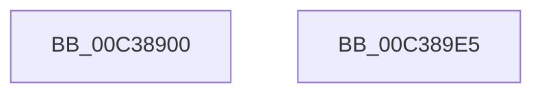

# KiInitializeIdleProcess

- RVA: `0x00C38900`–`0x00C389E6` (길이 `230` bytes)
- VA: `0x0000000140C38900`
- 실행 섹션: `INIT`
- PDB 이름 있음: `예`; PDB Function 태그: `아니요`
- unwind 정보 RVA: `0x000CA0BC`
- 디코드: `46`개 명령, `230/230` bytes 표시
- 미해석 바이트: `0` (있으면 어셈블리에 `.byte`로 보존)

> 이 문서는 커널 이미지의 기계어와 PDB 기호를 분석해 생성했습니다. 4번과 5번은 함수 원형과 자료형을 바이너리 사용 방식에서 추정한 C 해석이며 원본 소스 복구 결과는 아닙니다.

## 1. Dependencies

- 직접 호출 지점: **5**; 고유 호출 대상: **4**
- 직접 호출자로 확인된 함수: **1**
- RIP 상대 이미지 참조: **4**

### Outgoing calls
- `0x00C3892F` → [memset](../../text/6C/memset_function_006C6C40.md) (function, `0x006C6C40`)
- `0x00C38953` → [memset](../../text/6C/memset_function_006C6C40.md) (function, `0x006C6C40`)
- `0x00C3895F` → [KeAddProcessorAffinityEx](../../text/25/KeAddProcessorAffinityEx_function_0025B6F0.md) (function, `0x0025B6F0`)
- `0x00C3898B` → [KeInitializeProcess](../../page/A6/KeInitializeProcess_function_00A63CF4.md) (function, `0x00A63CF4`)
- `0x00C389CF` → [_security_check_cookie](../../text/6A/_security_check_cookie_function_006AC640.md) (function, `0x006AC640`)

### Direct callers
- [KiInitSystem](KiInitSystem_function_00C38480.md) at `0x00C38799`

### Static image references
- `0x00C3890D` → RVA `0x00E0A740` (`.data`; read)
- `0x00C38967` → RVA `0x00F22600` (`.data`; read)
- `0x00C389A5` → RVA `0x00FD00F0` (`CACHEALI`; read/write)
- `0x00C389B0` → RVA `0x00FD04FC` (`CACHEALI`; read/write)

## 2. Other-region calls and transfers

- 다른 실행 섹션으로 향하는 call: **5**
  - `0x00C3892F` → [memset](../../text/6C/memset_function_006C6C40.md) (`INIT` → `.text`)
  - `0x00C38953` → [memset](../../text/6C/memset_function_006C6C40.md) (`INIT` → `.text`)
  - `0x00C3895F` → [KeAddProcessorAffinityEx](../../text/25/KeAddProcessorAffinityEx_function_0025B6F0.md) (`INIT` → `.text`)
  - `0x00C3898B` → [KeInitializeProcess](../../page/A6/KeInitializeProcess_function_00A63CF4.md) (`INIT` → `PAGE`)
  - `0x00C389CF` → [_security_check_cookie](../../text/6A/_security_check_cookie_function_006AC640.md) (`INIT` → `.text`)
- 별도 외부 분기/꼬리 이동을 확인하지 못했습니다.

## 3. Assembly (complete function range)

```asm
00C38900  48 89 5C 24 10                  mov qword ptr [rsp + 0x10], rbx
00C38905  55                              push rbp
00C38906  48 81 EC 70 01 00 00            sub rsp, 0x170
00C3890D  48 8B 05 2C 1E 1D 00            mov rax, qword ptr [rip + 0x1d1e2c]
00C38914  48 33 C4                        xor rax, rsp
00C38917  48 89 84 24 60 01 00 00         mov qword ptr [rsp + 0x160], rax
00C3891F  48 8B D9                        mov rbx, rcx
00C38922  33 D2                           xor edx, edx
00C38924  48 8D 4C 24 58                  lea rcx, [rsp + 0x58]
00C38929  41 B8 00 01 00 00               mov r8d, 0x100
00C3892F  E8 0C E3 A8 FF                  call 0x1406c6c40
00C38934  83 64 24 54 00                  and dword ptr [rsp + 0x54], 0
00C38939  48 8D 4C 24 58                  lea rcx, [rsp + 0x58]
00C3893E  33 D2                           xor edx, edx
00C38940  C7 44 24 50 01 00 20 00         mov dword ptr [rsp + 0x50], 0x200001
00C38948  41 B8 00 01 00 00               mov r8d, 0x100
00C3894E  BD 01 00 00 00                  mov ebp, 1
00C38953  E8 E8 E2 A8 FF                  call 0x1406c6c40
00C38958  33 D2                           xor edx, edx
00C3895A  48 8D 4C 24 50                  lea rcx, [rsp + 0x50]
00C3895F  E8 8C 2D 62 FF                  call 0x14025b6f0
00C38964  45 33 C0                        xor r8d, r8d
00C38967  48 8D 05 92 9C 2E 00            lea rax, [rip + 0x2e9c92]
00C3896E  48 89 44 24 40                  mov qword ptr [rsp + 0x40], rax
00C38973  4C 8D 4C 24 50                  lea r9, [rsp + 0x50]
00C38978  89 6C 24 38                     mov dword ptr [rsp + 0x38], ebp
00C3897C  33 D2                           xor edx, edx
00C3897E  4C 21 44 24 28                  and qword ptr [rsp + 0x28], r8
00C38983  48 8B CB                        mov rcx, rbx
00C38986  4C 21 44 24 20                  and qword ptr [rsp + 0x20], r8
00C3898B  E8 64 B3 E2 FF                  call 0x140a63cf4
00C38990  48 8D 83 70 03 00 00            lea rax, [rbx + 0x370]
00C38997  C6 83 91 00 00 00 7F            mov byte ptr [rbx + 0x91], 0x7f
00C3899E  48 89 40 08                     mov qword ptr [rax + 8], rax
00C389A2  48 89 00                        mov qword ptr [rax], rax
00C389A5  F0 81 0D 40 77 39 00 00 80 00 00  lock or dword ptr [rip + 0x397740], 0x8000
00C389B0  F0 81 0D 41 7B 39 00 00 00 40 00  lock or dword ptr [rip + 0x397b41], 0x400000
00C389BB  66 C7 83 EC 06 00 00 64 86      mov word ptr [rbx + 0x6ec], 0x8664
00C389C4  48 8B 8C 24 60 01 00 00         mov rcx, qword ptr [rsp + 0x160]
00C389CC  48 33 CC                        xor rcx, rsp
00C389CF  E8 6C 3C A7 FF                  call 0x1406ac640
00C389D4  48 8B 9C 24 88 01 00 00         mov rbx, qword ptr [rsp + 0x188]
00C389DC  48 81 C4 70 01 00 00            add rsp, 0x170
00C389E3  5D                              pop rbp
00C389E4  C3                              ret
00C389E5  CC                              int3
```

## 4. C-style interpretation (structured pseudocode)

```c
__int64 __fastcall KiInitializeIdleProcess(__int64 a1, int a2)
{
    __int64 result;
    __int64 v_rsp;
    unsigned __int64 v_stack_m120;
    unsigned int v_stack_m124;
    unsigned int v_stack_m128;
    unsigned __int64 v_stack_m138;
    unsigned int v_stack_m140;
    unsigned __int64 v_stack_m150;
    unsigned __int64 v_stack_m158;
    unsigned __int64 v_stack_m18;
    unsigned __int64 v_stack_p10;

    v_stack_p10 = v_rbx;
    v_rsp = (v_rsp) - (368);
    result = (*(unsigned __int64 *)(v_rip + 1908268)) ^ (v_rsp);
    v_stack_m18 = result;
    a2 = 0;
    result = memset(v_stack_m120, a2, 256, a4);
    a2 = 0;
    v_stack_m128 = 0x200001ULL;
    result = memset(v_stack_m120, a2, 256, a4);
    a2 = 0;
    result = KeAddProcessorAffinityEx(v_stack_m128, a2, 256, a4);
    a3 = 0;
    v_stack_m138 = v_rip + 3054738;
    v_stack_m140 = 1;
    a2 = 0;
    result = KeInitializeProcess(a1, a2, a3, v_stack_m128);
    *(unsigned __int8 *)(a1 + 145) = 127;
    *(unsigned __int64 *)(a1 + 880 + 8) = a1 + 880;
    *(unsigned __int64 *)(a1 + 880) = a1 + 880;
    *(unsigned __int16 *)(a1 + 1772) = 0x8664ULL;
    a1 = (v_stack_m18) ^ (v_rsp);
    result = _security_check_cookie(a1, a2, a3, v_stack_m128);
    v_rsp = (v_rsp) + (368);
    return result;
}
```

## 5. (Beta) C Style

```c
int64_t KiInitializeIdleProcess(void *Arg1, int32_t Arg2)
{
    uint8_t *arg1 = (uint8_t *)Arg1;

    int64_t result;
    int64_t local_rsp;
    uint64_t v_stack_m120;
    uint32_t v_stack_m124;
    uint32_t v_stack_m128;
    uint64_t v_stack_m138;
    uint32_t v_stack_m140;
    uint64_t v_stack_m150;
    uint64_t v_stack_m158;
    uint64_t v_stack_m18;
    uint64_t v_stack_p10;

    v_stack_p10 = local_rbx;
    local_rsp = (local_rsp) - (368);
    result = (*(uint64_t *)(v_rip + 0x1D1E2C)) ^ (local_rsp);
    v_stack_m18 = result;
    Arg2 = 0;
    result = memset(v_stack_m120, Arg2, 256, a4);
    Arg2 = 0;
    v_stack_m128 = 0x200001ULL;
    result = memset(v_stack_m120, Arg2, 256, a4);
    Arg2 = 0;
    result = KeAddProcessorAffinityEx(v_stack_m128, Arg2, 256, a4);
    a3 = 0;
    v_stack_m138 = v_rip + 3054738;
    v_stack_m140 = 1;
    Arg2 = 0;
    result = KeInitializeProcess(Arg1, Arg2, a3, v_stack_m128);
    *(uint8_t *)(arg1 + 0x91) = 127;
    *(void **)(arg1 + 0x370 + 0x8) = Arg1 + 880;
    *(void **)(arg1 + 0x370) = Arg1 + 880;
    *(uint16_t *)(arg1 + 0x6EC) = 0x8664ULL;
    Arg1 = (v_stack_m18) ^ (local_rsp);
    result = _security_check_cookie(Arg1, Arg2, a3, v_stack_m128);
    local_rsp = (local_rsp) + (368);
    return result;
}
```

### 관측된 메모리 오프셋

구조체 형식이 확인되지 않은 접근은 인자 기준의 오프셋으로만 기록했습니다.

| 기준 인자 | 오프셋 표현 | 폭 (bit) | 접근 |
|---|---:|---:|---|
| `Arg1` | `+ 0x0` | `64` | `W` |
| `Arg1` | `+ 0x8` | `64` | `W` |
| `Arg1` | `+ 0x91` | `8` | `W` |
| `Arg1` | `+ 0x370` | `64` | `R` |
| `Arg1` | `+ 0x6EC` | `16` | `W` |

## 6. Execution-region graph

[열기: 2D/3D 그래프와 함수 탐색 컨트롤 패널](../../../control-panel.html?section=init&rva=0x00C38900&view=graph)

- 2D 그래프는 위에서 아래로 흐르고, 3D 그래프는 빈 공간을 드래그해 회전합니다. Shift+드래그는 이동, 휠은 확대·축소, 함수 노드 선택은 대상 보고서 이동입니다.

### Static fallback


