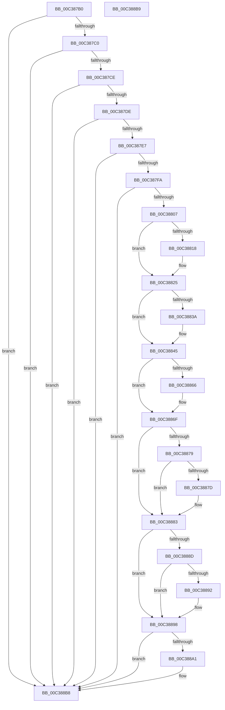

# KiInitializeLegacyWatchdogProfileThresholds

- RVA: `0x00C387B0`–`0x00C388BA` (길이 `266` bytes)
- VA: `0x0000000140C387B0`
- 실행 섹션: `INIT`
- PDB 이름 있음: `예`; PDB Function 태그: `아니요`
- unwind 정보 RVA: `0x000DB714`
- 디코드: `66`개 명령, `266/266` bytes 표시
- 미해석 바이트: `0` (있으면 어셈블리에 `.byte`로 보존)

> 이 문서는 커널 이미지의 기계어와 PDB 기호를 분석해 생성했습니다. 4번과 5번은 함수 원형과 자료형을 바이너리 사용 방식에서 추정한 C 해석이며 원본 소스 복구 결과는 아닙니다.

## 1. Dependencies

- 직접 호출 지점: **0**; 고유 호출 대상: **0**
- 직접 호출자로 확인된 함수: **1**
- RIP 상대 이미지 참조: **12**

### Outgoing calls
- 직접 디코드된 call 명령이 없습니다.

### Direct callers
- [KiInitDpcThresholds](KiInitDpcThresholds_function_00C38318.md) at `0x00C38405`

### Static image references
- `0x00C387B0` → RVA `0x00FC6FD8` (`ALMOSTRO`; read)
- `0x00C387C0` → RVA `0x00FC502C` (`ALMOSTRO`; read)
- `0x00C387CE` → RVA `0x00FC5034` (`ALMOSTRO`; read)
- `0x00C387ED` → RVA `0x00FC5028` (`ALMOSTRO`; read)
- `0x00C387FA` → RVA `0x00FC5024` (`ALMOSTRO`; read)
- `0x00C3882B` → RVA `0x00FC5024` (`ALMOSTRO`; write)
- `0x00C3885B` → RVA `0x00FC5028` (`ALMOSTRO`; write)
- `0x00C38866` → RVA `0x00FC5028` (`ALMOSTRO`; read/write)
- `0x00C3886F` → RVA `0x00FC5040` (`ALMOSTRO`; read)
- `0x00C38883` → RVA `0x00FC503C` (`ALMOSTRO`; read)
- `0x00C38898` → RVA `0x00FC5048` (`ALMOSTRO`; read)
- `0x00C388B2` → RVA `0x00FC5048` (`ALMOSTRO`; write)

## 2. Other-region calls and transfers

- 다른 실행 섹션으로 향하는 call: **0**
- 별도 외부 분기/꼬리 이동을 확인하지 못했습니다.

## 3. Assembly (complete function range)

```asm
00C387B0  44 8B 05 21 E8 38 00            mov r8d, dword ptr [rip + 0x38e821]
00C387B7  45 85 C0                        test r8d, r8d
00C387BA  0F 84 F8 00 00 00               je 0x140c388b8
00C387C0  8B 0D 66 C8 38 00               mov ecx, dword ptr [rip + 0x38c866]
00C387C6  85 C9                           test ecx, ecx
00C387C8  0F 84 EA 00 00 00               je 0x140c388b8
00C387CE  44 8B 15 5F C8 38 00            mov r10d, dword ptr [rip + 0x38c85f]
00C387D5  45 85 D2                        test r10d, r10d
00C387D8  0F 84 DA 00 00 00               je 0x140c388b8
00C387DE  44 3B D1                        cmp r10d, ecx
00C387E1  0F 83 D1 00 00 00               jae 0x140c388b8
00C387E7  41 BB FF FF FF FF               mov r11d, 0xffffffff
00C387ED  44 39 1D 34 C8 38 00            cmp dword ptr [rip + 0x38c834], r11d
00C387F4  0F 85 BE 00 00 00               jne 0x140c388b8
00C387FA  44 39 1D 23 C8 38 00            cmp dword ptr [rip + 0x38c823], r11d
00C38801  0F 85 B1 00 00 00               jne 0x140c388b8
00C38807  BA E8 03 00 00                  mov edx, 0x3e8
00C3880C  44 3B C2                        cmp r8d, edx
00C3880F  44 0F 46 C2                     cmovbe r8d, edx
00C38813  44 3B C1                        cmp r8d, ecx
00C38816  76 0D                           jbe 0x140c38825
00C38818  41 B8 10 27 00 00               mov r8d, 0x2710
00C3881E  41 3B C8                        cmp ecx, r8d
00C38821  44 0F 46 C2                     cmovbe r8d, edx
00C38825  44 8B C9                        mov r9d, ecx
00C38828  45 2B C8                        sub r9d, r8d
00C3882B  44 89 0D F2 C7 38 00            mov dword ptr [rip + 0x38c7f2], r9d
00C38832  41 8B C1                        mov eax, r9d
00C38835  44 3B CA                        cmp r9d, edx
00C38838  73 0B                           jae 0x140c38845
00C3883A  44 8B CA                        mov r9d, edx
00C3883D  89 15 E1 C7 38 00               mov dword ptr [rip + 0x38c7e1], edx
00C38843  8B C2                           mov eax, edx
00C38845  41 0F AF C2                     imul eax, r10d
00C38849  33 D2                           xor edx, edx
00C3884B  48 F7 F1                        div rcx
00C3884E  49 3B C3                        cmp rax, r11
00C38851  48 8B C8                        mov rcx, rax
00C38854  49 0F 47 CB                     cmova rcx, r11
00C38858  44 2B D1                        sub r10d, ecx
00C3885B  89 0D C7 C7 38 00               mov dword ptr [rip + 0x38c7c7], ecx
00C38861  45 3B D0                        cmp r10d, r8d
00C38864  76 09                           jbe 0x140c3886f
00C38866  83 25 BB C7 38 00 00            and dword ptr [rip + 0x38c7bb], 0
00C3886D  33 C9                           xor ecx, ecx
00C3886F  8B 05 CB C7 38 00               mov eax, dword ptr [rip + 0x38c7cb]
00C38875  85 C0                           test eax, eax
00C38877  74 0A                           je 0x140c38883
00C38879  3B C8                           cmp ecx, eax
00C3887B  76 06                           jbe 0x140c38883
00C3887D  89 05 A5 C7 38 00               mov dword ptr [rip + 0x38c7a5], eax
00C38883  8B 05 B3 C7 38 00               mov eax, dword ptr [rip + 0x38c7b3]
00C38889  85 C0                           test eax, eax
00C3888B  74 0B                           je 0x140c38898
00C3888D  44 3B C8                        cmp r9d, eax
00C38890  76 06                           jbe 0x140c38898
00C38892  89 05 8C C7 38 00               mov dword ptr [rip + 0x38c78c], eax
00C38898  44 39 1D A9 C7 38 00            cmp dword ptr [rip + 0x38c7a9], r11d
00C3889F  75 17                           jne 0x140c388b8
00C388A1  B8 D3 4D 62 10                  mov eax, 0x10624dd3
00C388A6  41 F7 E0                        mul r8d
00C388A9  C1 EA 06                        shr edx, 6
00C388AC  69 C2 00 68 00 00               imul eax, edx, 0x6800
00C388B2  89 05 90 C7 38 00               mov dword ptr [rip + 0x38c790], eax
00C388B8  C3                              ret
00C388B9  CC                              int3
```

## 4. C-style interpretation (structured pseudocode)

```c
__int64 __fastcall KiInitializeLegacyWatchdogProfileThresholds(void)
{
    __int64 result;
    __int64 v_r10;

    if ((unsigned int)((unsigned int)(*(unsigned int *)(v_rip + 3729441))) == 0) goto loc_00C388B8;
    if ((unsigned int)((unsigned int)(*(unsigned int *)(v_rip + 3721318))) == 0) goto loc_00C388B8;
    if ((unsigned int)((unsigned int)(*(unsigned int *)(v_rip + 3721311))) == 0) goto loc_00C388B8;
    if (((unsigned int)((unsigned int)(*(unsigned int *)(v_rip + 3721311)))) >= ((unsigned int)((unsigned int)(*(unsigned int *)(v_rip + 3721318))))) goto loc_00C388B8;
    if ((*(unsigned int *)(v_rip + 3721268)) != ((unsigned int)((unsigned int)(0xFFFFFFFFULL)))) goto loc_00C388B8;
    if ((*(unsigned int *)(v_rip + 3721251)) != ((unsigned int)((unsigned int)(0xFFFFFFFFULL)))) goto loc_00C388B8;
    a3 = (unsigned int)(*(unsigned int *)(v_rip + 3729441));
    if (((unsigned int)((unsigned int)(*(unsigned int *)(v_rip + 3729441)))) <= 1000) { a3 = 1000; }
    if (((unsigned int)(a3)) >= = ((unsigned int)((unsigned int)(*(unsigned int *)(v_rip + 3721318))))) {
        a3 = 0x2710ULL;
        if (((unsigned int)((unsigned int)(*(unsigned int *)(v_rip + 3721318)))) <= ((unsigned int)(a3))) { a3 = 1000; }
    }
    a4 = (unsigned int)(((unsigned int)((unsigned int)((unsigned int)(*(unsigned int *)(v_rip + 3721318))))) - ((unsigned int)(a3)));
    *(unsigned int *)(v_rip + 3721202) = (unsigned int)(a4);
    result = (unsigned int)((unsigned int)(a4));
    if (((unsigned int)(a4)) < 1000) {
        a4 = 1000;
        *(unsigned int *)(v_rip + 3721185) = 1000;
        result = 1000;
    }
    result = (unsigned int)((result) * ((unsigned int)((unsigned int)(*(unsigned int *)(v_rip + 3721311)))));
    a2 = 0;
    a1 = result;
    if (result > ((unsigned int)(0xFFFFFFFFULL))) { a1 = (unsigned int)(0xFFFFFFFFULL); }
    v_r10 = (unsigned int)(((unsigned int)(*(unsigned int *)(v_rip + 3721311))) - ((unsigned int)(a1)));
    *(unsigned int *)(v_rip + 3721159) = (unsigned int)(a1);
    if (((unsigned int)(v_r10)) >= = ((unsigned int)(a3))) {
        a1 = 0;
    }
    if ((unsigned int)((unsigned int)(*(unsigned int *)(v_rip + 3721163))) == 0) goto loc_00C38883;
    if (0 >= = ((unsigned int)((unsigned int)(*(unsigned int *)(v_rip + 3721163))))) {
        *(unsigned int *)(v_rip + 3721125) = (unsigned int)((unsigned int)(*(unsigned int *)(v_rip + 3721163)));
    }
    if ((unsigned int)((unsigned int)(*(unsigned int *)(v_rip + 3721139))) == 0) goto loc_00C38898;
    if (((unsigned int)(a4)) >= = ((unsigned int)((unsigned int)(*(unsigned int *)(v_rip + 3721139))))) {
        *(unsigned int *)(v_rip + 3721100) = (unsigned int)((unsigned int)(*(unsigned int *)(v_rip + 3721139)));
    }
    result = (unsigned int)(*(unsigned int *)(v_rip + 3721139));
    if ((*(unsigned int *)(v_rip + 3721129)) == ((unsigned int)((unsigned int)(0xFFFFFFFFULL)))) {
        result = 0x10624DD3ULL;
        a2 = (unsigned int)((a2) >> (6));
        result = (unsigned int)((result) * ((unsigned int)(a2)));
        *(unsigned int *)(v_rip + 3721104) = (unsigned int)(result);
    }
    return result;
}
```

## 5. (Beta) C Style

```c
void KiInitializeLegacyWatchdogProfileThresholds(void)
{
    int64_t result;
    int64_t local_r10;

    if ((uint32_t)((uint32_t)(*(uint32_t *)(v_rip + 0x38E821))) == 0) goto loc_00C388B8;
    if ((uint32_t)((uint32_t)(*(uint32_t *)(v_rip + 0x38C866))) == 0) goto loc_00C388B8;
    if ((uint32_t)((uint32_t)(*(uint32_t *)(v_rip + 0x38C85F))) == 0) goto loc_00C388B8;
    if (((uint32_t)((uint32_t)(*(uint32_t *)(v_rip + 0x38C85F)))) >= ((uint32_t)((uint32_t)(*(uint32_t *)(v_rip + 0x38C866))))) goto loc_00C388B8;
    if ((*(uint32_t *)(v_rip + 0x38C834)) != ((uint32_t)((uint32_t)(0xFFFFFFFFULL)))) goto loc_00C388B8;
    if ((*(uint32_t *)(v_rip + 0x38C823)) != ((uint32_t)((uint32_t)(0xFFFFFFFFULL)))) goto loc_00C388B8;
    a3 = (uint32_t)(*(uint32_t *)(v_rip + 0x38E821));
    if (((uint32_t)((uint32_t)(*(uint32_t *)(v_rip + 0x38E821)))) <= 1000) { a3 = 1000; }
    if (((uint32_t)(a3)) >= = ((uint32_t)((uint32_t)(*(uint32_t *)(v_rip + 0x38C866))))) {
        a3 = 0x2710ULL;
        if (((uint32_t)((uint32_t)(*(uint32_t *)(v_rip + 0x38C866)))) <= ((uint32_t)(a3))) { a3 = 1000; }
    }
    a4 = (uint32_t)(((uint32_t)((uint32_t)((uint32_t)(*(uint32_t *)(v_rip + 0x38C866))))) - ((uint32_t)(a3)));
    *(uint32_t *)(v_rip + 0x38C7F2) = (uint32_t)(a4);
    result = (uint32_t)((uint32_t)(a4));
    if (((uint32_t)(a4)) < 1000) {
        a4 = 1000;
        *(uint32_t *)(v_rip + 0x38C7E1) = 1000;
        result = 1000;
    }
    result = (uint32_t)((result) * ((uint32_t)((uint32_t)(*(uint32_t *)(v_rip + 0x38C85F)))));
    a2 = 0;
    a1 = result;
    if (result > ((uint32_t)(0xFFFFFFFFULL))) { a1 = (uint32_t)(0xFFFFFFFFULL); }
    local_r10 = (uint32_t)(((uint32_t)(*(uint32_t *)(v_rip + 0x38C85F))) - ((uint32_t)(a1)));
    *(uint32_t *)(v_rip + 0x38C7C7) = (uint32_t)(a1);
    if (((uint32_t)(local_r10)) >= = ((uint32_t)(a3))) {
        a1 = 0;
    }
    if ((uint32_t)((uint32_t)(*(uint32_t *)(v_rip + 0x38C7CB))) == 0) goto loc_00C38883;
    if (0 >= = ((uint32_t)((uint32_t)(*(uint32_t *)(v_rip + 0x38C7CB))))) {
        *(uint32_t *)(v_rip + 0x38C7A5) = (uint32_t)((uint32_t)(*(uint32_t *)(v_rip + 0x38C7CB)));
    }
    if ((uint32_t)((uint32_t)(*(uint32_t *)(v_rip + 0x38C7B3))) == 0) goto loc_00C38898;
    if (((uint32_t)(a4)) >= = ((uint32_t)((uint32_t)(*(uint32_t *)(v_rip + 0x38C7B3))))) {
        *(uint32_t *)(v_rip + 0x38C78C) = (uint32_t)((uint32_t)(*(uint32_t *)(v_rip + 0x38C7B3)));
    }
    result = (uint32_t)(*(uint32_t *)(v_rip + 0x38C7B3));
    if ((*(uint32_t *)(v_rip + 0x38C7A9)) == ((uint32_t)((uint32_t)(0xFFFFFFFFULL)))) {
        result = 0x10624DD3ULL;
        a2 = (uint32_t)((a2) >> (6));
        result = (uint32_t)((result) * ((uint32_t)(a2)));
        *(uint32_t *)(v_rip + 0x38C790) = (uint32_t)(result);
    }
    return result;
}
```

## 6. Execution-region graph

[열기: 2D/3D 그래프와 함수 탐색 컨트롤 패널](../../../control-panel.html?section=init&rva=0x00C387B0&view=graph)

- 2D 그래프는 위에서 아래로 흐르고, 3D 그래프는 빈 공간을 드래그해 회전합니다. Shift+드래그는 이동, 휠은 확대·축소, 함수 노드 선택은 대상 보고서 이동입니다.

### Static fallback


