# KiInitializeMTRR

- RVA: `0x00C39A1C`–`0x00C39DA6` (길이 `906` bytes)
- VA: `0x0000000140C39A1C`
- 실행 섹션: `INIT`
- PDB 이름 있음: `예`; PDB Function 태그: `아니요`
- unwind 정보 RVA: `0x000CA550`
- 디코드: `225`개 명령, `906/906` bytes 표시
- 미해석 바이트: `0` (있으면 어셈블리에 `.byte`로 보존)

> 이 문서는 커널 이미지의 기계어와 PDB 기호를 분석해 생성했습니다. 4번과 5번은 함수 원형과 자료형을 바이너리 사용 방식에서 추정한 C 해석이며 원본 소스 복구 결과는 아닙니다.

## 1. Dependencies

- 직접 호출 지점: **13**; 고유 호출 대상: **9**
- 직접 호출자로 확인된 함수: **1**
- RIP 상대 이미지 참조: **18**

### Outgoing calls
- `0x00C39B2D` → [ExAllocatePool2](../../poolcode/B8/ExAllocatePool2_function_00B820F0.md) (function, `0x00B820F0`)
- `0x00C39B58` → [ExAllocatePool2](../../poolcode/B8/ExAllocatePool2_function_00B820F0.md) (function, `0x00B820F0`)
- `0x00C39BA6` → [DbgPrintEx](../../text/35/DbgPrintEx_function_00359290.md) (function, `0x00359290`)
- `0x00C39C19` → [KeBugCheckEx](../../text/4F/KeBugCheckEx_function_004FD660.md) (function, `0x004FD660`)
- `0x00C39C40` → [DbgPrintEx](../../text/35/DbgPrintEx_function_00359290.md) (function, `0x00359290`)
- `0x00C39C6A` → [KiReadFixedMtrr](../../pagelk/B6/KiReadFixedMtrr_function_00B67E2C.md) (function, `0x00B67E2C`)
- `0x00C39CBA` → [KiMaskToLength](../../pagelk/B6/KiMaskToLength_function_00B67E00.md) (function, `0x00B67E00`)
- `0x00C39CE2` → [DbgPrintEx](../../text/35/DbgPrintEx_function_00359290.md) (function, `0x00359290`)
- `0x00C39D3C` → [MmLockPagableSectionByHandle](../../page/A4/MmLockPagableSectionByHandle_function_00A4D1E0.md) (function, `0x00A4D1E0`)
- `0x00C39D41` → [KeRestoreMtrrBroadcast](../../pagelk/B6/KeRestoreMtrrBroadcast_function_00B67C90.md) (function, `0x00B67C90`)
- `0x00C39D4D` → [MmUnlockPagableImageSection](../../text/2A/MmUnlockPagableImageSection_function_002A39F0.md) (function, `0x002A39F0`)
- `0x00C39D62` → [ExFreePoolWithTag](../../poolcode/B8/ExFreePoolWithTag_function_00B82870.md) (function, `0x00B82870`)
- `0x00C39D7C` → [ExFreePoolWithTag](../../poolcode/B8/ExFreePoolWithTag_function_00B82870.md) (function, `0x00B82870`)

### Direct callers
- [KiInitMachineDependent](../../text/5C/KiInitMachineDependent_function_005C1880.md) at `0x005C1952`

### Static image references
- `0x00C39A78` → RVA `0x00F10EE8` (`.data`; write)
- `0x00C39A88` → RVA `0x00F10EE0` (`.data`; write)
- `0x00C39A9B` → RVA `0x00F10EF1` (`.data`; write)
- `0x00C39ACD` → RVA `0x00F10EE8` (`.data`; read)
- `0x00C39AD4` → RVA `0x00F10EE0` (`.data`; read)
- `0x00C39AEA` → RVA `0x00FC6B30` (`ALMOSTRO`; reference)
- `0x00C39B1C` → RVA `0x00F10EF8` (`.data`; read)
- `0x00C39B32` → RVA `0x00F10EF8` (`.data`; write)
- `0x00C39B39` → RVA `0x00F10F00` (`.data`; read)
- `0x00C39B5D` → RVA `0x00F10F00` (`.data`; write)
- `0x00C39B91` → RVA `0x00F475F8` (`.data`; read)
- `0x00C39B9A` → RVA `0x00C7B3A0` (` ?? ::PBOPGDP::`string'`; read)
- `0x00C39C34` → RVA `0x00C7B350` (` ?? ::PBOPGDP::`string'`; read)
- `0x00C39C9C` → RVA `0x00E0B0E8` (`.data`; read)
- `0x00C39CC3` → RVA `0x00E0B0F0` (`.data`; read)
- `0x00C39CD8` → RVA `0x00C7B3E0` (` ?? ::PBOPGDP::`string'`; read)
- `0x00C39D26` → RVA `0x00F10EF0` (`.data`; write)
- `0x00C39D35` → RVA `0x00FC6C00` (`ALMOSTRO`; read)

## 2. Other-region calls and transfers

- 다른 실행 섹션으로 향하는 call: **13**
  - `0x00C39B2D` → [ExAllocatePool2](../../poolcode/B8/ExAllocatePool2_function_00B820F0.md) (`INIT` → `POOLCODE`)
  - `0x00C39B58` → [ExAllocatePool2](../../poolcode/B8/ExAllocatePool2_function_00B820F0.md) (`INIT` → `POOLCODE`)
  - `0x00C39BA6` → [DbgPrintEx](../../text/35/DbgPrintEx_function_00359290.md) (`INIT` → `.text`)
  - `0x00C39C19` → [KeBugCheckEx](../../text/4F/KeBugCheckEx_function_004FD660.md) (`INIT` → `.text`)
  - `0x00C39C40` → [DbgPrintEx](../../text/35/DbgPrintEx_function_00359290.md) (`INIT` → `.text`)
  - `0x00C39C6A` → [KiReadFixedMtrr](../../pagelk/B6/KiReadFixedMtrr_function_00B67E2C.md) (`INIT` → `PAGELK`)
  - `0x00C39CBA` → [KiMaskToLength](../../pagelk/B6/KiMaskToLength_function_00B67E00.md) (`INIT` → `PAGELK`)
  - `0x00C39CE2` → [DbgPrintEx](../../text/35/DbgPrintEx_function_00359290.md) (`INIT` → `.text`)
  - `0x00C39D3C` → [MmLockPagableSectionByHandle](../../page/A4/MmLockPagableSectionByHandle_function_00A4D1E0.md) (`INIT` → `PAGE`)
  - `0x00C39D41` → [KeRestoreMtrrBroadcast](../../pagelk/B6/KeRestoreMtrrBroadcast_function_00B67C90.md) (`INIT` → `PAGELK`)
  - `0x00C39D4D` → [MmUnlockPagableImageSection](../../text/2A/MmUnlockPagableImageSection_function_002A39F0.md) (`INIT` → `.text`)
  - `0x00C39D62` → [ExFreePoolWithTag](../../poolcode/B8/ExFreePoolWithTag_function_00B82870.md) (`INIT` → `POOLCODE`)
  - `0x00C39D7C` → [ExFreePoolWithTag](../../poolcode/B8/ExFreePoolWithTag_function_00B82870.md) (`INIT` → `POOLCODE`)
- 별도 외부 분기/꼬리 이동을 확인하지 못했습니다.

## 3. Assembly (complete function range)

```asm
00C39A1C  48 8B C4                        mov rax, rsp
00C39A1F  48 89 58 10                     mov qword ptr [rax + 0x10], rbx
00C39A23  48 89 68 18                     mov qword ptr [rax + 0x18], rbp
00C39A27  48 89 70 20                     mov qword ptr [rax + 0x20], rsi
00C39A2B  88 48 08                        mov byte ptr [rax + 8], cl
00C39A2E  57                              push rdi
00C39A2F  41 54                           push r12
00C39A31  41 55                           push r13
00C39A33  41 56                           push r14
00C39A35  41 57                           push r15
00C39A37  48 83 EC 30                     sub rsp, 0x30
00C39A3B  65 8B 04 25 A4 01 00 00         mov eax, dword ptr gs:[0x1a4]
00C39A43  BF 40 00 00 00                  mov edi, 0x40
00C39A48  45 33 ED                        xor r13d, r13d
00C39A4B  41 B4 01                        mov r12b, 1
00C39A4E  48 C7 C5 FF FB FF FF            mov rbp, 0xfffffffffffffbff
00C39A55  41 BF FF 02 00 00               mov r15d, 0x2ff
00C39A5B  44 8D 77 25                     lea r14d, [rdi + 0x25]
00C39A5F  85 C0                           test eax, eax
00C39A61  0F 85 48 01 00 00               jne 0x140c39baf
00C39A67  B9 FE 00 00 00                  mov ecx, 0xfe
00C39A6C  0F 32                           rdmsr
00C39A6E  48 C1 E2 20                     shl rdx, 0x20
00C39A72  41 8B CF                        mov ecx, r15d
00C39A75  48 0B C2                        or rax, rdx
00C39A78  48 89 05 69 74 2D 00            mov qword ptr [rip + 0x2d7469], rax
00C39A7F  0F 32                           rdmsr
00C39A81  48 C1 E2 20                     shl rdx, 0x20
00C39A85  48 0B C2                        or rax, rdx
00C39A88  48 89 05 51 74 2D 00            mov qword ptr [rip + 0x2d7451], rax
00C39A8F  4C 8B C8                        mov r9, rax
00C39A92  65 4C 8B 04 25 20 00 00 00      mov r8, qword ptr gs:[0x20]
00C39A9B  44 88 2D 4F 74 2D 00            mov byte ptr [rip + 0x2d744f], r13b
00C39AA2  45 38 A0 8D 00 00 00            cmp byte ptr [r8 + 0x8d], r12b
00C39AA9  75 22                           jne 0x140c39acd
00C39AAB  B9 10 00 01 C0                  mov ecx, 0xc0010010
00C39AB0  0F 32                           rdmsr
00C39AB2  48 C1 E2 20                     shl rdx, 0x20
00C39AB6  48 0B C2                        or rax, rdx
00C39AB9  25 00 00 04 01                  and eax, 0x1040000
00C39ABE  48 3D 00 00 04 00               cmp rax, 0x40000
00C39AC4  75 07                           jne 0x140c39acd
00C39AC6  44 88 25 24 74 2D 00            mov byte ptr [rip + 0x2d7424], r12b
00C39ACD  44 38 2D 14 74 2D 00            cmp byte ptr [rip + 0x2d7414], r13b
00C39AD4  48 8B 15 05 74 2D 00            mov rdx, qword ptr [rip + 0x2d7405]
00C39ADB  0F 95 C1                        setne cl
00C39ADE  48 0F BA E2 0B                  bt rdx, 0xb
00C39AE3  0F 92 C0                        setb al
00C39AE6  84 C8                           test al, cl
00C39AE8  74 7C                           je 0x140c39b66
00C39AEA  40 84 3D 3F D0 38 00            test byte ptr [rip + 0x38d03f], dil
00C39AF1  48 8B 15 F0 73 2D 00            mov rdx, qword ptr [rip + 0x2d73f0]
00C39AF8  0F 94 C1                        sete cl
00C39AFB  48 0F BA E2 0A                  bt rdx, 0xa
00C39B00  0F 92 C0                        setb al
00C39B03  84 C8                           test al, cl
00C39B05  74 0A                           je 0x140c39b11
00C39B07  48 23 D5                        and rdx, rbp
00C39B0A  48 89 15 D7 73 2D 00            mov qword ptr [rip + 0x2d73d7], rdx
00C39B11  0F B6 CA                        movzx ecx, dl
00C39B14  BB 4B 65 20 20                  mov ebx, 0x2020654b
00C39B19  C1 E1 04                        shl ecx, 4
00C39B1C  4C 39 2D D5 73 2D 00            cmp qword ptr [rip + 0x2d73d5], r13
00C39B23  75 14                           jne 0x140c39b39
00C39B25  8B D1                           mov edx, ecx
00C39B27  44 8B C3                        mov r8d, ebx
00C39B2A  48 8B CF                        mov rcx, rdi
00C39B2D  E8 BE 85 F4 FF                  call 0x140b820f0
00C39B32  48 89 05 BF 73 2D 00            mov qword ptr [rip + 0x2d73bf], rax
00C39B39  4C 39 2D C0 73 2D 00            cmp qword ptr [rip + 0x2d73c0], r13
00C39B40  75 6D                           jne 0x140c39baf
00C39B42  48 0F BA 25 9D 73 2D 00 08      bt qword ptr [rip + 0x2d739d], 8
00C39B4B  73 62                           jae 0x140c39baf
00C39B4D  44 8B C3                        mov r8d, ebx
00C39B50  BA 58 00 00 00                  mov edx, 0x58
00C39B55  48 8B CF                        mov rcx, rdi
00C39B58  E8 93 85 F4 FF                  call 0x140b820f0
00C39B5D  48 89 05 9C 73 2D 00            mov qword ptr [rip + 0x2d739c], rax
00C39B64  EB 49                           jmp 0x140c39baf
00C39B66  40 84 3D C3 CF 38 00            test byte ptr [rip + 0x38cfc3], dil
00C39B6D  74 3D                           je 0x140c39bac
00C39B6F  48 F7 05 6E 73 2D 00 FF 01 00 00  test qword ptr [rip + 0x2d736e], 0x1ff
00C39B7A  74 30                           je 0x140c39bac
00C39B7C  49 0F BA E1 0B                  bt r9, 0xb
00C39B81  72 29                           jb 0x140c39bac
00C39B83  45 38 A0 8D 00 00 00            cmp byte ptr [r8 + 0x8d], r12b
00C39B8A  75 05                           jne 0x140c39b91
00C39B8C  80 FA 06                        cmp dl, 6
00C39B8F  74 1B                           je 0x140c39bac
00C39B91  44 38 2D 60 DA 30 00            cmp byte ptr [rip + 0x30da60], r13b
00C39B98  74 12                           je 0x140c39bac
00C39B9A  4C 8D 05 FF 17 04 00            lea r8, [rip + 0x417ff]
00C39BA1  33 D2                           xor edx, edx
00C39BA3  41 8B CE                        mov ecx, r14d
00C39BA6  E8 E5 F6 71 FF                  call 0x140359290
00C39BAB  CC                              int3
00C39BAC  45 8A E5                        mov r12b, r13b
00C39BAF  4C 39 2D 42 73 2D 00            cmp qword ptr [rip + 0x2d7342], r13
00C39BB6  0F 84 98 01 00 00               je 0x140c39d54
00C39BBC  4C 39 2D 3D 73 2D 00            cmp qword ptr [rip + 0x2d733d], r13
00C39BC3  75 0F                           jne 0x140c39bd4
00C39BC5  48 0F BA 25 1A 73 2D 00 08      bt qword ptr [rip + 0x2d731a], 8
00C39BCE  0F 82 80 01 00 00               jb 0x140c39d54
00C39BD4  B9 FE 00 00 00                  mov ecx, 0xfe
00C39BD9  0F 32                           rdmsr
00C39BDB  48 C1 E2 20                     shl rdx, 0x20
00C39BDF  48 0B C2                        or rax, rdx
00C39BE2  40 84 3D 47 CF 38 00            test byte ptr [rip + 0x38cf47], dil
00C39BE9  48 8B D8                        mov rbx, rax
00C39BEC  0F 94 C1                        sete cl
00C39BEF  48 0F BA E0 0A                  bt rax, 0xa
00C39BF4  0F 92 C0                        setb al
00C39BF7  84 C8                           test al, cl
00C39BF9  74 03                           je 0x140c39bfe
00C39BFB  48 23 DD                        and rbx, rbp
00C39BFE  48 3B 1D E3 72 2D 00            cmp rbx, qword ptr [rip + 0x2d72e3]
00C39C05  74 18                           je 0x140c39c1f
00C39C07  45 33 C9                        xor r9d, r9d
00C39C0A  4C 89 6C 24 20                  mov qword ptr [rsp + 0x20], r13
00C39C0F  45 33 C0                        xor r8d, r8d
00C39C12  48 8B D7                        mov rdx, rdi
00C39C15  41 8D 49 3E                     lea ecx, [r9 + 0x3e]
00C39C19  E8 42 3A 8C FF                  call 0x1404fd660
00C39C1E  CC                              int3
00C39C1F  41 8B CF                        mov ecx, r15d
00C39C22  0F 32                           rdmsr
00C39C24  48 C1 E2 20                     shl rdx, 0x20
00C39C28  48 0B C2                        or rax, rdx
00C39C2B  48 3B 05 AE 72 2D 00            cmp rax, qword ptr [rip + 0x2d72ae]
00C39C32  74 11                           je 0x140c39c45
00C39C34  4C 8D 05 15 17 04 00            lea r8, [rip + 0x41715]
00C39C3B  33 D2                           xor edx, edx
00C39C3D  41 8B CE                        mov ecx, r14d
00C39C40  E8 4B F6 71 FF                  call 0x140359290
00C39C45  45 84 E4                        test r12b, r12b
00C39C48  0F 84 06 01 00 00               je 0x140c39d54
00C39C4E  65 8B 04 25 A4 01 00 00         mov eax, dword ptr gs:[0x1a4]
00C39C56  85 C0                           test eax, eax
00C39C58  0F 85 C1 00 00 00               jne 0x140c39d1f
00C39C5E  48 8B 0D 9B 72 2D 00            mov rcx, qword ptr [rip + 0x2d729b]
00C39C65  48 85 C9                        test rcx, rcx
00C39C68  74 05                           je 0x140c39c6f
00C39C6A  E8 BD E1 F2 FF                  call 0x140b67e2c
00C39C6F  44 0F B6 FB                     movzx r15d, bl
00C39C73  41 8B ED                        mov ebp, r13d
00C39C76  84 DB                           test bl, bl
00C39C78  0F 84 A1 00 00 00               je 0x140c39d1f
00C39C7E  49 8B F5                        mov rsi, r13
00C39C81  41 BE 01 02 00 00               mov r14d, 0x201
00C39C87  41 8D 4E FF                     lea ecx, [r14 - 1]
00C39C8B  0F 32                           rdmsr
00C39C8D  48 C1 E2 20                     shl rdx, 0x20
00C39C91  41 8B CE                        mov ecx, r14d
00C39C94  48 0B C2                        or rax, rdx
00C39C97  48 8B F8                        mov rdi, rax
00C39C9A  0F 32                           rdmsr
00C39C9C  4C 8B 2D 45 14 1D 00            mov r13, qword ptr [rip + 0x1d1445]
00C39CA3  48 C1 E2 20                     shl rdx, 0x20
00C39CA7  48 0B C2                        or rax, rdx
00C39CAA  4C 23 E8                        and r13, rax
00C39CAD  48 8B D8                        mov rbx, rax
00C39CB0  48 0F BA E0 0B                  bt rax, 0xb
00C39CB5  73 4F                           jae 0x140c39d06
00C39CB7  49 8B CD                        mov rcx, r13
00C39CBA  E8 41 E1 F2 FF                  call 0x140b67e00
00C39CBF  4A 8D 0C 28                     lea rcx, [rax + r13]
00C39CC3  0F B6 05 26 14 1D 00            movzx eax, byte ptr [rip + 0x1d1426]
00C39CCA  48 0F B3 C1                     btr rcx, rax
00C39CCE  45 33 ED                        xor r13d, r13d
00C39CD1  48 85 C9                        test rcx, rcx
00C39CD4  74 14                           je 0x140c39cea
00C39CD6  33 D2                           xor edx, edx
00C39CD8  4C 8D 05 01 17 04 00            lea r8, [rip + 0x41701]
00C39CDF  8D 4A 65                        lea ecx, [rdx + 0x65]
00C39CE2  E8 A9 F5 71 FF                  call 0x140359290
00C39CE7  45 8A E5                        mov r12b, r13b
00C39CEA  48 8B 05 07 72 2D 00            mov rax, qword ptr [rip + 0x2d7207]
00C39CF1  48 03 F6                        add rsi, rsi
00C39CF4  48 89 3C F0                     mov qword ptr [rax + rsi*8], rdi
00C39CF8  48 8B 05 F9 71 2D 00            mov rax, qword ptr [rip + 0x2d71f9]
00C39CFF  48 89 5C F0 08                  mov qword ptr [rax + rsi*8 + 8], rbx
00C39D04  EB 03                           jmp 0x140c39d09
00C39D06  45 33 ED                        xor r13d, r13d
00C39D09  FF C5                           inc ebp
00C39D0B  41 83 C6 02                     add r14d, 2
00C39D0F  8B F5                           mov esi, ebp
00C39D11  49 3B F7                        cmp rsi, r15
00C39D14  0F 82 6D FF FF FF               jb 0x140c39c87
00C39D1A  45 84 E4                        test r12b, r12b
00C39D1D  74 35                           je 0x140c39d54
00C39D1F  44 38 6C 24 60                  cmp byte ptr [rsp + 0x60], r13b
00C39D24  74 62                           je 0x140c39d88
00C39D26  C6 05 C3 71 2D 00 01            mov byte ptr [rip + 0x2d71c3], 1
00C39D2D  44 0F 20 C0                     mov rax, cr8
00C39D31  3C 02                           cmp al, 2
00C39D33  73 53                           jae 0x140c39d88
00C39D35  48 8B 0D C4 CE 38 00            mov rcx, qword ptr [rip + 0x38cec4]
00C39D3C  E8 9F 34 E1 FF                  call 0x140a4d1e0
00C39D41  E8 4A DF F2 FF                  call 0x140b67c90
00C39D46  48 8B 0D B3 CE 38 00            mov rcx, qword ptr [rip + 0x38ceb3]
00C39D4D  E8 9E 9C 66 FF                  call 0x1402a39f0
00C39D52  EB 34                           jmp 0x140c39d88
00C39D54  48 8B 0D 9D 71 2D 00            mov rcx, qword ptr [rip + 0x2d719d]
00C39D5B  48 85 C9                        test rcx, rcx
00C39D5E  74 0E                           je 0x140c39d6e
00C39D60  33 D2                           xor edx, edx
00C39D62  E8 09 8B F4 FF                  call 0x140b82870
00C39D67  4C 89 2D 8A 71 2D 00            mov qword ptr [rip + 0x2d718a], r13
00C39D6E  48 8B 0D 8B 71 2D 00            mov rcx, qword ptr [rip + 0x2d718b]
00C39D75  48 85 C9                        test rcx, rcx
00C39D78  74 0E                           je 0x140c39d88
00C39D7A  33 D2                           xor edx, edx
00C39D7C  E8 EF 8A F4 FF                  call 0x140b82870
00C39D81  4C 89 2D 78 71 2D 00            mov qword ptr [rip + 0x2d7178], r13
00C39D88  48 8B 5C 24 68                  mov rbx, qword ptr [rsp + 0x68]
00C39D8D  48 8B 6C 24 70                  mov rbp, qword ptr [rsp + 0x70]
00C39D92  48 8B 74 24 78                  mov rsi, qword ptr [rsp + 0x78]
00C39D97  48 83 C4 30                     add rsp, 0x30
00C39D9B  41 5F                           pop r15
00C39D9D  41 5E                           pop r14
00C39D9F  41 5D                           pop r13
00C39DA1  41 5C                           pop r12
00C39DA3  5F                              pop rdi
00C39DA4  C3                              ret
00C39DA5  CC                              int3
```

## 4. C-style interpretation (structured pseudocode)

```c
__int64 __fastcall KiInitializeMTRR(unsigned __int8 a1, __int64 a2)
{
    __int64 result;
    __int64 v_r12;
    __int64 v_r13;
    __int64 v_r14;
    __int64 v_rbp;
    __int64 v_rbx;
    __int64 v_rsi;
    __int64 v_rsp;
    unsigned __int64 v_stack_m38;
    unsigned __int64 v_stack_p10;
    unsigned __int64 v_stack_p18;
    unsigned __int64 v_stack_p20;
    unsigned __int8 v_stack_p8;

    *(unsigned __int64 *)(v_rsp + 16) = v_rbx;
    *(unsigned __int64 *)(v_rsp + 24) = v_rbp;
    *(unsigned __int64 *)(v_rsp + 32) = v_rsi;
    *(unsigned __int8 *)(v_rsp + 8) = a1;
    v_rsp = (v_rsp) - (48);
    v_r13 = 0;
    if ((unsigned int)((unsigned int)(*(unsigned int *)(gs_base + (0 + 420)))) != 0) goto loc_00C39BAF;
    a2 = (a2) << (32);
    result = ((unsigned int)(*(unsigned int *)(gs_base + (0 + 420)))) | (a2);
    *(unsigned __int64 *)(v_rip + 2978921) = result;
    a2 = (a2) << (32);
    result = (result) | (a2);
    *(unsigned __int64 *)(v_rip + 2978897) = result;
    *(unsigned __int8 *)(v_rip + 2978895) = 0;
    if ((*(unsigned __int8 *)(*(unsigned __int64 *)(gs_base + (0 + 32)) + 141)) != 1) goto loc_00C39ACD;
    a2 = (a2) << (32);
    result = (result) | (a2);
    result = (unsigned int)((result) & (0x1040000ULL));
    if (result == 0x40000ULL) {
        *(unsigned __int8 *)(v_rip + 2978852) = 1;
    }
    a1 = ((*(unsigned __int8 *)(v_rip + 2978836)) != 0) ? 1 : 0;
    result = ((*(unsigned __int8 *)(v_rip + 2978836)) < 0) ? 1 : 0;
    if ((((unsigned __int8)(result)) & (a1)) == 0) goto loc_00C39B66;
    a1 = (((*(unsigned __int8 *)(v_rip + 3723327)) & (64)) == 0) ? 1 : 0;
    result = (condition_is_below) ? 1 : 0;
    if ((((unsigned __int8)(result)) & (a1)) != 0) {
        a2 = (*(unsigned __int64 *)(v_rip + 2978800)) & (0xFFFFFFFFFFFFFBFFULL);
        *(unsigned __int64 *)(v_rip + 2978775) = a2;
    }
    a1 = (unsigned int)(((unsigned __int8)(a2)) << (4));
    if ((*(unsigned __int64 *)(v_rip + 2978773)) == 0) {
        a2 = a1;
        a3 = (unsigned int)((unsigned int)(0x2020654BULL));
        a1 = 64;
        result = ExAllocatePool2(a1, a2, a3, result);
        *(unsigned __int64 *)(v_rip + 2978751) = result;
    }
    if ((*(unsigned __int64 *)(v_rip + 2978752)) != 0) goto loc_00C39BAF;
    if ((*(unsigned __int64 *)(v_rip + 2978752)) >= 0) goto loc_00C39BAF;
    result = ExAllocatePool2(64, 88, (unsigned int)((unsigned int)((unsigned int)(0x2020654BULL))), result);
    *(unsigned __int64 *)(v_rip + 2978716) = result;
    goto loc_00C39BAF;
loc_00C39B66:
    if (((*(unsigned __int8 *)(v_rip + 3723203)) & (64)) == 0) goto loc_00C39BAC;
    if (((*(unsigned __int64 *)(v_rip + 2978670)) & (511)) == 0) goto loc_00C39BAC;
    if (condition_is_below) goto loc_00C39BAC;
    if ((*(unsigned __int8 *)((unsigned int)((unsigned int)((unsigned int)(0x2020654BULL))) + 141)) != 1) goto loc_00C39B91;
    if (88 == 6) goto loc_00C39BAC;
loc_00C39B91:
    if ((*(unsigned __int8 *)(v_rip + 3201632)) != 0) {
        a3 = v_rip + 268287;
        a2 = 0;
        a1 = (unsigned int)(64 + 37);
        result = DbgPrintEx(a1, a2, a3, result);
    }
loc_00C39BAF:
    if ((*(unsigned __int64 *)(v_rip + 2978626)) == 0) goto loc_00C39D54;
    if ((*(unsigned __int64 *)(v_rip + 2978621)) != 0) goto loc_00C39BD4;
    if ((*(unsigned __int64 *)(v_rip + 2978621)) < 0) goto loc_00C39D54;
loc_00C39BD4:
    a2 = (a2) << (32);
    result = (result) | (a2);
    a1 = (((*(unsigned __int8 *)(v_rip + 3723079)) & (64)) == 0) ? 1 : 0;
    result = (condition_is_below) ? 1 : 0;
    v_rbx = result;
    if ((((unsigned __int8)(result)) & (a1)) != 0) {
        v_rbx = (result) & (0xFFFFFFFFFFFFFBFFULL);
    }
    if (v_rbx != (*(unsigned __int64 *)(v_rip + 2978531))) {
        a4 = 0;
        v_stack_m38 = 0;
        a3 = 0;
        a2 = 64;
        a1 = a4 + 62;
        result = KeBugCheckEx(a1, a2, a3, a4);
    }
    a2 = (a2) << (32);
    result = (result) | (a2);
    if (result != (*(unsigned __int64 *)(v_rip + 2978478))) {
        a3 = v_rip + 268053;
        a2 = 0;
        a1 = (unsigned int)(64 + 37);
        result = DbgPrintEx(a1, a2, a3, a4);
    }
    if (0 == 0) goto loc_00C39D54;
    if ((unsigned int)((unsigned int)(*(unsigned int *)(gs_base + (0 + 420)))) != 0) goto loc_00C39D1F;
    result = (unsigned int)(*(unsigned int *)(gs_base + (0 + 420)));
    if (*(unsigned __int64 *)(v_rip + 2978459) != 0) {
        result = KiReadFixedMtrr(*(unsigned __int64 *)(v_rip + 2978459), a2, a3, a4);
    }
    if ((unsigned __int8)(v_rbx) == 0) goto loc_00C39D1F;
loc_00C39C87:
    a2 = (a2) << (32);
    result = (result) | (a2);
    a2 = (a2) << (32);
    result = (result) | (a2);
    v_r13 = (*(unsigned __int64 *)(v_rip + 1905733)) & (result);
    if (condition_is_above_or_equal) goto loc_00C39D06;
    result = KiMaskToLength(v_r13, a2, a3, a4);
    v_r13 = 0;
    result = *(unsigned __int8 *)(v_rip + 1905702);
    v_r12 = 0;
    if (result + v_r13 * 1 != 0) {
        a2 = 0;
        a3 = v_rip + 268033;
        a1 = a2 + 101;
        result = DbgPrintEx(a1, a2, a3, a4);
        v_r12 = 0;
    }
    v_rsi = (0) + (0);
    *(unsigned __int64 *)(*(unsigned __int64 *)(v_rip + 2978311) + v_rsi * 8) = result;
    *(unsigned __int64 *)(*(unsigned __int64 *)(v_rip + 2978297) + v_rsi * 8 + 8) = result;
    goto loc_00C39D09;
loc_00C39D06:
    v_r13 = 0;
loc_00C39D09:
    v_rbp = (unsigned int)((0) + 1);
    v_r14 = (unsigned int)((513) + (2));
    if (((unsigned int)((unsigned int)(v_rbp))) < ((unsigned __int8)(v_rbx))) goto loc_00C39C87;
    if ((unsigned __int8)(v_r12) == 0) goto loc_00C39D54;
loc_00C39D1F:
    if (v_stack_p8 == 0) goto loc_00C39D88;
    *(unsigned __int8 *)(v_rip + 2978243) = 1;
    if (((unsigned __int8)(v_cr8)) >= 2) goto loc_00C39D88;
    result = MmLockPagableSectionByHandle(*(unsigned __int64 *)(v_rip + 3722948), a2, a3, a4);
    result = KeRestoreMtrrBroadcast(*(unsigned __int64 *)(v_rip + 3722948), a2, a3, a4);
    result = MmUnlockPagableImageSection(*(unsigned __int64 *)(v_rip + 3722931), a2, a3, a4);
    goto loc_00C39D88;
loc_00C39D54:
    if (*(unsigned __int64 *)(v_rip + 2978205) != 0) {
        a2 = 0;
        result = ExFreePoolWithTag(*(unsigned __int64 *)(v_rip + 2978205), a2, a3, a4);
        *(unsigned __int64 *)(v_rip + 2978186) = 0;
    }
    if (*(unsigned __int64 *)(v_rip + 2978187) != 0) {
        a2 = 0;
        result = ExFreePoolWithTag(*(unsigned __int64 *)(v_rip + 2978187), a2, a3, a4);
        *(unsigned __int64 *)(v_rip + 2978168) = 0;
    }
    v_rsp = (v_rsp) + (48);
    return result;
}
```

## 5. (Beta) C Style

```c
int64_t KiInitializeMTRR(uint8_t Arg1, int64_t Arg2)
{
    int64_t result;
    int64_t local_r12;
    int64_t local_r13;
    int64_t local_r14;
    int64_t local_rbp;
    int64_t local_rbx;
    int64_t local_rsi;
    int64_t local_rsp;
    uint64_t v_stack_m38;
    uint64_t v_stack_p10;
    uint64_t v_stack_p18;
    uint64_t v_stack_p20;
    uint8_t v_stack_p8;

    *(uint64_t *)(local_rsp + 0x10) = local_rbx;
    *(uint64_t *)(local_rsp + 0x18) = local_rbp;
    *(uint64_t *)(local_rsp + 0x20) = local_rsi;
    *(uint8_t *)(local_rsp + 0x8) = Arg1;
    local_rsp = (local_rsp) - (48);
    local_r13 = 0;
    if ((uint32_t)((uint32_t)(*(uint32_t *)(gs_base + (0 + 0x1A4)))) != 0) goto loc_00C39BAF;
    Arg2 = (Arg2) << (32);
    result = ((uint32_t)(*(uint32_t *)(gs_base + (0 + 0x1A4)))) | (Arg2);
    *(uint64_t *)(v_rip + 0x2D7469) = result;
    Arg2 = (Arg2) << (32);
    result = (result) | (Arg2);
    *(uint64_t *)(v_rip + 0x2D7451) = result;
    *(uint8_t *)(v_rip + 0x2D744F) = 0;
    if ((*(uint8_t *)(*(uint64_t *)(gs_base + (0 + 0x20)) + 0x8D)) != 1) goto loc_00C39ACD;
    Arg2 = (Arg2) << (32);
    result = (result) | (Arg2);
    result = (uint32_t)((result) & (0x1040000ULL));
    if (result == 0x40000ULL) {
        *(uint8_t *)(v_rip + 0x2D7424) = 1;
    }
    Arg1 = ((*(uint8_t *)(v_rip + 0x2D7414)) != 0) ? 1 : 0;
    result = ((*(uint8_t *)(v_rip + 0x2D7414)) < 0) ? 1 : 0;
    if ((((uint8_t)(result)) & (Arg1)) == 0) goto loc_00C39B66;
    Arg1 = (((*(uint8_t *)(v_rip + 0x38D03F)) & (64)) == 0) ? 1 : 0;
    result = (condition_is_below) ? 1 : 0;
    if ((((uint8_t)(result)) & (Arg1)) != 0) {
        Arg2 = (*(uint64_t *)(v_rip + 0x2D73F0)) & (0xFFFFFFFFFFFFFBFFULL);
        *(uint64_t *)(v_rip + 0x2D73D7) = Arg2;
    }
    Arg1 = (uint32_t)(((uint8_t)(Arg2)) << (4));
    if ((*(uint64_t *)(v_rip + 0x2D73D5)) == 0) {
        Arg2 = Arg1;
        a3 = (uint32_t)((uint32_t)(0x2020654BULL));
        Arg1 = 64;
        result = ExAllocatePool2(Arg1, Arg2, a3, result);
        *(uint64_t *)(v_rip + 0x2D73BF) = result;
    }
    if ((*(uint64_t *)(v_rip + 0x2D73C0)) != 0) goto loc_00C39BAF;
    if ((*(uint64_t *)(v_rip + 0x2D73C0)) >= 0) goto loc_00C39BAF;
    result = ExAllocatePool2(64, 88, (uint32_t)((uint32_t)((uint32_t)(0x2020654BULL))), result);
    *(uint64_t *)(v_rip + 0x2D739C) = result;
    goto loc_00C39BAF;
loc_00C39B66:
    if (((*(uint8_t *)(v_rip + 0x38CFC3)) & (64)) == 0) goto loc_00C39BAC;
    if (((*(uint64_t *)(v_rip + 0x2D736E)) & (511)) == 0) goto loc_00C39BAC;
    if (condition_is_below) goto loc_00C39BAC;
    if ((*(uint8_t *)((uint32_t)((uint32_t)((uint32_t)(0x2020654BULL))) + 0x8D)) != 1) goto loc_00C39B91;
    if (88 == 6) goto loc_00C39BAC;
loc_00C39B91:
    if ((*(uint8_t *)(v_rip + 0x30DA60)) != 0) {
        a3 = v_rip + 268287;
        Arg2 = 0;
        Arg1 = (uint32_t)(64 + 37);
        result = DbgPrintEx(Arg1, Arg2, a3, result);
    }
loc_00C39BAF:
    if ((*(uint64_t *)(v_rip + 0x2D7342)) == 0) goto loc_00C39D54;
    if ((*(uint64_t *)(v_rip + 0x2D733D)) != 0) goto loc_00C39BD4;
    if ((*(uint64_t *)(v_rip + 0x2D733D)) < 0) goto loc_00C39D54;
loc_00C39BD4:
    Arg2 = (Arg2) << (32);
    result = (result) | (Arg2);
    Arg1 = (((*(uint8_t *)(v_rip + 0x38CF47)) & (64)) == 0) ? 1 : 0;
    result = (condition_is_below) ? 1 : 0;
    local_rbx = result;
    if ((((uint8_t)(result)) & (Arg1)) != 0) {
        local_rbx = (result) & (0xFFFFFFFFFFFFFBFFULL);
    }
    if (local_rbx != (*(uint64_t *)(v_rip + 0x2D72E3))) {
        a4 = 0;
        v_stack_m38 = 0;
        a3 = 0;
        Arg2 = 64;
        Arg1 = a4 + 62;
        result = KeBugCheckEx(Arg1, Arg2, a3, a4);
    }
    Arg2 = (Arg2) << (32);
    result = (result) | (Arg2);
    if (result != (*(uint64_t *)(v_rip + 0x2D72AE))) {
        a3 = v_rip + 268053;
        Arg2 = 0;
        Arg1 = (uint32_t)(64 + 37);
        result = DbgPrintEx(Arg1, Arg2, a3, a4);
    }
    if (0 == 0) goto loc_00C39D54;
    if ((uint32_t)((uint32_t)(*(uint32_t *)(gs_base + (0 + 0x1A4)))) != 0) goto loc_00C39D1F;
    result = (uint32_t)(*(uint32_t *)(gs_base + (0 + 0x1A4)));
    if (*(uint64_t *)(v_rip + 0x2D729B) != 0) {
        result = KiReadFixedMtrr(*(uint64_t *)(v_rip + 0x2D729B), Arg2, a3, a4);
    }
    if ((uint8_t)(local_rbx) == 0) goto loc_00C39D1F;
loc_00C39C87:
    Arg2 = (Arg2) << (32);
    result = (result) | (Arg2);
    Arg2 = (Arg2) << (32);
    result = (result) | (Arg2);
    local_r13 = (*(uint64_t *)(v_rip + 0x1D1445)) & (result);
    if (condition_is_above_or_equal) goto loc_00C39D06;
    result = KiMaskToLength(local_r13, Arg2, a3, a4);
    local_r13 = 0;
    result = *(uint8_t *)(v_rip + 0x1D1426);
    local_r12 = 0;
    if (result + local_r13 * 1 != 0) {
        Arg2 = 0;
        a3 = v_rip + 268033;
        Arg1 = Arg2 + 101;
        result = DbgPrintEx(Arg1, Arg2, a3, a4);
        local_r12 = 0;
    }
    local_rsi = (0) + (0);
    *(uint64_t *)(*(uint64_t *)(v_rip + 0x2D7207) + local_rsi * 8) = result;
    *(uint64_t *)(*(uint64_t *)(v_rip + 0x2D71F9) + local_rsi * 8 + 0x8) = result;
    goto loc_00C39D09;
loc_00C39D06:
    local_r13 = 0;
loc_00C39D09:
    local_rbp = (uint32_t)((0) + 1);
    local_r14 = (uint32_t)((513) + (2));
    if (((uint32_t)((uint32_t)(local_rbp))) < ((uint8_t)(local_rbx))) goto loc_00C39C87;
    if ((uint8_t)(local_r12) == 0) goto loc_00C39D54;
loc_00C39D1F:
    if (v_stack_p8 == 0) goto loc_00C39D88;
    *(uint8_t *)(v_rip + 0x2D71C3) = 1;
    if (((uint8_t)(v_cr8)) >= 2) goto loc_00C39D88;
    result = MmLockPagableSectionByHandle(*(uint64_t *)(v_rip + 0x38CEC4), Arg2, a3, a4);
    result = KeRestoreMtrrBroadcast(*(uint64_t *)(v_rip + 0x38CEC4), Arg2, a3, a4);
    result = MmUnlockPagableImageSection(*(uint64_t *)(v_rip + 0x38CEB3), Arg2, a3, a4);
    goto loc_00C39D88;
loc_00C39D54:
    if (*(uint64_t *)(v_rip + 0x2D719D) != 0) {
        Arg2 = 0;
        result = ExFreePoolWithTag(*(uint64_t *)(v_rip + 0x2D719D), Arg2, a3, a4);
        *(uint64_t *)(v_rip + 0x2D718A) = 0;
    }
    if (*(uint64_t *)(v_rip + 0x2D718B) != 0) {
        Arg2 = 0;
        result = ExFreePoolWithTag(*(uint64_t *)(v_rip + 0x2D718B), Arg2, a3, a4);
        *(uint64_t *)(v_rip + 0x2D7178) = 0;
    }
    local_rsp = (local_rsp) + (48);
    return result;
}
```

## 6. Execution-region graph

[열기: 2D/3D 그래프와 함수 탐색 컨트롤 패널](../../../control-panel.html?section=init&rva=0x00C39A1C&view=graph)

- 2D 그래프는 위에서 아래로 흐르고, 3D 그래프는 빈 공간을 드래그해 회전합니다. Shift+드래그는 이동, 휠은 확대·축소, 함수 노드 선택은 대상 보고서 이동입니다.

### Static fallback

```mermaid
flowchart TD
  bb_00C39A1C[BB_00C39A1C]
  bb_00C39A67[BB_00C39A67]
  bb_00C39AAB[BB_00C39AAB]
  bb_00C39AC6[BB_00C39AC6]
  bb_00C39ACD[BB_00C39ACD]
  bb_00C39AEA[BB_00C39AEA]
  bb_00C39B07[BB_00C39B07]
  bb_00C39B11[BB_00C39B11]
  bb_00C39B25[BB_00C39B25]
  bb_00C39B39[BB_00C39B39]
  bb_00C39B42[BB_00C39B42]
  bb_00C39B4D[BB_00C39B4D]
  bb_00C39B66[BB_00C39B66]
  bb_00C39B6F[BB_00C39B6F]
  bb_00C39B7C[BB_00C39B7C]
  bb_00C39B83[BB_00C39B83]
  bb_00C39B8C[BB_00C39B8C]
  bb_00C39B91[BB_00C39B91]
  bb_00C39B9A[BB_00C39B9A]
  bb_00C39BAC[BB_00C39BAC]
  bb_00C39BAF[BB_00C39BAF]
  bb_00C39BBC[BB_00C39BBC]
  bb_00C39BC5[BB_00C39BC5]
  bb_00C39BD4[BB_00C39BD4]
  bb_00C39BFB[BB_00C39BFB]
  bb_00C39BFE[BB_00C39BFE]
  bb_00C39C07[BB_00C39C07]
  bb_00C39C1F[BB_00C39C1F]
  bb_00C39C34[BB_00C39C34]
  bb_00C39C45[BB_00C39C45]
  bb_00C39C4E[BB_00C39C4E]
  bb_00C39C5E[BB_00C39C5E]
  bb_00C39C6A[BB_00C39C6A]
  bb_00C39C6F[BB_00C39C6F]
  bb_00C39C7E[BB_00C39C7E]
  bb_00C39C87[BB_00C39C87]
  bb_00C39CB7[BB_00C39CB7]
  bb_00C39CD6[BB_00C39CD6]
  bb_00C39CEA[BB_00C39CEA]
  bb_00C39D06[BB_00C39D06]
  bb_00C39D09[BB_00C39D09]
  bb_00C39D1A[BB_00C39D1A]
  bb_00C39D1F[BB_00C39D1F]
  bb_00C39D26[BB_00C39D26]
  bb_00C39D35[BB_00C39D35]
  bb_00C39D54[BB_00C39D54]
  bb_00C39D60[BB_00C39D60]
  bb_00C39D6E[BB_00C39D6E]
  bb_00C39D7A[BB_00C39D7A]
  bb_00C39D88[BB_00C39D88]
  bb_00C39DA5[BB_00C39DA5]
  bb_00C39A1C -->|branch| bb_00C39BAF
  bb_00C39A1C -->|fallthrough| bb_00C39A67
  bb_00C39A67 -->|branch| bb_00C39ACD
  bb_00C39A67 -->|fallthrough| bb_00C39AAB
  bb_00C39AAB -->|branch| bb_00C39ACD
  bb_00C39AAB -->|fallthrough| bb_00C39AC6
  bb_00C39AC6 -->|flow| bb_00C39ACD
  bb_00C39ACD -->|branch| bb_00C39B66
  bb_00C39ACD -->|fallthrough| bb_00C39AEA
  bb_00C39AEA -->|branch| bb_00C39B11
  bb_00C39AEA -->|fallthrough| bb_00C39B07
  bb_00C39B07 -->|flow| bb_00C39B11
  bb_00C39B11 -->|branch| bb_00C39B39
  bb_00C39B11 -->|fallthrough| bb_00C39B25
  bb_00C39B25 -->|flow| bb_00C39B39
  bb_00C39B39 -->|branch| bb_00C39BAF
  bb_00C39B39 -->|fallthrough| bb_00C39B42
  bb_00C39B42 -->|branch| bb_00C39BAF
  bb_00C39B42 -->|fallthrough| bb_00C39B4D
  bb_00C39B4D -->|branch| bb_00C39BAF
  bb_00C39B66 -->|branch| bb_00C39BAC
  bb_00C39B66 -->|fallthrough| bb_00C39B6F
  bb_00C39B6F -->|branch| bb_00C39BAC
  bb_00C39B6F -->|fallthrough| bb_00C39B7C
  bb_00C39B7C -->|branch| bb_00C39BAC
  bb_00C39B7C -->|fallthrough| bb_00C39B83
  bb_00C39B83 -->|branch| bb_00C39B91
  bb_00C39B83 -->|fallthrough| bb_00C39B8C
  bb_00C39B8C -->|branch| bb_00C39BAC
  bb_00C39B8C -->|fallthrough| bb_00C39B91
  bb_00C39B91 -->|branch| bb_00C39BAC
  bb_00C39B91 -->|fallthrough| bb_00C39B9A
  bb_00C39B9A -->|flow| bb_00C39BAC
  bb_00C39BAC -->|flow| bb_00C39BAF
  bb_00C39BAF -->|branch| bb_00C39D54
  bb_00C39BAF -->|fallthrough| bb_00C39BBC
  bb_00C39BBC -->|branch| bb_00C39BD4
  bb_00C39BBC -->|fallthrough| bb_00C39BC5
  bb_00C39BC5 -->|branch| bb_00C39D54
  bb_00C39BC5 -->|fallthrough| bb_00C39BD4
  bb_00C39BD4 -->|branch| bb_00C39BFE
  bb_00C39BD4 -->|fallthrough| bb_00C39BFB
  bb_00C39BFB -->|flow| bb_00C39BFE
  bb_00C39BFE -->|branch| bb_00C39C1F
  bb_00C39BFE -->|fallthrough| bb_00C39C07
  bb_00C39C07 -->|flow| bb_00C39C1F
  bb_00C39C1F -->|branch| bb_00C39C45
  bb_00C39C1F -->|fallthrough| bb_00C39C34
  bb_00C39C34 -->|flow| bb_00C39C45
  bb_00C39C45 -->|branch| bb_00C39D54
  bb_00C39C45 -->|fallthrough| bb_00C39C4E
  bb_00C39C4E -->|branch| bb_00C39D1F
  bb_00C39C4E -->|fallthrough| bb_00C39C5E
  bb_00C39C5E -->|branch| bb_00C39C6F
  bb_00C39C5E -->|fallthrough| bb_00C39C6A
  bb_00C39C6A -->|flow| bb_00C39C6F
  bb_00C39C6F -->|branch| bb_00C39D1F
  bb_00C39C6F -->|fallthrough| bb_00C39C7E
  bb_00C39C7E -->|flow| bb_00C39C87
  bb_00C39C87 -->|branch| bb_00C39D06
  bb_00C39C87 -->|fallthrough| bb_00C39CB7
  bb_00C39CB7 -->|branch| bb_00C39CEA
  bb_00C39CB7 -->|fallthrough| bb_00C39CD6
  bb_00C39CD6 -->|flow| bb_00C39CEA
  bb_00C39CEA -->|branch| bb_00C39D09
  bb_00C39D06 -->|flow| bb_00C39D09
  bb_00C39D09 -->|branch| bb_00C39C87
  bb_00C39D09 -->|fallthrough| bb_00C39D1A
  bb_00C39D1A -->|branch| bb_00C39D54
  bb_00C39D1A -->|fallthrough| bb_00C39D1F
  bb_00C39D1F -->|branch| bb_00C39D88
  bb_00C39D1F -->|fallthrough| bb_00C39D26
  bb_00C39D26 -->|branch| bb_00C39D88
  bb_00C39D26 -->|fallthrough| bb_00C39D35
  bb_00C39D35 -->|branch| bb_00C39D88
  bb_00C39D54 -->|branch| bb_00C39D6E
  bb_00C39D54 -->|fallthrough| bb_00C39D60
  bb_00C39D60 -->|flow| bb_00C39D6E
  bb_00C39D6E -->|branch| bb_00C39D88
  bb_00C39D6E -->|fallthrough| bb_00C39D7A
  bb_00C39D7A -->|flow| bb_00C39D88
```


