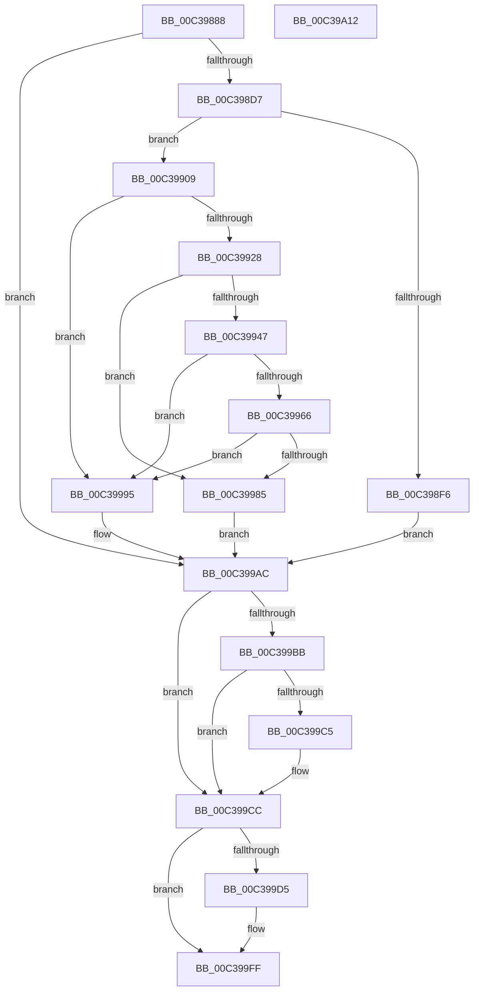

# KiInitializeNxSupportDiscard

- RVA: `0x00C39888`–`0x00C39A13` (길이 `395` bytes)
- VA: `0x0000000140C39888`
- 실행 섹션: `INIT`
- PDB 이름 있음: `예`; PDB Function 태그: `아니요`
- unwind 정보 RVA: `0x000AB2E4`
- 디코드: `86`개 명령, `395/395` bytes 표시
- 미해석 바이트: `0` (있으면 어셈블리에 `.byte`로 보존)

> 이 문서는 커널 이미지의 기계어와 PDB 기호를 분석해 생성했습니다. 4번과 5번은 함수 원형과 자료형을 바이너리 사용 방식에서 추정한 C 해석이며 원본 소스 복구 결과는 아닙니다.

## 1. Dependencies

- 직접 호출 지점: **9**; 고유 호출 대상: **4**
- 직접 호출자로 확인된 함수: **1**
- RIP 상대 이미지 참조: **10**

### Outgoing calls
- `0x00C398C9` → [strstr](../../text/4F/strstr_function_004FF680.md) (function, `0x004FF680`)
- `0x00C398EC` → [strstr](../../text/4F/strstr_function_004FF680.md) (function, `0x004FF680`)
- `0x00C3991E` → [strstr](../../text/4F/strstr_function_004FF680.md) (function, `0x004FF680`)
- `0x00C3993D` → [strstr](../../text/4F/strstr_function_004FF680.md) (function, `0x004FF680`)
- `0x00C3995C` → [strstr](../../text/4F/strstr_function_004FF680.md) (function, `0x004FF680`)
- `0x00C3997B` → [strstr](../../text/4F/strstr_function_004FF680.md) (function, `0x004FF680`)
- `0x00C399BB` → [KiGetCpuVendor](../../pagelk/B7/KiGetCpuVendor_function_00B7D5B4.md) (function, `0x00B7D5B4`)
- `0x00C399CC` → [KiIsNXSupported](../../pagelk/B6/KiIsNXSupported_function_00B66C98.md) (function, `0x00B66C98`)
- `0x00C39A07` → [_security_check_cookie](../../text/6A/_security_check_cookie_function_006AC640.md) (function, `0x006AC640`)

### Direct callers
- [KiInitializeBootStructures](../../pagelk/B6/KiInitializeBootStructures_function_00B68530.md) at `0x00B688A0`

### Static image references
- `0x00C3988E` → RVA `0x00E0A740` (`.data`; read)
- `0x00C3989D` → RVA `0x00FC5008` (`ALMOSTRO`; read)
- `0x00C398A4` → RVA `0x00C7B2E0` (` ?? ::PBOPGDP::`string'`; read)
- `0x00C398BB` → RVA `0x00FC6B20` (`ALMOSTRO`; read)
- `0x00C398DE` → RVA `0x00C7B2C0` (` ?? ::PBOPGDP::`string'`; read)
- `0x00C39910` → RVA `0x00C7B320` (` ?? ::PBOPGDP::`string'`; read)
- `0x00C3992F` → RVA `0x00C7B300` (` ?? ::PBOPGDP::`string'`; read)
- `0x00C3994E` → RVA `0x00C7B340` (` ?? ::PBOPGDP::`string'`; read)
- `0x00C3996D` → RVA `0x00C7B330` (` ?? ::PBOPGDP::`string'`; read)
- `0x00C399C5` → RVA `0x00E668FA` (`.data`; write)

## 2. Other-region calls and transfers

- 다른 실행 섹션으로 향하는 call: **9**
  - `0x00C398C9` → [strstr](../../text/4F/strstr_function_004FF680.md) (`INIT` → `.text`)
  - `0x00C398EC` → [strstr](../../text/4F/strstr_function_004FF680.md) (`INIT` → `.text`)
  - `0x00C3991E` → [strstr](../../text/4F/strstr_function_004FF680.md) (`INIT` → `.text`)
  - `0x00C3993D` → [strstr](../../text/4F/strstr_function_004FF680.md) (`INIT` → `.text`)
  - `0x00C3995C` → [strstr](../../text/4F/strstr_function_004FF680.md) (`INIT` → `.text`)
  - `0x00C3997B` → [strstr](../../text/4F/strstr_function_004FF680.md) (`INIT` → `.text`)
  - `0x00C399BB` → [KiGetCpuVendor](../../pagelk/B7/KiGetCpuVendor_function_00B7D5B4.md) (`INIT` → `PAGELK`)
  - `0x00C399CC` → [KiIsNXSupported](../../pagelk/B6/KiIsNXSupported_function_00B66C98.md) (`INIT` → `PAGELK`)
  - `0x00C39A07` → [_security_check_cookie](../../text/6A/_security_check_cookie_function_006AC640.md) (`INIT` → `.text`)
- 별도 외부 분기/꼬리 이동을 확인하지 못했습니다.

## 3. Assembly (complete function range)

```asm
00C39888  40 53                           push rbx
00C3988A  48 83 EC 40                     sub rsp, 0x40
00C3988E  48 8B 05 AB 0E 1D 00            mov rax, qword ptr [rip + 0x1d0eab]
00C39895  48 33 C4                        xor rax, rsp
00C39898  48 89 44 24 30                  mov qword ptr [rsp + 0x30], rax
00C3989D  48 8B 0D 64 B7 38 00            mov rcx, qword ptr [rip + 0x38b764]
00C398A4  48 8D 15 35 1A 04 00            lea rdx, [rip + 0x41a35]
00C398AB  8A 81 D5 02 00 00               mov al, byte ptr [rcx + 0x2d5]
00C398B1  24 FD                           and al, 0xfd
00C398B3  0C 01                           or al, 1
00C398B5  88 81 D5 02 00 00               mov byte ptr [rcx + 0x2d5], al
00C398BB  48 8B 0D 5E D2 38 00            mov rcx, qword ptr [rip + 0x38d25e]
00C398C2  48 8B 89 D8 00 00 00            mov rcx, qword ptr [rcx + 0xd8]
00C398C9  E8 B2 5D 8C FF                  call 0x1404ff680
00C398CE  48 85 C0                        test rax, rax
00C398D1  0F 85 D5 00 00 00               jne 0x140c399ac
00C398D7  48 8B 0D 42 D2 38 00            mov rcx, qword ptr [rip + 0x38d242]
00C398DE  48 8D 15 DB 19 04 00            lea rdx, [rip + 0x419db]
00C398E5  48 8B 89 D8 00 00 00            mov rcx, qword ptr [rcx + 0xd8]
00C398EC  E8 8F 5D 8C FF                  call 0x1404ff680
00C398F1  48 85 C0                        test rax, rax
00C398F4  74 13                           je 0x140c39909
00C398F6  48 8B 05 0B B7 38 00            mov rax, qword ptr [rip + 0x38b70b]
00C398FD  80 88 D5 02 00 00 03            or byte ptr [rax + 0x2d5], 3
00C39904  E9 A3 00 00 00                  jmp 0x140c399ac
00C39909  48 8B 0D 10 D2 38 00            mov rcx, qword ptr [rip + 0x38d210]
00C39910  48 8D 15 09 1A 04 00            lea rdx, [rip + 0x41a09]
00C39917  48 8B 89 D8 00 00 00            mov rcx, qword ptr [rcx + 0xd8]
00C3991E  E8 5D 5D 8C FF                  call 0x1404ff680
00C39923  48 85 C0                        test rax, rax
00C39926  75 6D                           jne 0x140c39995
00C39928  48 8B 0D F1 D1 38 00            mov rcx, qword ptr [rip + 0x38d1f1]
00C3992F  48 8D 15 CA 19 04 00            lea rdx, [rip + 0x419ca]
00C39936  48 8B 89 D8 00 00 00            mov rcx, qword ptr [rcx + 0xd8]
00C3993D  E8 3E 5D 8C FF                  call 0x1404ff680
00C39942  48 85 C0                        test rax, rax
00C39945  75 3E                           jne 0x140c39985
00C39947  48 8B 0D D2 D1 38 00            mov rcx, qword ptr [rip + 0x38d1d2]
00C3994E  48 8D 15 EB 19 04 00            lea rdx, [rip + 0x419eb]
00C39955  48 8B 89 D8 00 00 00            mov rcx, qword ptr [rcx + 0xd8]
00C3995C  E8 1F 5D 8C FF                  call 0x1404ff680
00C39961  48 85 C0                        test rax, rax
00C39964  75 2F                           jne 0x140c39995
00C39966  48 8B 0D B3 D1 38 00            mov rcx, qword ptr [rip + 0x38d1b3]
00C3996D  48 8D 15 BC 19 04 00            lea rdx, [rip + 0x419bc]
00C39974  48 8B 89 D8 00 00 00            mov rcx, qword ptr [rcx + 0xd8]
00C3997B  E8 00 5D 8C FF                  call 0x1404ff680
00C39980  48 85 C0                        test rax, rax
00C39983  74 10                           je 0x140c39995
00C39985  48 8B 05 7C B6 38 00            mov rax, qword ptr [rip + 0x38b67c]
00C3998C  80 A0 D5 02 00 00 FC            and byte ptr [rax + 0x2d5], 0xfc
00C39993  EB 17                           jmp 0x140c399ac
00C39995  48 8B 0D 6C B6 38 00            mov rcx, qword ptr [rip + 0x38b66c]
00C3999C  8A 81 D5 02 00 00               mov al, byte ptr [rcx + 0x2d5]
00C399A2  24 FE                           and al, 0xfe
00C399A4  0C 02                           or al, 2
00C399A6  88 81 D5 02 00 00               mov byte ptr [rcx + 0x2d5], al
00C399AC  33 C9                           xor ecx, ecx
00C399AE  B8 01 00 00 00                  mov eax, 1
00C399B3  0F A2                           cpuid
00C399B5  0F BA E2 1A                     bt edx, 0x1a
00C399B9  73 11                           jae 0x140c399cc
00C399BB  E8 F4 3B F4 FF                  call 0x140b7d5b4
00C399C0  83 F8 02                        cmp eax, 2
00C399C3  75 07                           jne 0x140c399cc
00C399C5  C6 05 2E CF 22 00 01            mov byte ptr [rip + 0x22cf2e], 1
00C399CC  E8 C7 D2 F2 FF                  call 0x140b66c98
00C399D1  84 C0                           test al, al
00C399D3  74 2A                           je 0x140c399ff
00C399D5  B9 80 00 00 C0                  mov ecx, 0xc0000080
00C399DA  0F 32                           rdmsr
00C399DC  48 C1 E2 20                     shl rdx, 0x20
00C399E0  48 0B C2                        or rax, rdx
00C399E3  48 0F BA E8 0B                  bts rax, 0xb
00C399E8  48 8B D0                        mov rdx, rax
00C399EB  48 C1 EA 20                     shr rdx, 0x20
00C399EF  0F 30                           wrmsr
00C399F1  48 8B 05 10 B6 38 00            mov rax, qword ptr [rip + 0x38b610]
00C399F8  C6 80 80 02 00 00 01            mov byte ptr [rax + 0x280], 1
00C399FF  48 8B 4C 24 30                  mov rcx, qword ptr [rsp + 0x30]
00C39A04  48 33 CC                        xor rcx, rsp
00C39A07  E8 34 2C A7 FF                  call 0x1406ac640
00C39A0C  48 83 C4 40                     add rsp, 0x40
00C39A10  5B                              pop rbx
00C39A11  C3                              ret
00C39A12  CC                              int3
```

## 4. C-style interpretation (structured pseudocode)

```c
__int64 __fastcall KiInitializeNxSupportDiscard(void)
{
    __int64 result;
    __int64 v_rsp;
    unsigned __int64 v_stack_m18;

    v_rsp = (v_rsp) - (64);
    result = (*(unsigned __int64 *)(v_rip + 1904299)) ^ (v_rsp);
    v_stack_m18 = result;
    result = (unsigned __int8)((*(unsigned __int8 *)(*(unsigned __int64 *)(v_rip + 3716964) + 725)) & (253));
    result = (unsigned __int8)((result) | (1));
    *(unsigned __int8 *)(*(unsigned __int64 *)(v_rip + 3716964) + 725) = (unsigned __int8)(result);
    result = strstr(*(unsigned __int64 *)(*(unsigned __int64 *)(v_rip + 3723870) + 216), v_rip + 268853, a3, a4);
    if (result != 0) goto loc_00C399AC;
    result = strstr(*(unsigned __int64 *)(*(unsigned __int64 *)(v_rip + 3723842) + 216), v_rip + 268763, a3, a4);
    if (result == 0) goto loc_00C39909;
    goto loc_00C399AC;
loc_00C39909:
    result = strstr(*(unsigned __int64 *)(*(unsigned __int64 *)(v_rip + 3723792) + 216), v_rip + 268809, a3, a4);
    if (result != 0) goto loc_00C39995;
    result = strstr(*(unsigned __int64 *)(*(unsigned __int64 *)(v_rip + 3723761) + 216), v_rip + 268746, a3, a4);
    if (result != 0) goto loc_00C39985;
    result = strstr(*(unsigned __int64 *)(*(unsigned __int64 *)(v_rip + 3723730) + 216), v_rip + 268779, a3, a4);
    if (result != 0) goto loc_00C39995;
    result = strstr(*(unsigned __int64 *)(*(unsigned __int64 *)(v_rip + 3723699) + 216), v_rip + 268732, a3, a4);
    if (result == 0) goto loc_00C39995;
loc_00C39985:
    goto loc_00C399AC;
loc_00C39995:
    result = (unsigned __int8)((*(unsigned __int8 *)(*(unsigned __int64 *)(v_rip + 3716716) + 725)) & (254));
    result = (unsigned __int8)((result) | (2));
    *(unsigned __int8 *)(*(unsigned __int64 *)(v_rip + 3716716) + 725) = (unsigned __int8)(result);
loc_00C399AC:
    a1 = 0;
    if (condition_is_above_or_equal) goto loc_00C399CC;
    result = KiGetCpuVendor(a1, v_rip + 268732, a3, a4);
    if (((unsigned int)(result)) == 2) {
        *(unsigned __int8 *)(v_rip + 2281262) = 1;
    }
    result = KiIsNXSupported(a1, v_rip + 268732, a3, a4);
    if ((unsigned __int8)(result) != 0) {
        a1 = 0xC0000080ULL;
        a2 = (v_rip + 268732) << (32);
        result = (result) | (a2);
        a2 = result;
        a2 = (a2) >> (32);
        result = *(unsigned __int64 *)(v_rip + 3716624);
        *(unsigned __int8 *)(result + 640) = 1;
    }
    a1 = (v_stack_m18) ^ (v_rsp);
    result = _security_check_cookie(a1, a2, a3, a4);
    v_rsp = (v_rsp) + (64);
    return result;
}
```

## 5. (Beta) C Style

```c
void KiInitializeNxSupportDiscard(void)
{
    int64_t result;
    int64_t local_rsp;
    uint64_t v_stack_m18;

    local_rsp = (local_rsp) - (64);
    result = (*(uint64_t *)(v_rip + 0x1D0EAB)) ^ (local_rsp);
    v_stack_m18 = result;
    result = (uint8_t)((*(uint8_t *)(*(uint64_t *)(v_rip + 0x38B764) + 0x2D5)) & (253));
    result = (uint8_t)((result) | (1));
    *(uint8_t *)(*(uint64_t *)(v_rip + 0x38B764) + 0x2D5) = (uint8_t)(result);
    result = strstr(*(uint64_t *)(*(uint64_t *)(v_rip + 0x38D25E) + 0xD8), v_rip + 268853, a3, a4);
    if (result != 0) goto loc_00C399AC;
    result = strstr(*(uint64_t *)(*(uint64_t *)(v_rip + 0x38D242) + 0xD8), v_rip + 268763, a3, a4);
    if (result == 0) goto loc_00C39909;
    goto loc_00C399AC;
loc_00C39909:
    result = strstr(*(uint64_t *)(*(uint64_t *)(v_rip + 0x38D210) + 0xD8), v_rip + 268809, a3, a4);
    if (result != 0) goto loc_00C39995;
    result = strstr(*(uint64_t *)(*(uint64_t *)(v_rip + 0x38D1F1) + 0xD8), v_rip + 268746, a3, a4);
    if (result != 0) goto loc_00C39985;
    result = strstr(*(uint64_t *)(*(uint64_t *)(v_rip + 0x38D1D2) + 0xD8), v_rip + 268779, a3, a4);
    if (result != 0) goto loc_00C39995;
    result = strstr(*(uint64_t *)(*(uint64_t *)(v_rip + 0x38D1B3) + 0xD8), v_rip + 268732, a3, a4);
    if (result == 0) goto loc_00C39995;
loc_00C39985:
    goto loc_00C399AC;
loc_00C39995:
    result = (uint8_t)((*(uint8_t *)(*(uint64_t *)(v_rip + 0x38B66C) + 0x2D5)) & (254));
    result = (uint8_t)((result) | (2));
    *(uint8_t *)(*(uint64_t *)(v_rip + 0x38B66C) + 0x2D5) = (uint8_t)(result);
loc_00C399AC:
    a1 = 0;
    if (condition_is_above_or_equal) goto loc_00C399CC;
    result = KiGetCpuVendor(a1, v_rip + 268732, a3, a4);
    if (((uint32_t)(result)) == 2) {
        *(uint8_t *)(v_rip + 0x22CF2E) = 1;
    }
    result = KiIsNXSupported(a1, v_rip + 268732, a3, a4);
    if ((uint8_t)(result) != 0) {
        a1 = 0xC0000080ULL;
        a2 = (v_rip + 268732) << (32);
        result = (result) | (a2);
        a2 = result;
        a2 = (a2) >> (32);
        result = *(uint64_t *)(v_rip + 0x38B610);
        *(uint8_t *)(result + 0x280) = 1;
    }
    a1 = (v_stack_m18) ^ (local_rsp);
    result = _security_check_cookie(a1, a2, a3, a4);
    local_rsp = (local_rsp) + (64);
    return result;
}
```

## 6. Execution-region graph

[열기: 2D/3D 그래프와 함수 탐색 컨트롤 패널](../../../control-panel.html?section=init&rva=0x00C39888&view=graph)

- 2D 그래프는 위에서 아래로 흐르고, 3D 그래프는 빈 공간을 드래그해 회전합니다. Shift+드래그는 이동, 휠은 확대·축소, 함수 노드 선택은 대상 보고서 이동입니다.

### Static fallback


