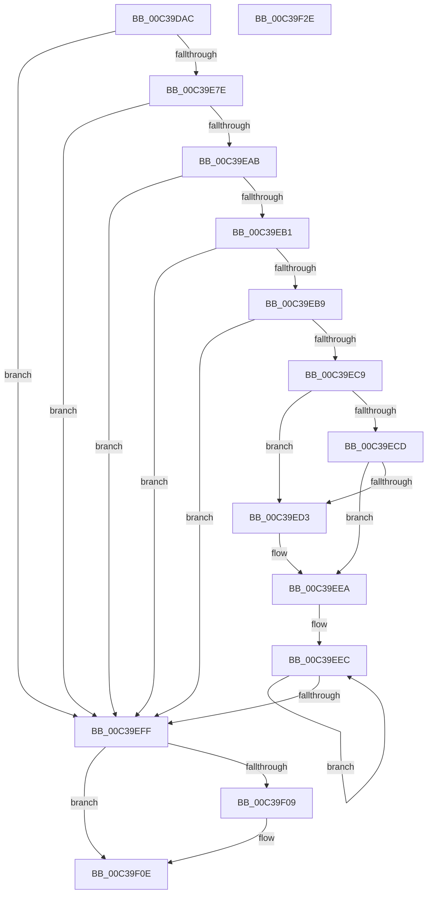

# KiInitializeReservedCpuSets

- RVA: `0x00C39DAC`–`0x00C39F2F` (길이 `387` bytes)
- VA: `0x0000000140C39DAC`
- 실행 섹션: `INIT`
- PDB 이름 있음: `예`; PDB Function 태그: `아니요`
- unwind 정보 RVA: `0x000CA710`
- 디코드: `89`개 명령, `387/387` bytes 표시
- 미해석 바이트: `0` (있으면 어셈블리에 `.byte`로 보존)

> 이 문서는 커널 이미지의 기계어와 PDB 기호를 분석해 생성했습니다. 4번과 5번은 함수 원형과 자료형을 바이너리 사용 방식에서 추정한 C 해석이며 원본 소스 복구 결과는 아닙니다.

## 1. Dependencies

- 직접 호출 지점: **9**; 고유 호출 대상: **8**
- 직접 호출자로 확인된 함수: **1**
- RIP 상대 이미지 참조: **4**

### Outgoing calls
- `0x00C39DDE` → [memset](../../text/6C/memset_function_006C6C40.md) (function, `0x006C6C40`)
- `0x00C39E3F` → [memset](../../text/6C/memset_function_006C6C40.md) (function, `0x006C6C40`)
- `0x00C39E71` → [ZwOpenKey](../../text/6A/ZwOpenKey_function_006AD310.md) (function, `0x006AD310`)
- `0x00C39EA2` → [ZwQueryValueKey](../../text/6A/ZwQueryValueKey_function_006AD3B0.md) (function, `0x006AD3B0`)
- `0x00C39EC0` → [KiValidateCpuSetMasks](../../text/30/KiValidateCpuSetMasks_function_00304238.md) (function, `0x00304238`)
- `0x00C39EE5` → [memcpy](../../text/6C/memcpy_function_006C6840.md) (function, `0x006C6840`)
- `0x00C39EF3` → [KeModifySystemAllowedCpuSets](../../text/30/KeModifySystemAllowedCpuSets_function_00303308.md) (function, `0x00303308`)
- `0x00C39F09` → [ZwClose](../../text/6A/ZwClose_function_006AD2B0.md) (function, `0x006AD2B0`)
- `0x00C39F18` → [_security_check_cookie](../../text/6A/_security_check_cookie_function_006AC640.md) (function, `0x006AC640`)

### Direct callers
- [KeInitSystem](../C7/KeInitSystem_function_00C71660.md) at `0x00C71BE1`

### Static image references
- `0x00C39DC1` → RVA `0x00E0A740` (`.data`; read)
- `0x00C39DE8` → RVA `0x00C7B440` (` ?? ::PBOPGDP::`string'`; read)
- `0x00C39DF4` → RVA `0x00FC8720` (`ALMOSTRO`; read)
- `0x00C39E0E` → RVA `0x00C7B420` (` ?? ::PBOPGDP::`string'`; read)

## 2. Other-region calls and transfers

- 다른 실행 섹션으로 향하는 call: **9**
  - `0x00C39DDE` → [memset](../../text/6C/memset_function_006C6C40.md) (`INIT` → `.text`)
  - `0x00C39E3F` → [memset](../../text/6C/memset_function_006C6C40.md) (`INIT` → `.text`)
  - `0x00C39E71` → [ZwOpenKey](../../text/6A/ZwOpenKey_function_006AD310.md) (`INIT` → `.text`)
  - `0x00C39EA2` → [ZwQueryValueKey](../../text/6A/ZwQueryValueKey_function_006AD3B0.md) (`INIT` → `.text`)
  - `0x00C39EC0` → [KiValidateCpuSetMasks](../../text/30/KiValidateCpuSetMasks_function_00304238.md) (`INIT` → `.text`)
  - `0x00C39EE5` → [memcpy](../../text/6C/memcpy_function_006C6840.md) (`INIT` → `.text`)
  - `0x00C39EF3` → [KeModifySystemAllowedCpuSets](../../text/30/KeModifySystemAllowedCpuSets_function_00303308.md) (`INIT` → `.text`)
  - `0x00C39F09` → [ZwClose](../../text/6A/ZwClose_function_006AD2B0.md) (`INIT` → `.text`)
  - `0x00C39F18` → [_security_check_cookie](../../text/6A/_security_check_cookie_function_006AC640.md) (`INIT` → `.text`)
- 별도 외부 분기/꼬리 이동을 확인하지 못했습니다.

## 3. Assembly (complete function range)

```asm
00C39DAC  48 89 5C 24 08                  mov qword ptr [rsp + 8], rbx
00C39DB1  55                              push rbp
00C39DB2  48 8D AC 24 50 FF FF FF         lea rbp, [rsp - 0xb0]
00C39DBA  48 81 EC B0 01 00 00            sub rsp, 0x1b0
00C39DC1  48 8B 05 78 09 1D 00            mov rax, qword ptr [rip + 0x1d0978]
00C39DC8  48 33 C4                        xor rax, rsp
00C39DCB  48 89 85 A0 00 00 00            mov qword ptr [rbp + 0xa0], rax
00C39DD2  33 D2                           xor edx, edx
00C39DD4  48 8D 4D 90                     lea rcx, [rbp - 0x70]
00C39DD8  41 B8 10 01 00 00               mov r8d, 0x110
00C39DDE  E8 5D CE A8 FF                  call 0x1406c6c40
00C39DE3  83 64 24 7C 00                  and dword ptr [rsp + 0x7c], 0
00C39DE8  48 8D 05 51 16 04 00            lea rax, [rip + 0x41651]
00C39DEF  83 64 24 30 00                  and dword ptr [rsp + 0x30], 0
00C39DF4  48 8D 0D 25 E9 38 00            lea rcx, [rip + 0x38e925]
00C39DFB  48 83 64 24 38 00               and qword ptr [rsp + 0x38], 0
00C39E01  33 D2                           xor edx, edx
00C39E03  48 89 44 24 48                  mov qword ptr [rsp + 0x48], rax
00C39E08  41 B8 00 01 00 00               mov r8d, 0x100
00C39E0E  48 8D 05 0B 16 04 00            lea rax, [rip + 0x4160b]
00C39E15  48 C7 44 24 60 30 00 00 00      mov qword ptr [rsp + 0x60], 0x30
00C39E1E  83 64 24 64 00                  and dword ptr [rsp + 0x64], 0
00C39E23  BB 20 00 00 00                  mov ebx, 0x20
00C39E28  48 89 44 24 58                  mov qword ptr [rsp + 0x58], rax
00C39E2D  48 C7 44 24 40 92 00 94 00      mov qword ptr [rsp + 0x40], 0x940092
00C39E36  48 C7 44 24 50 1E 00 20 00      mov qword ptr [rsp + 0x50], 0x20001e
00C39E3F  E8 FC CD A8 FF                  call 0x1406c6c40
00C39E44  48 83 64 24 68 00               and qword ptr [rsp + 0x68], 0
00C39E4A  48 8D 44 24 40                  lea rax, [rsp + 0x40]
00C39E4F  0F 57 C0                        xorps xmm0, xmm0
00C39E52  48 89 44 24 70                  mov qword ptr [rsp + 0x70], rax
00C39E57  4C 8D 44 24 60                  lea r8, [rsp + 0x60]
00C39E5C  C7 44 24 78 40 02 00 00         mov dword ptr [rsp + 0x78], 0x240
00C39E64  8D 53 E1                        lea edx, [rbx - 0x1f]
00C39E67  48 8D 4C 24 38                  lea rcx, [rsp + 0x38]
00C39E6C  F3 0F 7F 45 80                  movdqu xmmword ptr [rbp - 0x80], xmm0
00C39E71  E8 9A 34 A7 FF                  call 0x1406ad310
00C39E76  85 C0                           test eax, eax
00C39E78  0F 88 81 00 00 00               js 0x140c39eff
00C39E7E  48 8B 4C 24 38                  mov rcx, qword ptr [rsp + 0x38]
00C39E83  48 8D 44 24 30                  lea rax, [rsp + 0x30]
00C39E88  48 89 44 24 28                  mov qword ptr [rsp + 0x28], rax
00C39E8D  4C 8D 4D 90                     lea r9, [rbp - 0x70]
00C39E91  44 8D 43 E2                     lea r8d, [rbx - 0x1e]
00C39E95  C7 44 24 20 10 01 00 00         mov dword ptr [rsp + 0x20], 0x110
00C39E9D  48 8D 54 24 50                  lea rdx, [rsp + 0x50]
00C39EA2  E8 09 35 A7 FF                  call 0x1406ad3b0
00C39EA7  85 C0                           test eax, eax
00C39EA9  78 54                           js 0x140c39eff
00C39EAB  83 7D 94 03                     cmp dword ptr [rbp - 0x6c], 3
00C39EAF  75 4E                           jne 0x140c39eff
00C39EB1  8B 55 98                        mov edx, dword ptr [rbp - 0x68]
00C39EB4  F6 C2 07                        test dl, 7
00C39EB7  75 46                           jne 0x140c39eff
00C39EB9  C1 EA 03                        shr edx, 3
00C39EBC  48 8D 4D 9C                     lea rcx, [rbp - 0x64]
00C39EC0  E8 73 A3 6C FF                  call 0x140304238
00C39EC5  85 C0                           test eax, eax
00C39EC7  78 36                           js 0x140c39eff
00C39EC9  3B D3                           cmp edx, ebx
00C39ECB  73 06                           jae 0x140c39ed3
00C39ECD  8B DA                           mov ebx, edx
00C39ECF  85 D2                           test edx, edx
00C39ED1  74 17                           je 0x140c39eea
00C39ED3  44 8B C3                        mov r8d, ebx
00C39ED6  48 8D 55 9C                     lea rdx, [rbp - 0x64]
00C39EDA  49 C1 E0 03                     shl r8, 3
00C39EDE  48 8D 0D 3B E8 38 00            lea rcx, [rip + 0x38e83b]
00C39EE5  E8 56 C9 A8 FF                  call 0x1406c6840
00C39EEA  33 DB                           xor ebx, ebx
00C39EEC  44 8B CB                        mov r9d, ebx
00C39EEF  33 D2                           xor edx, edx
00C39EF1  33 C9                           xor ecx, ecx
00C39EF3  E8 10 94 6C FF                  call 0x140303308
00C39EF8  FF C3                           inc ebx
00C39EFA  83 FB 02                        cmp ebx, 2
00C39EFD  7C ED                           jl 0x140c39eec
00C39EFF  48 8B 4C 24 38                  mov rcx, qword ptr [rsp + 0x38]
00C39F04  48 85 C9                        test rcx, rcx
00C39F07  74 05                           je 0x140c39f0e
00C39F09  E8 A2 33 A7 FF                  call 0x1406ad2b0
00C39F0E  48 8B 8D A0 00 00 00            mov rcx, qword ptr [rbp + 0xa0]
00C39F15  48 33 CC                        xor rcx, rsp
00C39F18  E8 23 27 A7 FF                  call 0x1406ac640
00C39F1D  48 8B 9C 24 C0 01 00 00         mov rbx, qword ptr [rsp + 0x1c0]
00C39F25  48 81 C4 B0 01 00 00            add rsp, 0x1b0
00C39F2C  5D                              pop rbp
00C39F2D  C3                              ret
00C39F2E  CC                              int3
```

## 4. C-style interpretation (structured pseudocode)

```c
__int64 __fastcall KiInitializeReservedCpuSets(__int64 a1, int a2)
{
    __int64 result;
    __int64 v_rbx;
    __int64 v_rsp;
    unsigned __int64 v_stack_m11C;
    unsigned int v_stack_m120;
    unsigned int v_stack_m124;
    unsigned __int64 v_stack_m128;
    unsigned __int64 v_stack_m138;
    unsigned int v_stack_m13C;
    unsigned int v_stack_m140;
    unsigned __int64 v_stack_m148;
    unsigned __int64 v_stack_m150;
    unsigned int v_stack_m154;
    unsigned __int64 v_stack_m158;
    unsigned __int64 v_stack_m160;
    unsigned __int64 v_stack_m168;
    unsigned __int64 v_stack_m170;
    unsigned __int64 v_stack_m178;
    unsigned __int64 v_stack_m18;
    unsigned __int64 v_stack_m180;
    unsigned int v_stack_m188;
    unsigned __int64 v_stack_m190;
    unsigned int v_stack_m198;
    unsigned __int64 v_stack_mB8;
    unsigned __int64 v_stack_p8;

    v_stack_p8 = v_rbx;
    v_rsp = (v_rsp) - (432);
    result = (*(unsigned __int64 *)(v_rip + 1902968)) ^ (v_rsp);
    v_stack_m18 = result;
    a2 = 0;
    result = memset(v_stack_m128, a2, 272, a4);
    a2 = 0;
    v_stack_m170 = v_rip + 267857;
    v_stack_m158 = 48;
    v_stack_m160 = v_rip + 267787;
    v_stack_m178 = 0x940092ULL;
    v_stack_m168 = 0x20001EULL;
    result = memset(v_rip + 3729701, a2, 256, a4);
    v_stack_m148 = v_stack_m178;
    v_stack_m140 = 576;
    v_stack_m138 = v_xmm0;
    result = ZwOpenKey(v_stack_m180, 32 - 31, v_stack_m158, a4);
    if (sign_flag) goto loc_00C39EFF;
    v_stack_m190 = v_stack_m188;
    v_stack_m198 = 272;
    result = ZwQueryValueKey(v_stack_m180, v_stack_m168, 32 - 30, v_stack_m128);
    if (sign_flag) goto loc_00C39EFF;
    if (v_stack_m124 != 3) goto loc_00C39EFF;
    if ((((unsigned __int8)((unsigned int)(v_stack_m120))) & (7)) != 0) goto loc_00C39EFF;
    a2 = (unsigned int)(((unsigned int)(v_stack_m120)) >> (3));
    result = KiValidateCpuSetMasks(v_stack_m11C, a2, 32 - 30, v_stack_m128);
    if (sign_flag) goto loc_00C39EFF;
    if (a2 >= 32) goto loc_00C39ED3;
    if (a2 != 0) {
        a3 = (unsigned int)((unsigned int)(a2));
        a2 = v_stack_m11C;
        a3 = (a3) << (3);
        a1 = v_rip + 3729467;
        result = memcpy(a1, a2, a3, v_stack_m128);
    }
    v_rbx = 0;
loc_00C39EEC:
    a2 = 0;
    a1 = 0;
    result = KeModifySystemAllowedCpuSets(a1, a2, a3, 0);
    v_rbx = (unsigned int)((v_rbx) + 1);
    if (((unsigned int)(v_rbx)) < 2) goto loc_00C39EEC;
loc_00C39EFF:
    if (v_stack_m180 != 0) {
        result = ZwClose(v_stack_m180, a2, a3, 0);
    }
    a1 = (v_stack_m18) ^ (v_rsp);
    result = _security_check_cookie(a1, a2, a3, 0);
    v_rsp = (v_rsp) + (432);
    return result;
}
```

## 5. (Beta) C Style

```c
int64_t KiInitializeReservedCpuSets(int64_t Arg1, int32_t Arg2)
{
    int64_t result;
    int64_t local_rbx;
    int64_t local_rsp;
    uint64_t v_stack_m11C;
    uint32_t v_stack_m120;
    uint32_t v_stack_m124;
    uint64_t v_stack_m128;
    uint64_t v_stack_m138;
    uint32_t v_stack_m13C;
    uint32_t v_stack_m140;
    uint64_t v_stack_m148;
    uint64_t v_stack_m150;
    uint32_t v_stack_m154;
    uint64_t v_stack_m158;
    uint64_t v_stack_m160;
    uint64_t v_stack_m168;
    uint64_t v_stack_m170;
    uint64_t v_stack_m178;
    uint64_t v_stack_m18;
    uint64_t v_stack_m180;
    uint32_t v_stack_m188;
    uint64_t v_stack_m190;
    uint32_t v_stack_m198;
    uint64_t v_stack_mB8;
    uint64_t v_stack_p8;

    v_stack_p8 = local_rbx;
    local_rsp = (local_rsp) - (432);
    result = (*(uint64_t *)(v_rip + 0x1D0978)) ^ (local_rsp);
    v_stack_m18 = result;
    Arg2 = 0;
    result = memset(v_stack_m128, Arg2, 272, a4);
    Arg2 = 0;
    v_stack_m170 = v_rip + 267857;
    v_stack_m158 = 48;
    v_stack_m160 = v_rip + 267787;
    v_stack_m178 = 0x940092ULL;
    v_stack_m168 = 0x20001EULL;
    result = memset(v_rip + 3729701, Arg2, 256, a4);
    v_stack_m148 = v_stack_m178;
    v_stack_m140 = 576;
    v_stack_m138 = v_xmm0;
    result = ZwOpenKey(v_stack_m180, 32 - 31, v_stack_m158, a4);
    if (sign_flag) goto loc_00C39EFF;
    v_stack_m190 = v_stack_m188;
    v_stack_m198 = 272;
    result = ZwQueryValueKey(v_stack_m180, v_stack_m168, 32 - 30, v_stack_m128);
    if (sign_flag) goto loc_00C39EFF;
    if (v_stack_m124 != 3) goto loc_00C39EFF;
    if ((((uint8_t)((uint32_t)(v_stack_m120))) & (7)) != 0) goto loc_00C39EFF;
    Arg2 = (uint32_t)(((uint32_t)(v_stack_m120)) >> (3));
    result = KiValidateCpuSetMasks(v_stack_m11C, Arg2, 32 - 30, v_stack_m128);
    if (sign_flag) goto loc_00C39EFF;
    if (Arg2 >= 32) goto loc_00C39ED3;
    if (Arg2 != 0) {
        a3 = (uint32_t)((uint32_t)(Arg2));
        Arg2 = v_stack_m11C;
        a3 = (a3) << (3);
        Arg1 = v_rip + 3729467;
        result = memcpy(Arg1, Arg2, a3, v_stack_m128);
    }
    local_rbx = 0;
loc_00C39EEC:
    Arg2 = 0;
    Arg1 = 0;
    result = KeModifySystemAllowedCpuSets(Arg1, Arg2, a3, 0);
    local_rbx = (uint32_t)((local_rbx) + 1);
    if (((uint32_t)(local_rbx)) < 2) goto loc_00C39EEC;
loc_00C39EFF:
    if (v_stack_m180 != 0) {
        result = ZwClose(v_stack_m180, Arg2, a3, 0);
    }
    Arg1 = (v_stack_m18) ^ (local_rsp);
    result = _security_check_cookie(Arg1, Arg2, a3, 0);
    local_rsp = (local_rsp) + (432);
    return result;
}
```

## 6. Execution-region graph

[열기: 2D/3D 그래프와 함수 탐색 컨트롤 패널](../../../control-panel.html?section=init&rva=0x00C39DAC&view=graph)

- 2D 그래프는 위에서 아래로 흐르고, 3D 그래프는 빈 공간을 드래그해 회전합니다. Shift+드래그는 이동, 휠은 확대·축소, 함수 노드 선택은 대상 보고서 이동입니다.

### Static fallback


