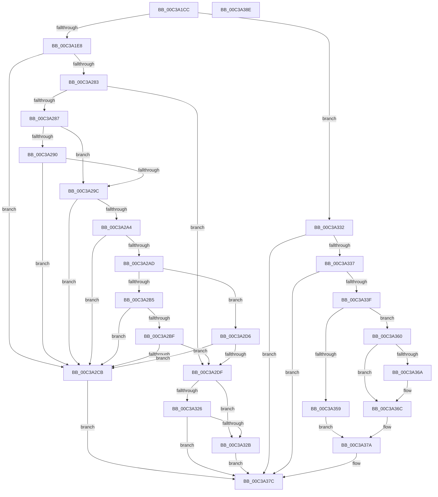

# KiIntSteerInit

- RVA: `0x00C3A1CC`–`0x00C3A38F` (길이 `451` bytes)
- VA: `0x0000000140C3A1CC`
- 실행 섹션: `INIT`
- PDB 이름 있음: `예`; PDB Function 태그: `아니요`
- unwind 정보 RVA: `0x000CAA90`
- 디코드: `107`개 명령, `451/451` bytes 표시
- 미해석 바이트: `0` (있으면 어셈블리에 `.byte`로 보존)

> 이 문서는 커널 이미지의 기계어와 PDB 기호를 분석해 생성했습니다. 4번과 5번은 함수 원형과 자료형을 바이너리 사용 방식에서 추정한 C 해석이며 원본 소스 복구 결과는 아닙니다.

## 1. Dependencies

- 직접 호출 지점: **12**; 고유 호출 대상: **9**
- 직접 호출자로 확인된 함수: **1**
- RIP 상대 이미지 참조: **25**

### Outgoing calls
- `0x00C3A224` → [memset](../../text/6C/memset_function_006C6C40.md) (function, `0x006C6C40`)
- `0x00C3A232` → [KeAddProcessorAffinityEx](../../text/25/KeAddProcessorAffinityEx_function_0025B6F0.md) (function, `0x0025B6F0`)
- `0x00C3A251` → [memset](../../text/6C/memset_function_006C6C40.md) (function, `0x006C6C40`)
- `0x00C3A273` → [guard_dispatch_icall](../../text/6B/guard_dispatch_icall_function_006BAAD0.md) (function, `0x006BAAD0`)
- `0x00C3A292` → [KeQueryActiveProcessorCountEx](../../text/24/KeQueryActiveProcessorCountEx_function_00249EF0.md) (function, `0x00249EF0`)
- `0x00C3A2A4` → [HviIsXboxNanovisorPresent](../../text/66/HviIsXboxNanovisorPresent_function_00666980.md) (function, `0x00666980`)
- `0x00C3A2D6` → [HviIsAnyHypervisorPresent](../../text/4A/HviIsAnyHypervisorPresent_function_004ADC50.md) (function, `0x004ADC50`)
- `0x00C3A2F8` → [ExAllocatePool2](../../poolcode/B8/ExAllocatePool2_function_00B820F0.md) (function, `0x00B820F0`)
- `0x00C3A311` → [ExAllocatePool2](../../poolcode/B8/ExAllocatePool2_function_00B820F0.md) (function, `0x00B820F0`)
- `0x00C3A341` → [KeQueryActiveProcessorCountEx](../../text/24/KeQueryActiveProcessorCountEx_function_00249EF0.md) (function, `0x00249EF0`)
- `0x00C3A348` → [IntPartGetClassAffinityGroup](../C6/IntPartGetClassAffinityGroup_function_00C6D2DC.md) (function, `0x00C6D2DC`)
- `0x00C3A36E` → [IntPartCreate](../C6/IntPartCreate_function_00C6D5C4.md) (function, `0x00C6D5C4`)

### Direct callers
- [KeInitSystem](../C7/KeInitSystem_function_00C71660.md) at `0x00C718E2`
- [KeInitSystem](../C7/KeInitSystem_function_00C71660.md) at `0x00C71AF6`

### Static image references
- `0x00C3A1E8` → RVA `0x00F10D50` (`.data`; read)
- `0x00C3A1EF` → RVA `0x00F10D40` (`.data`; write)
- `0x00C3A1F7` → RVA `0x00F10D58` (`.data`; write)
- `0x00C3A204` → RVA `0x00F10D50` (`.data`; write)
- `0x00C3A20B` → RVA `0x00F10BE8` (`.data`; read)
- `0x00C3A212` → RVA `0x00F10CF0` (`.data`; write)
- `0x00C3A219` → RVA `0x00F10BE0` (`.data`; write)
- `0x00C3A22B` → RVA `0x00F10BE0` (`.data`; read)
- `0x00C3A239` → RVA `0x00F10AA0` (`.data`; write)
- `0x00C3A24A` → RVA `0x00F10AA8` (`.data`; read)
- `0x00C3A256` → RVA `0x00E00638` (`.data`; read)
- `0x00C3A262` → RVA `0x00F10A90` (`.data`; read)
- `0x00C3A278` → RVA `0x00FC6D1C` (`ALMOSTRO`; read)
- `0x00C3A287` → RVA `0x00FC5018` (`ALMOSTRO`; read)
- `0x00C3A29C` → RVA `0x00FC521C` (`ALMOSTRO`; read)
- `0x00C3A2AD` → RVA `0x00FC6A97` (`ALMOSTRO`; read)
- `0x00C3A2B5` → RVA `0x00FC6A90` (`ALMOSTRO`; read)
- `0x00C3A2BF` → RVA `0x00FC6AD8` (`ALMOSTRO`; read)
- `0x00C3A2CB` → RVA `0x00F10BA8` (`.data`; write)
- `0x00C3A302` → RVA `0x00F10BB8` (`.data`; write)
- `0x00C3A316` → RVA `0x00F10BB8` (`.data`; read)
- `0x00C3A31D` → RVA `0x00F10BC0` (`.data`; write)
- `0x00C3A337` → RVA `0x00F10BA8` (`.data`; read)
- `0x00C3A34D` → RVA `0x00F10E70` (`.data`; write)
- `0x00C3A373` → RVA `0x00F10E60` (`.data`; write)

## 2. Other-region calls and transfers

- 다른 실행 섹션으로 향하는 call: **10**
  - `0x00C3A224` → [memset](../../text/6C/memset_function_006C6C40.md) (`INIT` → `.text`)
  - `0x00C3A232` → [KeAddProcessorAffinityEx](../../text/25/KeAddProcessorAffinityEx_function_0025B6F0.md) (`INIT` → `.text`)
  - `0x00C3A251` → [memset](../../text/6C/memset_function_006C6C40.md) (`INIT` → `.text`)
  - `0x00C3A273` → [guard_dispatch_icall](../../text/6B/guard_dispatch_icall_function_006BAAD0.md) (`INIT` → `.text`)
  - `0x00C3A292` → [KeQueryActiveProcessorCountEx](../../text/24/KeQueryActiveProcessorCountEx_function_00249EF0.md) (`INIT` → `.text`)
  - `0x00C3A2A4` → [HviIsXboxNanovisorPresent](../../text/66/HviIsXboxNanovisorPresent_function_00666980.md) (`INIT` → `.text`)
  - `0x00C3A2D6` → [HviIsAnyHypervisorPresent](../../text/4A/HviIsAnyHypervisorPresent_function_004ADC50.md) (`INIT` → `.text`)
  - `0x00C3A2F8` → [ExAllocatePool2](../../poolcode/B8/ExAllocatePool2_function_00B820F0.md) (`INIT` → `POOLCODE`)
  - `0x00C3A311` → [ExAllocatePool2](../../poolcode/B8/ExAllocatePool2_function_00B820F0.md) (`INIT` → `POOLCODE`)
  - `0x00C3A341` → [KeQueryActiveProcessorCountEx](../../text/24/KeQueryActiveProcessorCountEx_function_00249EF0.md) (`INIT` → `.text`)
- 별도 외부 분기/꼬리 이동을 확인하지 못했습니다.

## 3. Assembly (complete function range)

```asm
00C3A1CC  48 89 5C 24 10                  mov qword ptr [rsp + 0x10], rbx
00C3A1D1  48 89 6C 24 18                  mov qword ptr [rsp + 0x18], rbp
00C3A1D6  57                              push rdi
00C3A1D7  48 83 EC 30                     sub rsp, 0x30
00C3A1DB  33 DB                           xor ebx, ebx
00C3A1DD  8D 7B 01                        lea edi, [rbx + 1]
00C3A1E0  3B CF                           cmp ecx, edi
00C3A1E2  0F 85 4A 01 00 00               jne 0x140c3a332
00C3A1E8  48 8D 05 61 6B 2D 00            lea rax, [rip + 0x2d6b61]
00C3A1EF  89 1D 4B 6B 2D 00               mov dword ptr [rip + 0x2d6b4b], ebx
00C3A1F5  33 D2                           xor edx, edx
00C3A1F7  48 89 05 5A 6B 2D 00            mov qword ptr [rip + 0x2d6b5a], rax
00C3A1FE  41 B8 00 01 00 00               mov r8d, 0x100
00C3A204  48 89 05 45 6B 2D 00            mov qword ptr [rip + 0x2d6b45], rax
00C3A20B  48 8D 0D D6 69 2D 00            lea rcx, [rip + 0x2d69d6]
00C3A212  48 89 1D D7 6A 2D 00            mov qword ptr [rip + 0x2d6ad7], rbx
00C3A219  48 C7 05 BC 69 2D 00 01 00 20 00  mov qword ptr [rip + 0x2d69bc], 0x200001
00C3A224  E8 17 CA A8 FF                  call 0x1406c6c40
00C3A229  33 D2                           xor edx, edx
00C3A22B  48 8D 0D AE 69 2D 00            lea rcx, [rip + 0x2d69ae]
00C3A232  E8 B9 14 62 FF                  call 0x14025b6f0
00C3A237  33 D2                           xor edx, edx
00C3A239  48 C7 05 5C 68 2D 00 01 00 20 00  mov qword ptr [rip + 0x2d685c], 0x200001
00C3A244  41 B8 00 01 00 00               mov r8d, 0x100
00C3A24A  48 8D 0D 57 68 2D 00            lea rcx, [rip + 0x2d6857]
00C3A251  E8 EA C9 A8 FF                  call 0x1406c6c40
00C3A256  48 8B 05 DB 63 1C 00            mov rax, qword ptr [rip + 0x1c63db]
00C3A25D  4C 8D 4C 24 40                  lea r9, [rsp + 0x40]
00C3A262  4C 8D 05 27 68 2D 00            lea r8, [rip + 0x2d6827]
00C3A269  89 5C 24 40                     mov dword ptr [rsp + 0x40], ebx
00C3A26D  8D 53 04                        lea edx, [rbx + 4]
00C3A270  8D 4B 27                        lea ecx, [rbx + 0x27]
00C3A273  E8 58 08 A8 FF                  call 0x1406baad0
00C3A278  8B 05 9E CA 38 00               mov eax, dword ptr [rip + 0x38ca9e]
00C3A27E  40 84 C7                        test dil, al
00C3A281  75 48                           jne 0x140c3a2cb
00C3A283  A8 02                           test al, 2
00C3A285  75 58                           jne 0x140c3a2df
00C3A287  66 39 3D 8A AD 38 00            cmp word ptr [rip + 0x38ad8a], di
00C3A28E  75 0C                           jne 0x140c3a29c
00C3A290  33 C9                           xor ecx, ecx
00C3A292  E8 59 FC 60 FF                  call 0x140249ef0
00C3A297  83 F8 02                        cmp eax, 2
00C3A29A  72 2F                           jb 0x140c3a2cb
00C3A29C  38 1D 7A AF 38 00               cmp byte ptr [rip + 0x38af7a], bl
00C3A2A2  75 27                           jne 0x140c3a2cb
00C3A2A4  E8 D7 C6 A2 FF                  call 0x140666980
00C3A2A9  84 C0                           test al, al
00C3A2AB  75 1E                           jne 0x140c3a2cb
00C3A2AD  38 1D E4 C7 38 00               cmp byte ptr [rip + 0x38c7e4], bl
00C3A2B3  74 21                           je 0x140c3a2d6
00C3A2B5  8B 05 D5 C7 38 00               mov eax, dword ptr [rip + 0x38c7d5]
00C3A2BB  A8 02                           test al, 2
00C3A2BD  74 0C                           je 0x140c3a2cb
00C3A2BF  F7 05 0F C8 38 00 00 04 00 00   test dword ptr [rip + 0x38c80f], 0x400
00C3A2C9  74 14                           je 0x140c3a2df
00C3A2CB  88 1D D7 68 2D 00               mov byte ptr [rip + 0x2d68d7], bl
00C3A2D1  E9 A6 00 00 00                  jmp 0x140c3a37c
00C3A2D6  E8 75 39 87 FF                  call 0x1404adc50
00C3A2DB  84 C0                           test al, al
00C3A2DD  75 EC                           jne 0x140c3a2cb
00C3A2DF  40 88 3D C2 68 2D 00            mov byte ptr [rip + 0x2d68c2], dil
00C3A2E6  BA 04 02 00 00                  mov edx, 0x204
00C3A2EB  BF 40 00 00 00                  mov edi, 0x40
00C3A2F0  41 B8 49 54 72 6B               mov r8d, 0x6b725449
00C3A2F6  8B CF                           mov ecx, edi
00C3A2F8  E8 F3 7D F4 FF                  call 0x140b820f0
00C3A2FD  BA 00 02 00 00                  mov edx, 0x200
00C3A302  48 89 05 AF 68 2D 00            mov qword ptr [rip + 0x2d68af], rax
00C3A309  41 B8 49 54 72 6B               mov r8d, 0x6b725449
00C3A30F  8B CF                           mov ecx, edi
00C3A311  E8 DA 7D F4 FF                  call 0x140b820f0
00C3A316  48 39 1D 9B 68 2D 00            cmp qword ptr [rip + 0x2d689b], rbx
00C3A31D  48 89 05 9C 68 2D 00            mov qword ptr [rip + 0x2d689c], rax
00C3A324  74 05                           je 0x140c3a32b
00C3A326  48 85 C0                        test rax, rax
00C3A329  75 51                           jne 0x140c3a37c
00C3A32B  BB 9A 00 00 C0                  mov ebx, 0xc000009a
00C3A330  EB 4A                           jmp 0x140c3a37c
00C3A332  83 F9 02                        cmp ecx, 2
00C3A335  75 45                           jne 0x140c3a37c
00C3A337  38 1D 6B 68 2D 00               cmp byte ptr [rip + 0x2d686b], bl
00C3A33D  74 3D                           je 0x140c3a37c
00C3A33F  33 C9                           xor ecx, ecx
00C3A341  E8 AA FB 60 FF                  call 0x140249ef0
00C3A346  8B D0                           mov edx, eax
00C3A348  E8 8F 2F 03 00                  call 0x140c6d2dc
00C3A34D  48 89 05 1C 6B 2D 00            mov qword ptr [rip + 0x2d6b1c], rax
00C3A354  48 85 C0                        test rax, rax
00C3A357  75 07                           jne 0x140c3a360
00C3A359  B8 9A 00 00 C0                  mov eax, 0xc000009a
00C3A35E  EB 1A                           jmp 0x140c3a37a
00C3A360  8B 05 B6 C9 38 00               mov eax, dword ptr [rip + 0x38c9b6]
00C3A366  A8 04                           test al, 4
00C3A368  74 02                           je 0x140c3a36c
00C3A36A  8B DF                           mov ebx, edi
00C3A36C  8B D3                           mov edx, ebx
00C3A36E  E8 51 32 03 00                  call 0x140c6d5c4
00C3A373  40 88 3D E6 6A 2D 00            mov byte ptr [rip + 0x2d6ae6], dil
00C3A37A  8B D8                           mov ebx, eax
00C3A37C  48 8B 6C 24 50                  mov rbp, qword ptr [rsp + 0x50]
00C3A381  8B C3                           mov eax, ebx
00C3A383  48 8B 5C 24 48                  mov rbx, qword ptr [rsp + 0x48]
00C3A388  48 83 C4 30                     add rsp, 0x30
00C3A38C  5F                              pop rdi
00C3A38D  C3                              ret
00C3A38E  CC                              int3
```

## 4. C-style interpretation (structured pseudocode)

```c
__int64 __fastcall KiIntSteerInit(int a1, int a2)
{
    __int64 result;
    __int64 v_rbx;
    __int64 v_rsp;
    unsigned __int64 v_stack_p10;
    unsigned __int64 v_stack_p18;
    unsigned __int64 v_stack_p8;

    v_stack_p10 = v_rbx;
    v_stack_p18 = v_rbp;
    v_rsp = (v_rsp) - (48);
    v_rbx = 0;
    if (a1 != ((unsigned int)(v_rbx + 1))) goto loc_00C3A332;
    *(unsigned int *)(v_rip + 2976587) = 0;
    a2 = 0;
    *(unsigned __int64 *)(v_rip + 2976602) = v_rip + 2976609;
    *(unsigned __int64 *)(v_rip + 2976581) = v_rip + 2976609;
    *(unsigned __int64 *)(v_rip + 2976471) = 0;
    *(unsigned __int64 *)(v_rip + 2976188) = 0x200001ULL;
    result = memset(v_rip + 2976214, a2, 256, a4);
    a2 = 0;
    result = KeAddProcessorAffinityEx(v_rip + 2976174, a2, 256, a4);
    a2 = 0;
    *(unsigned __int64 *)(v_rip + 2975836) = 0x200001ULL;
    result = memset(v_rip + 2975831, a2, 256, a4);
    v_stack_p8 = 0;
    result = guard_dispatch_icall(v_rbx + 39, v_rbx + 4, v_rip + 2975783, v_stack_p8);
    if ((((unsigned __int8)(v_rbx + 1)) & ((unsigned __int8)((unsigned int)(*(unsigned int *)(v_rip + 3721886))))) != 0) goto loc_00C3A2CB;
    if ((((unsigned __int8)((unsigned int)(*(unsigned int *)(v_rip + 3721886)))) & (2)) != 0) goto loc_00C3A2DF;
    if ((*(unsigned __int16 *)(v_rip + 3714442)) != ((unsigned __int16)(v_rbx + 1))) goto loc_00C3A29C;
    a1 = 0;
    result = KeQueryActiveProcessorCountEx(a1, v_rbx + 4, v_rip + 2975783, v_stack_p8);
    if (((unsigned int)(result)) < 2) goto loc_00C3A2CB;
loc_00C3A29C:
    if ((*(unsigned __int8 *)(v_rip + 3714938)) != 0) goto loc_00C3A2CB;
    result = HviIsXboxNanovisorPresent(a1, v_rbx + 4, v_rip + 2975783, v_stack_p8);
    if ((unsigned __int8)(result) != 0) goto loc_00C3A2CB;
    if ((*(unsigned __int8 *)(v_rip + 3721188)) == 0) goto loc_00C3A2D6;
    if ((((unsigned __int8)((unsigned int)(*(unsigned int *)(v_rip + 3721173)))) & (2)) == 0) goto loc_00C3A2CB;
    if (((*(unsigned int *)(v_rip + 3721231)) & (0x400ULL)) == 0) goto loc_00C3A2DF;
loc_00C3A2CB:
    *(unsigned __int8 *)(v_rip + 2975959) = 0;
    goto loc_00C3A37C;
loc_00C3A2D6:
    result = HviIsAnyHypervisorPresent(a1, v_rbx + 4, v_rip + 2975783, v_stack_p8);
    if ((unsigned __int8)(result) != 0) goto loc_00C3A2CB;
loc_00C3A2DF:
    *(unsigned __int8 *)(v_rip + 2975938) = (unsigned __int8)(v_rbx + 1);
    result = ExAllocatePool2(64, 516, (unsigned int)(0x6B725449ULL), v_stack_p8);
    *(unsigned __int64 *)(v_rip + 2975919) = result;
    result = ExAllocatePool2(64, 512, (unsigned int)(0x6B725449ULL), v_stack_p8);
    *(unsigned __int64 *)(v_rip + 2975900) = result;
    if ((*(unsigned __int64 *)(v_rip + 2975899)) == 0) goto loc_00C3A32B;
    if (result != 0) goto loc_00C3A37C;
loc_00C3A32B:
    goto loc_00C3A37C;
loc_00C3A332:
    if (64 != 2) goto loc_00C3A37C;
    if ((*(unsigned __int8 *)(v_rip + 2975851)) == ((unsigned __int8)((unsigned int)(0xC000009AULL)))) goto loc_00C3A37C;
    a1 = 0;
    result = KeQueryActiveProcessorCountEx(a1, 512, (unsigned int)(0x6B725449ULL), v_stack_p8);
    result = IntPartGetClassAffinityGroup(a1, (unsigned int)((unsigned int)(result)), (unsigned int)(0x6B725449ULL), v_stack_p8);
    *(unsigned __int64 *)(v_rip + 2976540) = result;
    if (result != 0) goto loc_00C3A360;
    goto loc_00C3A37A;
loc_00C3A360:
    v_rbx = (unsigned int)(0xC000009AULL);
    if ((((unsigned __int8)((unsigned int)(*(unsigned int *)(v_rip + 3721654)))) & (4)) != 0) {
        v_rbx = 64;
    }
    result = IntPartCreate(a1, (unsigned int)((unsigned int)(v_rbx)), (unsigned int)(0x6B725449ULL), v_stack_p8);
    *(unsigned __int8 *)(v_rip + 2976486) = 64;
loc_00C3A37A:
loc_00C3A37C:
    v_rsp = (v_rsp) + (48);
    return (unsigned int)((unsigned int)((unsigned int)((unsigned int)(result))));
}
```

## 5. (Beta) C Style

```c
int64_t KiIntSteerInit(int32_t Arg1, int32_t Arg2)
{
    int64_t result;
    int64_t local_rbx;
    int64_t local_rsp;
    uint64_t v_stack_p10;
    uint64_t v_stack_p18;
    uint64_t v_stack_p8;

    v_stack_p10 = local_rbx;
    v_stack_p18 = local_rbp;
    local_rsp = (local_rsp) - (48);
    local_rbx = 0;
    if (Arg1 != ((uint32_t)(local_rbx + 1))) goto loc_00C3A332;
    *(uint32_t *)(v_rip + 0x2D6B4B) = 0;
    Arg2 = 0;
    *(uint64_t *)(v_rip + 0x2D6B5A) = v_rip + 2976609;
    *(uint64_t *)(v_rip + 0x2D6B45) = v_rip + 2976609;
    *(uint64_t *)(v_rip + 0x2D6AD7) = 0;
    *(uint64_t *)(v_rip + 0x2D69BC) = 0x200001ULL;
    result = memset(v_rip + 2976214, Arg2, 256, a4);
    Arg2 = 0;
    result = KeAddProcessorAffinityEx(v_rip + 2976174, Arg2, 256, a4);
    Arg2 = 0;
    *(uint64_t *)(v_rip + 0x2D685C) = 0x200001ULL;
    result = memset(v_rip + 2975831, Arg2, 256, a4);
    v_stack_p8 = 0;
    result = guard_dispatch_icall(local_rbx + 39, local_rbx + 4, v_rip + 2975783, v_stack_p8);
    if ((((uint8_t)(local_rbx + 1)) & ((uint8_t)((uint32_t)(*(uint32_t *)(v_rip + 0x38CA9E))))) != 0) goto loc_00C3A2CB;
    if ((((uint8_t)((uint32_t)(*(uint32_t *)(v_rip + 0x38CA9E)))) & (2)) != 0) goto loc_00C3A2DF;
    if ((*(uint16_t *)(v_rip + 0x38AD8A)) != ((uint16_t)(local_rbx + 1))) goto loc_00C3A29C;
    Arg1 = 0;
    result = KeQueryActiveProcessorCountEx(Arg1, local_rbx + 4, v_rip + 2975783, v_stack_p8);
    if (((uint32_t)(result)) < 2) goto loc_00C3A2CB;
loc_00C3A29C:
    if ((*(uint8_t *)(v_rip + 0x38AF7A)) != 0) goto loc_00C3A2CB;
    result = HviIsXboxNanovisorPresent(Arg1, local_rbx + 4, v_rip + 2975783, v_stack_p8);
    if ((uint8_t)(result) != 0) goto loc_00C3A2CB;
    if ((*(uint8_t *)(v_rip + 0x38C7E4)) == 0) goto loc_00C3A2D6;
    if ((((uint8_t)((uint32_t)(*(uint32_t *)(v_rip + 0x38C7D5)))) & (2)) == 0) goto loc_00C3A2CB;
    if (((*(uint32_t *)(v_rip + 0x38C80F)) & (0x400ULL)) == 0) goto loc_00C3A2DF;
loc_00C3A2CB:
    *(uint8_t *)(v_rip + 0x2D68D7) = 0;
    goto loc_00C3A37C;
loc_00C3A2D6:
    result = HviIsAnyHypervisorPresent(Arg1, local_rbx + 4, v_rip + 2975783, v_stack_p8);
    if ((uint8_t)(result) != 0) goto loc_00C3A2CB;
loc_00C3A2DF:
    *(uint8_t *)(v_rip + 0x2D68C2) = (uint8_t)(local_rbx + 1);
    result = ExAllocatePool2(64, 516, (uint32_t)(0x6B725449ULL), v_stack_p8);
    *(uint64_t *)(v_rip + 0x2D68AF) = result;
    result = ExAllocatePool2(64, 512, (uint32_t)(0x6B725449ULL), v_stack_p8);
    *(uint64_t *)(v_rip + 0x2D689C) = result;
    if ((*(uint64_t *)(v_rip + 0x2D689B)) == 0) goto loc_00C3A32B;
    if (result != 0) goto loc_00C3A37C;
loc_00C3A32B:
    goto loc_00C3A37C;
loc_00C3A332:
    if (64 != 2) goto loc_00C3A37C;
    if ((*(uint8_t *)(v_rip + 0x2D686B)) == ((uint8_t)((uint32_t)(0xC000009AULL)))) goto loc_00C3A37C;
    Arg1 = 0;
    result = KeQueryActiveProcessorCountEx(Arg1, 512, (uint32_t)(0x6B725449ULL), v_stack_p8);
    result = IntPartGetClassAffinityGroup(Arg1, (uint32_t)((uint32_t)(result)), (uint32_t)(0x6B725449ULL), v_stack_p8);
    *(uint64_t *)(v_rip + 0x2D6B1C) = result;
    if (result != 0) goto loc_00C3A360;
    goto loc_00C3A37A;
loc_00C3A360:
    local_rbx = (uint32_t)(0xC000009AULL);
    if ((((uint8_t)((uint32_t)(*(uint32_t *)(v_rip + 0x38C9B6)))) & (4)) != 0) {
        local_rbx = 64;
    }
    result = IntPartCreate(Arg1, (uint32_t)((uint32_t)(local_rbx)), (uint32_t)(0x6B725449ULL), v_stack_p8);
    *(uint8_t *)(v_rip + 0x2D6AE6) = 64;
loc_00C3A37A:
loc_00C3A37C:
    local_rsp = (local_rsp) + (48);
    return (uint32_t)((uint32_t)((uint32_t)((uint32_t)(result))));
}
```

## 6. Execution-region graph

[열기: 2D/3D 그래프와 함수 탐색 컨트롤 패널](../../../control-panel.html?section=init&rva=0x00C3A1CC&view=graph)

- 2D 그래프는 위에서 아래로 흐르고, 3D 그래프는 빈 공간을 드래그해 회전합니다. Shift+드래그는 이동, 휠은 확대·축소, 함수 노드 선택은 대상 보고서 이동입니다.

### Static fallback


