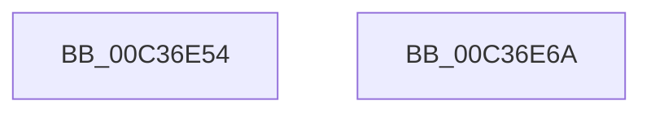

# KiIsKernelCfgActive

- RVA: `0x00C36E54`–`0x00C36E6B` (길이 `23` bytes)
- VA: `0x0000000140C36E54`
- 실행 섹션: `INIT`
- PDB 이름 있음: `예`; PDB Function 태그: `아니요`
- unwind 정보 RVA: `0x0005C788`
- 디코드: `8`개 명령, `23/23` bytes 표시
- 미해석 바이트: `0` (있으면 어셈블리에 `.byte`로 보존)

> 이 문서는 커널 이미지의 기계어와 PDB 기호를 분석해 생성했습니다. 4번과 5번은 함수 원형과 자료형을 바이너리 사용 방식에서 추정한 C 해석이며 원본 소스 복구 결과는 아닙니다.

## 1. Dependencies

- 직접 호출 지점: **1**; 고유 호출 대상: **1**
- 직접 호출자로 확인된 함수: **2**
- RIP 상대 이미지 참조: **0**

### Outgoing calls
- `0x00C36E5A` → [VslGetNestedPageProtectionFlags](../../text/2F/VslGetNestedPageProtectionFlags_function_002F2164.md) (function, `0x002F2164`)

### Direct callers
- [KiInitializeKernel](../../pagelk/B6/KiInitializeKernel_function_00B68D20.md) at `0x00B69135`
- [sub_00BF16D0](../BF/Unknown_function_00BF16D0.md) at `0x00BF5F7C`

### Static image references
- 디코드된 RIP-relative 메모리 참조가 없습니다.

## 2. Other-region calls and transfers

- 다른 실행 섹션으로 향하는 call: **1**
  - `0x00C36E5A` → [VslGetNestedPageProtectionFlags](../../text/2F/VslGetNestedPageProtectionFlags_function_002F2164.md) (`INIT` → `.text`)
- 별도 외부 분기/꼬리 이동을 확인하지 못했습니다.

## 3. Assembly (complete function range)

```asm
00C36E54  48 83 EC 28                     sub rsp, 0x28
00C36E58  33 C9                           xor ecx, ecx
00C36E5A  E8 05 B3 6B FF                  call 0x1402f2164
00C36E5F  C1 E8 07                        shr eax, 7
00C36E62  83 E0 01                        and eax, 1
00C36E65  48 83 C4 28                     add rsp, 0x28
00C36E69  C3                              ret
00C36E6A  CC                              int3
```

## 4. C-style interpretation (structured pseudocode)

```c
__int64 __fastcall KiIsKernelCfgActive(int a1)
{
    __int64 result;
    __int64 v_rsp;

    v_rsp = (v_rsp) - (40);
    a1 = 0;
    result = VslGetNestedPageProtectionFlags(a1, a2, a3, a4);
    result = (unsigned int)((result) >> (7));
    result = (unsigned int)((result) & (1));
    v_rsp = (v_rsp) + (40);
    return result;
}
```

## 5. (Beta) C Style

```c
int64_t KiIsKernelCfgActive(int32_t Arg1)
{
    int64_t result;
    int64_t local_rsp;

    local_rsp = (local_rsp) - (40);
    Arg1 = 0;
    result = VslGetNestedPageProtectionFlags(Arg1, a2, a3, a4);
    result = (uint32_t)((result) >> (7));
    result = (uint32_t)((result) & (1));
    local_rsp = (local_rsp) + (40);
    return result;
}
```

## 6. Execution-region graph

[열기: 2D/3D 그래프와 함수 탐색 컨트롤 패널](../../../control-panel.html?section=init&rva=0x00C36E54&view=graph)

- 2D 그래프는 위에서 아래로 흐르고, 3D 그래프는 빈 공간을 드래그해 회전합니다. Shift+드래그는 이동, 휠은 확대·축소, 함수 노드 선택은 대상 보고서 이동입니다.

### Static fallback


