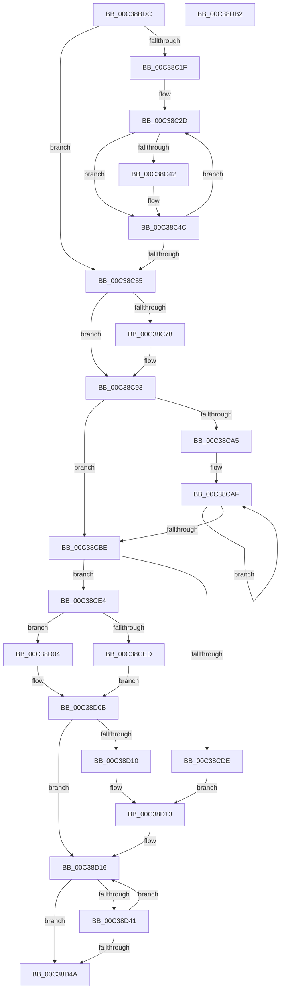

# KiPerformAutomaticGroupConfiguration

- RVA: `0x00C38BDC`–`0x00C38DB3` (길이 `471` bytes)
- VA: `0x0000000140C38BDC`
- 실행 섹션: `INIT`
- PDB 이름 있음: `예`; PDB Function 태그: `아니요`
- unwind 정보 RVA: `0x000CA3F4`
- 디코드: `117`개 명령, `471/471` bytes 표시
- 미해석 바이트: `0` (있으면 어셈블리에 `.byte`로 보존)

> 이 문서는 커널 이미지의 기계어와 PDB 기호를 분석해 생성했습니다. 4번과 5번은 함수 원형과 자료형을 바이너리 사용 방식에서 추정한 C 해석이며 원본 소스 복구 결과는 아닙니다.

## 1. Dependencies

- 직접 호출 지점: **8**; 고유 호출 대상: **8**
- 직접 호출자로 확인된 함수: **1**
- RIP 상대 이미지 참조: **8**

### Outgoing calls
- `0x00C38C6B` → [ExAllocatePool2](../../poolcode/B8/ExAllocatePool2_function_00B820F0.md) (function, `0x00B820F0`)
- `0x00C38C8D` → [KeBugCheckEx](../../text/4F/KeBugCheckEx_function_004FD660.md) (function, `0x004FD660`)
- `0x00C38CCF` → [qsort](../../text/50/qsort_function_005009F0.md) (function, `0x005009F0`)
- `0x00C38D38` → [KiAssignFixedSubNodes](KiAssignFixedSubNodes_function_00C3AEC8.md) (function, `0x00C3AEC8`)
- `0x00C38D5A` → [KiShuffleAssignedSubNodes](KiShuffleAssignedSubNodes_function_00C3B0A8.md) (function, `0x00C3B0A8`)
- `0x00C38D67` → [KiAssignAdjustableSubNodes](KiAssignAdjustableSubNodes_function_00C3AE30.md) (function, `0x00C3AE30`)
- `0x00C38D7F` → [ExFreePoolWithTag](../../poolcode/B8/ExFreePoolWithTag_function_00B82870.md) (function, `0x00B82870`)
- `0x00C38D8F` → [_security_check_cookie](../../text/6A/_security_check_cookie_function_006AC640.md) (function, `0x006AC640`)

### Direct callers
- [KiPerformGroupConfiguration](KiPerformGroupConfiguration_function_00C38FB0.md) at `0x00C3905C`

### Static image references
- `0x00C38BF8` → RVA `0x00E0A740` (`.data`; read)
- `0x00C38C0A` → RVA `0x00F21AC8` (`.data`; read)
- `0x00C38C1F` → RVA `0x00F21AF0` (`.data`; read)
- `0x00C38C31` → RVA `0x00FCF6C0` (`CACHEALI`; read)
- `0x00C38CC5` → RVA `0x005BC720` (`KiCompareSubNodeConfigurationCapacity`; read)
- `0x00C38CE4` → RVA `0x00FC6AF9` (`ALMOSTRO`; read)
- `0x00C38CF4` → RVA `0x00FC5044` (`ALMOSTRO`; read)
- `0x00C38D78` → RVA `0x00FC5014` (`ALMOSTRO`; write)

## 2. Other-region calls and transfers

- 다른 실행 섹션으로 향하는 call: **5**
  - `0x00C38C6B` → [ExAllocatePool2](../../poolcode/B8/ExAllocatePool2_function_00B820F0.md) (`INIT` → `POOLCODE`)
  - `0x00C38C8D` → [KeBugCheckEx](../../text/4F/KeBugCheckEx_function_004FD660.md) (`INIT` → `.text`)
  - `0x00C38CCF` → [qsort](../../text/50/qsort_function_005009F0.md) (`INIT` → `.text`)
  - `0x00C38D7F` → [ExFreePoolWithTag](../../poolcode/B8/ExFreePoolWithTag_function_00B82870.md) (`INIT` → `POOLCODE`)
  - `0x00C38D8F` → [_security_check_cookie](../../text/6A/_security_check_cookie_function_006AC640.md) (`INIT` → `.text`)
- 별도 외부 분기/꼬리 이동을 확인하지 못했습니다.

## 3. Assembly (complete function range)

```asm
00C38BDC  48 8B C4                        mov rax, rsp
00C38BDF  48 89 58 08                     mov qword ptr [rax + 8], rbx
00C38BE3  48 89 68 10                     mov qword ptr [rax + 0x10], rbp
00C38BE7  48 89 70 18                     mov qword ptr [rax + 0x18], rsi
00C38BEB  48 89 78 20                     mov qword ptr [rax + 0x20], rdi
00C38BEF  41 56                           push r14
00C38BF1  48 81 EC 00 01 00 00            sub rsp, 0x100
00C38BF8  48 8B 05 41 1B 1D 00            mov rax, qword ptr [rip + 0x1d1b41]
00C38BFF  48 33 C4                        xor rax, rsp
00C38C02  48 89 84 24 F0 00 00 00         mov qword ptr [rsp + 0xf0], rax
00C38C0A  0F B7 0D B7 8E 2E 00            movzx ecx, word ptr [rip + 0x2e8eb7]
00C38C11  33 F6                           xor esi, esi
00C38C13  0F B7 DE                        movzx ebx, si
00C38C16  44 8D 76 01                     lea r14d, [rsi + 1]
00C38C1A  66 3B F1                        cmp si, cx
00C38C1D  73 36                           jae 0x140c38c55
00C38C1F  48 8B 15 CA 8E 2E 00            mov rdx, qword ptr [rip + 0x2e8eca]
00C38C26  44 8B C1                        mov r8d, ecx
00C38C29  48 83 C2 05                     add rdx, 5
00C38C2D  0F B7 42 FD                     movzx eax, word ptr [rdx - 3]
00C38C31  48 8D 0D 88 6A 39 00            lea rcx, [rip + 0x396a88]
00C38C38  48 8B 04 C1                     mov rax, qword ptr [rcx + rax*8]
00C38C3C  F6 40 0A 04                     test byte ptr [rax + 0xa], 4
00C38C40  74 0A                           je 0x140c38c4c
00C38C42  80 0A 04                        or byte ptr [rdx], 4
00C38C45  0F B6 42 FF                     movzx eax, byte ptr [rdx - 1]
00C38C49  66 03 D8                        add bx, ax
00C38C4C  48 83 C2 18                     add rdx, 0x18
00C38C50  4D 2B C6                        sub r8, r14
00C38C53  75 D8                           jne 0x140c38c2d
00C38C55  0F B7 15 6C 8E 2E 00            movzx edx, word ptr [rip + 0x2e8e6c]
00C38C5C  B9 40 00 00 00                  mov ecx, 0x40
00C38C61  48 C1 E2 03                     shl rdx, 3
00C38C65  41 B8 4B 50 47 43               mov r8d, 0x4347504b
00C38C6B  E8 80 94 F4 FF                  call 0x140b820f0
00C38C70  48 8B F8                        mov rdi, rax
00C38C73  48 85 C0                        test rax, rax
00C38C76  75 1B                           jne 0x140c38c93
00C38C78  45 33 C9                        xor r9d, r9d
00C38C7B  48 89 74 24 20                  mov qword ptr [rsp + 0x20], rsi
00C38C80  45 33 C0                        xor r8d, r8d
00C38C83  8D 48 32                        lea ecx, [rax + 0x32]
00C38C86  48 C7 C2 9A 00 00 C0            mov rdx, 0xffffffffc000009a
00C38C8D  E8 CE 49 8C FF                  call 0x1404fd660
00C38C92  CC                              int3
00C38C93  0F B7 15 2E 8E 2E 00            movzx edx, word ptr [rip + 0x2e8e2e]
00C38C9A  41 B8 08 00 00 00               mov r8d, 8
00C38CA0  66 3B F2                        cmp si, dx
00C38CA3  73 19                           jae 0x140c38cbe
00C38CA5  48 8B 0D 44 8E 2E 00            mov rcx, qword ptr [rip + 0x2e8e44]
00C38CAC  44 8B CA                        mov r9d, edx
00C38CAF  48 89 08                        mov qword ptr [rax], rcx
00C38CB2  48 83 C1 18                     add rcx, 0x18
00C38CB6  49 03 C0                        add rax, r8
00C38CB9  4D 2B CE                        sub r9, r14
00C38CBC  75 F1                           jne 0x140c38caf
00C38CBE  0F B7 15 03 8E 2E 00            movzx edx, word ptr [rip + 0x2e8e03]
00C38CC5  4C 8D 0D 54 3A 98 FF            lea r9, [rip - 0x67c5ac]
00C38CCC  48 8B CF                        mov rcx, rdi
00C38CCF  E8 1C 7D 8C FF                  call 0x1405009f0
00C38CD4  BD 20 00 00 00                  mov ebp, 0x20
00C38CD9  66 85 DB                        test bx, bx
00C38CDC  75 06                           jne 0x140c38ce4
00C38CDE  41 0F B7 DE                     movzx ebx, r14w
00C38CE2  EB 2F                           jmp 0x140c38d13
00C38CE4  40 38 35 0E DE 38 00            cmp byte ptr [rip + 0x38de0e], sil
00C38CEB  75 17                           jne 0x140c38d04
00C38CED  0F B7 C3                        movzx eax, bx
00C38CF0  33 D2                           xor edx, edx
00C38CF2  FF C8                           dec eax
00C38CF4  03 05 4A C3 38 00               add eax, dword ptr [rip + 0x38c34a]
00C38CFA  F7 35 44 C3 38 00               div dword ptr [rip + 0x38c344]
00C38D00  8B D8                           mov ebx, eax
00C38D02  EB 07                           jmp 0x140c38d0b
00C38D04  0F B7 1D BD 8D 2E 00            movzx ebx, word ptr [rip + 0x2e8dbd]
00C38D0B  66 3B DD                        cmp bx, bp
00C38D0E  76 06                           jbe 0x140c38d16
00C38D10  0F B7 DD                        movzx ebx, bp
00C38D13  66 3B DD                        cmp bx, bp
00C38D16  48 8D 84 24 B0 00 00 00         lea rax, [rsp + 0xb0]
00C38D1E  41 0F 94 C1                     sete r9b
00C38D22  48 89 44 24 28                  mov qword ptr [rsp + 0x28], rax
00C38D27  44 0F B7 C3                     movzx r8d, bx
00C38D2B  48 8D 44 24 30                  lea rax, [rsp + 0x30]
00C38D30  48 8B CF                        mov rcx, rdi
00C38D33  48 89 44 24 20                  mov qword ptr [rsp + 0x20], rax
00C38D38  E8 8B 21 00 00                  call 0x140c3aec8
00C38D3D  84 C0                           test al, al
00C38D3F  75 09                           jne 0x140c38d4a
00C38D41  66 41 03 DE                     add bx, r14w
00C38D45  66 3B DD                        cmp bx, bp
00C38D48  76 CC                           jbe 0x140c38d16
00C38D4A  4C 8D 8C 24 B0 00 00 00         lea r9, [rsp + 0xb0]
00C38D52  48 8B CF                        mov rcx, rdi
00C38D55  4C 8D 44 24 30                  lea r8, [rsp + 0x30]
00C38D5A  E8 49 23 00 00                  call 0x140c3b0a8
00C38D5F  4C 8D 4C 24 30                  lea r9, [rsp + 0x30]
00C38D64  48 8B CF                        mov rcx, rdi
00C38D67  E8 C4 20 00 00                  call 0x140c3ae30
00C38D6C  66 3B D8                        cmp bx, ax
00C38D6F  48 8B CF                        mov rcx, rdi
00C38D72  66 0F 47 C3                     cmova ax, bx
00C38D76  33 D2                           xor edx, edx
00C38D78  66 89 05 95 C2 38 00            mov word ptr [rip + 0x38c295], ax
00C38D7F  E8 EC 9A F4 FF                  call 0x140b82870
00C38D84  48 8B 8C 24 F0 00 00 00         mov rcx, qword ptr [rsp + 0xf0]
00C38D8C  48 33 CC                        xor rcx, rsp
00C38D8F  E8 AC 38 A7 FF                  call 0x1406ac640
00C38D94  4C 8D 9C 24 00 01 00 00         lea r11, [rsp + 0x100]
00C38D9C  49 8B 5B 10                     mov rbx, qword ptr [r11 + 0x10]
00C38DA0  49 8B 6B 18                     mov rbp, qword ptr [r11 + 0x18]
00C38DA4  49 8B 73 20                     mov rsi, qword ptr [r11 + 0x20]
00C38DA8  49 8B 7B 28                     mov rdi, qword ptr [r11 + 0x28]
00C38DAC  49 8B E3                        mov rsp, r11
00C38DAF  41 5E                           pop r14
00C38DB1  C3                              ret
00C38DB2  CC                              int3
```

## 4. C-style interpretation (structured pseudocode)

```c
__int64 __fastcall KiPerformAutomaticGroupConfiguration(__int64 a1, __int64 a2, __int64 a3, int a4)
{
    __int64 result;
    __int64 v_rbx;
    __int64 v_rsi;
    __int64 v_rsp;
    unsigned __int64 v_stack_m18;
    unsigned __int64 v_stack_m58;
    unsigned __int64 v_stack_m8;
    unsigned __int64 v_stack_mD8;
    unsigned __int64 v_stack_mE0;
    unsigned __int64 v_stack_mE8;

    *(unsigned __int64 *)(v_rsp + 8) = v_rbx;
    *(unsigned __int64 *)(v_rsp + 16) = v_rbp;
    *(unsigned __int64 *)(v_rsp + 24) = v_rsi;
    *(unsigned __int64 *)(v_rsp + 32) = v_rdi;
    v_rsp = (v_rsp) - (256);
    result = (*(unsigned __int64 *)(v_rip + 1907521)) ^ (v_rsp);
    v_stack_m18 = result;
    v_rsi = 0;
    if (0 >= ((unsigned __int16)(*(unsigned __int16 *)(v_rip + 3051191)))) goto loc_00C38C55;
    a2 = (*(unsigned __int64 *)(v_rip + 3051210)) + (5);
loc_00C38C2D:
    result = *(unsigned __int64 *)(v_rip + 3762824 + *(unsigned __int16 *)(a2 - 3) * 8);
    v_rbx = 0;
    if (((*(unsigned __int8 *)(*(unsigned __int64 *)(v_rip + 3762824 + *(unsigned __int16 *)(a2 - 3) * 8) + 10)) & (4)) != 0) {
        result = *(unsigned __int8 *)(a2 - 1);
        v_rbx = (unsigned __int16)((0) + ((unsigned __int16)(result)));
    }
    a2 = (a2) + (24);
    a3 = ((unsigned int)((unsigned int)(*(unsigned __int16 *)(v_rip + 3051191)))) - (v_rsi + 1);
    if (condition_is_not_equal) goto loc_00C38C2D;
loc_00C38C55:
    a2 = (*(unsigned __int16 *)(v_rip + 3051116)) << (3);
    result = ExAllocatePool2(64, a2, (unsigned int)(0x4347504BULL), a4);
    if (result == 0) {
        a4 = 0;
        v_stack_mE8 = 0;
        a3 = 0;
        a1 = result + 50;
        a2 = 0xFFFFFFFFC000009AULL;
        result = KeBugCheckEx(a1, a2, a3, a4);
    }
    if (0 >= ((unsigned __int16)(*(unsigned __int16 *)(v_rip + 3051054)))) goto loc_00C38CBE;
loc_00C38CAF:
    *(unsigned __int64 *)(result) = *(unsigned __int64 *)(v_rip + 3051076);
    a1 = (*(unsigned __int64 *)(v_rip + 3051076)) + (24);
    result = (result) + (8);
    a4 = ((unsigned int)((unsigned int)(*(unsigned __int16 *)(v_rip + 3051054)))) - (v_rsi + 1);
    if (condition_is_not_equal) goto loc_00C38CAF;
loc_00C38CBE:
    result = qsort(result, *(unsigned __int16 *)(v_rip + 3051011), 8, v_rip - 6800812);
    if ((unsigned __int16)(v_rbx) != 0) goto loc_00C38CE4;
    goto loc_00C38D13;
loc_00C38CE4:
    if ((*(unsigned __int8 *)(v_rip + 3726862)) != 0) goto loc_00C38D04;
    a2 = 0;
    result = (unsigned int)(((unsigned __int16)((unsigned __int16)(v_rsi + 1))) - 1);
    result = (unsigned int)((result) + (*(unsigned int *)(v_rip + 3720010)));
    goto loc_00C38D0B;
loc_00C38D04:
loc_00C38D0B:
    if (((unsigned __int16)(*(unsigned __int16 *)(v_rip + 3050941))) <= 32) goto loc_00C38D16;
loc_00C38D13:
loc_00C38D16:
    a4 = (32 == 32) ? 1 : 0;
    v_stack_mE0 = v_stack_m58;
    v_stack_mE8 = v_stack_mD8;
    result = KiAssignFixedSubNodes(result, a2, 32, a4);
    if ((unsigned __int8)(result) != 0) goto loc_00C38D4A;
    v_rbx = (unsigned __int16)((32) + ((unsigned __int16)(v_rsi + 1)));
    if (((unsigned __int16)(v_rbx)) <= 32) goto loc_00C38D16;
loc_00C38D4A:
    result = KiShuffleAssignedSubNodes(result, a2, v_stack_mD8, v_stack_m58);
    result = KiAssignAdjustableSubNodes(result, a2, v_stack_mD8, v_stack_mD8);
    if (((unsigned __int16)(v_rbx)) > ((unsigned __int16)(result))) { result = (unsigned __int16)(v_rbx); }
    a2 = 0;
    *(unsigned __int16 *)(v_rip + 3719829) = (unsigned __int16)(result);
    result = ExFreePoolWithTag(result, a2, v_stack_mD8, v_stack_mD8);
    a1 = (v_stack_m18) ^ (v_rsp);
    result = _security_check_cookie(a1, a2, v_stack_mD8, v_stack_mD8);
    return result;
}
```

## 5. (Beta) C Style

```c
int64_t KiPerformAutomaticGroupConfiguration(int64_t Arg1, int64_t Arg2, int64_t Arg3, int32_t Arg4)
{
    int64_t result;
    int64_t local_rbx;
    int64_t local_rsi;
    int64_t local_rsp;
    uint64_t v_stack_m18;
    uint64_t v_stack_m58;
    uint64_t v_stack_m8;
    uint64_t v_stack_mD8;
    uint64_t v_stack_mE0;
    uint64_t v_stack_mE8;

    *(uint64_t *)(local_rsp + 0x8) = local_rbx;
    *(uint64_t *)(local_rsp + 0x10) = local_rbp;
    *(uint64_t *)(local_rsp + 0x18) = local_rsi;
    *(uint64_t *)(local_rsp + 0x20) = local_rdi;
    local_rsp = (local_rsp) - (256);
    result = (*(uint64_t *)(v_rip + 0x1D1B41)) ^ (local_rsp);
    v_stack_m18 = result;
    local_rsi = 0;
    if (0 >= ((uint16_t)(*(uint16_t *)(v_rip + 0x2E8EB7)))) goto loc_00C38C55;
    Arg2 = (*(uint64_t *)(v_rip + 0x2E8ECA)) + (5);
loc_00C38C2D:
    result = *(uint64_t *)(v_rip + 0x396A88 + *(uint16_t *)(Arg2 - 0x3) * 8);
    local_rbx = 0;
    if (((*(uint8_t *)(*(uint64_t *)(v_rip + 0x396A88 + *(uint16_t *)(Arg2 - 0x3) * 8) + 0xA)) & (4)) != 0) {
        result = *(uint8_t *)(Arg2 - 0x1);
        local_rbx = (uint16_t)((0) + ((uint16_t)(result)));
    }
    Arg2 = (Arg2) + (24);
    Arg3 = ((uint32_t)((uint32_t)(*(uint16_t *)(v_rip + 0x2E8EB7)))) - (local_rsi + 1);
    if (condition_is_not_equal) goto loc_00C38C2D;
loc_00C38C55:
    Arg2 = (*(uint16_t *)(v_rip + 0x2E8E6C)) << (3);
    result = ExAllocatePool2(64, Arg2, (uint32_t)(0x4347504BULL), Arg4);
    if (result == 0) {
        Arg4 = 0;
        v_stack_mE8 = 0;
        Arg3 = 0;
        Arg1 = result + 50;
        Arg2 = 0xFFFFFFFFC000009AULL;
        result = KeBugCheckEx(Arg1, Arg2, Arg3, Arg4);
    }
    if (0 >= ((uint16_t)(*(uint16_t *)(v_rip + 0x2E8E2E)))) goto loc_00C38CBE;
loc_00C38CAF:
    *(uint64_t *)(result) = *(uint64_t *)(v_rip + 0x2E8E44);
    Arg1 = (*(uint64_t *)(v_rip + 0x2E8E44)) + (24);
    result = (result) + (8);
    Arg4 = ((uint32_t)((uint32_t)(*(uint16_t *)(v_rip + 0x2E8E2E)))) - (local_rsi + 1);
    if (condition_is_not_equal) goto loc_00C38CAF;
loc_00C38CBE:
    result = qsort(result, *(uint16_t *)(v_rip + 0x2E8E03), 8, v_rip - 6800812);
    if ((uint16_t)(local_rbx) != 0) goto loc_00C38CE4;
    goto loc_00C38D13;
loc_00C38CE4:
    if ((*(uint8_t *)(v_rip + 0x38DE0E)) != 0) goto loc_00C38D04;
    Arg2 = 0;
    result = (uint32_t)(((uint16_t)((uint16_t)(local_rsi + 1))) - 1);
    result = (uint32_t)((result) + (*(uint32_t *)(v_rip + 0x38C34A)));
    goto loc_00C38D0B;
loc_00C38D04:
loc_00C38D0B:
    if (((uint16_t)(*(uint16_t *)(v_rip + 0x2E8DBD))) <= 32) goto loc_00C38D16;
loc_00C38D13:
loc_00C38D16:
    Arg4 = (32 == 32) ? 1 : 0;
    v_stack_mE0 = v_stack_m58;
    v_stack_mE8 = v_stack_mD8;
    result = KiAssignFixedSubNodes(result, Arg2, 32, Arg4);
    if ((uint8_t)(result) != 0) goto loc_00C38D4A;
    local_rbx = (uint16_t)((32) + ((uint16_t)(local_rsi + 1)));
    if (((uint16_t)(local_rbx)) <= 32) goto loc_00C38D16;
loc_00C38D4A:
    result = KiShuffleAssignedSubNodes(result, Arg2, v_stack_mD8, v_stack_m58);
    result = KiAssignAdjustableSubNodes(result, Arg2, v_stack_mD8, v_stack_mD8);
    if (((uint16_t)(local_rbx)) > ((uint16_t)(result))) { result = (uint16_t)(local_rbx); }
    Arg2 = 0;
    *(uint16_t *)(v_rip + 0x38C295) = (uint16_t)(result);
    result = ExFreePoolWithTag(result, Arg2, v_stack_mD8, v_stack_mD8);
    Arg1 = (v_stack_m18) ^ (local_rsp);
    result = _security_check_cookie(Arg1, Arg2, v_stack_mD8, v_stack_mD8);
    return result;
}
```

## 6. Execution-region graph

[열기: 2D/3D 그래프와 함수 탐색 컨트롤 패널](../../../control-panel.html?section=init&rva=0x00C38BDC&view=graph)

- 2D 그래프는 위에서 아래로 흐르고, 3D 그래프는 빈 공간을 드래그해 회전합니다. Shift+드래그는 이동, 휠은 확대·축소, 함수 노드 선택은 대상 보고서 이동입니다.

### Static fallback


