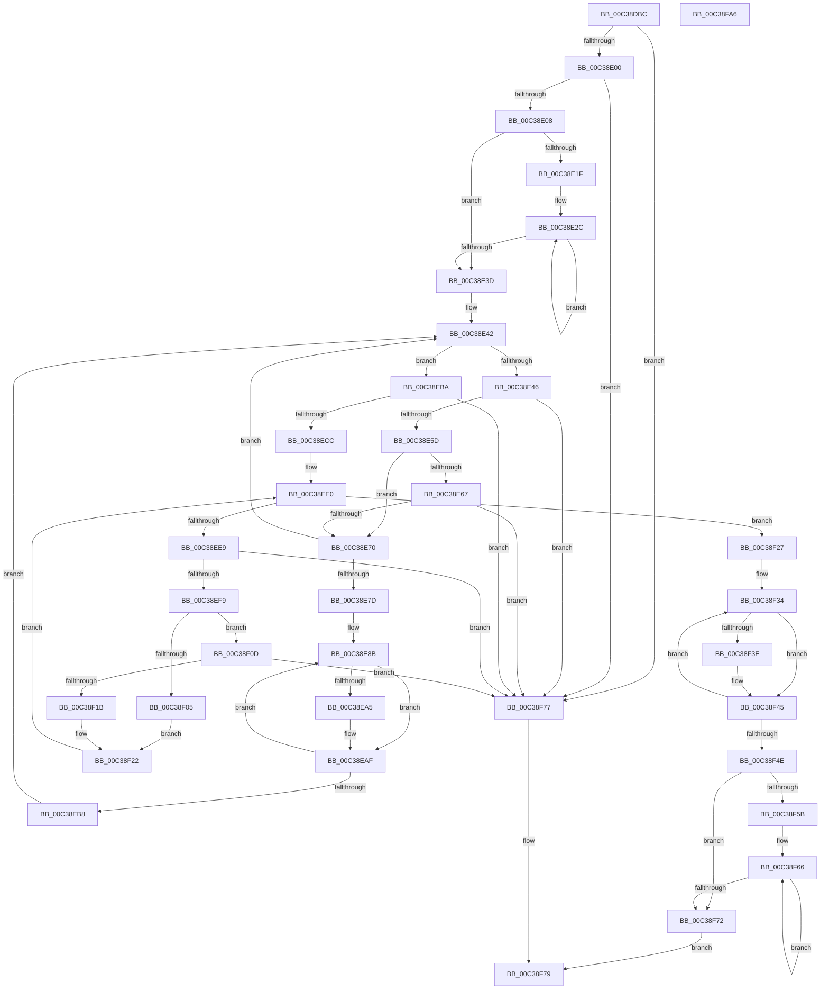

# KiPerformExplicitGroupAssignment

- RVA: `0x00C38DBC`–`0x00C38FA7` (길이 `491` bytes)
- VA: `0x0000000140C38DBC`
- 실행 섹션: `INIT`
- PDB 이름 있음: `예`; PDB Function 태그: `아니요`
- unwind 정보 RVA: `0x000CA3CC`
- 디코드: `128`개 명령, `491/491` bytes 표시
- 미해석 바이트: `0` (있으면 어셈블리에 `.byte`로 보존)

> 이 문서는 커널 이미지의 기계어와 PDB 기호를 분석해 생성했습니다. 4번과 5번은 함수 원형과 자료형을 바이너리 사용 방식에서 추정한 C 해석이며 원본 소스 복구 결과는 아닙니다.

## 1. Dependencies

- 직접 호출 지점: **2**; 고유 호출 대상: **2**
- 직접 호출자로 확인된 함수: **1**
- RIP 상대 이미지 참조: **8**

### Outgoing calls
- `0x00C38E50` → [KiQueryProximityNode](../../text/5B/KiQueryProximityNode_function_005BCDE0.md) (function, `0x005BCDE0`)
- `0x00C38F84` → [_security_check_cookie](../../text/6A/_security_check_cookie_function_006AC640.md) (function, `0x006AC640`)

### Direct callers
- [KiPerformGroupConfiguration](KiPerformGroupConfiguration_function_00C38FB0.md) at `0x00C38FF4`

### Static image references
- `0x00C38DD7` → RVA `0x00E0A740` (`.data`; read)
- `0x00C38E08` → RVA `0x00F21AC8` (`.data`; read)
- `0x00C38E1F` → RVA `0x00F21AF0` (`.data`; read)
- `0x00C38E8F` → RVA `0x00FCF6C0` (`CACHEALI`; read)
- `0x00C38ECC` → RVA `0x00FC5044` (`ALMOSTRO`; read)
- `0x00C38F27` → RVA `0x00FC5014` (`ALMOSTRO`; write)
- `0x00C38F3E` → RVA `0x00FC5014` (`ALMOSTRO`; read/write)
- `0x00C38F4E` → RVA `0x00FC5000` (`ALMOSTRO`; read)

## 2. Other-region calls and transfers

- 다른 실행 섹션으로 향하는 call: **2**
  - `0x00C38E50` → [KiQueryProximityNode](../../text/5B/KiQueryProximityNode_function_005BCDE0.md) (`INIT` → `.text`)
  - `0x00C38F84` → [_security_check_cookie](../../text/6A/_security_check_cookie_function_006AC640.md) (`INIT` → `.text`)
- 별도 외부 분기/꼬리 이동을 확인하지 못했습니다.

## 3. Assembly (complete function range)

```asm
00C38DBC  48 89 5C 24 10                  mov qword ptr [rsp + 0x10], rbx
00C38DC1  48 89 6C 24 18                  mov qword ptr [rsp + 0x18], rbp
00C38DC6  48 89 74 24 20                  mov qword ptr [rsp + 0x20], rsi
00C38DCB  57                              push rdi
00C38DCC  41 56                           push r14
00C38DCE  41 57                           push r15
00C38DD0  48 81 EC C0 00 00 00            sub rsp, 0xc0
00C38DD7  48 8B 05 62 19 1D 00            mov rax, qword ptr [rip + 0x1d1962]
00C38DDE  48 33 C4                        xor rax, rsp
00C38DE1  48 89 84 24 B0 00 00 00         mov qword ptr [rsp + 0xb0], rax
00C38DE9  45 33 F6                        xor r14d, r14d
00C38DEC  8B DA                           mov ebx, edx
00C38DEE  66 44 89 74 24 20               mov word ptr [rsp + 0x20], r14w
00C38DF4  48 8B F9                        mov rdi, rcx
00C38DF7  48 85 C9                        test rcx, rcx
00C38DFA  0F 84 77 01 00 00               je 0x140c38f77
00C38E00  3B 11                           cmp edx, dword ptr [rcx]
00C38E02  0F 85 6F 01 00 00               jne 0x140c38f77
00C38E08  0F B7 0D B9 8C 2E 00            movzx ecx, word ptr [rip + 0x2e8cb9]
00C38E0F  41 8D 6E 01                     lea ebp, [r14 + 1]
00C38E13  41 BF FF FF 00 00               mov r15d, 0xffff
00C38E19  66 44 3B F1                     cmp r14w, cx
00C38E1D  73 1E                           jae 0x140c38e3d
00C38E1F  48 8B 05 CA 8C 2E 00            mov rax, qword ptr [rip + 0x2e8cca]
00C38E26  8B D1                           mov edx, ecx
00C38E28  48 83 C0 05                     add rax, 5
00C38E2C  80 20 FE                        and byte ptr [rax], 0xfe
00C38E2F  66 44 89 78 01                  mov word ptr [rax + 1], r15w
00C38E34  48 8D 40 18                     lea rax, [rax + 0x18]
00C38E38  48 2B D5                        sub rdx, rbp
00C38E3B  75 EF                           jne 0x140c38e2c
00C38E3D  BE 20 00 00 00                  mov esi, 0x20
00C38E42  85 DB                           test ebx, ebx
00C38E44  74 74                           je 0x140c38eba
00C38E46  8B 4F 04                        mov ecx, dword ptr [rdi + 4]
00C38E49  48 8D 54 24 20                  lea rdx, [rsp + 0x20]
00C38E4E  FF CB                           dec ebx
00C38E50  E8 8B 3F 98 FF                  call 0x1405bcde0
00C38E55  85 C0                           test eax, eax
00C38E57  0F 85 1A 01 00 00               jne 0x140c38f77
00C38E5D  48 83 C7 08                     add rdi, 8
00C38E61  8B 07                           mov eax, dword ptr [rdi]
00C38E63  3B C6                           cmp eax, esi
00C38E65  72 09                           jb 0x140c38e70
00C38E67  41 3B C7                        cmp eax, r15d
00C38E6A  0F 85 07 01 00 00               jne 0x140c38f77
00C38E70  0F B7 0D 51 8C 2E 00            movzx ecx, word ptr [rip + 0x2e8c51]
00C38E77  66 44 3B F1                     cmp r14w, cx
00C38E7B  73 C5                           jae 0x140c38e42
00C38E7D  48 8B 15 6C 8C 2E 00            mov rdx, qword ptr [rip + 0x2e8c6c]
00C38E84  44 8B C1                        mov r8d, ecx
00C38E87  48 83 C2 05                     add rdx, 5
00C38E8B  0F B7 42 FD                     movzx eax, word ptr [rdx - 3]
00C38E8F  48 8D 0D 2A 68 39 00            lea rcx, [rip + 0x39682a]
00C38E96  48 8B 0C C1                     mov rcx, qword ptr [rcx + rax*8]
00C38E9A  0F B7 44 24 20                  movzx eax, word ptr [rsp + 0x20]
00C38E9F  66 39 41 02                     cmp word ptr [rcx + 2], ax
00C38EA3  75 0A                           jne 0x140c38eaf
00C38EA5  0F B7 07                        movzx eax, word ptr [rdi]
00C38EA8  40 08 2A                        or byte ptr [rdx], bpl
00C38EAB  66 89 42 01                     mov word ptr [rdx + 1], ax
00C38EAF  48 83 C2 18                     add rdx, 0x18
00C38EB3  4C 2B C5                        sub r8, rbp
00C38EB6  75 D3                           jne 0x140c38e8b
00C38EB8  EB 88                           jmp 0x140c38e42
00C38EBA  48 8B 15 2F 8C 2E 00            mov rdx, qword ptr [rip + 0x2e8c2f]
00C38EC1  66 44 39 7A 06                  cmp word ptr [rdx + 6], r15w
00C38EC6  0F 84 AB 00 00 00               je 0x140c38f77
00C38ECC  8B 05 72 C1 38 00               mov eax, dword ptr [rip + 0x38c172]
00C38ED2  48 8D 7C 24 30                  lea rdi, [rsp + 0x30]
00C38ED7  48 8B CE                        mov rcx, rsi
00C38EDA  F3 AB                           rep stosd dword ptr [rdi], eax
00C38EDC  41 0F B7 CE                     movzx ecx, r14w
00C38EE0  66 3B 0D E1 8B 2E 00            cmp cx, word ptr [rip + 0x2e8be1]
00C38EE7  73 3E                           jae 0x140c38f27
00C38EE9  0F B7 C1                        movzx eax, cx
00C38EEC  48 8D 3C 40                     lea rdi, [rax + rax*2]
00C38EF0  8A 44 FA 05                     mov al, byte ptr [rdx + rdi*8 + 5]
00C38EF4  40 84 C5                        test bpl, al
00C38EF7  74 7E                           je 0x140c38f77
00C38EF9  44 0F B7 44 FA 06               movzx r8d, word ptr [rdx + rdi*8 + 6]
00C38EFF  66 45 3B C7                     cmp r8w, r15w
00C38F03  75 08                           jne 0x140c38f0d
00C38F05  24 FE                           and al, 0xfe
00C38F07  88 44 FA 05                     mov byte ptr [rdx + rdi*8 + 5], al
00C38F0B  EB 15                           jmp 0x140c38f22
00C38F0D  0F B6 7C FA 04                  movzx edi, byte ptr [rdx + rdi*8 + 4]
00C38F12  42 8B 44 84 30                  mov eax, dword ptr [rsp + r8*4 + 0x30]
00C38F17  3B C7                           cmp eax, edi
00C38F19  72 5C                           jb 0x140c38f77
00C38F1B  2B C7                           sub eax, edi
00C38F1D  42 89 44 84 30                  mov dword ptr [rsp + r8*4 + 0x30], eax
00C38F22  66 03 CD                        add cx, bp
00C38F25  EB B9                           jmp 0x140c38ee0
00C38F27  66 44 89 35 E5 C0 38 00         mov word ptr [rip + 0x38c0e5], r14w
00C38F2F  48 8D 4C 24 30                  lea rcx, [rsp + 0x30]
00C38F34  8B 05 0A C1 38 00               mov eax, dword ptr [rip + 0x38c10a]
00C38F3A  39 01                           cmp dword ptr [rcx], eax
00C38F3C  73 07                           jae 0x140c38f45
00C38F3E  66 01 2D CF C0 38 00            add word ptr [rip + 0x38c0cf], bp
00C38F45  48 83 C1 04                     add rcx, 4
00C38F49  48 2B F5                        sub rsi, rbp
00C38F4C  75 E6                           jne 0x140c38f34
00C38F4E  0F B7 15 AB C0 38 00            movzx edx, word ptr [rip + 0x38c0ab]
00C38F55  66 44 3B F2                     cmp r14w, dx
00C38F59  73 17                           jae 0x140c38f72
00C38F5B  48 8B 0D 8E 8B 2E 00            mov rcx, qword ptr [rip + 0x2e8b8e]
00C38F62  48 83 C1 05                     add rcx, 5
00C38F66  80 09 04                        or byte ptr [rcx], 4
00C38F69  48 8D 49 18                     lea rcx, [rcx + 0x18]
00C38F6D  48 2B D5                        sub rdx, rbp
00C38F70  75 F4                           jne 0x140c38f66
00C38F72  40 8A C5                        mov al, bpl
00C38F75  EB 02                           jmp 0x140c38f79
00C38F77  32 C0                           xor al, al
00C38F79  48 8B 8C 24 B0 00 00 00         mov rcx, qword ptr [rsp + 0xb0]
00C38F81  48 33 CC                        xor rcx, rsp
00C38F84  E8 B7 36 A7 FF                  call 0x1406ac640
00C38F89  4C 8D 9C 24 C0 00 00 00         lea r11, [rsp + 0xc0]
00C38F91  49 8B 5B 28                     mov rbx, qword ptr [r11 + 0x28]
00C38F95  49 8B 6B 30                     mov rbp, qword ptr [r11 + 0x30]
00C38F99  49 8B 73 38                     mov rsi, qword ptr [r11 + 0x38]
00C38F9D  49 8B E3                        mov rsp, r11
00C38FA0  41 5F                           pop r15
00C38FA2  41 5E                           pop r14
00C38FA4  5F                              pop rdi
00C38FA5  C3                              ret
00C38FA6  CC                              int3
```

## 4. C-style interpretation (structured pseudocode)

```c
__int64 __fastcall KiPerformExplicitGroupAssignment(__int64 a1, int a2)
{
    __int64 result;
    __int64 v_r14;
    __int64 v_rbx;
    __int64 v_rdi;
    __int64 v_rsi;
    __int64 v_rsp;
    unsigned __int64 v_stack_m18;
    unsigned __int64 v_stack_m28;
    unsigned __int64 v_stack_mA8;
    unsigned __int16 v_stack_mB8;
    unsigned __int64 v_stack_p10;
    unsigned __int64 v_stack_p18;
    unsigned __int64 v_stack_p20;

    v_stack_p10 = v_rbx;
    v_stack_p18 = v_rbp;
    v_stack_p20 = v_rsi;
    v_rsp = (v_rsp) - (192);
    result = (*(unsigned __int64 *)(v_rip + 1907042)) ^ (v_rsp);
    v_stack_m28 = result;
    v_r14 = 0;
    v_stack_mB8 = 0;
    if (a1 == 0) goto loc_00C38F77;
    if (a2 != (*(unsigned int *)(a1))) goto loc_00C38F77;
    if (0 >= ((unsigned __int16)(*(unsigned __int16 *)(v_rip + 3050681)))) goto loc_00C38E3D;
    result = (*(unsigned __int64 *)(v_rip + 3050698)) + (5);
loc_00C38E2C:
    *(unsigned __int16 *)(result + 1) = (unsigned __int16)((unsigned int)(0xFFFFULL));
    a2 = ((unsigned int)((unsigned int)(*(unsigned __int16 *)(v_rip + 3050681)))) - (v_r14 + 1);
    if (condition_is_not_equal) goto loc_00C38E2C;
loc_00C38E3D:
loc_00C38E42:
    if ((unsigned int)((unsigned int)(a2)) == 0) goto loc_00C38EBA;
    v_rbx = (unsigned int)(((unsigned int)(a2)) - 1);
    result = KiQueryProximityNode((unsigned int)(*(unsigned int *)(a1 + 4)), v_stack_mB8, a3, a4);
    if ((unsigned int)(result) != 0) goto loc_00C38F77;
    v_rdi = (a1) + (8);
    if (((unsigned int)((unsigned int)(*(unsigned int *)(v_rdi)))) < 32) goto loc_00C38E70;
    if (((unsigned int)((unsigned int)(*(unsigned int *)(v_rdi)))) != ((unsigned int)((unsigned int)(0xFFFFULL)))) goto loc_00C38F77;
loc_00C38E70:
    if (0 >= ((unsigned __int16)(*(unsigned __int16 *)(v_rip + 3050577)))) goto loc_00C38E42;
    a2 = (*(unsigned __int64 *)(v_rip + 3050604)) + (5);
loc_00C38E8B:
    result = v_stack_mB8;
    if ((*(unsigned __int16 *)(*(unsigned __int64 *)(v_rip + 3762218 + *(unsigned __int16 *)(a2 - 3) * 8) + 2)) == ((unsigned __int16)(v_stack_mB8))) {
        result = *(unsigned __int16 *)(v_rdi);
        *(unsigned __int16 *)(a2 + 1) = (unsigned __int16)(result);
    }
    a2 = (a2) + (24);
    a3 = ((unsigned int)((unsigned int)(*(unsigned __int16 *)(v_rip + 3050577)))) - (v_r14 + 1);
    if (condition_is_not_equal) goto loc_00C38E8B;
    goto loc_00C38E42;
loc_00C38EBA:
    if ((*(unsigned __int16 *)(*(unsigned __int64 *)(v_rip + 3050543) + 6)) == ((unsigned __int16)((unsigned int)(0xFFFFULL)))) goto loc_00C38F77;
loc_00C38EE0:
    if (0 >= (*(unsigned __int16 *)(v_rip + 3050465))) goto loc_00C38F27;
    if ((((unsigned __int8)(v_r14 + 1)) & ((unsigned __int8)(*(unsigned __int8 *)(*(unsigned __int64 *)(v_rip + 3050543) + 0 + 0 * 2 * 8 + 5)))) == 0) goto loc_00C38F77;
    if (((unsigned __int16)(*(unsigned __int16 *)(*(unsigned __int64 *)(v_rip + 3050543) + 0 + 0 * 2 * 8 + 6))) != ((unsigned __int16)((unsigned int)(0xFFFFULL)))) goto loc_00C38F0D;
    result = (unsigned __int8)((*(unsigned __int8 *)(*(unsigned __int64 *)(v_rip + 3050543) + 0 + 0 * 2 * 8 + 5)) & (254));
    *(unsigned __int8 *)(*(unsigned __int64 *)(v_rip + 3050543) + 0 + 0 * 2 * 8 + 5) = (unsigned __int8)(result);
    goto loc_00C38F22;
loc_00C38F0D:
    if (((unsigned int)((unsigned int)(*(unsigned int *)(v_rsp + *(unsigned __int16 *)(*(unsigned __int64 *)(v_rip + 3050543) + 0 + 0 * 2 * 8 + 6) * 4 + 48)))) < ((unsigned int)(*(unsigned __int8 *)(*(unsigned __int64 *)(v_rip + 3050543) + 0 + 0 * 2 * 8 + 4)))) goto loc_00C38F77;
    result = (unsigned int)(((unsigned int)(*(unsigned int *)(v_rsp + *(unsigned __int16 *)(*(unsigned __int64 *)(v_rip + 3050543) + 0 + 0 * 2 * 8 + 6) * 4 + 48))) - ((unsigned int)(*(unsigned __int8 *)(*(unsigned __int64 *)(v_rip + 3050543) + 0 + 0 * 2 * 8 + 4))));
    *(unsigned int *)(v_rsp + *(unsigned __int16 *)(*(unsigned __int64 *)(v_rip + 3050543) + 0 + 0 * 2 * 8 + 6) * 4 + 48) = (unsigned int)(result);
loc_00C38F22:
    a1 = (unsigned __int16)((0) + ((unsigned __int16)(v_r14 + 1)));
    goto loc_00C38EE0;
loc_00C38F27:
    *(unsigned __int16 *)(v_rip + 3719397) = 0;
loc_00C38F34:
    if ((*(unsigned int *)(v_stack_mA8)) < ((unsigned int)((unsigned int)(*(unsigned int *)(v_rip + 3719434))))) {
    }
    a1 = (v_stack_mA8) + (4);
    v_rsi = (32) - (v_r14 + 1);
    if (condition_is_not_equal) goto loc_00C38F34;
    if (0 >= ((unsigned __int16)(*(unsigned __int16 *)(v_rip + 3719339)))) goto loc_00C38F72;
    a1 = (*(unsigned __int64 *)(v_rip + 3050382)) + (5);
loc_00C38F66:
    a2 = (*(unsigned __int16 *)(v_rip + 3719339)) - (v_r14 + 1);
    if (condition_is_not_equal) goto loc_00C38F66;
loc_00C38F72:
    goto loc_00C38F79;
loc_00C38F77:
    result = 0;
loc_00C38F79:
    a1 = (v_stack_m28) ^ (v_rsp);
    result = _security_check_cookie(a1, a2, *(unsigned __int16 *)(*(unsigned __int64 *)(v_rip + 3050543) + 0 + 0 * 2 * 8 + 6), a4);
    return result;
}
```

## 5. (Beta) C Style

```c
int64_t KiPerformExplicitGroupAssignment(void *Arg1, int32_t Arg2)
{
    uint8_t *arg1 = (uint8_t *)Arg1;

    int64_t result;
    int64_t local_r14;
    int64_t local_rbx;
    int64_t local_rdi;
    int64_t local_rsi;
    int64_t local_rsp;
    uint64_t v_stack_m18;
    uint64_t v_stack_m28;
    uint64_t v_stack_mA8;
    uint16_t v_stack_mB8;
    uint64_t v_stack_p10;
    uint64_t v_stack_p18;
    uint64_t v_stack_p20;

    v_stack_p10 = local_rbx;
    v_stack_p18 = local_rbp;
    v_stack_p20 = local_rsi;
    local_rsp = (local_rsp) - (192);
    result = (*(uint64_t *)(v_rip + 0x1D1962)) ^ (local_rsp);
    v_stack_m28 = result;
    local_r14 = 0;
    v_stack_mB8 = 0;
    if (Arg1 == NULL) goto loc_00C38F77;
    if (Arg2 != (*(uint32_t *)(arg1))) goto loc_00C38F77;
    if (0 >= ((uint16_t)(*(uint16_t *)(v_rip + 0x2E8CB9)))) goto loc_00C38E3D;
    result = (*(uint64_t *)(v_rip + 0x2E8CCA)) + (5);
loc_00C38E2C:
    *(uint16_t *)(result + 0x1) = (uint16_t)((uint32_t)(0xFFFFULL));
    Arg2 = ((uint32_t)((uint32_t)(*(uint16_t *)(v_rip + 0x2E8CB9)))) - (local_r14 + 1);
    if (condition_is_not_equal) goto loc_00C38E2C;
loc_00C38E3D:
loc_00C38E42:
    if ((uint32_t)((uint32_t)(Arg2)) == 0) goto loc_00C38EBA;
    local_rbx = (uint32_t)(((uint32_t)(Arg2)) - 1);
    result = KiQueryProximityNode((uint32_t)(*(uint32_t *)(arg1 + 0x4)), v_stack_mB8, a3, a4);
    if ((uint32_t)(result) != 0) goto loc_00C38F77;
    local_rdi = (Arg1) + (8);
    if (((uint32_t)((uint32_t)(*(uint32_t *)(local_rdi)))) < 32) goto loc_00C38E70;
    if (((uint32_t)((uint32_t)(*(uint32_t *)(local_rdi)))) != ((uint32_t)((uint32_t)(0xFFFFULL)))) goto loc_00C38F77;
loc_00C38E70:
    if (0 >= ((uint16_t)(*(uint16_t *)(v_rip + 0x2E8C51)))) goto loc_00C38E42;
    Arg2 = (*(uint64_t *)(v_rip + 0x2E8C6C)) + (5);
loc_00C38E8B:
    result = v_stack_mB8;
    if ((*(uint16_t *)(*(uint64_t *)(v_rip + 0x39682A + *(uint16_t *)(Arg2 - 0x3) * 8) + 0x2)) == ((uint16_t)(v_stack_mB8))) {
        result = *(uint16_t *)(local_rdi);
        *(uint16_t *)(Arg2 + 0x1) = (uint16_t)(result);
    }
    Arg2 = (Arg2) + (24);
    a3 = ((uint32_t)((uint32_t)(*(uint16_t *)(v_rip + 0x2E8C51)))) - (local_r14 + 1);
    if (condition_is_not_equal) goto loc_00C38E8B;
    goto loc_00C38E42;
loc_00C38EBA:
    if ((*(uint16_t *)(*(uint64_t *)(v_rip + 0x2E8C2F) + 0x6)) == ((uint16_t)((uint32_t)(0xFFFFULL)))) goto loc_00C38F77;
loc_00C38EE0:
    if (0 >= (*(uint16_t *)(v_rip + 0x2E8BE1))) goto loc_00C38F27;
    if ((((uint8_t)(local_r14 + 1)) & ((uint8_t)(*(uint8_t *)(*(uint64_t *)(v_rip + 0x2E8C2F) + 0x0 + 0x0 * 2 * 8 + 0x5)))) == 0) goto loc_00C38F77;
    if (((uint16_t)(*(uint16_t *)(*(uint64_t *)(v_rip + 0x2E8C2F) + 0x0 + 0x0 * 2 * 8 + 0x6))) != ((uint16_t)((uint32_t)(0xFFFFULL)))) goto loc_00C38F0D;
    result = (uint8_t)((*(uint8_t *)(*(uint64_t *)(v_rip + 0x2E8C2F) + 0x0 + 0x0 * 2 * 8 + 0x5)) & (254));
    *(uint8_t *)(*(uint64_t *)(v_rip + 0x2E8C2F) + 0x0 + 0x0 * 2 * 8 + 0x5) = (uint8_t)(result);
    goto loc_00C38F22;
loc_00C38F0D:
    if (((uint32_t)((uint32_t)(*(uint32_t *)(local_rsp + *(uint16_t *)(*(uint64_t *)(v_rip + 0x2E8C2F) + 0x0 + 0x0 * 2 * 8 + 0x6) * 4 + 0x30)))) < ((uint32_t)(*(uint8_t *)(*(uint64_t *)(v_rip + 0x2E8C2F) + 0x0 + 0x0 * 2 * 8 + 0x4)))) goto loc_00C38F77;
    result = (uint32_t)(((uint32_t)(*(uint32_t *)(local_rsp + *(uint16_t *)(*(uint64_t *)(v_rip + 0x2E8C2F) + 0x0 + 0x0 * 2 * 8 + 0x6) * 4 + 0x30))) - ((uint32_t)(*(uint8_t *)(*(uint64_t *)(v_rip + 0x2E8C2F) + 0x0 + 0x0 * 2 * 8 + 0x4))));
    *(uint32_t *)(local_rsp + *(uint16_t *)(*(uint64_t *)(v_rip + 0x2E8C2F) + 0x0 + 0x0 * 2 * 8 + 0x6) * 4 + 0x30) = (uint32_t)(result);
loc_00C38F22:
    Arg1 = (uint16_t)((0) + ((uint16_t)(local_r14 + 1)));
    goto loc_00C38EE0;
loc_00C38F27:
    *(uint16_t *)(v_rip + 0x38C0E5) = 0;
loc_00C38F34:
    if ((*(uint32_t *)(v_stack_mA8)) < ((uint32_t)((uint32_t)(*(uint32_t *)(v_rip + 0x38C10A))))) {
    }
    Arg1 = (v_stack_mA8) + (4);
    local_rsi = (32) - (local_r14 + 1);
    if (condition_is_not_equal) goto loc_00C38F34;
    if (0 >= ((uint16_t)(*(uint16_t *)(v_rip + 0x38C0AB)))) goto loc_00C38F72;
    Arg1 = (*(uint64_t *)(v_rip + 0x2E8B8E)) + (5);
loc_00C38F66:
    Arg2 = (*(uint16_t *)(v_rip + 0x38C0AB)) - (local_r14 + 1);
    if (condition_is_not_equal) goto loc_00C38F66;
loc_00C38F72:
    goto loc_00C38F79;
loc_00C38F77:
    result = 0;
loc_00C38F79:
    Arg1 = (v_stack_m28) ^ (local_rsp);
    result = _security_check_cookie(Arg1, Arg2, *(uint16_t *)(*(uint64_t *)(v_rip + 0x2E8C2F) + 0x0 + 0x0 * 2 * 8 + 0x6), a4);
    return result;
}
```

### 관측된 메모리 오프셋

구조체 형식이 확인되지 않은 접근은 인자 기준의 오프셋으로만 기록했습니다.

| 기준 인자 | 오프셋 표현 | 폭 (bit) | 접근 |
|---|---:|---:|---|
| `Arg1` | `+ 0x0` | `16` | `R` |
| `Arg1` | `+ 0x0` | `32` | `R` |
| `Arg1` | `+ 0x4` | `32` | `R` |

## 6. Execution-region graph

[열기: 2D/3D 그래프와 함수 탐색 컨트롤 패널](../../../control-panel.html?section=init&rva=0x00C38DBC&view=graph)

- 2D 그래프는 위에서 아래로 흐르고, 3D 그래프는 빈 공간을 드래그해 회전합니다. Shift+드래그는 이동, 휠은 확대·축소, 함수 노드 선택은 대상 보고서 이동입니다.

### Static fallback


