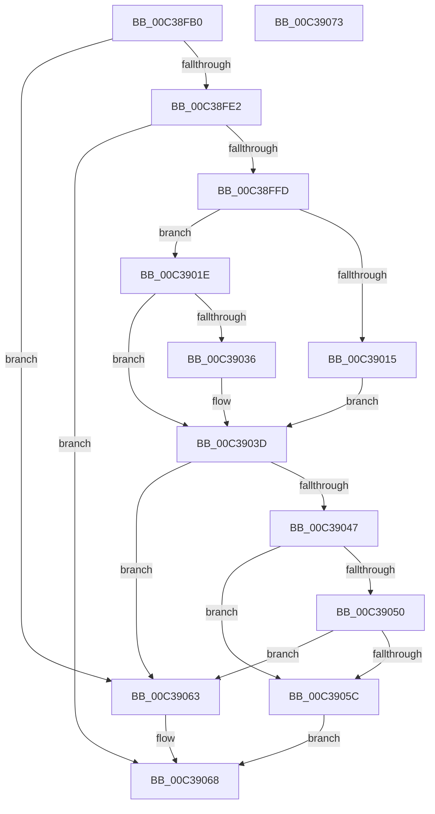

# KiPerformGroupConfiguration

- RVA: `0x00C38FB0`–`0x00C39074` (길이 `196` bytes)
- VA: `0x0000000140C38FB0`
- 실행 섹션: `INIT`
- PDB 이름 있음: `예`; PDB Function 태그: `아니요`
- unwind 정보 RVA: `0x000BF520`
- 디코드: `47`개 명령, `196/196` bytes 표시
- 미해석 바이트: `0` (있으면 어셈블리에 `.byte`로 보존)

> 이 문서는 커널 이미지의 기계어와 PDB 기호를 분석해 생성했습니다. 4번과 5번은 함수 원형과 자료형을 바이너리 사용 방식에서 추정한 C 해석이며 원본 소스 복구 결과는 아닙니다.

## 1. Dependencies

- 직접 호출 지점: **9**; 고유 호출 대상: **8**
- 직접 호출자로 확인된 함수: **1**
- RIP 상대 이미지 참조: **6**

### Outgoing calls
- `0x00C38FCB` → [KiPopulateNodeInformation](KiPopulateNodeInformation_function_00C3907C.md) (function, `0x00C3907C`)
- `0x00C38FD0` → [KiPopulateSubNodes](KiPopulateSubNodes_function_00C39390.md) (function, `0x00C39390`)
- `0x00C38FD5` → [HvlIsSingleGroupRequired](../../text/58/HvlIsSingleGroupRequired_function_00583BA4.md) (function, `0x00583BA4`)
- `0x00C38FF4` → [KiPerformExplicitGroupAssignment](KiPerformExplicitGroupAssignment_function_00C38DBC.md) (function, `0x00C38DBC`)
- `0x00C3900B` → [strstr](../../text/4F/strstr_function_004FF680.md) (function, `0x004FF680`)
- `0x00C3902C` → [strstr](../../text/4F/strstr_function_004FF680.md) (function, `0x004FF680`)
- `0x00C3905C` → [KiPerformAutomaticGroupConfiguration](KiPerformAutomaticGroupConfiguration_function_00C38BDC.md) (function, `0x00C38BDC`)
- `0x00C39063` → [KiAssignAllSubNodesToGroup0](KiAssignAllSubNodesToGroup0_function_00C38B98.md) (function, `0x00C38B98`)
- `0x00C39068` → [KiFinalizeGroupAssignment](../../text/5B/KiFinalizeGroupAssignment_function_005BC8B8.md) (function, `0x005BC8B8`)

### Direct callers
- [Phase1InitializationDiscard](../C1/Phase1InitializationDiscard_function_00C1C728.md) at `0x00C1CA6B`

### Static image references
- `0x00C39004` → RVA `0x00C7B2A0` (` ?? ::PBOPGDP::`string'`; read)
- `0x00C39015` → RVA `0x00FC6AF9` (`ALMOSTRO`; write)
- `0x00C39025` → RVA `0x00C7B2B0` (` ?? ::PBOPGDP::`string'`; read)
- `0x00C3903D` → RVA `0x00F21AC8` (`.data`; read)
- `0x00C39047` → RVA `0x00FC6AF9` (`ALMOSTRO`; read)
- `0x00C39050` → RVA `0x00FC5044` (`ALMOSTRO`; read)

## 2. Other-region calls and transfers

- 다른 실행 섹션으로 향하는 call: **4**
  - `0x00C38FD5` → [HvlIsSingleGroupRequired](../../text/58/HvlIsSingleGroupRequired_function_00583BA4.md) (`INIT` → `.text`)
  - `0x00C3900B` → [strstr](../../text/4F/strstr_function_004FF680.md) (`INIT` → `.text`)
  - `0x00C3902C` → [strstr](../../text/4F/strstr_function_004FF680.md) (`INIT` → `.text`)
  - `0x00C39068` → [KiFinalizeGroupAssignment](../../text/5B/KiFinalizeGroupAssignment_function_005BC8B8.md) (`INIT` → `.text`)
- 별도 외부 분기/꼬리 이동을 확인하지 못했습니다.

## 3. Assembly (complete function range)

```asm
00C38FB0  48 8B C4                        mov rax, rsp
00C38FB3  53                              push rbx
00C38FB4  48 83 EC 20                     sub rsp, 0x20
00C38FB8  83 60 18 00                     and dword ptr [rax + 0x18], 0
00C38FBC  48 8D 50 10                     lea rdx, [rax + 0x10]
00C38FC0  83 60 10 00                     and dword ptr [rax + 0x10], 0
00C38FC4  48 8B D9                        mov rbx, rcx
00C38FC7  48 8D 48 18                     lea rcx, [rax + 0x18]
00C38FCB  E8 AC 00 00 00                  call 0x140c3907c
00C38FD0  E8 BB 03 00 00                  call 0x140c39390
00C38FD5  E8 CA AB 94 FF                  call 0x140583ba4
00C38FDA  84 C0                           test al, al
00C38FDC  0F 85 81 00 00 00               jne 0x140c39063
00C38FE2  48 8B 8B F0 00 00 00            mov rcx, qword ptr [rbx + 0xf0]
00C38FE9  8B 54 24 38                     mov edx, dword ptr [rsp + 0x38]
00C38FED  48 8B 89 30 01 00 00            mov rcx, qword ptr [rcx + 0x130]
00C38FF4  E8 C3 FD FF FF                  call 0x140c38dbc
00C38FF9  84 C0                           test al, al
00C38FFB  75 6B                           jne 0x140c39068
00C38FFD  48 8B 8B D8 00 00 00            mov rcx, qword ptr [rbx + 0xd8]
00C39004  48 8D 15 95 22 04 00            lea rdx, [rip + 0x42295]
00C3900B  E8 70 66 8C FF                  call 0x1404ff680
00C39010  48 85 C0                        test rax, rax
00C39013  74 09                           je 0x140c3901e
00C39015  C6 05 DD DA 38 00 00            mov byte ptr [rip + 0x38dadd], 0
00C3901C  EB 1F                           jmp 0x140c3903d
00C3901E  48 8B 8B D8 00 00 00            mov rcx, qword ptr [rbx + 0xd8]
00C39025  48 8D 15 84 22 04 00            lea rdx, [rip + 0x42284]
00C3902C  E8 4F 66 8C FF                  call 0x1404ff680
00C39031  48 85 C0                        test rax, rax
00C39034  74 07                           je 0x140c3903d
00C39036  C6 05 BC DA 38 00 01            mov byte ptr [rip + 0x38dabc], 1
00C3903D  66 83 3D 83 8A 2E 00 01         cmp word ptr [rip + 0x2e8a83], 1
00C39045  74 1C                           je 0x140c39063
00C39047  80 3D AB DA 38 00 00            cmp byte ptr [rip + 0x38daab], 0
00C3904E  75 0C                           jne 0x140c3905c
00C39050  8B 05 EE BF 38 00               mov eax, dword ptr [rip + 0x38bfee]
00C39056  39 44 24 40                     cmp dword ptr [rsp + 0x40], eax
00C3905A  76 07                           jbe 0x140c39063
00C3905C  E8 7B FB FF FF                  call 0x140c38bdc
00C39061  EB 05                           jmp 0x140c39068
00C39063  E8 30 FB FF FF                  call 0x140c38b98
00C39068  E8 4B 38 98 FF                  call 0x1405bc8b8
00C3906D  48 83 C4 20                     add rsp, 0x20
00C39071  5B                              pop rbx
00C39072  C3                              ret
00C39073  CC                              int3
```

## 4. C-style interpretation (structured pseudocode)

```c
__int64 __fastcall KiPerformGroupConfiguration(__int64 a1)
{
    __int64 result;
    __int64 v_rsp;
    unsigned int v_stack_p10;
    unsigned int v_stack_p18;

    v_rsp = (v_rsp) - (32);
    result = KiPopulateNodeInformation(v_rsp + 24, v_rsp + 16, a3, a4);
    result = KiPopulateSubNodes(v_rsp + 24, v_rsp + 16, a3, a4);
    result = HvlIsSingleGroupRequired(v_rsp + 24, v_rsp + 16, a3, a4);
    if ((unsigned __int8)(result) != 0) goto loc_00C39063;
    result = KiPerformExplicitGroupAssignment(*(unsigned __int64 *)(*(unsigned __int64 *)(a1 + 240) + 304), (unsigned int)(v_stack_p10), a3, a4);
    if ((unsigned __int8)(result) != 0) goto loc_00C39068;
    result = strstr(*(unsigned __int64 *)(a1 + 216), v_rip + 270997, a3, a4);
    if (result == 0) goto loc_00C3901E;
    *(unsigned __int8 *)(v_rip + 3726045) = 0;
    goto loc_00C3903D;
loc_00C3901E:
    result = strstr(*(unsigned __int64 *)(a1 + 216), v_rip + 270980, a3, a4);
    if (result != 0) {
        *(unsigned __int8 *)(v_rip + 3726012) = 1;
    }
    if ((*(unsigned __int16 *)(v_rip + 3050115)) == 1) goto loc_00C39063;
    if ((*(unsigned __int8 *)(v_rip + 3725995)) != 0) goto loc_00C3905C;
    if (v_stack_p18 <= ((unsigned int)((unsigned int)(*(unsigned int *)(v_rip + 3719150))))) goto loc_00C39063;
loc_00C3905C:
    result = KiPerformAutomaticGroupConfiguration(*(unsigned __int64 *)(a1 + 216), v_rip + 270980, a3, a4);
    goto loc_00C39068;
loc_00C39063:
    result = KiAssignAllSubNodesToGroup0(*(unsigned __int64 *)(a1 + 216), v_rip + 270980, a3, a4);
loc_00C39068:
    result = KiFinalizeGroupAssignment(*(unsigned __int64 *)(a1 + 216), v_rip + 270980, a3, a4);
    v_rsp = (v_rsp) + (32);
    return result;
}
```

## 5. (Beta) C Style

```c
int64_t KiPerformGroupConfiguration(void *Arg1)
{
    uint8_t *arg1 = (uint8_t *)Arg1;

    int64_t result;
    int64_t local_rsp;
    uint32_t v_stack_p10;
    uint32_t v_stack_p18;

    local_rsp = (local_rsp) - (32);
    result = KiPopulateNodeInformation(local_rsp + 24, local_rsp + 16, a3, a4);
    result = KiPopulateSubNodes(local_rsp + 24, local_rsp + 16, a3, a4);
    result = HvlIsSingleGroupRequired(local_rsp + 24, local_rsp + 16, a3, a4);
    if ((uint8_t)(result) != 0) goto loc_00C39063;
    result = KiPerformExplicitGroupAssignment(*(uint64_t *)(*(uint64_t *)(arg1 + 0xF0) + 0x130), (uint32_t)(v_stack_p10), a3, a4);
    if ((uint8_t)(result) != 0) goto loc_00C39068;
    result = strstr(*(uint64_t *)(arg1 + 0xD8), v_rip + 270997, a3, a4);
    if (result == 0) goto loc_00C3901E;
    *(uint8_t *)(v_rip + 0x38DADD) = 0;
    goto loc_00C3903D;
loc_00C3901E:
    result = strstr(*(uint64_t *)(arg1 + 0xD8), v_rip + 270980, a3, a4);
    if (result != 0) {
        *(uint8_t *)(v_rip + 0x38DABC) = 1;
    }
    if ((*(uint16_t *)(v_rip + 0x2E8A83)) == 1) goto loc_00C39063;
    if ((*(uint8_t *)(v_rip + 0x38DAAB)) != 0) goto loc_00C3905C;
    if (v_stack_p18 <= ((uint32_t)((uint32_t)(*(uint32_t *)(v_rip + 0x38BFEE))))) goto loc_00C39063;
loc_00C3905C:
    result = KiPerformAutomaticGroupConfiguration(*(uint64_t *)(arg1 + 0xD8), v_rip + 270980, a3, a4);
    goto loc_00C39068;
loc_00C39063:
    result = KiAssignAllSubNodesToGroup0(*(uint64_t *)(arg1 + 0xD8), v_rip + 270980, a3, a4);
loc_00C39068:
    result = KiFinalizeGroupAssignment(*(uint64_t *)(arg1 + 0xD8), v_rip + 270980, a3, a4);
    local_rsp = (local_rsp) + (32);
    return result;
}
```

### 관측된 메모리 오프셋

구조체 형식이 확인되지 않은 접근은 인자 기준의 오프셋으로만 기록했습니다.

| 기준 인자 | 오프셋 표현 | 폭 (bit) | 접근 |
|---|---:|---:|---|
| `Arg1` | `+ 0xD8` | `64` | `R` |
| `Arg1` | `+ 0xF0` | `64` | `R` |

## 6. Execution-region graph

[열기: 2D/3D 그래프와 함수 탐색 컨트롤 패널](../../../control-panel.html?section=init&rva=0x00C38FB0&view=graph)

- 2D 그래프는 위에서 아래로 흐르고, 3D 그래프는 빈 공간을 드래그해 회전합니다. Shift+드래그는 이동, 휠은 확대·축소, 함수 노드 선택은 대상 보고서 이동입니다.

### Static fallback


