# KiPopulateNodeInformation

- RVA: `0x00C3907C`–`0x00C39389` (길이 `781` bytes)
- VA: `0x0000000140C3907C`
- 실행 섹션: `INIT`
- PDB 이름 있음: `예`; PDB Function 태그: `아니요`
- unwind 정보 RVA: `0x000CA438`
- 디코드: `211`개 명령, `781/781` bytes 표시
- 미해석 바이트: `0` (있으면 어셈블리에 `.byte`로 보존)

> 이 문서는 커널 이미지의 기계어와 PDB 기호를 분석해 생성했습니다. 4번과 5번은 함수 원형과 자료형을 바이너리 사용 방식에서 추정한 C 해석이며 원본 소스 복구 결과는 아닙니다.

## 1. Dependencies

- 직접 호출 지점: **9**; 고유 호출 대상: **6**
- 직접 호출자로 확인된 함수: **1**
- RIP 상대 이미지 참조: **7**

### Outgoing calls
- `0x00C390EF` → [guard_dispatch_icall](../../text/6B/guard_dispatch_icall_function_006BAAD0.md) (function, `0x006BAAD0`)
- `0x00C3912C` → [guard_dispatch_icall](../../text/6B/guard_dispatch_icall_function_006BAAD0.md) (function, `0x006BAAD0`)
- `0x00C39138` → [KiQueryProximityNode](../../text/5B/KiQueryProximityNode_function_005BCDE0.md) (function, `0x005BCDE0`)
- `0x00C39186` → [ExAllocatePool2](../../poolcode/B8/ExAllocatePool2_function_00B820F0.md) (function, `0x00B820F0`)
- `0x00C391AC` → [KeBugCheckEx](../../text/4F/KeBugCheckEx_function_004FD660.md) (function, `0x004FD660`)
- `0x00C391FB` → [guard_dispatch_icall](../../text/6B/guard_dispatch_icall_function_006BAAD0.md) (function, `0x006BAAD0`)
- `0x00C3929C` → [MmGetChannelInformation](../../page/A7/MmGetChannelInformation_function_00A71000.md) (function, `0x00A71000`)
- `0x00C392F6` → [ExFreePoolWithTag](../../poolcode/B8/ExFreePoolWithTag_function_00B82870.md) (function, `0x00B82870`)
- `0x00C39321` → [KeBugCheckEx](../../text/4F/KeBugCheckEx_function_004FD660.md) (function, `0x004FD660`)

### Direct callers
- [KiPerformGroupConfiguration](KiPerformGroupConfiguration_function_00C38FB0.md) at `0x00C38FCB`

### Static image references
- `0x00C39099` → RVA `0x00FC5000` (`ALMOSTRO`; read)
- `0x00C390D2` → RVA `0x00FCF6C0` (`CACHEALI`; read)
- `0x00C390E8` → RVA `0x00E01400` (`.data`; read)
- `0x00C39104` → RVA `0x00F21AE0` (`.data`; read)
- `0x00C3918B` → RVA `0x00FC50A8` (`ALMOSTRO`; write)
- `0x00C391EA` → RVA `0x00E01408` (`.data`; read)
- `0x00C39214` → RVA `0x00FC50A8` (`ALMOSTRO`; read)

## 2. Other-region calls and transfers

- 다른 실행 섹션으로 향하는 call: **9**
  - `0x00C390EF` → [guard_dispatch_icall](../../text/6B/guard_dispatch_icall_function_006BAAD0.md) (`INIT` → `.text`)
  - `0x00C3912C` → [guard_dispatch_icall](../../text/6B/guard_dispatch_icall_function_006BAAD0.md) (`INIT` → `.text`)
  - `0x00C39138` → [KiQueryProximityNode](../../text/5B/KiQueryProximityNode_function_005BCDE0.md) (`INIT` → `.text`)
  - `0x00C39186` → [ExAllocatePool2](../../poolcode/B8/ExAllocatePool2_function_00B820F0.md) (`INIT` → `POOLCODE`)
  - `0x00C391AC` → [KeBugCheckEx](../../text/4F/KeBugCheckEx_function_004FD660.md) (`INIT` → `.text`)
  - `0x00C391FB` → [guard_dispatch_icall](../../text/6B/guard_dispatch_icall_function_006BAAD0.md) (`INIT` → `.text`)
  - `0x00C3929C` → [MmGetChannelInformation](../../page/A7/MmGetChannelInformation_function_00A71000.md) (`INIT` → `PAGE`)
  - `0x00C392F6` → [ExFreePoolWithTag](../../poolcode/B8/ExFreePoolWithTag_function_00B82870.md) (`INIT` → `POOLCODE`)
  - `0x00C39321` → [KeBugCheckEx](../../text/4F/KeBugCheckEx_function_004FD660.md) (`INIT` → `.text`)
- 별도 외부 분기/꼬리 이동을 확인하지 못했습니다.

## 3. Assembly (complete function range)

```asm
00C3907C  48 89 54 24 10                  mov qword ptr [rsp + 0x10], rdx
00C39081  48 89 4C 24 08                  mov qword ptr [rsp + 8], rcx
00C39086  55                              push rbp
00C39087  53                              push rbx
00C39088  56                              push rsi
00C39089  57                              push rdi
00C3908A  41 54                           push r12
00C3908C  41 55                           push r13
00C3908E  41 56                           push r14
00C39090  41 57                           push r15
00C39092  48 8B EC                        mov rbp, rsp
00C39095  48 83 EC 58                     sub rsp, 0x58
00C39099  0F B7 05 60 BF 38 00            movzx eax, word ptr [rip + 0x38bf60]
00C390A0  45 33 FF                        xor r15d, r15d
00C390A3  44 89 7D 60                     mov dword ptr [rbp + 0x60], r15d
00C390A7  4C 8B EA                        mov r13, rdx
00C390AA  44 89 7D D8                     mov dword ptr [rbp - 0x28], r15d
00C390AE  45 8B E7                        mov r12d, r15d
00C390B1  4C 89 7D E8                     mov qword ptr [rbp - 0x18], r15
00C390B5  41 8B F7                        mov esi, r15d
00C390B8  44 89 7D 58                     mov dword ptr [rbp + 0x58], r15d
00C390BC  45 8D 77 01                     lea r14d, [r15 + 1]
00C390C0  44 89 7D E0                     mov dword ptr [rbp - 0x20], r15d
00C390C4  41 0F B7 DF                     movzx ebx, r15w
00C390C8  66 44 3B F8                     cmp r15w, ax
00C390CC  0F 83 98 00 00 00               jae 0x140c3916a
00C390D2  4C 8D 2D E7 65 39 00            lea r13, [rip + 0x3965e7]
00C390D9  0F B7 C3                        movzx eax, bx
00C390DC  48 8D 55 58                     lea rdx, [rbp + 0x58]
00C390E0  0F B7 CB                        movzx ecx, bx
00C390E3  49 8B 7C C5 00                  mov rdi, qword ptr [r13 + rax*8]
00C390E8  48 8B 05 11 83 1C 00            mov rax, qword ptr [rip + 0x1c8311]
00C390EF  E8 DC 19 A8 FF                  call 0x1406baad0
00C390F4  0F B7 45 58                     movzx eax, word ptr [rbp + 0x58]
00C390F8  4C 8D 77 04                     lea r14, [rdi + 4]
00C390FC  66 89 47 08                     mov word ptr [rdi + 8], ax
00C39100  44 03 65 58                     add r12d, dword ptr [rbp + 0x58]
00C39104  48 8B 05 D5 89 2E 00            mov rax, qword ptr [rip + 0x2e89d5]
00C3910B  48 85 C0                        test rax, rax
00C3910E  75 12                           jne 0x140c39122
00C39110  45 21 3E                        and dword ptr [r14], r15d
00C39113  8D 70 01                        lea esi, [rax + 1]
00C39116  0F B7 07                        movzx eax, word ptr [rdi]
00C39119  44 8B F6                        mov r14d, esi
00C3911C  66 89 47 02                     mov word ptr [rdi + 2], ax
00C39120  EB 2C                           jmp 0x140c3914e
00C39122  4C 8D 45 60                     lea r8, [rbp + 0x60]
00C39126  49 8B D6                        mov rdx, r14
00C39129  0F B7 CB                        movzx ecx, bx
00C3912C  E8 9F 19 A8 FF                  call 0x1406baad0
00C39131  8B 4D 60                        mov ecx, dword ptr [rbp + 0x60]
00C39134  48 8D 57 02                     lea rdx, [rdi + 2]
00C39138  E8 A3 3C 98 FF                  call 0x1405bcde0
00C3913D  8B 45 60                        mov eax, dword ptr [rbp + 0x60]
00C39140  41 39 06                        cmp dword ptr [r14], eax
00C39143  41 BE 01 00 00 00               mov r14d, 1
00C39149  75 03                           jne 0x140c3914e
00C3914B  41 03 F6                        add esi, r14d
00C3914E  0F B7 05 AB BE 38 00            movzx eax, word ptr [rip + 0x38beab]
00C39155  66 41 03 DE                     add bx, r14w
00C39159  66 3B D8                        cmp bx, ax
00C3915C  0F 82 77 FF FF FF               jb 0x140c390d9
00C39162  4C 8B 6D 50                     mov r13, qword ptr [rbp + 0x50]
00C39166  44 89 65 E0                     mov dword ptr [rbp - 0x20], r12d
00C3916A  66 41 3B C6                     cmp ax, r14w
00C3916E  76 42                           jbe 0x140c391b2
00C39170  0F B7 C0                        movzx eax, ax
00C39173  B9 40 00 00 00                  mov ecx, 0x40
00C39178  0F AF C0                        imul eax, eax
00C3917B  41 B8 4B 65 20 20               mov r8d, 0x2020654b
00C39181  C1 E0 02                        shl eax, 2
00C39184  8B D0                           mov edx, eax
00C39186  E8 65 8F F4 FF                  call 0x140b820f0
00C3918B  48 89 05 16 BF 38 00            mov qword ptr [rip + 0x38bf16], rax
00C39192  48 85 C0                        test rax, rax
00C39195  75 1B                           jne 0x140c391b2
00C39197  45 33 C9                        xor r9d, r9d
00C3919A  4C 89 7C 24 20                  mov qword ptr [rsp + 0x20], r15
00C3919F  45 33 C0                        xor r8d, r8d
00C391A2  8D 48 32                        lea ecx, [rax + 0x32]
00C391A5  48 C7 C2 9A 00 00 C0            mov rdx, 0xffffffffc000009a
00C391AC  E8 AF 44 8C FF                  call 0x1404fd660
00C391B1  CC                              int3
00C391B2  44 0F B7 05 46 BE 38 00         movzx r8d, word ptr [rip + 0x38be46]
00C391BA  41 0F B7 DF                     movzx ebx, r15w
00C391BE  66 45 3B F8                     cmp r15w, r8w
00C391C2  0F 83 98 00 00 00               jae 0x140c39260
00C391C8  4C 8D 25 F1 64 39 00            lea r12, [rip + 0x3964f1]
00C391CF  0F B7 C3                        movzx eax, bx
00C391D2  41 0F B7 FF                     movzx edi, r15w
00C391D6  4D 8B 34 C4                     mov r14, qword ptr [r12 + rax*8]
00C391DA  66 45 3B F8                     cmp r15w, r8w
00C391DE  73 64                           jae 0x140c39244
00C391E0  44 0F B7 FB                     movzx r15d, bx
00C391E4  41 BD 01 00 00 00               mov r13d, 1
00C391EA  48 8B 05 17 82 1C 00            mov rax, qword ptr [rip + 0x1c8217]
00C391F1  4C 8D 45 D8                     lea r8, [rbp - 0x28]
00C391F5  0F B7 D7                        movzx edx, di
00C391F8  0F B7 CB                        movzx ecx, bx
00C391FB  E8 D0 18 A8 FF                  call 0x1406baad0
00C39200  44 0F B7 05 F8 BD 38 00         movzx r8d, word ptr [rip + 0x38bdf8]
00C39208  0F B7 C7                        movzx eax, di
00C3920B  41 8B C8                        mov ecx, r8d
00C3920E  41 0F AF CF                     imul ecx, r15d
00C39212  03 C8                           add ecx, eax
00C39214  48 8B 05 8D BE 38 00            mov rax, qword ptr [rip + 0x38be8d]
00C3921B  48 63 D1                        movsxd rdx, ecx
00C3921E  8B 4D D8                        mov ecx, dword ptr [rbp - 0x28]
00C39221  89 0C 90                        mov dword ptr [rax + rdx*4], ecx
00C39224  66 3B DF                        cmp bx, di
00C39227  74 0E                           je 0x140c39237
00C39229  81 7D D8 FF FF 00 00            cmp dword ptr [rbp - 0x28], 0xffff
00C39230  74 05                           je 0x140c39237
00C39232  41 80 4E 0A 04                  or byte ptr [r14 + 0xa], 4
00C39237  66 41 03 FD                     add di, r13w
00C3923B  66 41 3B F8                     cmp di, r8w
00C3923F  72 A9                           jb 0x140c391ea
00C39241  45 33 FF                        xor r15d, r15d
00C39244  41 BE 01 00 00 00               mov r14d, 1
00C3924A  66 41 03 DE                     add bx, r14w
00C3924E  66 41 3B D8                     cmp bx, r8w
00C39252  0F 82 77 FF FF FF               jb 0x140c391cf
00C39258  44 8B 65 E0                     mov r12d, dword ptr [rbp - 0x20]
00C3925C  4C 8B 6D 50                     mov r13, qword ptr [rbp + 0x50]
00C39260  4C 89 7D E0                     mov qword ptr [rbp - 0x20], r15
00C39264  48 8D 15 55 64 39 00            lea rdx, [rip + 0x396455]
00C3926B  41 0F B7 DF                     movzx ebx, r15w
00C3926F  0F B7 05 8A BD 38 00            movzx eax, word ptr [rip + 0x38bd8a]
00C39276  66 3B D8                        cmp bx, ax
00C39279  0F 83 A8 00 00 00               jae 0x140c39327
00C3927F  0F B7 FB                        movzx edi, bx
00C39282  48 8B 0C FA                     mov rcx, qword ptr [rdx + rdi*8]
00C39286  0F B7 41 02                     movzx eax, word ptr [rcx + 2]
00C3928A  66 39 01                        cmp word ptr [rcx], ax
00C3928D  75 77                           jne 0x140c39306
00C3928F  0F B7 D3                        movzx edx, bx
00C39292  4C 8D 4D E8                     lea r9, [rbp - 0x18]
00C39296  33 C9                           xor ecx, ecx
00C39298  4C 8D 45 E0                     lea r8, [rbp - 0x20]
00C3929C  E8 5F 7D E3 FF                  call 0x140a71000
00C392A1  85 C0                           test eax, eax
00C392A3  78 6A                           js 0x140c3930f
00C392A5  4C 8B 4D E0                     mov r9, qword ptr [rbp - 0x20]
00C392A9  48 B8 CD CC CC CC CC CC CC CC   movabs rax, 0xcccccccccccccccd
00C392B3  48 F7 65 E8                     mul qword ptr [rbp - 0x18]
00C392B7  41 8B CF                        mov ecx, r15d
00C392BA  48 C1 EA 05                     shr rdx, 5
00C392BE  8B C1                           mov eax, ecx
00C392C0  45 8A C6                        mov r8b, r14b
00C392C3  48 3B C2                        cmp rax, rdx
00C392C6  73 13                           jae 0x140c392db
00C392C8  48 8D 04 80                     lea rax, [rax + rax*4]
00C392CC  4D 39 7C C1 08                  cmp qword ptr [r9 + rax*8 + 8], r15
00C392D1  75 05                           jne 0x140c392d8
00C392D3  41 03 CE                        add ecx, r14d
00C392D6  EB E6                           jmp 0x140c392be
00C392D8  45 8A C7                        mov r8b, r15b
00C392DB  48 8D 05 DE 63 39 00            lea rax, [rip + 0x3963de]
00C392E2  49 8B C9                        mov rcx, r9
00C392E5  48 8B 14 F8                     mov rdx, qword ptr [rax + rdi*8]
00C392E9  8A 42 0A                        mov al, byte ptr [rdx + 0xa]
00C392EC  24 FE                           and al, 0xfe
00C392EE  41 0A C0                        or al, r8b
00C392F1  88 42 0A                        mov byte ptr [rdx + 0xa], al
00C392F4  33 D2                           xor edx, edx
00C392F6  E8 75 95 F4 FF                  call 0x140b82870
00C392FB  48 8D 15 BE 63 39 00            lea rdx, [rip + 0x3963be]
00C39302  4C 89 7D E0                     mov qword ptr [rbp - 0x20], r15
00C39306  66 41 03 DE                     add bx, r14w
00C3930A  E9 60 FF FF FF                  jmp 0x140c3926f
00C3930F  45 33 C9                        xor r9d, r9d
00C39312  48 63 D0                        movsxd rdx, eax
00C39315  45 33 C0                        xor r8d, r8d
00C39318  4C 89 7C 24 20                  mov qword ptr [rsp + 0x20], r15
00C3931D  41 8D 49 32                     lea ecx, [r9 + 0x32]
00C39321  E8 3A 43 8C FF                  call 0x1404fd660
00C39326  CC                              int3
00C39327  66 44 3B F8                     cmp r15w, ax
00C3932B  73 3F                           jae 0x140c3936c
00C3932D  4C 8D 2D 8C 63 39 00            lea r13, [rip + 0x39638c]
00C39334  4C 8B D0                        mov r10, rax
00C39337  4D 8B CD                        mov r9, r13
00C3933A  4D 8B 01                        mov r8, qword ptr [r9]
00C3933D  41 0F B7 40 02                  movzx eax, word ptr [r8 + 2]
00C39342  66 41 39 00                     cmp word ptr [r8], ax
00C39346  74 17                           je 0x140c3935f
00C39348  49 8B 4C C5 00                  mov rcx, qword ptr [r13 + rax*8]
00C3934D  41 8A 50 0A                     mov dl, byte ptr [r8 + 0xa]
00C39351  8A C2                           mov al, dl
00C39353  32 41 0A                        xor al, byte ptr [rcx + 0xa]
00C39356  41 22 C6                        and al, r14b
00C39359  32 C2                           xor al, dl
00C3935B  41 88 40 0A                     mov byte ptr [r8 + 0xa], al
00C3935F  49 83 C1 08                     add r9, 8
00C39363  4D 2B D6                        sub r10, r14
00C39366  75 D2                           jne 0x140c3933a
00C39368  4C 8B 6D 50                     mov r13, qword ptr [rbp + 0x50]
00C3936C  48 8B 45 48                     mov rax, qword ptr [rbp + 0x48]
00C39370  41 89 75 00                     mov dword ptr [r13], esi
00C39374  44 89 20                        mov dword ptr [rax], r12d
00C39377  48 83 C4 58                     add rsp, 0x58
00C3937B  41 5F                           pop r15
00C3937D  41 5E                           pop r14
00C3937F  41 5D                           pop r13
00C39381  41 5C                           pop r12
00C39383  5F                              pop rdi
00C39384  5E                              pop rsi
00C39385  5B                              pop rbx
00C39386  5D                              pop rbp
00C39387  C3                              ret
00C39388  CC                              int3
```

## 4. C-style interpretation (structured pseudocode)

```c
__int64 __fastcall KiPopulateNodeInformation(__int64 a1, __int64 a2, __int64 a3, int a4)
{
    __int64 result;
    __int64 v_r10;
    __int64 v_r12;
    __int64 v_r15;
    __int64 v_rbx;
    __int64 v_rdi;
    __int64 v_rsi;
    __int64 v_rsp;
    unsigned __int64 v_stack_m58;
    unsigned int v_stack_m60;
    unsigned int v_stack_m68;
    unsigned __int64 v_stack_m78;
    unsigned __int64 v_stack_p10;
    unsigned int v_stack_p18;
    unsigned int v_stack_p20;
    unsigned __int64 v_stack_p8;

    v_stack_p10 = a2;
    v_stack_p8 = a1;
    v_rsp = (v_rsp) - (88);
    v_r15 = 0;
    v_stack_p20 = 0;
    v_stack_m68 = 0;
    v_stack_m58 = 0;
    v_stack_p18 = 0;
    v_stack_m60 = 0;
    if (0 >= ((unsigned __int16)(*(unsigned __int16 *)(v_rip + 3719008)))) goto loc_00C3916A;
loc_00C390D9:
    result = guard_dispatch_icall(0, v_stack_p18, a3, a4);
    *(unsigned __int16 *)(*(unsigned __int64 *)(v_rip + 3761639 + 0 * 8) + 8) = (unsigned __int16)(v_stack_p18);
    v_r12 = (unsigned int)((0) + (v_stack_p18));
    if (*(unsigned __int64 *)(v_rip + 3049941) != 0) goto loc_00C39122;
    *(unsigned __int16 *)(*(unsigned __int64 *)(v_rip + 3761639 + 0 * 8) + 2) = (unsigned __int16)(*(unsigned __int16 *)(*(unsigned __int64 *)(v_rip + 3761639 + 0 * 8)));
    goto loc_00C3914E;
loc_00C39122:
    result = guard_dispatch_icall(0, (unsigned int)((unsigned int)(*(unsigned __int64 *)(v_rip + 3049941) + 1)), v_stack_p20, a4);
    result = KiQueryProximityNode((unsigned int)(v_stack_p20), *(unsigned __int64 *)(v_rip + 3761639 + 0 * 8) + 2, v_stack_p20, a4);
    v_rsi = *(unsigned __int64 *)(v_rip + 3049941) + 1;
    if ((*(unsigned int *)((unsigned int)((unsigned int)(*(unsigned __int64 *)(v_rip + 3049941) + 1)))) == ((unsigned int)((unsigned int)(v_stack_p20)))) {
        v_rsi = (unsigned int)((*(unsigned __int64 *)(v_rip + 3049941) + 1) + (1));
    }
    v_rbx = (unsigned __int16)((0) + (1));
    if (((unsigned __int16)(v_rbx)) < ((unsigned __int16)(*(unsigned __int16 *)(v_rip + 3718827)))) goto loc_00C390D9;
    v_stack_m60 = (unsigned int)(v_r12);
loc_00C3916A:
    if (((unsigned __int16)(*(unsigned __int16 *)(v_rip + 3718827))) <= 1) goto loc_00C391B2;
    result = (unsigned int)(((unsigned __int16)(*(unsigned __int16 *)(v_rip + 3718827))) * ((unsigned int)((unsigned __int16)(*(unsigned __int16 *)(v_rip + 3718827)))));
    result = (unsigned int)((result) << (2));
    result = ExAllocatePool2(64, (unsigned int)((unsigned int)(result)), (unsigned int)(0x2020654BULL), a4);
    *(unsigned __int64 *)(v_rip + 3718934) = result;
    if (result == 0) {
        a4 = 0;
        v_stack_m78 = 0;
        a3 = 0;
        a1 = result + 50;
        a2 = 0xFFFFFFFFC000009AULL;
        result = KeBugCheckEx(a1, a2, a3, a4);
    }
    if (0 >= ((unsigned __int16)(*(unsigned __int16 *)(v_rip + 3718726)))) goto loc_00C39260;
loc_00C391CF:
    if (0 >= ((unsigned __int16)(*(unsigned __int16 *)(v_rip + 3718726)))) goto loc_00C39244;
loc_00C391EA:
    result = guard_dispatch_icall(0, 0, v_stack_m68, a4);
    a1 = (unsigned int)(((unsigned int)((unsigned int)(*(unsigned __int16 *)(v_rip + 3718648)))) * (0));
    a1 = (unsigned int)((a1) + (0));
    *(unsigned int *)(*(unsigned __int64 *)(v_rip + 3718797) + (int)((unsigned int)(a1)) * 4) = (unsigned int)((unsigned int)(v_stack_m68));
    if (0 == 0) goto loc_00C39237;
    if (v_stack_m68 != 0xFFFFULL) {
    }
    v_rdi = (unsigned __int16)((0) + (1));
    if (((unsigned __int16)(v_rdi)) < ((unsigned __int16)(*(unsigned __int16 *)(v_rip + 3718648)))) goto loc_00C391EA;
    v_r15 = 0;
loc_00C39244:
    v_rbx = (unsigned __int16)((0) + (1));
    if (((unsigned __int16)(v_rbx)) < ((unsigned __int16)(*(unsigned __int16 *)(v_rip + 3718648)))) goto loc_00C391CF;
loc_00C39260:
    v_stack_m60 = 0;
loc_00C3926F:
    if (0 >= ((unsigned __int16)(*(unsigned __int16 *)(v_rip + 3718538)))) goto loc_00C39327;
    if ((*(unsigned __int16 *)(*(unsigned __int64 *)(v_rip + 3761237 + 0 * 8))) != ((unsigned __int16)(*(unsigned __int16 *)(*(unsigned __int64 *)(v_rip + 3761237 + 0 * 8) + 2)))) goto loc_00C39306;
    a1 = 0;
    result = MmGetChannelInformation(a1, 0, v_stack_m60, v_stack_m58);
    if (sign_flag) goto loc_00C3930F;
    a2 = (0) >> (5);
loc_00C392BE:
    if (0 >= a2) goto loc_00C392DB;
    if ((*(unsigned __int64 *)(v_stack_m60 + 0 + 0 * 4 * 8 + 8)) != 0) goto loc_00C392D8;
    a1 = (unsigned int)((0) + (1));
    goto loc_00C392BE;
loc_00C392D8:
loc_00C392DB:
    result = (unsigned __int8)((*(unsigned __int8 *)(*(unsigned __int64 *)(v_rip + 3761118 + 0 * 8) + 10)) & (254));
    result = (unsigned __int8)((result) | (0));
    *(unsigned __int8 *)(*(unsigned __int64 *)(v_rip + 3761118 + 0 * 8) + 10) = (unsigned __int8)(result);
    a2 = 0;
    result = ExFreePoolWithTag(v_stack_m60, a2, 0, v_stack_m60);
    v_stack_m60 = 0;
loc_00C39306:
    v_rbx = (unsigned __int16)((0) + (1));
    goto loc_00C3926F;
loc_00C3930F:
    a4 = 0;
    a3 = 0;
    v_stack_m78 = 0;
    result = KeBugCheckEx(a4 + 50, (int)((unsigned int)(result)), a3, a4);
loc_00C39327:
    if (0 >= ((unsigned __int16)(result))) goto loc_00C3936C;
loc_00C3933A:
    result = *(unsigned __int16 *)(*(unsigned __int64 *)(v_rip + 3761036) + 2);
    if ((*(unsigned __int16 *)(*(unsigned __int64 *)(v_rip + 3761036))) != ((unsigned __int16)(*(unsigned __int16 *)(*(unsigned __int64 *)(v_rip + 3761036) + 2)))) {
        a1 = *(unsigned __int64 *)(v_rip + 3761036 + *(unsigned __int16 *)(*(unsigned __int64 *)(v_rip + 3761036) + 2) * 8);
        a2 = *(unsigned __int8 *)(*(unsigned __int64 *)(v_rip + 3761036) + 10);
        result = (unsigned __int8)(a2);
        result = (unsigned __int8)((result) ^ (*(unsigned __int8 *)(a1 + 10)));
        result = (unsigned __int8)((result) & (1));
        result = (unsigned __int8)((result) ^ ((unsigned __int8)(a2)));
        *(unsigned __int8 *)(*(unsigned __int64 *)(v_rip + 3761036) + 10) = (unsigned __int8)(result);
    }
    a4 = (v_rip + 3761036) + (8);
    v_r10 = (result) - (1);
    if (condition_is_not_equal) goto loc_00C3933A;
loc_00C3936C:
    *(unsigned int *)(v_stack_p10) = (unsigned int)(v_rsi);
    *(unsigned int *)(v_stack_p8) = (unsigned int)((unsigned int)(v_stack_m60));
    v_rsp = (v_rsp) + (88);
    return v_stack_p8;
}
```

## 5. (Beta) C Style

```c
int64_t KiPopulateNodeInformation(int64_t Arg1, int64_t Arg2, int64_t Arg3, int32_t Arg4)
{
    int64_t result;
    int64_t local_r10;
    int64_t local_r12;
    int64_t local_r15;
    int64_t local_rbx;
    int64_t local_rdi;
    int64_t local_rsi;
    int64_t local_rsp;
    uint64_t v_stack_m58;
    uint32_t v_stack_m60;
    uint32_t v_stack_m68;
    uint64_t v_stack_m78;
    uint64_t v_stack_p10;
    uint32_t v_stack_p18;
    uint32_t v_stack_p20;
    uint64_t v_stack_p8;

    v_stack_p10 = Arg2;
    v_stack_p8 = Arg1;
    local_rsp = (local_rsp) - (88);
    local_r15 = 0;
    v_stack_p20 = 0;
    v_stack_m68 = 0;
    v_stack_m58 = 0;
    v_stack_p18 = 0;
    v_stack_m60 = 0;
    if (0 >= ((uint16_t)(*(uint16_t *)(v_rip + 0x38BF60)))) goto loc_00C3916A;
loc_00C390D9:
    result = guard_dispatch_icall(0, v_stack_p18, Arg3, Arg4);
    *(uint16_t *)(*(uint64_t *)(v_rip + 0x3965E7 + 0x0 * 8) + 0x8) = (uint16_t)(v_stack_p18);
    local_r12 = (uint32_t)((0) + (v_stack_p18));
    if (*(uint64_t *)(v_rip + 0x2E89D5) != 0) goto loc_00C39122;
    *(uint16_t *)(*(uint64_t *)(v_rip + 0x3965E7 + 0x0 * 8) + 0x2) = (uint16_t)(*(uint16_t *)(*(uint64_t *)(v_rip + 0x3965E7 + 0x0 * 8)));
    goto loc_00C3914E;
loc_00C39122:
    result = guard_dispatch_icall(0, (uint32_t)((uint32_t)(*(uint64_t *)(v_rip + 0x2E89D5) + 1)), v_stack_p20, Arg4);
    result = KiQueryProximityNode((uint32_t)(v_stack_p20), *(uint64_t *)(v_rip + 0x3965E7 + 0x0 * 8) + 2, v_stack_p20, Arg4);
    local_rsi = *(uint64_t *)(v_rip + 0x2E89D5) + 1;
    if ((*(uint32_t *)((uint32_t)((uint32_t)(*(uint64_t *)(v_rip + 0x2E89D5) + 0x1)))) == ((uint32_t)((uint32_t)(v_stack_p20)))) {
        local_rsi = (uint32_t)((*(uint64_t *)(v_rip + 0x2E89D5) + 1) + (1));
    }
    local_rbx = (uint16_t)((0) + (1));
    if (((uint16_t)(local_rbx)) < ((uint16_t)(*(uint16_t *)(v_rip + 0x38BEAB)))) goto loc_00C390D9;
    v_stack_m60 = (uint32_t)(local_r12);
loc_00C3916A:
    if (((uint16_t)(*(uint16_t *)(v_rip + 0x38BEAB))) <= 1) goto loc_00C391B2;
    result = (uint32_t)(((uint16_t)(*(uint16_t *)(v_rip + 0x38BEAB))) * ((uint32_t)((uint16_t)(*(uint16_t *)(v_rip + 0x38BEAB)))));
    result = (uint32_t)((result) << (2));
    result = ExAllocatePool2(64, (uint32_t)((uint32_t)(result)), (uint32_t)(0x2020654BULL), Arg4);
    *(uint64_t *)(v_rip + 0x38BF16) = result;
    if (result == 0) {
        Arg4 = 0;
        v_stack_m78 = 0;
        Arg3 = 0;
        Arg1 = result + 50;
        Arg2 = 0xFFFFFFFFC000009AULL;
        result = KeBugCheckEx(Arg1, Arg2, Arg3, Arg4);
    }
    if (0 >= ((uint16_t)(*(uint16_t *)(v_rip + 0x38BE46)))) goto loc_00C39260;
loc_00C391CF:
    if (0 >= ((uint16_t)(*(uint16_t *)(v_rip + 0x38BE46)))) goto loc_00C39244;
loc_00C391EA:
    result = guard_dispatch_icall(0, 0, v_stack_m68, Arg4);
    Arg1 = (uint32_t)(((uint32_t)((uint32_t)(*(uint16_t *)(v_rip + 0x38BDF8)))) * (0));
    Arg1 = (uint32_t)((Arg1) + (0));
    *(uint32_t *)(*(uint64_t *)(v_rip + 0x38BE8D) + (int32_t)((uint32_t)(Arg1)) * 4) = (uint32_t)((uint32_t)(v_stack_m68));
    if (0 == 0) goto loc_00C39237;
    if (v_stack_m68 != 0xFFFFULL) {
    }
    local_rdi = (uint16_t)((0) + (1));
    if (((uint16_t)(local_rdi)) < ((uint16_t)(*(uint16_t *)(v_rip + 0x38BDF8)))) goto loc_00C391EA;
    local_r15 = 0;
loc_00C39244:
    local_rbx = (uint16_t)((0) + (1));
    if (((uint16_t)(local_rbx)) < ((uint16_t)(*(uint16_t *)(v_rip + 0x38BDF8)))) goto loc_00C391CF;
loc_00C39260:
    v_stack_m60 = 0;
loc_00C3926F:
    if (0 >= ((uint16_t)(*(uint16_t *)(v_rip + 0x38BD8A)))) goto loc_00C39327;
    if ((*(uint16_t *)(*(uint64_t *)(v_rip + 0x396455 + 0x0 * 8))) != ((uint16_t)(*(uint16_t *)(*(uint64_t *)(v_rip + 0x396455 + 0x0 * 8) + 0x2)))) goto loc_00C39306;
    Arg1 = 0;
    result = MmGetChannelInformation(Arg1, 0, v_stack_m60, v_stack_m58);
    if (sign_flag) goto loc_00C3930F;
    Arg2 = (0) >> (5);
loc_00C392BE:
    if (0 >= Arg2) goto loc_00C392DB;
    if ((*(uint64_t *)(v_stack_m60 + 0x0 + 0x0 * 4 * 8 + 0x8)) != 0) goto loc_00C392D8;
    Arg1 = (uint32_t)((0) + (1));
    goto loc_00C392BE;
loc_00C392D8:
loc_00C392DB:
    result = (uint8_t)((*(uint8_t *)(*(uint64_t *)(v_rip + 0x3963DE + 0x0 * 8) + 0xA)) & (254));
    result = (uint8_t)((result) | (0));
    *(uint8_t *)(*(uint64_t *)(v_rip + 0x3963DE + 0x0 * 8) + 0xA) = (uint8_t)(result);
    Arg2 = 0;
    result = ExFreePoolWithTag(v_stack_m60, Arg2, 0, v_stack_m60);
    v_stack_m60 = 0;
loc_00C39306:
    local_rbx = (uint16_t)((0) + (1));
    goto loc_00C3926F;
loc_00C3930F:
    Arg4 = 0;
    Arg3 = 0;
    v_stack_m78 = 0;
    result = KeBugCheckEx(Arg4 + 50, (int32_t)((uint32_t)(result)), Arg3, Arg4);
loc_00C39327:
    if (0 >= ((uint16_t)(result))) goto loc_00C3936C;
loc_00C3933A:
    result = *(uint16_t *)(*(uint64_t *)(v_rip + 0x39638C) + 0x2);
    if ((*(uint16_t *)(*(uint64_t *)(v_rip + 0x39638C))) != ((uint16_t)(*(uint16_t *)(*(uint64_t *)(v_rip + 0x39638C) + 0x2)))) {
        Arg1 = *(uint64_t *)(v_rip + 0x39638C + *(uint16_t *)(*(uint64_t *)(v_rip + 0x39638C) + 0x2) * 8);
        Arg2 = *(uint8_t *)(*(uint64_t *)(v_rip + 0x39638C) + 0xA);
        result = (uint8_t)(Arg2);
        result = (uint8_t)((result) ^ (*(uint8_t *)(Arg1 + 0xA)));
        result = (uint8_t)((result) & (1));
        result = (uint8_t)((result) ^ ((uint8_t)(Arg2)));
        *(uint8_t *)(*(uint64_t *)(v_rip + 0x39638C) + 0xA) = (uint8_t)(result);
    }
    Arg4 = (v_rip + 3761036) + (8);
    local_r10 = (result) - (1);
    if (condition_is_not_equal) goto loc_00C3933A;
loc_00C3936C:
    *(uint32_t *)(v_stack_p10) = (uint32_t)(local_rsi);
    *(uint32_t *)(v_stack_p8) = (uint32_t)((uint32_t)(v_stack_m60));
    local_rsp = (local_rsp) + (88);
    return v_stack_p8;
}
```

## 6. Execution-region graph

[열기: 2D/3D 그래프와 함수 탐색 컨트롤 패널](../../../control-panel.html?section=init&rva=0x00C3907C&view=graph)

- 2D 그래프는 위에서 아래로 흐르고, 3D 그래프는 빈 공간을 드래그해 회전합니다. Shift+드래그는 이동, 휠은 확대·축소, 함수 노드 선택은 대상 보고서 이동입니다.

### Static fallback

```mermaid
flowchart TD
  bb_00C3907C[BB_00C3907C]
  bb_00C390D2[BB_00C390D2]
  bb_00C390D9[BB_00C390D9]
  bb_00C39110[BB_00C39110]
  bb_00C39122[BB_00C39122]
  bb_00C3914B[BB_00C3914B]
  bb_00C3914E[BB_00C3914E]
  bb_00C39162[BB_00C39162]
  bb_00C3916A[BB_00C3916A]
  bb_00C39170[BB_00C39170]
  bb_00C39197[BB_00C39197]
  bb_00C391B2[BB_00C391B2]
  bb_00C391C8[BB_00C391C8]
  bb_00C391CF[BB_00C391CF]
  bb_00C391E0[BB_00C391E0]
  bb_00C391EA[BB_00C391EA]
  bb_00C39229[BB_00C39229]
  bb_00C39232[BB_00C39232]
  bb_00C39237[BB_00C39237]
  bb_00C39241[BB_00C39241]
  bb_00C39244[BB_00C39244]
  bb_00C39258[BB_00C39258]
  bb_00C39260[BB_00C39260]
  bb_00C3926F[BB_00C3926F]
  bb_00C3927F[BB_00C3927F]
  bb_00C3928F[BB_00C3928F]
  bb_00C392A5[BB_00C392A5]
  bb_00C392BE[BB_00C392BE]
  bb_00C392C8[BB_00C392C8]
  bb_00C392D3[BB_00C392D3]
  bb_00C392D8[BB_00C392D8]
  bb_00C392DB[BB_00C392DB]
  bb_00C39306[BB_00C39306]
  bb_00C3930F[BB_00C3930F]
  bb_00C39327[BB_00C39327]
  bb_00C3932D[BB_00C3932D]
  bb_00C3933A[BB_00C3933A]
  bb_00C39348[BB_00C39348]
  bb_00C3935F[BB_00C3935F]
  bb_00C39368[BB_00C39368]
  bb_00C3936C[BB_00C3936C]
  bb_00C39388[BB_00C39388]
  bb_00C3907C -->|branch| bb_00C3916A
  bb_00C3907C -->|fallthrough| bb_00C390D2
  bb_00C390D2 -->|flow| bb_00C390D9
  bb_00C390D9 -->|branch| bb_00C39122
  bb_00C390D9 -->|fallthrough| bb_00C39110
  bb_00C39110 -->|branch| bb_00C3914E
  bb_00C39122 -->|branch| bb_00C3914E
  bb_00C39122 -->|fallthrough| bb_00C3914B
  bb_00C3914B -->|flow| bb_00C3914E
  bb_00C3914E -->|branch| bb_00C390D9
  bb_00C3914E -->|fallthrough| bb_00C39162
  bb_00C39162 -->|flow| bb_00C3916A
  bb_00C3916A -->|branch| bb_00C391B2
  bb_00C3916A -->|fallthrough| bb_00C39170
  bb_00C39170 -->|branch| bb_00C391B2
  bb_00C39170 -->|fallthrough| bb_00C39197
  bb_00C39197 -->|flow| bb_00C391B2
  bb_00C391B2 -->|branch| bb_00C39260
  bb_00C391B2 -->|fallthrough| bb_00C391C8
  bb_00C391C8 -->|flow| bb_00C391CF
  bb_00C391CF -->|branch| bb_00C39244
  bb_00C391CF -->|fallthrough| bb_00C391E0
  bb_00C391E0 -->|flow| bb_00C391EA
  bb_00C391EA -->|branch| bb_00C39237
  bb_00C391EA -->|fallthrough| bb_00C39229
  bb_00C39229 -->|branch| bb_00C39237
  bb_00C39229 -->|fallthrough| bb_00C39232
  bb_00C39232 -->|flow| bb_00C39237
  bb_00C39237 -->|branch| bb_00C391EA
  bb_00C39237 -->|fallthrough| bb_00C39241
  bb_00C39241 -->|flow| bb_00C39244
  bb_00C39244 -->|branch| bb_00C391CF
  bb_00C39244 -->|fallthrough| bb_00C39258
  bb_00C39258 -->|flow| bb_00C39260
  bb_00C39260 -->|flow| bb_00C3926F
  bb_00C3926F -->|branch| bb_00C39327
  bb_00C3926F -->|fallthrough| bb_00C3927F
  bb_00C3927F -->|branch| bb_00C39306
  bb_00C3927F -->|fallthrough| bb_00C3928F
  bb_00C3928F -->|branch| bb_00C3930F
  bb_00C3928F -->|fallthrough| bb_00C392A5
  bb_00C392A5 -->|flow| bb_00C392BE
  bb_00C392BE -->|branch| bb_00C392DB
  bb_00C392BE -->|fallthrough| bb_00C392C8
  bb_00C392C8 -->|branch| bb_00C392D8
  bb_00C392C8 -->|fallthrough| bb_00C392D3
  bb_00C392D3 -->|branch| bb_00C392BE
  bb_00C392D8 -->|flow| bb_00C392DB
  bb_00C392DB -->|flow| bb_00C39306
  bb_00C39306 -->|branch| bb_00C3926F
  bb_00C3930F -->|flow| bb_00C39327
  bb_00C39327 -->|branch| bb_00C3936C
  bb_00C39327 -->|fallthrough| bb_00C3932D
  bb_00C3932D -->|flow| bb_00C3933A
  bb_00C3933A -->|branch| bb_00C3935F
  bb_00C3933A -->|fallthrough| bb_00C39348
  bb_00C39348 -->|flow| bb_00C3935F
  bb_00C3935F -->|branch| bb_00C3933A
  bb_00C3935F -->|fallthrough| bb_00C39368
  bb_00C39368 -->|flow| bb_00C3936C
```


