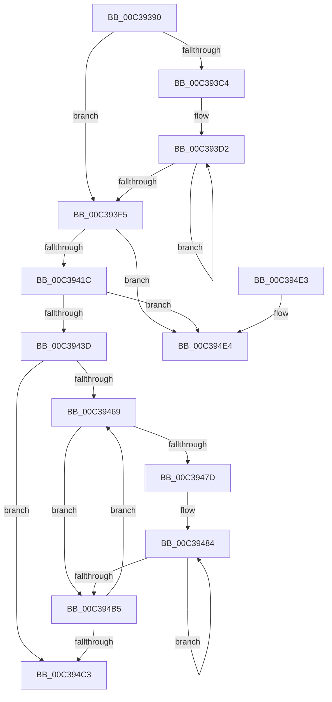

# KiPopulateSubNodes

- RVA: `0x00C39390`–`0x00C39500` (길이 `368` bytes)
- VA: `0x0000000140C39390`
- 실행 섹션: `INIT`
- PDB 이름 있음: `예`; PDB Function 태그: `아니요`
- unwind 정보 RVA: `0x000CA41C`
- 디코드: `90`개 명령, `368/368` bytes 표시
- 미해석 바이트: `0` (있으면 어셈블리에 `.byte`로 보존)

> 이 문서는 커널 이미지의 기계어와 PDB 기호를 분석해 생성했습니다. 4번과 5번은 함수 원형과 자료형을 바이너리 사용 방식에서 추정한 C 해석이며 원본 소스 복구 결과는 아닙니다.

## 1. Dependencies

- 직접 호출 지점: **3**; 고유 호출 대상: **2**
- 직접 호출자로 확인된 함수: **1**
- RIP 상대 이미지 참조: **7**

### Outgoing calls
- `0x00C3940B` → [ExAllocatePool2](../../poolcode/B8/ExAllocatePool2_function_00B820F0.md) (function, `0x00B820F0`)
- `0x00C3942F` → [ExAllocatePool2](../../poolcode/B8/ExAllocatePool2_function_00B820F0.md) (function, `0x00B820F0`)
- `0x00C394FA` → [KeBugCheckEx](../../text/4F/KeBugCheckEx_function_004FD660.md) (function, `0x004FD660`)

### Direct callers
- [KiPerformGroupConfiguration](KiPerformGroupConfiguration_function_00C38FB0.md) at `0x00C38FD0`

### Static image references
- `0x00C393A8` → RVA `0x00FC5000` (`ALMOSTRO`; read)
- `0x00C393AF` → RVA `0x00FCF6C0` (`CACHEALI`; read)
- `0x00C393C4` → RVA `0x00FC5044` (`ALMOSTRO`; read)
- `0x00C39448` → RVA `0x00F21AD0` (`.data`; read)
- `0x00C39453` → RVA `0x00F21AD0` (`.data`; write)
- `0x00C3945A` → RVA `0x00F21AF0` (`.data`; write)
- `0x00C394CD` → RVA `0x00F21AC8` (`.data`; write)

## 2. Other-region calls and transfers

- 다른 실행 섹션으로 향하는 call: **3**
  - `0x00C3940B` → [ExAllocatePool2](../../poolcode/B8/ExAllocatePool2_function_00B820F0.md) (`INIT` → `POOLCODE`)
  - `0x00C3942F` → [ExAllocatePool2](../../poolcode/B8/ExAllocatePool2_function_00B820F0.md) (`INIT` → `POOLCODE`)
  - `0x00C394FA` → [KeBugCheckEx](../../text/4F/KeBugCheckEx_function_004FD660.md) (`INIT` → `.text`)
- 별도 외부 분기/꼬리 이동을 확인하지 못했습니다.

## 3. Assembly (complete function range)

```asm
00C39390  48 89 5C 24 08                  mov qword ptr [rsp + 8], rbx
00C39395  48 89 6C 24 10                  mov qword ptr [rsp + 0x10], rbp
00C3939A  48 89 74 24 18                  mov qword ptr [rsp + 0x18], rsi
00C3939F  57                              push rdi
00C393A0  41 55                           push r13
00C393A2  41 56                           push r14
00C393A4  48 83 EC 30                     sub rsp, 0x30
00C393A8  0F B7 05 51 BC 38 00            movzx eax, word ptr [rip + 0x38bc51]
00C393AF  4C 8D 2D 0A 63 39 00            lea r13, [rip + 0x39630a]
00C393B6  33 ED                           xor ebp, ebp
00C393B8  0F B7 DD                        movzx ebx, bp
00C393BB  44 8D 75 01                     lea r14d, [rbp + 1]
00C393BF  66 3B E8                        cmp bp, ax
00C393C2  73 31                           jae 0x140c393f5
00C393C4  44 0F B7 0D 78 BC 38 00         movzx r9d, word ptr [rip + 0x38bc78]
00C393CC  4D 8B C5                        mov r8, r13
00C393CF  44 8B D0                        mov r10d, eax
00C393D2  49 8B 00                        mov rax, qword ptr [r8]
00C393D5  33 D2                           xor edx, edx
00C393D7  41 0F B7 C9                     movzx ecx, r9w
00C393DB  4D 8D 40 08                     lea r8, [r8 + 8]
00C393DF  66 03 48 08                     add cx, word ptr [rax + 8]
00C393E3  66 41 2B CE                     sub cx, r14w
00C393E7  0F B7 C1                        movzx eax, cx
00C393EA  41 F7 F1                        div r9d
00C393ED  66 03 D8                        add bx, ax
00C393F0  4D 2B D6                        sub r10, r14
00C393F3  75 DD                           jne 0x140c393d2
00C393F5  0F B7 FB                        movzx edi, bx
00C393F8  B9 48 00 00 00                  mov ecx, 0x48
00C393FD  41 B8 4B 53 4E 41               mov r8d, 0x414e534b
00C39403  48 8D 14 7F                     lea rdx, [rdi + rdi*2]
00C39407  48 C1 E2 03                     shl rdx, 3
00C3940B  E8 E0 8C F4 FF                  call 0x140b820f0
00C39410  48 8B F0                        mov rsi, rax
00C39413  48 85 C0                        test rax, rax
00C39416  0F 84 C8 00 00 00               je 0x140c394e4
00C3941C  48 8D 14 FD 00 00 00 00         lea rdx, [rdi*8]
00C39424  B9 48 00 00 00                  mov ecx, 0x48
00C39429  41 B8 4B 53 4E 41               mov r8d, 0x414e534b
00C3942F  E8 BC 8C F4 FF                  call 0x140b820f0
00C39434  48 85 C0                        test rax, rax
00C39437  0F 84 A7 00 00 00               je 0x140c394e4
00C3943D  66 3B 2D BC BB 38 00            cmp bp, word ptr [rip + 0x38bbbc]
00C39444  44 0F B7 DD                     movzx r11d, bp
00C39448  48 8B 0D 81 86 2E 00            mov rcx, qword ptr [rip + 0x2e8681]
00C3944F  44 0F B7 C5                     movzx r8d, bp
00C39453  48 89 05 76 86 2E 00            mov qword ptr [rip + 0x2e8676], rax
00C3945A  48 89 35 8F 86 2E 00            mov qword ptr [rip + 0x2e868f], rsi
00C39461  48 8B 11                        mov rdx, qword ptr [rcx]
00C39464  48 89 10                        mov qword ptr [rax], rdx
00C39467  73 5A                           jae 0x140c394c3
00C39469  41 0F B7 C0                     movzx eax, r8w
00C3946D  49 8B 44 C5 00                  mov rax, qword ptr [r13 + rax*8]
00C39472  44 0F B7 48 08                  movzx r9d, word ptr [rax + 8]
00C39477  66 45 85 C9                     test r9w, r9w
00C3947B  74 38                           je 0x140c394b5
00C3947D  44 8B 15 C0 BB 38 00            mov r10d, dword ptr [rip + 0x38bbc0]
00C39484  41 0F B7 C1                     movzx eax, r9w
00C39488  41 0F B7 D2                     movzx edx, r10w
00C3948C  41 3B C2                        cmp eax, r10d
00C3948F  41 0F B7 C3                     movzx eax, r11w
00C39493  66 41 0F 46 D1                  cmovbe dx, r9w
00C39498  48 8D 0C 40                     lea rcx, [rax + rax*2]
00C3949C  66 44 89 1C CE                  mov word ptr [rsi + rcx*8], r11w
00C394A1  66 45 03 DE                     add r11w, r14w
00C394A5  66 44 89 44 CE 02               mov word ptr [rsi + rcx*8 + 2], r8w
00C394AB  88 54 CE 04                     mov byte ptr [rsi + rcx*8 + 4], dl
00C394AF  66 44 2B CA                     sub r9w, dx
00C394B3  75 CF                           jne 0x140c39484
00C394B5  66 45 03 C6                     add r8w, r14w
00C394B9  66 44 3B 05 3F BB 38 00         cmp r8w, word ptr [rip + 0x38bb3f]
00C394C1  72 A6                           jb 0x140c39469
00C394C3  48 8B 6C 24 58                  mov rbp, qword ptr [rsp + 0x58]
00C394C8  48 8B 74 24 60                  mov rsi, qword ptr [rsp + 0x60]
00C394CD  66 89 1D F4 85 2E 00            mov word ptr [rip + 0x2e85f4], bx
00C394D4  48 8B 5C 24 50                  mov rbx, qword ptr [rsp + 0x50]
00C394D9  48 83 C4 30                     add rsp, 0x30
00C394DD  41 5E                           pop r14
00C394DF  41 5D                           pop r13
00C394E1  5F                              pop rdi
00C394E2  C3                              ret
00C394E3  CC                              int3
00C394E4  45 33 C9                        xor r9d, r9d
00C394E7  48 89 6C 24 20                  mov qword ptr [rsp + 0x20], rbp
00C394EC  45 33 C0                        xor r8d, r8d
00C394EF  48 C7 C2 9A 00 00 C0            mov rdx, 0xffffffffc000009a
00C394F6  41 8D 49 32                     lea ecx, [r9 + 0x32]
00C394FA  E8 61 41 8C FF                  call 0x1404fd660
00C394FF  CC                              int3
```

## 4. C-style interpretation (structured pseudocode)

```c
__int64 __fastcall KiPopulateSubNodes(__int64 a1, int a2)
{
    __int64 result;
    __int64 v_r10;
    __int64 v_r11;
    __int64 v_rbp;
    __int64 v_rbx;
    __int64 v_rsp;
    unsigned __int64 v_stack_p10;
    unsigned __int64 v_stack_p18;
    unsigned __int64 v_stack_p20;
    unsigned __int64 v_stack_p8;

    v_stack_p8 = v_rbx;
    v_stack_p10 = v_rbp;
    v_stack_p18 = v_rsi;
    v_rsp = (v_rsp) - (48);
    v_rbp = 0;
    if (0 >= ((unsigned __int16)(*(unsigned __int16 *)(v_rip + 3718225)))) goto loc_00C393F5;
loc_00C393D2:
    a2 = 0;
    a1 = (unsigned __int16)(((unsigned __int16)(*(unsigned __int16 *)(v_rip + 3718264))) + (*(unsigned __int16 *)(*(unsigned __int64 *)(v_rip + 3760906) + 8)));
    a1 = (unsigned __int16)((a1) - ((unsigned __int16)(v_rbp + 1)));
    v_rbx = (unsigned __int16)((0) + ((unsigned __int16)((unsigned __int16)(a1))));
    v_r10 = ((unsigned int)((unsigned int)(*(unsigned __int16 *)(v_rip + 3718225)))) - (v_rbp + 1);
    if (condition_is_not_equal) goto loc_00C393D2;
loc_00C393F5:
    a2 = ((unsigned __int16)(v_rbx) + (unsigned __int16)(v_rbx) * 2) << (3);
    result = ExAllocatePool2(72, a2, (unsigned int)(0x414E534BULL), *(unsigned __int16 *)(v_rip + 3718264));
    if (result == 0) goto loc_00C394E4;
    result = ExAllocatePool2(72, (unsigned __int16)(v_rbx) * 8, (unsigned int)(0x414E534BULL), *(unsigned __int16 *)(v_rip + 3718264));
    if (result == 0) goto loc_00C394E4;
    *(unsigned __int64 *)(v_rip + 3049078) = result;
    *(unsigned __int64 *)(v_rip + 3049103) = result;
    *(unsigned __int64 *)(result) = *(unsigned __int64 *)(*(unsigned __int64 *)(v_rip + 3049089));
    if (0 >= (*(unsigned __int16 *)(v_rip + 3718076))) goto loc_00C394C3;
loc_00C39469:
    if ((unsigned __int16)(*(unsigned __int16 *)(*(unsigned __int64 *)(v_rip + 3760906 + 0 * 8) + 8)) == 0) goto loc_00C394B5;
loc_00C39484:
    a2 = (unsigned __int16)((unsigned int)(*(unsigned int *)(v_rip + 3718080)));
    if (((unsigned int)((unsigned __int16)(*(unsigned __int16 *)(*(unsigned __int64 *)(v_rip + 3760906 + 0 * 8) + 8)))) <= ((unsigned int)((unsigned int)(*(unsigned int *)(v_rip + 3718080))))) { a2 = (unsigned __int16)(*(unsigned __int16 *)(*(unsigned __int64 *)(v_rip + 3760906 + 0 * 8) + 8)); }
    *(unsigned __int16 *)(result + 0 + 0 * 2 * 8) = 0;
    v_r11 = (unsigned __int16)((0) + ((unsigned __int16)(v_rbp + 1)));
    *(unsigned __int16 *)(result + 0 + 0 * 2 * 8 + 2) = 0;
    *(unsigned __int8 *)(result + 0 + 0 * 2 * 8 + 4) = (unsigned __int8)(a2);
    a4 = (unsigned __int16)((*(unsigned __int16 *)(*(unsigned __int64 *)(v_rip + 3760906 + 0 * 8) + 8)) - ((unsigned __int16)(a2)));
    if (condition_is_not_equal) goto loc_00C39484;
loc_00C394B5:
    a3 = (unsigned __int16)((0) + ((unsigned __int16)(v_rbp + 1)));
    if (((unsigned __int16)(a3)) < (*(unsigned __int16 *)(v_rip + 3717951))) goto loc_00C39469;
loc_00C394C3:
    *(unsigned __int16 *)(v_rip + 3048948) = (unsigned __int16)(v_rbx);
    v_rsp = (v_rsp) + (48);
    return 0;
loc_00C394E4:
    a4 = 0;
    v_stack_p20 = v_stack_p10;
    a3 = 0;
    result = KeBugCheckEx(a4 + 50, 0xFFFFFFFFC000009AULL, a3, a4);
    return result;
}
```

## 5. (Beta) C Style

```c
int64_t KiPopulateSubNodes(int64_t Arg1, int32_t Arg2)
{
    int64_t result;
    int64_t local_r10;
    int64_t local_r11;
    int64_t local_rbp;
    int64_t local_rbx;
    int64_t local_rsp;
    uint64_t v_stack_p10;
    uint64_t v_stack_p18;
    uint64_t v_stack_p20;
    uint64_t v_stack_p8;

    v_stack_p8 = local_rbx;
    v_stack_p10 = local_rbp;
    v_stack_p18 = local_rsi;
    local_rsp = (local_rsp) - (48);
    local_rbp = 0;
    if (0 >= ((uint16_t)(*(uint16_t *)(v_rip + 0x38BC51)))) goto loc_00C393F5;
loc_00C393D2:
    Arg2 = 0;
    Arg1 = (uint16_t)(((uint16_t)(*(uint16_t *)(v_rip + 0x38BC78))) + (*(uint16_t *)(*(uint64_t *)(v_rip + 0x39630A) + 0x8)));
    Arg1 = (uint16_t)((Arg1) - ((uint16_t)(local_rbp + 1)));
    local_rbx = (uint16_t)((0) + ((uint16_t)((uint16_t)(Arg1))));
    local_r10 = ((uint32_t)((uint32_t)(*(uint16_t *)(v_rip + 0x38BC51)))) - (local_rbp + 1);
    if (condition_is_not_equal) goto loc_00C393D2;
loc_00C393F5:
    Arg2 = ((uint16_t)(local_rbx) + (uint16_t)(local_rbx) * 2) << (3);
    result = ExAllocatePool2(72, Arg2, (uint32_t)(0x414E534BULL), *(uint16_t *)(v_rip + 0x38BC78));
    if (result == 0) goto loc_00C394E4;
    result = ExAllocatePool2(72, (uint16_t)(local_rbx) * 8, (uint32_t)(0x414E534BULL), *(uint16_t *)(v_rip + 0x38BC78));
    if (result == 0) goto loc_00C394E4;
    *(uint64_t *)(v_rip + 0x2E8676) = result;
    *(uint64_t *)(v_rip + 0x2E868F) = result;
    *(uint64_t *)(result) = *(uint64_t *)(*(uint64_t *)(v_rip + 0x2E8681));
    if (0 >= (*(uint16_t *)(v_rip + 0x38BBBC))) goto loc_00C394C3;
loc_00C39469:
    if ((uint16_t)(*(uint16_t *)(*(uint64_t *)(v_rip + 0x39630A + 0x0 * 8) + 0x8)) == 0) goto loc_00C394B5;
loc_00C39484:
    Arg2 = (uint16_t)((uint32_t)(*(uint32_t *)(v_rip + 0x38BBC0)));
    if (((uint32_t)((uint16_t)(*(uint16_t *)(*(uint64_t *)(v_rip + 0x39630A + 0x0 * 8) + 0x8)))) <= ((uint32_t)((uint32_t)(*(uint32_t *)(v_rip + 0x38BBC0))))) { Arg2 = (uint16_t)(*(uint16_t *)(*(uint64_t *)(v_rip + 0x39630A + 0x0 * 8) + 0x8)); }
    *(uint16_t *)(result + 0x0 + 0x0 * 2 * 8) = 0;
    local_r11 = (uint16_t)((0) + ((uint16_t)(local_rbp + 1)));
    *(uint16_t *)(result + 0x0 + 0x0 * 2 * 8 + 0x2) = 0;
    *(uint8_t *)(result + 0x0 + 0x0 * 2 * 8 + 0x4) = (uint8_t)(Arg2);
    a4 = (uint16_t)((*(uint16_t *)(*(uint64_t *)(v_rip + 0x39630A + 0x0 * 8) + 0x8)) - ((uint16_t)(Arg2)));
    if (condition_is_not_equal) goto loc_00C39484;
loc_00C394B5:
    a3 = (uint16_t)((0) + ((uint16_t)(local_rbp + 1)));
    if (((uint16_t)(a3)) < (*(uint16_t *)(v_rip + 0x38BB3F))) goto loc_00C39469;
loc_00C394C3:
    *(uint16_t *)(v_rip + 0x2E85F4) = (uint16_t)(local_rbx);
    local_rsp = (local_rsp) + (48);
    return 0;
loc_00C394E4:
    a4 = 0;
    v_stack_p20 = v_stack_p10;
    a3 = 0;
    result = KeBugCheckEx(a4 + 50, 0xFFFFFFFFC000009AULL, a3, a4);
    return result;
}
```

## 6. Execution-region graph

[열기: 2D/3D 그래프와 함수 탐색 컨트롤 패널](../../../control-panel.html?section=init&rva=0x00C39390&view=graph)

- 2D 그래프는 위에서 아래로 흐르고, 3D 그래프는 빈 공간을 드래그해 회전합니다. Shift+드래그는 이동, 휠은 확대·축소, 함수 노드 선택은 대상 보고서 이동입니다.

### Static fallback


