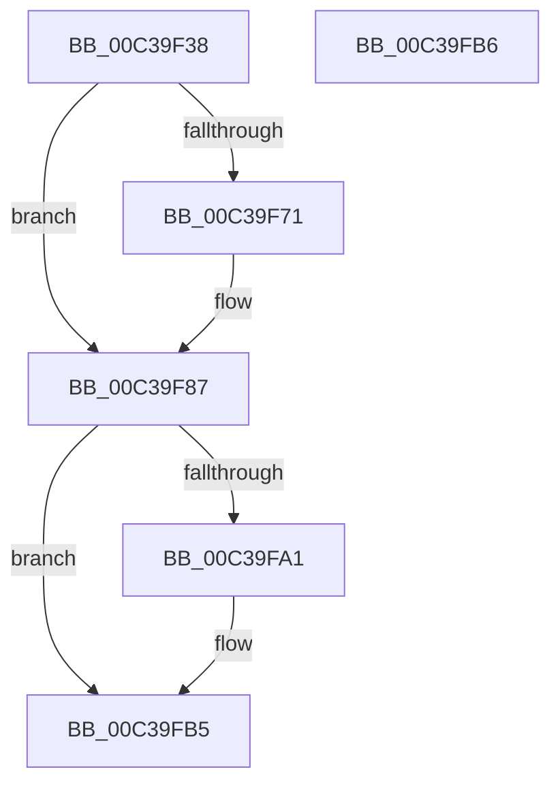

# KiPublishProcessorFeatures

- RVA: `0x00C39F38`–`0x00C39FB7` (길이 `127` bytes)
- VA: `0x0000000140C39F38`
- 실행 섹션: `INIT`
- PDB 이름 있음: `예`; PDB Function 태그: `아니요`
- unwind 정보 RVA: `0x000DB714`
- 디코드: `25`개 명령, `127/127` bytes 표시
- 미해석 바이트: `0` (있으면 어셈블리에 `.byte`로 보존)

> 이 문서는 커널 이미지의 기계어와 PDB 기호를 분석해 생성했습니다. 4번과 5번은 함수 원형과 자료형을 바이너리 사용 방식에서 추정한 C 해석이며 원본 소스 복구 결과는 아닙니다.

## 1. Dependencies

- 직접 호출 지점: **0**; 고유 호출 대상: **0**
- 직접 호출자로 확인된 함수: **1**
- RIP 상대 이미지 참조: **4**

### Outgoing calls
- 직접 디코드된 call 명령이 없습니다.

### Direct callers
- [KiSetProcessorSignature](../../text/5C/KiSetProcessorSignature_function_005C48C0.md) at `0x005C491F`

### Static image references
- `0x00C39F38` → RVA `0x00FC5008` (`ALMOSTRO`; read)
- `0x00C39F42` → RVA `0x00FC6B60` (`ALMOSTRO`; read)
- `0x00C39F57` → RVA `0x00FC6B20` (`ALMOSTRO`; read)
- `0x00C39FAF` → RVA `0x00FC6BF0` (`ALMOSTRO`; write)

## 2. Other-region calls and transfers

- 다른 실행 섹션으로 향하는 call: **0**
- 별도 외부 분기/꼬리 이동을 확인하지 못했습니다.

## 3. Assembly (complete function range)

```asm
00C39F38  48 8B 05 C9 B0 38 00            mov rax, qword ptr [rip + 0x38b0c9]
00C39F3F  4C 8B C9                        mov r9, rcx
00C39F42  4C 8B 05 17 CC 38 00            mov r8, qword ptr [rip + 0x38cc17]
00C39F49  41 8A D0                        mov dl, r8b
00C39F4C  D0 EA                           shr dl, 1
00C39F4E  80 E2 01                        and dl, 1
00C39F51  88 90 95 02 00 00               mov byte ptr [rax + 0x295], dl
00C39F57  48 8B 05 C2 CB 38 00            mov rax, qword ptr [rip + 0x38cbc2]
00C39F5E  48 8B 90 F0 00 00 00            mov rdx, qword ptr [rax + 0xf0]
00C39F65  F7 82 84 00 00 00 00 20 00 00   test dword ptr [rdx + 0x84], 0x2000
00C39F6F  75 16                           jne 0x140c39f87
00C39F71  48 8B 05 90 B0 38 00            mov rax, qword ptr [rip + 0x38b090]
00C39F78  49 C1 E8 0D                     shr r8, 0xd
00C39F7C  41 80 E0 01                     and r8b, 1
00C39F80  44 88 80 97 02 00 00            mov byte ptr [rax + 0x297], r8b
00C39F87  48 8B 05 92 CB 38 00            mov rax, qword ptr [rip + 0x38cb92]
00C39F8E  48 8B 88 F0 00 00 00            mov rcx, qword ptr [rax + 0xf0]
00C39F95  F7 81 84 00 00 00 00 80 00 00   test dword ptr [rcx + 0x84], 0x8000
00C39F9F  75 14                           jne 0x140c39fb5
00C39FA1  49 8B 81 A0 8F 00 00            mov rax, qword ptr [r9 + 0x8fa0]
00C39FA8  48 C1 E8 21                     shr rax, 0x21
00C39FAC  83 E0 01                        and eax, 1
00C39FAF  89 05 3B CC 38 00               mov dword ptr [rip + 0x38cc3b], eax
00C39FB5  C3                              ret
00C39FB6  CC                              int3
```

## 4. C-style interpretation (structured pseudocode)

```c
__int64 __fastcall KiPublishProcessorFeatures(__int64 a1)
{
    __int64 result;

    a2 = (unsigned __int8)(((unsigned __int8)(*(unsigned __int64 *)(v_rip + 3722263))) >> (1));
    a2 = (unsigned __int8)((a2) & (1));
    *(unsigned __int8 *)(*(unsigned __int64 *)(v_rip + 3715273) + 661) = (unsigned __int8)(a2);
    result = *(unsigned __int64 *)(v_rip + 3722178);
    if (((*(unsigned int *)(*(unsigned __int64 *)(*(unsigned __int64 *)(v_rip + 3722178) + 240) + 132)) & (0x2000ULL)) == 0) {
        result = *(unsigned __int64 *)(v_rip + 3715216);
        a3 = (*(unsigned __int64 *)(v_rip + 3722263)) >> (13);
        a3 = (unsigned __int8)((a3) & (1));
        *(unsigned __int8 *)(result + 663) = (unsigned __int8)(a3);
    }
    result = *(unsigned __int64 *)(v_rip + 3722130);
    if (((*(unsigned int *)(*(unsigned __int64 *)(*(unsigned __int64 *)(v_rip + 3722130) + 240) + 132)) & (0x8000ULL)) == 0) {
        result = *(unsigned __int64 *)(a1 + 36768);
        result = (result) >> (33);
        result = (unsigned int)((result) & (1));
        *(unsigned int *)(v_rip + 3722299) = (unsigned int)(result);
    }
    return result;
}
```

## 5. (Beta) C Style

```c
int64_t KiPublishProcessorFeatures(void *Arg1)
{
    uint8_t *arg1 = (uint8_t *)Arg1;

    int64_t result;

    a2 = (uint8_t)(((uint8_t)(*(uint64_t *)(v_rip + 0x38CC17))) >> (1));
    a2 = (uint8_t)((a2) & (1));
    *(uint8_t *)(*(uint64_t *)(v_rip + 0x38B0C9) + 0x295) = (uint8_t)(a2);
    result = *(uint64_t *)(v_rip + 0x38CBC2);
    if (((*(uint32_t *)(*(uint64_t *)(*(uint64_t *)(v_rip + 0x38CBC2) + 0xF0) + 0x84)) & (0x2000ULL)) == 0) {
        result = *(uint64_t *)(v_rip + 0x38B090);
        a3 = (*(uint64_t *)(v_rip + 0x38CC17)) >> (13);
        a3 = (uint8_t)((a3) & (1));
        *(uint8_t *)(result + 0x297) = (uint8_t)(a3);
    }
    result = *(uint64_t *)(v_rip + 0x38CB92);
    if (((*(uint32_t *)(*(uint64_t *)(*(uint64_t *)(v_rip + 0x38CB92) + 0xF0) + 0x84)) & (0x8000ULL)) == 0) {
        result = *(uint64_t *)(arg1 + 0x8FA0);
        result = (result) >> (33);
        result = (uint32_t)((result) & (1));
        *(uint32_t *)(v_rip + 0x38CC3B) = (uint32_t)(result);
    }
    return result;
}
```

### 관측된 메모리 오프셋

구조체 형식이 확인되지 않은 접근은 인자 기준의 오프셋으로만 기록했습니다.

| 기준 인자 | 오프셋 표현 | 폭 (bit) | 접근 |
|---|---:|---:|---|
| `Arg1` | `+ 0x8FA0` | `64` | `R` |

## 6. Execution-region graph

[열기: 2D/3D 그래프와 함수 탐색 컨트롤 패널](../../../control-panel.html?section=init&rva=0x00C39F38&view=graph)

- 2D 그래프는 위에서 아래로 흐르고, 3D 그래프는 빈 공간을 드래그해 회전합니다. Shift+드래그는 이동, 휠은 확대·축소, 함수 노드 선택은 대상 보고서 이동입니다.

### Static fallback


