# KiShuffleAssignedSubNodes

- RVA: `0x00C3B0A8`–`0x00C3B499` (길이 `1,009` bytes)
- VA: `0x0000000140C3B0A8`
- 실행 섹션: `INIT`
- PDB 이름 있음: `예`; PDB Function 태그: `아니요`
- unwind 정보 RVA: `0x000CB294`
- 디코드: `259`개 명령, `1,009/1,009` bytes 표시
- 미해석 바이트: `0` (있으면 어셈블리에 `.byte`로 보존)

> 이 문서는 커널 이미지의 기계어와 PDB 기호를 분석해 생성했습니다. 4번과 5번은 함수 원형과 자료형을 바이너리 사용 방식에서 추정한 C 해석이며 원본 소스 복구 결과는 아닙니다.

## 1. Dependencies

- 직접 호출 지점: **0**; 고유 호출 대상: **0**
- 직접 호출자로 확인된 함수: **1**
- RIP 상대 이미지 참조: **3**

### Outgoing calls
- 직접 디코드된 call 명령이 없습니다.

### Direct callers
- [KiPerformAutomaticGroupConfiguration](KiPerformAutomaticGroupConfiguration_function_00C38BDC.md) at `0x00C38D5A`

### Static image references
- `0x00C3B0CB` → RVA `0x00F21AC8` (`.data`; read)
- `0x00C3B1C7` → RVA `0x00FC5000` (`ALMOSTRO`; read)
- `0x00C3B1E1` → RVA `0x00FC50A8` (`ALMOSTRO`; read)

## 2. Other-region calls and transfers

- 다른 실행 섹션으로 향하는 call: **0**
- 별도 외부 분기/꼬리 이동을 확인하지 못했습니다.

## 3. Assembly (complete function range)

```asm
00C3B0A8  48 8B C4                        mov rax, rsp
00C3B0AB  4C 89 48 20                     mov qword ptr [rax + 0x20], r9
00C3B0AF  4C 89 40 18                     mov qword ptr [rax + 0x18], r8
00C3B0B3  66 89 50 10                     mov word ptr [rax + 0x10], dx
00C3B0B7  48 89 48 08                     mov qword ptr [rax + 8], rcx
00C3B0BB  53                              push rbx
00C3B0BC  55                              push rbp
00C3B0BD  56                              push rsi
00C3B0BE  57                              push rdi
00C3B0BF  41 54                           push r12
00C3B0C1  41 55                           push r13
00C3B0C3  41 56                           push r14
00C3B0C5  41 57                           push r15
00C3B0C7  48 83 EC 38                     sub rsp, 0x38
00C3B0CB  0F B7 3D F6 69 2E 00            movzx edi, word ptr [rip + 0x2e69f6]
00C3B0D2  45 33 C9                        xor r9d, r9d
00C3B0D5  41 8B C1                        mov eax, r9d
00C3B0D8  49 8B E8                        mov rbp, r8
00C3B0DB  4C 8B E1                        mov r12, rcx
00C3B0DE  89 44 24 0C                     mov dword ptr [rsp + 0xc], eax
00C3B0E2  B9 FF FF 00 00                  mov ecx, 0xffff
00C3B0E7  45 8D 41 01                     lea r8d, [r9 + 1]
00C3B0EB  44 88 8C 24 88 00 00 00         mov byte ptr [rsp + 0x88], r9b
00C3B0F3  45 8A D9                        mov r11b, r9b
00C3B0F6  66 44 89 4C 24 04               mov word ptr [rsp + 4], r9w
00C3B0FC  41 0F B7 F1                     movzx esi, r9w
00C3B100  66 44 3B CF                     cmp r9w, di
00C3B104  0F 83 68 03 00 00               jae 0x140c3b472
00C3B10A  49 8B C4                        mov rax, r12
00C3B10D  48 89 44 24 18                  mov qword ptr [rsp + 0x18], rax
00C3B112  4C 8B 38                        mov r15, qword ptr [rax]
00C3B115  4C 89 7C 24 20                  mov qword ptr [rsp + 0x20], r15
00C3B11A  45 84 47 05                     test byte ptr [r15 + 5], r8b
00C3B11E  0F 84 24 03 00 00               je 0x140c3b448
00C3B124  49 8B C4                        mov rax, r12
00C3B127  66 89 0C 24                     mov word ptr [rsp], cx
00C3B12B  48 89 44 24 10                  mov qword ptr [rsp + 0x10], rax
00C3B130  45 0F B7 D9                     movzx r11d, r9w
00C3B134  44 89 4C 24 08                  mov dword ptr [rsp + 8], r9d
00C3B139  4C 8B 28                        mov r13, qword ptr [rax]
00C3B13C  45 84 45 05                     test byte ptr [r13 + 5], r8b
00C3B140  0F 84 68 02 00 00               je 0x140c3b3ae
00C3B146  66 41 3B F3                     cmp si, r11w
00C3B14A  0F 84 5E 02 00 00               je 0x140c3b3ae
00C3B150  41 0F B7 5D 06                  movzx ebx, word ptr [r13 + 6]
00C3B155  45 0F B7 77 06                  movzx r14d, word ptr [r15 + 6]
00C3B15A  66 89 5C 24 02                  mov word ptr [rsp + 2], bx
00C3B15F  66 44 3B F3                     cmp r14w, bx
00C3B163  0F 84 45 02 00 00               je 0x140c3b3ae
00C3B169  45 0F B6 45 04                  movzx r8d, byte ptr [r13 + 4]
00C3B16E  41 0F B6 57 04                  movzx edx, byte ptr [r15 + 4]
00C3B173  41 8B C0                        mov eax, r8d
00C3B176  2B C2                           sub eax, edx
00C3B178  8B CA                           mov ecx, edx
00C3B17A  41 2B C8                        sub ecx, r8d
00C3B17D  44 3A C2                        cmp r8b, dl
00C3B180  41 B8 01 00 00 00               mov r8d, 1
00C3B186  0F 43 C8                        cmovae ecx, eax
00C3B189  0F B7 C3                        movzx eax, bx
00C3B18C  66 41 0F 43 C6                  cmovae ax, r14w
00C3B191  0F B7 C0                        movzx eax, ax
00C3B194  39 4C 85 00                     cmp dword ptr [rbp + rax*4], ecx
00C3B198  0F 82 0C 02 00 00               jb 0x140c3b3aa
00C3B19E  4D 8B D4                        mov r10, r12
00C3B1A1  41 8B E9                        mov ebp, r9d
00C3B1A4  4C 8B A4 24 98 00 00 00         mov r12, qword ptr [rsp + 0x98]
00C3B1AC  49 8B 12                        mov rdx, qword ptr [r10]
00C3B1AF  66 44 3B CE                     cmp r9w, si
00C3B1B3  74 44                           je 0x140c3b1f9
00C3B1B5  44 84 42 05                     test byte ptr [rdx + 5], r8b
00C3B1B9  74 3E                           je 0x140c3b1f9
00C3B1BB  66 44 39 72 06                  cmp word ptr [rdx + 6], r14w
00C3B1C0  75 37                           jne 0x140c3b1f9
00C3B1C2  41 0F B7 47 02                  movzx eax, word ptr [r15 + 2]
00C3B1C7  0F B7 0D 32 9E 38 00            movzx ecx, word ptr [rip + 0x389e32]
00C3B1CE  47 0F B7 04 74                  movzx r8d, word ptr [r12 + r14*2]
00C3B1D3  0F AF C8                        imul ecx, eax
00C3B1D6  41 FF C8                        dec r8d
00C3B1D9  0F B7 42 02                     movzx eax, word ptr [rdx + 2]
00C3B1DD  33 D2                           xor edx, edx
00C3B1DF  03 C8                           add ecx, eax
00C3B1E1  48 8B 05 C0 9E 38 00            mov rax, qword ptr [rip + 0x389ec0]
00C3B1E8  48 63 C9                        movsxd rcx, ecx
00C3B1EB  8B 04 88                        mov eax, dword ptr [rax + rcx*4]
00C3B1EE  41 F7 F0                        div r8d
00C3B1F1  41 B8 01 00 00 00               mov r8d, 1
00C3B1F7  03 E8                           add ebp, eax
00C3B1F9  66 45 03 C8                     add r9w, r8w
00C3B1FD  49 83 C2 08                     add r10, 8
00C3B201  66 44 3B CF                     cmp r9w, di
00C3B205  72 A5                           jb 0x140c3b1ac
00C3B207  4C 8B 94 24 80 00 00 00         mov r10, qword ptr [rsp + 0x80]
00C3B20F  45 33 C9                        xor r9d, r9d
00C3B212  48 8B B4 24 98 00 00 00         mov rsi, qword ptr [rsp + 0x98]
00C3B21A  0F B7 DB                        movzx ebx, bx
00C3B21D  48 89 5C 24 28                  mov qword ptr [rsp + 0x28], rbx
00C3B222  49 8B 12                        mov rdx, qword ptr [r10]
00C3B225  66 45 3B CB                     cmp r9w, r11w
00C3B229  74 43                           je 0x140c3b26e
00C3B22B  44 84 42 05                     test byte ptr [rdx + 5], r8b
00C3B22F  74 3D                           je 0x140c3b26e
00C3B231  66 39 5A 06                     cmp word ptr [rdx + 6], bx
00C3B235  75 37                           jne 0x140c3b26e
00C3B237  0F B7 05 C2 9D 38 00            movzx eax, word ptr [rip + 0x389dc2]
00C3B23E  41 0F B7 4D 02                  movzx ecx, word ptr [r13 + 2]
00C3B243  44 0F B7 04 5E                  movzx r8d, word ptr [rsi + rbx*2]
00C3B248  0F AF C8                        imul ecx, eax
00C3B24B  41 FF C8                        dec r8d
00C3B24E  0F B7 42 02                     movzx eax, word ptr [rdx + 2]
00C3B252  33 D2                           xor edx, edx
00C3B254  03 C8                           add ecx, eax
00C3B256  48 8B 05 4B 9E 38 00            mov rax, qword ptr [rip + 0x389e4b]
00C3B25D  48 63 C9                        movsxd rcx, ecx
00C3B260  8B 04 88                        mov eax, dword ptr [rax + rcx*4]
00C3B263  41 F7 F0                        div r8d
00C3B266  41 B8 01 00 00 00               mov r8d, 1
00C3B26C  03 E8                           add ebp, eax
00C3B26E  66 45 03 C8                     add r9w, r8w
00C3B272  49 83 C2 08                     add r10, 8
00C3B276  66 44 3B CF                     cmp r9w, di
00C3B27A  72 A6                           jb 0x140c3b222
00C3B27C  4C 8B 94 24 80 00 00 00         mov r10, qword ptr [rsp + 0x80]
00C3B284  33 C0                           xor eax, eax
00C3B286  0F B7 74 24 04                  movzx esi, word ptr [rsp + 4]
00C3B28B  8B D8                           mov ebx, eax
00C3B28D  4C 8B BC 24 98 00 00 00         mov r15, qword ptr [rsp + 0x98]
00C3B295  44 0F B7 C8                     movzx r9d, ax
00C3B299  49 8B 12                        mov rdx, qword ptr [r10]
00C3B29C  66 44 3B CE                     cmp r9w, si
00C3B2A0  74 44                           je 0x140c3b2e6
00C3B2A2  44 84 42 05                     test byte ptr [rdx + 5], r8b
00C3B2A6  74 3E                           je 0x140c3b2e6
00C3B2A8  66 44 39 72 06                  cmp word ptr [rdx + 6], r14w
00C3B2AD  75 37                           jne 0x140c3b2e6
00C3B2AF  41 0F B7 45 02                  movzx eax, word ptr [r13 + 2]
00C3B2B4  0F B7 0D 45 9D 38 00            movzx ecx, word ptr [rip + 0x389d45]
00C3B2BB  47 0F B7 04 77                  movzx r8d, word ptr [r15 + r14*2]
00C3B2C0  0F AF C8                        imul ecx, eax
00C3B2C3  41 FF C8                        dec r8d
00C3B2C6  0F B7 42 02                     movzx eax, word ptr [rdx + 2]
00C3B2CA  33 D2                           xor edx, edx
00C3B2CC  03 C8                           add ecx, eax
00C3B2CE  48 8B 05 D3 9D 38 00            mov rax, qword ptr [rip + 0x389dd3]
00C3B2D5  48 63 C9                        movsxd rcx, ecx
00C3B2D8  8B 04 88                        mov eax, dword ptr [rax + rcx*4]
00C3B2DB  41 F7 F0                        div r8d
00C3B2DE  41 B8 01 00 00 00               mov r8d, 1
00C3B2E4  03 D8                           add ebx, eax
00C3B2E6  66 45 03 C8                     add r9w, r8w
00C3B2EA  49 83 C2 08                     add r10, 8
00C3B2EE  66 44 3B CF                     cmp r9w, di
00C3B2F2  72 A5                           jb 0x140c3b299
00C3B2F4  4C 8B 94 24 80 00 00 00         mov r10, qword ptr [rsp + 0x80]
00C3B2FC  45 33 C9                        xor r9d, r9d
00C3B2FF  4C 8B 7C 24 20                  mov r15, qword ptr [rsp + 0x20]
00C3B304  44 0F B7 74 24 02               movzx r14d, word ptr [rsp + 2]
00C3B30A  4C 8B 6C 24 28                  mov r13, qword ptr [rsp + 0x28]
00C3B30F  4C 8B A4 24 98 00 00 00         mov r12, qword ptr [rsp + 0x98]
00C3B317  49 8B 12                        mov rdx, qword ptr [r10]
00C3B31A  66 45 3B CB                     cmp r9w, r11w
00C3B31E  74 44                           je 0x140c3b364
00C3B320  44 84 42 05                     test byte ptr [rdx + 5], r8b
00C3B324  74 3E                           je 0x140c3b364
00C3B326  66 44 39 72 06                  cmp word ptr [rdx + 6], r14w
00C3B32B  75 37                           jne 0x140c3b364
00C3B32D  0F B7 05 CC 9C 38 00            movzx eax, word ptr [rip + 0x389ccc]
00C3B334  41 0F B7 4F 02                  movzx ecx, word ptr [r15 + 2]
00C3B339  47 0F B7 04 6C                  movzx r8d, word ptr [r12 + r13*2]
00C3B33E  0F AF C8                        imul ecx, eax
00C3B341  41 FF C8                        dec r8d
00C3B344  0F B7 42 02                     movzx eax, word ptr [rdx + 2]
00C3B348  33 D2                           xor edx, edx
00C3B34A  03 C8                           add ecx, eax
00C3B34C  48 8B 05 55 9D 38 00            mov rax, qword ptr [rip + 0x389d55]
00C3B353  48 63 C9                        movsxd rcx, ecx
00C3B356  8B 04 88                        mov eax, dword ptr [rax + rcx*4]
00C3B359  41 F7 F0                        div r8d
00C3B35C  41 B8 01 00 00 00               mov r8d, 1
00C3B362  03 D8                           add ebx, eax
00C3B364  66 45 03 C8                     add r9w, r8w
00C3B368  49 83 C2 08                     add r10, 8
00C3B36C  66 44 3B CF                     cmp r9w, di
00C3B370  72 A5                           jb 0x140c3b317
00C3B372  4C 8B A4 24 80 00 00 00         mov r12, qword ptr [rsp + 0x80]
00C3B37A  3B DD                           cmp ebx, ebp
00C3B37C  73 21                           jae 0x140c3b39f
00C3B37E  2B EB                           sub ebp, ebx
00C3B380  45 33 C9                        xor r9d, r9d
00C3B383  39 6C 24 08                     cmp dword ptr [rsp + 8], ebp
00C3B387  73 19                           jae 0x140c3b3a2
00C3B389  41 0F B7 CB                     movzx ecx, r11w
00C3B38D  89 6C 24 08                     mov dword ptr [rsp + 8], ebp
00C3B391  48 8B AC 24 90 00 00 00         mov rbp, qword ptr [rsp + 0x90]
00C3B399  66 89 0C 24                     mov word ptr [rsp], cx
00C3B39D  EB 0F                           jmp 0x140c3b3ae
00C3B39F  45 33 C9                        xor r9d, r9d
00C3B3A2  48 8B AC 24 90 00 00 00         mov rbp, qword ptr [rsp + 0x90]
00C3B3AA  0F B7 0C 24                     movzx ecx, word ptr [rsp]
00C3B3AE  48 8B 44 24 10                  mov rax, qword ptr [rsp + 0x10]
00C3B3B3  66 45 03 D8                     add r11w, r8w
00C3B3B7  48 83 C0 08                     add rax, 8
00C3B3BB  48 89 44 24 10                  mov qword ptr [rsp + 0x10], rax
00C3B3C0  66 44 3B DF                     cmp r11w, di
00C3B3C4  0F 82 6F FD FF FF               jb 0x140c3b139
00C3B3CA  B8 FF FF 00 00                  mov eax, 0xffff
00C3B3CF  66 3B C8                        cmp cx, ax
00C3B3D2  74 6A                           je 0x140c3b43e
00C3B3D4  0F B7 C1                        movzx eax, cx
00C3B3D7  45 8A D8                        mov r11b, r8b
00C3B3DA  44 88 84 24 88 00 00 00         mov byte ptr [rsp + 0x88], r8b
00C3B3E2  B9 FF FF 00 00                  mov ecx, 0xffff
00C3B3E7  4D 8B 14 C4                     mov r10, qword ptr [r12 + rax*8]
00C3B3EB  41 0F B7 47 06                  movzx eax, word ptr [r15 + 6]
00C3B3F0  44 8B C0                        mov r8d, eax
00C3B3F3  45 0F B7 4A 06                  movzx r9d, word ptr [r10 + 6]
00C3B3F8  66 45 89 4F 06                  mov word ptr [r15 + 6], r9w
00C3B3FD  66 41 89 42 06                  mov word ptr [r10 + 6], ax
00C3B402  41 0F B6 57 04                  movzx edx, byte ptr [r15 + 4]
00C3B407  03 54 85 00                     add edx, dword ptr [rbp + rax*4]
00C3B40B  89 54 85 00                     mov dword ptr [rbp + rax*4], edx
00C3B40F  41 0F B6 42 04                  movzx eax, byte ptr [r10 + 4]
00C3B414  2B D0                           sub edx, eax
00C3B416  42 89 54 85 00                  mov dword ptr [rbp + r8*4], edx
00C3B41B  41 B8 01 00 00 00               mov r8d, 1
00C3B421  41 0F B6 52 04                  movzx edx, byte ptr [r10 + 4]
00C3B426  42 03 54 8D 00                  add edx, dword ptr [rbp + r9*4]
00C3B42B  42 89 54 8D 00                  mov dword ptr [rbp + r9*4], edx
00C3B430  41 0F B6 47 04                  movzx eax, byte ptr [r15 + 4]
00C3B435  2B D0                           sub edx, eax
00C3B437  42 89 54 8D 00                  mov dword ptr [rbp + r9*4], edx
00C3B43C  EB 0A                           jmp 0x140c3b448
00C3B43E  44 8A 9C 24 88 00 00 00         mov r11b, byte ptr [rsp + 0x88]
00C3B446  8B C8                           mov ecx, eax
00C3B448  48 8B 44 24 18                  mov rax, qword ptr [rsp + 0x18]
00C3B44D  66 41 03 F0                     add si, r8w
00C3B451  48 83 C0 08                     add rax, 8
00C3B455  66 89 74 24 04                  mov word ptr [rsp + 4], si
00C3B45A  48 89 44 24 18                  mov qword ptr [rsp + 0x18], rax
00C3B45F  41 B9 00 00 00 00               mov r9d, 0
00C3B465  66 3B F7                        cmp si, di
00C3B468  0F 82 A4 FC FF FF               jb 0x140c3b112
00C3B46E  8B 44 24 0C                     mov eax, dword ptr [rsp + 0xc]
00C3B472  41 03 C0                        add eax, r8d
00C3B475  89 44 24 0C                     mov dword ptr [rsp + 0xc], eax
00C3B479  45 84 DB                        test r11b, r11b
00C3B47C  74 09                           je 0x140c3b487
00C3B47E  83 F8 0A                        cmp eax, 0xa
00C3B481  0F 82 64 FC FF FF               jb 0x140c3b0eb
00C3B487  48 83 C4 38                     add rsp, 0x38
00C3B48B  41 5F                           pop r15
00C3B48D  41 5E                           pop r14
00C3B48F  41 5D                           pop r13
00C3B491  41 5C                           pop r12
00C3B493  5F                              pop rdi
00C3B494  5E                              pop rsi
00C3B495  5D                              pop rbp
00C3B496  5B                              pop rbx
00C3B497  C3                              ret
00C3B498  CC                              int3
```

## 4. C-style interpretation (structured pseudocode)

```c
__int64 __fastcall KiShuffleAssignedSubNodes(__int64 a1, unsigned __int16 a2, __int64 a3, __int64 a4)
{
    __int64 result;
    __int64 v_r10;
    __int64 v_r11;
    __int64 v_rbp;
    __int64 v_rbx;
    __int64 v_rsi;
    __int64 v_rsp;
    unsigned __int64 v_stack_m50;
    unsigned __int64 v_stack_m58;
    unsigned __int64 v_stack_m60;
    unsigned __int64 v_stack_m68;
    unsigned int v_stack_m6C;
    unsigned int v_stack_m70;
    unsigned __int16 v_stack_m74;
    unsigned __int16 v_stack_m76;
    unsigned __int16 v_stack_m78;
    unsigned __int8 v_stack_p10;
    unsigned __int64 v_stack_p18;
    unsigned __int64 v_stack_p20;
    unsigned __int64 v_stack_p8;

    *(unsigned __int64 *)(v_rsp + 32) = a4;
    *(unsigned __int64 *)(v_rsp + 24) = a3;
    *(unsigned __int16 *)(v_rsp + 16) = a2;
    *(unsigned __int64 *)(v_rsp + 8) = a1;
    v_rsp = (v_rsp) - (56);
    a4 = 0;
    v_stack_m6C = 0;
loc_00C3B0EB:
    v_stack_p10 = 0;
    v_stack_m74 = 0;
    if (0 >= ((unsigned __int16)(*(unsigned __int16 *)(v_rip + 3041782)))) goto loc_00C3B472;
    v_stack_m60 = a1;
loc_00C3B112:
    v_stack_m58 = *(unsigned __int64 *)(a1);
    if (((*(unsigned __int8 *)(*(unsigned __int64 *)(a1) + 5)) & ((unsigned __int8)(a4 + 1))) == 0) goto loc_00C3B448;
    v_stack_m78 = (unsigned __int16)((unsigned int)(0xFFFFULL));
    v_stack_m68 = a1;
    v_stack_m70 = 0;
loc_00C3B139:
    if (((*(unsigned __int8 *)(*(unsigned __int64 *)(a1) + 5)) & ((unsigned __int8)(a4 + 1))) == 0) goto loc_00C3B3AE;
    if (0 == 0) goto loc_00C3B3AE;
    v_stack_m76 = (unsigned __int16)(*(unsigned __int16 *)(*(unsigned __int64 *)(a1) + 6));
    if (((unsigned __int16)(*(unsigned __int16 *)(*(unsigned __int64 *)(a1) + 6))) == ((unsigned __int16)(*(unsigned __int16 *)(*(unsigned __int64 *)(a1) + 6)))) goto loc_00C3B3AE;
    result = (unsigned int)(((unsigned int)((unsigned int)(*(unsigned __int8 *)(*(unsigned __int64 *)(a1) + 4)))) - ((unsigned int)(*(unsigned __int8 *)(*(unsigned __int64 *)(a1) + 4))));
    a1 = (unsigned int)(((unsigned int)((unsigned int)(*(unsigned __int8 *)(*(unsigned __int64 *)(a1) + 4)))) - ((unsigned int)(*(unsigned __int8 *)(*(unsigned __int64 *)(a1) + 4))));
    if (((unsigned __int8)(*(unsigned __int8 *)(*(unsigned __int64 *)(a1) + 4))) >= ((unsigned __int8)(*(unsigned __int8 *)(*(unsigned __int64 *)(a1) + 4)))) { a1 = (unsigned int)(result); }
    result = (unsigned __int16)(*(unsigned __int16 *)(*(unsigned __int64 *)(a1) + 6));
    if (((unsigned __int8)(*(unsigned __int8 *)(*(unsigned __int64 *)(a1) + 4))) >= ((unsigned __int8)(*(unsigned __int8 *)(*(unsigned __int64 *)(a1) + 4)))) { result = (unsigned __int16)(*(unsigned __int16 *)(*(unsigned __int64 *)(a1) + 6)); }
    if ((*(unsigned int *)(a3 + (unsigned __int16)(result) * 4)) < ((unsigned int)(a1))) goto loc_00C3B3AA;
loc_00C3B1AC:
    if (0 == 0) goto loc_00C3B1F9;
    if (((*(unsigned __int8 *)(*(unsigned __int64 *)(a1) + 5)) & (1)) == 0) goto loc_00C3B1F9;
    result = (unsigned __int16)(result);
    v_rbp = 0;
    if ((*(unsigned __int16 *)(*(unsigned __int64 *)(a1) + 6)) == ((unsigned __int16)(*(unsigned __int16 *)(*(unsigned __int64 *)(a1) + 6)))) {
        result = *(unsigned __int16 *)(*(unsigned __int64 *)(a1) + 2);
        a1 = *(unsigned __int16 *)(v_rip + 3710514);
        a3 = *(unsigned __int16 *)(v_stack_p20 + *(unsigned __int16 *)(*(unsigned __int64 *)(a1) + 6) * 2);
        a1 = (unsigned int)((a1) * ((unsigned int)(result)));
        a3 = (unsigned int)((a3) - 1);
        result = *(unsigned __int16 *)(*(unsigned __int64 *)(a1) + 2);
        a2 = 0;
        a1 = (unsigned int)((a1) + ((unsigned int)(result)));
        result = *(unsigned __int64 *)(v_rip + 3710656);
        a1 = (int)((unsigned int)(a1));
        result = *(unsigned int *)(result + a1 * 4);
        a3 = 1;
        v_rbp = (unsigned int)((0) + ((unsigned int)(result)));
    }
    a4 = (unsigned __int16)((a4) + ((unsigned __int16)(a3)));
    v_r10 = (a1) + (8);
    if (((unsigned __int16)(a4)) < ((unsigned __int16)(*(unsigned __int16 *)(v_rip + 3041782)))) goto loc_00C3B1AC;
    a4 = 0;
    v_stack_m50 = (unsigned __int16)(*(unsigned __int16 *)(*(unsigned __int64 *)(a1) + 6));
loc_00C3B222:
    if (0 == 0) goto loc_00C3B26E;
    if (((*(unsigned __int8 *)(*(unsigned __int64 *)(v_stack_p8) + 5)) & ((unsigned __int8)(a3))) == 0) goto loc_00C3B26E;
    if ((*(unsigned __int16 *)(*(unsigned __int64 *)(v_stack_p8) + 6)) == ((unsigned __int16)((unsigned __int16)(*(unsigned __int16 *)(*(unsigned __int64 *)(a1) + 6))))) {
        result = *(unsigned __int16 *)(v_rip + 3710402);
        a1 = *(unsigned __int16 *)(*(unsigned __int64 *)(a1) + 2);
        a3 = *(unsigned __int16 *)(v_stack_p20 + (unsigned __int16)(*(unsigned __int16 *)(*(unsigned __int64 *)(a1) + 6)) * 2);
        a1 = (unsigned int)((a1) * ((unsigned int)(result)));
        a3 = (unsigned int)((a3) - 1);
        result = *(unsigned __int16 *)(*(unsigned __int64 *)(v_stack_p8) + 2);
        a2 = 0;
        a1 = (unsigned int)((a1) + ((unsigned int)(result)));
        result = *(unsigned __int64 *)(v_rip + 3710539);
        a1 = (int)((unsigned int)(a1));
        result = *(unsigned int *)(result + a1 * 4);
        a3 = 1;
        v_rbp = (unsigned int)((v_rbp) + ((unsigned int)(result)));
    }
    a4 = (unsigned __int16)((a4) + ((unsigned __int16)(a3)));
    v_r10 = (v_stack_p8) + (8);
    if (((unsigned __int16)(a4)) < ((unsigned __int16)(*(unsigned __int16 *)(v_rip + 3041782)))) goto loc_00C3B222;
    result = 0;
loc_00C3B299:
    if (0 == ((unsigned __int16)(v_stack_m74))) goto loc_00C3B2E6;
    if (((*(unsigned __int8 *)(*(unsigned __int64 *)(v_stack_p8) + 5)) & ((unsigned __int8)(a3))) == 0) goto loc_00C3B2E6;
    v_rbx = 0;
    if ((*(unsigned __int16 *)(*(unsigned __int64 *)(v_stack_p8) + 6)) == ((unsigned __int16)(*(unsigned __int16 *)(*(unsigned __int64 *)(a1) + 6)))) {
        result = *(unsigned __int16 *)(*(unsigned __int64 *)(a1) + 2);
        a1 = *(unsigned __int16 *)(v_rip + 3710277);
        a3 = *(unsigned __int16 *)(v_stack_p20 + *(unsigned __int16 *)(*(unsigned __int64 *)(a1) + 6) * 2);
        a1 = (unsigned int)((a1) * ((unsigned int)(result)));
        a3 = (unsigned int)((a3) - 1);
        result = *(unsigned __int16 *)(*(unsigned __int64 *)(v_stack_p8) + 2);
        a2 = 0;
        a1 = (unsigned int)((a1) + ((unsigned int)(result)));
        result = *(unsigned __int64 *)(v_rip + 3710419);
        a1 = (int)((unsigned int)(a1));
        result = *(unsigned int *)(result + a1 * 4);
        a3 = 1;
        v_rbx = (unsigned int)((0) + ((unsigned int)(result)));
    }
    a4 = (unsigned __int16)((0) + ((unsigned __int16)(a3)));
    v_r10 = (v_stack_p8) + (8);
    if (((unsigned __int16)(a4)) < ((unsigned __int16)(*(unsigned __int16 *)(v_rip + 3041782)))) goto loc_00C3B299;
    a4 = 0;
loc_00C3B317:
    if (0 == 0) goto loc_00C3B364;
    if (((*(unsigned __int8 *)(*(unsigned __int64 *)(v_stack_p8) + 5)) & ((unsigned __int8)(a3))) == 0) goto loc_00C3B364;
    if ((*(unsigned __int16 *)(*(unsigned __int64 *)(v_stack_p8) + 6)) == ((unsigned __int16)(v_stack_m76))) {
        result = *(unsigned __int16 *)(v_rip + 3710156);
        a1 = *(unsigned __int16 *)(v_stack_m58 + 2);
        a3 = *(unsigned __int16 *)(v_stack_p20 + v_stack_m50 * 2);
        a1 = (unsigned int)((a1) * ((unsigned int)(result)));
        a3 = (unsigned int)((a3) - 1);
        result = *(unsigned __int16 *)(*(unsigned __int64 *)(v_stack_p8) + 2);
        a2 = 0;
        a1 = (unsigned int)((a1) + ((unsigned int)(result)));
        result = *(unsigned __int64 *)(v_rip + 3710293);
        a1 = (int)((unsigned int)(a1));
        result = *(unsigned int *)(result + a1 * 4);
        a3 = 1;
        v_rbx = (unsigned int)((v_rbx) + ((unsigned int)(result)));
    }
    a4 = (unsigned __int16)((a4) + ((unsigned __int16)(a3)));
    v_r10 = (v_stack_p8) + (8);
    if (((unsigned __int16)(a4)) < ((unsigned __int16)(*(unsigned __int16 *)(v_rip + 3041782)))) goto loc_00C3B317;
    if (((unsigned int)(v_rbx)) >= ((unsigned int)(v_rbp))) goto loc_00C3B39F;
    v_rbp = (unsigned int)((v_rbp) - ((unsigned int)(v_rbx)));
    a4 = 0;
    if (v_stack_m70 >= ((unsigned int)(v_rbp))) goto loc_00C3B3A2;
    v_stack_m70 = (unsigned int)(v_rbp);
    v_stack_m78 = 0;
    goto loc_00C3B3AE;
loc_00C3B39F:
    a4 = 0;
loc_00C3B3A2:
loc_00C3B3AA:
loc_00C3B3AE:
    v_r11 = (unsigned __int16)((0) + ((unsigned __int16)(a3)));
    result = (v_stack_m68) + (8);
    v_stack_m68 = result;
    if (((unsigned __int16)(v_r11)) < ((unsigned __int16)(*(unsigned __int16 *)(v_rip + 3041782)))) goto loc_00C3B139;
    if (((unsigned __int16)(v_stack_m78)) == ((unsigned __int16)((unsigned int)(0xFFFFULL)))) goto loc_00C3B43E;
    v_stack_p10 = (unsigned __int8)(a3);
    *(unsigned __int16 *)(v_stack_m58 + 6) = (unsigned __int16)(*(unsigned __int16 *)(*(unsigned __int64 *)(v_stack_p8 + (unsigned __int16)(v_stack_m78) * 8) + 6));
    *(unsigned __int16 *)(*(unsigned __int64 *)(v_stack_p8 + (unsigned __int16)(v_stack_m78) * 8) + 6) = (unsigned __int16)(*(unsigned __int16 *)(v_stack_m58 + 6));
    a2 = (unsigned int)((*(unsigned __int8 *)(v_stack_m58 + 4)) + (*(unsigned int *)(v_stack_p18 + *(unsigned __int16 *)(v_stack_m58 + 6) * 4)));
    *(unsigned int *)(v_stack_p18 + *(unsigned __int16 *)(v_stack_m58 + 6) * 4) = a2;
    a2 = (unsigned int)((a2) - ((unsigned int)(*(unsigned __int8 *)(*(unsigned __int64 *)(v_stack_p8 + (unsigned __int16)(v_stack_m78) * 8) + 4))));
    *(unsigned int *)(v_stack_p18 + (unsigned int)((unsigned int)(*(unsigned __int16 *)(v_stack_m58 + 6))) * 4) = a2;
    a2 = (unsigned int)((*(unsigned __int8 *)(*(unsigned __int64 *)(v_stack_p8 + (unsigned __int16)(v_stack_m78) * 8) + 4)) + (*(unsigned int *)(v_stack_p18 + *(unsigned __int16 *)(*(unsigned __int64 *)(v_stack_p8 + (unsigned __int16)(v_stack_m78) * 8) + 6) * 4)));
    *(unsigned int *)(v_stack_p18 + *(unsigned __int16 *)(*(unsigned __int64 *)(v_stack_p8 + (unsigned __int16)(v_stack_m78) * 8) + 6) * 4) = a2;
    a2 = (unsigned int)((a2) - ((unsigned int)(*(unsigned __int8 *)(v_stack_m58 + 4))));
    *(unsigned int *)(v_stack_p18 + *(unsigned __int16 *)(*(unsigned __int64 *)(v_stack_p8 + (unsigned __int16)(v_stack_m78) * 8) + 6) * 4) = a2;
    goto loc_00C3B448;
loc_00C3B43E:
loc_00C3B448:
    v_rsi = (unsigned __int16)((v_stack_m74) + (1));
    result = (v_stack_m60) + (8);
    v_stack_m74 = (unsigned __int16)(v_rsi);
    v_stack_m60 = result;
    if (((unsigned __int16)(v_rsi)) < ((unsigned __int16)(*(unsigned __int16 *)(v_rip + 3041782)))) goto loc_00C3B112;
loc_00C3B472:
    result = (unsigned int)(((unsigned int)(v_stack_m6C)) + (1));
    v_stack_m6C = (unsigned int)(result);
    if ((unsigned __int8)(v_stack_p10) == 0) goto loc_00C3B487;
    if (((unsigned int)(result)) < 10) goto loc_00C3B0EB;
loc_00C3B487:
    v_rsp = (v_rsp) + (56);
    return result;
}
```

## 5. (Beta) C Style

```c
int64_t KiShuffleAssignedSubNodes(int64_t Arg1, uint16_t Arg2, int64_t Arg3, int64_t Arg4)
{
    int64_t result;
    int64_t local_r10;
    int64_t local_r11;
    int64_t local_rbp;
    int64_t local_rbx;
    int64_t local_rsi;
    int64_t local_rsp;
    uint64_t v_stack_m50;
    uint64_t v_stack_m58;
    uint64_t v_stack_m60;
    uint64_t v_stack_m68;
    uint32_t v_stack_m6C;
    uint32_t v_stack_m70;
    uint16_t v_stack_m74;
    uint16_t v_stack_m76;
    uint16_t v_stack_m78;
    uint8_t v_stack_p10;
    uint64_t v_stack_p18;
    uint64_t v_stack_p20;
    uint64_t v_stack_p8;

    *(uint64_t *)(local_rsp + 0x20) = Arg4;
    *(uint64_t *)(local_rsp + 0x18) = Arg3;
    *(uint16_t *)(local_rsp + 0x10) = Arg2;
    *(uint64_t *)(local_rsp + 0x8) = Arg1;
    local_rsp = (local_rsp) - (56);
    Arg4 = 0;
    v_stack_m6C = 0;
loc_00C3B0EB:
    v_stack_p10 = 0;
    v_stack_m74 = 0;
    if (0 >= ((uint16_t)(*(uint16_t *)(v_rip + 0x2E69F6)))) goto loc_00C3B472;
    v_stack_m60 = Arg1;
loc_00C3B112:
    v_stack_m58 = *(uint64_t *)(Arg1);
    if (((*(uint8_t *)(*(uint64_t *)(Arg1) + 0x5)) & ((uint8_t)(Arg4 + 1))) == 0) goto loc_00C3B448;
    v_stack_m78 = (uint16_t)((uint32_t)(0xFFFFULL));
    v_stack_m68 = Arg1;
    v_stack_m70 = 0;
loc_00C3B139:
    if (((*(uint8_t *)(*(uint64_t *)(Arg1) + 0x5)) & ((uint8_t)(Arg4 + 1))) == 0) goto loc_00C3B3AE;
    if (0 == 0) goto loc_00C3B3AE;
    v_stack_m76 = (uint16_t)(*(uint16_t *)(*(uint64_t *)(Arg1) + 0x6));
    if (((uint16_t)(*(uint16_t *)(*(uint64_t *)(Arg1) + 0x6))) == ((uint16_t)(*(uint16_t *)(*(uint64_t *)(Arg1) + 0x6)))) goto loc_00C3B3AE;
    result = (uint32_t)(((uint32_t)((uint32_t)(*(uint8_t *)(*(uint64_t *)(Arg1) + 0x4)))) - ((uint32_t)(*(uint8_t *)(*(uint64_t *)(Arg1) + 0x4))));
    Arg1 = (uint32_t)(((uint32_t)((uint32_t)(*(uint8_t *)(*(uint64_t *)(Arg1) + 0x4)))) - ((uint32_t)(*(uint8_t *)(*(uint64_t *)(Arg1) + 0x4))));
    if (((uint8_t)(*(uint8_t *)(*(uint64_t *)(Arg1) + 0x4))) >= ((uint8_t)(*(uint8_t *)(*(uint64_t *)(Arg1) + 0x4)))) { Arg1 = (uint32_t)(result); }
    result = (uint16_t)(*(uint16_t *)(*(uint64_t *)(Arg1) + 0x6));
    if (((uint8_t)(*(uint8_t *)(*(uint64_t *)(Arg1) + 0x4))) >= ((uint8_t)(*(uint8_t *)(*(uint64_t *)(Arg1) + 0x4)))) { result = (uint16_t)(*(uint16_t *)(*(uint64_t *)(Arg1) + 0x6)); }
    if ((*(uint32_t *)(Arg3 + (uint16_t)(result) * 4)) < ((uint32_t)(Arg1))) goto loc_00C3B3AA;
loc_00C3B1AC:
    if (0 == 0) goto loc_00C3B1F9;
    if (((*(uint8_t *)(*(uint64_t *)(Arg1) + 0x5)) & (1)) == 0) goto loc_00C3B1F9;
    result = (uint16_t)(result);
    local_rbp = 0;
    if ((*(uint16_t *)(*(uint64_t *)(Arg1) + 0x6)) == ((uint16_t)(*(uint16_t *)(*(uint64_t *)(Arg1) + 0x6)))) {
        result = *(uint16_t *)(*(uint64_t *)(Arg1) + 0x2);
        Arg1 = *(uint16_t *)(v_rip + 0x389E32);
        Arg3 = *(uint16_t *)(v_stack_p20 + *(uint16_t *)(*(uint64_t *)(Arg1) + 0x6) * 2);
        Arg1 = (uint32_t)((Arg1) * ((uint32_t)(result)));
        Arg3 = (uint32_t)((Arg3) - 1);
        result = *(uint16_t *)(*(uint64_t *)(Arg1) + 0x2);
        Arg2 = 0;
        Arg1 = (uint32_t)((Arg1) + ((uint32_t)(result)));
        result = *(uint64_t *)(v_rip + 0x389EC0);
        Arg1 = (int32_t)((uint32_t)(Arg1));
        result = *(uint32_t *)(result + Arg1 * 4);
        Arg3 = 1;
        local_rbp = (uint32_t)((0) + ((uint32_t)(result)));
    }
    Arg4 = (uint16_t)((Arg4) + ((uint16_t)(Arg3)));
    local_r10 = (Arg1) + (8);
    if (((uint16_t)(Arg4)) < ((uint16_t)(*(uint16_t *)(v_rip + 0x2E69F6)))) goto loc_00C3B1AC;
    Arg4 = 0;
    v_stack_m50 = (uint16_t)(*(uint16_t *)(*(uint64_t *)(Arg1) + 0x6));
loc_00C3B222:
    if (0 == 0) goto loc_00C3B26E;
    if (((*(uint8_t *)(*(uint64_t *)(v_stack_p8) + 0x5)) & ((uint8_t)(Arg3))) == 0) goto loc_00C3B26E;
    if ((*(uint16_t *)(*(uint64_t *)(v_stack_p8) + 0x6)) == ((uint16_t)((uint16_t)(*(uint16_t *)(*(uint64_t *)(Arg1) + 0x6))))) {
        result = *(uint16_t *)(v_rip + 0x389DC2);
        Arg1 = *(uint16_t *)(*(uint64_t *)(Arg1) + 0x2);
        Arg3 = *(uint16_t *)(v_stack_p20 + (uint16_t)(*(uint16_t *)(*(uint64_t *)(Arg1) + 0x6)) * 2);
        Arg1 = (uint32_t)((Arg1) * ((uint32_t)(result)));
        Arg3 = (uint32_t)((Arg3) - 1);
        result = *(uint16_t *)(*(uint64_t *)(v_stack_p8) + 0x2);
        Arg2 = 0;
        Arg1 = (uint32_t)((Arg1) + ((uint32_t)(result)));
        result = *(uint64_t *)(v_rip + 0x389E4B);
        Arg1 = (int32_t)((uint32_t)(Arg1));
        result = *(uint32_t *)(result + Arg1 * 4);
        Arg3 = 1;
        local_rbp = (uint32_t)((local_rbp) + ((uint32_t)(result)));
    }
    Arg4 = (uint16_t)((Arg4) + ((uint16_t)(Arg3)));
    local_r10 = (v_stack_p8) + (8);
    if (((uint16_t)(Arg4)) < ((uint16_t)(*(uint16_t *)(v_rip + 0x2E69F6)))) goto loc_00C3B222;
    result = 0;
loc_00C3B299:
    if (0 == ((uint16_t)(v_stack_m74))) goto loc_00C3B2E6;
    if (((*(uint8_t *)(*(uint64_t *)(v_stack_p8) + 0x5)) & ((uint8_t)(Arg3))) == 0) goto loc_00C3B2E6;
    local_rbx = 0;
    if ((*(uint16_t *)(*(uint64_t *)(v_stack_p8) + 0x6)) == ((uint16_t)(*(uint16_t *)(*(uint64_t *)(Arg1) + 0x6)))) {
        result = *(uint16_t *)(*(uint64_t *)(Arg1) + 0x2);
        Arg1 = *(uint16_t *)(v_rip + 0x389D45);
        Arg3 = *(uint16_t *)(v_stack_p20 + *(uint16_t *)(*(uint64_t *)(Arg1) + 0x6) * 2);
        Arg1 = (uint32_t)((Arg1) * ((uint32_t)(result)));
        Arg3 = (uint32_t)((Arg3) - 1);
        result = *(uint16_t *)(*(uint64_t *)(v_stack_p8) + 0x2);
        Arg2 = 0;
        Arg1 = (uint32_t)((Arg1) + ((uint32_t)(result)));
        result = *(uint64_t *)(v_rip + 0x389DD3);
        Arg1 = (int32_t)((uint32_t)(Arg1));
        result = *(uint32_t *)(result + Arg1 * 4);
        Arg3 = 1;
        local_rbx = (uint32_t)((0) + ((uint32_t)(result)));
    }
    Arg4 = (uint16_t)((0) + ((uint16_t)(Arg3)));
    local_r10 = (v_stack_p8) + (8);
    if (((uint16_t)(Arg4)) < ((uint16_t)(*(uint16_t *)(v_rip + 0x2E69F6)))) goto loc_00C3B299;
    Arg4 = 0;
loc_00C3B317:
    if (0 == 0) goto loc_00C3B364;
    if (((*(uint8_t *)(*(uint64_t *)(v_stack_p8) + 0x5)) & ((uint8_t)(Arg3))) == 0) goto loc_00C3B364;
    if ((*(uint16_t *)(*(uint64_t *)(v_stack_p8) + 0x6)) == ((uint16_t)(v_stack_m76))) {
        result = *(uint16_t *)(v_rip + 0x389CCC);
        Arg1 = *(uint16_t *)(v_stack_m58 + 0x2);
        Arg3 = *(uint16_t *)(v_stack_p20 + v_stack_m50 * 2);
        Arg1 = (uint32_t)((Arg1) * ((uint32_t)(result)));
        Arg3 = (uint32_t)((Arg3) - 1);
        result = *(uint16_t *)(*(uint64_t *)(v_stack_p8) + 0x2);
        Arg2 = 0;
        Arg1 = (uint32_t)((Arg1) + ((uint32_t)(result)));
        result = *(uint64_t *)(v_rip + 0x389D55);
        Arg1 = (int32_t)((uint32_t)(Arg1));
        result = *(uint32_t *)(result + Arg1 * 4);
        Arg3 = 1;
        local_rbx = (uint32_t)((local_rbx) + ((uint32_t)(result)));
    }
    Arg4 = (uint16_t)((Arg4) + ((uint16_t)(Arg3)));
    local_r10 = (v_stack_p8) + (8);
    if (((uint16_t)(Arg4)) < ((uint16_t)(*(uint16_t *)(v_rip + 0x2E69F6)))) goto loc_00C3B317;
    if (((uint32_t)(local_rbx)) >= ((uint32_t)(local_rbp))) goto loc_00C3B39F;
    local_rbp = (uint32_t)((local_rbp) - ((uint32_t)(local_rbx)));
    Arg4 = 0;
    if (v_stack_m70 >= ((uint32_t)(local_rbp))) goto loc_00C3B3A2;
    v_stack_m70 = (uint32_t)(local_rbp);
    v_stack_m78 = 0;
    goto loc_00C3B3AE;
loc_00C3B39F:
    Arg4 = 0;
loc_00C3B3A2:
loc_00C3B3AA:
loc_00C3B3AE:
    local_r11 = (uint16_t)((0) + ((uint16_t)(Arg3)));
    result = (v_stack_m68) + (8);
    v_stack_m68 = result;
    if (((uint16_t)(local_r11)) < ((uint16_t)(*(uint16_t *)(v_rip + 0x2E69F6)))) goto loc_00C3B139;
    if (((uint16_t)(v_stack_m78)) == ((uint16_t)((uint32_t)(0xFFFFULL)))) goto loc_00C3B43E;
    v_stack_p10 = (uint8_t)(Arg3);
    *(uint16_t *)(v_stack_m58 + 0x6) = (uint16_t)(*(uint16_t *)(*(uint64_t *)(v_stack_p8 + (uint16_t)(v_stack_m78) * 8) + 0x6));
    *(uint16_t *)(*(uint64_t *)(v_stack_p8 + (uint16_t)(v_stack_m78) * 8) + 0x6) = (uint16_t)(*(uint16_t *)(v_stack_m58 + 0x6));
    Arg2 = (uint32_t)((*(uint8_t *)(v_stack_m58 + 0x4)) + (*(uint32_t *)(v_stack_p18 + *(uint16_t *)(v_stack_m58 + 0x6) * 4)));
    *(uint32_t *)(v_stack_p18 + *(uint16_t *)(v_stack_m58 + 0x6) * 4) = Arg2;
    Arg2 = (uint32_t)((Arg2) - ((uint32_t)(*(uint8_t *)(*(uint64_t *)(v_stack_p8 + (uint16_t)(v_stack_m78) * 8) + 0x4))));
    *(uint32_t *)(v_stack_p18 + (uint32_t)((uint32_t)(*(uint16_t *)(v_stack_m58 + 0x6))) * 4) = Arg2;
    Arg2 = (uint32_t)((*(uint8_t *)(*(uint64_t *)(v_stack_p8 + (uint16_t)(v_stack_m78) * 8) + 0x4)) + (*(uint32_t *)(v_stack_p18 + *(uint16_t *)(*(uint64_t *)(v_stack_p8 + (uint16_t)(v_stack_m78) * 8) + 0x6) * 4)));
    *(uint32_t *)(v_stack_p18 + *(uint16_t *)(*(uint64_t *)(v_stack_p8 + (uint16_t)(v_stack_m78) * 8) + 0x6) * 4) = Arg2;
    Arg2 = (uint32_t)((Arg2) - ((uint32_t)(*(uint8_t *)(v_stack_m58 + 0x4))));
    *(uint32_t *)(v_stack_p18 + *(uint16_t *)(*(uint64_t *)(v_stack_p8 + (uint16_t)(v_stack_m78) * 8) + 0x6) * 4) = Arg2;
    goto loc_00C3B448;
loc_00C3B43E:
loc_00C3B448:
    local_rsi = (uint16_t)((v_stack_m74) + (1));
    result = (v_stack_m60) + (8);
    v_stack_m74 = (uint16_t)(local_rsi);
    v_stack_m60 = result;
    if (((uint16_t)(local_rsi)) < ((uint16_t)(*(uint16_t *)(v_rip + 0x2E69F6)))) goto loc_00C3B112;
loc_00C3B472:
    result = (uint32_t)(((uint32_t)(v_stack_m6C)) + (1));
    v_stack_m6C = (uint32_t)(result);
    if ((uint8_t)(v_stack_p10) == 0) goto loc_00C3B487;
    if (((uint32_t)(result)) < 10) goto loc_00C3B0EB;
loc_00C3B487:
    local_rsp = (local_rsp) + (56);
    return result;
}
```

## 6. Execution-region graph

[열기: 2D/3D 그래프와 함수 탐색 컨트롤 패널](../../../control-panel.html?section=init&rva=0x00C3B0A8&view=graph)

- 2D 그래프는 위에서 아래로 흐르고, 3D 그래프는 빈 공간을 드래그해 회전합니다. Shift+드래그는 이동, 휠은 확대·축소, 함수 노드 선택은 대상 보고서 이동입니다.

### Static fallback

```mermaid
flowchart TD
  bb_00C3B0A8[BB_00C3B0A8]
  bb_00C3B0EB[BB_00C3B0EB]
  bb_00C3B10A[BB_00C3B10A]
  bb_00C3B112[BB_00C3B112]
  bb_00C3B124[BB_00C3B124]
  bb_00C3B139[BB_00C3B139]
  bb_00C3B146[BB_00C3B146]
  bb_00C3B150[BB_00C3B150]
  bb_00C3B169[BB_00C3B169]
  bb_00C3B19E[BB_00C3B19E]
  bb_00C3B1AC[BB_00C3B1AC]
  bb_00C3B1B5[BB_00C3B1B5]
  bb_00C3B1BB[BB_00C3B1BB]
  bb_00C3B1C2[BB_00C3B1C2]
  bb_00C3B1F9[BB_00C3B1F9]
  bb_00C3B207[BB_00C3B207]
  bb_00C3B222[BB_00C3B222]
  bb_00C3B22B[BB_00C3B22B]
  bb_00C3B231[BB_00C3B231]
  bb_00C3B237[BB_00C3B237]
  bb_00C3B26E[BB_00C3B26E]
  bb_00C3B27C[BB_00C3B27C]
  bb_00C3B299[BB_00C3B299]
  bb_00C3B2A2[BB_00C3B2A2]
  bb_00C3B2A8[BB_00C3B2A8]
  bb_00C3B2AF[BB_00C3B2AF]
  bb_00C3B2E6[BB_00C3B2E6]
  bb_00C3B2F4[BB_00C3B2F4]
  bb_00C3B317[BB_00C3B317]
  bb_00C3B320[BB_00C3B320]
  bb_00C3B326[BB_00C3B326]
  bb_00C3B32D[BB_00C3B32D]
  bb_00C3B364[BB_00C3B364]
  bb_00C3B372[BB_00C3B372]
  bb_00C3B37E[BB_00C3B37E]
  bb_00C3B389[BB_00C3B389]
  bb_00C3B39F[BB_00C3B39F]
  bb_00C3B3A2[BB_00C3B3A2]
  bb_00C3B3AA[BB_00C3B3AA]
  bb_00C3B3AE[BB_00C3B3AE]
  bb_00C3B3CA[BB_00C3B3CA]
  bb_00C3B3D4[BB_00C3B3D4]
  bb_00C3B43E[BB_00C3B43E]
  bb_00C3B448[BB_00C3B448]
  bb_00C3B46E[BB_00C3B46E]
  bb_00C3B472[BB_00C3B472]
  bb_00C3B47E[BB_00C3B47E]
  bb_00C3B487[BB_00C3B487]
  bb_00C3B498[BB_00C3B498]
  bb_00C3B0A8 -->|flow| bb_00C3B0EB
  bb_00C3B0EB -->|branch| bb_00C3B472
  bb_00C3B0EB -->|fallthrough| bb_00C3B10A
  bb_00C3B10A -->|flow| bb_00C3B112
  bb_00C3B112 -->|branch| bb_00C3B448
  bb_00C3B112 -->|fallthrough| bb_00C3B124
  bb_00C3B124 -->|flow| bb_00C3B139
  bb_00C3B139 -->|branch| bb_00C3B3AE
  bb_00C3B139 -->|fallthrough| bb_00C3B146
  bb_00C3B146 -->|branch| bb_00C3B3AE
  bb_00C3B146 -->|fallthrough| bb_00C3B150
  bb_00C3B150 -->|branch| bb_00C3B3AE
  bb_00C3B150 -->|fallthrough| bb_00C3B169
  bb_00C3B169 -->|branch| bb_00C3B3AA
  bb_00C3B169 -->|fallthrough| bb_00C3B19E
  bb_00C3B19E -->|flow| bb_00C3B1AC
  bb_00C3B1AC -->|branch| bb_00C3B1F9
  bb_00C3B1AC -->|fallthrough| bb_00C3B1B5
  bb_00C3B1B5 -->|branch| bb_00C3B1F9
  bb_00C3B1B5 -->|fallthrough| bb_00C3B1BB
  bb_00C3B1BB -->|branch| bb_00C3B1F9
  bb_00C3B1BB -->|fallthrough| bb_00C3B1C2
  bb_00C3B1C2 -->|flow| bb_00C3B1F9
  bb_00C3B1F9 -->|branch| bb_00C3B1AC
  bb_00C3B1F9 -->|fallthrough| bb_00C3B207
  bb_00C3B207 -->|flow| bb_00C3B222
  bb_00C3B222 -->|branch| bb_00C3B26E
  bb_00C3B222 -->|fallthrough| bb_00C3B22B
  bb_00C3B22B -->|branch| bb_00C3B26E
  bb_00C3B22B -->|fallthrough| bb_00C3B231
  bb_00C3B231 -->|branch| bb_00C3B26E
  bb_00C3B231 -->|fallthrough| bb_00C3B237
  bb_00C3B237 -->|flow| bb_00C3B26E
  bb_00C3B26E -->|branch| bb_00C3B222
  bb_00C3B26E -->|fallthrough| bb_00C3B27C
  bb_00C3B27C -->|flow| bb_00C3B299
  bb_00C3B299 -->|branch| bb_00C3B2E6
  bb_00C3B299 -->|fallthrough| bb_00C3B2A2
  bb_00C3B2A2 -->|branch| bb_00C3B2E6
  bb_00C3B2A2 -->|fallthrough| bb_00C3B2A8
  bb_00C3B2A8 -->|branch| bb_00C3B2E6
  bb_00C3B2A8 -->|fallthrough| bb_00C3B2AF
  bb_00C3B2AF -->|flow| bb_00C3B2E6
  bb_00C3B2E6 -->|branch| bb_00C3B299
  bb_00C3B2E6 -->|fallthrough| bb_00C3B2F4
  bb_00C3B2F4 -->|flow| bb_00C3B317
  bb_00C3B317 -->|branch| bb_00C3B364
  bb_00C3B317 -->|fallthrough| bb_00C3B320
  bb_00C3B320 -->|branch| bb_00C3B364
  bb_00C3B320 -->|fallthrough| bb_00C3B326
  bb_00C3B326 -->|branch| bb_00C3B364
  bb_00C3B326 -->|fallthrough| bb_00C3B32D
  bb_00C3B32D -->|flow| bb_00C3B364
  bb_00C3B364 -->|branch| bb_00C3B317
  bb_00C3B364 -->|fallthrough| bb_00C3B372
  bb_00C3B372 -->|branch| bb_00C3B39F
  bb_00C3B372 -->|fallthrough| bb_00C3B37E
  bb_00C3B37E -->|branch| bb_00C3B3A2
  bb_00C3B37E -->|fallthrough| bb_00C3B389
  bb_00C3B389 -->|branch| bb_00C3B3AE
  bb_00C3B39F -->|flow| bb_00C3B3A2
  bb_00C3B3A2 -->|flow| bb_00C3B3AA
  bb_00C3B3AA -->|flow| bb_00C3B3AE
  bb_00C3B3AE -->|branch| bb_00C3B139
  bb_00C3B3AE -->|fallthrough| bb_00C3B3CA
  bb_00C3B3CA -->|branch| bb_00C3B43E
  bb_00C3B3CA -->|fallthrough| bb_00C3B3D4
  bb_00C3B3D4 -->|branch| bb_00C3B448
  bb_00C3B43E -->|flow| bb_00C3B448
  bb_00C3B448 -->|branch| bb_00C3B112
  bb_00C3B448 -->|fallthrough| bb_00C3B46E
  bb_00C3B46E -->|flow| bb_00C3B472
  bb_00C3B472 -->|branch| bb_00C3B487
  bb_00C3B472 -->|fallthrough| bb_00C3B47E
  bb_00C3B47E -->|branch| bb_00C3B0EB
  bb_00C3B47E -->|fallthrough| bb_00C3B487
```


