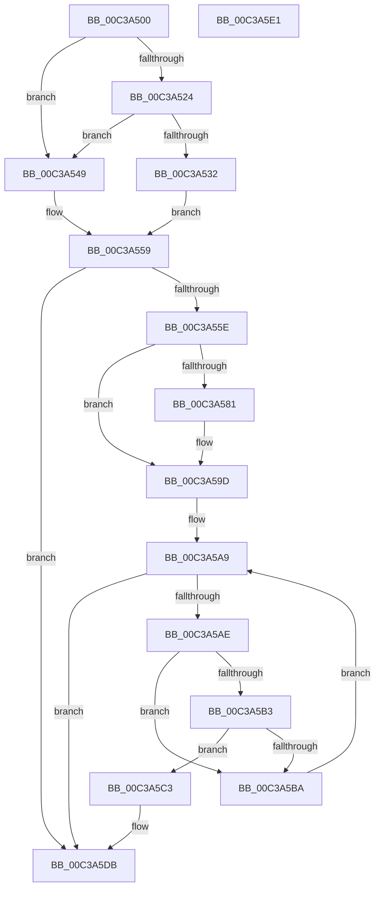

# KiVerifyPdata

- RVA: `0x00C3A500`–`0x00C3A5E2` (길이 `226` bytes)
- VA: `0x0000000140C3A500`
- 실행 섹션: `INIT`
- PDB 이름 있음: `예`; PDB Function 태그: `아니요`
- unwind 정보 RVA: `0x00071A74`
- 디코드: `63`개 명령, `226/226` bytes 표시
- 미해석 바이트: `0` (있으면 어셈블리에 `.byte`로 보존)

> 이 문서는 커널 이미지의 기계어와 PDB 기호를 분석해 생성했습니다. 4번과 5번은 함수 원형과 자료형을 바이너리 사용 방식에서 추정한 C 해석이며 원본 소스 복구 결과는 아닙니다.

## 1. Dependencies

- 직접 호출 지점: **3**; 고유 호출 대상: **2**
- 직접 호출자로 확인된 함수: **1**
- RIP 상대 이미지 참조: **3**

### Outgoing calls
- `0x00C3A551` → [RtlpxLookupFunctionTable](../../text/2F/RtlpxLookupFunctionTable_function_002F3610.md) (function, `0x002F3610`)
- `0x00C3A597` → [KeBugCheckEx](../../text/4F/KeBugCheckEx_function_004FD660.md) (function, `0x004FD660`)
- `0x00C3A5D5` → [KeBugCheckEx](../../text/4F/KeBugCheckEx_function_004FD660.md) (function, `0x004FD660`)

### Direct callers
- [KiVerifyScopesExecute](KiVerifyScopesExecute_function_00C3A640.md) at `0x00C3A72E`
- [KiVerifyScopesExecute](KiVerifyScopesExecute_function_00C3A640.md) at `0x00C3A73A`

### Static image references
- `0x00C3A50B` → RVA `0x01200038` (`CFGRO`; read)
- `0x00C3A524` → RVA `0x01200040` (`CFGRO`; read)
- `0x00C3A53A` → RVA `0x01200030` (`CFGRO`; read)

## 2. Other-region calls and transfers

- 다른 실행 섹션으로 향하는 call: **3**
  - `0x00C3A551` → [RtlpxLookupFunctionTable](../../text/2F/RtlpxLookupFunctionTable_function_002F3610.md) (`INIT` → `.text`)
  - `0x00C3A597` → [KeBugCheckEx](../../text/4F/KeBugCheckEx_function_004FD660.md) (`INIT` → `.text`)
  - `0x00C3A5D5` → [KeBugCheckEx](../../text/4F/KeBugCheckEx_function_004FD660.md) (`INIT` → `.text`)
- 별도 외부 분기/꼬리 이동을 확인하지 못했습니다.

## 3. Assembly (complete function range)

```asm
00C3A500  40 53                           push rbx
00C3A502  48 83 EC 50                     sub rsp, 0x50
00C3A506  48 8B D9                        mov rbx, rcx
00C3A509  33 C0                           xor eax, eax
00C3A50B  48 8B 0D 26 5B 5C 00            mov rcx, qword ptr [rip + 0x5c5b26]
00C3A512  0F 57 C0                        xorps xmm0, xmm0
00C3A515  48 89 44 24 40                  mov qword ptr [rsp + 0x40], rax
00C3A51A  0F 11 44 24 30                  movups xmmword ptr [rsp + 0x30], xmm0
00C3A51F  48 3B D9                        cmp rbx, rcx
00C3A522  72 25                           jb 0x140c3a549
00C3A524  8B 05 16 5B 5C 00               mov eax, dword ptr [rip + 0x5c5b16]
00C3A52A  48 03 C1                        add rax, rcx
00C3A52D  48 3B D8                        cmp rbx, rax
00C3A530  73 17                           jae 0x140c3a549
00C3A532  F2 0F 10 05 06 5B 5C 00         movsd xmm0, qword ptr [rip + 0x5c5b06]
00C3A53A  4C 8B 0D EF 5A 5C 00            mov r9, qword ptr [rip + 0x5c5aef]
00C3A541  F2 0F 11 44 24 40               movsd qword ptr [rsp + 0x40], xmm0
00C3A547  EB 10                           jmp 0x140c3a559
00C3A549  48 8D 54 24 30                  lea rdx, [rsp + 0x30]
00C3A54E  48 8B CB                        mov rcx, rbx
00C3A551  E8 BA 90 6B FF                  call 0x1402f3610
00C3A556  4C 8B C8                        mov r9, rax
00C3A559  4D 85 C9                        test r9, r9
00C3A55C  74 7D                           je 0x140c3a5db
00C3A55E  44 8B 44 24 44                  mov r8d, dword ptr [rsp + 0x44]
00C3A563  48 B8 AB AA AA AA AA AA AA AA   movabs rax, 0xaaaaaaaaaaaaaaab
00C3A56D  49 F7 E0                        mul r8
00C3A570  48 C1 EA 03                     shr rdx, 3
00C3A574  48 8D 0C 52                     lea rcx, [rdx + rdx*2]
00C3A578  48 C1 E1 02                     shl rcx, 2
00C3A57C  4C 3B C1                        cmp r8, rcx
00C3A57F  74 1C                           je 0x140c3a59d
00C3A581  48 83 64 24 20 00               and qword ptr [rsp + 0x20], 0
00C3A587  45 8B C8                        mov r9d, r8d
00C3A58A  4C 8B C3                        mov r8, rbx
00C3A58D  BA FD FF FF FF                  mov edx, 0xfffffffd
00C3A592  B9 4D 01 00 00                  mov ecx, 0x14d
00C3A597  E8 C4 30 8C FF                  call 0x1404fd660
00C3A59C  CC                              int3
00C3A59D  8B C2                           mov eax, edx
00C3A59F  48 8D 0C 40                     lea rcx, [rax + rax*2]
00C3A5A3  49 8D 14 89                     lea rdx, [r9 + rcx*4]
00C3A5A7  33 C9                           xor ecx, ecx
00C3A5A9  4C 3B CA                        cmp r9, rdx
00C3A5AC  74 2D                           je 0x140c3a5db
00C3A5AE  48 85 C9                        test rcx, rcx
00C3A5B1  74 07                           je 0x140c3a5ba
00C3A5B3  41 8B 01                        mov eax, dword ptr [r9]
00C3A5B6  39 01                           cmp dword ptr [rcx], eax
00C3A5B8  73 09                           jae 0x140c3a5c3
00C3A5BA  49 8B C9                        mov rcx, r9
00C3A5BD  49 83 C1 0C                     add r9, 0xc
00C3A5C1  EB E6                           jmp 0x140c3a5a9
00C3A5C3  48 89 4C 24 20                  mov qword ptr [rsp + 0x20], rcx
00C3A5C8  4C 8B C3                        mov r8, rbx
00C3A5CB  B9 4D 01 00 00                  mov ecx, 0x14d
00C3A5D0  BA FE FF FF FF                  mov edx, 0xfffffffe
00C3A5D5  E8 86 30 8C FF                  call 0x1404fd660
00C3A5DA  CC                              int3
00C3A5DB  48 83 C4 50                     add rsp, 0x50
00C3A5DF  5B                              pop rbx
00C3A5E0  C3                              ret
00C3A5E1  CC                              int3
```

## 4. C-style interpretation (structured pseudocode)

```c
__int64 __fastcall KiVerifyPdata(__int64 a1)
{
    __int64 result;
    __int64 v_rsp;
    unsigned int v_stack_m14;
    unsigned __int64 v_stack_m18;
    unsigned __int64 v_stack_m28;
    unsigned __int64 v_stack_m38;

    v_rsp = (v_rsp) - (80);
    result = 0;
    v_stack_m18 = 0;
    v_stack_m28 = v_xmm0;
    if (a1 < (*(unsigned __int64 *)(v_rip + 6052646))) goto loc_00C3A549;
    result = ((unsigned int)(*(unsigned int *)(v_rip + 6052630))) + (*(unsigned __int64 *)(v_rip + 6052646));
    if (a1 >= result) goto loc_00C3A549;
    v_stack_m18 = v_xmm0;
    goto loc_00C3A559;
loc_00C3A549:
    result = RtlpxLookupFunctionTable(a1, v_stack_m28, a3, *(unsigned __int64 *)(v_rip + 6052591));
loc_00C3A559:
    if (result == 0) goto loc_00C3A5DB;
    a2 = (v_stack_m28) >> (3);
    a1 = (a2 + a2 * 2) << (2);
    if (((unsigned int)(v_stack_m14)) != a1) {
        a4 = (unsigned int)((unsigned int)(v_stack_m14));
        a3 = a1;
        a2 = 0xFFFFFFFDULL;
        a1 = 333;
        result = KeBugCheckEx(a1, a2, a3, a4);
    }
    a1 = 0;
loc_00C3A5A9:
    if (a4 == (a4 + (unsigned int)((unsigned int)(a2)) + (unsigned int)((unsigned int)(a2)) * 2 * 4)) goto loc_00C3A5DB;
    if (0 == 0) goto loc_00C3A5BA;
    if ((*(unsigned int *)(a1)) >= ((unsigned int)((unsigned int)(*(unsigned int *)(a4))))) goto loc_00C3A5C3;
loc_00C3A5BA:
    a4 = (a4) + (12);
    goto loc_00C3A5A9;
loc_00C3A5C3:
    v_stack_m38 = a4;
    result = KeBugCheckEx(333, (unsigned int)(0xFFFFFFFEULL), 0, a4);
loc_00C3A5DB:
    v_rsp = (v_rsp) + (80);
    return result;
}
```

## 5. (Beta) C Style

```c
int64_t KiVerifyPdata(int64_t Arg1)
{
    int64_t result;
    int64_t local_rsp;
    uint32_t v_stack_m14;
    uint64_t v_stack_m18;
    uint64_t v_stack_m28;
    uint64_t v_stack_m38;

    local_rsp = (local_rsp) - (80);
    result = 0;
    v_stack_m18 = 0;
    v_stack_m28 = v_xmm0;
    if (Arg1 < (*(uint64_t *)(v_rip + 0x5C5B26))) goto loc_00C3A549;
    result = ((uint32_t)(*(uint32_t *)(v_rip + 0x5C5B16))) + (*(uint64_t *)(v_rip + 0x5C5B26));
    if (Arg1 >= result) goto loc_00C3A549;
    v_stack_m18 = v_xmm0;
    goto loc_00C3A559;
loc_00C3A549:
    result = RtlpxLookupFunctionTable(Arg1, v_stack_m28, a3, *(uint64_t *)(v_rip + 0x5C5AEF));
loc_00C3A559:
    if (result == 0) goto loc_00C3A5DB;
    a2 = (v_stack_m28) >> (3);
    Arg1 = (a2 + a2 * 2) << (2);
    if (((uint32_t)(v_stack_m14)) != Arg1) {
        a4 = (uint32_t)((uint32_t)(v_stack_m14));
        a3 = Arg1;
        a2 = 0xFFFFFFFDULL;
        Arg1 = 333;
        result = KeBugCheckEx(Arg1, a2, a3, a4);
    }
    Arg1 = 0;
loc_00C3A5A9:
    if (a4 == (a4 + (uint32_t)((uint32_t)(a2)) + (uint32_t)((uint32_t)(a2)) * 2 * 4)) goto loc_00C3A5DB;
    if (0 == 0) goto loc_00C3A5BA;
    if ((*(uint32_t *)(Arg1)) >= ((uint32_t)((uint32_t)(*(uint32_t *)(a4))))) goto loc_00C3A5C3;
loc_00C3A5BA:
    a4 = (a4) + (12);
    goto loc_00C3A5A9;
loc_00C3A5C3:
    v_stack_m38 = a4;
    result = KeBugCheckEx(333, (uint32_t)(0xFFFFFFFEULL), 0, a4);
loc_00C3A5DB:
    local_rsp = (local_rsp) + (80);
    return result;
}
```

## 6. Execution-region graph

[열기: 2D/3D 그래프와 함수 탐색 컨트롤 패널](../../../control-panel.html?section=init&rva=0x00C3A500&view=graph)

- 2D 그래프는 위에서 아래로 흐르고, 3D 그래프는 빈 공간을 드래그해 회전합니다. Shift+드래그는 이동, 휠은 확대·축소, 함수 노드 선택은 대상 보고서 이동입니다.

### Static fallback


