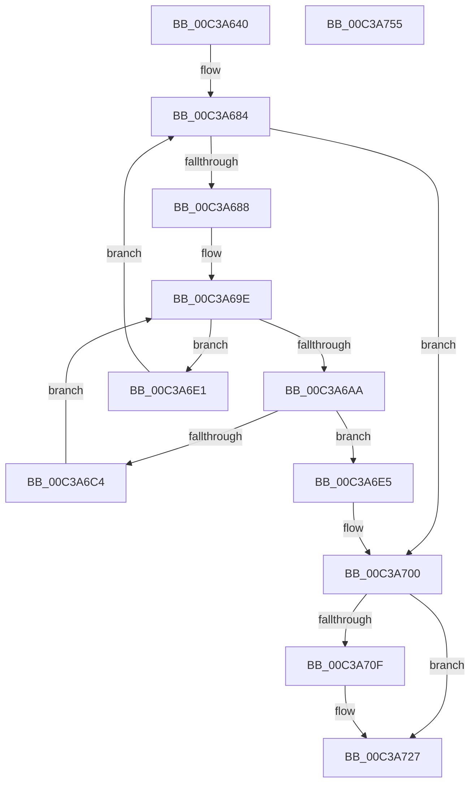

# KiVerifyScopesExecute

- RVA: `0x00C3A640`–`0x00C3A756` (길이 `278` bytes)
- VA: `0x0000000140C3A640`
- 실행 섹션: `INIT`
- PDB 이름 있음: `예`; PDB Function 태그: `아니요`
- unwind 정보 RVA: `0x000BF5C8`
- 디코드: `74`개 명령, `278/278` bytes 표시
- 미해석 바이트: `0` (있으면 어셈블리에 `.byte`로 보존)

> 이 문서는 커널 이미지의 기계어와 PDB 기호를 분석해 생성했습니다. 4번과 5번은 함수 원형과 자료형을 바이너리 사용 방식에서 추정한 C 해석이며 원본 소스 복구 결과는 아닙니다.

## 1. Dependencies

- 직접 호출 지점: **5**; 고유 호출 대상: **3**
- 직접 호출자로 확인된 함수: **0**
- RIP 상대 이미지 참조: **5**

### Outgoing calls
- `0x00C3A6B9` → `indirect target` (indirect, 간접 대상)
- `0x00C3A6FA` → [KeBugCheckEx](../../text/4F/KeBugCheckEx_function_004FD660.md) (function, `0x004FD660`)
- `0x00C3A721` → [KeBugCheckEx](../../text/4F/KeBugCheckEx_function_004FD660.md) (function, `0x004FD660`)
- `0x00C3A72E` → [KiVerifyPdata](KiVerifyPdata_function_00C3A500.md) (function, `0x00C3A500`)
- `0x00C3A73A` → [KiVerifyPdata](KiVerifyPdata_function_00C3A500.md) (function, `0x00C3A500`)

### Direct callers
- 이 함수 시작 RVA로 연결되는 직접 call은 확인되지 않았습니다. 간접 호출은 완전히 역산할 수 없습니다.

### Static image references
- `0x00C3A66D` → RVA `0x01008620` (`INITDATA`; read)
- `0x00C3A68A` → RVA `0x010080D0` (`INITDATA`; read)
- `0x00C3A69E` → RVA `0x01008148` (`INITDATA`; read)
- `0x00C3A727` → RVA `0x00FC6B28` (`ALMOSTRO`; read)
- `0x00C3A733` → RVA `0x00FC6B98` (`ALMOSTRO`; read)

## 2. Other-region calls and transfers

- 다른 실행 섹션으로 향하는 call: **2**
  - `0x00C3A6FA` → [KeBugCheckEx](../../text/4F/KeBugCheckEx_function_004FD660.md) (`INIT` → `.text`)
  - `0x00C3A721` → [KeBugCheckEx](../../text/4F/KeBugCheckEx_function_004FD660.md) (`INIT` → `.text`)
- 별도 외부 분기/꼬리 이동을 확인하지 못했습니다.

## 3. Assembly (complete function range)

```asm
00C3A640  48 89 5C 24 08                  mov qword ptr [rsp + 8], rbx
00C3A645  48 89 74 24 10                  mov qword ptr [rsp + 0x10], rsi
00C3A64A  48 89 7C 24 18                  mov qword ptr [rsp + 0x18], rdi
00C3A64F  55                              push rbp
00C3A650  48 8B EC                        mov rbp, rsp
00C3A653  48 83 EC 60                     sub rsp, 0x60
00C3A657  48 83 65 E8 00                  and qword ptr [rbp - 0x18], 0
00C3A65C  0F 57 C0                        xorps xmm0, xmm0
00C3A65F  83 65 F4 00                     and dword ptr [rbp - 0xc], 0
00C3A663  48 B8 FF FF FF FF FF FF FF FE   movabs rax, 0xfeffffffffffffff
00C3A66D  8B 1D AD DF 3C 00               mov ebx, dword ptr [rip + 0x3cdfad]
00C3A673  83 65 F0 00                     and dword ptr [rbp - 0x10], 0
00C3A677  48 8B 55 E8                     mov rdx, qword ptr [rbp - 0x18]
00C3A67B  F3 0F 7F 45 D8                  movdqu xmmword ptr [rbp - 0x28], xmm0
00C3A680  48 89 45 D0                     mov qword ptr [rbp - 0x30], rax
00C3A684  85 DB                           test ebx, ebx
00C3A686  74 78                           je 0x140c3a700
00C3A688  8A C3                           mov al, bl
00C3A68A  48 8D 3D 3F DA 3C 00            lea rdi, [rip + 0x3cda3f]
00C3A691  F6 D0                           not al
00C3A693  0F B6 C8                        movzx ecx, al
00C3A696  83 E1 01                        and ecx, 1
00C3A699  89 4D D8                        mov dword ptr [rbp - 0x28], ecx
00C3A69C  33 F6                           xor esi, esi
00C3A69E  48 8D 05 A3 DA 3C 00            lea rax, [rip + 0x3cdaa3]
00C3A6A5  48 3B F8                        cmp rdi, rax
00C3A6A8  7D 37                           jge 0x140c3a6e1
00C3A6AA  48 8B 07                        mov rax, qword ptr [rdi]
00C3A6AD  48 8D 4D D0                     lea rcx, [rbp - 0x30]
00C3A6B1  83 65 DC 00                     and dword ptr [rbp - 0x24], 0
00C3A6B5  83 65 E0 00                     and dword ptr [rbp - 0x20], 0
00C3A6B9  FF D0                           call rax
00C3A6BB  0F 1F 00                        nop dword ptr [rax]
00C3A6BE  83 7D E0 00                     cmp dword ptr [rbp - 0x20], 0
00C3A6C2  74 21                           je 0x140c3a6e5
00C3A6C4  8B 4D DC                        mov ecx, dword ptr [rbp - 0x24]
00C3A6C7  FF C6                           inc esi
00C3A6C9  48 63 55 DC                     movsxd rdx, dword ptr [rbp - 0x24]
00C3A6CD  83 E1 3F                        and ecx, 0x3f
00C3A6D0  48 33 55 E8                     xor rdx, qword ptr [rbp - 0x18]
00C3A6D4  48 D3 C2                        rol rdx, cl
00C3A6D7  48 89 55 E8                     mov qword ptr [rbp - 0x18], rdx
00C3A6DB  48 83 C7 08                     add rdi, 8
00C3A6DF  EB BD                           jmp 0x140c3a69e
00C3A6E1  FF CB                           dec ebx
00C3A6E3  EB 9F                           jmp 0x140c3a684
00C3A6E5  4C 63 4D DC                     movsxd r9, dword ptr [rbp - 0x24]
00C3A6E9  B9 4D 01 00 00                  mov ecx, 0x14d
00C3A6EE  48 83 64 24 20 00               and qword ptr [rsp + 0x20], 0
00C3A6F4  4C 63 C3                        movsxd r8, ebx
00C3A6F7  48 63 D6                        movsxd rdx, esi
00C3A6FA  E8 61 2F 8C FF                  call 0x1404fd660
00C3A6FF  CC                              int3
00C3A700  49 B9 9A E6 A9 4F 22 D5 93 74   movabs r9, 0x7493d5224fa9e69a
00C3A70A  49 3B D1                        cmp rdx, r9
00C3A70D  74 18                           je 0x140c3a727
00C3A70F  48 89 54 24 20                  mov qword ptr [rsp + 0x20], rdx
00C3A714  45 33 C0                        xor r8d, r8d
00C3A717  BA FF FF FF FF                  mov edx, 0xffffffff
00C3A71C  B9 4D 01 00 00                  mov ecx, 0x14d
00C3A721  E8 3A 2F 8C FF                  call 0x1404fd660
00C3A726  CC                              int3
00C3A727  48 8B 0D FA C3 38 00            mov rcx, qword ptr [rip + 0x38c3fa]
00C3A72E  E8 CD FD FF FF                  call 0x140c3a500
00C3A733  48 8B 0D 5E C4 38 00            mov rcx, qword ptr [rip + 0x38c45e]
00C3A73A  E8 C1 FD FF FF                  call 0x140c3a500
00C3A73F  4C 8D 5C 24 60                  lea r11, [rsp + 0x60]
00C3A744  49 8B 5B 10                     mov rbx, qword ptr [r11 + 0x10]
00C3A748  49 8B 73 18                     mov rsi, qword ptr [r11 + 0x18]
00C3A74C  49 8B 7B 20                     mov rdi, qword ptr [r11 + 0x20]
00C3A750  49 8B E3                        mov rsp, r11
00C3A753  5D                              pop rbp
00C3A754  C3                              ret
00C3A755  CC                              int3
```

## 4. C-style interpretation (structured pseudocode)

```c
__int64 __fastcall KiVerifyScopesExecute(void)
{
    __int64 result;
    __int64 v_rbx;
    __int64 v_rdi;
    __int64 v_rsi;
    __int64 v_rsp;
    unsigned int v_stack_m14;
    unsigned int v_stack_m18;
    unsigned __int64 v_stack_m20;
    unsigned int v_stack_m28;
    unsigned int v_stack_m2C;
    unsigned __int64 v_stack_m30;
    unsigned __int64 v_stack_m38;
    unsigned __int64 v_stack_m48;
    unsigned __int64 v_stack_m8;
    unsigned __int64 v_stack_p10;
    unsigned __int64 v_stack_p18;
    unsigned __int64 v_stack_p8;

    v_stack_p8 = v_rbx;
    v_stack_p10 = v_rsi;
    v_stack_p18 = v_rdi;
    v_rsp = (v_rsp) - (96);
    v_stack_m30 = v_xmm0;
    v_stack_m38 = result;
loc_00C3A684:
    if ((unsigned int)((unsigned int)(*(unsigned int *)(v_rip + 3989421))) == 0) goto loc_00C3A700;
    result = (unsigned __int8)(~((unsigned __int8)((unsigned int)(*(unsigned int *)(v_rip + 3989421)))));
    a1 = (unsigned int)(((unsigned __int8)(result)) & (1));
    v_stack_m30 = (unsigned int)(a1);
    v_rsi = 0;
loc_00C3A69E:
    if ((v_rip + 3988031) >= (v_rip + 3988131)) goto loc_00C3A6E1;
    result = kernel_indirect_call(v_stack_m38, v_stack_m20, a3, a4);
    if (v_stack_m28 == 0) goto loc_00C3A6E5;
    v_rsi = (unsigned int)((v_rsi) + 1);
    a1 = (unsigned int)(((unsigned int)(v_stack_m2C)) & (63));
    a2 = ((int)(v_stack_m2C)) ^ (v_stack_m20);
    v_stack_m20 = a2;
    v_rdi = (v_rip + 3988031) + (8);
    goto loc_00C3A69E;
loc_00C3A6E1:
    v_rbx = (unsigned int)(((unsigned int)(*(unsigned int *)(v_rip + 3989421))) - 1);
    goto loc_00C3A684;
loc_00C3A6E5:
    result = KeBugCheckEx(333, (int)((unsigned int)(v_rsi)), (int)((unsigned int)(v_rbx)), (int)(v_stack_m2C));
loc_00C3A700:
    if (((int)((unsigned int)(v_rsi))) != ((int)(v_stack_m2C))) {
        v_stack_m48 = (int)((unsigned int)(v_rsi));
        a3 = 0;
        a2 = 0xFFFFFFFFULL;
        a1 = 333;
        result = KeBugCheckEx(a1, a2, a3, (int)(v_stack_m2C));
    }
    result = KiVerifyPdata(*(unsigned __int64 *)(v_rip + 3720186), a2, a3, (int)(v_stack_m2C));
    result = KiVerifyPdata(*(unsigned __int64 *)(v_rip + 3720286), a2, a3, (int)(v_stack_m2C));
    return result;
}
```

## 5. (Beta) C Style

```c
void KiVerifyScopesExecute(void)
{
    int64_t result;
    int64_t local_rbx;
    int64_t local_rdi;
    int64_t local_rsi;
    int64_t local_rsp;
    uint32_t v_stack_m14;
    uint32_t v_stack_m18;
    uint64_t v_stack_m20;
    uint32_t v_stack_m28;
    uint32_t v_stack_m2C;
    uint64_t v_stack_m30;
    uint64_t v_stack_m38;
    uint64_t v_stack_m48;
    uint64_t v_stack_m8;
    uint64_t v_stack_p10;
    uint64_t v_stack_p18;
    uint64_t v_stack_p8;

    v_stack_p8 = local_rbx;
    v_stack_p10 = local_rsi;
    v_stack_p18 = local_rdi;
    local_rsp = (local_rsp) - (96);
    v_stack_m30 = v_xmm0;
    v_stack_m38 = result;
loc_00C3A684:
    if ((uint32_t)((uint32_t)(*(uint32_t *)(v_rip + 0x3CDFAD))) == 0) goto loc_00C3A700;
    result = (uint8_t)(~((uint8_t)((uint32_t)(*(uint32_t *)(v_rip + 0x3CDFAD)))));
    a1 = (uint32_t)(((uint8_t)(result)) & (1));
    v_stack_m30 = (uint32_t)(a1);
    local_rsi = 0;
loc_00C3A69E:
    if ((v_rip + 3988031) >= (v_rip + 3988131)) goto loc_00C3A6E1;
    result = kernel_indirect_call(v_stack_m38, v_stack_m20, a3, a4);
    if (v_stack_m28 == 0) goto loc_00C3A6E5;
    local_rsi = (uint32_t)((local_rsi) + 1);
    a1 = (uint32_t)(((uint32_t)(v_stack_m2C)) & (63));
    a2 = ((int32_t)(v_stack_m2C)) ^ (v_stack_m20);
    v_stack_m20 = a2;
    local_rdi = (v_rip + 3988031) + (8);
    goto loc_00C3A69E;
loc_00C3A6E1:
    local_rbx = (uint32_t)(((uint32_t)(*(uint32_t *)(v_rip + 0x3CDFAD))) - 1);
    goto loc_00C3A684;
loc_00C3A6E5:
    result = KeBugCheckEx(333, (int32_t)((uint32_t)(local_rsi)), (int32_t)((uint32_t)(local_rbx)), (int32_t)(v_stack_m2C));
loc_00C3A700:
    if (((int32_t)((uint32_t)(local_rsi))) != ((int32_t)(v_stack_m2C))) {
        v_stack_m48 = (int32_t)((uint32_t)(local_rsi));
        a3 = 0;
        a2 = 0xFFFFFFFFULL;
        a1 = 333;
        result = KeBugCheckEx(a1, a2, a3, (int32_t)(v_stack_m2C));
    }
    result = KiVerifyPdata(*(uint64_t *)(v_rip + 0x38C3FA), a2, a3, (int32_t)(v_stack_m2C));
    result = KiVerifyPdata(*(uint64_t *)(v_rip + 0x38C45E), a2, a3, (int32_t)(v_stack_m2C));
    return result;
}
```

## 6. Execution-region graph

[열기: 2D/3D 그래프와 함수 탐색 컨트롤 패널](../../../control-panel.html?section=init&rva=0x00C3A640&view=graph)

- 2D 그래프는 위에서 아래로 흐르고, 3D 그래프는 빈 공간을 드래그해 회전합니다. Shift+드래그는 이동, 휠은 확대·축소, 함수 노드 선택은 대상 보고서 이동입니다.

### Static fallback


